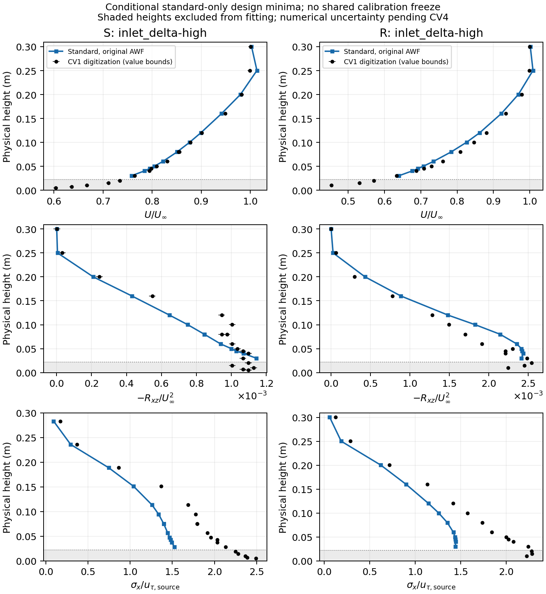
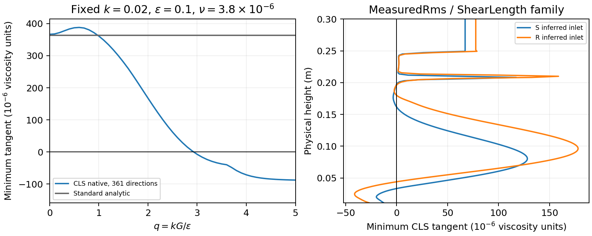

# CV3 bounded calibration attempt: development gate unmet

## Material Passport

- Origin Skill: academic-research-suite / experiment-agent
- Origin Mode: computational experiment execution and reproducibility audit
- Origin Date: 2026-11-01
- Verification Status: implementation checks pass; CV3 remains INCOMPLETE
- Version Label: cao-tamura-cv3-attempt-v1

## Outcome

**CV3 is not closed.** The declared 32-case empty-floor design concluded with
13 developed standard k–epsilon cases and no eligible high-Re CLS case.
There is no shared S/R parameter selection, versioned calibration freeze or
developed ten-case wall-policy transfer. Reserved Fig.3d and hill scores were
not used. The [plan's closure gate](cao-tamura-calibrated-validation.md) remains
unchanged; completing software or accepting short positive runs does not meet it.

The [machine-readable record](cao-tamura-validation-evidence/cv3-attempt/attempt.json),
[complete design table](cao-tamura-validation-evidence/cv3-attempt/design.csv) and
[numerical preflight table](cao-tamura-validation-evidence/cv3-attempt/preflight.csv)
retain successful and rejected attempts. Large native meshes, fields, complete
history, point diagnostics, command receipts and logs remain under
`/media/jay/新加卷/nektar-v2026-runs/cao-tamura-calibrated-validation` on Linux.
The [protocol and its amendments](cao-tamura-cv3-calibration-protocol.md) record
the design, fixed objective scales, development criteria and numerical controls.

This result demonstrates failure of the tested numerical recipes to supply
the required CLS precursors. It does **not** establish global nonexistence of
a canonical CLS solution, experimental model accuracy, mesh convergence or
the cause of every rejected nonlinear stage.

## Implementation delivered

`cao_tamura_calibration.py` extends the CV2 workflow with a bounded coordinate
design, common physical inlet parameters, five flat-data objective families,
native development with full-history continuation, pointwise relative scalar
drift checks, independent strip inventories, selection and guarded immutable
freezing. At least 3 unforced flow-through times and two successive 1TF drift
passes are required. Native weak/free residuals, positivity, resolved mass,
projected normal flow and independent strip continuity retain their gates.
The reconstructed BDF2 strip momentum balance is checked against the native
point flux residual; the latter need not vanish pointwise in continuous
Galerkin discretization and is reported separately.

`cao_tamura_campaign.py` binds source/binary/geometry hashes and a numerical
recipe to a new run directory. Each serial case has its own explicitly pinned
CPU; one separate CPU is reserved for the controller. An interrupted or changed
recipe cannot silently resume over an existing attempt. Run-start receipts
survive solver failures/timeouts, and repeated environment setup does not grow
`LD_LIBRARY_PATH` without bound.

The inferred inlet families include measured-longitudinal-rms-based k,
positive finite-depth turbulence blending and shear/outer-length dissipation.
These are bounded assumptions on unmeasured k/spanwise variance/epsilon, not
new measurements. A near-wall shear collar preserves the permitted mean fit
above N. Outer inputs at and above N are common across closures; required
policy-specific H..N epsilon collars are explicit. Smooth ks stays exactly
zero; rough ks, observational d and source z0 remain separate quantities.

Two specific defects were corrected:

- Experimental initialization prepared the selected wall policy's epsilon
  collar but retained a different floor Dirichlet initializer. The floor now
  uses `EpsilonWall`. In the rough common-k original CLS control the old
  initializer produced a 0.0043467 epsilon jump before evolution; the corrected
  initial hold gives a first-map epsilon change about 3.2e-12. Pre-fix pilots
  remain excluded.
- The continuity audit used an unused boundary-sign array for pressure maps
  without sign changes, including Q1. It now follows native conditional sign
  handling. Open-boundary Q1/Q2 hold checks pass.

Optional numerical controls are documented in the solver guides. Their
defaults preserve the previous partition and operator:

- `RANSMatrixFreeTolerance` separates the current-operator target from the
  cached native inverse/preconditioner tolerance.
- `RANSAdvectionTreatment=Implicit` puts convection of every transported
  variable in the coupled stage. The AWF inertial predictor includes the same
  current convection, including k; auxiliary forcing still uses current
  physical convection. Native IMEX1/2 inertia/history remain in use.
- Nonnegative `RANSGradDiv` adds the full vector
  gamma*(div U,div v) weak term, its independent audit and matching
  preconditioning. Its continuum incompressible contribution is zero;
  finite-mesh effects still need CV4 assessment.
- `RANSStartupDuration` optionally fades a fixed initial weak residual to
  zero on an experimental plane. It is disabled in the declared design.
  Mid-warmup restart is unsupported; post-warmup history is checked.
- Newton permits signed finite **linear preconditioner images**, while all
  closure inputs and accepted timesteps still require positive k/epsilon.
  Those images are counted separately; no accepted physical field is clipped
  or floored. This correction did not rescue the controlled rejected cases.

IMEX3 was investigated and rejected as an unsupported diagnostic. It is not
enabled by the delivered solver. Integrated AWF strip continuity and canonical
closure, Yap and smooth-wall coefficients are retained throughout.

## Bounded design and conditional standard results

Primary cases retain resolved molecular diffusion. Analysis scaling uses the
source Re_H with nominal U(Hh)=1; U_inf is 1.2602221090 for S and 1.4562340769
for R. This is a Reynolds-matched analysis scale, not a measured airspeed.
The common inlet references are Q_in=10/3 and kappa_in=sqrt(0.48*1.3/Q_in).
Each closure keeps its own constitutive coefficients and reference constants.

The first full design uses Q3/Q2, five GLL points, streamwise columns
[-1,0,1.2]m, six outer layers plus three blend cells, dt=0.05, implicit
advection and gamma=0.01 in the declared analysis units. H/P/N are
11/5.5/22 mm, the ceiling is 0.8m, and the selected inference family is
MeasuredRms/ShearLength. Original AWF is the calibration policy. The recipe
and every physical input are bound in the evidence. This coarse provisional
discretization is not a CV4 convergence result.

All seven S standard cases developed. Six of nine R standard cases developed;
the low-thickness, low-epsilon and high-k R standard cases were rejected.
None of the sixteen CLS cases qualified. Some reached the first 3TF checkpoint
but failed continuation; the S high-k case instead failed the positive
incident-traction audit. None can enter common selection.

For information only, the standard-only design minimum for **both** surfaces
is the high-thickness axis point: inlet delta=0.25m, k/epsilon multipliers one,
ks=0 for S and 0.004m for R. These conditional minima are at the tested bound;
they are neither identified interior/global optima nor frozen calibrations.

| Standard-only quantity | S | R |
|---|---:|---:|
| Five-family design objective J | 4.77251 | 1.72708 |
| Fit-band U RMSE/U_inf | 0.007694 | 0.015161 |
| Native u_tau / reported u_tau | 1.16135 | 0.96748 |
| delta99 (m) | 0.210951 | 0.221921 |
| delta95 (m) | 0.168648 | 0.183313 |
| Actual incident Re_H | 11847.94 | 10322.54 |
| Incident sigma_u/U_H | 0.062655 | 0.109081 |
| Source incident sigma_u/U_H | 0.0893 | 0.151 |
| Final elapsed domain flow times | 9.022 | 9.168 |

Small native drift does not remove these residuals. In particular the smooth
friction error is +16.1%, the approximate source thickness is 0.25m without a
specified edge criterion, and the incident intensities are underpredicted.
There is no global/irreducible-misfit claim from this limited design. The
reported Re_H residuals are retained rather than normalized away.



Scores use the frozen height weights and the common z>=22mm fitting band,
without renormalizing weights to that band. Below-interface stress/rms gaps,
excluded points and available auxiliary mean values remain explicit in
objective receipts. The profile figure shows the fit band and digitization
value bounds; those bounds are not experimental confidence intervals.
Rough observational d=2.5/3.5/4.5mm scenarios are retained for developed
standard cases without moving the wall or changing Yap distance. The k and
epsilon axis probes bound input assumptions; they do not determine unique
unmeasured variances or statistical parameter confidence regions. Final shared
calibration uncertainty remains unfinished.

## Numerical controls and constitutive diagnostic

Later controls use the delivered Newton-domain correction where indicated.
All times below are the last accepted native timestep in a subsequently
rejected run, not an accepted developed precursor:

| Control | S CLS | R CLS |
|---|---:|---:|
| Eight GLL points, fixed Q3/Q2 and mesh | 5.40 (epsilon multiplier 0.5) | 3.50 (centre) |
| Backward Euler, implicit advection, dt=0.01 | 4.91 (centre) | 4.64 (centre) |
| gamma=0.1, original five-point mesh | 5.20 (epsilon multiplier 0.5) | 5.15 (centre) |
| Four streamwise columns, ten outer layers, eight GLL points | Not run | 1.50 (centre, four MPI ranks) |

The eight-point R high-k standard control also rejected after t=1.40; the
five-point Newton-domain control rejected after t=1.35. The R centre CLS
Newton-domain control rejected after t=4.60. These are coupled Newton
line-search rejections, with no physical floor or weakened gate. The
smaller-step backward-Euler diagnostics used the archived pre-domain-correction
binary; the table/receipts distinguish binaries and time methods. Neither
aliasing nor BDF2 alone is established as the cause. One refinement is not a
convergence study, and failed attempts do not identify a viable production mesh.

Two additional full-development controls target the old image-guard failures
directly. Rough ks-high advanced from its previous t=1.45 stop through t=3.15,
recording signed finite linear images while accepted k/epsilon remained
positive; it then failed. Smooth k-low failed its first continuation after
t=6.40. Neither qualified. A separate 35-step rough ks-high regression through
the old stopping point verifies the corrected image domain, accepted-state
positivity and full weak/mass/strip budgets. This short passing check is a
software regression, not a developed precursor. The additional target receipts
are separate from the unchanged first 32-case design.

In that short regression the largest signed-image count is 16 per timestep,
while minimum accepted k/epsilon are 2.40e-5/3.21e-7. Maximum weak divergence
is 8.73e-9, the free stage residual is 9.34e-10 and the resolved mass defect
is 1.56e-9. The strong pointwise normal mismatch reaches 0.00492; its
convergence is not established by the small projected residual.

`RANSStressTangentAudit` evaluates the full native deviatoric momentum stress
T=nu_eff*(g+g^T)-R_quadratic-R_cubic. For fixed positive k/epsilon and
parallel g_xz=G, perturb g by h*a*n with n=(cos theta,sin theta) and
a=(-sin theta,cos theta). The transverse principal coefficient is
lambda=a_i*n_j*dT_ij/dh. An independent 2D reduction gives, with
q=kG/epsilon, x=cos(2theta), y=sin(2theta), C=Cmu(q),

```text
lambda = nu + (k^2/epsilon) * [
  C*(1-q*y/5) + D*(q*x+q^2*y/5) + 20*C^3*q^2*x*(1+x)]
D_positive = C'(q)*x;  D_negative = -C'(q).
```

The two derivatives retain the physical max(S,Omega) branch. This follows
because S^2 is a scalar matrix in the trace-free x-z block, its commutator
vanishes, and isotropic terms vanish in a*n contraction. The standard model
has the independent constant oracle lambda=nu+0.09*k^2/epsilon.
`validate_rans_stress_tangent.py` compares minima over 361 directions and
both perturbation signs at two finite-difference sizes with these formulas.
Maximum errors scaled by nu+nu_t are 2.36e-10 for standard and 6.12e-7 for
CLS. With k=0.02, epsilon=0.1 and retained nu=3.8e-6, the minimum changes
sign between q=2.9 and q=3.0. The prescribed revised S/R inlet families also
contain negative sampled coefficients. These are local constitutive findings,
not a global nonlinear instability proof or a demonstrated attribution of
the full-flow failures.



## Verification and reproduction

Authoritative builds/solves use the isolated Linux source and Release MPI
build, preserving the unrelated main HIT checkout, build and installation.
Source parent is `b974ac37cf53bfa481f1976ab9dbeefbd1675f6a` plus the exact
source hashes in the evidence. The first bounded-design binary is
`296f8ea629bf58ac9b6c0b89cdad52777aaed1840bf6793be5caa4c4d7703ec4`.
The final delivered solver binary is
`39438f0ebdd9d741575d3aad151a716cf600011a45e00e8d4deb061ac798c236`.
The record distinguishes these builds; the full design is not mislabelled
as a run of the later binary. All later field/kernel checks identify their
actual binaries and native command receipts.

The final Linux regression suite passes all 13 registered CTests. Additional
native checks pass ten model/surface inlet preparations, analytic-expression
and positive projection checks, Q1/Q2 initial residual controls, startup fade,
post-startup 1-to-4-rank history and rejection of mid-warmup restart. Standard
and CLS implicit-transport manufactured solutions recover second order;
prefix lengths 1/2/5 followed by four-rank continuation meet the 1e-6
full-field gate. Separate gamma=0/0.005/0.01/0.02 neutral controls retain
equilibrium. These checks verify the implementation within their stated
limits, not developed CLS experimental readiness.

Project concurrency never exceeds 16 CPU workers. Compilation is explicitly
bounded; final builds use four workers and CTest two. Numerical checks use
1 or 4 MPI ranks and one thread per rank. The design uses twelve serial case
CPUs plus one controller. The shared server's unrelated 48-rank HIT job is
left untouched. Project CPUs are explicitly drawn from 1–15 and 64, with
OMP/OPENBLAS/MKL/BLIS thread counts one. Tests and temporary files stay on the
large Linux volume.

Representative commands, with B set to the run root and SRC to its source:

```bash
B=/media/jay/新加卷/nektar-v2026-runs/cao-tamura-calibrated-validation
SRC="$B/source"
source /home/jay/.local/opt/nektar-v2026-mpi/env.sh
export OMP_NUM_THREADS=1 OPENBLAS_NUM_THREADS=1 MKL_NUM_THREADS=1 BLIS_NUM_THREADS=1
export TMPDIR="$B/tmp" LD_LIBRARY_PATH="$B/build/geometry-lib:$LD_LIBRARY_PATH"
taskset -c 1-4 cmake --build "$B/build" --target IncNavierStokesSolver --parallel 4
taskset -c 1,2 ctest --test-dir "$B/build" --parallel 2 --output-on-failure
RANS="$SRC/solvers/IncNavierStokesSolver/Tests/RANS"
taskset -c 1-4 python3 "$RANS/validate_rans_implicit_advection.py" \
  --build "$B/build-cv3-newton-domain" --output "$B/calibration/cv3/new-order-check" --cpus 1,2,3,4
taskset -c 9 python3 "$RANS/validate_rans_stress_tangent.py" \
  --audit "$B/build/RANSStressTangentAudit" --output "$B/calibration/cv3/new-tangent-check"
taskset -c 15 python3 "$RANS/record_cao_tamura_cv3.py" \
  --campaign "$B/calibration/cv3/design-v1" --run-root "$B" \
  --build "$B/build-cv3-newton-domain" --output "$B/calibration/cv3/new-attempt-record"
```

Run independent commands only within a combined allocation <=16; the examples
are not instructions to overlap all of them. `cao_tamura_campaign.py --help`
and `cao_tamura_calibration.py --help` expose design/develop/select/assess/freeze
entry points. Use a fresh campaign directory after any recipe/binary/source
change; preserve original cases and their producing XML for native observation.

## Remaining gate

Establish a numerically admissible, unforced developed CLS precursor for both
surfaces before completing a common search. Then develop and audit all ten
wall-policy transfers, publish common/conditional sensitivity and residuals,
freeze versioned S/R manifests, and perform the reserved flat crosschecks.
Any remedy must distinguish a solver/discretization correction from a new
physical regularization or closure variant. No such variant is silently
introduced here. CV4–CV8 retain their dependencies and remain planned.
