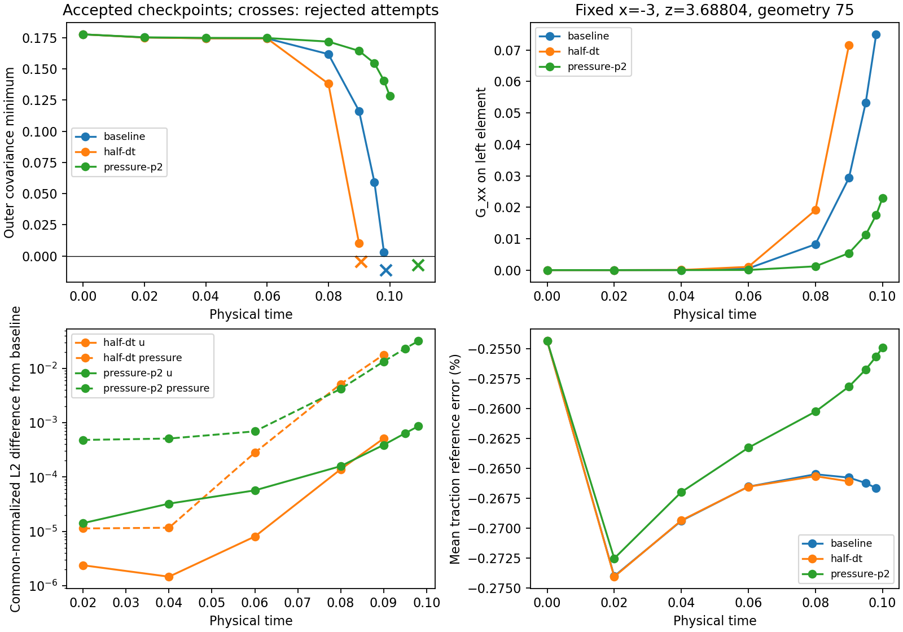
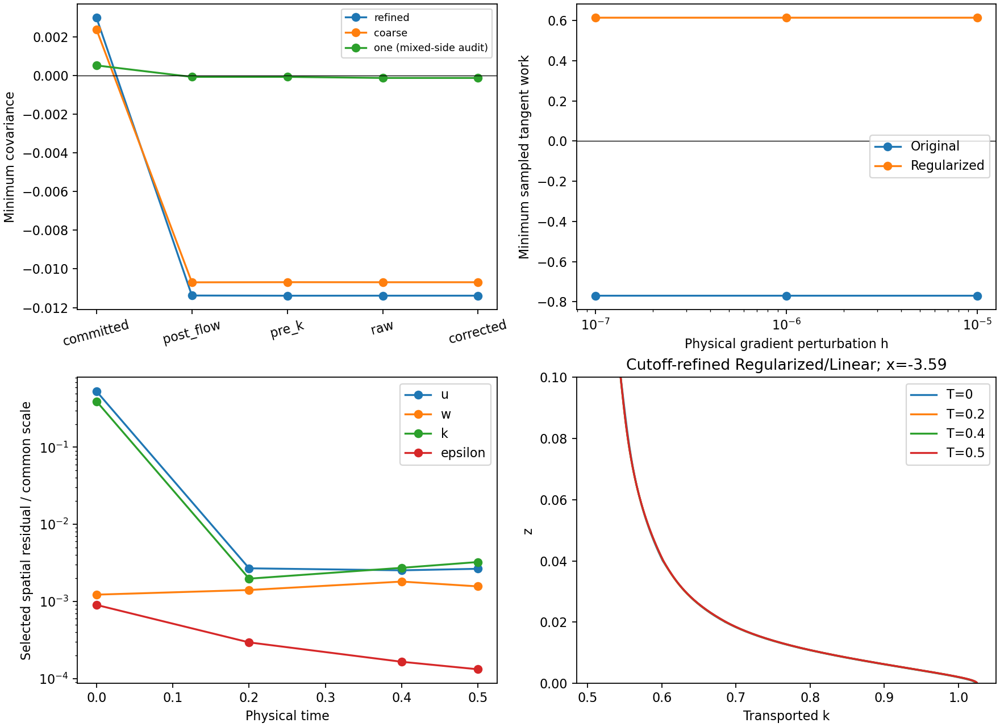

# Calibrated budget AWF: covariance stages and controlled continuation

See the [NativeElementSideV2 update](#native-element-side-v2-update) for the
corrected interpretation of interface witnesses. The original bulk failures
and archived V1 receipts below remain preserved.

2026-11-09, Asia/Shanghai. Work remains on
`codex/cls-epawf-pimple-one-sweep`. The inspected Mac and fetched remote base was
`310ebe427f575f74c9ef1ea240ad5afa1acc45f7`; no branch reset, checkpoint migration,
or change to a running numerical configuration occurred. The implementation is
`d8f1ff1838c6c89f38bc26938a8d5dd6c4ce2730`. Compact receipts and the final dated
frontiers are in [native.json](cls-accepted-budget-awf-evidence/covariance/native.json).

## Method and diagnostic contract

All new physical controls retain `CLSCalibratedBudgetAWF`, H=z_K=z_m=2,
endpoint K=k(H), h=.1, nu=1.5e-5, u_star=.4, calibrated coefficients and cutoff,
represented production and signed inner source P_h-E_C. There is no prescribed
redistribution, E_C/k reaction, residual-cancelling forcing, extra relaxation,
or inner-epsilon equation. Molecular diffusion remains inside and is absent
from the selected high-Re outer equations. Original/Linear and the existing
Regularized/Linear or Regularized/Saturated companions remain distinct.

Original uses cubic beta=1 and gamma=0. The existing Regularized companion
uses beta=.4, gamma_0=0 and scale=1, giving gamma(z)=kappa*u_star*z with the
incoming analytical neutral reference strain. SaturatedR2, where named,
retains its existing inner rho=.8 law; it is not an inner destruction cap.

Production still performs one vector momentum prediction, one pressure/gauge
solve and algebraic correction, one outer-epsilon solve, one k solve and one
logical final bound call. Internal mass/constraint work is separate. The
native IMEX1 histories and solved epsilon trace are retained; refreshed matching
is a diagnostic. The floor, arithmetic reserve, consistent-mass objective,
inventory, projection limits and numerical hard checks are unchanged.

`RANSWallResolutionProbe` now provides an explicit `archived_stages` operation.
The ordinary strict spatial operation still requires exactly the committed
checkpoint state. The new operation binds the native checkpoint bytes and
signature, differential state, every GLM slot and time label, attempted packet,
five stage hashes, callback history, time/alpha, reference, external coefficients
and frozen transport-matrix hash. It restores the saved reference without Lift.
A local integrator callback capture aborts before any governing solve and
verifies bitwise rollback, including signed zeros. Each saved stage is evaluated
as retained, without correction, projection, field transfer or history commit.

The output distinguishes refreshed same-stage constitutive diagnostics from
the frozen coefficients used by an earlier assembly. It records full tensors,
spectra, critical eigenvectors, term contractions, scalar/budget checks and
epsilon-trace context. Identified one-sided element gradients remain separate.
The independent NumPy oracle contracts the exported native coefficient rows
and reconstructs the tensor and spectrum independently.
The committed vector retains its checkpoint time label; these stage tensors
use the recorded attempted-time evaluation context, as the frozen assembly
does. External data are fixed and unforced in these cases, so this introduces
no time-dependent boundary substitution.

## Faithful failure mechanism

| Saved stage | Refined H2 Original outer minimum | Coarse H2 Original outer minimum |
|---|---:|---:|
| Committed | +.00299220753 | +.00238392277 |
| Post flow | -.01137612394 | -.01069306337 |
| Pre k, after epsilon | -.01138577938 | -.01068589928 |
| Raw k | -.01138394022 | -.01068847809 |
| Corrected | -.01138394022 | -.01068847809 |

The refined case accepts 157 steps/T=.098125 and rejects attempt 158/T=.09875.
Its witness is x=-3, z=3.68804330858, geometry 75: the **left** element on the
internal tangential face, in the upper outer panel [11/3,4]. The coarse case
accepts 120/T=.075 and rejects 121/T=.075625 at x=-3,z=3.73471663643, geometry 56,
on the **right** side. These are not prescribed side-boundary degrees of freedom.
Both first become negative immediately after U/p. The k and epsilon coefficient
hashes are exactly unchanged across that stage. Bounding is inactive.

At the refined final witness, committed to post-flow values are:

| Quantity | Committed | Post flow |
|---|---:|---:|
| k | .510442713575819 | identical |
| epsilon | .039364352609579 | identical |
| G_xx | .07500941370 | .07998387205 |
| G_xz | .23576057433 | .23322182036 |
| G_zx | -.01576226565 | -.01708995370 |
| G_zz | .00038913012 | .00059248869 |
| Divergence | .07539854382 | .08057636073 |
| Same-state Regularized covariance minimum | .06467531314 | .05615398432 |

Along the post-flow Original critical eigenvector, isotropic, linear,
quadratic and cubic contributions are respectively +.34029514238,
-.12790015699, -.06932435570 and -.15444675363. The cubic contribution has
the largest adverse change. Later epsilon and k solves change the eigenvalue
much less than the flow update.

A native-verified pointwise hybrid-gradient experiment holds k/epsilon fixed.
Replacing only G_xx by its post-flow value gives lambda_min=-.01679529919;
replacing both diagonal entries gives -.01727118877. Replacing both shear
entries instead gives +.00880088239. These nonlinear local counterfactuals
are not additive eigenvalue contributions or realizable coupled solutions.
They isolate the importance of normal strain. The neighboring outer element
at the same refined coordinate remains positive (about .22475). Averaging
the two gradients would conceal the mechanism.

The full 721-angle x-z incompressible rank-one frozen-k/epsilon tangent scan
uses both physical perturbation signs and h=1e-5,1e-6,1e-7, recomputing the
actual max(strain,rotation) branch. Independent tensor/directional-work
reconstruction agrees. Original minimum work at the refined committed and
post-flow witnesses tends to -.7288353 and -.7696050; existing Regularized
gives +.6204541 and +.6143206 on the same fields. Even the analytical neutral
Original state has a negative sampled direction (-.0439625), despite positive
covariance. Covariance is therefore not used as an ellipticity test. The
negative directional work is a separate concrete frozen principal-part
finding, not proof of the mechanism or spectrum of the complete coupled
discrete evolution. Positive finite scans do not prove all-direction stability.

### One-element companion: a distinct interface-audit issue

The Regularized/Saturated H=.5 one-element case accepts 161/T=.100625 and
rejects 162/T=.10125. Its native outer minimum is +.00052388419 committed,
-.00006995861 post-flow and -.00012415558 after k. At x=1,z=H, the native
`physical_sampled_K` inventory supplies an **inner-element** gradient while
the side-zero classification selects the **outer** constitutive law. The new
diagnostic records this mismatch explicitly. The actual outer one-sided
elements remain positive there (approximately .2355 and .2670); their shear
is about 1.2338 versus about 3.96 from the inner element.

Thus this reported interface exit is not evidence of a negative covariance
using the actual outer one-sided gradient at that coordinate. No production
gate is relaxed or changed here, and the failed campaign remains terminal.
A separately validated side-consistent audit change is appropriate follow-up.
This does not explain the faithful bulk failures, and it does not rescue the
ordinary one-cubic representation's large reference/traction errors.

## Failure-horizon controls

Both controls use fresh native initialization, valid own histories and the
unchanged frozen production solver. The half-dt h0 is bitwise identical to
the archived refined baseline (hash
`176dd38e7136e0341926cb7ee7302041fad27c8f983764504ed586cb2940d8d4`).
The outer-pressure control has identical physical h0 on the common rule.

The witness-driven spatial control changes **only outer pressure degree**
from one to two. Inner pressure remains linear; velocity/k/epsilon remain
cubic. Cutoff-v1 inner and outer meshes, quadrature, physics, dt=.000625 and
boundary data remain unchanged. The new regional pressure expansions belong
to both declared DOMAIN composites. Actual field sizes are
[784,784,784,304,66,143], total 2866 including gauge, below the 3000 pilot limit.
The baseline is 2765, with 42 outer-pressure coefficients. This tests weak
continuity/normal-strain sensitivity rather than changing the wall profile.

The fixed horizons are .12 or the first hard rejection. Both tests terminate
on the existing outer-covariance check:

| Faithful cutoff-v1 control | dt | Last accepted | Rejected attempt | Outer minimum | Bound activations |
|---|---:|---:|---:|---:|---:|
| Archived baseline | .000625 | 157 / .098125 | 158 / .09875 | -.01138394022 | 0 |
| Half timestep | .0003125 | 289 / .0903125 | 290 / .090625 | -.00487434613 | 0 |
| Outer pressure p2 | .000625 | 174 / .10875 | 175 / .109375 | -.00737938650 | 0 |

The half-dt exit is 8.2% earlier, not a negligible shift or a survival
improvement. It rules out a simple remedy by halving dt but does not establish
a converged exit time. These two levels do not prove a continuum constitutive
failure or that the one-sweep update is irrelevant. Another dt level is not
needed to choose the presently admissible continuation; precise exit-time
convergence remains unresolved.

Half-dt also first crosses after U/p: committed/post-flow/pre-k/raw minima
are +.00267947361,-.00487047103,-.00487516513,-.00487434613 at
x=-3,z=3.70833333333, left geometry 75. k/epsilon coefficients are unchanged
through flow; witness divergence rises .07412380 to .07680664. Its raw k linear
residual is 3.44e-19. The numerical failure is a covariance exit, with positive
inner covariance, scalars and budget, not a linear-solver or positivity failure.

The outer-pressure control accepts 174/T=.10875 and rejects 175/T=.109375,
outer eigenvalue -.00737938650 at x=-3,z=3.73471663643, left geometry 75.
Committed/post-flow/pre-k/raw minima are respectively +.00657607067,
-.00737225089,-.00737909473,-.00737938650. k/epsilon are again bitwise unchanged
across flow. Divergence at the witness increases .07149457 to .07641192.
The same bulk mechanism therefore persists after a 10.8% delay in exit time.
All four governing solves and the inactive final bound complete; frozen k
linear residual is 7.59e-19. Natural state/time/history rollback is exact.
This establishes outer-representation sensitivity without establishing a
repair or a continuum constitutive failure. The test is terminal, not retried.

Common-time native covariance minima make the late sensitivity visible:

| T | Baseline | Half-dt | Outer pressure p2 |
|---:|---:|---:|---:|
| .02 | .17521109 | .17518887 | .17537118 |
| .06 | .17443599 | .17444653 | .17479737 |
| .08 | .16187882 | .13816080 | .17192542 |
| .09 | .11630281 | .00998072 | .16449078 |
| .095 | .05930583 | rejected earlier | .15461186 |
| .098125 | .00299221 | rejected earlier | .14063645 |

These minima use each case's declared native inventory. The accompanying
fixed-point plot compares identical physical coordinates and one-sided
gradients, independently of which point currently minimizes the audit.
At T=.09, dimensional L2 differences from baseline are:

| Control | U_x | W | k | Outer epsilon | Common-gauge pressure |
|---|---:|---:|---:|---:|---:|
| Half-dt | .00100222 | .000227952 | 2.22571e-5 | 3.71829e-6 | .01401226 |
| Outer pressure p2 | .000762572 | .000150451 | 5.43258e-5 | 9.54959e-6 | .01046912 |

All fields use common augmented physical panels, not coefficient differences.
Mean traction at .09 is .15957476,.15957425,.15958691 respectively: a small
change in this engineering output does not reveal the severe local covariance
loss. The results show sensitivity to both updates and representation, not
demonstrated temporal convergence. No unchanged rejected step is retried.

At .09, the dimensional alpha=0 [U_x,W,k,epsilon] free-row residual norms are
[.107596,.0215064,.00272545,.000522333] for baseline,
[.225312,.0553968,.00540351,.000927762] for half-dt, and
[.0333089,.00584559,.00230528,.000292214] for pressure p2. Refreshed epsilon
matching defects are respectively 1.11e-6,6.86e-7,1.67e-7. The scalar, budget,
boundary and algebraic continuity/gauge checks remain satisfied up to each
accepted frontier. None of these successful linear/constraint checks proves
that the refreshed Reynolds tensor remains admissible.



## Selected versus Original operators and continuing Regularized evolution

Strict accepted-checkpoint readbacks at T=0,.2,.4,.5 retain actual native
fields, reference and all histories. Alpha=0 selected loads agree with the
native full residual to the recorded tolerance. The same-state Original
counterfactual recomputes momentum stress, k production and epsilon production
consistently; unaffected terms and continuity/gauge loads are identical.
Original-on-Original is an exact no-op. Full free-row vectors stay on Linux.

| T | Selected dimensional U residual | k residual | epsilon residual | Same-state Original U residual | Original epsilon residual |
|---:|---:|---:|---:|---:|---:|
| 0 | .2084625 | .1973569 | 4.53688e-5 | .2084386 | 4.47078e-5 |
| .2 | .00105422 | .000987569 | 1.48169e-5 | .00216363 | 1.25248e-5 |
| .4 | .000992821 | .00136577 | 8.30255e-6 | .00223543 | 1.16204e-5 |
| .5 | .00103937 | .00162405 | 6.63261e-6 | .00228760 | 1.16051e-5 |

These are physical consistent-mass dual norms of free-row rates, with each
block's dimensional units. At T=.5, the dimensional selected-minus-Original
norms [U,W,k,epsilon] are [.00203691,.000840143,.0000606397,.0000110370].
The model modification is measurable even though both sampled covariance
inventories are positive on these retained Regularized fields. This is not
an evolving Original restart or a claim that its equations have been solved.
Legacy `refreshed_original_block_norms` names continue to mean the **selected
uncancelled** operator; explicit Original counterfactuals are labelled separately.

The actual physical M_ff is exported through `PicardKMass`, with essential
rows removed. Independent component mass solves reproduce the native k norm
within 4.4e-19. At T=.5, advection, diffusion, inner-production and inner-EC
load norms are .0016520,1.8005654,4.7648007,4.0899068; outer-production and
destruction norms are .1739977 and .1740838. These positive norms do not retain
load signs. Production loads are negative in residual convention, EC is
counted once, and all physical component vectors sum to the spatial load.
Auxiliary E/-C diagnostics are excluded. A frozen transport A_k is never used
as the mass metric.

Similar component norms do not establish a single cause: removing the
advective load at T=.5 still leaves a .00140566 mass-dual k residual, and its
dual-metric correlation with the complete residual is .631916. Source,
diffusion and transport remain coupled in this late drift.

At T=.5, mean traction is .15957613 versus .16, matching defect is
6.07e-9, and selected inner/outer covariance minima are .17278092/.17516167.
Strong full-traction and k-flux jump RMS are .00250834 and .000183312;
inner/outer divergence L2 are .00274489/.000152064. They are distinct from
roundoff-level algebraic continuity/gauge. Integrated inner production and EC
rates are 5.15114751 and 5.15058645, with zero redistribution. Outer same-state
regularization production/work change is -.0001012652, consistent to roundoff.
These are instantaneous rates, not integrated window amounts.

The [predeclared criteria](cls-accepted-budget-awf-evidence/covariance/convergence-policy.json)
use fixed primary windows DeltaT=.5, three consecutive windows, and secondary
.1/.2 windows. Ustar=.4, K0=.510508, H=2, volume=24 and outer volume=12 define
common norms. Window field thresholds are 1e-4 for U/W/k and 1e-3 for epsilon/
pressure; each normalized spatial block must be below 1e-3 for a steady claim.
These stringent exploratory drift screens are below the demonstrated native
reference error, not a continuum accuracy certificate or acceptance gate.

On augmented common physical panels, h0 to T=.5 normalized changes are
[U,W,k,epsilon,p]=[8.0870e-4,1.2222e-4,2.0096e-4,1.5860e-5,1.7780e-3].
At .5, normalized selected residuals are
[.0026520,.0015675,.0032468,.0001318]. The k residual is growing relative to
T=.2. Adjacent .1-window normalized k changes increase approximately
3.92e-5,4.03e-5,4.85e-5,5.92e-5 through .5. No correction has activated:
signed, positive, negative and absolute bound supply are all exactly zero.
This is **continuing transient evolution**, not an Original or selected steady
solution, a bounded fixed point, or established statistical stationarity.

The .5 window is only .1 H/u_star and .426 initial bulk flow-through times
(H/u_star=5; flow-through time=1.17455). Three primary windows are not yet
available in the analyzed data. The observer retains sampled time-weighted
means/fluctuations, fixed physical bands and trapezoidal source amounts, while
exact discrete correction sums remain separate. Its frozen production-report
quadrature is labelled; quantitative checkpoint tables use the union panels
including .0025,.005,.02,.04. Future settling must pass the same window and
residual tests, including sensitivity to window length.

Fixed physical k integrals (per unit span) show the small but nonzero drift:

| State | z<=.01 | z<=.1 | Wall layer [0,2] | Global [0,4] |
|---|---:|---:|---:|---:|
| Actual native h0 | .055602779 | .379678224 | 6.232204338 | 12.358300495 |
| T=.2 | .055613759 | .379658863 | 6.232298744 | 12.358355497 |
| T=.4 | .055618276 | .379682804 | 6.232382150 | 12.358414333 |
| T=.5 | .055619226 | .379695870 | 6.232421884 | 12.358446307 |

The first element ends at .0025 and is reported separately. These partial-band
integrals split physical panels at their edges; they are not point masks or
an assertion of an exactly conservative local CG control-volume balance.



## Validation, provenance and reproduction

Linux is authoritative. Tests passed: projection QP, native history rejection,
case definitions, preserved tangent oracle; observer signed/rate accounting,
idempotence, physical-window statistics; existing analysis adapter and handoff;
45 independent archived coefficient/tensor witnesses; eight corrupt-input
rejections; exact native restart and forced-rejection rollback; incompatible
coefficient/sampler/tail/mesh/model rejection. The new solver's two-step state
and native histories match the prior production validation bitwise. All new
readbacks have zero governing solves, zero physical commits and zero Lift.

Define Linux roots:

```bash
O=/media/jay/新加卷/nektar-v2026-runs/cls-accepted-budget-awf-20261108
R=/media/jay/新加卷/nektar-v2026-runs/cls-accepted-awf-covariance-20261108
source /home/jay/.local/opt/nektar-v2026-mpi/env.sh
export OMP_NUM_THREADS=1 OPENBLAS_NUM_THREADS=1 MKL_NUM_THREADS=1
export BLIS_NUM_THREADS=1 NUMEXPR_NUM_THREADS=1 VECLIB_MAXIMUM_THREADS=1
P="$R/source/solvers/IncNavierStokesSolver/Tests/RANS"
```

The production solver remains O/runtime-v4, SHA256
`db73039aad11327b9ea4deefa5da890b73041eef8d0aa4eb4cfb7e8a6ba1534b`.
R/runtime-v4 is a **separate** frozen diagnostic/validation closure, not a
replacement. Source content hashes bind it to d8f1ff1; its actual isolated
worktree still records the 310ebe4 base plus synchronized changes. Launch-time
controller hashes, XML, actual h0 and native history identities are retained;
none is relabelled as a later checkout. Complete executable/library identities,
commands, checkpoint hashes and heavy-artifact paths are indexed in
[artifact-index.json](cls-accepted-budget-awf-evidence/covariance/artifact-index.json).

The new probe SHA256 is
`1b8723d11af631ebbf57dd5632f3a5c14246d863e7611d9fe5d88d991acfd7a5`;
the separate validation solver is
`b507a0dc25f16ea118b8f54d7d91fbe5cb8ccd899469870c7802ffa0c0111a49`.
Production continues to use the unchanged db73039a image. SSH used the
documented Tailscale fallback after `linux-usb` timed out.

```bash
python3 -B "$P/diagnose_cls_accepted_covariance.py" \
  --probe "$R/runtime-v4/probe/RANSWallResolutionProbe" \
  --old-root "$O" --output "$R/replay-new" --contract-tests
python3 -B "$P/read_cls_accepted_operators.py" \
  --probe "$R/runtime-v4/probe/RANSWallResolutionProbe" \
  --old-root "$O" --output "$R/operators-new"
python3 -B "$P/launch_cls_accepted_failure_control.py" --kind half-dt \
  --solver "$O/runtime-v4/solver/IncNavierStokesSolver" \
  --solver-sha256 db73039aad11327b9ea4deefa5da890b73041eef8d0aa4eb4cfb7e8a6ba1534b \
  --output "$R/half-dt-reproduction" --reason 'fresh faithful half-dt failure-horizon control'
# Spatial control: same command, --kind pressure-p2-v1 and a new output path.
```

New builds use the isolated external R/build, Release, `-fno-fast-math
-ffp-contract=off -D_GLIBCXX_ASSERTIONS`, explicit parallelism four. Numerical
pilots are one MPI rank and one computational thread. Shared installation,
active runtimes and unrelated experiments were preserved; total workers remain
below 72. Quiet filesystem waits are distinguished from numerical rejection.
No terminal numerical failure is retried unchanged.

The prior large synthetic-depletion projection stress test remains a failure
(2000 separation passes, 776.67 seconds; see the preceding main report).
It limits demonstrated correction robustness but has not blocked these
uncorrected physical trajectories. Full curved coupled evolution also remains
outside this serial flat pilot. Neither limitation is concealed by survival
or by the new read-only diagnostics.

## Dated continuation status

Verified snapshot: **2026-11-09 01:10:25 Asia/Shanghai**. These are accepted frontiers, not
future completion claims. All six driver/supervisor identities match; frozen
executables and all 37 linked-library hashes per campaign were reverified.

| Campaign | Accepted steps | Accepted T | Status | Next automatic T | Recent s/accepted step | Conditional hours to next target |
|---|---:|---:|---|---:|---:|---:|
| Budget H2 cutoff-v1 Regularized/Linear | 1082 | 0.67625 | running | 1 | 19.15 | 2.76 |
| Budget H=.5 graded Regularized/Linear | 1643 | 1.026875 | running | 2 | 14.79 | 6.40 |
| Budget H=.5 graded Regularized/SaturatedR2 | 1536 | 0.96 | running | 1 | 15.12 | 0.27 |
| Legacy Upstream H=.5 one | 3406 | 2.12875 | running | 5 | 29.85 | 38.09 |
| Legacy Uniform G | 3811 | 2.381875 | running | 5 | 34.19 | 39.78 |
| Legacy Uniform H | 4876 | 3.0475 | running | 5 | 26.54 | 23.03 |

The promising H2 case completed T=.5 and continues toward 1,2,5. Its observed
T=0.67625 is 0.13525 H/u_star and
0.575753 initial flow-through times. Its verified checkpoint is
`bf8dea2dc8440c1de51e48b0db65b9dad48e33d0dac22628c5fc4d592f23e38b`; the indexed immutable copy preserves all native
histories. Correction remains inactive. The H=.5 Regularized/Linear campaign
has completed T=1. Neither milestone establishes steady convergence.

Costs include native block startup, diagnostics, checkpointing and shared-volume
I/O; estimates assume continuing admissibility and similar load. They are not
isolated linear-solver timings. Both new faithful controls are terminal numerical
rejections, with no pending automatic retry. The old repaired Upstream graded
campaign remains terminal at 275/T=.171875, attempted T=.1725 on bound-algebra
wall-time exhaustion; it was neither resumed nor used as a budget-AWF result.

Full process identities, checkpoints, native-history hashes, actual counts and
the two control terminal packets are in the linked compact records. The durable
supervisors remain active under their original configurations and runtimes.

## Next decision

Continue cutoff-v1 H2 Regularized/Linear on its existing .5/1/2/5 supervisor,
without treating survival as convergence. Retain the faithful controls as
discriminating experiments, not automatic replacements. The coarse .001 K0
perturbation through .02 does not establish stability of this refined trajectory;
a refined perturbation pair should answer a concrete stability question after
the current transient has developed.

The evidence motivates a separate future constitutive proposal rather than
an unreported universal limiter. One candidate is a reference-preserving
positive covariance parameterization, proposed identity **CLSNeutralMatrixExpV1**:
R=2k exp(A)/tr(exp(A)), A=A_ref-c(S-S_ref), c>0 fixed with respect to G at
frozen k/epsilon, with A_ref=log(R_ref/(2k)) from the SPD neutral CLS tensor.
It preserves that neutral tensor and trace 2k; the log-tr-exp convexity gives
a useful monotone frozen trace-free stress tangent. This is a design direction,
not an implemented or validated closure. It requires its own identity, full
stress-work/k/epsilon consistency, branch/Fréchet derivatives, initialization,
restart rules and native covariance/tangent/neutral-reference tests. It would
not establish coupled stability by construction. The current controls must
first establish how much the observed failure depends on the pressure space
and time update.

<a id="native-element-side-v2-update"></a>

## NativeElementSideV2 correction (2026-11-09)

The former endpoint observation mixed two sides: its native row was H-minus,
but `physical_sampled_K` had side=0 and selected the outer law. Both the static
and moving registrations now carry H-minus explicitly. A shared resolver uses
the recorded native geometry/element to determine the physical region and
validate the radial side. Production and forensic calculations use that same
provenance for velocity derivatives, local k, epsilon and constitutive law.
Explicit H-plus matching observations and both tangential neighbors remain.
There is no averaging of one-sided gradients.

Audit-only commit `8a3ff79` was built and frozen independently of the cache
implementation. A fitted polynomial test has common U/k traces, vertical
slopes .1/.3, and tangential slopes .01/.02 at x=-3. All four neighboring rows,
151 static endpoint samples and 390 moving samples select the expected side;
239 explicit H-plus observations remain outer. Four inconsistent-side inputs
are rejected. Maximum polynomial error is 1.31e-15.

Complete zero-PDE re-audits, not just the old local witness, give:

| Immutable terminal candidate | Corrected inner minimum | Corrected outer minimum | V2 interpretation |
|---|---:|---:|---|
| H=.5 Regularized/Saturated one element, attempt 162 | .091486935 | .076525677 | Historical V1 rejection was false |
| H2 Saturated inner / Original outer, attempt 32 | .103017647 | -.00162046549 | Genuine H-plus outer failure remains |
| H=.5 Linear inner / Regularized outer, attempt 148 | -.0000530490157 | .071802149 | Genuine inner failure remains |
| Faithful cutoff-refined H2, attempt 158 | .172877388 | -.0113839402 | Genuine upper-outer failure remains |
| Faithful coarse H2, attempt 121 | .136142686 | -.0106884781 | Genuine upper-outer failure remains |

The completed faithful half-dt control also retains its genuine negative bulk
witness: at attempted T=.090625 its outer minimum is -.00487434613 at
x=-3,z=3.70833333, geometry 75, with outer gradient and outer law paired.
Independently reconstructed tensors/eigenvalues agree with native
rows. No archived coefficients, histories, reference, matrix or checkpoint
bytes were changed. Historical V1 rejection receipts remain intact.

Native restart of the false-rejected one-element case from its actual step-161
checkpoint accepts step 162 at T=.10125. Committed, post-flow, pre-k, raw,
corrected, callback-history and reference vectors are bitwise identical to the
old attempt. The acceptance difference comes from the complete corrected audit.
This is a short repair validation, not a new long one-element campaign.

Older short runs saved only periodic checkpoints. Their separate
`archived_report_stages` reader binds an immutable terminal native report and
packet to a compatible periodic parent checkpoint in the report's accepted-state
lineage. It reads the actual recorded final native GLM slots, reproduces the
saved callback history, and checks rollback before evaluating the stages. It
explicitly reports the parent and final steps; it neither invents the missing
final checkpoint nor offers a restart/migration path. The ordinary exact-CP
spatial reader and `archived_stages` contracts remain strict. Corrupted report,
history and signature inputs are rejected.

Audit revision is execution/acceptance provenance, separate from the unchanged
physical checkpoint signature. A runtime handoff must re-audit the exact parent
checkpoint, preserve every coefficient/history/time bit, and demonstrate an
isolated equivalent restart step. No checkpoint signature or payload is edited.
Full receipts and source identities are in the
[audit/cache/temporal evidence](cls-accepted-budget-awf-evidence/audit-cache-temporal/native.json).
