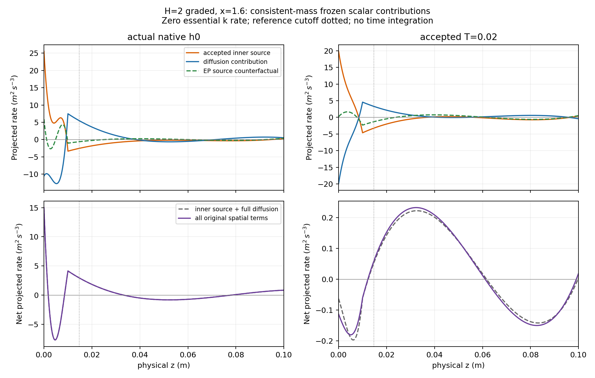
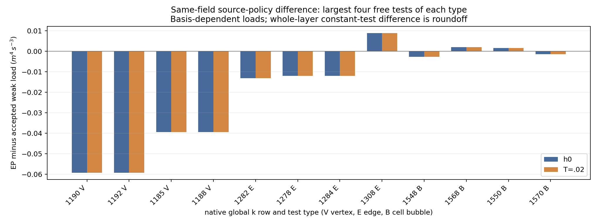

# Calibrated budget AWF: independent reference and curved-column checks

**Final source-bound Linux verification passed 10,827 checks** at clean source
`e0d599bc539b64045f87662d87be31a30fa6b4f3`. The authoritative final receipt is
`kernel-native-v4/validation.json` under the run root below; compact results are
in [kernel-v4.json](cls-accepted-budget-awf-evidence/kernel-v4.json).

The authoritative specification is
[`accepted_awf_appendix.tex`](../literature/accepted_awf_appendix.tex), copied
verbatim from the supplied Mac file. Its SHA256 is
`9998548d33bd2ca856bb6cc85551c82b86d3b499fd54ae8dc9ba26453450fdbf`.
The accompanying revised note has SHA256
`d35e437c2f2f8b25a46f7a3f285c6f1ad8b48d7b554aa1d161315f59eeb6de0f`.

The independent Linux oracle is
[`validate_cls_accepted_awf_kernel.py`](../../solvers/IncNavierStokesSolver/Tests/RANS/validate_cls_accepted_awf_kernel.py).
It solves the original CLS coefficient/Yap roots rather than prescribing the
rounded reference constants. It constructs the calibrated wall coefficients,
retains the original intercept correlation, evaluates closed metric-weighted
production and dissipation primitives, and solves the monotone cutoff equation
independently of the native source quadrature. Its GL64/GL96 factor-three
panels differ from the native panels. A real-dilogarithm primitive is a second
evaluation of the flat rough k profile.

## Independent Linux results

The standalone `--self-check` passed 770 checks on 2026-11-08. The complete
compiled-native comparison then passed **10,827 checks**: seven cases at native
quadrature orders 16 and 32, and three expected applicability rejections.
Neither check advances a native governing equation. The final frozen probe
SHA256 is
`79b28f015bb55571123349258aa5dd35f45432defaa53dcc21a6b496fa8f1533`.
Its 17 invocations took 1.6955 seconds in total, excluding Python orchestration.
The maximum native/reference scaled difference is 3.52e-13 (smooth-reference
k gradient). All native reference weak residuals are below 2.57e-16 absolute.
Native order-16/order-32 cutoff values are identical; weak loads differ by at
most 9.21e-17 scaled by the production budget, and ground k by at most
4.33e-16 scaled by endpoint K.

For h=.1, nu=1.5e-5 and reference u_star=.4:

| Quantity | H=2 | H=.5 |
|---|---:|---:|
| Endpoint K | .510508013059886 | .510508013059886 |
| Reference production/A | 5.909280150953166 | 4.531094243588622 |
| Cutoff | .014755594641345 | .014636433344370 |
| Matching velocity | 5.379706230389028 | 4.128270816644428 |
| Aerodynamic z0 | .005342939598684 | .005300459545886 |
| Reference k at ground | 1.022910439492602 | .994298029088087 |
| Reference k at z=.1 | .544798281032111 | .530743075243479 |

The flat rough integral and closed k evaluations agree within 3e-15 scaled by
endpoint K. The independent weak residuals are below 1.13e-16 absolute for
shifted Legendre modes 0--5 and for every assembled ordinary cubic modified-CG
row on the declared graded wall-normal partitions. Diffusion and source loads
are retained separately; their nonzero higher modes cancel. This is continuum
reference balance, not a claim that a projected native polynomial has zero
residual.

The native forced-momentum check uses the same calibrated viscosity and
cutoff. Its accepted and calibrated-EP source comparison retains identical
matching velocity, forcing and K. The whole-layer sources agree while their
higher modes differ. For H=2, selected shifted-Legendre loads are:

| Degree | Accepted source | Calibrated-EP source |
|---:|---:|---:|
| 0 | .054691928357523 | .054691928357523 |
| 1 | .019999933562998 | .023600353680282 |
| 2 | -.005333142558859 | -.013808577243728 |
| 3 | -.004129702550364 | .009775541144865 |

These are source-only kernel counterfactuals on the same forced analytical
momentum field. They are not separately evolved coupled solutions or a claim
that the old Upstream/Uniform campaigns are matched controls.

### Same-field source comparison on actual native H2 graded states

The source-only readback also uses the actual native h0 and the accepted
step-32 state at T=.02, from immutable completed coupled reports. It compares
P_h-E_C and P_h-P_A0 on identical transported fields, endpoint K, viscosity,
cutoff, geometry and time. It retains all 592 global k test loads and the exact
504 free rows, checked against the actual transport packets. No EP trajectory,
history update or source modification is performed.

The primary comparison uses the actual native physical consistent M_ff from
`native-constitutive-v6/mass-accounting/result.json`. Its rows match both
retained transport packets exactly. One Cholesky factorization is reused for
28 diagnostic mass-factor applications; these are algebraic readbacks, not
governing solves. The norm is sqrt(L_f^T M_ff^-1 L_f), with dimensional units
m^3/s^3 in this two-dimensional per-unit-span problem. The common normalization
is (K0*u_star/2)*sqrt(24)=.500193656639525. All original physical spatial terms
are summed once; diagnostic E/C aliases are excluded.

| Free k load | h0 dimensional norm | T=.02 dimensional norm | h0 common normalized | T=.02 common normalized |
|---|---:|---:|---:|---:|
| Accepted inner source P_h-E_C | 1.946906 | 2.051270 | 3.892304 | 4.100952 |
| EP source counterfactual P_h-P_A0 | .591125 | .493036 | 1.181792 | .985691 |
| Difference between source policies | 1.790138 | 1.790108 | 3.578890 | 3.578829 |
| Diffusion, residual sign positive | 2.470738 | 2.076418 | 4.939562 | 4.151229 |
| Inner production, residual sign negative | 4.881487 | 4.849045 | 9.759195 | 9.694335 |
| Inner E_C, residual sign positive | 4.086860 | 4.086791 | 8.170556 | 8.170418 |
| Diffusion minus accepted inner source | 1.412865 | .092265 | 2.824636 | .184458 |
| Complete original k spatial residual | 1.412865 | .092188 | 2.824636 | .184304 |

The continuum reference balances all weak moments, but the actual projected
native h0 has a substantial diffusion/source defect. At T=.02, its norm relative
to the accepted source decreases from .7257 to .04498, and the complete
original k spatial residual is about 15.3 times smaller. This is evidence that
ordinary diffusion is becoming the leading balance for the nonconstant k
profile. It does not establish a steady original-equation solution or temporal
accuracy. The independently recomputed k residual norms agree with the native
reported values within 1.25e-14. A source-only EP substitution on these same
retained fields would instead give residual norms 2.35811 and 1.82682; this
remains a counterfactual, not an initialized or evolved EP case.

The plotted rates below are native free-space Riesz representations at x=1.6
with zero essential k rate, holding flow and epsilon fixed. Diffusion includes
the full-domain diffusion load. The curves are not pointwise constitutive
source evaluations and do not advance the coupled system.



The full constant-test contraction is reconstructed from the exported native
Modified_A local/global IDs and signs, using the same tensor constant rule as
RANSWallGlobalField. It includes prescribed test rows and gives the physical
wall-layer source integral. Summing all raw load coordinates is a different,
basis-dependent operation. The free-vertex contraction is also recorded
separately rather than described as the full constant test.

| Retained state | Integral P_h-E_C | Integral P_h-P_A0 | Maximum free load difference | Nonvertex difference coordinate L2 |
|---|---:|---:|---:|---:|
| Actual native h0 | .042103444785513 | .042103444785512 | .059172686883538 | .038034154425652 |
| T=.02, step 32 | .019732379308875 | .019732379308874 | .059171693550358 | .038033508506799 |

These secondary coordinate statistics and the integrals retain the local
source redistribution that a whole-layer budget can hide. The integrals use
dx dz over the 12-unit-area wall layer, per unit span. Their
volume means are .00350862039879 and .00164436494241, respectively. The source
integrals have units m^4/s^3 and the means m^2/s^3. The complete free-coordinate
L2 differences are .125816759493011 and .125814643979265. These coordinate
norms depend on basis normalization and are **not physical mass-dual norms**.
All free modes are retained, including 143 and 238 nonvertex modes with
difference above 1e-14 in these coordinates. Equality of the layer integrals
does not imply equality of the discrete source operators.



At native h0 the actual production integral is 5.192809297692645, whereas
the reference-production/dissipation budget is 5.150705852907132. The current
represented production therefore differs from its counterfactual reference;
the cutoff budget itself still closes. At T=.02 these values are
5.170352842621993 and 5.150620463313116. Direct source loads agree with the
original residual's production/destruction components within 1.45e-15. This
readback attributes the source-law difference without claiming that switching
the source alone creates a valid initialized EP control.

Full vectors, free IDs, the native constant-test vector and their input hashes
are retained in `source-counterfactual-native-v2/analysis.json`; compact data
are in [native-source-counterfactual.json](cls-accepted-budget-awf-evidence/native-source-counterfactual.json).
Physical norms, complete free Riesz coefficients and plotted columns are in
`source-counterfactual-native-v2/mass-dual-analysis.json`. The projection mass
is M_ff, not the transport matrix A_k.

### Frozen native source quadrature

One additional generic resolution-probe process changes only the normal source
order from 16 to 32, using the exact signed-zero-preserving native h0 vector
and the same source-only history/time. Its selected-state SHA256 remains
`36ddd501981b449544d3f67d60a82383088e10f98f6746e3f680761c1abf9605`.
Every free-mode accepted-source load changes by at most 1.2491e-16, or
2.425e-17 relative to the physical reference-production integral. For the EP
counterfactual, the maximum is 3.036e-17. The existing cutoff, roughness and
mesh integration panels are retained. This shows that normal source
quadrature is resolved for this frozen state; it does not establish adequacy
of the polynomial representation, tangential quadrature or later states.
The corresponding mass-dual differences are 1.658e-14 and 3.887e-15, respectively.

The diagnostic took 9.2534 seconds and performed zero governing solves and
physical steps. Preparing its separate reference called Lift once, with one
initialization iteration; Lift was never applied to the selected transported
state. The order-32 session can have different prepared external traces, so
this is explicitly a source-only comparison, not a restart or a claim of full
residual/boundary equivalence. Its receipt, input, session and full loads are
retained in `source-counterfactual-native-v2/quadrature32/`. Native integer
JSON literals are read with `parse_int=float` to preserve signed zero, as in
the repository's established reader. The earlier parser guard stop is kept
as diagnostic provenance and involved no native process or numerical failure.

The smooth h=0, H=2 control has an admissible cutoff
.000628974425719 but analytical ground k=-.304067694181446. It is reported
without clipping as a stationary-reference positivity qualification failure.
Cutoff applicability and positivity of this auxiliary reference are distinct.
The oracle also rejects a budget below its minimum (h=0, nu=.05, H=2) without
clipping the cutoff. No general evolving-state qualification is inferred from
the sign of an associated auxiliary stationary reference.

## Curved scalar scope

The plus-curvature convention is

    J(r)=(1+kappa1*r)(1+kappa2*r),   x=X+r*n,   B=grad_Gamma(n).

For Q_J=integral_0^r J(E_C-p_A0), the frozen-column relation is
Q_J=J*D_k*k'_column. The physical upward diffusive flux is -Q_J/J.
The independent metric budget is

    B(c)/A = 1+log(H/c)
             +(kappa1+kappa2)*(H-c/2)
             +kappa1*kappa2*(H^2/2-c^2/6).

Its derivative is -A*integral_0^c J/c^2. The oracle checks the derivative,
strict monotonicity, minimum budget, cutoff uniqueness, J=1 limit, and
normal-column endpoint fluxes. It checks principal stretches individually;
positive J alone cannot validate two negative stretches.

At H=2 with the same physical inputs:

| kappa1 | kappa2 | Cutoff | Frozen-column k(0) |
|---:|---:|---:|---:|
| 0 | 0 | .014755594641345 | 1.022910439492602 |
| .1 | 0 | .014792183273770 | 1.026967008714417 |
| -.1 | 0 | .014719042683243 | 1.018769827433485 |
| .12 | -.06 | .014776408356599 | 1.025122739031065 |

These are reference scalar columns. They are not terrain-flow equilibria or
curved PIMPLE evolutions. Positive local stretches do not prove global normal
projection uniqueness. Curved native evolution still needs full mapped
momentum/continuity; curvature and normal-motion traction; tangential scalar
transport; actual matching-surface normals; conservative flux matching;
geometry admissibility; and pressure/positivity coverage consistent with that
geometry. With varying H, endpoint K must sample the actual matching face
using local physical H.

## Reproduction

Heavy results are under
`/media/jay/新加卷/nektar-v2026-runs/cls-accepted-budget-awf-20261108`.
The standalone receipt is `kernel-independent-self/validation.json`, including
source/specification hashes, physical values, weak loads and numerical errors.
The final native receipt and per-case JSON/logs are in
`kernel-native-v4/validation.json`, with the source revision and individual
source hashes bound to the frozen runtime. The earlier
`kernel-native-v2/validation.json` is retained as initial verification against
probe SHA256
`138d7f53178785662113782edc1062c487044953389c0d2a3e4629c9866c5c0e`;
that matrix also passed 10,827 checks. `kernel-native-v1` is retained: its harness
initially scaled a zero budget residual by 1e-14 and therefore imposed an
inappropriate absolute tolerance near 1e-24. The native curved residual was
1.11e-16. The corrected oracle scales this residual by the physical production
budget and requires 2e-12 relative accuracy. No kernel or acceptance tolerance
was changed for that correction.
Use a fresh output directory when reproducing:

```bash
source /home/jay/.local/opt/nektar-v2026-mpi/env.sh
export OMP_NUM_THREADS=1 OPENBLAS_NUM_THREADS=1 MKL_NUM_THREADS=1
export BLIS_NUM_THREADS=1 VECLIB_MAXIMUM_THREADS=1 NUMEXPR_NUM_THREADS=1
export PYTHONDONTWRITEBYTECODE=1
python3 -B "$R/source/solvers/IncNavierStokesSolver/Tests/RANS/validate_cls_accepted_awf_kernel.py" \
  --self-check --output "$R/reproduce-independent"
```

For the source-bound native comparison, replace `--self-check` by
`--probe "$R/runtime-v4/kernel/RANSAcceptedAWFProbe"`.
Use its frozen linked-library closure in `LD_LIBRARY_PATH`, as recorded by
`runtime-v4/kernel/identity.json`.
The complete native comparison checks orders 16 and 32, calibrated forced
momentum, all source moments for identical-field accepted/EP counterfactuals,
and explicit invalid-budget/stretch rejection. `--quick` uses native order 16
while retaining independent quadrature refinement. Neither command advances a
production trajectory.
