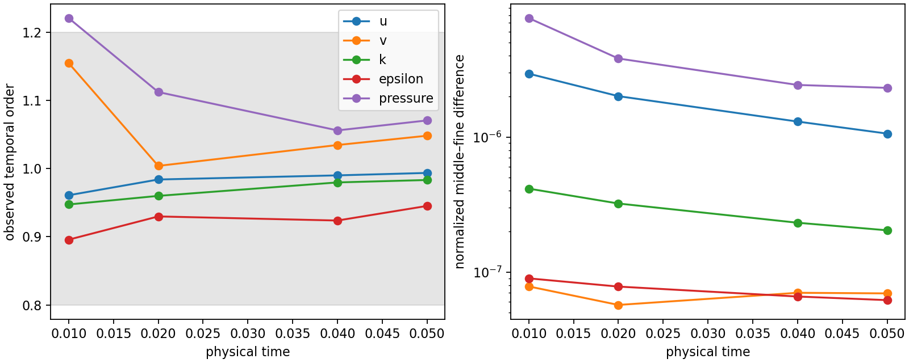

# Accepted budget AWF: finite-horizon temporal self-convergence

**2026-11-10 late-state addition:** the
[H=.5 Regularized/Linear common-state IVP](cls-awf-neutral-qualification.md#late-temporal-import-and-experiment)
imports the retained T=6 coupled state and fixed reference exactly, then forms
independent IMEX1 histories at dt=.000625/.0003125/.00015625. All 160/320/640
steps reached elapsed .1 with no correction. The same-dt first step matches
ordinary restart bitwise. At .1, U/W/k/epsilon/pressure/traction orders are
.998/1.005/1.000/.999/1.016/1.019; estimated normalized errors for the original
.000625 step are 2.08e-9/8.78e-10/2.56e-9/9.93e-9/1.15e-8/5.17e-10, all
within the predeclared budgets. Epsilon covers the **complete .5<=z<=4**
transport space with unchanged common normalization and an independent
consistent-mass crosscheck. This bounds late local sensitivity and does not
reconstruct accumulated startup-to-T6 error or establish timestep-independent
steady roots. The bounded experiment stops at .1; no extension is warranted.
The earlier H2-from-h0 study below remains a distinct qualification.

2026-11-09, Asia/Shanghai; branch `codex/cls-epawf-pimple-one-sweep`.
The [predeclared policy](cls-accepted-budget-awf-evidence/audit-cache-temporal/temporal-policy.json)
was committed in `8f5db2c` before the new coarse/fine execution. Detailed native
receipts are indexed in the [compact evidence](cls-accepted-budget-awf-evidence/audit-cache-temporal/native.json).

The primary triplet uses H2 cutoff-v1 Regularized/Linear accepted budget AWF,
with z_K=z_m=H, the same mesh/degrees/quadrature/physical data, native IMEX1 and
one U/p/epsilon/k solve plus one logical final bound call per step. It is a
first-order sequential linearly implicit candidate, not an exactly converged
backward-Euler stage. The corrected `NativeElementSideV2` hard audit is used.

Coarse dt=.00125 and fine dt=.0003125 were freshly initialized from native h0,
with their own valid startup histories. Both actual initialized coupled states
have SHA256 `176dd38e7136e0341926cb7ee7302041fad27c8f983764504ed586cb2940d8d4`,
matching the existing middle trajectory at dt=.000625. Forty coarse and 160 fine
steps reached T=.05. The middle trajectory's real checkpoints/history lineage
were reused, without changing timestep or reinterpreting a checkpoint. All
three paths remain hard-admissible and require no bound activation.

All comparisons use common physical quadrature, full-domain U/k, transported
epsilon on z>=2, and one common volume-mean pressure alignment across both
regional spaces. Their permitted relative pressure offset is retained.
D_c=||q_2dt-q_dt||, D_f=||q_dt-q_dt/2|| and p=log2(D_c/D_f).

| Field | p at .01 | p at .02 | p at .04 | p at .05 | Normalized middle-step Richardson estimate at .05 | Target |
|---|---:|---:|---:|---:|---:|---:|
| U_x | .961 | .984 | .990 | .994 | 2.13e-6 | 1e-4 |
| W | 1.154 | 1.004 | 1.034 | 1.048 | 1.35e-7 | 1e-4 |
| k | .947 | .960 | .980 | .983 | 4.12e-7 | 1e-4 |
| Outer epsilon | .896 | .930 | .924 | .945 | 1.29e-7 | 1e-3 |
| Pressure | 1.220 | 1.112 | 1.056 | 1.070 | 4.41e-6 | 1e-3 |

The declared coherent band is [.8,1.2] at .02/.04/.05. Pressure at .01 falls
outside it; no Richardson estimate is assigned there. All five field blocks
meet the declared later-time order and error screens. Dimensional D_c/D_f and
both fine/middle estimates remain in the full evidence. These estimates concern
the selected model at this fixed spatial representation through T=.05. They
are not bounds on accumulated T=5 error or a qualification of faithful Original
CLS evolution.

Mean traction has orders .910, .759, .926, .997 at the four observations. Its
relative middle-step estimate at .05 is 9.55e-7 against the declared 1e-4 target.
The .02 value misses the unchanged order band, so the primary result is
**fields within budget, early traction assessment incomplete**. A specifically
labelled fresh dt=.00015625 control through .01/.02 was launched to resolve
that small early nonasymptotic result; no general dt/4-to-long-time campaign
was scheduled. The 128-step control completed T=.02. The finer traction triplet gives p=.887 at .01 and p=.863 at .02, both inside the unchanged band. Its estimates for the long-campaign dt=.000625 are respectively 2.05e-7 and 8.35e-7 relative to reference traction, below 1e-4. Combined with the later primary observations, the selected finite-horizon fields and traction meet the declared first-order/error screens. This resolves the specific early ambiguity without extending dt/4 through .05 or T=5.

The evidence also retains actual frozen momentum load defects separately from
the splitting-identity error, epsilon lag, strong divergence, full/normal
traction and k-flux jumps, covariance at common one-sided points, and the
zero correction supply. Raw CG jumps are not required to vanish with dt at
fixed mesh. No late local-window IVP is needed to interpret the current
continuing transient; such a check remains useful if a late steady candidate
emerges. No production checkpoint timestep was edited.

At T=.05 the coarse/middle/fine actual frozen momentum load defects are
6.346e-7/1.608e-7/4.047e-8, while the separate splitting-identity errors are
only 1.60e-18/2.27e-18/2.25e-18. The former decreases by about four per halving;
that local load behavior does not make the complete sequential scheme second
order. Refreshed epsilon matching discrepancies are
4.587e-8/2.203e-8/1.078e-8. Inner strong-divergence L2 is
.0017353/.0017412/.0017442, full traction-jump RMS is
.0024781/.0024774/.0024770, and k-flux-jump RMS is
8.244e-5/8.308e-5/8.341e-5. Their nonzero fixed-mesh limits must not be confused
with failure of temporal self-convergence. Outer covariance minima remain
positive at .1759908/.1759867/.1759846; common one-sided witness values and
provenance are retained separately from these moving global minima.



Reproduction on Linux uses fresh output roots. The original primary temporal
execution used frozen cache-v2 image `f87f597420617e9c96172c67e70b363daf4eb878207dcdf87d0ca60f1a27c447`;
the final image is bitwise equivalent on the representative 32-step trajectory
and adds further exact dependency reuse. The targeted traction confirmation
and final strict readbacks used the final frozen runtime.

```bash
source /home/jay/.local/opt/nektar-v2026-mpi/env.sh
export OMP_NUM_THREADS=1 OPENBLAS_NUM_THREADS=1 MKL_NUM_THREADS=1
export BLIS_NUM_THREADS=1 VECLIB_MAXIMUM_THREADS=1 NUMEXPR_NUM_THREADS=1
R=/media/jay/新加卷/nektar-v2026-runs/cls-awf-audit-cache-temporal-20261109
S="$R/source/solvers/IncNavierStokesSolver/Tests/RANS"
python3 "$S/run_cls_awf_temporal_study.py" \
  --solver "$R/runtime-cache-final/solver/IncNavierStokesSolver" \
  --h0-hash 176dd38e7136e0341926cb7ee7302041fad27c8f983764504ed586cb2940d8d4 \
  --policy "$R/temporal-policy.json" --levels coarse fine \
  --times .01 .02 .04 .05 --block-steps 32 --timeout 7200 \
  --output "$R/reproduce-temporal"
python3 "$S/analyse_cls_awf_temporal_study.py" \
  --study "$R/reproduce-temporal" \
  --middle-campaign /media/jay/新加卷/nektar-v2026-runs/cls-accepted-budget-awf-20261108/selected-refined-regularized-2G/trajectory \
  --probe "$R/runtime-cache-final/probe/RANSWallResolutionProbe" \
  --output "$R/reproduce-temporal-analysis"
```

The extra-fine follow-up uses `--levels extra-fine --times .01 .02` and purpose
`traction-only early nonasymptotic discrimination`; its actual initialization,
128 accepted solves per equation and checkpoint/report hashes are indexed.
Production does not inherit any diagnostic k-only or readback work.
