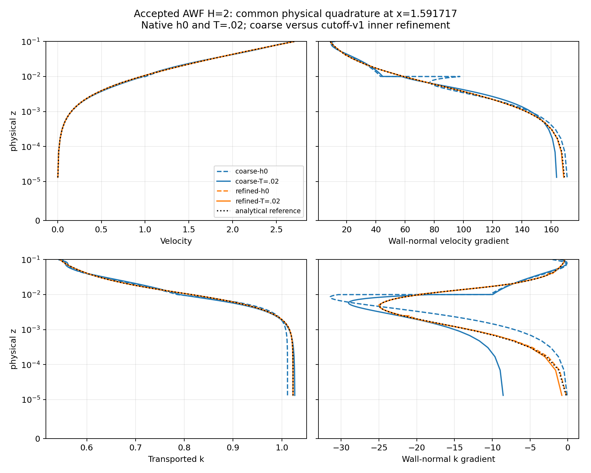
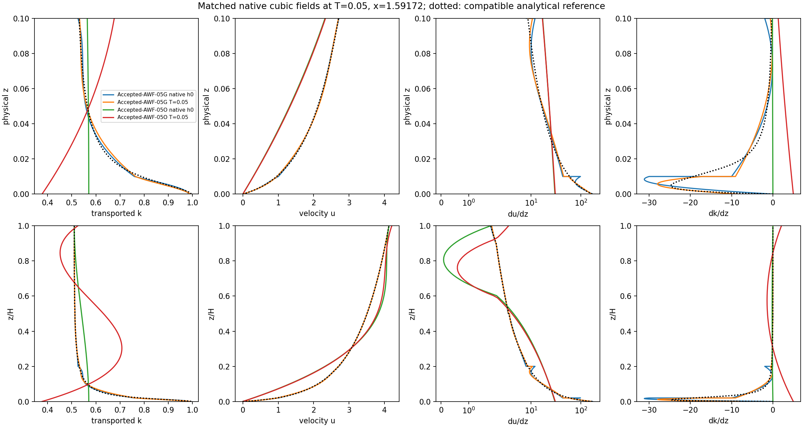
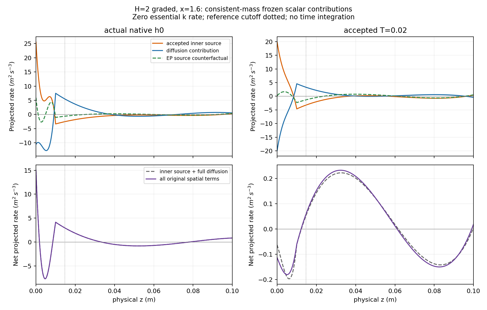

# CLS-calibrated budget AWF: implementation and native evolution

**2026-11-09 timing diagnosis:** [native campaign profiling](cls-awf-campaign-timing.md)
replays six completed eight-step blocks with bitwise field/history equality.
Inventories and constitutive audits consume 71–76% of native CPU; all four
direct equation solves together cost .014–.055 CPU s/step. Six production
campaigns remain unchanged and running; dated frontiers and hashes are in
[the timing evidence](cls-awf-campaign-timing-evidence/native.json).

**2026-11-09 follow-up:** the [covariance-stage and failure-horizon report](cls-accepted-awf-covariance.md)
adds strict immutable intermediate-stage readback, independent tensor/tangent
verification, full same-state Original-operator comparisons, and completed
fresh faithful controls. Half-dt rejects at T=.090625; outer pressure p2 rejects
at T=.109375, compared with the archived refined baseline T=.09875. Both first
lose outer covariance after flow with unchanged turbulence coefficients.
The cutoff-refined Regularized/Linear continuation remains running, without
bounding; the latest verified dated table and checkpoint identities are in
that report and its [native evidence](cls-accepted-budget-awf-evidence/covariance/native.json).
The preceding implementation and historical campaign snapshots below remain
preserved. These new results do not establish steady or temporal convergence.

Branch `codex/cls-epawf-pimple-one-sweep`, 2026-11-08. Inspected local and
remote base: `bc33b7e511fc599e5be98200b5afb0f9def0ce09`; no reset or checkpoint
migration. The model implementation and authoritative production build are
`e0d599bc539b64045f87662d87be31a30fa6b4f3`. A subsequent read-only reporting
extension, `b249efe3a689ea762904113e361e7d7f7e1333dc`, permits common physical
quadrature panels for the focused mesh comparison. Production runtime V4 is
immutable and continues to use e0d599b. Final C++ revision
`436f0e33b54b2689f76d1273b440f4218107f60e` adds strict immutable native-state and
history readbacks; the separately built final solver produces a byte-identical
restart step. The later evidence/orchestration commit does not change C++.

The supplied [appendix](../literature/accepted_awf_appendix.tex) is versioned
verbatim as **accepted-appendix-v1**, SHA256
`9998548d33bd2ca856bb6cc85551c82b86d3b499fd54ae8dc9ba26453450fdbf`.
[Provenance](../literature/accepted_awf_appendix.provenance.json) also identifies
the accompanying revised note. Analytical targets, native projection errors,
physical evolution, correction feasibility and original-equation convergence
are separate results throughout this report.

## Implemented method

`RANSWallFormulation=CLSCalibratedBudgetAWF` is independent of the existing
outer `RANSWallVariant`. EPAWF remains the default. The primary new cases use
Original high-Re CLS/Yap outside the wall layer and Linear full-strain inner
stress. Outer molecular diffusion is omitted; inner molecular viscosity is
retained. Explicitly named companions can select SaturatedR2 inner stress or
the existing outer regularization; these are different models, never automatic
fallbacks.

The wall parameter object is calibrated separately from the outer CLS object:

    c_mu_wall = q_star^-2
    c_length_wall = kappa*q_star^(3/2)
    a = kappa*sqrt(K/q_star)
    A = (K/q_star)^(3/2)/kappa
    Lambda = integral(p_A0)/A
    z_c = H*exp(1-Lambda), requiring Lambda >= 1
    E_C(z) = A/max(z,z_c)
    source_k = P_h - E_C

The original rough/smooth intercept correlation remains. Redistribution is
exactly zero. Chi, EP transition, destruction cap and capped normalization are
not applicable and are reported as null. The new source is neither legacy
chi=0 nor chi=1.

`RANSWallKSampling=InterfaceTrace` selects the common native k trace on the
actual matching face. Its declared version is
`InterfaceTrace-v1:common-CG-matching-face:physical-local-H`. All new cases have
z_K=z_m=H. The interface K evolves; the fixed K0 supplies only the reference and
compatible external data.

| Scheduled operation | Frozen/latest choices |
|---|---|
| One vector momentum predictor | Incoming turbulence and current constitutive coefficients; physical native IMEX1 history |
| One pressure/gauge solve and algebraic velocity update | Existing alpha^-1 M_u^-1 approximation, complete native pressure action, two regional pressures and common gauge |
| One outer-epsilon transport solve | Corrected flow; epsilon_H=A(K)/H evaluated/projected once before this solve |
| One k transport solve | Latest flow and outer epsilon; K, viscosity, cutoff and E_C frozen; signed P_h-E_C source, no local reaction E_C/k |
| One logical final k bound | RetainedPool, physical consistent M_ff, original raw objective center, fixed prescribed coefficients |
| Refresh, full hard audit, commit | Retained solved epsilon coefficients, refreshed matching defect; one physical time/history commit |

No inner epsilon equation, extra outer sweep, field relaxation, residual
cancellation, epsilon-trace restoration or post-k transport solve is used.
This is a candidate first-order sequential linearly implicit time map, not an
exact fully implicit stage root. Original refreshed residuals are diagnostics.

`AcceptedAWFDiagnosticV1` retains finite-field, scalar, covariance, profile
budget, boundary, continuity, gauge and transaction checks without importing
the old narrow R2 reference box. `AcceptedBudgetV1` protects shared native
source, endpoint, matching, reconstruction, contact and reporting locations,
including their K-dependent budget rays; it retains continuous-ground checks
and all discovered physical cuts. It does not certify every volume polynomial.
Independent vertical cubic minima are reported separately.

The physical floor is 1e-8*K0, with the existing arithmetic reserve. Numerical
controls are explicitly 2000 per Add, 20000 total, 2000 separations and 900
seconds. Model, wall coefficients, endpoint functional, source, stress, mesh,
height, tail, inventory and reference enter strict restart identity.

## Reference and native initialization

The native reference uses Q(z)=integral_0^z(E_C-p_A0) and
k_w0(z)=K0-integral_z^H Q/D_k. Ground k is not prescribed; the reference has
zero endpoint fluxes and common interface K. General interface flux remains
conservative rather than independently prescribed zero. Native constrained
projection retains no-slip and the existing one-sided matching value/derivative
conditions. It adds no ground-shear condition.

Stored inner pi=p/rho+2k/3 is constant in the parallel reference. Mechanical
pressure varies with k; the common pressure gauge and -11K/75 traction offset
are retained. Compatible external fields and projected epsilon matching data
are constructed from this reference. Each case saves its actual native h0 and
all native histories; no old checkpoint becomes a new-model initialization.

The durable fresh-h0 path retains h0 in the first completed block rather than
writing a production step-zero checkpoint. A separately repeated zero-step
native initialization of the refined regularized case reproduces that h0
bitwise, including the physical signature, and writes a genuine native
checkpoint. Restoring actual native GLM slots and capturing the first callback
without a governing solve reproduces the production history SHA256 exactly
for both faithful H=2 and refined regularized H=2. Native GLM arithmetic changes
12/17 signed-zero bits relative to h0, with zero numerical difference; these
histories are preserved rather than reconstructed from h0. The repeated
initialization uses two initialization Lift iterations, separately counted.
Neither replay advances physical time or creates a production step-zero
checkpoint. See [initial-history provenance](cls-accepted-budget-awf-evidence/initial-history-provenance.json).

The independent and native kernel checks are detailed in the
[kernel report](cls-accepted-awf-kernel-verification.md) and
[source-bound evidence](cls-accepted-budget-awf-evidence/kernel-v4.json).
The final kernel passed 10,827 checks, including curved scalar columns,
J0/J2, calibrated coefficients, cutoff uniqueness and endpoint budgets, flux,
mechanical energy, forced momentum and every tested weak mode. Maximum native
weak residual was 2.57e-16. Order16/32 agreement is recorded separately from
native spatial representation. The smooth-wall example has a valid cutoff
but negative stationary-reference ground k and is retained without clipping.

| Analytical quantity | H=2 | H=.5 |
|---|---:|---:|
| K0 | .510508013059886 | .510508013059886 |
| Lambda | 5.909280150953166 | 4.531094243588622 |
| z_c | .014755594641345 | .014636433344370 |
| U_H | 5.379706230389028 | 4.128270816644428 |
| Aerodynamic z0 | .005342939598684 | .005300459545886 |
| Analytical k(0) | 1.022910439492602 | .994298029088087 |
| Analytical k(.1) | .544798281032111 | .530743075243479 |

Here roughness parameter h=.1 is distinct from aerodynamic z0. Height changes
regenerate the compatible reference without retuning h, u_star or constants.

## Cases and first observed results

All primary cases are unforced, zero perturbation, IMEX1 dt=.000625, unit
relaxation, cubic velocity/k/epsilon and linear regional pressure. Tangential
knots are [-4,-3,-2,-1,1,2]. Graded physical vertical knots are
[0,.01,.1,.25,.5,1,2,7/3,8/3,3,10/3,11/3,4]; a one-element partner removes only
knots strictly below its H. The outer mesh above z=2 is common.

| Primary case | Unknowns | Native initial mean traction | L2 U error | L2 dU/dz error | L2 k error | Initialization |
|---|---:|---:|---:|---:|---:|---|
| Accepted-AWF-2G | 2165 | .161707 | .009213 | 3.59060 | .005639 | passed |
| Accepted-AWF-05G | 2261 | .161711 | .009266 | 3.59175 | .005590 | passed |
| Accepted-AWF-05O | 1811 | .028338 | .634665 | 19.70976 | .099353 | passed |
| Accepted-AWF-2O | 1415 | .010254 | 2.305193 | 25.33680 | .122694 | hard covariance rejection |

Errors use common physical quadrature, not coefficient differences. Reference
traction is .16. The ordinary H=2 cubic overshoots the interior velocity
gradient: at x=-3,z=.5064148487, local k=.5298848106, nu_tA=.0901702789 and
minimum covariance eigenvalue=-.08491550818. Its outer covariance minimum is
positive .1777343943, scalar/budget checks pass, and no physical step was
attempted. This is an inner representation/stress blocker, not a missing
dissipation sink or projection exhaustion.

The faithful rejection is immutable. A separately labelled SaturatedR2-inner
H=2 one-element companion retains Original outer CLS, endpoint K, EC source,
zero redistribution, mesh, floor and timestep. Its actual native initialization
passes; it is not described as the unchanged appendix model. The faithful
H=.5 one-element case requires no companion at initialization.

The faithful H=2 graded campaign later accepts 120 steps through T=.075 and
rejects attempt121 at T=.075625. Its Original outer covariance minimum is
-.0106884781 at x=-3,z=3.7347166364; inner covariance remains positive
.1361426863, local/sample k and cutoff budget remain admissible, and the bound
is inactive. All scheduled solves complete, but the final hard audit rejects
the step. Natural rollback exactly preserves the step120 state, physical time,
every native history and its time labels. The terminal checkpoint SHA256 is
`b299e304e25dfe2918286a48cae42c8de894982e3b6f6b1b31884c54c2f53b5e`.
This campaign is terminal; it is not retried or silently regularized in place.

Both faithful H=.5 cases subsequently reject Original outer CLS covariance,
with no bounding activation. The one-element case accepts 86 steps through
T=.05375 and rejects attempt 87 at T=.054375, eigenvalue -.00197736437 near
x=-3,z=3.75. The graded case accepts 119 steps through T=.074375 and rejects
attempt 120 at T=.075, eigenvalue -.00317440407 near x=-3,z=3.7347166364.
Their inner covariance and scalar/budget checks remain positive. All four
scheduled governing solves and the single logical bound complete before the
final hard-audit rejection; the rejected candidates and actual histories are
retained separately from committed state.

The H=2 SaturatedR2-inner-only companion accepts 31 steps through T=.019375,
then rejects Original outer covariance at attempt 32/T=.02, eigenvalue
-.00178715151 at x=-4,z=2. A separately labelled Regularized-plus-Saturated
H=2 pair completes T=.02. A Regularized-outer-only H=.5 pair retains Linear
inner stress and starts from fresh native h0. Its graded member continues;
the one-element member accepts 147/T=.091875, then rejects attempt 148/T=.0925
on inner Linear covariance=-5.30490156848e-5 at x=1,z=.5, with positive outer
covariance and no bounding. This is the reason for the separately named
SaturatedR2 companion. None adds a cap, EP source,
forcing, trace restoration or extra sweep. These results do not repair the
unchanged appendix's Original outer constitutive limitations.

The three admissible faithful cases have actually advanced beyond T=.02.
The H=2 graded first eight accepted steps have eight U, pressure, epsilon and k
solves, eight callbacks and bound calls, zero extra governing solves and zero
bound activations. At T=.005 its physical drifts from actual h0 are
L2 U=.0054152, k=.0024078, epsilon=5.69e-7; mean traction changes from .161707
to .152246. Dimensional alpha=0 U and k residual norms decrease from
3.86684/1.41286 to .52305/.271985, while epsilon changes from 4.47e-5 to
1.486e-4. These are transient observations, not reference preservation or
steady convergence.

### Focused representation check

One declared `cutoff-v1` graded refinement adds only z=.0025,.005,.02,.04 below
H=2. It preserves the physical model, polynomial degrees and outer mesh.
Both coarse and refined actual native states complete T=.02. Strict readbacks
use verified immutable native checkpoints, their complete actual GLM slots
and time labels, alpha=0, zero Lift, and the same union of physical reporting
panels. Default V4/V5 readback physical outputs match exactly; nine corrupted
identity/history/domain inputs are rejected.

| Common-rule quantity | Original graded | Cutoff-v1 graded |
|---|---:|---:|
| h0 L2 dU/dz error | 3.59060 | .154136 |
| h0 L2 production error | 1.28708 | .0493837 |
| h0 L2 dk/dz error | 2.05338 | .0666883 |
| T=.02 L2 U drift from own h0 | .00797218 | .00100859 |
| T=.02 L2 k drift from own h0 | .00404947 | .000171289 |
| T=.02 original spatial k mass-dual residual | .0921878 | .00501785 |
| T=.02 mean traction | .1558967 | .1595616 |

The analytical target traction is .16. The improvement identifies material
near-cutoff representation error; it is not a temporal-order study. Coarse
reporting quadrature is not reused across refined panels. The refined case
continued separately through T=.05 using its own compatible checkpoint,
before the terminal result reported below.



The small inner-k perturbation is .001*K0 times
sin(pi*(x-xmin)/(xmax-xmin))^2*(1-3(z/H)^2+2(z/H)^3), zero outside the layer;
native external and matching k coefficients are preserved. It completes
T=.02 from fresh native histories without resetting the solution. Perturbation
evolution and unperturbed reference drift are distinct measurements.
Its physical k difference from the unperturbed trajectory decreases only from
.0006599963 to .0006576389 by T=.02. Velocity, common-gauge pressure and common
outer-epsilon differences at that time are 2.03e-8, 7.52e-7 and 1.54e-7. This is
mild decay over a short horizon, not an attractor or stability theorem.

| Faithful H=.5 quantity | Graded, T=.02 | One cubic, T=.02 | Graded, T=.05 | One cubic, T=.05 |
|---|---:|---:|---:|---:|
| L2 k drift from actual h0 | .00401552 | .05720983 | .00544073 | .12702144 |
| Mean traction | .15589270 | .02892046 | .15480242 | .02907018 |
| Original spatial k mass-dual residual | .0918977 | 2.62510 | .0661504 | 2.11973 |

The one-element case's initial representation error and later evolutionary
drift are separate. Its improved survival at smaller H does not make its
traction or high-mode k balance accurate. Neither result is sustained by a
positivity correction: cumulative signed, positive, negative and absolute
correction integrals are all zero over these accepted prefixes.

Fixed physical bands give the same conclusion without conflating a first
element with the whole wall layer. The following are physical k integrals
over x in [-4,2], per unit span (units m^4/s^2). Partial native panels are
split at the band edge before integration; no quadrature-point mask is used.

| H=.5 case/state | 0<z<=.01 | 0<z<=.1 | Whole wall layer | Whole domain |
|---|---:|---:|---:|---:|
| Graded actual h0 | .05376683 | .36825429 | 1.60172713 | 12.32239540 |
| Graded T=.02 | .05342015 | .36830256 | 1.60214587 | 12.32279183 |
| One cubic actual h0 | .03423931 | .34110769 | 1.62178048 | 12.34244875 |
| One cubic T=.02 | .03031880 | .33771307 | 1.65047762 | 12.37428976 |

At T=.02 in z<=.01, graded/one-element production rates are .956311/.0949062
and EC rates .595527/.616187 (integrated units m^4/s^3). Across the whole wall
layer the corresponding production rates are 3.96947/5.70969 and EC rates
3.94948/4.08848. Thus the one-element case has a strong spatial redistribution
error even when its global k increases. These are instantaneous rates, not
window-integrated quantities or an exact local control-volume balance.
The complete frozen-step storage identity is retained separately. For graded
H=.5 the first element ends at .01; for its one-element partner it ends at .5.



The Regularized/SaturatedR2 H=.5 pair completes 160 steps/T=.1. At that common
time the graded/one-element k drifts are .00729279/.19995506, mean tractions
.15384278/.02879755, and selected-operator spatial k residuals
.0430731/1.6136946. Refreshed epsilon matching defects are 1.43e-6/3.93e-4.
Strong traction-jump RMS is .00550/.14259 and k-flux-jump RMS
.000161/.19906; algebraic continuity and gauge remain within their existing
tolerances. These strong spatial defects are reported separately from the
successful pressure linear solve.

Both compatible handoffs advance natively beyond step 160. Graded continues;
the one-element case accepts 161/T=.100625, then rejects 162/T=.10125 on
Regularized outer covariance=-.00012415558 at x=1,z=.5. Its inner saturated
covariance remains positive .09149; scalar checks pass and bounding is
inactive. Startup is an exact no-op and rejection rollback is exact. No
unchanged retry or further parameter tuning follows this terminal outcome.

Saturation is not an exact no-op on the graded mesh: active inner volume
is .8061% initially and .03226% at T=.1; integrated production changes by
-.00042485 and -6.20e-6, with stress-work consistency at roundoff. Graded
Regularized/Saturated versus Regularized/Linear differences at T=.1 are only
3.14e-6 in U and 2.49e-6 in k physical L2. The one-element saturation is much
more material: 39.47%/37.24% active volume initially/finally, production changes
-.643508/-.154660. These are measured constitutive changes. The companion
states and checkpoint signatures remain separate.

The outer regularization is also measurable, rather than an exact no-op.
At H=.5, its same-state integrated production difference from Original outer
CLS is +.000151337 initially; at T=.1 in the Regularized/Saturated pair it is
-.000570626 graded and -.05097334 one-element. Stress-work and production
differences agree to roundoff. The analytical neutral shear reference remains
unchanged, while the projected and evolving native fields activate the changed
outer constitutive law.

Here a companion's "original spatial residual" means its own selected,
uncancelled operator. It does not mean the faithful Original-variant operator.
Small native residuals in a poorer test space also cannot establish accurate
gradients or wall stress; the independent physical profiles are essential.

The faithful cutoff-v1 trajectory eventually accepts 157/T=.098125 and rejects
158/T=.09875 on Original outer covariance=-.0113839402 at
x=-3,z=3.6880433086, with positive inner covariance and no bounding. Its exact
rollback and terminal checkpoint are retained in
[the refined terminal receipt](cls-accepted-budget-awf-evidence/refined-faithful-terminal.json).
Thus refinement delays the coupled exit as well as improving early reference
preservation; it does not remove the outer constitutive limitation in this run.
A separate **fresh-h0** cutoff-v1 Regularized-outer/Linear-inner continuation
is running. No failed checkpoint is converted to a different model.

That companion has now **completed 160 steps/T=.1** and continued beyond it.
Its immutable [native milestone](cls-accepted-budget-awf-evidence/refined-regularized-T01.json)
has L2 drifts U=.00149017, k=.000284315, common outer epsilon=1.17252e-6,
and common-gauge pressure=.000457343 from actual h0. Mean traction is
.15957746. Dimensional selected-operator alpha=0 blocks (Ux, Uz, k, epsilon)
are [.00245555,.000421267,.00115702,.0000204428]; refreshed epsilon matching
defect is 2.19e-8. Each governing-solve count and bound-call count is 160;
extra governing solves, bound activations and correction supply are zero.
Own-case drifts here use the same default physical GL16 reporting points;
the strict union-panel V6 measurements above remain the cross-mesh comparison.

### Temporal sensitivity and present classification

One fresh-h0 H=2 graded run halves dt to .0003125 and completes 64 steps/T=.02.
The actual h0 is bitwise identical. At common T=.02 its differences from the
baseline are L2 U=2.31e-5, k=1.60e-5, common outer epsilon=1.25e-7 and
common-gauge pressure=6.13e-5. These are much smaller than the observed
near-cutoff representation effect. Two levels do not establish an order of
accuracy or determine the time-step dependence of the later covariance exit.
All 64 passes retain one solve per field and one inactive logical bound call.

The wall source is supported by ordinary diffusion on the resolved analytical
reference and the evolving graded state. The unrefined native h0 remains
materially imperfect. A plain cubic over H=2 is not admissible with Linear
stress at initialization, and a plain cubic over H=.5 has severe gradient,
traction and scalar/interface errors even when an explicit robustness
companion advances it. Reducing H improves that cubic but does not make it
adequate for the intended reference.

The current classification is **unresolved transient evolution**, with
documented hard constitutive exits for the terminal cases. There is no
demonstrated steady original-equation root or statistically stationary regime.
All accepted new trajectories through these snapshots have zero correction
supply. Longer survivors remain under supervised observation. The useful next
configuration is the cutoff-resolved graded budget AWF; keep the explicit
outer-regularization comparison and assess its effects. A cost-driven
one-element method would require a separately verified analytical/enriched
representation.

The Regularized/Linear H=.5 graded trajectory continues to change over the
fixed window T=.1 to .15: L2 changes U=.0009412, k=.0018185,
epsilon=1.2472e-5 and pressure=.0009902, with mean traction changing by
-.0003612. Its T=.15 selected spatial blocks are
[.0154774,.0037665,.031536,.0005628] and matching defect 1.66e-6.
Correction remains zero. This is continuing transient drift; neither a small
one-step increment nor its decreasing k residual establishes equilibrium.
For H=2, H/u_star=5 and flow-through time from the actual initialized bulk
velocity is about 1.17455; for H=.5 these are 1.25 and 1.17327. T=.1 is
therefore only .02/.08 wall times and about .085 flow-through times.

## Verification, runtime and evidence

Authoritative Linux build uses the installed dependency environment and an
isolated source/build. All tracked source blobs were checked against e0d599b;
all changed translation units were force-recompiled after synchronization.
`source-verified-e0d599b.json` records the clean revision and compiled-source
hash match. CTest passed 5/5: projection, accepted kernel, history rejection,
case definitions and native equilibrium profiles. The existing earlier active
Upstream correction is bitwise unchanged against its pinned runtime using
both legacy WorkingSet and RetainedPool.

Native transaction checks pass exact uninterrupted/split restart, startup
no-op, incompatible coefficient/sampler/tail/mesh/outer-model rejection, and
forced post-k hard-rejection rollback of state, time and every native history.
These use five explicitly counted verification steps, separate from production.
Endpoint and dependent matching checks on a nonuniform polynomial agree within
2.23e-16. Native frozen/source assembly agrees to 3.07e-16, including the full
prescribed sink with zero artificial reaction.

A localized diagnostic negative pocket is repaired by the production engine:
raw ground -5.10508e-6 becomes 5.10554e-9; correction mass norm 1.27026e-7,
non-k/essential coefficients exact, CG jump 2.22e-16, stationarity and
complementarity at roundoff. Its Linear-stress covariance audit then correctly
fails at near-zero k: QP positivity is not constitutive acceptance. An independent
nonzero correction-vector accounting test distinguishes A_k*delta from
alpha*M_ff*delta (maximum norms 2.80165e-6 and 2.52604e-6; identity defect 5.28e-17).
The saved first-step raw transport candidate still has its own roundoff
residual; the artificial test vector is explicitly not that governing candidate.

An additional large global synthetic depletion fixture is retained as a failed
stress test: it exhausts 2000 physical separation passes in 776.67 seconds.
Its completed finite QP and positive latest ground do not waive the unfinished
moving-inventory separation. No step is accepted. The original fixture remains
selectable as `accepted_large_negative`; the small localized fixture tests a
different, explicitly declared risk. Production correction controls are not
expanded to hide this limitation. No primary accepted trajectory has required
this correction so far.

The localized negative-pocket test under the explicitly selected
Regularized/SaturatedR2 companion passes the **complete** hard audit as well
as positivity/KKT/invariance. Its correction norm is 8.87e-7, CG jump 1.39e-16,
stationarity 0 and complementarity 9.39e-29. It remains a zero-PDE diagnostic
repair.

Heavy root R:
`/media/jay/新加卷/nektar-v2026-runs/cls-accepted-budget-awf-20261108`.
Private V4 solver SHA256:
`db73039aad11327b9ea4deefa5da890b73041eef8d0aa4eb4cfb7e8a6ba1534b`;
resolution probe:
`ce4687ced48ec170ac60adfdb75de9d40a109411c05e43604aa16d8f1e6f8c80`;
kernel:
`79b28f015bb55571123349258aa5dd35f45432defaa53dcc21a6b496fa8f1533`.
`runtime-v4/*/identity.json` records all private linked libraries. These files
are not rebuilt in place. Diagnostic V5 has a separate source/build/runtime.
The final C++ source at 436f0e3 also builds the full native solver with Werror
in that isolated build; its separate final-validation image SHA256 is
`5f09e92a6b609eee789385c805e5d2ab7c3b407dea2498061b10f0847f61ade0`.
One native restart step gives state, time, every history and checkpoint bytes
exactly equal to V4. Later changes are Python orchestration, analysis/tests,
documentation and evidence. Active production images are never replaced.

All native runtimes use one rank and one computational thread; builds use
four explicit compiler workers. Existing campaigns and new diagnostics remain
well within 72 workers. Full linked-library identities were rechecked in the
dated [old-campaign](cls-accepted-budget-awf-evidence/preexisting-campaigns-latest.json)
and [new-campaign](cls-accepted-budget-awf-evidence/new-campaigns-latest.json)
packets. The later checkpoint/process snapshot below supersedes their times.
Existing campaigns are contextual experiments with different equations and
are not single-change EP controls.

The new source-only calibrated-EP comparison is performed on identical native
fields with the same wall viscosity, K and cutoff. Its source is P_h-p_A0;
the new source is P_h-EC. All weak-load vectors are retained, rather than only
the whole-layer integral. No alternate EP field is substituted into a new
history or interpreted as a separately evolved matched case.
At actual H=2 native h0 and T=.02 the accepted and EP whole-layer constant-test
source integrals agree (.04210344 and .01973238 respectively), but their full
free-mode loads differ. Frozen native source quadrature16/32 differs by only
1.25e-16 per free coefficient at h0, or 2.43e-17 of the global reference
production budget. This rules out quadrature error as the source of the much
larger measured h0 representation defect at that state.

| Dimensional free-Mff mass-dual norm | Native h0 | T=.02 |
|---|---:|---:|
| Accepted inner source | 1.946906 | 2.051270 |
| Same-field calibrated-EP source | .591125 | .493036 |
| Difference between source policies | 1.790138 | 1.790108 |
| Diffusion | 2.470738 | 2.076418 |
| Complete selected k spatial residual | 1.412865 | .0921878 |

The common physical normalization is .50019365664. Replacing only the source
at the retained T=.02 field gives residual norm 1.82682, rather than .09219.
Constant-test agreement therefore conceals substantial higher-mode differences.
The exact 504 free-row mass and all 592 loads, independent component sums,
signed source conventions and zero-essential-rate reconstruction are indexed
on Linux. These physical norms supersede raw coefficient norms as comparison
measures.



<!-- BEGIN GENERATED CAMPAIGN STATUS -->
## Dated continuation status

Verified **2026-11-08T12:19:12.833326+00:00** (UTC), from immutable checkpoint copies, native
headers, executable bytes and actual process-start identities. These are
observed accepted frontiers, not forecasts. Detailed checkpoint paths, full
hashes, every native-history hash, supervisor/driver/native identities and
next targets are in [latest-status.json](cls-accepted-budget-awf-evidence/latest-status.json).

| Experiment | Accepted steps | Physical T | Actual status | Next automatic target |
|---|---:|---:|---|---|
| Budget H=.5 graded, Regularized/Linear | 504 | 0.315000 | running | T=0.5 |
| Budget H=.5 graded, Regularized/SaturatedR2 | 391 | 0.244375 | running | T=0.5 |
| Budget H=2 cutoff-v1 graded, Regularized/Linear | 196 | 0.122500 | running | T=0.5 |
| Faithful H=2 graded | 120 | 0.075000 | numerically rejected | terminal; no retry |
| Faithful H=2 cutoff-v1 graded | 157 | 0.098125 | numerically rejected | terminal; no retry |
| Budget H=.5 one cubic, Regularized/SaturatedR2 | 161 | 0.100625 | numerically rejected | terminal; no retry |
| Pre-existing repaired Upstream graded | 275 | 0.171875 | numerically rejected | terminal; no retry |
| Pre-existing Upstream one cubic | 2843 | 1.776875 | running | T=2 |
| Pre-existing Uniform G | 3308 | 2.067500 | running | T=5 |
| Pre-existing Uniform H | 4240 | 2.650000 | running | T=5 |

The fresh refined regularized case has completed .005, .01, .02, .05 and .1;
all three new surviving graded supervisors retain targets .5, 1, 2 and 5.
Their latest accepted steps show one U/p/epsilon/k solve and one logical bound,
zero additional governing solves, zero correction, and matching/scalar checks
within the retained hard acceptance conditions. The full scheduled counts at
the refined T=.1 milestone are recorded separately above.

The pre-existing repaired Upstream graded campaign has a **new terminal result**:
attempt 276/T=.1725 stops at `k_bound_algebra_wall_time_limit` (900 seconds),
after acceptance through step 275/T=.171875. Its original runtime, terminal
report and last accepted checkpoint are preserved; it is not retried or
treated as a new-budget-AWF result. The other three pre-existing campaigns
remain healthy under their unchanged frozen runtimes.

| New surviving case | Observed campaign wall seconds/accepted step | Conditional hours to T=.5 | Conditional hours to T=5 |
|---|---:|---:|---:|
| H=.5 Regularized/Linear | 14.16 | 1.16 | 29.5 |
| H=.5 Regularized/SaturatedR2 | 13.75 | 1.56 | 29.1 |
| H=2 cutoff-v1 Regularized/Linear | 18.10 | 3.04 | 39.2 |

These rates include block initialization, reporting and checkpoint overhead,
measured over the same dated observation window; they are not just the
linear-solve timer. Estimates assume continued admissibility and similar load.
The campaigns are **still running**, not completed long-time assessments.
The retained classification is unresolved transient evolution.

Outcome distinctions: implementation/build and focused native verification
passed; all four faithful initialization attempts were executed, with three
actual evolving faithful trajectories and preserved constitutive rejections.
The refined explicit companion completed T=.1. Neither original-equation
steady convergence nor temporal order is demonstrated. The old narrow R2
qualification box is not asserted for this new reference. No fully converged
M8 stage root was sought.

<!-- END GENERATED CAMPAIGN STATUS -->

## Reproduction

To rebuild from a clean checkout of the final tested C++ revision, use a new
source/build and runtime; never rebuild an active campaign's files:

```bash
source /home/jay/.local/opt/nektar-v2026-mpi/env.sh
cmake -S "$TASK_SOURCE/solvers/IncNavierStokesSolver/Tests/RANS" \
  -B "$TASK_BUILD" -DRANS_BUILD_SOLVER=ON \
  -DNektar++_DIR=/home/jay/.local/opt/nektar-v2026-mpi/lib64/nektar++/cmake \
  -DCMAKE_BUILD_TYPE=Release \
  -DCMAKE_CXX_FLAGS='-fno-fast-math -ffp-contract=off -D_GLIBCXX_ASSERTIONS'
cmake --build "$TASK_BUILD" --parallel 4
ctest --test-dir "$TASK_BUILD" --output-on-failure --parallel 1
```

`TASK_SOURCE` and `TASK_BUILD` must be explicitly chosen unused isolated paths
on the Linux run volume. Exact executed build commands/logs and source hashes
are indexed in [artifact-index.json](cls-accepted-budget-awf-evidence/artifact-index.json).
The following commands use the retained frozen runtime:

```bash
source /home/jay/.local/opt/nektar-v2026-mpi/env.sh
export OMP_NUM_THREADS=1 OPENBLAS_NUM_THREADS=1 MKL_NUM_THREADS=1
export BLIS_NUM_THREADS=1 NUMEXPR_NUM_THREADS=1 VECLIB_MAXIMUM_THREADS=1
R=/media/jay/新加卷/nektar-v2026-runs/cls-accepted-budget-awf-20261108
S="$R/source/solvers/IncNavierStokesSolver/Tests/RANS"
export LD_LIBRARY_PATH="$R/runtime-v4/solver/lib"
python3 -B "$S/run_cls_accepted_awf.py" \
  --solver "$R/runtime-v4/solver/IncNavierStokesSolver" \
  --probe "$R/runtime-v4/probe/RANSWallResolutionProbe" \
  --output "$R/reproduce-05G" --cases Accepted-AWF-05G --steps 160
python3 -B "$S/test_cls_accepted_awf_native.py" \
  --solver "$R/runtime-v4/solver/IncNavierStokesSolver" \
  --probe "$R/runtime-diagnostic-v6/probe/RANSWallResolutionProbe" \
  --output "$R/reproduce-transactions"
python3 -B "$S/supervise_cls_epawf_pimple.py" \
  --solver "$R/runtime-v4/solver/IncNavierStokesSolver" \
  --output "$R/reproduce-refined-regularized" \
  --wall-policy CLSCalibratedBudgetAWF --accepted-awf-case Accepted-AWF-2G \
  --accepted-awf-companion regularized \
  --accepted-awf-companion-reason 'Fresh companion after preserved faithful refined outer-covariance rejection at T=.09875' \
  --inner-refinement cutoff-v1 --inventory AcceptedBudgetV1 \
  --bound-solver RetainedPool --targets 8 16 32 80 160 800 1600 3200 8000 \
  --block-steps 8 --timeout 7200 \
  --bound-max-add 2000 --bound-max-total 20000 \
  --bound-max-separations 2000 --bound-max-seconds 900
```

Use a fresh output directory. Supervisor commands and immutable checkpoint
receipts are retained with each campaign. Numerical rejection is terminal;
the supervisor does not automatically retry an unchanged rejected step.
The reproduction companion reason is deliberately a new case identity, not
an instruction to load any retained campaign checkpoint. Existing supervisors
retain their exact original reason/configuration and immutable launch receipts.
