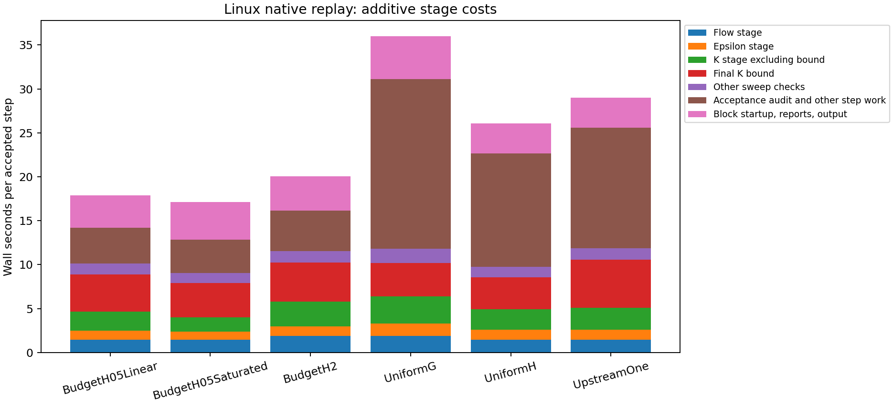

# Native campaign runtime diagnosis

The [later exact-reuse results](#exact-reuse-update) use a corrected uncached
audit reference and include validated production handoffs. The original timing
study below remains preserved as historical evidence.

2026-11-09, Asia/Shanghai. Branch `codex/cls-epawf-pimple-one-sweep`; inspected/fetched base `35c0c93b22ea6b1905875a93c5f6b36a7180ce3c`. Timing implementation: `9596389009e73a7ef2930393c7bbed41b6645b8b`. The later Python/report changes add a timing-disabled control and correct a derived work-field alias; they do not change C++ or the frozen image. [Compact evidence](cls-awf-campaign-timing-evidence/native.json) and [artifact index](cls-awf-campaign-timing-evidence/artifact-index.json) retain the precise source hashes, checkpoints, runtime and commands.

Admissibility inventories and constitutive audits dominate this serial pilot. Their exclusive CPU time accounts for 71–76% of the entire native block, including startup/output. All four governing-equation factorizations/solves together consume 0.014–0.055 CPU-seconds per step. Matrix assembly and pressure construction are also small. No production executable, library, XML, work limit, physical parameter or acceptance check was changed.

## Measurement and validation

Six immutable, completed eight-step blocks were copied with their actual XML and start/end native checkpoints. The timed solver replayed exactly those blocks, with only restart/output paths changed. Each of the 48 replay steps retained one vector U predictor, one p/gauge solve, one outer-epsilon solve, one k solve, one logical bound call, one callback and zero additional governing solves. Final coupled coefficients, physical time and every native history/time slot matched the archived production endpoint bit for bit. An additional eight-step H2 replay with timing disabled also matched. [Per-step hash receipts](cls-awf-campaign-timing-evidence/step-hash-validation.json) additionally confirm incoming/callback-history/raw/corrected equality at every one of the 56 replayed steps. These are isolated diagnostic replays, not extra work inside a production step.

Linux Release/GCC 11.4, `-O3 -DNDEBUG -fno-fast-math -ffp-contract=off -D_GLIBCXX_ASSERTIONS`, matching the production builds. One rank and all six computational-thread controls=1. Build parallelism=4; at most two serial replays ran concurrently with six production campaigns. The copied source-compatible SpatialDomains dependency and all linked libraries were frozen separately. The shared build/install and live runtimes were untouched.

`RANSWallTimingChecks` and the existing `RANSKBoundQPChecks` passed on Linux. The timing test covers opt-in/default-off behavior, nesting, physical-step context, explicit stop, exception unwinding and additive partition. Every complete native trace passed the parent/child time-partition check.

`NEKTAR_RANS_TIMING_FILE=/absolute/unique-per-process.jsonl` enables buffered hierarchical steady-wall/process-CPU timers. It is outside physics/checkpoint signatures. This writer is for the supported single-rank pilot; use a unique file per process. Inclusive and exclusive numbers must not be added together.

## Actual costs

The following are mean **wall seconds per accepted step**, amortizing startup/final output over the same eight-step block. The first seven cost columns partition native runtime. Flow/scalar stages include their checks and bookkeeping; they are not just linear solves. Python parsing/compression is outside these totals.

| Case | Flow | Epsilon | K excluding bound | Bound | Other sweep checks | Audit/other step | Startup/output per step | Native total |
|---|---:|---:|---:|---:|---:|---:|---:|---:|
| Budget H=2 cutoff-v1, Regularized/Linear | 1.89 | 1.10 | 2.82 | 4.42 | 1.33 | 4.61 | 3.91 | 20.07 |
| Budget H=.5 graded, Regularized/Linear | 1.47 | 1.02 | 2.14 | 4.23 | 1.23 | 4.09 | 3.68 | 17.87 |
| Budget H=.5 graded, Regularized/Saturated | 1.45 | 0.91 | 1.62 | 3.91 | 1.13 | 3.83 | 4.25 | 17.11 |
| Uniform G, H=.5 graded | 1.89 | 1.40 | 3.12 | 3.76 | 1.63 | 19.31 | 4.86 | 35.97 |
| Uniform H, H=.5 one element | 1.45 | 1.15 | 2.31 | 3.62 | 1.22 | 12.90 | 3.42 | 26.06 |
| Upstream H=.5 one element | 1.42 | 1.15 | 2.49 | 5.46 | 1.32 | 13.74 | 3.42 | 29.01 |



The same completed production segments give the following operational comparison. The 32-step production averages include the existing driver’s work through its block receipt; its final gzip occurs after that receipt. They are not controlled instrumented-versus-original speed ratios.

| Case | Replayed global steps | Production wall s/step, preceding 32 steps | Native replay wall s/step | Native replay CPU s/step |
|---|---:|---:|---:|---:|
| Budget H=2 cutoff-v1, Regularized/Linear | 2576–2584 | 19.74 | 20.07 | 16.16 |
| Budget H=.5 graded, Regularized/Linear | 3568–3576 | 15.56 | 17.87 | 14.44 |
| Budget H=.5 graded, Regularized/Saturated | 3488–3496 | 15.12 | 17.11 | 13.81 |
| Uniform G, H=.5 graded | 4656–4664 | 34.55 | 35.97 | 32.56 |
| Uniform H, H=.5 one element | 5952–5960 | 27.48 | 26.06 | 24.04 |
| Upstream H=.5 one element | 4392–4400 | 31.30 | 29.01 | 27.16 |

### Equation assembly and direct solution

CPU milliseconds per step isolate computation from file waits/descheduling. “Solve” includes factorization, triangular solution and its linear-residual validation. Pressure construction includes the consistent-mass factor and its pressure-column applications. Flow assembly builds the native coupled flow block. These are nested costs already included in the preceding table.

| Case | Flow assembly | U solve | Pressure construction | p solve | Epsilon assembly | Epsilon solve | K assembly | K solve |
|---|---:|---:|---:|---:|---:|---:|---:|---:|
| Budget H=2 cutoff-v1, Regularized/Linear | 242.74 | 45.72 | 124.45 | 0.30 | 7.36 | 0.86 | 61.00 | 7.85 |
| Budget H=.5 graded, Regularized/Linear | 200.84 | 22.29 | 54.66 | 0.33 | 11.06 | 1.84 | 62.81 | 4.70 |
| Budget H=.5 graded, Regularized/Saturated | 192.83 | 21.51 | 61.32 | 0.31 | 10.50 | 2.04 | 54.36 | 4.56 |
| Uniform G, H=.5 graded | 220.11 | 20.98 | 57.46 | 0.25 | 131.00 | 2.00 | 114.16 | 4.11 |
| Uniform H, H=.5 one element | 166.76 | 9.60 | 24.57 | 0.10 | 108.68 | 1.74 | 97.60 | 2.09 |
| Upstream H=.5 one element | 191.78 | 10.96 | 25.57 | 0.11 | 102.99 | 2.00 | 88.90 | 2.48 |

### Where the time goes

| Case | Scalar-domain scans/step | Domain scan wall s/step | Final acceptance audit wall s/step | Checkpoint wall s/step | Attempt-snapshot wall s/step |
|---|---:|---:|---:|---:|---:|
| Budget H=2 cutoff-v1, Regularized/Linear | 9 | 9.32 | 4.25 | 0.17 | 1.62 |
| Budget H=.5 graded, Regularized/Linear | 9 | 8.46 | 3.75 | 0.13 | 1.06 |
| Budget H=.5 graded, Regularized/Saturated | 9 | 7.93 | 3.61 | 0.07 | 0.59 |
| Uniform G, H=.5 graded | 9 | 8.27 | 18.76 | 0.05 | 1.70 |
| Uniform H, H=.5 one element | 9 | 6.77 | 12.46 | 0.08 | 1.12 |
| Upstream H=.5 one element | 11 | 7.89 | 13.25 | 0.05 | 1.28 |

Domain-scan totals overlap with the bound, stage checks and acceptance audit; this table is explanatory, not additive. Nine scans occur in the inactive-bound and Uniform-H blocks, eleven in the Upstream active-bound block. The traces also show eight full residual evaluations, eighteen matching-constraint evaluations and fourteen dependent refreshes per physical step. These evaluations are not additional transport solves.

Uniform G’s acceptance audit is 18.76 wall s/step: 16.57 s is in the physical/reconstruction audit, about 1.03 s in its scalar-domain scan, and 1.15 s in the remaining complete-audit work. Uniform H has 10.72 s of physical audit inside its 12.46 s acceptance audit. Budget H2 has only .64 s of physical audit inside its 4.25 s acceptance audit; its additional complete-observation covariance loop costs about 2.51 s. Thus the legacy fully reconstructed/capped-closure audit is a major reason the Uniform cases cost more. The timers identify the routine and source call sites; they do not isolate every constitutive kernel instruction.

| Case | Bound activations / 8 | Bound wall s/step | Inventory inside bound | Separation inside bound | QP factorization | Active-set algebra |
|---|---:|---:|---:|---:|---:|---:|
| Budget H=2 cutoff-v1, Regularized/Linear | 0 | 4.345 | 4.114 | 0.012 | 0.0000 | 0.0000 |
| Budget H=.5 graded, Regularized/Linear | 0 | 4.106 | 3.786 | 0.018 | 0.0000 | 0.0000 |
| Budget H=.5 graded, Regularized/Saturated | 0 | 3.823 | 3.551 | 0.013 | 0.0000 | 0.0000 |
| Uniform G, H=.5 graded | 0 | 3.655 | 2.988 | 0.048 | 0.0000 | 0.0000 |
| Uniform H, H=.5 one element | 8 | 3.544 | 2.498 | 0.552 | 0.0170 | 0.0074 |
| Upstream H=.5 one element | 8 | 5.361 | 3.394 | 1.340 | 0.0168 | 0.0246 |

The native bound timer ends just before its final JSON serialization; the scoped bound timer includes the complete call, hence their small difference. The subcosts omit bookkeeping/report construction and are not asserted to sum to the bound total. Even with active repair, most time is inventory/separation work. Uniform H uses 22 KKT solves/step and Upstream 56–61, but their measured algebra is only .007–.025 s/step. The inactive cases perform zero QP/KKT work while still checking the complete inventories. The previous exceptional projection timeouts remain separate terminal evidence.

Cold/restart object construction plus initialization costs 9.8–25.8 wall seconds per eight-step block. Final report generation adds 3.9–9.1 s/block; field output, final budgets, framework startup/finalization and file waits account for the remaining block overhead. Python report loading/checking/gzip adds about .19–.98 s/step in the separate replay measurements, primarily compression. This does not include every production ledger fsync or runtime-library hash.

For the identical H2 block, timing-on used 160.53 wall / 129.29 process-CPU seconds, and timing-off used 149.49 wall / 130.50 child-CPU seconds. Both are bitwise equivalent. CPU differs by less than 1%; wall differs by 7.4%. One pair is not a formal overhead bound, and the CPU metrics have slightly different MPI-helper coverage. The trace is only about .58 MB/1,992 scopes for the whole H2 block. Wall times include variable filesystem/wait effects and concurrent load. A short host sample showed 92–93% aggregate idle CPU and negligible sampled run-queue delay; no CPU-affinity collapse was found (all solvers allowed CPUs 0–127).

## Next useful optimization

The first priority is reuse/deduplication of geometry-dependent evaluation rows and repeated scalar-inventory results, with an exact state/time/data/configuration key and all declared locations retained. Next, avoid recomputing identical refreshed residual/constraint diagnostics and reduce the frequency of nonessential reconstruction reports. Longer checkpointed blocks can amortize 10–26 seconds of repeated initialization, but will not remove the per-step hard audit cost. The column-average rows already have a cache; replacing that cache is not the identified task. Snapshot writes cost .6–1.7 wall s/step: an output policy that avoids writing then deleting unselected accepted dense packets is another secondary target, provided detailed failure recovery is retained.

Dense momentum/pressure/scalar linear-algebra optimization is a low priority at these pilot sizes. Reusing a velocity mass factor may save milliseconds, while inventories/audits consume seconds. No proposed reuse or reporting change has been installed in a running campaign; preserving every hard acceptance condition and bitwise step/history behavior would be required before adopting it.

## Observed production frontiers

Capture beginning **2026-11-09 09:55:41 Asia/Shanghai**. These are native-checkpoint-verified accepted frontiers, separate from the replay endpoints. All six drivers were alive and the frozen executable hashes matched. No campaign was restarted or modified. Exact per-case capture times, native identities, checkpoint and history hashes are in [latest-status.json](cls-awf-campaign-timing-evidence/latest-status.json).

| Campaign | Status | Accepted steps | Accepted T | Next automatic target T |
|---|---|---:|---:|---:|
| Budget H=2 cutoff-v1, Regularized/Linear | running | 2680 | 1.675000 | 2 |
| Budget H=.5 graded, Regularized/Linear | running | 3696 | 2.310000 | 5 |
| Budget H=.5 graded, Regularized/Saturated | running | 3614 | 2.258750 | 5 |
| Uniform G, H=.5 graded | running | 4720 | 2.950000 | 5 |
| Uniform H, H=.5 one element | running | 6030 | 3.768750 | 5 |
| Upstream H=.5 one element | running | 4462 | 2.788750 | 5 |

This is a performance diagnosis, not a new physical-convergence or constitutive-qualification claim. Running continuations retain their prior scientific interpretation.

## Runtime, storage and reproduction

Heavy root: `/media/jay/新加卷/nektar-v2026-runs/cls-awf-campaign-timing-20261109`. Frozen timed image SHA256: `5201b9ad007d63d4c6f25380c18c7bd2063b93c378933f108053f50afc011022`. The 37-library closure, copied geometry hash, exact C++ source hashes and GCC flags are in the compact evidence. Linux Git base was 35c0c93 plus the byte-for-byte C++ diff committed as 9596389; the archive records that dirty source state explicitly. The Python control/report extension is separately hashed. No unrecorded source update of the timed image occurred.

`replays/<case>/capture.json` binds the original XML and native checkpoints; `start/` and `expected/` are immutable copies. `timed/` retains raw/corrected packets, frozen k matrices, native checkpoints, full report gzip, trace and log. `result.json` records the endpoint/history comparison and complete hierarchical timings. `BudgetH2/untimed/` and `result-untimed.json` contain the overhead control. The 256-entry artifact index hashes these files and the six current checkpoint copies; library hashes are indexed through `runtime/identity.json`.

Build (Linux, a new isolated source/build, never the running image):

```bash
source /home/jay/.local/opt/nektar-v2026-mpi/env.sh
export OMP_NUM_THREADS=1 OPENBLAS_NUM_THREADS=1 MKL_NUM_THREADS=1 BLIS_NUM_THREADS=1
export VECLIB_MAXIMUM_THREADS=1 NUMEXPR_NUM_THREADS=1
R=/media/jay/新加卷/nektar-v2026-runs/cls-awf-campaign-timing-20261109
cmake -S "$R/source/solvers/IncNavierStokesSolver/Tests/RANS" -B "$R/build" \
  -DRANS_BUILD_SOLVER=ON -DCMAKE_BUILD_TYPE=Release \
  -DNektar++_DIR=/home/jay/.local/opt/nektar-v2026-mpi/lib64/nektar++/cmake \
  -DRANS_PREBUILT_SPATIAL_LIBRARY="$R/dependency/libSpatialDomains.so.5.9.0" \
  -DCMAKE_CXX_FLAGS="-fno-fast-math -ffp-contract=off -D_GLIBCXX_ASSERTIONS"
cmake --build "$R/build" --target IncNavierStokesSolver RANSWallTimingChecks RANSKBoundQPChecks --parallel 4
ctest --test-dir "$R/build" --parallel 1 --output-on-failure \
  -R "^(RANSWallTimingChecks|RANSKBoundQPChecks)$"
```

For an exact replay, create a **fresh** output directory and copy only `capture.json`, `production.xml`, `start/` and `expected/` for each desired case from the retained capture into it. Existing output directories are intentionally refused. Then:

```bash
TOOLS="$R/source/solvers/IncNavierStokesSolver/Tests/RANS"
export LD_LIBRARY_PATH="$R/dependency:$LD_LIBRARY_PATH"
# NEW is the fresh output containing the retained per-case input copies.
python3 -B "$TOOLS/profile_cls_awf_campaign.py" --output "$NEW" \
  --solver "$R/build/IncNavierStokesSolver" --parallel 2 --timeout 1800
python3 -B "$TOOLS/profile_cls_awf_campaign.py" --output "$NEW" --untimed-control BudgetH2
python3 -B "$TOOLS/analyze_cls_awf_campaign_timing.py" "$NEW" \
  --output "$NEW/analysis.json" --plot "$NEW/stage-costs.png"
```

To capture a newer completed production block instead, repeat `--campaign name=/absolute/trajectory` in a fresh output invocation without `--solver`, then run the replay command. That measures a newer state, not the exact archived timing fixture. The current analysis is for the retained state/time/configurations, not a universal performance guarantee.

<a id="exact-reuse-update"></a>

## Corrected-audit exact reuse (2026-11-09)

The new performance reference is the separately frozen **corrected uncached**
`NativeElementSideV2` implementation (`8a3ff79`), not the old interface rejection.
Cache implementation `232b663` is opt-in through
`RANSWallEvaluationReuse=ExactStepV1`; `Off` remains the default and forced
verification path. Compiler/arithmetic flags and the complete dependency
closure match the reference. No physical selector, equation, timestep, field
relaxation, inventory, floor or projection work limit changes.

Fixed reconstruction/surface rows and geometry-to-element maps belong to an
immutable patch catalog. Numerical row reuse keys include field/block, native
geometry/element, actual radial side and exact coordinate bits; observation
membership, ordering and witness ties remain intact. Moving rows are scoped to
one evaluation transaction. The implementation bounds four exact full-state
contexts, 524288 moving rows, 4096 owned profiles and 32 domain-query keys per
state. No campaign-long moving-coordinate table is accumulated.

The implicit callback owns the short-lived context through its final acceptance
audit. Full state bytes, exact time, immutable-data generation/fixed-boundary
bytes, coverage flags and ordered additional anchors identify scalar-domain
requests. Cached results retain observations, phase/count outputs, effective and
trace states and both coverage inventories. Failures are recomputed. K-only
validation can supply the safe prefix for full completion; normalization still
follows required k-domain checks. Residual keys also contain full callback
history, alpha, anchoring, regional and constraint options. A residual hit
refreshes dependent ray state before returning.

Only the accepted budget formulation has an additional proven scalar dependency
reuse: with identical complete k/epsilon coefficient bytes, its scalar inventory
and dependent trace are independent of changed U/p. Full state contexts remain
distinct and both returned full states are rebound to the current candidate.
Every coefficient is checked finite before this reuse. This rule is disabled
for state-dependent transition/capped paths. Tensor/gradient hard audits still
evaluate the actual current velocity. Legacy normalization reuse instead keys
the exact full state and owned immutable profile/branch/quadrature, anchor and
coverage context; sampled K alone is insufficient.

Two final native contract fixtures each pass 34 compared cached/uncached queries,
including changed non-k versus scalar fields, signed zero, time, generation,
external data, history, alpha/options, flags, anchors, foreign data, radial sides,
tangential geometries and the unregistered-consumer tripwire. Native acceptance,
genuine covariance rejection, active-bound rollback and the repaired interface
case preserve complete stage/history bits. The focused durability, handoff,
projection-helper and timing tests are indexed with the numerical evidence.

Three alternating eight-step pairs per representative case give the following
paired medians. Each pair includes report parsing/checks/compression and keeps
native checkpoint and dense attempt-packet writes enabled. Full receipts retain
all individual timings, exclusive costs, CPU and RSS, not just these ratios.

| Case | Median replay-driver speedup | Median native CPU speedup |
|---|---:|---:|
| Refined H2 Regularized/Linear | 1.70x | 1.84x |
| Active-bound Upstream one element | 1.86x | 1.98x |

The roughly 2x H2 eight-step end-to-end target was not fully met. The result is
still a material reduction, with remaining complete covariance evaluation,
large inventory bookkeeping and durable output visible in the subtimers.
The first 65536-row prototype churned its table; bounded larger storage and
avoiding row copies fixed that measured deficiency. That prototype and its
interrupted diagnostic benchmarks remain indexed separately, not reported as
numerical rejections.

Thirty-two-step and four-eight-step comparisons retain every hard per-step
check and checkpoint. Their governing vectors, pressure/gauge, correction
results and native payloads are compared exactly. Cache peaks are bounded per
step rather than growing with the number of moving coordinates encountered
across a block. The final block timings, cold/continued costs and checkpoint
proofs are in the [new evidence](cls-accepted-budget-awf-evidence/audit-cache-temporal/native.json).
No 64-step experiment or selective-packet-output change was needed.

Validated adoption uses a separate successor root and frozen library closure.
It re-audits the actual accepted parent checkpoint, compares isolated uncached
and cached restart steps, retires only the identified old owners at a completed
native boundary, and observes the first successor checkpoint matching the
isolated result. The successor supervisor retains the parent campaign lock;
a handoff receipt/seal prevents ordinary stale-source resume. Native coefficients,
all GLM slots/time labels, physical signature and dt are preserved. Old runtime
files and campaign evidence remain intact. Actual handoffs/frontiers, rather
than planned future times, are recorded in
[latest-status.json](cls-accepted-budget-awf-evidence/audit-cache-temporal/latest-status.json).

The final H2 32-step block costs 358.25 replay-driver seconds versus 463.20
for four eight-step blocks (22.7% less). The active legacy case costs
452.21 versus 554.94 seconds (18.5% less). Peak RSS is respectively
1543896/1525788 KiB for H2 and 1106724/1088100 KiB for the active case
(32-step/four-eight-step maximum). The eight-step H2 cached median RSS is
1516676 KiB versus 654616 KiB with reuse Off. Faster exact reuse therefore
uses appreciably more memory; its bounded storage is not free.

The long H2 block peaks at 437613 moving rows, four states and 625 profiles;
the active case peaks at 375849 rows, four states and 1142 profiles. Both stay
below the configured caps, with zero moving-row table evictions in these
32-step tests. The legacy normalization cache computes 41671 of 887103
requests, reusing 845432. A separate heavy Uniform-G audit replay gives
2.08x driver/2.47x CPU speedup with identical states, audits and histories.

Paired-median **exclusive CPU seconds per physical step** isolate the largest
changed work. These per-group medians describe the runs; individual complete
timing trees, rather than sums of separate medians, satisfy the partition test.

| Work | H2 Off | H2 ExactStepV1 | Active legacy Off | Active legacy ExactStepV1 |
|---|---:|---:|---:|---:|
| Scalar inventory computation | 11.648 | 3.570 | 8.012 | 3.623 |
| Complete audit, excluding children | 2.671 | 1.979 | 2.692 | 2.035 |
| Physical/reconstruction audit, excluding children | .457 | .360 | 9.284 | 2.512 |
| Residual, excluding children | .598 | .400 | .552 | .334 |
| Constitutive refresh | .193 | .169 | .487 | .174 |

The H2 median inclusive physical-step CPU drops from 17.001 to 8.526 seconds.
Its optimized equation costs remain small: flow assembly .283 CPU s/step,
momentum factor/solve/validation .0483, pressure construction including mass
factor .1227, pressure solve .00049, epsilon assembly/solve .00823/.00125,
and k assembly/solve .06695/.00912. Bound-call inclusive CPU is 1.523 seconds,
mostly required inventory work even though bounding is inactive. Complete
audit inclusive CPU is 2.531 seconds. These inclusive numbers overlap with
their child costs and must not be added to the exclusive table.

`performance.timing_statistics` retains cold-restart overhead outside physical
steps, first physical-step versus continued-step wall costs, all major timers
and individual alternating pair receipts. Native wall/process CPU, replay-driver
wall including report compression, and operational production block receipts
are distinct measurements. Cached H2 medians are 10.43 seconds for the first
physical step, 9.87 for continued steps and 22.25 outside physical steps per
eight-step restart block. The active case gives 14.54, 13.41 and 18.07 seconds
respectively. The first successor block receipts measure 326.00,
241.36 and 238.10 seconds for 32 steps of H2, H=.5 Linear and H=.5 Saturated;
their final gzip is outside that existing receipt timer. These different-state
operational measurements are not substituted for the controlled paired speedup.

Reproduction uses fresh output directories and the frozen images; it does not
pause or resume a production campaign:

```bash
source /home/jay/.local/opt/nektar-v2026-mpi/env.sh
export OMP_NUM_THREADS=1 OPENBLAS_NUM_THREADS=1 MKL_NUM_THREADS=1
export BLIS_NUM_THREADS=1 VECLIB_MAXIMUM_THREADS=1 NUMEXPR_NUM_THREADS=1
R=/media/jay/新加卷/nektar-v2026-runs/cls-awf-audit-cache-temporal-20261109
P=/media/jay/新加卷/nektar-v2026-runs/cls-awf-campaign-timing-20261109
S="$R/source/solvers/IncNavierStokesSolver/Tests/RANS"
python3 "$S/verify_cls_awf_evaluation_reuse.py" \
  --probe "$R/runtime-cache-final/probe/RANSWallResolutionProbe" \
  --fixtures "$P/replays" --interface-xml "$R/cache-contract-final/interface.xml" \
  --output "$R/reproduce-cache-contract"
python3 "$S/benchmark_cls_awf_evaluation_reuse.py" \
  --fixtures "$P/replays" \
  --reference-solver "$R/runtime-audit-uncached/solver/IncNavierStokesSolver" \
  --optimized-solver "$R/runtime-cache-final/solver/IncNavierStokesSolver" \
  --reference-results "$R/benchmarks-v1" --pairs 3 --long-blocks \
  --output "$R/reproduce-cache-benchmarks" --timeout 7200
python3 "$S/verify_cls_awf_checkpoint_equivalence.py" \
  --benchmarks "$R/reproduce-cache-benchmarks" \
  --reference-results "$R/benchmarks-v1" \
  --output "$R/reproduce-checkpoint-equivalence.json"
```

The isolated authoritative build additionally uses
`-DRANS_PREBUILT_SPATIAL_LIBRARY=$R/dependency/libSpatialDomains.so.5.9.0`;
its exact dependency SHA and frozen linked-library closure are indexed.
No fast-math/FP-contract flag, inventory, physical timestep, work limit or
output-durability change is included in these measurements.
