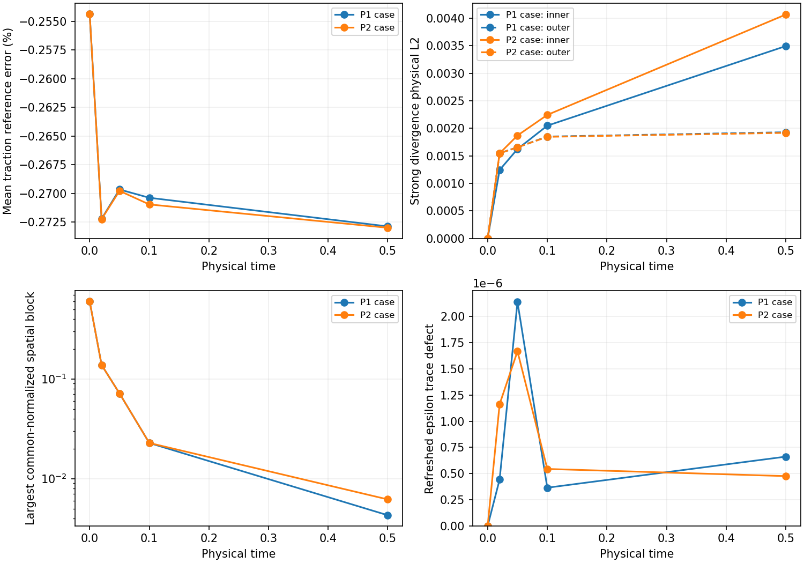
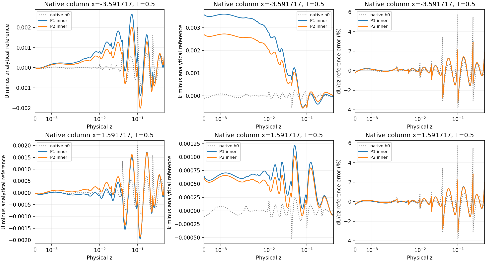

# H=.5 cutoff-v1 AWF: controlled inner-pressure P2 test

**2026-11-11:** the fresh exact-control-closure pilot completed all 800 steps
through T=.5. Inner P2 does **not** remove the traction departure at this
horizon: .159563194 versus P1 .159563386 (reference .16). Inner strong
divergence is 16.4% higher; k spatial residual is 44.1% higher, while epsilon
spatial residual is 45.2% lower. Neither case used positivity correction.
Both are transient at T=.5. A separate ordinary continuation of the new P2
case is running toward the unchanged complete steady screen, capped at T=6;
it has already advanced beyond its own T=.5 parent. The qualified P1 control
and completed H2 datasets remain immutable.

Compact native evidence is [native.json](cls-awf-inner-pressure-evidence/native.json).
The [dated live-status capture](cls-awf-inner-pressure-evidence/latest-status.json),
[restart proof](cls-awf-inner-pressure-evidence/continuation-compatibility.json)
and [artifact index](cls-awf-inner-pressure-evidence/artifact-index.json)
locate the immutable checkpoints, histories, packets, readbacks and runtime
identities. Frozen transport `matrix.bin` files are A_k, not projection M_ff.

The preceding package qualified a P1-inner/P1-outer selected discrete steady
candidate through three complete half-unit windows, ending at T=4.02. Its
remaining traction deficit is .2558%, and its inner strong-divergence L2 is
.00940571. This experiment changes **only inner pressure from P1 to P2**.
It tests pressure-space sensitivity; it does not assume pressure degree is
the sole source of reference error.

The [predeclared policy](cls-awf-inner-pressure-evidence/policy.json) fixes
the matched problem, pilot endpoints, norms, numerical comparison floors,
resource limits and bounded continuation decision before execution. Heavy
artifacts are under
`/media/jay/新加卷/nektar-v2026-runs/cls-awf-inner-pressure-p2-20261111`.

## Implemented control

`--pressure-space inner-p2-v1` is restricted to `Accepted-AWF-05G` with
`cutoff-v1`. The existing default and the separate H2 outer-P2 control retain
their previous generated XML. The new control has native field sizes
`[784,784,784,400,187,54,1]`: 2,994 coupled unknowns, within the unchanged
3,000-unknown pilot limit. Inner pressure has quadratic tensor expansions;
outer pressure remains linear. Velocity, k and outer epsilon remain cubic.
Both regional pressures and the single common gauge remain separate.

The flat mesh has five tangential panels and sixteen vertical panels (eight
inside and eight outside H), for 80 quadrilaterals. Its vertical knots are
`0,.0025,.005,.01,.02,.04,.1,.25,.5,1,2,7/3,8/3,3,10/3,11/3,4`;
tangential knots are `-4,-3,-2,-1,1,2`. Native points remain 8x8 and source
quadrature remains 16x8. The free vector-velocity system stays at 1,316
unknowns; the pressure/gauge system grows from 109 to 242. Its 242 consistent
velocity-mass inverse applications per step are separate from the single
momentum-equation solve.

The physical mesh, H=.5, endpoint K=k(H), z_K=z_m=H, h=.1, nu=1.5e-5,
u_star=.4, calibrated budget cutoff, actual P_h-E_C source and zero forcing
are unchanged. The selected companion is Regularized/Linear. Native IMEX1
uses dt=.000625, unit relaxation, one U/p/epsilon/k solve and one logical
final bound call. ExactStepV1, NativeElementSideV2, AcceptedBudgetV1,
RetainedPool, floor 1e-8 and controls 2000/20000/2000/900 remain selected.

The native signature already binds every field's dimension, regional
geometry, basis modes and quadrature. Thus the changed pressure space has
a strict restart identity without adding an unused physical parameter.
No checkpoint migration, pressure coefficient injection, trace restoration
or extra transport solve is used.

## Focused Linux qualification

The generated default H=.5 and existing H2 outer-P2 XML match the archived
3714cf3 generator exactly after normalizing transient output paths. The
new case has identical geometry, physical parameters, source quadrature,
controls and non-pressure expansions. Unsupported combinations are rejected.

The exact-control-closure native checks in `verification-matched` pass:

- Actual 2,994-unknown native initialization and inactive startup bound.
- Bitwise identical U/k/epsilon seed coefficients, differential history
  slots and time labels against P1. All initial physical differences,
  including commonly aligned pressure, are exactly zero.
- Two uninterrupted steps equal one step plus restart bitwise in coupled
  state, native histories/time labels and complete checkpoint payload.
- A deliberate post-solve hard rejection retains the actual candidate and
  restores the accepted coupled state, physical time and native histories.
- P1-to-P2 and P2-to-P1 ordinary restarts both reject signature mismatch.

Initialization uses the established native zero-perturbation projection
and two initialization Lift iterations. These are separate from physical
steps. Verification performs five solves of each governing equation in
independent test paths; production is a separate fresh h0 trajectory.
The earlier exploratory-closure verification also performed five solves
per equation; its receipts remain separate. Neither set is counted as
production evolution. Direct readback comparison additionally finds exact
equality in all 120 analytical/reference/retained physical weak-load vectors
through the unchanged first four field blocks at t=0.

## Runtime and comparison provenance

The solver is the unchanged Linux Release image used by the P1 pilot,
SHA256 `177ce5e54e7de514fa019122e46d3a5d709455cd091bd3023fbfa745c48c9bfc`.
No C++ change or rebuild is required for this native regional-expansion
control. The strict read-only probe is
`67e9d5093d8bdf164ca7fdf7dc97f5a5cb70a7012dce1096be399e45363f2a43`.
Source/configuration and focused tests are `b6c65b4`; matched readback
orchestration is `711eff8`. Both executable and linked-library closures
are immutable in the new run root. One rank and all six computational
thread controls one are explicit.

An initial healthy exploratory segment in `pilot` was stopped at step64,
T=.04, after checking dependency identities. It inherited the preceding
long-run library closure, which has a different `libSpatialDomains` image
from the original short P1 pilot. It is preserved as a separate dataset.
The definitive `pilot-matched` experiment starts freshly from h0 with
the **exact P1 pilot dependency bytes**; no preliminary checkpoint is used.
The native qualification was repeated under that exact closure before
launch. This avoids treating dependency provenance as an uncontrolled
pressure-space effect.

The analysis reuses hash-verified P1 readbacks and the existing strict
checkpoint observer. New P2 readbacks do zero governing solves, Lift calls,
physical commits or history advances. Physical integration panels are common;
epsilon covers the complete .5<=z<=4 region with the fixed E0*sqrt(12)
normalization. One pressure-mean shift across both regions preserves their
relative offset. Reference error, drift from actual h0, pressure-space
difference, selected residual and correction supply are separate metrics.

Matched native observations are requested at T=.02, .05, .1 and .5.
An observation is used only after its exact native checkpoint and completed
block report are published. The long P1 control remains immutable; it is
not rerun. The completed H2 dataset and other experiments remain untouched.

## Observed finite-horizon comparison

The initial physical fields and all unchanged weak loads agree exactly.
Both initial tractions are .159593022157, already .25436% below the .16
analytical reference. Changing pressure degree does not change that initial
velocity-gradient representation error. Evolution is measured from this
actual common native h0, rather than from a substituted analytical field.

At the additional immutable native checkpoints T=.2 and .3, P2 still has
positive covariance and no correction, but it does not improve inner strong
divergence or traction. These rows use the completed native audits and full
free-row spatial residuals; they are not interpolated field readbacks.

| Time | P1 traction | P2 traction | P1 inner divergence L2 | P2 inner divergence L2 | P1 normalized spatial k residual | P2 normalized spatial k residual |
|---:|---:|---:|---:|---:|---:|---:|
| .2 | .159569548400 | .159567285247 | .00237730 | .00273809 | .00361678 | .00446174 |
| .3 | .159568638312 | .159566833378 | .00254986 | .00310486 | .00347597 | .00566674 |

The exact discrete continuity/gauge equations remain satisfied near roundoff.
Their small defects do not imply pointwise incompressibility of the represented
velocity. Conversely, the nonzero strong-divergence norm is not a failed
pressure linear solve. Linear residuals remain below 2.1e-17 through the
captured step348 frontier, and the maximum continuity/gauge defect is 2.62e-16.
The physical frozen momentum splitting defect is recorded independently of
its much smaller identity-check defect.

### Completed T=.5 pilot

| Quantity | P1 inner / P1 outer | P2 inner / P1 outer |
|---|---:|---:|
| Native coupled unknowns | 2861 | 2994 |
| Mean kinematic wall traction | .159563386204 | .159563193617 |
| Traction reference error | -.272884% | -.273004% |
| Sampled native traction range | [.159414606, .159744706] | [.159290350, .159750510] |
| Inner strong-divergence physical L2 | .00349462 | .00406773 |
| Outer strong-divergence physical L2 | .00192952 | .00191836 |
| Common-normalized spatial U residual | .00290987 | .00354843 |
| Common-normalized spatial W residual | .00199291 | .00179579 |
| Common-normalized spatial k residual | .00428959 | .00618204 |
| Common-normalized full outer-epsilon residual | .00210015 | .00115155 |
| Physical velocity-vector reference-error L2 | .00183760 | .00182390 |
| Physical k reference-error L2 | .000736082 | .000823778 |
| Physical full outer-epsilon reference-error L2 | .000738421 | .000739399 |
| Physical dU/dz reference-error L2 | .124383 | .124676 |
| Physical dk/dz reference-error L2 | .0562505 | .0605848 |
| Inner production reference-error L2 | .0393042 | .0395279 |
| Interface full traction jump RMS | .00542804 | .00543354 |
| Interface normal traction jump RMS | .00115808 | .00115608 |
| Interface maximum sampled normal jump | .00173496 | .00178020 |
| Interface k-flux jump RMS | .000163593 | .000166180 |
| Refreshed epsilon matching defect | 6.61823e-7 | 4.76020e-7 |
| Actual frozen momentum splitting defect | 1.98178e-9 | 1.80907e-9 |
| Splitting-identity check defect | 7.84283e-20 | 1.07533e-19 |
| Bound activation / signed / absolute supply | 0 / 0 / 0 | 0 / 0 / 0 |

The P2-minus-P1 traction difference is -1.926e-7, below the predeclared
1e-5 practical comparison threshold. It is numerically resolved, not
roundoff. Common-normalized U/W/k/epsilon/pressure differences are
3.120e-4 / 2.329e-4 / 3.823e-4 / 1.071e-4 / 2.392e-3. The pressure mean
shift is -1.31e-17; one alignment preserves both regions' relative offset.
Physical norms use (integral q^2 dx dz)^1/2; common normalization remains
U*=.4, K0=.5105080131, E0=.0726358333, pressure=.16, V=24 and epsilon
reference volume=12. Epsilon is actually integrated over all .5<=z<=4
(physical area21), not truncated at z=2 or renormalized by area21.

The slightly smaller velocity-vector error does not imply a smaller gradient
error: both dU/dz and strong divergence are larger. Likewise the lower epsilon
spatial residual does not improve its reference-error norm. The retained
element diagnostics reproduce the regional divergence norms independently.
For P2 the largest inner contribution is in geometry3, x in [-1,1],
z in [0,.0025]; the next is geometry13 over the same x panel at
z in [.005,.01]. Native geometry and one-sided gradients are retained.
These observations locate numerical modes; they do not prove instability or
identify every mixed-space/interface contribution.

| Physical reporting region | P1 integral k | P2 integral k |
|---|---:|---:|
| 0<z<=.01 | .0539647145 | .0539544199 |
| 0<z<=.1 | .368130875 | .368086624 |
| Whole wall layer, 0<z<=.5 | 1.60212499 | 1.60211538 |
| First element, 0<z<=.0025 | .0147306963 | .0147280839 |
| Whole domain | 12.3225836 | 12.3225735 |

The small net integral difference does not erase the resolved local L2
difference. Instantaneous whole-domain production/destruction rates are
5.76170200 / 5.76135256 for P1 and 5.76175240 / 5.76141404 for P2.
These are rates at T=.5, not time-integrated changes. Exact discrete repair
budgets are separately zero. Complete signed weak-load projections, including
boundary reactions and cancellation, remain in the native artifacts and compact
evidence; component norms are not added as percentages of traction error.





Profile columns use the actual native tangential Gauss locations shown in the
titles. Cubic fields and their derivatives are recovered from the verified
common-rule samples; the analytical plotting function does not replace a native
gradient in any residual. The full norms above cover all physical panels,
including regions not represented by these two illustrative columns.

### Counts, cost and bounded continuation

All 800 completed native callbacks are accounted for: 800 outer sweeps,
800 vector momentum predictions, 800 pressure/gauge solves, 800 epsilon
and 800 k solves, and 800 logical bound calls. Additional governing,
restoration and KKT solves are zero. There are 193600 velocity-mass inverse
applications (242 per step), separately counted. The native block reports,
contiguous accepted ledger and immutable checkpoint copies agree.
The 26 completed native blocks separately perform 27 initialization Lift
calls/iterations (two on the first startup, one before each later checkpoint
load) and 26 unchanged-state startup bound checks. They are not hidden physical
step iterations or governing-equation solves.

Completed blocks consume 6370.87 wall seconds, 7.964 seconds per accepted
step including block processing. A sampled native VmHWM was 1377204 kB;
this is a sampled process high-water value, not a measured campaign-wide
peak. The observed high-water value and total wall time are below the unchanged
16GiB / eight-hour pilot limits.
Each native runtime has one computational thread; MPI helper threads are
accounted for in the shared worker checks. Other work remained below72 total.

The [continuation decision](cls-awf-inner-pressure-evidence/continuation-decision.json)
was made after observing T=.5. The mixed response and residuals above1e-3
make a separately settled P2 comparison useful. An exact parent copy of
checkpoint `547b9f811aaa3869cf39baabc5c929377a335967e256881e3460772b7207da98`
and byte-preserving native-report decompression seed `to-steady`; no checkpoint
signature, coefficient, reference, defect or history slot is edited.
Native step801 starts from exactly the parent coupled vector. The signature,
fixed reference, defect and dt are unchanged. The successor is an ordinary
compatible restart, not a changed-mesh or late-state-IVP initialization.
The first completed successor block reports one initialization Lift/iteration
on the temporary analytical reference constructed **before** checkpoint load.
It is then replaced by the saved reference and coupled/history data. The
startup bound's raw and corrected hashes both equal the exact parent vector;
reference/defect hashes are unchanged. This existing per-process setup work
is separate from physical steps. An exploratory expectation of zero ordinary
restart initialization work was corrected after inspecting this path; there
was no native rejection or time-map change. Strict diagnostic readbacks still
perform zero Lift work.

Automatic targets are steps1600,2400,...,9600 (T=1,1.5,...,6). A durable
supervisor and the existing scientific observer stop at the first three passing
half-unit windows, **including full outer epsilon**, or the T=6 cap. Numerical
rejection is terminal. At the measured pilot cost the maximum added interval
would require about19.5 wall hours; the scientific stop may occur earlier.
The completed T=.5 pilot is not a long-time or steady-convergence result.
Actual h0 bulk velocity is 5.11391934, giving a six-unit flow-through time of
1.17326841. H/u*=1.25; T=.5 spans only .4 wall times and .42616 flow-through
times. Settling must be assessed from persistent windows, not this horizon.

**Dated capture: 2026-11-11 11:59:47 Asia/Shanghai.**

| Dataset | Accepted global step / time | Actual disposition | Next automatic target |
|---|---:|---|---|
| Exact-control-closure P2 pilot | 800 / .5 | Completed all four requested observations | None |
| P2 `to-steady` successor | 928 / .58 | Running; driver, native child and supervisor identities verified | 1600 / T=1 |
| Preliminary P2 closure screen | 64 / .04 | Intentionally stopped at a complete boundary | None |

The successor checkpoint SHA256 is
`cc95cd52bae639d1d6f812b3ce69c227e12b49154eaab6df698dcaf95fb48e27`.
Supervisor PID626365, native PID632490 (current block929–960), and scientific
observer PID626366 match their recorded start identities. The observer is
`observing`, with no eligible three-window assessment yet. All 128 added
accepted callbacks/steps are accounted for, with zero activation/supply.
The latest snapshot is immutable; rotating live checkpoints are not used as
long-lived evidence. This is running continuation, not completed T=1 or T=6
qualification.

The evidence supports retaining the qualified P1 dataset as the current steady
reference. Inner pressure enrichment alone has not removed its finite-horizon
traction/gradient departure. Complete the one bounded P2 settling comparison
before attributing a steady-root change or scheduling another representation
family. No closure retuning, new limiter, extra outer correction or faithful
Original-CLS qualification follows from this test.

## Reproduction

Use the frozen solver/probe under `runtime-matched`, one rank and all six
computational-library thread variables one. Exact argument vectors and library
hashes are retained in the launch receipts and artifact index. The short form is:

```bash
source /home/jay/.local/opt/nektar-v2026-mpi/env.sh
export OMP_NUM_THREADS=1 OPENBLAS_NUM_THREADS=1 MKL_NUM_THREADS=1
export BLIS_NUM_THREADS=1 VECLIB_MAXIMUM_THREADS=1 NUMEXPR_NUM_THREADS=1
exp_root='/media/jay/新加卷/nektar-v2026-runs/cls-awf-inner-pressure-p2-20261111'
export LD_LIBRARY_PATH="$exp_root/runtime-matched/solver/lib"
python3 -B "$exp_root/source/solvers/IncNavierStokesSolver/Tests/RANS/supervise_cls_epawf_pimple.py" \
  --solver "$exp_root/runtime-matched/solver/IncNavierStokesSolver" --output "$exp_root/reproduction-unused" \
  --wall-policy CLSCalibratedBudgetAWF --accepted-awf-case Accepted-AWF-05G \
  --accepted-awf-companion regularized \
  --accepted-awf-companion-reason 'matched inner-pressure P2 sensitivity; faithful covariance blocker retained' \
  --inner-refinement cutoff-v1 --pressure-space inner-p2-v1 \
  --inventory AcceptedBudgetV1 --bound-solver RetainedPool \
  --evaluation-reuse ExactStepV1 --audit-revision NativeElementSideV2 \
  --targets 32 80 160 800 --block-steps 32 --timeout 7200 \
  --bound-max-add 2000 --bound-max-total 20000 --bound-max-separations 2000 --bound-max-seconds 900
```

`test_cls_awf_inner_pressure_cases.py --baseline-script <archived-3714-generator>`
checks generated inputs; `check_cls_awf_inner_pressure_native.py` performs the
independent native qualification. `analyse_cls_awf_inner_pressure.py` consumes
strict new checkpoints and hash-verified P1 summaries; `plot_...` and `collect_...`
reduce those results. `capture_cls_accepted_awf_status.py --campaign LABEL=...`
retains immutable live-status/checkpoint/history copies without running a PDE.

During collection the IPv4 SSH route temporarily timed out after both pilot and
readbacks completed. The same online Tailscale peer was reached over its IPv6
address using the established IPv4 host-key alias. No simulation interruption,
numerical retry or network-configuration change was made.
The working fallback was
`ssh -6 -o HostKeyAlias=100.105.247.110 jay@fd7a:115c:a1e0::472b:f76f`.
