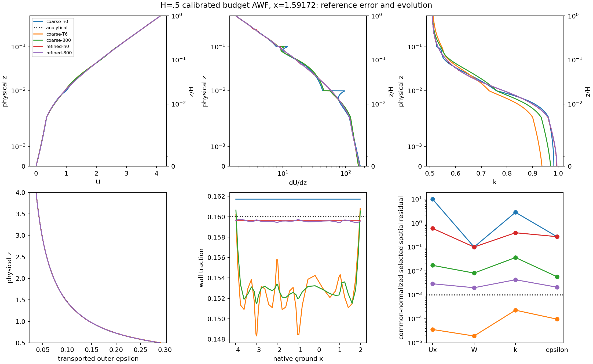

# H=.5 calibrated budget AWF: neutral-reference qualification

**Completion update, 2026-11-11 09:02 Asia/Shanghai:** neither continuation
remains running. The refined H=.5 case stopped under its authorized scientific
criterion; H2 completed its maximum T=6 target. There was no numerical
rejection in either continuation. The [terminal inspection](cls-awf-neutral-qualification-evidence/completion-20261111.json)
verifies checkpoint/report/reference/defect/native-history identities, actual
solve counts, complete steady windows and absence of remaining campaign
processes. This is read-only inspection, with zero new governing solves or
physical-time advance.

| Continuation | Final accepted frontier | Finished | Outcome |
|---|---:|---|---|
| H=.5 cutoff-v1 Regularized/Linear | 6432 / T=4.02 | Nov 11, 08:48 | Three complete steady windows passed through T=4; stopped after the next native block |
| H2 cutoff-v1 Regularized/Linear | 9600 / T=6 | Nov 10, 23:51 | Target completed; necessary steady residual gate still fails |

The refined screen passes on [2.5,3], [3,3.5] and [3.5,4], including the
actual full outer-epsilon norm. Normalized k changes are 7.93e-5, 5.20e-5
and 3.24e-5; full epsilon changes are 3.29e-5, 2.73e-5 and 1.89e-5. All
other unchanged field, residual, matching, traction and supply conditions
pass. Final selected alpha=0 U/W/k/epsilon residuals are
5.68e-5 / 3.19e-5 / 2.50e-4 / 1.14e-4, below the 1e-3 gate.
Final mean traction is .159590714, .2558% below .16. This is about eighteen
times smaller reference-traction error than the separately qualified coarse
T=6 candidate; two meshes still do not establish a spatial convergence order.
It is a selected discrete steady candidate, not faithful Original-CLS or
continuum qualification.

H2 finishes with normalized spatial U/W/k/epsilon residuals
.00120085 / .00076917 / .00220272 / .0000104409. U and k remain above
the unchanged 1e-3 limit, so close traction (.159627825, -.2326%) does not
establish steady convergence. Inner strong-divergence L2 grows from .0222473
at T=5 to .0261468 at T=6 while weak residuals decline. The bounded interval
therefore confirms persistence of that unresolved trend; no T=10 extension
has been launched.

Both continuations have **zero bound activations and zero signed, positive,
negative and absolute correction supply** over their 5632 and 1600 added
steps. Actual counters confirm one U/p/epsilon/k solve and one logical bound
call per accepted step, with no additional governing solves. Their final
checkpoint hashes are `a8dad94dfff868867dcb76b775ec277d00121354f77127e9dda87b4732d6803f`
and `73001b027b9763e656115e55ac040a2465a215f8c5873b95588a67907946a934`.
The inactive `next_target` value retained in the refined progress file does
not represent a queued continuation: its supervisor honored the scientific
stop request and exited.

This package starts from `303b712` on
`codex/cls-epawf-pimple-one-sweep`. The completed T=6 Linear/Saturated steady
screens, corrected interface audit, exact evaluation reuse and early H2
temporal study are retained qualifications, not repeated experiments here.
The primary model is **CLSCalibratedBudgetAWF, Regularized/Linear**. Legacy
Uniform G is a different equation set and is not the matched control.

Heavy evidence lives on authoritative Linux under
`/media/jay/新加卷/nektar-v2026-runs/cls-awf-neutral-qualification-20261110`.
The [predeclared policy](cls-awf-neutral-qualification-evidence/policy.json)
fixes domains, normalization, accuracy targets, cost limits and bounded
continuation decisions before execution.

## Preserved problem and implementation

All evolving cases retain endpoint K=k(H), z_K=z_m=H, h=.1, nu=1.5e-5,
u_star=.4, calibrated coefficients, budget cutoff and signed P_h-E_C source.
The named Regularized companion keeps cubic beta=.4, gamma0=0 and
regularization scale=1, giving gamma(z)=kappa_c*u_star*z; inner stress is Linear.
There is no prescribed redistribution, E_C/k reaction, cancellation forcing,
equation relaxation, additional outer sweep or epsilon-trace restoration.
Molecular diffusion remains inside; the selected outer equations remain
high-Re. Native IMEX1 executes one vector U, one p/gauge, one epsilon and one k
solve, and one logical final bound call per accepted step. ExactStepV1 and
NativeElementSideV2 remain enabled. Bound controls stay 2000/20000/2000/900,
with relative floor 1e-8. Initializations and diagnostic algebra are separate
from those production counts.

`LateStateIMEX1V1` explicitly reads a parent checkpoint at its **original** dt
and full physical signature/checksum. It imports all coupled coefficients,
reference/defect and external data, retaining the physical t0, then calls
native IMEX1 initialization to form independent new histories. It copies or
rescales no parent history slot and calls no Lift. Each IVP owns a new counter,
dt and checkpoint lineage. Ordinary changed-dt restart remains rejected.

The read-only neutral-balance extension evaluates analytical values **and
analytical gradients** directly under native test rows and quadrature. It
separately evaluates the archived coefficient-derived representation and
retained state; analytical gradients never replace native gradients in a
represented residual. Full transported epsilon covers .5<=z<=4, with the
unchanged E0*sqrt(12) normalization. Reporting panels split both meshes and
the reference cutoff. Native GL4 rows independently localize mass-dual
residuals; their summed physical norm agrees with the actual consistent mass.
Stored modified pressure is interpreted consistently with mechanical-gradient
recovery grad(pi)-(2/3)grad(k). Only one volume-mean gauge is removed across
both regional pressure fields; their relative offset is retained.

## Where departure enters

The archived native h0 and stored reference are numerically identical. Their
bits differ only in 44 signed zeros on the coarse mesh and 60 on the refined
mesh; there is no nonzero coefficient difference. Both objects remain
separately hashed. The reference is not regenerated and substituted for h0.
The modified reference has k(0)=.994298029 and k(H)=K0=.510508013;
its interior k varies to balance source and diffusion.

On the exact analytical neutral state, selected-versus-Original stress
difference is **zero** at the native outer integration points; maximum
production difference is 2.78e-17. The regularization vanishes on the exact
prescribed shear, and the cubic modification cancels there. Analytical weak
U/W/k/epsilon mass-dual norms are approximately
3.95e-13 / 1.03e-14 / 1.10e-13 / 9.10e-11. The small last value includes the
native integration rule. These are far below the represented-state loads.
The implemented continuum reference is therefore compatible at the tested
accuracy; a 4.59% unavoidable analytical Regularized-model offset is unsupported.
The nonconstant analytical k profile balances local source with diffusion;
pointwise production need not equal destruction. A small column integral alone
does not establish the all-mode weak balance tested here.

| Native initial representation | Coarse graded | cutoff-v1 graded |
|---|---:|---:|
| Coupled unknowns | 2261 | 2861 |
| Mean traction | .161711352 | .159593022 |
| Traction error versus .16 | +1.0696% | -.25436% |
| Velocity vector reference error, physical L2 | .00926585 | .00177215 |
| dU/dz reference error, physical L2 | 3.59175 | .156884 |
| k reference error, physical L2 | .00558943 | .000130796 |
| dk/dz reference error, physical L2 | 2.04375 | .0658930 |
| Inner production reference error, physical L2 | 1.28753 | .0493557 |
| Selected U spatial load, dimensional mass-dual norm | 3.86897 | .234347 |
| Selected k spatial load, dimensional mass-dual norm | 1.40615 | .196813 |
| Selected epsilon spatial load, dimensional mass-dual norm | .0135997 | .0135997 |
| Native inner integral P_h-E_C, rate | .0420027 | .000393433 |

The reference cutoff is .0146364333, budget ratio 4.53109424, velocity scale
.00535725133 and derived aerodynamic z0=.00530045955. Roughness input h=.1 is
not z0. Refinement adds only .0025/.005/.02/.04 below the same H=.5; outer and
tangential meshes and polynomial degrees remain unchanged. First-element
height/velocity-scale falls from 1.867 to .467. The coarse cutoff-containing
panel [.01,.1] becomes [.01,.02]. Production quadrature remains order 16
normal/order 8 tangential, with native 8x8 points, cubic U/scalars and linear
regional pressures. No ground-shear condition was added.

The unmodified outer representation still matters. On the archived projected
reference its largest sampled constitutive stress difference is .00805807 near
z=.990072, where represented dU/dz=.963237 rather than the analytical shear.
At T=6 the largest sampled difference is .00739348 near x=-3.980145,z=.990072,
native geometry 20. One-sided native gradients and both complete tensors are
retained. This is model/representation interaction, not analytical-reference
incompatibility. On the same T=6 fields, Original-operator U/W/k/epsilon
mass-dual norms are .0144721/.00632457/.00205541/.000866646, compared with
selected norms 1.408e-5/7.523e-6/1.150e-4/4.893e-6. This diagnostic does not
demonstrate successful Original-CLS evolution. Its same-state Original outer
covariance minimum on the shared native audit inventory and explicit neighbors
is positive, .165243, at x=2,z=1 (geometry 24). Thus the reported counterfactual
operator is not hiding a negative covariance witness at these retained fields.

## The coarse T=6 balance

Mean traction is .152655352, 4.5904% below reference, despite three passing
steady windows and zero correction supply. Inner/outer strong-divergence L2
is .0586433/.00273633. About 93% of inner squared divergence lies below z=.1;
the [.01,.1] panel contributes about 66%. Initial divergence was near roundoff.
The evolved field has developed unresolved within-element variation while
satisfying the weak continuity and common gauge constraints near roundoff.

The interface has full/normal traction-jump RMS .00556248/.00142450 and
k-flux-jump RMS .000212342. Its maximum absolute sampled normal jump is
.00447793 (index4), distinct from normal RMS (index2). The solved epsilon trace is retained; its refreshed
matching discrepancy is 4.388e-8. These spatial quantities are distinct from
the tiny frozen linear-system and splitting-identity residuals.

Signed mass-dual projections onto the remaining selected residual preserve
cancellation. For k, advection +.00543666, diffusion +.09469713, inner
production -3.20452006, inner destruction +3.10453054, outer production
+.00926790 and outer destruction -.00929718 sum to .000115005. For epsilon,
advection -.000784423, diffusion +.0413132, production +.1222563,
destruction -.1630852 and Yap +.000304991 sum to 4.893e-6. These signed
projections are not additive fractions of the traction discrepancy.

Complete free-mode loads and prescribed-row reactions are retained. A
constant-test scalar balance, reconstructed and checked from the native mass
rows, gives total k volume load -.01452895, free contraction +.0000767594 and
prescribed reaction -.01460571 at alpha=0. The inferred outward reaction is
+.01460571. This is an exact discrete row accounting, including the remaining
free imbalance; it is not an assertion that an estimated local physical CG
control-volume flux closes exactly. Instantaneous rates are not accumulated
time-window amounts.

## Matched spatial trajectory

| Physical T | Coarse mean traction | Refined mean traction |
|---|---:|---:|
| 0 | .161711352 | .159593022 |
| .02 | .155890375 | .159564447 |
| .05 | .154792948 | .159568537 |
| .1 | .153842723 | .159567378 |
| .5 | .152964038 | .159563386 |

The fresh pilot completed all **800 accepted steps to T=.5**, with zero bound
activation or signed/absolute supply. Its independently archived zero-step
state matches the first production packet's committed state bitwise; reference
and native histories are separately checked. Fresh initialization reports two
Lift calls/two initialization iterations, outside physical-step work. Native
field sizes are [784,784,784,400,54,54,1], totaling 2861 below the 3000 limit.
The unchanged coarse trajectory is reused, not rerun.

| Matched T=.5 quantity | Coarse | cutoff-v1 |
|---|---:|---:|
| Mean traction relative error | -4.3975% | -.27288% |
| Velocity-vector reference error, physical L2 | .0150309 | .00183760 |
| dU/dz reference error, physical L2 | 2.06109 | .124383 |
| k reference error, physical L2 | .0141964 | .000736082 |
| dk/dz reference error, physical L2 | 1.68078 | .0562505 |
| Inner production reference error, physical L2 | .630151 | .0393042 |
| Full outer epsilon reference error, common normalized | .00297881 | .00293469 |
| Inner / outer strong-divergence L2 | .0202283 / .00206279 | .00349462 / .00192952 |
| Full / normal traction-jump RMS | .00545277 / .00120508 | .00542804 / .00115808 |
| Maximum absolute sampled normal jump | .00184986 | .00173496 |
| k-flux-jump RMS | .000235934 | .000163593 |
| Refreshed epsilon matching defect | 1.627e-6 | 6.618e-7 |
| Common selected U/W/k/epsilon spatial residuals | .01710 / .008152 / .03630 / .005751 | .002910 / .001993 / .004290 / .002100 |
| Minimum inner / outer covariance | .126841 / .160592 | .172830 / .161669 |
| Native inner integral P_h-E_C, rate | .0206162 | .00120255 |

No scalar, covariance, budget, continuity, boundary or transaction gate was
weakened. Every accepted step has one actual U/p/epsilon/k solve, one implicit
callback and one logical final bound call, with zero additional governing
solves. The added frozen-momentum defect at the refined endpoint is 1.982e-9
(maximum free-row load), versus 7.843e-20 for its splitting-identity error.
Those are different quantities.

Fixed physical-band k integrals at .5 are .0522293/.372652/1.61039 on the
coarse mesh and .0539647/.368131/1.60212 on the refined mesh for z<=.01,
z<=.1 and the whole layer. Global integrals are 12.330498/12.322584. Relative
to its own h0, the refined global change is .000166035 and the whole-layer
change is .000375706, with no correction supply. The first-element bounds
remain separately .01 and .0025; they are not used as interchangeable bands.
Local P_h-E_C need not vanish: diffusion balances the nonconstant analytical
k reference. All-mode weak loads, rather than just column integrals, are
retained in the native artifacts.

At .5, the exact constant-test weak k volume/free/prescribed contractions are
-.01844658/-.01236005/-.00608653 on the coarse mesh and
-.000349533/-.000280761/-.0000687718 on the refined mesh. These rates close
with their discrete boundary reactions to roundoff. They are not time-window
integrals, nor a claim that separately sampled continuum fluxes close exactly.

The pilot took approximately 104 wall minutes; summed native-plus-metric
block receipts are 6179.8 s (7.725 s/step), excluding subsequent gzip work.
Observed native high-water memory is about 1.4 GB. This is well within the
predeclared 8-hour/16-GiB pilot limits.

The [bounded decision](cls-awf-neutral-qualification-evidence/spatial-continuation-decision.json)
continues this case from its own exact .5 checkpoint, with a separate durable
successor and immutable runtime. It stops on three passing unchanged half-unit
windows including full outer epsilon, or at T=6. The remaining k residual has
risen from about .00346 at .28 to .00429 at .5, and strong divergence is growing.
At the dated T=.5 screening, these trends required observation and did not
establish a refined steady candidate. The completed Nov11 assessment above
supersedes that transient status: three windows qualify through T=4, with a
safe final stopping checkpoint at T=4.02.
The forecast to the maximum endpoint is about 20 hours at the observed cost;
early scientific qualification can stop it sooner. No unchanged numerical
rejection is automatically retried.



The five curves distinguish actual native h0, the coarse T=6 candidate, and
the matched .5 states. Native one-sided wall traction is not smoothed across
elements. Inner panels show both physical z and z/H; epsilon includes the
complete transported region. Full-domain fields and all common-panel samples
remain in the indexed Linux results. Two meshes demonstrate sensitivity,
not a spatial order. The much smaller outer-epsilon and interface improvement
is a remaining limitation, not hidden by the stronger inner result.

## Late temporal import and experiment

Parent T=6 checkpoint SHA256:
`14d85b7f578b6545558cb212ac08b774d16e1a05b5659a17faab38acb51ea740`.
The same-dt IVP matches ordinary restart bitwise in seed/reference/defect,
callback history, committed/post-flow/pre-k/raw/corrected stages, first
accepted state, native histories and time labels. New IVP step 1 is distinct
from ordinary step 9601. Old/new-runtime ordinary-step fields and histories are also
bitwise equal. A deliberate post-solve hard rejection restores state, time and
all histories, and retains the actual rejected candidate. Wrong parent hash,
checksum, mesh and ordinary changed-dt requests are rejected.

Three independent histories start from that exact common coupled state at
dt=.000625/.0003125/.00015625. Requested elapsed observations are .05/.1,
requiring 160/320/640 accepted steps. **All 1120 steps completed**, with zero
bound activation or supply. Actual time is t0+elapsed; native
t0=6.000000000000763 is retained, not rounded or reset to zero.

| Quantity | p at elapsed .05 | p at .1 | Normalized Richardson estimate for original dt=.000625 at .1 | Middle dt=.0003125 estimate | Target |
|---|---:|---:|---:|---:|---:|
| U_x | .9968 | .9983 | 2.080e-9 | 1.041e-9 | 1e-4 |
| W | 1.0032 | 1.0048 | 8.779e-10 | 4.375e-10 | 1e-4 |
| k | .9995 | .9996 | 2.560e-9 | 1.280e-9 | 1e-4 |
| Complete outer epsilon | .9993 | .9994 | 9.934e-9 | 4.969e-9 | 1e-3 |
| Common-gauge pressure | 1.0116 | 1.0158 | 1.147e-8 | 5.674e-9 | 1e-3 |
| Mean traction / .16 | 1.0663 | 1.0194 | 5.166e-10 | 2.548e-10 | 1e-4 |

All differences exceed the predeclared 1e-11 normalized comparison floor and
orders lie in [.8,1.2]. The traction signal at .05 is only about five floor
units on the finer difference; its small absolute magnitude matters more than
precise order digits. The complete physical epsilon measure is 21, with the
fixed normalization volume 12 unchanged. Its independent full consistent-mass
and common-quadrature differences agree within 2.8e-18 absolute.

At elapsed .1 the original-dt mean traction is .152655315056, only 3.69e-8
below its seed. Normalized seed-to-end U_x/W/k/epsilon/pressure drifts are
6.75e-7 / 3.61e-7 / 4.38e-6 / 2.21e-6 / 3.17e-6. These are temporal drift,
not reference errors. Inner strong divergence is .0586530 at every dt, while
the actual frozen momentum defects are 1.902e-11 / 4.755e-12 / 1.189e-12.
Their splitting-identity errors remain about 1e-21. Refreshed epsilon trace
defects halve: 3.819e-8 / 1.910e-8 / 9.548e-9. Native continuity, gauge,
covariance and hard scalar checks pass; the solved epsilon trace is retained.

The bounded study is **consistent with first-order local sensitivity and
within budget**. The [recorded decision](cls-awf-neutral-qualification-evidence/late-continuation-decision.json)
stops at elapsed .1; no remaining above-target response justifies spending
another .4 on this triplet. This cannot reconstruct accumulated T=0-to-6 error
or prove timestep-independent steady roots. It makes a late local timestep
explanation of the 4.59% traction discrepancy unsupported at these scales.

## H2 disposition

Read-only states at 3.5/4/4.5/5 show normalized k residual decreasing from
.00251770 to .00230330 while inner strong divergence grows .0160882 to
.0222473. At T=5, about 34% of squared U residual's physical Riesz norm lies
in [.04,.1] and 22% in [.02,.04]; the largest k contributions are [.01,.02],
[.02,.04] and [.005,.01]. These are native element-local weak-residual
representations, not signs of modal coefficients or a proof of instability.
The [bounded successor decision](cls-awf-neutral-qualification-evidence/h2-continuation-decision.json)
authorizes one unchanged T=5-to-6 continuation to observe that trend. The
completed parent and frozen runtime remain immutable; T=10 is not scheduled.

## Historical continuation snapshot, November 10

The [verified status receipt](cls-awf-neutral-qualification-evidence/status-20261110-212952.json)
is dated **2026-11-10 21:29:52, Asia/Shanghai**. Each live frontier was copied
immutably and bound to its checkpoint checksum, accepted ledger, reference,
all native histories and exact process-start identity.

| Experiment | Actually accepted | Status | Next target / stop |
|---|---:|---|---|
| Fresh refined H=.5 pilot | 800 / T=.5 | Completed | All requested observations retained |
| Late common-state IVP, coarse / middle / fine | 160 / 320 / 640, elapsed .1 | Completed | Stopped; no extension |
| Refined H=.5 successor | 996 / T=.6225 | Running, no correction | T=1; three complete steady windows or maximum T=6 |
| Unchanged H2 successor | 8650 / T=5.40625 | Running, no correction | Maximum T=6; no T=10 |

Refined and H2 supervisors are respectively PIDs 493128 and 475888; native
children at that snapshot are 500831 and 500511. All recorded start identities
match live processes. The scientific observer PID 494690 is actively observing;
no refined steady window has yet been certified. Current immutable frontier
checkpoint SHA256 values are
`6101d81b4dfaf094898290651147365be13686d1639a64087156a5aed707d9fe`
and `06593d90d6da18c64d3cc62f9e723870e6432148c18bacfc54713d6c8a76e32d`.
The refined parent remains
`a2e6ee3dfdd10024a91e6426b795c35a12abd67aac9881ba4be4ad8dc7d4e3de`;
the H2 T=5 parent remains
`f324a446f29b2a7c21e4d04ec859480cfd47097ea2edf5d51575d62a7444ac98`.

The refined successor's first completed block (801–832) preserves its seed,
fixed reference and defect exactly; native checkpoint loading validates the
parent histories. Startup bounding is inactive. Its existing ordinary-restart
reference initialization work is [1 call,1 iteration], separate from physical
step counts; the diagnostic IVP path instead has [0,0]. Measured successor
block costs are about 7.35 s/step refined and 8.38 s/step H2, before final gzip.
At that rate, remaining maximum-endpoint costs are approximately 18 and 2.2
hours; these are forecasts, not completion claims.

For H=.5, H/u_star=1.25 and the analytical-reference bulk velocity is 5.11388,
giving L/U_bulk=1.17328 with domain length L=6. The .5 pilot spans .4 wall
times and .426 flow-through times; the late .1 IVP spans .08 and .0852.
The coarse retained T=6 spans 4.8 and 5.114. For H2, wall time is 5 and
reference flow-through time 1.17456: its observed T=5.40625 spans 1.081 and
4.603 respectively. These scales describe this configured domain, not an
independently established atmospheric-boundary-layer thickness.

The original H=.5 Linear/Saturated T=6 pair and legacy Uniform G T=5 remain
completed reference datasets. Legacy Uniform H and Upstream-one remain parked;
the modified one-element companion remains a distinct dataset. No historical
campaign was repurposed or silently migrated.

## What is resolved and what should happen next

| Distinct measure | Actual result |
|---|---|
| Neutral-reference error | Coarse T=6 traction -4.5904%; physical k L2 error .0216902 |
| Evolution from actual native h0 | Coarse 0-to-6 k L2 change .0210007; traction change -.00905600 |
| Selected-equation residual | Coarse T=6 normalized k load 2.2992e-4; all four blocks pass the established screen |
| Positivity correction | Zero activation and signed/absolute supply in the qualified coarse windows, refined .5 pilot and late triplet |
| Same-H spatial sensitivity | At matched .5, traction difference +.00659935 and physical k difference .0141913; full epsilon difference .000100926 |
| Refined temporal drift from own h0 | Through .5, k L2 change .000723749 and traction change -2.96360e-5 |
| Late local timestep sensitivity | At elapsed .1, original-dt normalized k estimate 2.560e-9 and relative traction estimate 5.166e-10 |

Residuals are rates with their stated common normalization; field changes are
differences over stated intervals. These rows cannot be added as percentages
of a traction discrepancy.

The strongest supported mechanism is **native spatial representation and its
subsequent discrete evolution**, with a clear inner cutoff-resolution effect.
The analytical constitutive reference balances, and the late timestep response
is far too small on the tested window to explain the reference offset. Outer
projection activates the selected constitutive modification, and interface
and within-element divergence errors remain. Their causal shares have not
been uniquely separated, nor has the refined steady root been qualified.

The refined steady-window assessment is complete. The proposed same-mesh
inner-pressure P1-to-P2 control has now been implemented and tested on Linux:
the [dedicated pressure-space report](cls-awf-inner-pressure.md) records native
2994-unknown initialization, strict restart/rollback checks and an 800-step
fresh trajectory through T=.5. At that finite horizon traction is essentially
unchanged, inner strong divergence is 16.4% higher and k residual is 44.1%
higher; epsilon residual is lower. There is no bounding. Its separately
bounded settling continuation remains distinct from the completed P1 result
above. This tests one pressure-space change; it does not establish that
pressure order caused the remaining discrepancy. Constitutive retuning, a new
limiter, another mesh family and a broad perturbation sweep are not justified
by this package. Successful faithful Original-CLS evolution remains a
separate gate.

## Provenance and reproduction

Policy: `e51fa17`. Solver/import implementation: `1220ddf`; final analytical,
element/side and physical-panel readbacks: `cd41c90`. Linux source was 303b712
plus the recorded byte-for-byte Mac overlays; builds are isolated Release
GCC 11.4 with `-fno-fast-math -ffp-contract=off -D_GLIBCXX_ASSERTIONS`.
New solver SHA256:
`dbf908fcd81d059b5e348cd46e1d4d303e975cfbee79028355b6d50695949ca1`.
Read-only probe SHA256:
`67e9d5093d8bdf164ca7fdf7dc97f5a5cb70a7012dce1096be399e45363f2a43`.
The spatial and H2 production images remain the validated frozen
`177ce5e54e7de514fa019122e46d3a5d709455cd091bd3023fbfa745c48c9bfc`.
All linked-library closures are retained; none was rebuilt in place.
An additional final combined-source solver build passed on Linux with two
compiler workers, frozen separately as
`ccb552a1b5a608c10f1c7934066c5131eff5004328b784ea225f50b7568432a6`.
Its one-step ordinary continuation matches the study image bitwise in all
governing stages, callback history, coefficients, native histories/time labels
and the complete checkpoint payload. That step is verification-only; neither
production successor nor the completed triplet was replaced. All twelve
checked native input files match the declared Mac solver/probe commits.

Analysis/estimator and observer implementation: `3ce137e`; the observer's
startup status-label repair and recorded bounded decisions are `188fcdb`.
The status repair replaced only the read-only observer by verified process
identity. Both native supervisors and runtimes continued uninterrupted.

Use one rank and all six computational-library thread controls one. The
isolated native build uses four compiler workers; later read-only probe
builds use two. Peak observed native memory is about 1.4 GB for the spatial
pilot, 1.09 GiB for late IVPs and about 1.5 GiB for H2, far below the
declared 16 GiB per-process budget; all concurrent work remains below 72
workers. The native history-rejection check, four estimator checks and
focused import/rejection/rollback checks pass on Linux.
The late level wall costs are 1047/2112/4180 s; their aggregate native counters
confirm 1120 implicit callbacks and one solve of each equation per callback.
Inactive bound calls still perform 1120 separations/inventory rebuilds
(1088.6 s summed inside their reported scopes); active-set/KKT work is zero.
Pressure mass-inverse applications remain separately reported native algebra.
No governing solve is inferred merely from configuration values.

```bash
R=/media/jay/新加卷/nektar-v2026-runs/cls-awf-neutral-qualification-20261110
S="$R/source/solvers/IncNavierStokesSolver/Tests/RANS"
source /home/jay/.local/opt/nektar-v2026-mpi/env.sh
export OMP_NUM_THREADS=1 OPENBLAS_NUM_THREADS=1 MKL_NUM_THREADS=1
export BLIS_NUM_THREADS=1 NUMEXPR_NUM_THREADS=1 VECLIB_MAXIMUM_THREADS=1
python3 -B "$S/qualify_cls_awf_neutral.py" \
  --probe "$R/runtime/probe-final/RANSWallResolutionProbe" \
  --selections "$R/reference-qualification-selections.json" \
  --output "$R/UNUSED-reference-readback"
python3 -B "$S/run_cls_awf_late_ivp.py" \
  --solver "$R/runtime/solver/IncNavierStokesSolver" \
  --parent "$R/late-triplet/parent" --policy "$R/policy.json" \
  --times .05 .1 --block-steps 32 --timeout 7200 --max-hours 8 \
  --output "$R/UNUSED-late-triplet"
python3 -B "$S/analyse_cls_awf_late_ivp.py" \
  --study "$R/late-triplet" --probe "$R/runtime/probe-final/RANSWallResolutionProbe" \
  --output "$R/UNUSED-late-analysis"
python3 -B "$S/supervise_cls_epawf_pimple.py" \
  --solver "$R/spatial-cutoff05/trajectory/runtime/IncNavierStokesSolver" \
  --output "$R/UNUSED-spatial-pilot" --wall-policy CLSCalibratedBudgetAWF \
  --accepted-awf-case Accepted-AWF-05G --accepted-awf-companion regularized \
  --accepted-awf-companion-reason 'same-H cutoff representation qualification' \
  --inner-refinement cutoff-v1 --inventory AcceptedBudgetV1 --bound-solver RetainedPool \
  --evaluation-reuse ExactStepV1 --audit-revision NativeElementSideV2 \
  --targets 32 80 160 800 --block-steps 32 --timeout 7200 \
  --bound-max-add 2000 --bound-max-total 20000 --bound-max-separations 2000 --bound-max-seconds 900
ctest --test-dir "$R/build" --parallel 1 -R '^RANSHistoryRejectionChecks$' --output-on-failure
python3 -B "$S/test_cls_awf_late_analysis.py"
```

Use unused output roots. Exact source hashes, launch argv, initialization,
reference/history/checkpoint identities, runtime closures and raw native
reports remain in the [content-addressed artifact index](cls-awf-neutral-qualification-evidence/artifact-index.json).
The [compact native evidence](cls-awf-neutral-qualification-evidence/native.json)
contains field/balance tables, source receipts and histories; the separate
dated status receipts record advancing frontiers and the completed dispositions. Build configuration,
commands and dependency identities remain in configure/build logs and frozen
runtime manifests. No Mac-only numerical result is substituted for Linux.

There is no unresolved infrastructure or numerical blocker to the completed
bounded pilots. Remaining scientific gates are separation of
outer/interface/pressure-space errors and spatial
accuracy beyond two meshes. Active-projection robustness is not extended by
these inactive-bound runs. Faithful Original-CLS evolution and continuum
accuracy remain separate qualifications.
