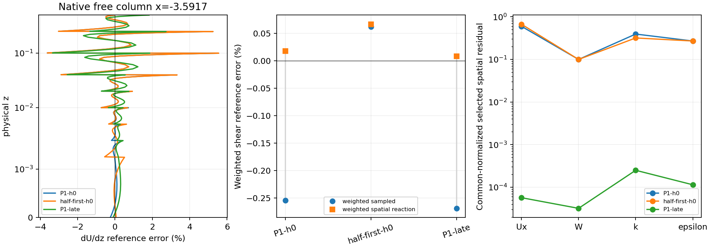
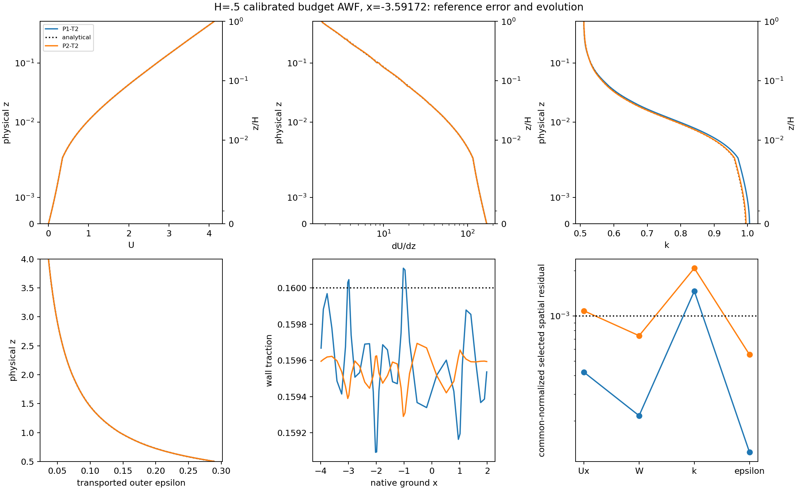
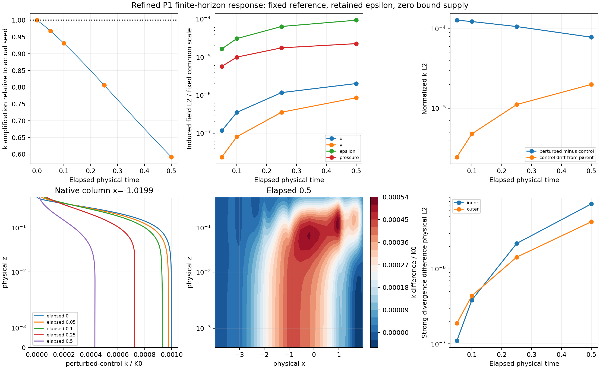

# Refined H=.5 budget AWF: complete-field qualification and local response

Implementation: `96c0c098e1668e2ac52034940401640ddf50af07`, on the existing
`codex/cls-epawf-pimple-one-sweep` branch, based on reviewed `1ef4d7e`.
Authoritative execution: Linux, November 11, 2026 (Asia/Shanghai).
[Compact evidence](cls-awf-refined-response-evidence/native.json) and
[artifact index](cls-awf-refined-response-evidence/artifact-index.json) retain
exact identities; large native files remain on Linux.

All new physical steps retain `CLSCalibratedBudgetAWF`, Regularized/Linear,
H=zK=zm=.5, dt=.000625, IMEX1, unit relaxation, `ExactStepV1`, and
`NativeElementSideV2`. They use one U predictor, one pressure correction, one
outer-epsilon solve, one k solve, and one final logical bound call. Solved
epsilon is retained after k. Floors, reserve, consistent-mass metric and
2000/20000/2000/900 projection controls are unchanged.

The completed coarse late-timestep triplet and H2 T=6 experiment were reused,
not repeated. The completed P1 trajectory and every historical runtime were
preserved. The first-knot control below has **zero physical timesteps**.

## P1 steady screen survives the corrected field integration

Exact checkpoints 4000/4800/5600/6400 were observed without Lift, state changes,
history advancement, or governing solves. Every native vertical interface is
included, particularly `.0025,.005,.02,.04`, together with the analytical
breakpoints. GL16 norms were independently checked by reconstructing each
native polynomial and contracting at tensor GL4. Maximum dimensional
GL4/GL16 disagreement was `2.43e-18`; polynomial fit errors were below `1.1e-15`.
Prescribed and matching coefficients are included. Pressure uses one common
mean alignment across both regions, preserving the regional offset.

| Window | U | W | k | Full outer epsilon | Pressure | Complete screen |
|---|---:|---:|---:|---:|---:|---|
| 2.5–3 | 2.096922e-5 | 1.232284e-5 | 7.930452e-5 | 3.294996e-5 | 1.087964e-4 | Pass |
| 3–3.5 | 1.230945e-5 | 6.687591e-6 | 5.198720e-5 | 2.729290e-5 | 6.051229e-5 | Pass |
| 3.5–4 | 7.532902e-6 | 4.305675e-6 | 3.241376e-5 | 1.892584e-5 | 3.952249e-5 | Pass |

These are the unchanged common normalized norms and thresholds: U/W/k `1e-4`,
epsilon/pressure `1e-3`. The full epsilon domain is `.5<=z<=4`, physical area21;
its denominator remains the established `E0*sqrt(12)`, not a new volume scale.
The old common-panel epsilon changes were only `2.02e-7,9.69e-8,8.69e-8` on
z>=2. The earlier independent **full-epsilon** confirmation was already correct
and is confirmed here. U/W/k/pressure changes from the old panels are small;
old and new values are retained in the evidence. All residual, matching,
traction and correction-supply gates still pass. No trajectory rerun was used.

The qualifying endpoint is **T=4, step6400**. The actual safe stopping checkpoint
is **T=4.02, step6432**, SHA256
`a8dad94dfff868867dcb76b775ec277d00121354f77127e9dda87b4732d6803f`.
Its selected normalized U/W/k/epsilon spatial residuals are
`5.67553e-5,3.19058e-5,2.49571e-4,1.14080e-4`. Correction supply is zero.
This remains a selected discrete steady candidate at the declared accuracy.

## Reporting and terminal observer

`NativeElementPanelsGL4CheckV1` confirms every field for subsequent P2 windows.
The observer assesses available windows **before** handling target completion,
scientific stopping or numerical rejection. A T=6 cap alone implies neither
failure nor passage of the steady screen. It additionally observes the actual
terminal checkpoint, which can follow the qualifying endpoint. It does not
launch steps or change the native runtime. Existing stop requests retain their
original contents and ownership.

The fixed half-unit endpoint grid is enforced: a safe checkpoint at4.02 cannot
silently shift the requested windows to2.52/3.02/3.52/4.02. Terminal-main tests
cover cap completion and rejection; a real terminal readback selects6432 while
keeping6400 as the qualifying endpoint. Six focused metric/observer tests pass.
The final observer has its own frozen source snapshot and launch receipt.

Native interface index2 is normal-traction RMS; index3 is full-vector RMS;
index4 is maximum absolute sampled normal jump; index5 is k-flux RMS.
[Named historical reductions](cls-awf-refined-response-evidence/named-interface-interpretation.json)
preserve the original raw arrays and their source hash.

| Historical state | Normal RMS | Maximum absolute normal jump |
|---|---:|---:|
| Coarse T6 | .001424498776 | .004477932182 |
| Coarse T.5 | .001205079751 | .001849862341 |
| Refined T.5 | .001158077939 | .001734964041 |

The older prose labels and stale present-tense P1 status are corrected in the
neutral report. Native data and acceptance decisions are unchanged.

## Where the traction discrepancy enters

For this calibrated formulation, `h=.1` is the AWF roughness parameter;
aerodynamic `z0=.005300459546`, velocity scale `.005357251334`, cutoff
`.014636433344`, and H=.5. They are distinct lengths. H=zK=zm=.5 throughout.

The analytical neutral law remains compatible with the selected Regularized
operator: analytical selected/Original stress and production differences are
at implementation roundoff. Analytical weak-load mass-dual norms are
`3.93e-13,1.58e-14,9.09e-14,9.10e-11` in U/W/k/epsilon. The actual native h0
has corresponding norms `.234347,.0390857,.196813,.0135997`.
Analytical values **and gradients** were integrated separately under native
tests; they were not substituted into a represented-field residual.

Actual archived h0 and stored reference have no numerical coefficient
differences, but differ in **60 signed-zero bits**. Both identities are retained.
Their native representation already has mean traction `.159593022157`, versus
`.16`; the late P1 value is `.159590713858`. The initial deficit is99.44% of
the final deficit. This is an observation about the metric's initial bias,
not an additive causal decomposition of the evolution.

A weighted reaction uses the exact native test
`w=4*xhat*(1-xhat)*max(0,1-z/dz_first)`, zero on other boundaries and at ground
side corners. The weighted ground measure is4. Full stress, advection,
roughness and other weak loads are contracted before separating prescribed
reaction and free-row work. Positive shear is sigma_xz; outward ground
traction has the opposite sign.

| State | Weighted sampled shear | Spatial reaction shear |
|---|---:|---:|
| Analytical | .160000000000 | .160000000000 |
| Native h0 | .159593022157 | .160027935698 |
| P1 T4.02 | .159570189016 | .160013110449 |
| First-knot control h0 | .160099055686 | .160106281171 |

Actual saved callback history and alpha1600 give a late storage lifting moment
`3.20307e-9`; including it changes the late reaction mean to `.160013109648`.
The refreshed free momentum stage-residual mass-dual norm is `1.09184e-7`.
This includes the real storage contribution, not a reconstructed history or
frozen transport A matrix. The reaction is a discrete diagnostic; it neither
replaces the original sampled traction metric nor proves exact physical stress.

The refined late-state same-field Original counterfactual has normalized
U/W/k/epsilon residuals `.02828795,.00559566,.00368056,.01449298`, substantially
larger than the selected values. Regularization vanishes on the exact reference
but acts on represented/evolved errors. This is not an evolving Original run.

## Zero-time first-knot control

Only `.0025 -> .00125` changes. The next interval consequently widens from
`.0025` to `.00375`; all other knots, spaces, physical coefficients, quadrature,
matching constraints and boundary data remain fixed. Both cases have2861
unknowns, cubic velocity/scalars, linear inner/outer pressure, five tangential
and sixteen vertical panels. Fresh native initialization has its own reference,
defect and histories. Its distinct geometry signature rejects an ordinary
same-size cross-mesh restart. Initialization algebra is reported separately;
there are zero implicit callbacks and zero physical steps.

| Native h0 metric | Baseline first cell .0025 | Control first cell .00125 |
|---|---:|---:|
| Mean sampled traction | .159593022157 | .160099055686 |
| Relative traction error | -.254361% | +.061910% |
| U reference error, physical L2 | .00177215499 | .00177216518 |
| dU/dz reference error, physical L2 | .156883775 | .159833964 |
| Inner production reference error, physical L2 | .049355668 | .050294171 |
| k reference error, physical L2 | .00013079617 | .00013074942 |
| dk/dz reference error, physical L2 | .065892987 | .065402700 |
| U spatial residual, dimensional mass-dual | .234346616 | .262219242 |
| k spatial residual, dimensional mass-dual | .196812923 | .159318588 |

The cell widths are `.46666/.23333` of the velocity scale and `.47166/.23583`
of aerodynamic z0. Improved boundary gradient does not imply improved whole
representation: gradient/production errors slightly worsen, while k weak
balance improves. Most U-gradient error remains in `.02<z<.25`, particularly
`.04<z<.1` and `.1<z<.25`. No evolving version of this control was launched.



## Matched P1/P2 evolution and turbulence terms

The initial physical fields are the established exact control. P2 changes only
inner pressure to degree2 (2994 unknowns), retaining outer pressure degree1.
At T2, P2 has lower divergence and closer U/k profiles, but worse traction and
larger selected residuals. It remains transient; P1 remains the reference.

| At T2 | P1 | Inner P2 |
|---|---:|---:|
| Mean traction | .159580002655 | .159552669721 |
| U-vector reference L2 error | .002090596 | .001797461 |
| k reference L2 error | .002214074 | .000914714 |
| Full epsilon reference L2 error | .000736705 | .000743510 |
| Inner strong-divergence L2 | .008273723 | .003233913 |
| Selected normalized U residual | .000421177 | .001080449 |
| Selected normalized k residual | .001460695 | .002078070 |
| Selected normalized epsilon residual | .000122989 | .000550648 |

All physical norms use common union panels; pressure has one common gauge.
Correctly named interface measures, full epsilon, covariance, matching,
physical bands and full free-row operators are in the evidence.

The native advection identity is verified to about1e-15:
`conservative load = advective load + q div(u) - outward boundary load`.
Actual production includes `-(2/3)k div(u)`. At T1.5, the k*dilatation mass-dual
load norms are `.00313618` (P1) and `.00178476` (P2); isotropic-production
norms are `.00209079` and `.00118984`. The explicit combined residual part is
`+(5/3)k div(u)`, with norms `.00522697/.00297460`. Remaining strain/production
terms are retained. These are load decompositions on the actual states, not
sums of norms or percentages of the traction error. Smaller weak continuity
defects do not imply small strong divergence; both weak constraints are already
near roundoff. Signed physical rates and mass-dual component projections retain
cancellation and are kept distinct from time-integrated changes.



## Bounded late disturbance pair

Parent: actual P1 step6432/T4.02, including both pressures, gauge, solved epsilon,
fixed reference/defect and external data. `LateStateInnerKIMEX1V1` creates each
leg's own native history. Zero amplitude leaves the seed bitwise untouched.
The +.001 K0 leg uses a constrained physical-mass projection of the prescribed
shape `sin(pi*(x+4)/6)^2 * (1-3*(z/H)^2+2*(z/H)^3)`
onto inner k only, fixing every outer-supported and
prescribed coefficient. Actual initial norm is `.00033000174960640946`,
integral `.00038287170799916983`, shape-projection L2 error `3.44059e-7`.
336 k coefficients change; U/pressure/epsilon/outer-k and endpoint data do not.
Stored pressure is pi; derived mechanical pressure follows its existing k
convention. Reference and defect are never replaced by the late state.

Setup uses one mass solve, zero governing solves and zero Lift calls. The
native H-minus face is used for trace/derivative verification. A centred-row
calculation of a zero increment can show tiny cancellation; actual before/after
native endpoint values and fixed coefficients remain exactly unchanged. This
setup diagnostic allowance does not enter physical floors or acceptance checks.

Zero import equals ordinary restart bitwise through all stage vectors, callback
history, accepted state and native history/time labels. Nonzero seed support,
independent histories, split/uninterrupted restart and forced-rejection rollback
pass. Ordinary changed-dt, changed-mesh and bad-parent-hash imports reject.
Final-code seed telemetry also preserves both legs' first-step bits. The
preserved reference runtime gives the same ordinary restart step bitwise.

Both legs completed **800 accepted steps**, elapsed **.5**, physical time
**4.52** from the retained T4.02 parent. There were no numerical
rejections, correction activations or signed/positive/negative correction supply.
Every leg has exactly800 U/p/epsilon/k solves,800 logical bound calls and zero
additional governing solves; setup/verification work is separate.

| Elapsed | k amplification | Induced U norm | Induced W norm | Induced epsilon norm | Induced pressure norm | Traction change |
|---|---:|---:|---:|---:|---:|---:|
| 0.05 | 0.967964 | 1.162e-07 | 2.350e-08 | 1.644e-05 | 5.682e-06 | 1.392e-06 |
| 0.1 | 0.931204 | 3.508e-07 | 8.014e-08 | 3.059e-05 | 9.971e-06 | 2.347e-06 |
| 0.25 | 0.806087 | 1.163e-06 | 3.545e-07 | 6.384e-05 | 1.751e-05 | 3.845e-06 |
| 0.5 | 0.591594 | 2.014e-06 | 8.531e-07 | 9.324e-05 | 2.254e-05 | 3.964e-06 |

Induced field norms use the unchanged common normalization; traction is a
dimensional shear difference. No induced quantity is divided by its zero initial
difference. k amplification uses the **actual** initial physical mass norm.

Native consistent M_ff contractions of every accepted state agree with the
independent full-field panels. Maximum amplification across all800 accepted
steps is `.999631962` (initial seed amplification is1). At elapsed.5, k norm
is `0.000195227023053` and amplification `.591594`; the combined scaled field norm
is `.93744` of its initial value. Epsilon and pressure responses are still
building, so decay of every component or asymptotic stability is not claimed.

Unperturbed remaining normalized drift over.5 is
`4.35e-6,2.39e-6,1.99e-5,1.06e-5,2.14e-5` in U/W/k/epsilon/pressure.
It is explicitly subtracted by the paired comparison. Final induced inner/outer
strong-divergence L2 is `7.39e-6/4.27e-6`; a sampled largest k difference is
`.00026208` near `(x,z)=(-.3400,.05980)`. The initial scalar disturbance advects
and spreads. Final covariance margins stay positive (`.172858/.161221` on the
perturbed leg), and all matching/scalar/boundary/continuity checks pass.

The predeclared finite-horizon k-decay criterion is met. The conditional1.25
extension is **not used**. This tests one small shape about one selected
discrete steady candidate over.4 H/u_star and approximately.426 bulk
flow-through times; it does not prove general stability or faithful Original
evolution.

| Leg | End-to-end seconds | Native process wall seconds | Peak RSS GiB | Final checkpoint SHA256 |
|---|---:|---:|---:|---|
| control | 6431.5 | 6344.5 | 1.307 | `ed38d07d341e06ec0ad5cd160f2190577f35ece682e448b956acc465ca409f36` |
| perturbed | 6450.0 | 6371.5 | 1.307 | `17776bf63a2ca825cf5dbcf38bfd3881cea843608e03ce954a0fcc142c6ef103` |

The parallel pair took about108 minutes per leg, roughly8.0 s/accepted step.
All native histories, physical times and accepted-state sequences are retained.



## Runtime, provenance and reproduction

Linux root:
`/media/jay/新加卷/nektar-v2026-runs/cls-awf-refined-qualification-followup-20261111`.
Source/Git work occurred on the Mac worktree. The dirty shared Linux checkout
and active P2 runtime were left untouched. USB SSH was unavailable; execution
used the same Tailscale peer over IPv6 with its existing host-key alias.

External Release build: GCC11.4.0, `-fno-fast-math -ffp-contract=off
-D_GLIBCXX_ASSERTIONS`, build parallelism4 (later focused rebuilds2), existing
SpatialDomains5.9 library reused by hash. Each native runtime has its own copied
linked-library closure. All six computational-thread controls are1 and each
pilot uses one rank. Conservative aggregate allocation stayed below32 workers,
within the hard72 limit, including concurrent P2, response legs and diagnostics.

Frozen response image:
`81d78312548c917eef3b5ebbbd476fd3990abdfa7c6823e580a35da275d74ae6`.
Readback probe:
`c4a545389c21e4c7b3f4587e20a14bf4b30f7df80b2aa5c2c05fab8fd1c4d35d`.
Both are based on1ef4d7e plus the archived implementation patch. The final C++
sources match96c0c09 by file hashes; the post-freeze change is seed H-minus
telemetry only, with seed/stage/history bitwise equivalence proved in a separate
runtime. Neither an active executable nor its libraries was rebuilt in place.

Focused checks: native build/probe, six metric/observer tests, case definitions,
pressure-default XML compatibility, four existing late-estimator tests, native
history rejection test, exact import/restart/rollback, same-size geometry
rejection, reference-runtime equivalence, tensor/complete audits and all-field
mass/quadrature checks. Heavy logs and receipts are indexed.

```bash
source /home/jay/.local/opt/nektar-v2026-mpi/env.sh
export OMP_NUM_THREADS=1 OPENBLAS_NUM_THREADS=1 MKL_NUM_THREADS=1
export BLIS_NUM_THREADS=1 VECLIB_MAXIMUM_THREADS=1 NUMEXPR_NUM_THREADS=1
R='/media/jay/新加卷/nektar-v2026-runs/cls-awf-refined-qualification-followup-20261111'
S="$R/source/solvers/IncNavierStokesSolver/Tests/RANS"
# Use fresh unused output roots when reproducing.
cmake -S "$S" -B "$R/reproduce-build" -DCMAKE_BUILD_TYPE=Release \
  -DNektar++_DIR=/home/jay/.local/opt/nektar-v2026-mpi/lib64/nektar++/cmake \
  -DRANS_BUILD_SOLVER=ON \
  -DRANS_PREBUILT_SPATIAL_LIBRARY=/media/jay/新加卷/nektar-v2026-runs/cls-awf-inner-pressure-p2-20261111/to-steady/trajectory/runtime/lib/libSpatialDomains.so.5.9.0 \
  '-DCMAKE_CXX_FLAGS=-fno-fast-math -ffp-contract=off -D_GLIBCXX_ASSERTIONS'
cmake --build "$R/reproduce-build" --target IncNavierStokesSolver RANSWallResolutionProbe --parallel 4

python3 -B "$S/confirm_cls_awf_complete_windows.py" \
  --common-panel /media/jay/新加卷/nektar-v2026-runs/cls-awf-neutral-qualification-20261110/spatial-window-observer-v2/step-006400/common \
  --case Refined05 --probe "$R/runtime-probe/RANSWallResolutionProbe" \
  --output "$R/reproduce-complete-windows"
python3 -B "$S/run_cls_awf_first_cell_control.py" \
  --solver "$R/runtime-solver/IncNavierStokesSolver" --output "$R/reproduce-zero-time"
python3 -B "$S/run_cls_awf_refined_response.py" \
  --solver "$R/runtime-seed-report-check-v2/IncNavierStokesSolver" \
  --parent /media/jay/新加卷/nektar-v2026-runs/cls-awf-neutral-qualification-20261110/spatial-to-six/trajectory/steps-006401-006432/checkpoint.3 \
  --policy "$R/late-response/declared-policy.json" --output "$R/reproduce-response" \
  --times .05 .1 .25 .5 --timeout 3600 --max-hours 8
```

The exact analysis invocation, parent/seed/history hashes, native sources,
metrics, clocks, resource usage and source-equivalence receipts are indexed.

## Final disposition and recommendation

P1 all-field qualification, the zero-time control, the bounded disturbance pair,
and focused software validation are complete. No new physical run rejected.
Expected checkpoint-incompatibility and deliberate rollback rejections remain
in their separate test directories.

**Final handoff capture:** 2026-11-11 18:26:51 Asia/Shanghai,
step**3904**, **T=2.44000000**, checkpoint
`9bcdf1c2c7e31d9cadd0ba78be045d806f39a26f9efdad00b3c69635b81dec7d`. Driver/native/supervisor and observer remain live;
next target is4000/T=2.5, cap9600/T=6. See
[latest-status.json](cls-awf-refined-response-evidence/latest-status.json).
The earlier detailed work/metric receipt below is deliberately retained at its
own earlier frontier, rather than relabelled as this newer checkpoint.

**P2 remains durably running**, not completed. The verified snapshot at
**2026-11-11 18:10:01 Asia/Shanghai** is step
**3775, T=2.359375000**, checkpoint
`9a288725bd6bab8c333374a2b952974c4e87ddf831b5ad31883df40a04e8450c`. Driver, native child, supervisor and the replacement
read-only observer identities were verified. Completed staged targets are
T=1,1.5,2; the next is **step4000/T=2.5**. The authorized maximum remains
step9600/T=6, or the first three passing half-unit windows. Numerical rejection
remains terminal. No physical setting or runtime was changed.

The latest complete-block metrics in this capture are separately labelled:
step3744/T=2.34, traction0.159548853388, U/W/k/epsilon
spatial blocks `0.000939598, 0.000524848, 0.0019089, 0.000554867`.
The k residual still fails the necessary1e-3 gate. Three eligible P2 windows
are not yet available; neither a settled P2 benefit nor failure at its cap is
claimed. The observer will perform complete-field assessment and strict
selected/Original diagnostics at the actual terminal checkpoint.

The successor ledger verifies2975 added U/p/epsilon/k solves and logical
bound calls, with zero additional governing solves or correction. The original
800-step pilot is kept separate, avoiding a duplicated prefix. Completed-block
callback counts are2944, with31 later accepted steps in the then-live block.
Median implicit callback cost is4.128s; whole-block cost remains about8s/step.
At that cost the T=6 cap is roughly13 more wall hours from this capture;
scientific stopping can occur sooner. This is a forecast, not a completion claim.

The supported conclusion is that spatial projection/differentiation introduces
a large part of the reference departure before evolution; the selected
constitutive law preserves the exact analytical reference, and the positivity
correction supplies none of the settled balance. Higher inner pressure degree
changes divergence and turbulence balance but is not yet a superior steady
solution. The refined P1 candidate attenuates the tested k disturbance over the
observed finite horizon, while other induced fields still adjust.

**One next new experiment:** a balanced, same-size radial-knot redistribution
at fixed H=.5 and P1, designed against the complete derivative/weak-load errors
in .02<z<.25, retaining near-ground resolution. The single first-knot move is
not sufficient to improve all metrics. Finish the already authorized P2 screen
before changing the pressure default. A new closure, force calibration,
positivity stabilizer or broad timestep matrix is not supported by this package.
