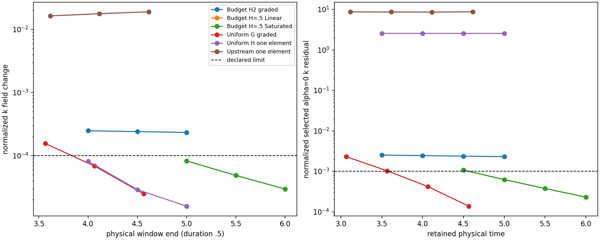

# Campaign status and steady-convergence check — 2026-11-10

**Later 17:00 update:** both formerly live runs completed T=5. The
[final-pair assessment](cls-awf-steady-final-pair-20261110.md) confirms three
passing windows for Uniform G, including its full outer epsilon region;
Upstream-one still fails the steady screen. The 10:23 snapshot below is
preserved as historical evidence.

Live status refreshed **10:23:16 Asia/Shanghai** on the authoritative Linux
server; the immutable window analysis was captured at 10:13:48.
The two H=.5 graded budget-AWF campaigns have completed T=6 and pass all
three declared steady windows, including full-outer-epsilon confirmation.
They are **steady candidates of the selected discrete Regularized equations**
at the declared tolerances. This is not an exact-root, spatial-accuracy,
perturbation-stability or neutral-reference-preservation certificate.
Hard numerical admissibility remains separate from the older narrow
constitutive qualification box; that qualification is not asserted here.

Only Uniform G and Upstream-one remain running. Four campaigns completed
their authorized targets normally; there is no new numerical rejection.
No production run was restarted, extended, interrupted or reconfigured for
this inspection. The [compact native evidence](cls-accepted-budget-awf-evidence/steady-check-20261110/native.json)
contains actual process/start-token, checkpoint/state/history and runtime
identities. Heavy immutable copies and strict native readbacks are indexed
in [artifact-index.json](cls-accepted-budget-awf-evidence/steady-check-20261110/artifact-index.json).

## Current status and assessment

| Campaign | Accepted step / T | Actual status | Passing .5 windows | Latest normalized k window change | Selected alpha=0 k residual | Assessment |
|---|---|---|---:|---:|---:|---|
| Budget H2 cutoff-refined Regularized/Linear | 8000 / 5 | target completed | 0/3 | 2.333e-4 | 2.303e-3 | Continuing transient |
| Budget H=.5 graded Regularized/Linear | 9600 / 6 | target completed | 3/3 | 2.955e-5 | 2.299e-4 | Selected discrete steady candidate |
| Budget H=.5 graded Regularized/Saturated | 9600 / 6 | target completed | 3/3 | 2.958e-5 | 2.301e-4 | Selected discrete steady candidate |
| Existing Uniform G graded | 7343 / 4.589375 | running toward 5 | 2/3 | 2.475e-5 | 1.372e-4 | Improving; persistence incomplete |
| Existing Uniform H one element | 8000 / 5 | target completed | 0/3 | 1.580e-5 | 2.556 | Correction-supported settling, not original-equation steady |
| Existing Upstream one element | 7429 / 4.643125 | running toward 5 | 0/3 | 1.903e-2 | 8.732 | Substantial bounded transient |

The running frontiers and analyzed states are distinct: Uniform G's latest
analyzed report is T=4.5675 and its windows end at 4.565; Upstream-one's latest
analyzed report is T=4.619375 and its windows end at 4.615. Selection follows
the previous availability-only rule, with no interpolation. All four completed
campaigns are analyzed at their exact target checkpoint. Running native
executables match their recorded identities; the other recorded native PIDs
have exited normally. Two native production processes were observed.

## Unchanged scientific criteria

The same `AcceptedAWFExploratoryWindowsV1` policy requires three consecutive
.5-unit windows: normalized U/W/k changes <=1e-4, epsilon/pressure <=1e-3,
selected spatial residual blocks <=1e-3, relative traction change <=5e-4,
relative matching mismatch <=1e-5, and negligible absolute correction supply.
The common normalization remains U=.4, K=.5105080131, epsilon=.0726358333,
pressure=.16 and reference volume=24; the epsilon reference volume remains 12.
Neither H-dependent scales nor a broader drift tolerance replace this policy.

All residuals are alpha=0 evaluations of the retained, selected uncancelled
operator. Small linear-system residuals, small accepted increments, pinned
floor values and the splitting-identity error do not establish steady behavior.

## T=6 pair: exact restart-spanning windows

Exact native checkpoints at steps 7200/8000/8800/9600 supply
T=4.5/5/5.5/6, respectively. The step-7200 Linear state lies inside a prior
block and is resolved by its accepted ledger hash, not by relabelling the
previous T=4.49 report. The actual parent prefix report, coupled state and all
native history slots/time labels are checked across the T=5 restart. The
strict frozen probe restores the saved reference and retains the solved
epsilon coefficients; it performs zero governing solves, Lift/projection calls
or physical-time/history advances.

| Window | Linear k change | Saturated k change | Linear full-outer epsilon change | Saturated full-outer epsilon change | Both pass |
|---|---:|---:|---:|---:|---|
| 4.5–5 | 8.236e-5 | 8.243e-5 | 4.158e-5 | 4.163e-5 | yes |
| 5–5.5 | 4.859e-5 | 4.863e-5 | 2.900e-5 | 2.903e-5 | yes |
| 5.5–6 | 2.955e-5 | 2.958e-5 | 1.633e-5 | 1.635e-5 | yes |

Entries are normalized physical L2 changes. U, W, common-gauge pressure,
traction, matching and correction conditions also pass every window.
The full epsilon region is the actual transported .5<=z<=4, not only z>=2.
Interior tensor GL4 quadrature on each native affine cubic element integrates
the squared difference exactly. It uses 640 element-specific samples over
physical area 21; the fixed common normalization is unchanged. Independent
contraction of native epsilon rows with saved coefficients agrees within
5.56e-17. Overintegrating the last window with GL5 agrees within 6.4e-18
and 1e-19 for Linear and Saturated. Separate constant/cubic integral checks pass.
No new compiled solver/probe or production acceptance policy was introduced.

| T=6 quantity | Regularized/Linear | Regularized/Saturated |
|---|---:|---:|
| Selected normalized U residual | 3.593e-5 | 3.596e-5 |
| Selected normalized W residual | 1.920e-5 | 1.921e-5 |
| Selected normalized k residual | 2.299e-4 | 2.301e-4 |
| Selected normalized epsilon residual | 9.723e-5 | 9.730e-5 |
| Refreshed matching discrepancy | 4.388e-8 | 4.393e-8 |
| Mean wall traction | .15265535 | .15265496 |
| Traction error versus .16 reference | -4.5904% | -4.5906% |
| Inner strong-divergence L2 | .0586433 | .0586823 |
| Outer strong-divergence L2 | .0027363 | .0027368 |
| Inner / outer covariance minima | .126436 / .159642 | .131808 / .159643 |
| Bound activation/supply over all three windows | zero | zero |

The fields are approaching a selected-equation steady state without bound
cancellation. Reference traction is still materially wrong and strong
divergence remains nonzero, despite weak continuity/gauge constraints near
roundoff. These spatial/physical limitations survive temporal settling.
The earlier H2 temporal study through .05 is not a long-time H=.5 accuracy
certificate; a short late-state timestep check and spatial/reference assessment
are appropriate next validations of these steady candidates.

## Other four campaigns

H2's latest three k changes are 2.478e-4, 2.402e-4 and 2.333e-4, all above
1e-4. U and k spatial residuals still exceed 1e-3. T=5 is only one H/u_star
scale for H2, so its normal target completion must not be reported as settling.

Uniform G's k changes decrease from 1.557e-4 to 6.837e-5 and 2.475e-5.
Its last two windows satisfy the common screen, but the first does not. It has
zero correction supply. Continue its existing T=5 run and reassess persistence;
an eventual positive legacy classification also needs the documented full
outer-epsilon field confirmation.

Uniform H's last field drift is small, but its original selected k residual
remains about 2.556 and correction stays active. Upstream-one still has large
field changes and residuals. Their last-window absolute correction rates,
normalized by K0*24/(2/.4), are .57883 and 1.55712 respectively. These are
rates relative to a fixed field/time scale, not fractions of total turbulent
energy. Signed, positive and negative redistribution budgets remain separate
in the evidence. Neither run qualifies as an uncorrected-equation steady state;
statistical stationarity is not demonstrated.



## Reproduction and provenance

Source base: `99112a1`; the new read-only helper is `368eb8b`. The executed
file hash is recorded alongside the unchanged probe SHA256
`4130cea9d57de9f25264c581716b73a9253ffa540d067d38b1c31e94e8f7b6b7`
and its frozen library manifest. Linux uses one rank/thread per probe, at most
two independent probes, alongside the two healthy production campaigns and
well below the 72-worker cap. No production checkpoint or runtime was edited.
Heavy artifacts reside in
`/media/jay/新加卷/nektar-v2026-runs/cls-awf-steady-check-20261110`.

```bash
R=/media/jay/新加卷/nektar-v2026-runs/cls-awf-steady-check-20261110
N=/media/jay/新加卷/nektar-v2026-runs/cls-awf-05-to-T6-20261109
S="$R/source/solvers/IncNavierStokesSolver/Tests/RANS"
P=/media/jay/新加卷/nektar-v2026-runs/cls-awf-audit-cache-temporal-20261109/runtime-cache-final/probe/RANSWallResolutionProbe
python3 -B "$S/check_cls_awf_restart_windows.py" \
  --campaign Budget05Linear="$N/regularized-linear/trajectory" \
  --campaign Budget05Saturated="$N/regularized-saturated/trajectory" \
  --probe "$P" \
  --policy "$R/source/docs/plans/cls-accepted-budget-awf-evidence/covariance/convergence-policy.json" \
  --output "$R/UNUSED-restarted-verification"
```

Use an unused output directory. The existing `check_cls_awf_steady_windows.py`
and explicit campaign paths reproduce the four uninterrupted cases. These
commands are read-only observations, not campaign resume commands.
