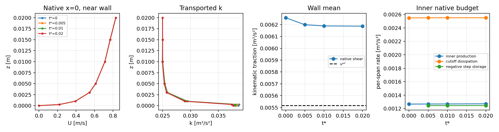

# Cao–Tamura budget AWF H2a: developing rough-flat foundation

H2a is implemented and Linux-verified. The fresh developing rough-flat pilot
accepted **160 steps to T=.0008 s, t*=.02**, with zero positivity correction.
It stopped at its valid checkpoint under the predeclared cost policy; t*=.1
and 1 were not executed. This is not a numerical rejection.

H2a adds an opt-in affine developing-flow boundary problem, strict native
turbulence budgets, bounded exact reuse and selective attempt packets. It keeps
Regularized CLS/Linear inner stress and the accepted calibrated budget AWF.
Mapped hill production is still guarded. This is a startup experiment, not a
developed precursor or experimental validation.

Mac source/Git work uses the existing `codex/cls-epawf-pimple-one-sweep`
worktree. The fetched starting head was
`a26ab9f43d9b578e124891355600b16bee95e963`; no newer branch work was discarded.
Linux builds and numerical results use a fresh isolated build. Historical H1,
P1/P2 and all other runtimes/checkpoints were preserved.

Implementation/test commit: `4f5898f22fa2e7f2d7ecc38f74a379b3c024776a`.
All 19 implementation files and all 147 native source/header files in the
relevant directories match the tested Linux export. Native executable SHA256:
`6601b0e187b22764a9455e87f69ff90689655e193c08d20c57b36bbb76433d7d`;
final strict probe: `62ae3efa40c8a757bf8a3b6e235b652b12d053428d130ef5c45bb258a30aa128`.
The [source/closure manifest](cls-cao-tamura-budget-h2a-evidence/source-revisions.json)
records exact library identities, executed driver/probe versions, compiler and
fresh-build flags. The final driver also fixes inherited compatibility-only
case labels/XML-digest metadata; original executed definitions are retained,
with an explicit [case-manifest erratum](cls-cao-tamura-budget-h2a-evidence/case-manifest.json).

[Native result](cls-cao-tamura-budget-h2a-evidence/native.json),
[focused checks](cls-cao-tamura-budget-h2a-evidence/verification.json),
[H1 budgets](cls-cao-tamura-budget-h2a-evidence/H1-budgets.json),
[temporal comparison](cls-cao-tamura-budget-h2a-evidence/temporal.json),
[native observations](cls-cao-tamura-budget-h2a-evidence/observations.json),
[timings](cls-cao-tamura-budget-h2a-evidence/timing.json) and
[artifact index](cls-cao-tamura-budget-h2a-evidence/artifact-index.json)
contain compact evidence. The index covers 1,260 heavy evidence files,
approximately 243 MB, including exact checkpoints, histories, stage packets,
frozen k matrices and logs.

Heavy artifacts are under:

```text
/media/jay/新加卷/nektar-v2026-runs/cls-cao-tamura-budget-h2a-20261111
```

## Physical and numerical contract

The frozen `cao-tamura-2006-v1.1` data and H1 completion are unchanged. The
finite profile SHA256 is
`9375601441e2c70fb87cf8f31de305afd4b67fd2f82a750f9274f6bb68eed697`.
Only the permitted rough Fig.3a/b/c observations are queried, with all their
original visibility and weights. Fig.3d and all hill observations remain held
out. No completion, effective roughness or source was tuned during H2a.

The dimensional realization remains Hh=.04 m, U(Hh)=1 m/s, Hw=.015 m,
h_eff=.000878311859293 m, nu=3.80952380952e-6 m²/s, and
u_star=.0742679379242 m/s. Cube height b=.005 m, aerodynamic z0=.0002 m
and assumed displacement d0=.0035 m retain their separate meanings.

Regularized beta=.4, Gamma=1, gamma0=0; Linear inner stress; endpoint
K=k(Hw); z_K=z_m=Hw; counterfactual flat p_A0 determines the cutoff.
The actual inner source is P_actual-E_C, with zero prescribed redistribution
and no E_C/k reaction. Molecular diffusion acts inside, with the selected
high-Re outer equations above Hw. The immutable gamma-reference table is
separate from the transported epsilon interface condition.

The retained dense pilot has 2,000 coupled slots: U/W/k each 520, outer epsilon
364, inner/outer pressures 25/50, and one unused gauge slot. Velocity/scalars
are cubic and both pressures linear. Streamwise knots are
[-.2,-.1,0,.1,.2] m. Vertical knots are
[0,.00025,.001,.003,.015,.03,.06,.1,.2,.25,.3,.4,.5,.8] m.
Source quadrature, cutoff panels, floor/reserve and bound controls are unchanged.
The 3,000-slot guard remains in force.

Every accepted step has one IMEX1 callback, one vector U predictor, one complete
pressure correction with algebraic velocity correction, one outer-epsilon
solve, one k solve and one logical final bound call. No inner epsilon equation
or extra outer sweep is introduced. Internal mass/KKT work is separate.
Post-k epsilon coefficients are asserted bitwise unchanged. Refreshed epsilon
matching is reported, without restoring its trace.

## Explicit boundary equations and pressure convention

`RANSWallBoundaryPolicy=CompatibilityV1` remains the default and preserves H1.
The new opt-in policy is `RoughFlatOpenV1`, restricted to the serial affine
accepted-budget pilot. Let un=u·n, a+=max(a,0), a-=min(a,0), and let q_seed
denote the immutable native fixed-reference value. With modified pressure
pi=p_mechanical+2k/3, the full selected kinematic stress is

```text
sigma = -R + (2k/3 - pi) I + nu S       (nu only in the inner region).
```

The volume residual uses grad(v):(sigma-u tensor u) and
grad(v)·(d grad(q)-u q). Its outlet weak loads are

```text
F_U = un+ U + un- U_seed + Pout n,
F_q = un+ q + un- q_seed.
```

Equivalently, sigma n=-Pout n+un-(U-U_seed) and
d partial_n(q)=un-(q-q_seed). Pure outflow has prescribed total traction
and zero scalar diffusive flux; backflow uses positive prescribed k/epsilon
and incoming momentum from the fixed native reference. No evolving state
changes that reference. The backflow mismatch has the expected dissipative
continuum energy sign; no general fully discrete energy theorem is claimed.

The inlet prescribes the AWF-completed inner U/k and finite outer completion.
The inlet/interface epsilon corner takes exact E_C(Hw)=.1050450587819008
m²/s³, rather than the immutable gamma table's .10548224438480716. Ground
velocity remains no-slip and ground k is natural. At the .8 m facility top,
W=0, full selected tangential traction is zero, and scalar fluxes are natural.
This is a free-slip facility-top approximation, with floor-only Yap distance;
it is not a no-slip roof treatment.

Pout=0 fixes absolute **total normal traction**, not Dirichlet mechanical or
modified pressure. The complete weak pressure action is retained in both
regions, including roughness-pressure coupling. Outlet free velocity tests
detect a common constant pressure, so there is no closed-box pressure
nullspace. The old mean-gauge terms are omitted; its retained storage slot is
fixed zero. No prescribed-top net-flux adjustment is used. The algebraic Schur
correction therefore enforces the native regional continuity using this full
G and exact B=(alpha M_free)^-1; no separately invented scalar pressure
Dirichlet condition is imposed. Physical pressure level is retained in norms.

Boundary roles, traction datum, top/backflow interpretation and policy version
participate in the physical signature. Ordinary restart rejects boundary or
datum changes. H1 checkpoints are not migrated to this physical problem.

## Coordinate, provenance and transaction checks

The affine finite initializer/readback now rejects a nonzero incoming normal
origin or nonhorizontal incoming frame before forming histories. Tangential
origin changes leave h0 bitwise unchanged. The executed H1 origin is unaffected.
The general immutable provider still evaluates its declared Cartesian frame;
the mapped initializer guard remains.

Strict readbacks restore saved reference, defect, external data and histories,
with zero Lift, zero PDE solves and zero time/history advancement. Native
reports are bound by SHA256, signature, state/reference/time, every history
slot and time label. Saved callback history/alpha/time additionally agree with
the attempted-stage record and history digest. A separate zero-step readback
provides physical sample arrays omitted by native zero-step reports.

Focused Linux checks establish:

- H1 old/new, and cache/output Off/On eight-step paths have bitwise-identical
  stage vectors, accepted fields, native histories and time labels.
- Open-policy eight-step cached/uncached and uninterrupted/split restart paths
  agree bitwise; hard rejection at step1 and unselected step9 restores all
  accepted fields/time/history and preserves the immutable parent.
- Fresh unsupported origin, changed boundary interpretation/datum/dt and
  corrupted checkpoint/state/history/signature/callback history reject.
- All-mode conservative advection identities, full selected stress and scalar
  diffusive boundary identities, separate outflow/backflow, absolute pressure
  projection, full native G and inlet/interface epsilon corner checks pass.
- A negative free outlet-ground k fixture activates the same consistent-mass
  correction, protects prescribed/non-k coefficients exactly, and passes its
  declared complete k inventory. This is a projection-only fixture, not an
  additional physical step or a claim of covariance validity for its synthetic
  fields.

The flux identity errors are at most 6.67e-16; full native G action error
4.60e-17. Common constant-pressure action is .20000000000000007, and
absolute-pressure projection/corner errors are zero. The final one-step
comparison against the earlier verified H2a runtime preserves every governing
stage/history/audit bit. Focused H1-kernel and history-rejection CTests pass.

## Native budget diagnosis

All rates below are per unit span: k-integral rates in m^4/s^3, epsilon-integral
rates in m^4/s^4. Storage uses the actual saved callback history and physical
consistent mass, including retained matching/prescribed coefficients.
Counterfactual p_A0, actual P and prescribed E_C are kept separate.

For the exact parallel zero-force seed, independent GL64 integration gives
P/E=.4949760731736898, agreeing with
(q_star*u_star_in²/K)²=.49497607317368947. Native h0 instead gives
.496958360952915. Native representation changes the actual stress-work
production; it does not change the counterfactual cutoff budget.

| H1 state | inner P | inner E_C | inner storage | outer-k storage | outer-epsilon storage |
|---|---:|---:|---:|---:|---:|
| h0 | .001266888917 | .002549285849 | 0 | 0 | 0 |
| step8, T=.00008 | .001267281356 | .002549591351 | -.001223275104 | .000211864366 | .000699043753 |

The h0 storage entries use alpha=0 because no physical step has occurred;
they are not an assertion that its instantaneous spatial rate is zero.

At step8 the inner source is -.001282309995, outer-k source .000237168234,
and outer-epsilon source -.000467777358. Thus epsilon storage can be positive
while its integrated physical source is negative: the imposed dependent trace
and boundary reactions matter. The inner/outer-k free-interface projections
are approximately +1.36686e-5/-1.36642e-5. Epsilon's constrained-row reaction
is +.001166820535. These are native CG weak-row projections, not unique
finite-volume interface fluxes.

Native constant-test balances and their free/interior/interface/constrained
partitions close to roundoff. Ground/interface physical gradient fluxes are
reported independently, along with inlet/outlet advection. They need not form
an exactly conservative local CG control-volume balance. Full free-mode loads,
mass-dual norms and signed projections preserve cancellation; component norms
are not added as percentages.

Independent source integration splits at every native interface, finite-profile
knot, roughness/intercept and cutoff. GL16/32 inner rates agree to roundoff.
Native outer production differs from the split GL32 readback by about .34%;
the much smaller nonsmooth Yap term converges more slowly. These integration
uncertainties are retained. Production quadrature is unchanged in the pilot.
The reference-k seed diffusion was constructed from p_A0, so the approximately
half-strength actual production alone cannot predict storage.

The supported diagnosis is therefore mixed, with distinct causes. The large
integrated P/E deficit exists **before projection** because the completed
interface K is not q_star*u_star². Native projection changes that ratio by only
about .40% relative, although its sampled wall-shear error is much larger.
Reference-k diffusion and imposed epsilon/interface data then influence the
actual native storage. Releasing the outlet/top changes transport and pressure
adjustment, not the definition of E_C. The verified component/flux identities
provide no evidence of an omitted or double-counted sink. The provisional
finite completion is not an exact steady RANS solution, and no equilibrium
was manufactured by changing K, E_C or the immutable gamma reference.

## Exact reuse, output and measured cost

`RANSWallVelocityMassReuse=ExactV1` reuses only the consistent free-velocity
mass factor after exact row/matrix-byte comparison. Alpha scaling remains
explicit. No changing momentum/scalar factor, G, Schur or AWF object is reused.
`RANSWallFiniteReferenceReuse=ExactHeightV1` caches the immutable prescribed
function after physical incoming height is formed. Exact height bits and
patch-owned content/frame/interpretation define its identity. It is not a
coordinate-only cache of native field rows/gradients. Storage is bounded at
32,768 entries. ExactStepV1 and NativeElementSideV2 remain active.

`RANSWallAttemptPackets=EveryAttempt` remains the default. Opt-in SelectedV1
keeps first/cadence/verification and every active-correction full packet.
Other inactive packets retain a scoped writer until acceptance: no dense file
is written then deleted. Numerical rejection flushes it before rollback.
Early-stage rejection records explicit partial fields/history and deterministic
matrix-replay instructions. Native checkpoints and full histories are unchanged.
An unselected pending matrix is **not SIGKILL-durable**; accepted checkpoint,
frozen runtime/configuration and deterministic isolated stage replay recover it.
This limitation is explicit rather than hidden behind an in-memory buffer.

| Eight-step restart | Off wall, s | On wall, s | Off/On | peak RSS, MiB (On) |
|---|---:|---:|---:|---:|
| H1 compatibility | 44.126 | 40.726 | 1.084 | 854.5 |
| H2a open | 38.783 | 39.224 | .989 | 862.4 |

These are single matched pairs, not a robust speedup claim. Open end-to-end
acceleration is **not demonstrated**. Seven of eight repeated mass
factorizations and six of eight dense packet writes are avoided; the immutable
reference cache has 661,392 hits/343 misses at open step8. Inventories and full
audits still dominate, and cold setup is material for short blocks. The
pre-change H1 profile consumed 12.28 CPU seconds in domain scans and 8.11 in
full audits, versus roughly one second in flow assembly; dense solve work is
not the dominant measured cost. Inclusive and exclusive timers are retained
separately in evidence.

For the optimized open eight-step block, major **exclusive CPU** costs are:

| Scope | CPU seconds |
|---|---:|
| Domain construction/scans | 12.523 |
| Complete constitutive audits | 7.986 |
| Physical audits | 1.698 |
| Cold object construction | 3.099 |
| Flow / epsilon / k assembly | 1.318 / .0736 / .2676 |
| Explicit external-boundary assembly | .0234 |
| All dense factors / triangular applications | .1640 / .1403 |
| Selected attempt packets / checkpoints | .0654 / .0103 |

These are nonoverlapping selected scopes, not an exhaustive sum. Inclusive
momentum factor/validation, pressure build/validation, epsilon validation and
k validation CPU costs over eight steps are .1331/.1975/.0117/.0276 seconds;
their assembly and hard checks are separate. See the
[full scoped timings](cls-cao-tamura-budget-h2a-evidence/timing-scopes.json).
Fresh zero-step initialization costs 7.4–10.4 driver seconds and 463–469 MiB
RSS, with initialization projection/Lift recorded separately from physical
solves. In the final 32-step primary blocks, driver costs are 3.94 and 3.91
seconds/step; the shorter final block has more startup overhead.

## Startup accuracy and bounded execution policy

The initial triplet is dt=4e-5,2e-5,1e-5 s at common T=.0002/.0004 s. A
single conditional 5e-6 level is authorized only if the primary triplet cannot
meet the predeclared accuracy screen. Every level starts from identical actual
native h0, with its own valid histories and dt signature. Reporting initially
stopped because h0 arrays were omitted; strict zero-Lift sampling repaired that
reporting path, and the completed hash-validated trajectories were reused.
This was not a numerical rejection or an unchanged rejected-step retry.

Norms use full physical area, complete outer epsilon Hw<=z<=.8, exact native
weights, and absolute pressure. Scales are U(Hh)=1, completed K(Hw), E_C(Hw),
U(Hh)² and u_star². Absolute normalized targets are 1e-4 for velocity/k/mean
traction, 1e-3 for epsilon/pressure; additionally, estimated error must be below
1% of the actual response from h0. A 1e-12 scale floor prevents unsupported
orders for numerical zeros. Coherent first-order ratios permit Richardson
estimates; otherwise conservative adjacent-difference bounds are used.

The primary trajectory has a predeclared 1,800-second wall cap and at most
32 steps per block, with exact t*=.02,.1,1 endpoints when affordable.
Continuation never selects dt on survival alone. t*=t U(Hh)/Hh is a startup
clock, not a development criterion. Inlet-to-observation distance is .2 m;
the observation plane x=0 is a numerical comparison plane, not an established
experimental fetch location.

The three original levels accepted 10/20/40 steps respectively through
T=.0004. Wall-traction accuracy and the early epsilon response prevented
selecting dt=1e-5 or larger under the predeclared screen. The conditional
5e-6 level accepted 80 steps to the same time and passed both observation
screens. Its native h0 is bitwise identical to all three original levels.

The following orders use dt=2e-5,1e-5,5e-6. Errors are normalized **5e-6
Richardson estimates**, not accumulated long-time error estimates. Dimensional
pairwise differences for every field, both pressure regions and the original
triplet are retained in the temporal JSON.

| Quantity | p at T=.0002 | p at T=.0004 | estimated fine error at .0002 | at .0004 |
|---|---:|---:|---:|---:|
| U | .970 | .991 | 6.99e-8 | 7.39e-8 |
| W | 1.850 | 1.264 | unresolved order | unresolved order |
| k | .976 | .996 | 6.87e-7 | 4.37e-7 |
| full outer epsilon | .999 | 1.001 | 2.41e-7 | 2.16e-7 |
| absolute pressure | .991 | 1.059 | 3.29e-7 | 1.54e-7 |
| mean traction | .958 | 1.033 | 8.92e-5 | 2.80e-5 |

W differences are small but not asymptotic: adjacent fine differences are
1.88e-9 and 2.66e-9 in physical L2 units. No W Richardson estimate is assigned.
The combined velocity norm, k, epsilon, pressure and traction satisfy the
declared absolute and actual-response-relative selection targets. This supports
a first-order short-startup comparison for those resolved quantities, not a
temporal qualification of a developed flow.

## Executed developing startup and disposition

The selected leg continued from its own dt-compatible checkpoint; it did not
reuse a different timestep's history or an H1 compatibility checkpoint.

| Retained state | global steps | T, s | t* | mean traction, m²/s² | total k, m^4/s² | outer epsilon integral, m^4/s³ |
|---|---:|---:|---:|---:|---:|---:|
| native h0 | 0 | 0 | 0 | .006257855542 | .001085770775 | .001135903021 |
| temporal endpoint | 80 | .0004 | .01 | .006188619214 | .001085358808 | .001136184716 |
| primary endpoint | 160 | .0008 | .02 | .006186942423 | .001084945288 | .001136459986 |

The actual seed traction already exceeds u_star²=.005515726604 by about
13.45%. The final traction remains about 12.17% above that input scale. This
is an initial native/completion and subsequent evolving-flow discrepancy; it
is not evidence for retuning the accepted sink. Total k falls .0760%, epsilon
rises .0490%, and mean traction falls 1.133% from actual h0. No correction is
active in any physical startup leg; signed, positive, negative and absolute
correction supply are all zero.

At the final state the inner k production/dissipation rates are
.001270872701/.002551431951, with storage -.001244465419. Counterfactual
p_A0 still integrates to E_C to roundoff. Outer-k P/D are
.001364514887/.001136459986, with storage +.000209118968. Outer-epsilon
P/D/Yap are .003487876291/.003998537102/.000001243492, with storage
+.000679597658. Their exact native weak partitions close to roundoff. Physical
inlet/outlet transport and independently sampled ground/interface diffusion,
including their nonzero CG flux discrepancies, are in each observation.

Every accepted physical step has exactly one U/p/epsilon/k solve and one bound
call. Across the independent startup legs this is 230 accepted steps and 230
solves of each equation, including the selected leg's 160-step lineage once.
There are zero extra governing solves and zero physical bound activations;
217 exact mass-factor hits and 17 selected full packets are recorded. Peak
native RSS is 896,480 KiB (875.5 MiB). The independent complete native G action
agrees with extracted pressure columns within 2.05e-19 over all these steps,
including the actual nonconstant pressure corrections and roughness coupling.
[Work counters](cls-cao-tamura-budget-h2a-evidence/startup-work.json)
keep these totals separate from setup/readback/verification work.
At the endpoint the raw k linear residual is 6.10e-20, imposed epsilon
trace defect 1.06e-21, and refreshed post-k trace defect 6.67e-7 m²/s³.
The solved epsilon is retained bitwise. The momentum splitting-identity defect
is 5.79e-19; the distinct frozen-momentum splitting defect is 8.34e-11.

Final covariance minima are .00964433 inner and 1.90371e-5 outer, with native
element/side witnesses retained. Minimum inner k is .02495594, minimum outer
k is 2.85941e-5, and minimum outer epsilon is 1.05178e-6. Budget ratio is at
least 4.04475 with roundoff budget defect. These are declared-inventory and
continuous-ground checks, not a volume-wide positivity theorem.

Inlet/outlet volume fluxes are -/+1.106878972873 m²/s; net imbalance is
-2.22e-16, without a top-flux adjustment. Regional weak continuity is below
7.11e-18. Strong divergence L2 remains .00438923 inner/.00132425 outer and
must not be inferred from those weak numbers. Selected scaled alpha=0
U/W/k/epsilon residuals are .17355/.11523/.56957/.04976; this is an evolving
state. Interface normal/full traction-jump RMS are 5.23e-5/1.96e-4, maximum
sampled normal jump 2.96e-4 and k-flux-jump RMS 2.92e-5.

At x=0 the original-weight Fig.3a/b/c RMSEs change from
.00518139/.000844626/.00994007 at h0 to
.00517156/.000830492/.00995429 at t*=.02. Every permitted query is valid,
uses its actual inner or outer law, and retains its weight; no holdout is
fitted. These discrepancies are much larger than temporal differences and
cannot yet be interpreted as a developed flat-flow calibration.



The primary 80-step extension took 331.5 seconds including exact endpoint
readback; measured continued cost is about 4.20 s/step. Reaching t*=.1 would
require another 640 steps, forecast 2,686.7 seconds, exceeding the total
1,800-second primary cap after work already spent. It stopped deliberately at
the completed milestone. The final checkpoint is
`startup-v2/primary-step160/checkpoint.16/State.bin`, SHA256
`7485f1b78243f6cb09d7406f3c685caa8779cf868c5826f9d8f9aca025dd6605`.
There is no H2a production child left running and no failed physical step to
retry. t*=.1 and 1 remain unexecuted, not rejected.

Bulk velocity is 1.38360 m/s; inlet-to-observation and domain flow-through
times are .144551 and .289101 s. The endpoint is only .00553 and .00277 of
those times, or .00396 Hw/u_star. At the current cost/dt one domain transit
would cost roughly 67 hours, before any requirement for multiple developed
transits. The concrete limit is affordable native stepping with full audits,
not a demonstrated physical failure. A larger timestep after startup needs
its own evidence; it was not silently substituted here.

## Reproduction and preserved independent work

The dependency environment is `/home/jay/.local/opt/nektar-v2026-mpi/env.sh`.
The initial USB/IPv4 path was unavailable; actual execution used the Tailscale
IPv6 address with the recorded `100.105.247.110` host-key alias. The shared
Linux checkout/installation were not synchronized in place. A separate source
export, fresh build, direct source hashes and real rebuild logs prevent stale
copied objects. Builds used four workers; pilots used one rank and all six
OMP/BLAS/MKL/BLIS/vecLib/NumExpr controls set to one, accounting for the existing
P2 and other project workers within the 72-worker aggregate limit.

With `R` set to the H2a heavy root, `R1` to the H1 root, and `S=$R/source`, the
essential native commands are:

```bash
source /home/jay/.local/opt/nektar-v2026-mpi/env.sh
export OMP_NUM_THREADS=1 OPENBLAS_NUM_THREADS=1 MKL_NUM_THREADS=1
export BLIS_NUM_THREADS=1 VECLIB_MAXIMUM_THREADS=1 NUMEXPR_NUM_THREADS=1
cmake -S "$S/solvers/IncNavierStokesSolver/Tests/RANS" -B "$R/build" \
  -DCMAKE_BUILD_TYPE=Release -DRANS_BUILD_SOLVER=ON \
  -DNektar++_DIR=/home/jay/.local/opt/nektar-v2026-mpi/lib64/nektar++/cmake \
  -DRANS_PREBUILT_SPATIAL_LIBRARY="$R1/compatibility-resolved/runtime-solver/lib/libSpatialDomains.so.5.9.0" \
  '-DCMAKE_CXX_FLAGS=-fno-fast-math -ffp-contract=off -D_GLIBCXX_ASSERTIONS'
cmake --build "$R/build" --parallel 4 --target IncNavierStokesSolver \
  RANSWallResolutionProbe RANSCaoTamuraBudgetH1Checks RANSHistoryRejectionChecks
ctest --test-dir "$R/build" -R 'RANSCaoTamuraBudgetH1|RANSHistoryRejection' \
  --output-on-failure --parallel 1
python3 -B "$S/solvers/IncNavierStokesSolver/Tests/RANS/run_cao_tamura_budget_h2a.py" \
  --solver "$R/build/IncNavierStokesSolver" --probe "$R/build/RANSWallResolutionProbe" \
  --h1 "$R1/compatibility-resolved" --output "$R/new-focused" --phase focused
python3 -B "$S/solvers/IncNavierStokesSolver/Tests/RANS/run_cao_tamura_budget_h2a.py" \
  --solver "$R/build/IncNavierStokesSolver" --probe "$R/build/RANSWallResolutionProbe" \
  --h1 "$R1/compatibility-resolved" --output "$R/new-startup" --phase startup \
  --primary-cap-seconds 1800
python3 -B "$S/solvers/IncNavierStokesSolver/Tests/RANS/analyze_cao_tamura_budget_h2a.py" \
  --probe "$R/build/RANSWallResolutionProbe" --h1 "$R1/compatibility-resolved" \
  --startup "$R/new-startup" --output "$R/new-readbacks"
```

Use unused output roots. Exact historical launch commands, every session and
receipt, the metadata-only final driver change, and the original reporting-stop
recovery are indexed; ordinary numerical rejection is never automatically
retried. Some concurrent MPI finalizers emitted PMIx datastore permission
warnings after successful solver output; native exit codes, checkpoints and
bitwise restart tests passed. These warnings are retained in raw logs.

The final unrelated P2 read-only snapshot at **2026-11-12 01:13:25
Asia/Shanghai** had accepted **step7117/T=4.448125**, with supervisor 626365,
driver 626371, native child 770570 and observer 689309 under their recorded
identities. It was still running toward step7200/T=4.5 under its unchanged
first-three-windows-or-T6 policy. The immutable complete-field assessment
through T=4 has **two** passing windows, not a steady qualification:
T=3..3.5 and 3.5..4 pass, while 2.5..3 fails. The final confirmed normalized
U/W/k/full-epsilon/pressure changes are
2.67e-5/2.21e-5/5.72e-5/2.08e-5/1.73e-4.
[Retained P2 metrics](cls-cao-tamura-budget-h2a-evidence/P2-retained-windows.json)
preserve the actual assessed results. No P2 executable, observer policy,
checkpoint or cap was changed by H2a.
Its [dated process/frontier receipt](cls-cao-tamura-budget-h2a-evidence/latest-status.json)
keeps the frontier separate from the completed two-window assessment.

## H2b handoff

The next implementation must retain the guarded two-region map. For outer
native coordinate t in [Hw,Z], eta=(t-Hw)/(Z-Hw); its derivative scale must
enter J before applying J^-T to physical gradients. Inner physical measure is
base arclength times the relative normal Jacobian. AWF cutoff budgets use the
relative normal J, and ray physical loads include base area **once**. Cartesian
weak stress divergence already contains geometric effects; add no separate
curvature forces.

Required operators are region-aware physical masses, gradients, conservative
advection/diffusion/source loads, physical cofactor face measures and full
traction/pressure action, including tangential roughness-pressure forcing.
Interface points/measures must coincide with opposite area vectors. Outer
physical nearest-wall distance remains distinct from eta and incoming-frame
height. Endpoint K uses the mapped Gamma_H native trace functional, with
one-sided geometry/region provenance in the complete positivity/covariance
inventory, moving cutoff rows and continuous ground checks.

A mapped initial state must satisfy physical no-slip, interface epsilon and
declared continuity/boundary fluxes; removing the affine initializer guard is
not sufficient. A constrained physical streamfunction/projection is one small
candidate initialization route, with setup algebra and fresh histories recorded
separately. Observation lookup needs physical inverse maps, the paper's global
vertical coordinates, and metric-aware integration split at interfaces and
physical breakpoints. Flat GL4 polynomial exactness is not a curved norm proof.

Dense storage/factors, pressure actions and repeated audits remain scaling
limits. H2b needs sparse/block or matrix-free **assembly and storage**, not a
sparse factor behind dense matrices or merely a raised 3,000-slot guard.
The smallest test sequence is: composite flat-limit operator equivalence;
manufactured curved mass/flux/pressure/positivity checks; compatible mapped
seed; one bounded small hill step; then affordable developed rough-flat
calibration before quantitative held-out hill validation. Full calibration does
not block implementing these operators.

The prioritized next implementation is the metric-consistent mapped operator
and flat-limit test sequence, with an explicit cost/scaling design for assembly
and repeated audits before committing to a developed precursor. H2a does not
justify a new limiter, EP fallback, source retuning or hill-data fitting.
