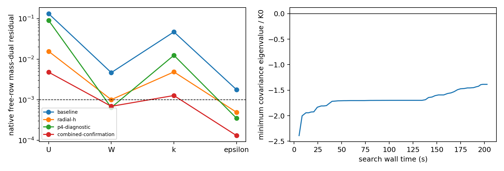

# Cao–Tamura budget AWF H2d

2026-11-13, Asia/Shanghai. **The signed-curvature defect is repaired and
verified. The bounded velocity-only search did not produce an admissible hill
seed. No physical hill step was attempted or accepted.** The best saved native
candidate still has outer covariance minimum −.0243800. Independent extra
sampling also finds a negative value. The conditional 8/16-step hill pilot
therefore remains unexecuted.

The flat study supports a spatial-representation explanation for its initial
imbalance: analytical weak loads remain near roundoff, while native projected
fields have substantial residuals. Joint refinement improves them, but does
not close the unchanged 1e−3 spatial target. A single-knot transfer improves
traction while worsening gradients and residuals; it is not adopted.

## Identities and unchanged problem

The Mac worktree is `.worktrees/pimple-one-sweep` on the existing
`codex/cls-epawf-pimple-one-sweep` branch. Local and fetched starting HEAD were
`c18e9ab7e6e22a4e268b04d07a0a05ec25083532`. Implementation is
`380d4d8300eb3a797ecc987abf1b2adc9d9438e5`; the exact numerical-JSON/fixed-row
contract is `14a325acb6ac62dfe92be7dc4ae7c7072d78c899`. The reporting update
`acb9fe204449c2d71004c6c67ea8436697849f28` distinguishes the final exact-row
probe from the earlier import-validation probe. Native C++/header hashes and
postprocessing hashes are recorded in
[source-revisions.json](cls-cao-tamura-budget-h2d-evidence/source-revisions.json).

The frozen native solver SHA256 is
`143b083fad7f4072baf1f7651dff82435470ac0509b4e75fb78903f589e9bfc3`.
The final exact-row probe SHA256 is
`38fe0d300c038a79131c55637b2385e1493917141c0e9e04583e3519334a742e`.
All 19 implementation/test/policy files match the isolated Linux source export.
Every frozen runtime has its executable and linked-library closure indexed.
Linux compilation used Release, `-fno-fast-math -ffp-contract=off`, four build
workers, and the verified H2b SpatialDomains library. Each pilot/probe used one
rank and one computational-library thread. The independent two-worker project
build and the shared Linux checkout were left untouched. That checkout was
observed at `f4b70baec10016dd098005bc5a5507b87e4a57bf`, with its existing
developer-guide change preserved.

The data volume is UUID `5AB8A669B8A642FD`, mounted at `/media/jay/新加卷1`.
The artifact index records 1,800 files (about 6.80 GB), excluding build/source
objects. All heavy H2d artifacts are in the new root:

```text
/media/jay/新加卷1/nektar-v2026-runs/cls-cao-tamura-budget-h2d-20261113
```

The primary case remains H_A=.0065 m, h_s=.0022472751006336437 m,
z_m=z_K=H_A, and transported endpoint K. The existing H2c seven-point fit,
u_tau, viscosity, calibrated AWF constants and AnalyticalNeutralInflowV1 are
unchanged. No height or roughness calibration was repeated. Regularized CLS
has beta=.4, Gamma=1, gamma0=0; inner stress is Linear. The source remains
P_actual−E_C, with the counterfactual flat production determining the curved
cutoff budget. Molecular inner diffusion, high-Re outer equations, pressure,
interface and open-boundary interpretations are unchanged. Production remains
one native IMEX1 sweep with one U/p/epsilon/k solve and one logical final bound.
No floor, reserve, covariance tolerance, correction objective or work limit was
relaxed. The 3000-slot limit remains.

The 5.5/6.0 mm H2c results and all finite-profile runtimes remain historical
controls. The roughness-sublayer qualification at these low matching planes,
and the neutral inlet's representativeness above the experimental boundary
layer, remain open.

## Signed curvature and reference diagnostics

`RANSWallNormalMap::At()` correctly sorts its principal curvatures. For an
extruded negative-curvature shoulder, kappa1=0 and kappa2=kappa_stream.
The initializer incorrectly used kappa1 as signed streamwise curvature.
Both policies now use **t_stream^T B t_stream** for the normal derivative,
reconstructed f'', amplitude derivatives and outer continuation. Principal
ordering, metric products, reach certificates and governing geometry were not
changed. Fresh policy names are `TangentialNeutralV2` and
`PhysicalHeightInterfaceV2`; their strict initializer identity changes are
intentional. Historical V1 reproduction uses its saved runtime and fields.

At the retained point s=.059553093889933906, r=.0065:

- signed curvature is −3.6782547400293875/m; sorted principals remain [0,−3.67825474];
- the old represented-radial target divergence was −2.2595050864/s;
- corrected target divergence is **6.84349e−9/s**, with step-halving difference 1.45e−9/s;
- velocity agrees with an independently differentiated represented streamfunction
  to 2.18e−11 m/s there; the maximum across the focused samples is 6.09e−11 m/s.

Tests include crest/positive curvature, the negative shoulder, both foot limits,
and inner/interface/outer points. Independent analytical radial differentiation
is retained separately from represented-radial differentiation and final 2D
native gradients. Thus the H2c negative-shoulder analytical/native-target
mismatch was **not entirely radial representation error**. Its positive-curvature
outer failure was independently genuine and is not removed by this repair.

`accepted_awf_reference_departure` now uses the selected immutable provider at
the physical incoming-frame height. The focused nonflat point has physical z
different from native zHat; exact reference gradient/epsilon give departure
zero and ratio one. Nearest-floor distance remains the CLS/Yap input; inner r
and outer chart coordinates keep their separate roles. Legacy finite chart-log
ranges remain explicitly diagnostic. This was a reporting error: covariance
already used the correct physical provider, and its old negative values remain
valid evidence.

## Corrected primary replay

All entries below are zero physical steps. Full vectors, targets, scalar/budget
inventories, native one-sided tensors, traces and hashes are in
[curvature.json](cls-cao-tamura-budget-h2d-evidence/curvature.json).

| Policy | H2c inner / outer minima | Corrected inner / outer minima |
|---|---:|---:|
| TangentialNeutral | +.00271257 / −.0711611 | +.00278770 / −.1064044 |
| PhysicalHeightInterface | +.000335983 / −.0534449 | +.00160236 / −.0528906 |

Corrected state hashes are respectively
`6bb1618a9d9eaf9ecfb966d8b5b2332ba8c15684fbee0189bc996a8b1949211f`
and `83b1a4fd9a4fcda694f6e6f10bfb789700d1fc6fc83443b91f67bfcb045e79b5`.
The corrected PhysicalHeightInterface setup's native weak-continuity maximum
is 2.94e−18. Its continuity-projection mass correction is 5.15e−5, versus the
old 1.48e−3. Small weak continuity does not imply pointwise solenoidality or
covariance feasibility. The positive-curvature analytical outer target remains
inadmissible after the kinematic defect is fixed.

## Bounded velocity-only feasibility experiment

The [predeclared policy](cls-cao-tamura-budget-h2d-evidence/policy.json) was
recorded before the search. Scalars, pressure, dependent epsilon, K, profiles
and all model data were frozen. The interface was already free in the native
projection; no interface Dirichlet condition was removed.

The base satisfies the affine essential/continuity constraints. Smooth physical
streamfunctions use the floor height, a quadratic inlet/floor zero, and a roof
streamfunction zero that permits tangential roof motion. Centers and vertical
scales span the outer domain, including above z=.2; that old blend plane is not
a search constraint. Native free-row directions are injected with exact zero
essential coefficients and projected into the continuity nullspace using the
stored consistent mass, independent Q rows and factored Schur system. No large
projector is formed. Trials are **u_base+Z a**, with actual native gradient rows.
No final projection is applied after optimization. Natural top/outlet loads
remain the declared weak problem; a zero-time steady force balance is not
imposed or fabricated.

The two spaces have 16 and 32 columns. The native homogeneous constraint defect
is 1.14e−13. Mass-Gram condition numbers are about 895 and 7.58e5: the larger
basis is full rank but poorly conditioned enough to limit interpretation of a
local coefficient-space search. This is not a singular-constraint certificate.

A gamma-weighted strain-extension least-squares predictor supplies a starting
trial. Phase I minimizes covariance slack with small distance/strain penalties.
Active eigenvalue constraints are linearized within bounded trust steps; every
trial is checked against the true selected tensors. The local subproblem does
not make the nonconvex problem globally convex. Branch-aware one-sided checks
near q_S=q_Omega are separate from central differences: errors decrease under
step halving, with final maximum about 7.5e−7 in the sampled matrix derivatives.

The positive target was lambda_min/K0>=1e−4, separate from the unchanged hard
tolerance −1e−10 K0. Limits were 40 iterations, 5000 tensor trial batches and
900 s per size, at most six final complete-audit operations, and eight stagnant
iterations. The velocity-distance cap was .12 in physical L2 (15% using the
fixed nominal flat volume scale), with sampled velocity increments capped at
.5 m/s. Weights are recorded, not fitted to hill observations.

The 16-column run ended at 40 iterations/1468 trial batches. The 32-column run
stagnated after 28 iterations/1892 batches. Total including preliminary scans
was 3363 batches. The frozen numerical context contains 155,380 distinct native
observations; production membership/counts are retained by the independent full
audit. No solver process was rebuilt for an optimization trial.

### Best rejected seed

[Native evidence](cls-cao-tamura-budget-h2d-evidence/native.json) preserves the
complete best vector outside Git and its exact hash:

```text
42b9f5650078a8075bf14fc966fb8dd8c96ffd71ad24985cb2e51df9309c4111
```

- Full production inventory: inner minimum +.00415643; outer **−.0243800383**.
- The limiting outer point is the roof at (x,z)=(.1,.8) m, native element/geometry
  77, on the right/flat side of the foot. Gradients are not averaged with the
  other tangential limit.
- Extra independent GL12 sampling gives **−.0241926818** near
  (−.0242755,.172686) m. Both radial interface limits, both foot limits and
  moving observations remain in the production inventory.
- At the native critical direction, contributions are isotropic +.01173259,
  linear −.00367556, quadratic −.00216953, cubic −.00058011 and regularization
  **−.02968742**. The tensor/eigenvalue replay agrees independently to roundoff.
- Non-velocity and prescribed coefficients are bitwise fixed. Scalar and cutoff
  budgets pass. Native continuity/boundary norms remain below 1.2e−13 and the
  integrated net volume flux is about −5.1e−16 m²/s per unit span.

The search improves its covariance objective while **worsening strong divergence**:
L2 rises from about .0603 to .2718 (RMS about .341/s for the best field).
Velocity change is .0749586 in physical L2, about 7.1% of the base velocity norm;
maximum sampled change is .499954 m/s, essentially the declared response cap.
Mean-flow kinetic energy increases from .564366 to .569933 per unit span/density,
about .99%. These are setup changes, not positivity-correction supply or physical
time evolution. The limited smooth basis and cap do not rule out other seeds;
the worse pointwise divergence and negative complete audit prohibit accepting
this one. No global infeasibility, ellipticity or hill-solution nonexistence is
inferred.

## Exact startup-state contract and software checks

`CertifiedNeutralStartupV1` binds the complete coupled vector/hash to native
geometry/mesh, reference/fit, initializer, inventory, source/runtime and complete
validation receipt. Each dt creates its own fresh native IMEX1 histories from
that exact state. Import runs no optimizer, Lift or projection. Ordinary
changed-dt/changed-geometry restart remains rejected. The historical runner's
boolean-gate-plus-regeneration path is retired; the new hill runner requires
an exact certificate and independent extra-point margin.

The affine control verifies fresh state/reference/history equality, complete
stage-vector equality, 1+1 versus uninterrupted two steps, and post-assignment
rollback. The final runtime also matches the frozen H2c four-step state,
stages and all native history bits. It confirms one U/p/epsilon/k solve and one
logical bound per accepted step, solved epsilon retention, and zero correction.
The imported control reports **zero Lift calls/iterations**. Native certificate
validation repeats scalar/covariance/budget and algebraic/boundary checks before
forming histories.

Two contract issues were found and fixed during verification:

1. Inherited literal-zero perturbation functions still entered the generic Lift
   path. Certified import now verifies literal zeros and bypasses that path;
   nonzero post-import perturbations reject before histories.
2. Native JSON can contain `-0`. Python's integer parser normalized two frozen
   k modal zeros. H2d readers preserve those bits, and the native candidate
   reader now uses bitwise fixed-row checks. Only those two serialized fixed
   zero bits were restored from the immutable base; numerical fields, objective
   and covariance did not change. The old packet is retained and now correctly
   rejected. The corrected packet passes every fixed-row check and retains the
   same negative covariance. No search was rerun to make it pass.

Parser/native signed-zero tests, fit/mesh/dt/corruption rejections, exact cache
on/off comparisons and focused projection tests pass. Earlier missing-include,
contract-guard and expected-exception harness stops are archived as software
stops, separately from numerical/model outcomes.

**There is no accepted hill seed or hill checkpoint.** The 8×2e−6 / 16×1e−6
pair, curved 4+4 restart and curved physical rejection test remain conditional
and unexecuted. Their runner is implemented; the complete gate prevents launch.

## Flat spatial diagnosis

Four zero-step affine diagnostic configurations use the same physical interval,
compatible verification boundaries, fixed physics and source quadrature. Two
streamwise panels permit radial refinement below the size limit. The supported
p4 control also uses P2 regional pressures; it is not an isolated radial-p order
study or a production-positivity qualification. The original six-panel pilot
and its cubic/P1 spaces remain unchanged.

| Diagnostic | slots | U residual | W residual | k residual | epsilon residual | grad-U L2 |
|---|---:|---:|---:|---:|---:|---:|
| Reduced cubic baseline | 1040 | .133220 | .00468333 | .0472329 | .00177542 | .259916 |
| Radial h | 1979 | .0156970 | .00100731 | .00487620 | .000491969 | .0303301 |
| Tensor p4/P2 | 1833 | .0908329 | .000645012 | .0125201 | .000351277 | .0778895 |
| Localized h+p4 confirmation | 2885 | .00479799 | .000690938 | .00127535 | .000131072 | .00444211 |

The six-panel H2c baseline is [.134298,.0047212,.047615,.0017898]. Reducing the
streamwise test space changes its norm slightly, and is not claimed as closing
any gate. All four diagnostic configurations still fail at least one 1e−3 block.
Both native normalization and dimensional physical-mass dual norms are retained
in [flat.json](cls-cao-tamura-budget-h2d-evidence/flat.json).

The direct analytical free loads remain around 1e−13 or below. Native U/k
errors, shear/normal stress and production errors localize primarily to the
rapid inner profile; the first outer panels dominate important W/epsilon
cancellations. Every panel contribution is assembled into shared global rows
before the full free-mass contraction. Signed projections onto the total
residual retain cross terms and can exceed one or be negative; they are not
additive error percentages. Summed panel vectors reproduce global free loads
to the recorded rounding tolerance. Physical one-sided selected tractions and
k/epsilon fluxes are retained, separately from derivative jumps. Inner epsilon
flux is undefined, not invented as an inner transport equation.

The exact analytical Yap contribution is nonzero (scaled epsilon component
about 1.29334e−4 in the combined control). It cancels consistently with the
other analytical terms. It is not labelled a numerical error. Near-unity
column production/destruction also does not close the higher free modes.

A separate, explicit zero-step transfer adds only z=.0001 m to the original
six-panel cubic/P1 pilot: **2982 slots**. Traction moves from .005522619 toward
.005513842, closer to reference .005515727. However grad-U error rises to
.288864, U residual to .225383 and k residual to .0610092. Thus traction alone
would select the wrong allocation. The transfer is not adopted for a hill run.
The constrained L2 reference projection need not improve derivative/weak-load
errors monotonically with one extra knot.

The full h allocation would require 5339 six-panel cubic slots; the localized
combined radial allocation alone would require 4399 cubic slots. Both exceed
3000. One dense coupled n² allocation would grow from about 63 MB at 2804 to
228 MB at 5339, before other matrices, caches and factors. Raising the guard is
not a scaling remedy. The remaining useful spatial work requires a more
affordable assembly/representation package, not another evolving knot sweep.



## Work and current disposition

The native setup/export receipt is 99.97 s; the uncompressed optimization
context is about 789 MB. A full batched tensor scan costs .425 s. Search process
cost is 238.91 s wall, 169.40 s user CPU, peak 4.85 GiB. The final native best
re-audit costs 25.13 s and about 1.25 GiB peak. The final affine four-step
verification block costs 45.36 s inclusive, peak about 1.52 GiB; fresh certified
initialization costs 17.55 s. This is not a physical hill-step timing or an
isolated factorization cost. No long continuation was launched; all H2d jobs
are bounded and finished. The bulky offline JSON export is itself a future
storage/cost concern, not a scalable solver solution.

| Gate | Actual result |
|---|---|
| Signed curvature, both foot sides, physical reference diagnostic | Passed |
| Corrected primary scalar/budget/essential-boundary/weak-continuity checks | Passed |
| Corrected primary covariance | Failed |
| Bounded frozen-scalar native velocity search | Terminated: iteration budget / stagnation |
| Best seed complete and independent covariance checks | Failed |
| Exact packet/fixed bits, affine import/history/stages/restart/rollback | Passed |
| Flat analytical weak equilibrium | Passed at integration accuracy |
| Native flat 1e−3 spatial target | Failed |
| Conditional physical hill pair and curved restart/rollback | Unexecuted: no admissible seed |
| Developed flow / experimental validation | Unqualified |

## Reproduction and next package

From the indexed Linux root, with all computational-library threads set to one:

```bash
python3 source/solvers/IncNavierStokesSolver/Tests/RANS/run_cao_tamura_budget_h2d.py \
  --probe build/RANSWallResolutionProbe --phase replay \
  --preflight ../cls-cao-tamura-budget-h2c-20261112/preflight-final.json \
  --h1 ../cls-cao-tamura-budget-h1-20261111/compatibility-resolved --output NEW_REPLAY
python3 source/solvers/IncNavierStokesSolver/Tests/RANS/run_cao_tamura_budget_h2d.py \
  --probe build/RANSWallResolutionProbe --phase setup \
  --preflight ../cls-cao-tamura-budget-h2c-20261112/preflight-final.json \
  --h1 ../cls-cao-tamura-budget-h1-20261111/compatibility-resolved --output NEW_SETUP
python3 source/solvers/IncNavierStokesSolver/Tests/RANS/search_cao_tamura_budget_h2d.py \
  --setup NEW_SETUP/65-hill-probe/result.json \
  --preflight ../cls-cao-tamura-budget-h2c-20261112/preflight-final.json --output NEW_SEARCH
```

Use unused output roots. The artifact index records full commands, inputs,
outputs, runtime closures, source hashes and retained software stops. Historical
checkpoint bytes and signatures were not edited.

**Next recommendation:** implement one bounded, strong-divergence-controlled
coupled velocity/turbulence initializer at this same fixed physical case, with
mass-conditioned velocity directions and consistent E_C(K) interface data.
The present limited velocity-only search reaches its response cap and trades
covariance improvement for worse pointwise divergence. That evidence supports
a better coupled setup, not a height/Gamma/floor change or a claim of global
physical infeasibility. The deferred short hill pair should remain locked until
that exact seed passes all independent gates.
