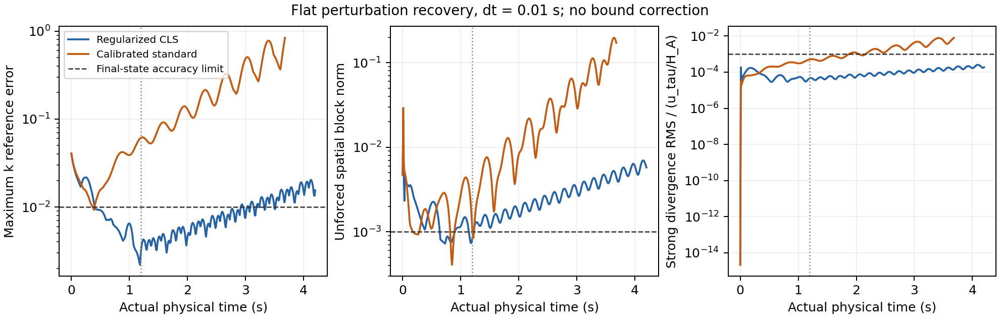

# WP2: full-height neutral open approach flow

2026-11-16–17, Asia/Shanghai. **WP2 remains OPEN.** Both models pass the
new boundary implementation, common deployable spatial qualification and
unperturbed transit tests. The bounded perturbation tests fail recovery:
regularized CLS remains admissible but misses the final accuracy budgets at
T=4.2 s; calibrated standard loses inner covariance at attempted T=3.69 s.
No hill run or automatic global recovery retry is launched. The bounded
common-state time-sensitivity control also ends in rejection; it does not
promote the failed global recovery gate.

| Gate | Regularized CLS | Calibrated standard |
|---|---|---|
| Equilibrium-compatible boundary implementation | PASS | PASS |
| Common six-column spatial accuracy | PASS | PASS |
| Unperturbed dt / dt/2 / finer mesh through T_req | PASS | PASS |
| Whole-interval quarter-budget comparisons | PASS | PASS |
| Complete unperturbed final windows and trend | PASS | PASS |
| Split restart, histories, post-assignment rollback | PASS | PASS |
| Bounded perturbation return to all final budgets | FAIL, T=4.2 | FAIL, native rejection at attempted T=3.69 |
| Resolved transient timestep accuracy | OPEN | OPEN; short half-step control exceeds a quarter budget |
| Overall approach-flow closure | OPEN | OPEN |

The [closure ledger](cls-cao-tamura-budget-wp2-evidence/final-status.json)
and [checkpoint-4 receipt](cls-cao-tamura-budget-wp2-evidence/checkpoint4.json)
bind terminal results. Boundary/spatial success and an admissible trajectory
are separate from perturbation recovery and experimental accuracy.

## Physical contract and boundaries

The frozen H2g calibrations, seven-point fit, u_tau=.07426793792419734 m/s,
nu=3.8095238095238094e-6 m²/s, kappa=.4405539051866587,
z0_eff=.00012222264395414748 m and H_A=.0065 m are unchanged. Both models use
the full-height analytical logarithmic U and 1/z epsilon above H_A, their own
equilibrium K0, and the nonconstant accepted inner ReferenceK. The inlet and
backflow reference have no finite tail. Endpoint K is transported during
evolution; every local cutoff uses its actual K and counterfactual p_A0(K).
Actual inner production remains full stress work, with source P_actual-E_C.
There is no forcing, residual anchor, profile reset, E_C/k reaction or retuning.

The versioned policy is NeutralEquilibriumOpenV1. Historical policies retain
their meanings. At the roof, W=0 is essential; U, k and solved outer epsilon
are free. The full selected tangential traction is +u_tau² e_x, k conormal
flux is zero, and epsilon conormal is -u_tau^4/(sigma_epsilon Z). The latter
is positive outward physical diffusion. Per unit roof length it is
2.9253115350668032e-5 for CLS and 2.821498719297465e-5 for standard.
Roof traction is .005515726603512429 m²/s².

The outlet uses T*n=T_ref*n+min(u_n,0)(u-u_ref), with its equivalent
conservative upwind flux counted once and immutable positive scalar backflow
data. Pressure is pi=p/rho+2k/3. Pout fixes outer streamwise total normal
pressure; no independent pressure Dirichlet condition or closed-box mean gauge
is appended. Production cases use Pout=0. The nonzero-datum fixture at .003
independently recovers:

| Reference | pi_inner | pi_outer | mechanical p_inner-p_outer, per density |
|---|---:|---:|---:|
| CLS | -.004039556572351707 | -.0014583858291560801 | -.0025811707431956273 |
| Standard | .003 | .003 | 0 |

All affected face test modes, nonconstant modes and outflow/backflow signs agree
with independent GL32 integration within 1.2e-15 relative error. Analytical
free U/W/k/epsilon weak loads are at most 1.58e-13 in native normalization.
Wrong-top and omitted-outlet-shear controls retain U=.04529 and W=.04033
defects. Full-stress compensation, pressure/corner and production fixtures pass.
See [checkpoint 1](cls-cao-tamura-budget-wp2-evidence/checkpoint1.json) and the
[literature crosswalk](cls-cao-tamura-budget-wp2-evidence/source-crosswalk.json).
Richards–Norris supplies the upper shear/epsilon-flux rationale; the regional
outlet-pressure completion and numerical budgets are project-specific.

## Common spatial qualification

All levels use the complete six-column topology
[-.2,-.1,-.05,0,.05,.1,.6] m, Z=.8 m, cubic U/W/k/epsilon and regional P1
pressures. Reported numbers are **full free-row physical consistent-mass-dual
block norms**, with shared rows and cross terms assembled before contraction.

| Slots / representation | CLS U / W / k / epsilon | Standard U / W / k / epsilon |
|---|---|---|
| 2804 / L2 | .137041 / .004816 / .048587 / .001826 | .136857 / .0001048 / .046509 / .002950 |
| 2804 / energy | .022613 / .002042 / .005188 / .0006376 | .021994 / .0001243 / .004970 / .0007684 |
| 5339 / energy | .003470 / .0004199 / .001045 / .0001060 | .003343 / .00001984 / .0009998 / .0001234 |
| 8002 / energy | .001272 / .0004486 / .0001386 / .00006463 | .001056 / .00001863 / .0001302 / .0001034 |
| **8650 / selected** | **.000469076 / .000166622 / .000126918 / .000036735** | **.000412545 / .000018553 / .000120549 / .000029991** |
| 11014 / confirmation | .000329744 / .000137559 / .000072366 / .000033939 | .000277433 / .000018548 / .000067656 / .000026954 |

An ineffective 9882-slot upper-only refinement is preserved. Signed global
mass-dual panel contractions localized matching-plane cancellation; splitting
the last inner and first two outer panels produced the selected case.
RadialEnergyV1 minimizes a representation error for U, k and complete outer
epsilon with correct regional reference pressures. It is setup algebra,
not a stationary PDE solve or an equilibrium-restoring load.

Source/face GL16-to-GL24 changes in block norms are <=2.2e-11. Independent GL28,
physical stations, native extrema and exact sided interfaces pass initial
physical/scalar/covariance budgets. Independent initial covariance minima
(inner, outer) are (.00631381050,.00609524100) for CLS and
(.00683838645,.00671295638) for standard. Independent tensor/eigenvalue replay
agrees within 1e-12. No bound correction or artificial supply is used.

The historical 3000-slot default remains. Explicit WP2MeasuredDenseV1 permits
at most 12000 only for this serial affine one-sweep problem, after measured
larger audits and continued steps. No physical-mass approximation or general
mapped expansion is introduced. Exact native field dimensions, free rows,
quadrature and identities are in
[checkpoint 2](cls-cao-tamura-budget-wp2-evidence/checkpoint2.json) and
[numerical adaptation](cls-cao-tamura-budget-wp2-evidence/numerical-adaptation.json).

## Executed physical time and independent checks

The composite inlet gives Q=1.050195996901104 m²/s, U_bulk=1.31274499612638 m/s
and **T_req=1.1942387693600194 s**. Each model completes:

| Leg | dt, seconds | Accepted / attempted | Actual endpoint, seconds |
|---|---:|---:|---:|
| Selected coarse | .02 | 60 / 60 | 1.2000000000000006 |
| Selected half-step | .01 | 120 / 120 | 1.2000000000000008 |
| Confirmation mesh | .02 | 60 / 60 | 1.2000000000000006 |

These are 1.004824 transit units. Reused trial prefixes are counted once;
restart/rollback replay executions are itemized separately in the artifact
index. All accepted physical steps retain one U/p/outer-epsilon/k solve and
one logical bound operation, with zero correction supply and authoritative
solved epsilon. First histories match the actual fresh seed, not a regenerated
reference. Ordinary changed-dt and changed-boundary restart rejection remains.
Across the pulse's .012–.05 m reference support, k/epsilon is approximately
.227–.946 s for CLS and .237–.989 s for standard. These reference times do not
bound the evolved near-wall scale: at standard's rejected witness k/E_C is
about .00358 s, below dt=.01 s. This motivates a transient time-sensitivity
check; it is not an integrator-instability proof.

Every unique unperturbed state passes native monitoring and independent
coefficient-derived full 3x3 stress/gradient/profile checks at 254016 GL28
points. Primitive fields/gradients replay native rows bitwise; reference-k
primitives agree within 1.18e-16. Dependent inner data use each state's own
endpoint K, rather than a report's terminal transient sampler.

All 61 common executed times pass dense timestep and mesh comparisons.
Worst fractions of the **allowed quarter budgets** are .21852 (CLS timestep),
.05875 (standard timestep) and .56653 (mesh). Native boundary/continuity
triangle bounds also pass. Full Reynolds/mean-stress RMS errors normalized by
u_tau² reach at most .002211 (CLS) and .001525 (standard), below .01.
Final .3 s windows exceed T_req/4: all-pairs component-range bounds and
transit-scaled trends pass all six unperturbed cases. Endpoint similarity alone
is not used to claim window closure.

Actual step52-to60 4+4 replay is bitwise equal in fields, governing stages,
histories/time labels, reference, defect and boundary identity. Deliberate
post-assignment rejection restores the restart-initialized accepted caches,
fields and histories. The diagnostic runtime upgrade is separately shown
bitwise equivalent to the previous production arithmetic on both models.

## Bounded perturbation outcome

The predeclared fresh setup changes only outer k on .012<z<.05 with zero
external/interface increment. Its actual peak departure is 4.0492203% of K0,
above twice the 1% accuracy budget. Endpoint K, U/W, pressure, epsilon,
reference, defect and prescribed data are unchanged. Initial TKE increments
are 5.35438e-6 (CLS) and 5.59378e-6 (standard) per unit span/density; these
are setup changes, not bound supply.

| Recovery, dt=.01 s | CLS | Standard |
|---|---:|---:|
| Accepted / attempted physical steps | 420 / 420 | 368 / 369 |
| Accepted physical frontier, seconds | 4.199999999999955 | 3.6799999999999655 |
| Transit units | 3.516885 | 3.081461 |
| Terminal native covariance inner / outer | .006282072 / .006084599 | first rejected: -.000577381 / .005659255 |
| Final complete return classification | FAIL accuracy/window | FAIL hard covariance |
| Bound activation / supply | zero / zero | zero / zero |

CLS's final free U/W/k/epsilon block norms are
(.0057668113,.0012657988,.0005281667,.0000819372). Inner pointwise k error is
1.54713%, against 1%; strong-divergence RMS/(u_tau/H_A)=.000187065 and
wall-shear RMS error=.00141018 pass their own budgets. Passing those quantities
does not compensate for failed residual/profile/window criteria.
The independently recomputed GL28 final .3 s window changes inner U by
.00027763 (limit .00025), pointwise inner k by .01364577 (limit .0025), and
mechanical-pressure RMS by .00650470 (limit .0025). The corresponding
transit-scaled trends fail too. The complete all-pairs window receipt is
retained; the final-window failure is measured, not inferred from the endpoint.

Standard's first rejection is at actual attempted T=3.6899999999999653,
after all four scheduled solves and the logical bound, at the final complete
accepted-AWF audit **before** candidate assignment/history commit. Its exact
negative witness is (x,z)=(.1,.00037071067811865477) m, geometry/element 71,
tangential plus limit of the downstream [.1,.6] panel, interior radial side.
Actual k=.004780870703900692, endpoint K=.020124472529214812,
nu_A=1.3079319333594469e-5 m²/s. G has U_x=.9163086232, U_z=283.82060192,
W_x=-.0423199353 and W_z=3.1273719451 per second. Independent polynomial
differentiation differs by <=2.3e-12 per second.

The complete covariance eigenvalues are
(-.0005773808840411,.003187247135934,.006846097977037) m²/s²;
independent replay agrees with the native minimum within 8.2e-17. This is a
genuine inner Linear witness, not an interface-law/gradient pairing defect.
Scalar positivity and cutoff budgets still pass: min inner k=.00285531158,
min outer epsilon=.00116219967, min budget ratio=3.03600254, budget defect zero.
All accepted parent fields/histories/time labels/reference/defect restore
bitwise, with rejected candidate and callback history retained.

At that point actual full stress-work production is 1.0406687 and E_C=1.3355405
m²/s³; counterfactual p_A0=1.6713864 remains a distinct quantity.
The preceding accepted state's domain-integrated inner P/E=1.003648:
near-balanced global integrals do not imply local equilibrium or covariance.
Diffusion, advection, storage and interface/constrained-row exchanges remain
explicit in the native weak budgets, rather than being inferred from P-E.

The saved-stage replay localizes the crossing more precisely. At the same
native-sided witness, lambda_min is +.000533425 in the committed state and
+.000577805 after momentum/pressure; epsilon leaves that inner tensor unchanged.
The raw k solve changes local k from .00648484380 to .00478087070 and endpoint
K from .01995190149 to .02012447253, yielding lambda_min=-.000577381.
The logical bound changes no coefficient. The seen GL28 volume grid likewise
first becomes negative after k (inner minimum -.000399024). Direct application
of the saved 2286-row frozen k matrix to its increment reproduces the linear
equation within 4.1e-19. This separates the stage-local admissibility loss from
a failed linear solve; it does not settle temporal or spatial accuracy.
The [stage receipt](cls-cao-tamura-budget-wp2-evidence/failure-stage-sequence.json)
binds every saved stage hash and the immutable packet/matrix. Its diagnostic
point/grid replay is distinct from a complete production-inventory audit and
performs zero governing solves.

One bounded standard dt=.005 control executes 60 accepted steps to
T=.30000000000000016 from the identical pulse and its own valid histories.
At T=.3, timestep differences use 2.82 times the quarter-budget point-pressure
limit and 2.8–10.8% of the resolved response. Thus the transient timestep gate
is open. These results do not establish timestep-independent model instability
or global physical infeasibility. The original negative assessments, exact
states and independent
[rejection replay](cls-cao-tamura-budget-wp2-evidence/recovery-standard-native-rejection.json)
are preserved. No retry, physical retuning or extension beyond T=4.2 follows.

## Budgets, performance and scientific limits

Native budgets retain actual production, prescribed cutoff dissipation,
separate counterfactual production, epsilon production/destruction/Yap,
physical history storage, boundary transport, roof/outlet work and constrained
reactions. Weak row identities close within 1.5e-16 at retained unperturbed
endpoints, and within 1.3e-16 at the reported late recovery endpoints.
At CLS's unperturbed T=1.2 half-step endpoint, actual roof traction work is
.00653600734, outward roof epsilon diffusion is .00002340249228 and outlet
reference-traction work is .00002352580716, per unit span/density. These are
separate work/flux terms, not a fabricated closed kinetic balance.

Raw face column `outward_diffusion` stores D*grad(q) dot n; outward physical
diffusive transport is its negative. Sampled-gradient face balances are distinct
from exact weak row partitions. CG interface-row projections are not unique
control-volume fluxes, constrained reactions are not free evolution equations,
and dependent inner epsilon has no invented transport equation.

Continued selected steps cost roughly 25–33 s; confirmation steps about 40 s.
Measured selected recovery steps are about 27 s, including all unchanged hard
audits. The confirmation run peaks near 5.9 GiB. Driver time includes startup,
report/budget construction and checkpoint/output. Exclusive process-CPU
categories distinguish domain/inventory and constitutive scans from
factorization/triangular actions; report construction is not labelled pure I/O.
The [artifact/cost index](cls-cao-tamura-budget-wp2-evidence/artifact-index.json)
records actual commands, per-root costs, executable identities and heavy paths.
The original aggregate 12-hour, 96-GiB storage, 24-GiB/process and 72-worker
limits are not reset by continuation names. Numerical ranks/library threads
are one; build concurrency is four. Repeated-addition time allowances are
predeclared bounds; no saved time, history or checkpoint identity is edited.

The complete native-report index counts **1379 physical attempts, 1370 accepted
step executions, eight deliberately injected rollback rejections and one
genuine standard rejection**, across 103 solver invocations including zero-step
and incompatible-restart fixtures. It includes nested runtime replays and
legacy progress records, deriving counters from native callback/accepted-step
data without rewriting original receipts. The ledger reserved 1400 attempts;
the 21 unexecuted attempts are the remainder of the standard block stopped at
its first rejection. Spatial cases use 32/32, boundary calls 7/24 and timestep
trials 7/16. Final measured storage is 14.45 GiB and maximum native RSS is
5.90 GiB. The original full-horizon WP2 physical jobs are stopped. Eleven focused Linux protocol
tests pass, including nested execution counting and fail-fast ownership.
The recovery driver wall times are 13366.15 s (CLS) and 11763.28 s (standard),
with continued-step medians 27.01 and 26.95 s; these concurrent process costs
are distinct from aggregate elapsed wall time.

The active-goal follow-up amends the agent-selected resource envelope to
thirteen hours cumulative, without changing its origin or resetting work
counters. The original twelve-hour negative result remains archived. This
corrects an unnecessary request for approval: the user specified autonomous
evidence-based numerical adaptation and a finite budget, not a twelve-hour
hard limit. Numerical acceptance budgets remain frozen.

The new AnalyticalNeutralOpenIMEX1V1 diagnostic import reads the parent under
its original dt/signature/checksum, retains all fields and fixed data, and
forms independent histories at the saved physical time without Lift. An actual
same-dt step agrees bitwise with ordinary continuation and the archived step
in all governing-stage hashes, coupled fields, histories/time labels, reference
and defect. Ordinary changed-dt restart rejects. Twelve focused Linux protocol
tests pass. The old v12 runtime remains frozen; v13 is separately frozen and
used only for this qualified standard late-import control.

The single new fine leg starts from the exact accepted standard
T=3.3599999999999723 state and uses dt=.005. It accepts **59 of 60 attempted
steps**, reaching T=3.654999999999966, then rejects at T=3.659999999999966.
Its native covariance minima are (-.0005649986426315,.005553131793160), with
the inner witness at (x,z)=(.1,.0004). Scalar/cutoff budgets remain recorded in
the terminal receipt. Parent bytes are preserved; the later block is never
launched. The archived dt=.01 trajectory is reused, including its later
T≈3.69 rejection. The smaller local timestep does not remove the failure.

Thirty exact common times through T=3.649999999999966 are compared on seen
GL28 physical panels. At the last common time, differences divided by the fine
response from the same late seed are U=.57680, W=.33199, k=.56366,
epsilon=.78850, pi=.74714 and mechanical pressure=.75642. Sampled covariance
minima at that time are (.00338718,.00606569) for coarse and
(.00089249,.00568973) for fine. These are local adjacent-step differences,
without a temporal-order or accumulated-global-error claim. The independent
history import removes a startup-history ambiguity; it does not remove errors
already present in the common late state.

The follow-up adds 62 physical attempts and 61 accepted executions, including
the two one-step import checks. The combined ledger is therefore 1441 attempts,
1431 accepted executions, eight deliberate rollback rejections and two genuine
covariance rejections. The native legs and numerical comparison finish before
the cumulative 46800-second boundary; terminal capture is at 46799.17 seconds.
Final administrative archiving and Git pushes extend beyond that aggregate
wall envelope. This is recorded as a resource overrun, not retroactively hidden
by moving the origin or raising the cap again. No further numerical job runs.
See [terminal result](cls-cao-tamura-budget-wp2-evidence/late-control-terminal.json),
[common-time comparison](cls-cao-tamura-budget-wp2-evidence/late-comparison-final.json)
and the separately frozen [v13 runtime](cls-cao-tamura-budget-wp2-evidence/late-runtime.json).

Frozen experimental coordinates/weights are unchanged. At x=-.15, preserved
T=1.2 full 15-point mean RMSE is about .0912971 Uinf for both models; shear
RMSE is about .001822 Uinf², and streamwise RMS error is .90110 (CLS) versus
.77668 (standard), in sigma_u/u_tau units. The seven fitted mean points retain
RMSE .02549213 Uinf. This records the full-height surface-layer idealization's
experimental discrepancy; numerical closure would not remove it. Standard's
isotropic neutral normal stresses are not a fit to unequal measured RMS.
Fig.3d and hill observations remain held out.

## Provenance, reproduction and next action

Starting head: baa4651351a588c23c72785a22e90bb3f1bd40ce. Checkpoints 0–3 were
committed/pushed as 019190cb74783fdc8cea88d07a96deabd491b68f,
2e08ddb40615269044b34ad40d8509171cfcfd40,
76f94833f1170d81059b68d6599c9690686ea459 and
8e499bc5c64fb7a22f036e649c53b93cff31b643, respectively.
The source identity manifest records the full tested hashes; final evidence
is committed as checkpoint 4 with an explicitly **OPEN** result.

Production runtime-v12 executable SHA256:
8f64823373d97b86880cc9b624b19886f9921a2e9a0d56a9def1f0528af485df.
Its complete linked-library closure is frozen and rechecked by the closure
collector. Original v12 production source hashes match its source chain;
the geometry-only row-export probe is separately built and identified.
Postprocessing changes do not overwrite a historical solver or library.
The row-probe source index is corrected to the successfully compiled c5c3be08
source: its earlier manifest described a failed missing-field-initializer
compile. The exact constructor-only diff, failed/successful build-log hashes
and unchanged f51cad5b runtime are preserved in
[row-probe-source-correction.json](cls-cao-tamura-budget-wp2-evidence/row-probe-source-correction.json).
The tested implementation revision is 19959bea36d9b289f685f014dcb4518c5c152dbb;
the final documentation/evidence commit adds no native arithmetic change.

Heavy root:
`/media/jay/新加卷1/nektar-v2026-runs/cls-cao-tamura-budget-wp2-20261116`;
mount UUID 5AB8A669B8A642FD is verified. Exact native XML/argv, histories,
checkpoints, failed packets and all readback sources remain there.
The [plan](cls-cao-tamura-budget-wp2-plan.md),
[policy](cls-cao-tamura-budget-wp2-evidence/policy.json),
[source chain](cls-cao-tamura-budget-wp2-evidence/native-source-chain.json)
and final artifact index provide reproducible commands. Principal entry points
are run_cao_tamura_budget_wp2.py, run_wp2_preservation.py,
verify_wp2_long_transaction.py, audit_wp2_rejected_recovery.py,
audit_wp2_dense_comparisons.py, audit_wp2_window_envelope.py,
collect_wp2_closure.py and collect_wp2_artifacts.py. Use unused output roots;
existing owners reject duplicate launches. Every forensic/readback operation
performs zero governing solves.

**Next package:** continue the already-retained global dt=.005 standard control
from T=.3 to T=1.2 under a new finite cost declaration. This reuses its own
valid native histories and original pulse, and tests accumulated early-time
error that the late common-state experiment cannot resolve. Do that before
attributing the mode to the physical model or selecting a new mesh.
Hill requalification remains deferred until both-model WP2 closure. Spatial
accuracy of the selected equilibrium, transient accuracy/robustness, developed
flow and held-out experimental validation remain separate gates.

## Global half-step control, declared 2026-11-17

The preceding terminal statement records the thirteen-hour segment. A new,
explicit cumulative amendment retains the same original clock and all failed
results, and caps the entire campaign at sixteen hours (57600 seconds). It
permits only 180 additional physical attempts: ordinary same-runtime continuation
of the existing standard dt=.005 trajectory from step60/T=.3 to step240/T=1.2.
The pre-existing checkpoint SHA256 is c60c81942d969b75194c2034d867d3c5ec8e041f3afc4ad3c49b7d97c96a734c.
The frozen v12 executable, original perturbation, native histories and every
acceptance threshold remain unchanged. Measured cost is 30.94 seconds per
accepted step; forecast native cost is 5569 seconds, with 600 seconds reserved
for analysis. The first rejection is terminal. The experiment tests global
early-time accumulation, which the late common-state experiment cannot assess;
its launch does not close either model's perturbation-recovery gate.
See [cumulative amendment](cls-cao-tamura-budget-wp2-evidence/resource-extension-16h.json).

The new read-only global comparator replays 31 exact common times through
T=.30000000000000016 from the original pulse (SHA256
0f2bc1f991d814e8a2b4fcfe471ee47efc07927c48f25b162d5c161ea89927f0).
It verifies the complete pair signatures after excluding only the independently
checked TIMESTEP entry for this comparison; ordinary restart checks remain
unchanged. At T=.3, dt=.01 versus .005 differences divided by the fine
response from the original seed are U=.0281971, W=.0718051, k=.0281016,
epsilon=.0723916, pi=.107707 and mechanical pressure=.0474274. The frozen
quarter-budget test fails at pressure/normal-traction point measures. Both
runs retain positive inner/outer GL28 covariance minima (coarse
.00682821/.00671630; fine .00682758/.00671630). This is global adjacent-step
sensitivity evidence, not a measured order or a recovery pass. The replay took
47.44 seconds and 914176 KiB peak RSS, with zero governing solves. Thirteen
focused Linux protocol/comparison tests pass. See
[readback receipt](cls-cao-tamura-budget-wp2-evidence/global-half-step-readback-T03.json)
and [exact launch](cls-cao-tamura-budget-wp2-evidence/global-half-step-launch.json).

## Signed k-load replay at the first standard rejection

A separately frozen, read-only probe exports the complete native free-k-row
components at the archived pre-k stage, with the original physical signature,
parent checkpoint, callback history and all stage-vector hashes validated. It
performs no Lift, projection, physical advance or governing solve. The production
v12/v13 executables and closures remain unchanged. Changed callback-history and
physical-signature bindings reject in focused negative tests, preserving the
accepted parent. The probe source and runtime are indexed in the
[k-balance artifact receipt](cls-cao-tamura-budget-wp2-evidence/k-balance-artifact-index.json).

At the independently reconstructed native witness x=.1,
z=.00037071067811865477, the saved 2286-row transport matrix gives an adjoint
functional for the local k increment. Signed responses, in m²/s², are:

| Frozen residual load | Response in local k |
|---|---:|
| Inner actual production | +.00838646938168 |
| Inner prescribed cutoff dissipation | -.01128845927369 |
| Physical k diffusion | +.00176780369307 |
| Conservative volume advection | -.00086918607934 |
| External advection | +.00029908480983 |
| Outer production minus destruction | +.00000031437214 |
| Time-mass load at pre-k | 0 |
| Sum | -.00170397309630 |

The sum reproduces the actual change .00648484380020 -> .00478087070390
within 2.17e-17; the adjoint backward residual is 2.81e-18. No bound correction
acts. The instantaneous time-mass residual is zero because pre-k k still equals
the callback history; physical storage is formed by the solved increment.
The native component sum also reproduces the frozen packet residual.
These are signed responses through the **same frozen operator**, retaining
cancellation; they are neither additive percentages nor independent physical
evolution equations. They show the production/dissipation imbalance and
advection driving this saved loss, with diffusion opposing it. They do not
establish whether its origin is physical, temporal or spatial. The globally
refined control remains necessary.

The readback plus diagnostic adjoint takes 12.26 seconds. Reported 231192 KiB
RSS concerns the Python analysis process; native child peak RSS was not captured
by that receipt. Two negative probe checks add zero governing solves. Reproduce
with audit_wp2_k_witness_balance.py followed by verify_wp2_k_balance_contract.py,
using the isolated probe and unused output directories. Full load vectors remain
outside Git. See [signed result](cls-cao-tamura-budget-wp2-evidence/rejected-k-witness-balance.json)
and [negative checks](cls-cao-tamura-budget-wp2-evidence/rejected-k-witness-contracts.json).

## Global half-step terminal result, 2026-11-17

The standard original-pulse dt=.005 trajectory completes **240/240 accepted
physical attempts**, actual T=1.1999999999999964 s (1.00482419 minimum transits).
Its six resumed blocks add 180 accepted steps. Each has one U, pressure,
outer-epsilon and k solve and one logical bound call; solved epsilon remains
bitwise retained and no bound correction activates. The original T=.3 parent
checkpoint and frozen v12 executable/library closure remain unchanged. The
terminal checkpoint is step240/checkpoint.28, SHA256
d49341a3735b7f175ee4650e222730f93f0cc19e5972d67adfb97bbad18bd348.

**Recovery fails.** At T=1.2 the maximum native free-block residual is
.00176608 (limit .001), inner velocity L2 error .00158487 (limit .001),
inner W RMS/u_tau .00137881 (limit .001), inner k L2 error .0132106
(limit .01), pointwise inner k error .0644920 (limit .01), and inner mechanical
pressure RMS/u_tau² .0431218 (limit .01). The coefficient-derived analytical-reference profile
comparison and the actual endpoint/final-window change and trend checks also
fail. No covariance rejection occurs on this global half-step interval.
The finer timestep therefore does not remove the observed recovery departure.

All **121 exact common times** through T=1.2 are compared on the seen GL28
physical panels without time interpolation or pressure realignment. At the last
common time, dt=.01/.005 differences divided by the fine response from the
original seed are U=.326310, W=.271823, k=.104333, epsilon=.302567,
pi=.230040 and mechanical pressure=.180476. The quarter-budget test and full
stress-tensor difference test fail. The corresponding GL28 inner/outer covariance
minima are (.00678803,.00669283) coarse and (.00678567,.00669021) fine.
These two levels establish sensitivity, not an observed temporal order or a
continuum-model instability certificate. The finer global experiment is distinct
from the previously rejected common-late-state experiment.

The added native work takes 5416.24 seconds (90.27 minutes), peak RSS
4317860 KiB (4.12 GiB). Native continuation finishes at 05:13:31 Shanghai;
all terminal numerical analyses finish at 05:57:01, within the cumulative
sixteen-hour boundary of 06:15:47. Administrative capture and archiving occur
later, at approximately 07:54, producing an explicitly recorded wall-envelope
overrun of about 99 minutes. The original clock is not moved. No further
numerical job is running or launched under this envelope.

Combined execution totals are **1621 attempts / 1611 accepted executions**,
with eight deliberate rollback rejections and two genuine covariance rejections
from the earlier controls. Requested-work reservations remain distinct from
actual attempts. Boundary consistency, common spatial accuracy, unperturbed
physical-duration preservation, confirmation-mesh preservation and restart/rollback
retain their recorded passes for both models. **Perturbation recovery remains
FAIL for both; WP2 remains OPEN.** Perturbed temporal and spatial qualification
also remain open. The successful unperturbed programme is not substituted for
those missing gates.

See [terminal receipt](cls-cao-tamura-budget-wp2-evidence/global-half-step-terminal.json),
[recovery checks](cls-cao-tamura-budget-wp2-evidence/global-half-step-recovery.json)
and [complete artifact index](cls-cao-tamura-budget-wp2-evidence/global-half-step-artifact-index.json).

The smallest next experiment is one same-dt standard original-pulse recovery on
the already-qualified 11014-slot confirmation mesh through T=1.2. It separates
radial-representation sensitivity from the measured timestep sensitivity while
reusing the archived selected-mesh dt=.01 control. It was **not launched** within
the exhausted envelope. Repeated smaller timesteps alone are not justified by
the present evidence. A changed mesh or new resource envelope must be declared
and costed before execution; neither a closure change nor weakened acceptance
is proposed. The common-boundary hill requalification remains deferred.
