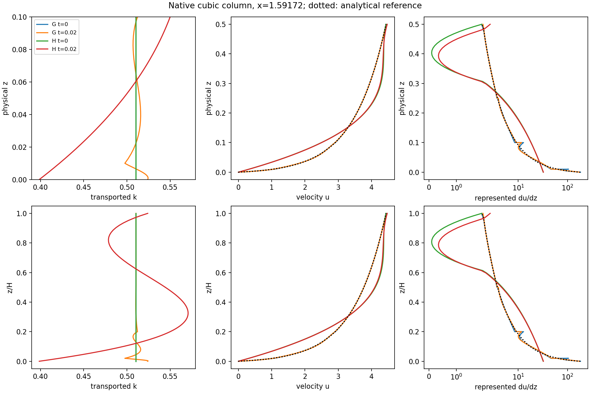
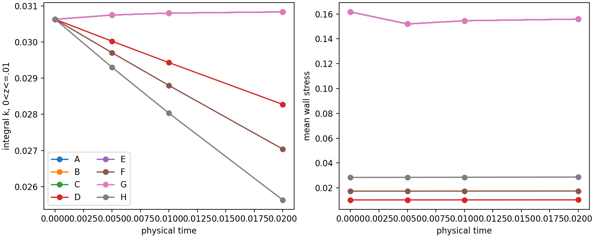

# CLS–EP-AWF: height, tail, sampling and wall-layer partition

2026-11-07. Branch `codex/cls-epawf-pimple-one-sweep`; base
`edd0759b69ab3577d4655608664bb00d5ad1aa20`.

All eight configurations completed 32 native IMEX1 steps to **T=.02**.
All used one U/p/outer-epsilon/k solve and one logical ConstitutiveV2 bound
call per step. Bounding remained inactive. Lowering H improved the ordinary
single-cubic velocity fit, but did **not** make its near-wall gradients,
production or k evolution adequate. Fixed physical bands show larger near-wall
k depletion at smaller H, despite increasing whole-layer k in the one-element
cases. Successful execution is therefore not reference preservation.

The H=.5 graded/one-element pair has a separate durable continuation through
targets 32, 80, 160, 800, 1600, 3200 and 8000 steps. The dated status packet
and the continuation section below give the observed frontier; future targets
are not claimed as results.

## Physical definitions and compatible references

The AWF parameter **h=.1 is not aerodynamic roughness z0=.1**. The selected
CLS constants give K0=.5105080130598861 and kappa=.4405539051866587, with
u_star=.4, nu=1.5e-5, AWF c_mu=.09 and c_length=2.55. The computational top
is Z=4; it is not an independently established atmospheric boundary-layer
thickness. Ground velocity is no-slip; interior ground k remains free under
the inherited natural scalar treatment.

For these inputs Zv=-.005272131216726143 and the inner velocity length is
ell=nu/(c_mu c_length sqrt(K0))-Zv=.005363607242366248. The reference construction
uses J0(H)=log(1+H/ell)/(c_mu c_length sqrt(K0)), U_H=u_star^2 J0(H), and
z0,c=H exp(-kappa U_H/u_star). An independent Python evaluation agrees with
the native analytical kernel. The old original-AWF epsilon cutoff is about
1.07068e-4; it is distinct from the budget-selected corrected cutoff z_c below.

| H | H/h | H/z0,c | H/Z | ell/H | H sqrt(K0)/nu | U_H | z0,c | z_c | z_c/H | tail-H budget ratio | intrinsic chi |
|---:|---:|---:|---:|---:|---:|---:|---:|---:|---:|---:|---:|
| 2 | 20 | 581.892 | .5 | .00268180 | 95266.46 | 5.78025437 | .00343706659 | .00951526914 | .00475763 | 6.34800 | 1 |
| 1 | 10 | 277.064 | .25 | .00536361 | 47633.23 | 5.10652625 | .00360926835 | .00999150999 | .00999151 | 5.60602 | 1 |
| .5 | 5 | 132.299 | .125 | .0107272 | 23816.61 | 4.43538361 | .00377932029 | .0104612514 | .0209225 | 4.86693 | 1 |

Reference traction is .16 in all three primary references. H/ell is still
about 373, 186 and 93 respectively: changing H to .5 leaves a steep velocity
profile inside the first fraction of an ordinary cubic element. All cases
satisfy h<H and the kernel's intrinsic profile checks. No universal maximum
H/z0 is imposed or inferred from this experiment.

At H=2, z_m=1 gives budget ratio 3.74923; z_m=2 gives 6.34800. Here z_m is a
tail-joining requirement, while velocity matching remains at H. Both requirements
already lie well beyond z_c. The two references and complete trajectories A/B
are bitwise identical through .02, including native histories.

Changing H changes the compatible external log profile. A read-only diagnostic
that retains the baseline z0*=.003437066591 gives:

| H | compatible U_H | fixed-z0* U_H* | t_A*=U_H*/J0(H) | t_A*-.16 |
|---:|---:|---:|---:|---:|
| 2 | 5.78025437 | 5.78025437 | .160000000 | 0 |
| 1 | 5.10652625 | 5.15091283 | .161390741 | .001390741 |
| .5 | 4.43538361 | 4.52157129 | .163109095 | .003109095 |

Thus retaining the old external profile would change traction by about .869%
or 1.943%. The primary height comparison allows z0,c to change and regenerates
the analytical reference, boundary data, epsilon trace and native history.
Common aerodynamic roughness at fixed h/u_star would require a separate
momentum calibration; no constants or forcing were retuned here.

The common physical u L2 decomposition makes this distinction quantitative:

| pair | analytical reference offset | difference of initial representation errors | actual h0 difference | difference of evolution-only increments at .02 |
|---|---:|---:|---:|---:|
| C/E, graded 2/1 | .168032 | .00302575 | .168178 | .00158534 |
| E/G, graded 1/.5 | .182945 | .00291064 | .183381 | .00179665 |
| D/F, one-element 2/1 | .168032 | 1.92142 | 1.94484 | .0350369 |
| F/H, one-element 1/.5 | .182945 | 1.06850 | 1.09478 | .0370483 |

These norms are not additive scalars; the stored squared cross term closes
the vector decomposition. Between-H offsets dominate the graded initial
velocity differences, while representation changes dominate the one-element
family. Evolution-only differences subtract each case's own actual h0 before
comparison.

The XML E0 expression already depends on H. Its derived YapScale helper and
the zero-amplitude outer perturbation geometry were audited. The actual Yap
coefficient .83, length coefficient 2.5 and geometric distance z in the native
outer closure were preserved. All perturbation amplitudes and prescribed
body/scalar forcing remain zero; eta=0.

## Implemented experiment and shared K functional

| Case | H | inner partition | K functional | z_m | full coupled coefficients |
|---|---:|---|---|---:|---:|
| A | 2 | graded | Point, z_K=1 | 1 | 2165 |
| B | 2 | graded | Point, z_K=1 | 2 | 2165 |
| C | 2 | graded | ColumnAverage | 2 | 2165 |
| D | 2 | one element | ColumnAverage | 2 | 1415 |
| E | 1 | graded | ColumnAverage | 1 | 2213 |
| F | 1 | one element | ColumnAverage | 1 | 1613 |
| G | .5 | graded | ColumnAverage | .5 | 2261 |
| H | .5 | one element | ColumnAverage | .5 | 1811 |

The graded full-domain radial knots are
`0,.01,.1,.25,.5,1,2,7/3,8/3,3,10/3,11/3,4`.
Each one-element partner removes only knots strictly below H, retaining 0.
Tangential geometry, outer mesh within each pair, and the mesh above 2 are
identical. Velocity/k/outer-epsilon remain cubic; both regional pressures are
linear with one common gauge. C/E/G use the same full-domain velocity/k mesh;
D/F/H are the declared single-inner-element family at each physical H.

`RANSWallKSampling=Point|ColumnAverage` is opt-in; Point keeps its old default.
ColumnAverage-v1 is the physical linear functional

    K(x) = (1/H) integral_0^H k_h(x,z) dz = a(x)^T k.

Its global CG row uses fixed GL8 on native physical vertical panels. It does
not use K-dependent AWF normalization quadrature or average in x. Shared
`SampleKRow`/`SampleK` consumers cover profiles, rays, transition inputs,
normalization, reference production, dependent epsilon/matching, directional
assembly, probes and admissibility. Mean observations/witnesses retain the
actual coefficient row in separation and retained cuts. A mean violation is
not replaced by a point constraint at the row's metadata coordinate.

In average mode, H/2 is an internal geometry placeholder; z_K is reported null
and is excluded from physical identity. Changing that unused placeholder in a
valid restart leaves state/history unchanged. The explicit functional version,
support and physical normalization are in the signature. H, tail, sampler and
mesh changes remain strict checkpoint incompatibilities.

Local point inventories, continuous cubic ground extrema and complete
ConstitutiveV2 coverage remain active. Positive mean K does not establish local
positivity. The guarantee remains the declared evaluation inventory plus
continuous ground, not every volume-polynomial point. Mean sampling is limited
to the supported serial flat 2D PIMPLE pilot.

All cases use UniformEPFlat-v1, actual chi=1, SaturatedR2, capped destruction,
IMEX1 dt=.000625, relaxation=1 and the existing mass pressure approximation.
Projection controls are explicitly 2000 per Add, 20000 total, 2000 separations,
900 seconds. The physical relative floor is 1e-8, or 5.10508013e-9, with the
existing reserve unchanged. No governing equation or epsilon-trace solve is
repeated. Native initialization is separate; all fresh h0/history/checkpoint
hashes and initialization work are recorded in the evidence.

## Native initialization and short evolution

The constrained reference projection is retained, including inner value and
matching derivatives. No ground-shear constraint or ground-k value was added.
The following dimensional L2 errors use a common physical reporting quadrature.
The production error uses selected represented production against analytical
AWF reference production. These are errors of actual native h0, not a substituted
probe reference.

| Case | velocity error | du/dz error | inner production error | initial mean wall stress |
|---|---:|---:|---:|---:|
| A/B/C | .00989479 | 3.85576 | 1.26948 | .161726 |
| D | 2.47630 | 27.2088 | 5.18598 | .0102634 |
| E | .0100364 | 3.85566 | 1.26943 | .161725 |
| F | 1.34024 | 24.6027 | 5.02595 | .0173226 |
| G | .00993347 | 3.85697 | 1.26981 | .161730 |
| H | .681627 | 21.1623 | 4.69963 | .0283614 |

Reference production L2 norms are 5.17008, 5.16307 and 5.14911 at the three
heights. The one-element errors remain roughly 100%, 97% and 91% of these
norms. Reducing H improves velocity values much faster than near-wall gradients
and production. It does not make a single ordinary cubic adequate.

At .02 the saturation-active fraction is about 47% in D versus .13% in the
H=2 graded case, and 43% in H versus .53% in G. The same SaturatedR2 law is
being evaluated in substantially different represented-gradient regimes.

At T=.02 all cases accepted 32 steps with zero bound activations:

| Case | drift u_x L2 | drift k L2 | outer epsilon drift, z>=2 | common-gauge pressure drift | min declared k | mean stress | refreshed trace defect | native wall seconds |
|---|---:|---:|---:|---:|---:|---:|---:|---:|
| A/B | .00841186 | .00320023 | 2.04873e-6 | .0109310 | .497688 | .155901 | 7.35714e-7 | 1371 / 1310 |
| C | .00841188 | .00319905 | 4.03580e-6 | .0109490 | .497673 | .155910 | 5.66989e-7 | 1334 |
| D | .0218925 | .0494591 | 2.99140e-4 | .148830 | .461620 | .0103112 | 5.44766e-5 | 835 |
| E | .00847832 | .00319833 | 8.27085e-5 | .0111697 | .497657 | .155914 | 2.30302e-6 | 1235 |
| F | .0238662 | .0551504 | 1.00729e-4 | .112926 | .433903 | .0174422 | 1.60465e-4 | 853 |
| G | .00844644 | .00319622 | 5.24292e-5 | .0113518 | .497645 | .155922 | 8.93318e-6 | 1069 |
| H | .0245325 | .0569688 | 5.19239e-5 | .0971403 | .398119 | .0286825 | 4.52046e-4 | 755 |

v, full vector changes, profiles, and dimensional/native/common-normalized
spatial residuals are retained separately. The common normalization uses
U=.4, K=.5105080131, E=.07263583326, H_ref=2, volume=24 and common outer
volume=12. Pressure alignment removes one global weighted-mean difference,
preserving the permitted regional offset. Epsilon norms here use transported
epsilon at z>=2; they are not norms of reconstructed inner dissipation.

A exactly reproduces the archived UniformEPFlat step-32 state/history.
A/B are bitwise identical. B/C have identical native h0; their .02 differences
are u=6.53e-7, k=5.89e-6, epsilon=5.61e-6 and pressure=2.47e-5 in the same
physical norms. The K functional has a small effect over this horizon; that is
not evidence of equivalence for longer or strongly nonuniform states.

### Fixed physical bands and source accounting

Reporting bands 0<z<=.01 and 0<z<=.1 split cut elements exactly before physical
quadrature. Whole wall layer, global domain and first element are separate
regions with explicit bounds. In particular, the first element equals H for
the one-element cases and is not called a common near-ground region.

| Case | integral k, z<=.01 at .02 | integral k, z<=.1 at .02 | global integral k at .02 |
|---|---:|---:|---:|
| initial, all | .03063048 | .30630481 | 12.25219231 |
| A/B | .03083640 | .30654730 | 12.25261304 |
| C | .03083536 | .30654399 | 12.25260627 |
| D | .02827481 | .28835094 | 12.28715418 |
| E | .03083465 | .30654216 | 12.25259761 |
| F | .02703741 | .28630552 | 12.27796426 |
| G | .03083333 | .30653831 | 12.25259148 |
| H | .02563095 | .29515824 | 12.27003354 |

The .01-band k losses are about 7.69%, 11.73% and 16.32% for D/F/H, while
their global integrals increase. This reverses the impression that could be
obtained from a mesh-dependent whole-first-element budget.

Complete weak source vectors, including all free higher modes, are retained.
The discrete budget reconstructs native PicardKMass M_ff; the saved matrix is
A_k, not that mass. For each physical band row ell, q=M_ff^-1 ell_f and
L=A_k-M_ff/dt give the exact increment decomposition

    integral Delta k_corrected = -dt q^T r - dt q^T L Delta k_raw
                                + ell_f^T delta k_bound.

It is checked against packet matrices, actual history, free/prescribed rows
and endpoint storage. A_k delta k and M_ff delta k/dt remain separate load
rates. All short-run correction integrals (signed, positive, negative and
absolute), correction norms and storage reactions are zero. The correction
is not responsible for the observed drift. Continuum production/destruction
time integrals use sampled endpoint trapezoids and are labelled estimates;
they are not asserted to close a local CG control-volume flux balance.

## Focused verification and follow-ups

Linux build and focused QP, reduced-model and native-history tests passed.
The earlier active Upstream six-step state/history is bitwise preserved.
Mean tests reproduce constants and a nonconstant cubic to 2.22e-16 across
partitions, exercise 383 exact-row mean observations, and reject positive
mean K with negative local k. A direct consistent-mass mean constraint has
zero constraint error and stationarity <=4.5e-18. Partial-band polynomial
integrals/rows agree within 6.1e-14. Non-k/prescribed coefficients and CG sharing
are preserved in the active between-node ground fixture. Existing dependent,
inactive-cut re-entry, budget-exhaustion and coherent-failure tests passed.

Within-case H restart (2+2 versus 4 steps) is bitwise identical in coupled
state, time and every native history. Forced hard rejection rolls back those
same quantities. H/mesh/sampler/tail-incompatible checkpoints are rejected.
The final diagnostic-source build also reproduces the frozen H first native
step exactly. Driver ownership/orphan/idempotent-ledger tests passed.

With the same actual D/H h0 coefficients, normal order 16 -> 32 changes the
full free-mode inner production load by 9.07e-5 / 2.33e-5 in physical mass-dual
norm, versus initial k residuals 2.56 / 3.08. Destruction changes by <=6.8e-14.
Cutoff, roughness and geometric integration panels remain present even for
one transported element. Quadrature error does not explain the large inner
representation defect.

Lower H exposes a second, separate outer-representation issue. Native initial
epsilon residual norms are 4.54e-5 (C), .01503 (E), .01360 (G). The corresponding
Yap component norms are 6.82e-5, .0001834, .0005228; at smaller H the total
defect is substantially larger than Yap alone. Component norms are not summed
as signed scalars. One declared G/H follow-up adds only outer knots .75 and
1.5, keeping the mesh above 2 unchanged and using fresh native h0. It reduces
both initial epsilon residuals to .002857 and vertical momentum residuals from
about .039 to .0105. The inner gradient/production errors hardly change. This
separates lower-outer resolution from the inadequate single inner cubic.

The G/H outer-refined pair also completed eight steps to .005. This is a
separate fresh-initialization representation test, not a checkpoint migration
or a replacement of the primary continuation.
At .005 its k differences from the original mesh are 1.44e-5 (G) and .001253
(H), while mean stresses are .152011 and .0284568. Outer resolution affects
the coupled trajectory and should be retained as an accuracy limitation;
it does not recover the missing near-wall velocity/production in H.

The targeted dt/2 G/H runs completed 64 steps to the same .02 horizon from
bitwise identical h0. Differences from dt=.000625 are:

| Case | time | u_x L2 | k L2 | epsilon L2, z>=2 | common-gauge pressure L2 |
|---|---:|---:|---:|---:|---:|
| G | .005 | 9.06118e-5 | 3.02692e-5 | 5.17295e-7 | 2.55127e-4 |
| G | .01 | 5.86051e-5 | 3.52357e-5 | 4.27116e-7 | 2.76488e-4 |
| G | .02 | 2.97203e-5 | 3.75393e-5 | 2.81246e-7 | 8.17000e-5 |
| H | .005 | 7.12451e-5 | 7.30947e-5 | 5.20816e-7 | 4.92649e-4 |
| H | .01 | 1.07902e-4 | 1.37674e-4 | 3.40379e-7 | 4.60834e-4 |
| H | .02 | 1.25244e-4 | 2.52159e-4 | 2.25355e-7 | 4.42226e-4 |

These are much smaller than the one-versus-graded discrepancies and do not
change the representation conclusion. Two levels do not establish an
asymptotic temporal order or a complete time-accuracy study.

The exact frozen physical-band budgets telescope to the endpoint k integrals
with maximum cumulative closure error 6.24e-16. Initial native mass-inverted
.01-band rates are +.05111 for the graded cases and -.12364, -.18842, -.27503
for D/F/H (integrated-k units per physical time). Their positive global rates
are respectively +1.7360, +1.2552, +.8510. The complete free-mode weak source
loads therefore explain both near-wall depletion and global k increase; net
destruction is counted once. No correction supplies that k.

Figures use actual native field evaluations at a free interior Gauss column
near x=1.60. Cubics are reconstructed within the reporting panels for plotting;
sparse epsilon engineering probes are marked explicitly. Physical z and z/H
are both shown.




## Continuations, scope and recommendation

At **08:12:36 UTC on 2026-11-07**, the immutable status/checkpoint capture
recorded:

| Campaign | status | accepted global steps | physical time | completed new targets | next target |
|---|---|---:|---:|---|---|
| primary G, H=.5 graded | running | 132 | .0825 | .02, .05 | .1 / step 160 |
| primary H, H=.5 one element | running | 170 | .10625 | .02, .05, .1 | .5 / step 800 |
| existing UniformEPFlat | running, unchanged frozen runtime | 1415 | .884375 | inherited .1, .5 | 1 / step 1600 |
| repaired original Upstream | numerically rejected, preserved | 103 | .064375 | former attempt-73 repair and .05 passed | none; rejection terminal |

Both new campaigns remain supervised through their remaining .1, .5, 1, 2 and 5 targets. They are
running experiments, not completed long-time assessments. Their immutable
checkpoint SHA256 values at this capture are respectively
`e530477a1bed1047d90b42b951b764c5005cc5063d3ffeb45c388de52dd0f76f` and
`30cc3b9fd06380b03f43181204b407b74005a108f0732a71c27db0f070339a6f`.
The independently maintained Uniform checkpoint is
`e818c1a416dc18ad675e6f8fbc3fec4c9a64324f0b595e24d6ea7e8ce7e9a5a0`.
Full immutable paths, process start tokens and verified executable/library
closures are in the status packet. Rotating live paths are not used as archived
field evidence.

At the common **T=.05 / step 80** observation:

| quantity | G graded | H one element |
|---|---:|---:|
| u_x drift from own actual h0, physical L2 | .00987852 | .0475507 |
| k drift, physical L2 | .00447437 | .132004 |
| epsilon drift on z>=2 | 6.12259e-5 | 6.08290e-5 |
| common-gauge pressure drift | .00907293 | .142014 |
| integral k, z<=.01 | .03064083 | .01927230 |
| global integral k | 12.25310112 | 12.29890350 |
| mean wall stress | .154984 | .0290937 |
| original spatial k residual, mass-dual norm | .0676823 | 2.39400 |
| original spatial epsilon residual, mass-dual norm | .00445756 | .0560754 |

The one-element .01-band loss reaches about 37.1% at .05, without bounding.
The elapsed time is only .04 H/u_star units for H=.5 and about .045 of the
actual initial bulk flow-through time (Lx/mean u, approximately 1.11).
Adjacent .02 physical windows still show material k/pressure drift, especially
in H. The epsilon trace is retained throughout these alpha=0 residual readbacks.

H subsequently completed T=.1: k drift is .239327 in physical L2, the .01-band
integral is .01032837 (about 66.3% below initial), and mean wall stress is
.0294528. Bounding is still inactive. Survival to .1 therefore strengthens the
diagnosis of poor reference preservation, rather than establishing accuracy.

The old repaired Upstream attempt 104 at .065 fails after U/p and before
epsilon/k/bounding: a newly moving constitutive ray finds
k=-4.47955e-8 at (x,z)=(-3.5,.0095161932). This is a different failure from
the previously repaired projection-work exhaustion. Its accepted checkpoint
`11d1c23373ed98a3f79c7ce6f242c23883398a3e369e1210e34a81a1c42445e9`,
actual rejected state and native stage history are preserved. No unchanged
retry or physical-policy conversion was made. The older original terminal
experiment at step 72/.045 also remains untouched.

R2DiagnosticV1 preserves hard scalar/covariance/normalization/boundary checks.
All cases leave the inherited narrow qualification envelope: A/B/C at .00125,
D at .000625 and E/F/G/H at initialization, first reason
`outer_gradient_box_exit`. Intrinsic chi=1 and numerical completion do not
establish qualification or a fully converged M8 stage.

The supported conclusion is transient, numerically admissible evolution with
significant representation-dependent drift. No original-equation steady
solution, bounded fixed point or statistical stationarity has been established.
The inactive bound cannot sustain a fixed point in these short comparisons.

Use a graded inner layer for reference preservation in the present polynomial
spaces. If H=.5 is pursued, retain the targeted outer refinement as a separate
accuracy follow-up with fresh initialization. Reducing H alone is not a repair
for an ordinary single cubic. An analytical/enriched inner representation is
better justified than further blind shrinking of H; a fixed-z0 momentum
calibration is a separate physical-model question. The original eight cases
and their histories remain unchanged by either suggestion.

## Provenance, commands and retained artifacts

Heavy root: `/media/jay/新加卷/nektar-v2026-runs/cls-epawf-height-sampler-20261107`.
Source/Git work used the existing Mac worktree
`/Users/jay/Documents/nektar-v2026/.worktrees/pimple-one-sweep`, preserving the
other Mac checkout and unrelated work. Linux source/build/runtime directories
are isolated. No active executable/library closure was rebuilt in place.
SSH used the documented Tailscale fallback after linux-usb timed out.

The production suite and both selected campaigns use compiled source
`5db0bd331bce6dbc4676fd391559137db41b3846`, executable SHA256
`aa1071c74de72601f47c97ed413995434e1496dba07095ee970ac361825cb98d`.
Focused functional tests use probe source `4dea51f`; the final band/diagnostic
build uses `69b039b`. Later commits add orchestration, readback and evidence.
Frozen identity files record every linked library hash. Exact XML hashes,
h0/history/checkpoint hashes, commands and receipts are indexed in the evidence.

Each numerical process uses one MPI rank and all computational library/thread
settings equal 1. Build parallelism is 4; suite concurrency is 4, focused/dt-half
concurrency 2. Existing jobs were counted. The conservative overlapping
allocation, including three OS threads per serial MPI process, was <=67 of 72.
Timings include concurrent server work and are not isolated scaling benchmarks.

```bash
R='/media/jay/新加卷/nektar-v2026-runs/cls-epawf-height-sampler-20261107'
S="$R/source/solvers/IncNavierStokesSolver/Tests/RANS"
source /home/jay/.local/opt/nektar-v2026-mpi/env.sh
export OMP_NUM_THREADS=1 OPENBLAS_NUM_THREADS=1 MKL_NUM_THREADS=1
export BLIS_NUM_THREADS=1 VECLIB_MAXIMUM_THREADS=1 NUMEXPR_NUM_THREADS=1
export TMPDIR="$R/tmp"

cmake -S "$S" -B "$R/build" -DRANS_BUILD_SOLVER=ON \
  -DNektar++_DIR=/home/jay/.local/opt/nektar-v2026-mpi/lib64/nektar++/cmake \
  -DCMAKE_BUILD_TYPE=Release \
  -DCMAKE_CXX_FLAGS='-fno-fast-math -ffp-contract=off -D_GLIBCXX_ASSERTIONS'
cmake --build "$R/build" --parallel 4 --target IncNavierStokesSolver \
  RANSWallResolutionProbe RANSHeightReferenceChecks RANSKBoundQPChecks \
  RANSHistoryRejectionChecks RANSReducedModelChecks
ctest --test-dir "$R/build" -j 1 --output-on-failure \
  -R 'RANS(KBoundQP|HistoryRejection|ReducedModel)Checks'

# New output directories are required; these names describe the retained runs.
python3 -B "$S/run_cls_epawf_height_comparison.py" \
  --solver "$R/screening/runtime/IncNavierStokesSolver" \
  --probe "$R/focused/probe-runtime/RANSWallResolutionProbe" \
  --output NEW_SCREEN --workers 4 --steps 32
python3 -B "$S/run_cls_epawf_height_comparison.py" \
  --solver "$R/screening/runtime/IncNavierStokesSolver" \
  --probe "$R/focused/probe-runtime/RANSWallResolutionProbe" \
  --output NEW_DT_HALF --cases G H --workers 2 --steps 64 --dt .0003125
python3 -B "$S/run_cls_epawf_height_comparison.py" \
  --solver "$R/screening/runtime/IncNavierStokesSolver" \
  --probe "$R/band-probe-runtime/RANSWallResolutionProbe" \
  --output NEW_OUTER --cases G H --workers 2 --steps 8 --outer-refined
python3 -B "$S/test_cls_epawf_height_comparison.py" \
  --solver "$R/screening/runtime/IncNavierStokesSolver" \
  --probe "$R/band-probe-runtime/RANSWallResolutionProbe" \
  --screening "$R/screening" --output NEW_FOCUSED \
  --upstream-baseline /media/jay/新加卷/nektar-v2026-runs/cls-epawf-projection-repair-20261107/earlier-active6/case.evolution.json
python3 -B "$S/analyse_cls_epawf_height_comparison.py" \
  --root "$R" --output "$R/analysis-screening"
python3 -B "$S/analyse_cls_epawf_height_comparison.py" \
  --root "$R" --screening "$R/dt-half" --compare-to "$R/screening" \
  --output "$R/analysis-dt-half"
```

The exact running supervisor commands are in `selected-G-command.json` and
`selected-H-command.json`. They use compatible native four-step prefixes,
explicit projection controls and 8-step checkpointed blocks with 7200-second
timeouts. Locks, native-child identities and idempotent ledgers protect recovery;
numerical rejection is terminal. `pair-monitor` reads completed immutable native
reports and records .02 physical windows (then .05 windows at later horizons).
It performs no governing solves or field repair.

Compact evidence: [native.json](cls-epawf-height-sampler-evidence/native.json),
dated live status and indexed heavy-artifact hashes. Native states, all histories,
matrices, packets, logs and per-case source vectors remain on Linux. Read-only
reference/case analyses are reproduced by `analyse_cls_epawf_height_comparison.py`,
`analyse_cls_epawf_height_discrete_budget.py`,
`check_cls_epawf_height_quadrature.py` and
`check_cls_epawf_height_outer_balance.py` in the RANS test directory.
