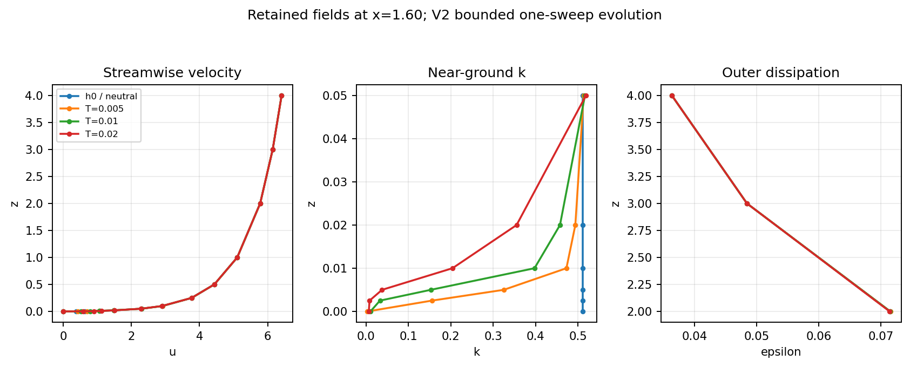
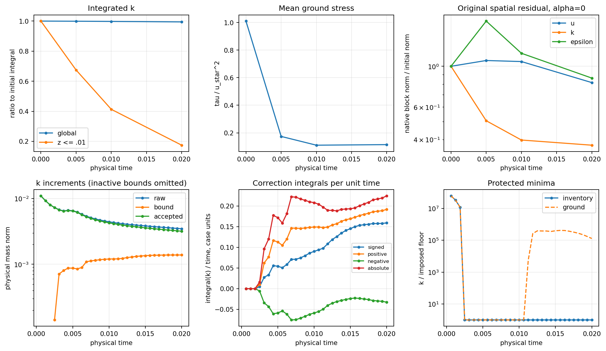

# ConstitutiveV2: complete declared k coverage and fresh continuation

The fresh h0 trajectory has completed **32 steps to T=.02**, passed both
V1 rejection times, and continued automatically toward T=.1. The numerical
method remains one U/p/outer-epsilon/k sweep. The longer assessment is
**running and unresolved**, not complete. The immutable analysis below
covers T<=.02; live progress and a later checkpoint snapshot are recorded
in [compact evidence](cls-epawf-pimple-constitutive-v2-evidence/native.json).

This work starts from the actual reviewed and fetched branch HEAD
`0b86269739075af81622319402370967fdeffbe8`, on the existing
`codex/cls-epawf-pimple-one-sweep` worktree. Other Mac worktrees, untracked
literature and concurrent Linux experiments were preserved. The original
[V1 failed campaigns](cls-epawf-pimple-longtime.md) remain unchanged.

The archived evidence snapshot has **68 accepted steps at
T=.042500000000000024**, status `running`, and next target step 160
(T=.1). Targets 32/.02 are complete; 160/.1, 800/.5, 1600/1, 3200/2 and
8000/5 remain pending. Its native checkpoint copy is
`evidence-supervised/checkpoint-0/State.bin` under the Linux root below,
SHA256 `6c701825b3cdf7b941c24e18ed5ca71fa30b5801ef8f7221197983b68971cde6`.
It preserves all actual native histories. The original rotating checkpoint
path is not an archival promise; use the copy or live progress pointer.
This snapshot verifies 68 callbacks and 68 of each governing solve, zero
additional governing solves, and 68 logical bound calls.


## Policy, shared coverage and scope

Select `RANSWallPimpleKBound=MassProjection` and
`RANSWallPimpleKInventory=ConstitutiveV2`. `LegacyV1` remains the inventory
default, reproducing the old map and checkpoint identity; `Off` retains
its numerical path and empty bound signature. V2 uses the explicit
`MassQR-ConstitutiveV2` identity in the native checkpoint fingerprint,
including the consistent-mass metric, constraint policy, effective floor,
reference K0 and arithmetic reserve. A V1 checkpoint is not a V2 restart.

V1 protected static locations, volume rays, matching-trace rays and
continuous ground extrema. Its complete audit additionally reconstructed
constitutive quantities at native/dense anchors, creating normalization
rays absent from that protection. The ray at a moving ground minimum
could also be invalid in an accepted V1 state.

V2 shares the following definitions with actual consumers:

| Evaluation family | Shared implementation and protection |
|---|---|
| Native/dense reconstruction | `ReconstructionLocations`, used by scalar inventory and `Audit`; both velocity and k grids contribute horizontal anchors |
| Static assembly and transfers | Existing physical mass/source/interface/reconstruction locations, physical sampled K, matching and transition samplers |
| Volume and matching trace | Native volume profiles and both baseline/current matching profiles, with their actual quadrature |
| Complete constitutive reconstruction | Both baseline and current profiles at all shared sampler/reconstruction anchors |
| Continuation diagnostics | Surface/probe anchors, shared profile abscissae, all current continuous-ground extrema, and retained correction/contact anchors |
| Normalization | `NormalizationRows` is used by both the inventory and `WallNormalization`, including each profile variant's actual quadrature |

The supported scope remains the serial, flat, cubic 2D pilot. Horizontal
anchor reduction uses that flat geometry. This is protection of the
**complete declared evaluation inventory and continuous cubic ground**,
not positivity everywhere inside every volume polynomial.

The ordering is coefficients and fixed scalar/sampler checks, safe profile
construction, ray-k checks, then normalization and dependent quantities.
Additional anchors have their sampled K and transition k/epsilon checked
before profile construction. Nonfinite values and non-k failures remain
explicit failures; arbitrary exceptions are not converted into k cuts.
`WallNormalization` also checks its actual k rows before dependent source
evaluation. No constitutive input is clipped independently of the state.

A final-audit coverage tripwire checks actual samplers, normalization rows,
audit samples, outer closures and wall sources against protected locations.
A focused test introduces an undeclared consumer and requires rejection.
This complements the shared generators and catches a future audit consumer
that bypasses them.

For each logical correction, all QPs minimize

`(1/2) delta_f^T M_ff delta_f`

relative to the **original raw transport result**. M_ff is the actual
physical consistent mass on shared free CG coefficients; prescribed k and
all non-k coefficients remain fixed. Ground extrema and state-dependent
rays are rebuilt after updates. Discovered physical constraints and their
anchors remain in separation even after leaving the active set. Final
KKT checks apply to the accumulated finite cuts; no global nonlinear
closest-point theorem is claimed.

The primary floor is still `1e-8*K0`, with
`K0=.5105080130598861` in velocity-squared units:
`floor=5.105080130598862e-9`. The arithmetic reserve is
`4096*machine_epsilon*K0`, about `4.64e-13`; separation requires half
that reserve above the physical floor, with the existing ground-roundoff
allowance. Hard nonnegativity/strict-positivity checks are unchanged.
Incompatible prescribed data cause rejection.

## Unchanged step map outside the revised bound

Native IMEX1 supplies its actual history. This remains a candidate
first-order sequential, linearly implicit method, not an exact fully
implicit backward-Euler solve or a demonstrated temporal order study.

| Scheduled operation | Frozen/latest choices |
|---|---|
| One vector momentum predictor | Existing frozen flow/turbulence operator and native history |
| One pressure/gauge solve | Unchanged B=(alpha M_u)^-1 and complete native G, followed by algebraic velocity correction |
| One outer-epsilon solve | Corrected flow, available turbulence; once-imposed matching target and retained trace columns |
| One k solve | Corrected flow, newly solved epsilon, unchanged physical destruction/source split |
| One logical V2 bound | Only k changes; internal mass/QR/KKT/separation work counted separately |
| Refresh, hard audit, commit | Retained solved epsilon trace; one state/time/native-history commit |

Relaxations remain one, eta and pseudo-time zero, forcing zero, and the
original outer6 mesh, boundary data, molecular viscosity, SaturatedR2
stress and capped destruction laws/quadrature are unchanged. There is no
inner-epsilon transport, extra outer iteration, transport re-solve,
nonlinear trace restoration, damping or residual-cancelling source.
The refreshed original residual and matching lag remain diagnostics.

## Focused Linux checks

All listed checks passed in the isolated authoritative Linux build.
The projection-only entry point uses the production engine, but explicitly
allows inspecting an immutable legacy pre-k state that fails V2. It does
not advance time/history, migrate a checkpoint or relax production entry.
Both retained pre-k fixtures fail the stronger entry check; ordinary
production use refuses them.

| Retained fixture | V1 result | V2 diagnostic result |
|---|---|---|
| dt=.000625, attempted T=.008125 | Exact old corrected hash reproduced; limited inventory passes, final audit finds k=-5.71472e-5 | Complete inventory and hard scalar/covariance/normalization checks pass; correction mass norm .00115067 |
| dt=.0003125, attempted T=.0071875 | Exact old corrected hash reproduced; final audit finds k=-2.05440e-6 | Complete inventory and hard checks pass; correction mass norm .000971610 |
| V1 accepted T=.0075 | Extra ground-minimum diagnostic ray finds k=-1.47519e-6 | Projection-only repair succeeds; refreshed ground/contact ray evaluations pass; repair mass norm 3.22450e-6 |

The two failure replays needed 188 and 175 separation passes, respectively.
They discover general constitutive-ray constraints, rather than hard-coded
repairs at the two known coordinates. The old accepted-state repair uses
60 passes. Non-k/prescribed coefficients are invariant, shared CG jumps
stay below 1e-12, and mass/integral/KKT checks pass. Actual h0 and neutral
reference are checked separately and both return bitwise unchanged.
Their distinct hashes reflect signed zeros; their represented physical
fields coincide in this zero-amplitude perturbation case.

Independent frozen accounting gives:

| Fixture | Raw k linear residual | Corrected frozen residual | A_k delta, max | alpha M_k delta, max |
|---|---:|---:|---:|---:|
| Coarse failure | 1.11e-16 | .0966538 | .0966538 | .0184966 |
| Finer failure | 1.39e-16 | .0976479 | .0976479 | .0311289 |

These are algebraic load infinity norms. The corrected field does not
solve the original frozen k system to roundoff. The added residual is
A_k delta, with storage reported separately. Refreshed epsilon matching
coefficient defects are 8.70824e-6 and 4.37672e-6; epsilon is not re-solved.
Both diagnostic repaired fixtures remain outside the qualification box.

Additional focused checks passed:

- Active-set removal and inactive-constraint rediscovery, including the
  existing identity-mass (1,3) example; the wrapper responsibility remains documented.
- Six uninterrupted V2 steps versus restart after step four: coupled state,
  time and every native history are bitwise identical across active bounding.
- Deliberate hard rejection after the activated step-six correction: actual
  candidate saved, accepted state/time/history restored to step five.
- V1 checkpoint refused by its unchanged fingerprint, with original bytes intact.
- Campaign flock retained by a surviving child; simultaneous owners and a
  live recorded native identity prevent replacement. An actual simultaneous
  resume against the running campaign was also refused.
- Repeated recovery after append-before-progress interruption does not
  duplicate the step or correction budget. Conflicting checkpoint hashes
  are rejected; incomplete final journal writes are reconciled.
- Ordinary resume refuses terminal numerical rejection without changing
  progress. A completed orphan's failure report is also terminal.

The governing counters distinguish attempts from successful validated
solves. The final-audit exception now retains the detailed constitutive
exception and witness alongside the saved actual candidate/history.
A broad old regression campaign was not repeated for these focused changes.

## Observed evolution through T=.02

The native first two blocks each report 16 implicit callbacks for 16
accepted steps. Thus the analysed prefix has exactly 32 vector momentum,
32 pressure/gauge, 32 outer-epsilon and 32 k solves, and zero additional
governing solves. Pressure mass-inverse actions are 85 per step. There
are 32 logical bound calls, 29 activations, 1996 bound mass-factor
applications, 1709 KKT solves and 1710 active-set iterations. Existing
initialization Lift work is separate: [2 calls,3 iterations] in the first
block and [1,2] on restart; initialization bound checks are no-ops.

States zero through eight match the available V1 trajectory bit for bit.
At T=.0075 the V2 k field differs from V1 by physical L2 norm 2.75768e-5;
velocity, pressure and epsilon still agree there. V1's retained safe
wall samples differ by stress norm 3.76743e-5. That comparison does not
make the old state admissible under V2.

| T | Global integral k | Integral k, z<=.01 | Mean ground stress | Scaled spatial k residual | Refreshed epsilon matching coefficient defect |
|---:|---:|---:|---:|---:|---:|
| 0 | 12.25219231 | .0306304808 | .16172622 | 62.60960 | 0 |
| .005 | 12.24044809 | .0206605600 | .02781963 | 31.64801 | 1.58771e-5 |
| .01 | 12.22340309 | .0126519068 | .01764684 | 24.85241 | 9.87131e-6 |
| .02 | 12.18493042 | .0053453243 | .01830067 | 23.29807 | 1.48542e-5 |

Original residuals use alpha=0 on the retained corrected state, without
Lift or epsilon-trace replacement. At T=.02, u/v/epsilon block norms are
6.70654/.541388/.186016. Continuity and gauge defects remain roundoff.
The minimum full-inventory k is 5.105505e-9 at approximately
(-1.48758,.000662658), while the continuous ground minimum is
.000655946. B_min=.553567 and lambda_min=1.



| Equal physical window | Velocity L2 change | k L2 change | Epsilon L2 change | Common-gauge pressure L2 change | Wall-stress L2 change |
|---|---:|---:|---:|---:|---:|
| 0–.01 | .0256823 | .0838954 | .000237157 | .361861 | .361727 |
| .01–.02 | .0284195 | .0564165 | .000115728 | .0252851 | .00347226 |

The initial represented neutral state is not a discrete equilibrium.
Global integrated k falls .549%, but the near-ground integral falls
82.55%. Small changes in global field norms conceal this local transient.

At step 32, raw/correction/accepted k increment mass norms are
.00346577/.00138355/.00317762. Correction/raw is **39.92%**, whereas
correction/(K0*sqrt(volume)) is about **.0553%**. These denominators are
different. The raw frozen residual is 1.67e-16, corrected frozen residual
.134937, and storage reaction .0357673. The cancellation identity is
verified from saved coefficients.

Through T=.02, signed correction integral is .00185507, positive .00262991,
negative -.000774837, absolute .00340474, and near-ground signed .00194433.
Net supply is .01514% of initial global integrated k, but near supply is
6.35% of initial near-ground integrated k.

| Window | Net correction integral | Near correction integral | Near physical production integral | Near physical destruction integral |
|---|---:|---:|---:|---:|
| 0–.01 | .000473016 | .000561150 | .00729680 | .0328050 |
| .01–.02 | .00138205 | .00138318 | .00265106 | .0225222 |

All entries are window-integrated k quantities per unit span. Physical
production/destruction use trapezoids at retained endpoints and are
estimates, not an exactly closed local CG balance. The independent actual
frozen discrete budget closes to roundoff; native pre-k and supplied k
history agree exactly in this unforced case. Globally through .02 its
input-load / implicit-increment / bound terms are
-.08220932 / .01309236 / .00185507, summing to actual delta -.06726189.
Near-ground terms are -.04150109 / .01427160 / .00194433 = -.02528516.



The T=.02 contact readback includes the ground minimum, fixed x=1.60 and
14 near-floor active locations. Every requested point-source ray is
valid. Instantaneous assembled mass-inverted rates at near-floor points
range from -170.763 to +28.243: contact dynamics are mixed. For example,
a floor point near x=-2.625 has rate +27.618 despite negative point source
-1.95e-5, while fixed ground x=1.60 has rate -352.573. The nonlocal mass
projection and finite-step/frozen coupling matter; persistent activation
does not mean every final contact has an outward instantaneous rate.
These readbacks perform zero diagnostic transport solves.

A subsequent immutable readback at **step 64, T=.04** reports global k
12.10112887, near-ground k .0017752981, mean stress .01739323 and scaled
k spatial residual 22.02589. Cumulative net correction is .00573156,
positive .00720792, negative -.00147636, near .00569716 (18.60% of initial
near-ground k). Correction/raw-step norm is 53.81%; it is not 53.81% of
total k. Algebraic cost has increased to 484 separation passes and 930
active-set iterations at that step, still one logical correction and one
solve per governing equation. Lambda remains one. This later state does
not establish settling; the near-ground integral continues to change
substantially. Full readback remains in the monitor directory and compact
later-state evidence.

The first narrow qualification exit is still T=.00125, outer-gradient
box. R2DiagnosticV1 continues deliberately outside that box while retaining
hard scalar/covariance/normalization checks. These states are not physically
qualified M8 evolution. No fully converged M8 stage is claimed.

The physical domain has L=6, H=2, u_star=.4 and initial mean U=5.4755408072.
Thus H/u_star=5 and initial flow-through time=1.0957821723. T=.02 covers
only .4% and 1.825% of these scales. The prior exploratory assessment
criteria (.5 and 1 physical-time windows, at least three adjacent windows,
1e-3 normalized field/residual/correction thresholds and 1% mean/RMS
stability) are not yet eligible. Classification is **unresolved transient
bounded evolution**; neither original-equation steady convergence nor a
bounded fixed point/statistical stationarity has been demonstrated.

## Durable execution, provenance and reproduction

The supervisor continues integer targets 32,160,800,1600,3200,8000 with
16-step blocks and explicit 7200-second timeouts. It waits for surviving
native children, recovers only infrastructure interruptions, and never
silently retries numerical rejection. The child inherits the campaign
flock. Step records use global step plus checkpoint hash; budgets reconcile
from unique accepted records. The native checkpoint-publication wait and
quiet-output timeout are retained. A separate monitor reads completed
immutable prefixes every 32 steps; diagnostic failures have their own
status and do not masquerade as numerical failures.

The original supervisor exited on a transient `FileNotFoundError` while
reading an atomically replaced progress file. The numerical driver
continued uninterrupted. Bounded read retries were added and tested;
replacement supervisor PID 97870 attached to the same driver PID 93027
and start token without restarting the solver or changing history. The
idle read-only monitor was resumed with its completed diagnostics retained.
The recovered supervisor and monitor were observed alive in the archived
snapshot; the old exception log and recovery receipt are retained. This
was an orchestration fault, not a rejected numerical step.


Heavy root:
`/media/jay/新加卷/nektar-v2026-runs/cls-epawf-pimple-constitutive-v2-20261106`.
Use `campaign/trajectory/progress.json`, `campaign/status.json` and
`monitor/status.json` for actual live state, checkpoint and next target.
Routine accepted dense packets are pruned after step 32 except every
32nd; complete bounded-size reports are compressed, failed packets retained,
and checkpoint retention preserves fixed samples and the newest pair.
The evidence directory also contains an immutable native checkpoint copy.
`evidence-supervised/artifact-index.json` indexes 496 files at collection,
SHA256 `f7e979f67d2ce3258531a053018678ed8aa19d6c94476bf28e6ea652c1c67be6`.
Mutable/prunable entries are labelled. The production driver, supervisor
and monitor have separate process identities in the evidence.


Production C++ was built at `1c49c07` and launched with orchestration
revision `6f13e58`. The implementation starts at `0fa84ef`, driver
ownership/idempotence checks at `91130e8`, and the observed supervisor
publication-gap repair at `545fc0d`. The compact snapshot source is
`f7c9f39`; later report/figure work does not change the production binary. The frozen executable SHA256 is
`e3385b72b6eefba29e61753cc7d57e1beac7b8f1f52824c6c0d4247218666963`.
The separately built audit/readback probe SHA256 is
`dd4addcd2624ac991485b7614012b8608b99f57989e75ca87f932b1fa5c7e39a`.
Production executable and libraries were copied before launch and remain
unchanged. Source/file/library hashes, actual commands, checkpoint history
hashes, build receipts and the heavy artifact index are in compact evidence.
Build parallelism was eight, each native job one rank with all six thread
limits set to one, and the combined allocation stayed below 72. The shared
checkout/installation were not rebuilt. USB SSH timed out; the documented
Tailscale fallback was used.

Representative Linux reproduction (use unused output paths and inspect load):

```bash
source /home/jay/.local/opt/nektar-v2026-mpi/env.sh
r=/media/jay/新加卷/nektar-v2026-runs/cls-epawf-pimple-constitutive-v2-20261106
tests="$r/source/solvers/IncNavierStokesSolver/Tests/RANS"
export OMP_NUM_THREADS=1 OPENBLAS_NUM_THREADS=1 MKL_NUM_THREADS=1
export BLIS_NUM_THREADS=1 VECLIB_MAXIMUM_THREADS=1 NUMEXPR_NUM_THREADS=1
export TMPDIR="$r/tmp" LD_LIBRARY_PATH="$r/validation-runtime/lib"
cmake -S "$tests" -B "$r/reproduce-build" -DRANS_BUILD_SOLVER=ON \
  -DNektar++_DIR=/home/jay/.local/opt/nektar-v2026-mpi/lib64/nektar++/cmake \
  -DCMAKE_BUILD_TYPE=Release \
  -DCMAKE_CXX_FLAGS='-fno-fast-math -ffp-contract=off -D_GLIBCXX_ASSERTIONS'
cmake --build "$r/reproduce-build" --parallel 8 \
  --target IncNavierStokesSolver RANSWallResolutionProbe RANSKBoundQPChecks
python3 -B "$tests/test_cls_epawf_continuation_durability.py"
python3 -B "$tests/test_cls_epawf_constitutive_inventory.py" \
  --probe "$r/audit-probe/RANSWallResolutionProbe" \
  --prior /media/jay/新加卷/nektar-v2026-runs/cls-epawf-pimple-k-bound \
  --legacy /media/jay/新加卷/nektar-v2026-runs/cls-epawf-pimple-longtime-20261106 \
  --output "$r/reproduce-fixtures"
nohup python3 -B "$tests/supervise_cls_epawf_pimple.py" \
  --solver "$r/validation-runtime/IncNavierStokesSolver" \
  --output "$r/reproduce-campaign" --block-steps 16 --timeout 7200 \
  --targets 32 160 800 1600 3200 8000 > "$r/reproduce-supervisor.log" 2>&1 &
```

Continue the healthy primary campaign and inspect fixed physical windows
as they become meaningful. Its increasing correction supply and large
original residuals make accuracy and any apparent settling open questions.
A later finer-dt confirmation and targeted spatial/source-projection study
are appropriate when the observed regime justifies them; neither should
replace this ongoing actual-h0 evolution.
