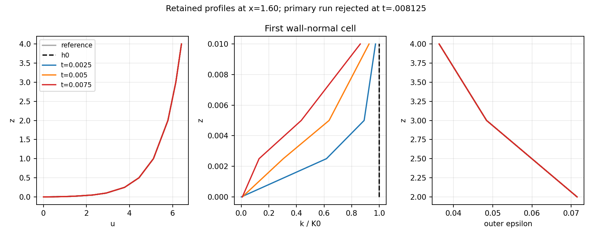
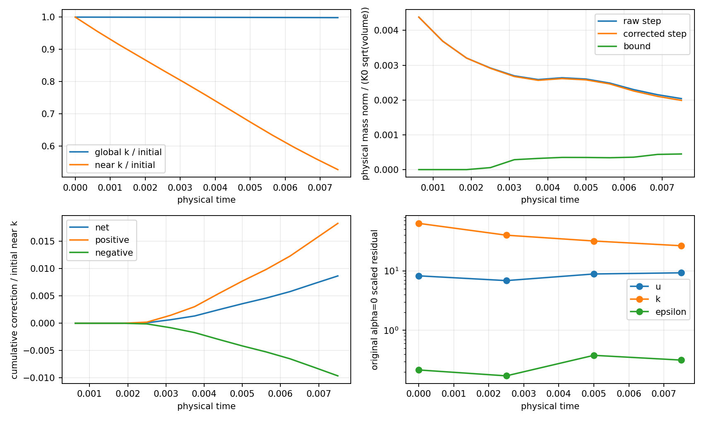
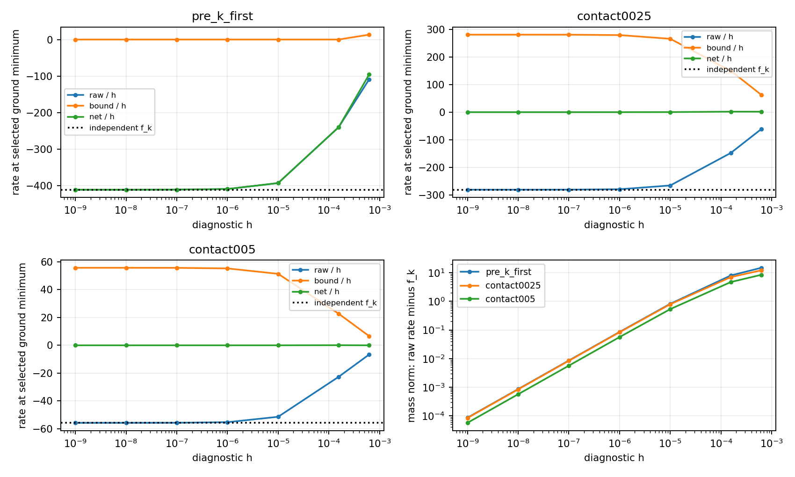

# Bounded single-sweep continuation: contact rates and an interior k limit

The primary continuation **rejected attempted step 13 at T=.008125** after
12 accepted steps to T=.0075. The independent dt=.0003125 run rejected
step 23 at T=.0071875 after 22 accepted steps to T=.006875. Both are hard
constitutive-evaluation-domain failures caused by interior negative k,
despite successful scheduled solves, bounding, declared scalar sampling
and continuous-ground checks. Neither campaign remains running.
The subsequent [ConstitutiveV2 implementation and fresh continuation](cls-epawf-pimple-constitutive-v2.md)
retains these failed campaigns and addresses their missing evaluation coverage.

The observed classification is **unresolved evolution / numerical
representation and evaluation-inventory limitation**. No original-equation
steady state, bounded fixed point, or statistically stationary/periodic
regime has been demonstrated. This is not a completed long-time assessment.

Work continues on `codex/cls-epawf-pimple-one-sweep` from the actual local
HEAD `b1ee77d0390fec18b62e6cc6c465902ad98795c7`. The other Mac worktrees,
untracked literature and concurrent Linux experiments were preserved.
[Compact evidence](cls-epawf-pimple-longtime-evidence/native.json) includes
actual progress/checkpoint identities, rejected candidates, contact and
h-scan data, budgets, software checks and executable/library hashes.

## Execution and status

The primary configuration remained native IMEX1, dt=.000625,
`PimpleSingleSweep`, `MassProjection`, relative floor 1e-8 and
`R2DiagnosticV1`. The physical model, SaturatedR2 stress, capped destruction,
source laws, molecular viscosity, original outer6 mesh, boundary data,
zero prescribed forcing, unit relaxation, eta=0 and approximate pressure
correction were unchanged. There was no additional outer iteration,
transport solve, epsilon trace restoration, cancellation source or damping.

The latest saved compatible checkpoint was step four at T=.0025. The
verified T=.005 endpoint was not a restart checkpoint, so continuation
started from that earlier native checkpoint. The native fingerprint and
checksum validation were used throughout; no checkpoint contents were
manufactured or edited. Step eight reproduced the previous T=.005 state.

| Requested primary target | Global steps | Completed |
|---:|---:|---|
| .02 | 32 | No: rejected before target |
| .1 | 160 | No |
| .5 | 800 | No |
| 1 | 1600 | No |
| 2 | 3200 | No |
| 5 | 8000 | No |

The integer step targets govern the driver. Actual native times retain
binary64 accumulation: the primary accepted time is
`.007499999999999999`, and the finer time `.006875000000000002`.
The finer run started independently from the same actual h0 and requested
64 steps to T=.02; its dt was never changed within the trajectory.

Every accepted step and the rejected attempts completed one vector
momentum predictor, one pressure/gauge solve and algebraic correction,
one outer-epsilon solve, one k solve, and one logical bound call. Primary
totals including rejection are 13 of each governing solve; the finer
totals are 23 of each. Additional production governing solves are zero.
The primary accepted 9 bound activations in 12 steps; the finer accepted
17 in 22. Internal mass, QR, KKT and active-set work remains separately
reported. There is no transported inner-epsilon equation.

The campaign ran under nohup with 16-step blocks, explicit 7200-second
block timeouts and a checkpoint after every accepted step. Measured cost
was about 20–25 seconds per step including the dense native audits; the
resumed primary process took 187.03 seconds before rejection. The finer
run took 497.67 seconds, with an explicit 14400-second timeout. Neither
numerical failure was a timeout or SSH interruption.

The first resumed step exposed a driver publication race: the solver's
accepted-step line precedes checkpoint publication. The driver now waits
for the native atomic rename. The genuine published step-five checkpoint
was recovered by matching its coupled state to its saved candidate and
then validating it through the native restart reader. Its budget is
counted once. This earlier orchestration interruption is distinct from
the later numerical rejection. Numerical rejection is terminal in the
driver; its resume guard was tested without modifying progress or the
checkpoint. A live-process guard prevents duplicate campaign startup.

Routine accepted matrices/packets would be hashed and pruned after step
32 except every 32nd step; failed packets are retained. Bounded-size native
reports are compressed after successful blocks, with compact per-step
metrics and atomic progress. Checkpoints retain the latest pair and fixed
targets. The actual failed experiment is small enough that all contact
packets through rejection remain available.

## Time scales and interpretation criteria

The actual domain has streamwise length 6, height 4, volume 24 per unit
span, wall-layer H=2 and u_star=.4. The initial represented volume-mean
streamwise speed is 5.4755408072, giving flow-through time
`6/U_bulk = 1.0957821723`. `H/u_star=5`. The primary horizon covers only
`.0015` wall time scales and `.00684443` flow-through times: 0.15% and
0.684%, respectively. It is far too short for a long-time inference.

Before evaluating settling, the analysis recorded physical windows .5
and 1, persistence over at least three adjacent windows, and at least one
flow-through time. Exploratory thresholds are 1e-3 for changes normalized
by Ustar/K0/epsilon(H)/Ustar^2 and physical volume or wall measures, 1e-3
for similarly scaled spatial/correction rates on H/u_star time, 1e-3 for
normalized matching defect, and 1% stability of window means and RMS.
These are exploratory accuracy requirements, not the old 2e-12 stage
tolerance. No eligible assessment window was reached. The .0025 windows
below describe the transient only; they do not establish stationarity.

## First hard failure and preserved state

| Run | Accepted steps / time | Rejected attempt | First actual k witness (x,z), geometry 4 | k at witness |
|---|---|---|---|---:|
| dt=.000625 | 12 / .0075 | 13 / .008125 | (1.5833333333, .0002053387271) | -5.71472235e-5 |
| dt=.0003125 | 22 / .006875 | 23 / .0071875 | (1.5833333333, .0001839328250) | -2.05439993e-6 |

These are actual physical evaluations along a capped-normalization ray
anchored at a dense reconstruction location. The complete audit evaluates
profiles at more anchors than the bound's declared static/pre-k/moving-ray
inventory. Continuous ground admissibility does not constrain every
interior volume polynomial. The primary candidate's ground minimum was
still `5.10540e-9`, and its declared inventory minimum `5.10554e-9`.
Nevertheless the additional ray encountered negative k before capped
destruction could be evaluated. The first failing condition is finite
nonnegative transported k, not covariance, lambda, pressure, or a failed
linear solve. The hard audit was retained.

The failure replay records the actual corrected candidate and incoming
history. The primary last accepted checkpoint is
`main/steps-000006-000021/checkpoint/State.bin`, SHA256
`86cbba25d6de07eccce124b9e74652e8aad3b8691fd64c512a822d242056d274`.
The finer checkpoint is `finer-from-h0/checkpoint.21/State.bin`, SHA256
`1ef08725100edd08359fd0c7ad3e74888ebca839ff363024a9f1fc9ecf53aaee`.
Accepted coupled state, time, every native history vector and history
time match these checkpoints after rejection. Replaying the actual
rejection with the final-source executable reproduces the candidate and
rollback bit for bit.

An additional diagnostic ray at the accepted T=.0075 ground minimum,
x=1.5488724079, also discovers negative interior k: `-1.47519e-6` at
z=`4.84799e-7`. Its point-source evaluation is explicitly marked invalid.
The native assembled spatial rate remains computable on its own declared
quadrature. This finding further limits any claim of volume positivity;
it is not repaired, skipped in production acceptance, or labelled physical
qualification.

## Fields, engineering quantities and spatial residuals

The actual h0 and intended represented neutral reference were kept
separate: hashes begin `b8ba7917424057a9` and `4ad26ed0167bb176`.
In this inherited zero-amplitude perturbation case their numerical
coefficients and physical fields coincide; the hash difference is from
signed zeros. Both have initial k spatial residual norm 62.6095951.
Neither is an exact equilibrium of the original discretized equations.
No reference state or residual-cancelling source replaced h0.

| T | Global integral k | Integral k, z<=.01 | Mean ground stress | Minimum inventory B | Raw matching coefficient defect |
|---:|---:|---:|---:|---:|---:|
| 0 | 12.25219231 | .0306304808 | .16172622 | 1 | 0 |
| .0025 | 12.24708343 | .0255891119 | .05889492 | .829717 | 3.23414e-6 |
| .005 | 12.24044809 | .0206605600 | .02781963 | .742501 | 1.58771e-5 |
| .0075 | 12.23232520 | .0161446166 | .01654078 | .647140 | 8.12901e-6 |

Lambda remains one. Ground stress RMS values are .161726/.078715/.052389/
.036081. Velocity/k/epsilon physical L2 norms change from
27.214015/2.500968/.177588 to 27.213555/2.497920/.177552; these small
global norm changes conceal strong local evolution. Near-ground integrated
k falls 47.29%, while the global integral falls only .1622%. Profiles at
x=1.60 show the substantial first-cell k change. Pressure comparisons use
one common gauge over the separate regional spaces, retaining their
permitted relative offset.



| Physical window | Velocity L2 change | k L2 change | Epsilon L2 change | Common-gauge pressure L2 change | Wall-stress L2 change |
|---|---:|---:|---:|---:|---:|
| 0–.0025 | .00405076 | .03471970 | 5.32329e-5 | .0864413 | .282507 |
| .0025–.005 | .00705284 | .02515237 | 1.64979e-4 | .155829 | .104029 |
| .005–.0075 | .00833481 | .02167014 | 5.11267e-5 | .0882016 | .075123 |

The original refreshed spatial residual uses alpha=0 and actual retained
epsilon coefficients. No nonlinear Lift or trace replacement is applied
to a selected state. Native block norms are:

| T | u | v | k | outer epsilon | Normalized epsilon matching |
|---:|---:|---:|---:|---:|---:|
| 0 | 8.22728 | .027076 | 62.60960 | .215669 | 0 |
| .0025 | 6.84192 | .134224 | 39.64401 | .171776 | 4.45253e-5 |
| .005 | 8.84389 | .341732 | 31.64801 | .379901 | 2.18585e-4 |
| .0075 | 9.24813 | .444366 | 26.35102 | .315904 | 1.11915e-4 |

Regional continuity and common gauge defects remain at roundoff, below
the retained 1e-10 acceptance requirement. This is the weak algebraic
constraint statement, not a claim that strong divergence vanishes.
The spatial residuals and growing velocity-window change exclude an
original-equation steady interpretation of this short prefix.

## Correction budgets and the equation actually advanced

The exact cancellation identity `net increment = raw increment + bound`
holds in the saved physical coefficient vectors; maximum discrepancy is
below 1e-15. The full added frozen residual A_k delta and storage reaction
M_k delta/dt are retained separately in Linux `analysis-final/budget-vectors-*`.
The final accepted step has raw/net/bound mass norms
`.00510073/.00497318/.00112252`. Its correction is 22.01% of the raw
step norm, .04488% of the reference **field** norm K0*sqrt(volume), and
its signed integral is .0003552% of current global integrated k. These
are different normalizations. The earlier 41.8% result concerned a raw
one-step increment at a different, finer dt, not total turbulent energy.

Through T=.0075, net added integral is `2.65601863e-4`, positive contribution
`5.60495939e-4`, negative contribution `-2.94894076e-4`, and absolute
redistribution `8.55390014e-4`. The near-ground signed contribution is
`3.25600192e-4`, 1.063% of initial near-ground integrated k. Global net
addition is only .002168% of initial global integrated k. Large local
effects must not be inferred from the global net alone.

| Window | Global correction rate | Near-ground correction rate | Near physical production integral | Near physical destruction integral | Near evaluated diffusive outward-flux integral |
|---|---:|---:|---:|---:|---:|
| 0–.0025 | .00114699 | .00140609 | .00257852 | .00969649 | .00081456 |
| .0025–.005 | .04273327 | .05238653 | .00208212 | .00917467 | .00148898 |
| .005–.0075 | .06236048 | .07644745 | .00154252 | .00857191 | .00096101 |

The region is the original first row of elements, x in [-4,2], z in
[0,.01]. Physical production/destruction and represented-gradient fluxes
use unchanged laws, with trapezoidal time integration at every accepted
endpoint. Near advective flux integrals are below 2e-8. These gradient
fluxes are not an exactly locally conservative CG numerical flux; natural
boundary treatment, essential-row reactions, source projection and the
finite implicit increment matter. This table is not presented as a closed
continuum control-volume balance.

An independent exact discrete balance does close. With M_ff^T w equal
to the global or near-region physical integral functional, each step has

`integral(Delta k) = -dt*w^T R_pre - dt*w^T L*Delta k_raw + integral(delta_bound)`.

For this unforced IMEX1 case, saved pre-k coefficients equal the actual
native k history exactly. The two offline mass-dual applications are not
transport solves. The near-region window balances are:

| Window | Frozen input load | Implicit L-increment term | Bound supply | Actual near-k increment |
|---|---:|---:|---:|---:|
| 0–.0025 | -.00754256 | .00249767 | .00000352 | -.00504137 |
| .0025–.005 | -.00737783 | .00231831 | .00013097 | -.00492855 |
| .005–.0075 | -.00683874 | .00213168 | .00019112 | -.00451594 |

All global and near step balances close within `2.23e-16`. The increasing
correction rate has not settled or vanished. Instantaneous spatial-source
integrals alone cannot replace this frozen discrete balance at the tested
physical dt.



## Actual contact dynamics and fixed-state h scans

The diagnostic independently reconstructs
`f_k=-M_ff^-1 R_k,spatial`, with zero essential-boundary rates. It evaluates
the continuous ground minimum, active bound locations and x=1.60.
Net destruction appears once. At actual contact states:

| State / ground-minimum x | k at minimum | Advection contribution | Diffusion | Production | Net destruction | Total native rate | Local point source |
|---|---:|---:|---:|---:|---:|---:|---:|
| Pre-k first activation / 1.60950 | .05989979 | -.052632 | 227.4504 | 18.9317 | -658.0624 | -411.7329 | -811.6638 |
| Corrected .0025 / 1.60135 | 5.10548e-9 | -.045343 | 224.4629 | 12.8918 | -518.3299 | -281.0206 | -8.00839e-5 |
| Corrected .005 / -2.45908 | 5.10537e-9 | -.020449 | 118.8736 | 2.2896 | -176.8300 | -55.6873 | -8.56091e-5 |
| Accepted .0075 / 1.54887 | 5.10547e-9 | -.029152 | 2.5438 | 7.0807 | -331.4475 | -321.8523 | Extra ray invalid, reported explicitly |

The changing minimum location matters. At the fixed x=1.60 witness the
rates are -411.590, -281.257, -347.284 and -336.965 respectively. The
large difference between a near-zero point source and its mass-inverted
assembled contribution exposes the spatial projection; modal matrix signs
are not used as a positivity diagnosis.

For each selected state, the entire state, coefficient assembly,
evaluation time, boundary data and epsilon-trace context are fixed.
Diagnostic k history equals that selected k. The native k block is
assembled once and shifted by `(1/h-1/h0) M_ff`. There is no flow or epsilon
solve and no epsilon trace adjustment. The core batch contains 49 k-only
diagnostic solves, separate from every production count; the representation
comparison adds nine. Raw frozen residuals are below `6.7e-16`.

At corrected T=.0025, the actual ground-minimum rates are:

| h | Raw Delta/h | Bound delta/h | Net rate | Full-vector raw-rate error, mass norm |
|---:|---:|---:|---:|---:|
| .000625 | -61.2271 | 62.9516 | 1.72452 | 12.1443 |
| 1e-6 | -279.4038 | 279.4403 | .036509 | .0832685 |
| 1e-8 | -281.0043 | 281.0047 | .000376 | .000837319 |
| 1e-9 | -281.0190 | 281.0191 | .0000868 | .0000837361 |

The independent target is -281.0205948. Raw-rate convergence is directly
observed; points with h times the sampled maximum destruction rate below
.1 are included, without treating that sample as a spectral bound.
Small net contact rates at the smallest h are affected by the stated
arithmetic reserve divided by h. The bound-rate mass norm tends to about
4.849 at T=.0025 and 7.249 at T=.005, rather than vanishing.

For the positive pre-k state, correction disappears already at h=.00015625
and remains inactive as h decreases. For actual contact, an outward native
spatial rate and persistent correction remain. The small-step outcome is
a projected reaction, not merely a removable finite-step undershoot.
This fixed-state test is not evidence of full coupled temporal order.



At T=.005, h=1e-9 and the selected ground minimum, destruction-only,
diffusion-only, destruction+diffusion and complete raw rates are
`-176.8287`, `118.8735`, `-57.9559`, `-55.6868`. Destruction's consistent
mass projection drives outward; diffusion partly counteracts it. The
actual physical destruction rate and its zero-k extension were retained.

The focused representation check at the identical T=.0025 coefficients
gives rate -281.020595 with normal order 16 and -281.019858 with order 32
(about 2.6 ppm change). Splitting only the first .01 cell into .005+.005
gives -256.564523. Physical polynomial transfer errors are below `9e-16`,
with old represented essential traces restricted exactly. No trajectory
or checkpoint was created on this mesh. The outward rate persists; this
single refinement is a diagnostic, not a spatial convergence study.

## Finer-dt confirmation and qualification

The finer run is a complete independent h0 trajectory, not initialization
from a coarse late-time state. At the matching accepted times:

| T | Velocity difference | k difference | Epsilon difference | Common-gauge pressure difference | Wall-stress difference |
|---:|---:|---:|---:|---:|---:|
| .005 | .00205388 | .00722887 | 2.85556e-5 | .0479688 | .0650910 |
| .006875 | .00259633 | .00624858 | 1.22311e-5 | .0315582 | .00862838 |

The same [.005,.006875] accepted window exists in both. At its finer end,
k spatial residual is 25.9521 and velocity residual 9.3575; integrated k
is 12.23185557 globally and .0159469738 near the ground. Cumulative added
integral reaches `4.93420172e-4`, larger than the coarse run's even though
the finer trajectory stops earlier. This confirms the same kind of
limitation, not a settled coarse candidate or a converged h0 trajectory.
No third dt or repeated floor sweep was needed to identify this failure.

R2DiagnosticV1 continuation remains explicitly unqualified outside the
narrow reference box. Original qualification exits are .00125 for the
primary and .0009375 for the finer trajectory. They precede the hard
failures. The earlier strict-run evidence remains available; no box was
widened. Covariance/normalization and all other hard checks were retained.

## Software checks, provenance and reproduction

Governing-solve attempts now have separate counters and completion flags.
Completion is set after the solve and linear residual validation.
The active-set test drops x>=1 after adding x+y>=3, then adds y>=3 and
requires full physical separation to rediscover x>=1 and obtain (1,3).
The helper's reliance on wrapper rescanning is documented. QP and
ASan/UBSan checks passed. Two same-dt accepted steps from the old checkpoint
have bitwise-identical coupled state, time and all native history with
the final-source executable. Its actual rejected step also reproduces
the pinned candidate and rollback bit for bit. A broad regression campaign
was not repeated.

Source/Git work used the existing Mac worktree. Linux USB SSH timed out;
the documented Tailscale fallback was used. Build/run files are isolated
under `/media/jay/新加卷/nektar-v2026-runs/cls-epawf-pimple-longtime-20261106`.
Build parallelism was eight. Each native runtime used one rank and all six
thread settings equal to one. Observed concurrent work plus the conservative
allocation stayed well below 72. The shared checkout and installation
were not modified.

The primary production executable was frozen before continuation, copied
with its direct linked libraries into `main/runtime`, and checked at
block boundaries. Its C++ source is `c7ce4cfb1a624771a64d9b1dc3e73845791de339`,
unchanged numerically through reviewed b1ee77d; executable SHA256 is
`7c0d132c40a68c7c01fec5552dcb2029dfbe4016312d12ee189e3bbdd8758db9`.
The OS loader is hash-pinned as well. No running binary/library path was
rebuilt. New software checks used a separate build; final solver SHA256 is
`d476b1fd5db432dbc45b84cf46ac091e52be9d469499790524ddbc785b803dce`.
Core contact probe SHA256 is
`ff4e1f0640f7c34d3db3d8d6219d2729f0cc352df0a2e126a976e63d14a2174a`;
the representation/window probe is
`5d4a41dad05962fceb5b936989af3c715d0056c03eb850b3324542e48d0aae1e`.
The final analysis source revision is `c5f554c7c9106f35fcbd796eb227821fea1c491f`.
The counter/contact and active-set changes begin at
`2a446156fd94d605016ad18cfc18346f6fcdbfc1`. The core contact probe uses
`f271d476c9d996667b133600a2f458700d4e0823`; the representation probe uses
the C++ changes through `8226a313a9f7740bf276a1581faf64cc9694e405`, built
at the subsequent orchestration-only commit `00d6b40`. The final solver
was built at `eb8d09fa3286afc8da07d6418bc73f95a7ee57b3`.
Individual source file, executable/library, XML, report and log hashes are
in the compact evidence. Initialization work is separate from physical
step and diagnostic solve counts.

`campaign-status.json` and `main/progress.json` contain actual terminal
status and last accepted checkpoint. The heavy `artifact-index.json`
pins 365 files with SHA256
`2d4a81b415b144bc5c44e2e8ad8354fec94b4a9cfbef46a16bd78ddc7a6ff1f9`.
Full packets/matrices, trial h-scan storage and added-residual vectors,
coefficients, histories, logs, checkpoints and PDF figures stay there.
The three small PNGs and compact evidence are committed. An early profile
readback incorrectly selected the region above the top boundary; that
diagnostic-only selector was fixed before the reported results. Additional
ray domain failures are reported as findings, not suppressed.

For reproduction, inspect load, activate the documented dependency env,
use an unused output directory and the pinned runtime or the separately
validated final-source executable. The setup/build is the same standalone
RANS CMake target as the preceding k-bound report, with a new build directory
and explicit `--parallel 8`. Representative commands are:

```bash
source /home/jay/.local/opt/nektar-v2026-mpi/env.sh
run=/media/jay/新加卷/nektar-v2026-runs/cls-epawf-pimple-longtime-20261106
old=/media/jay/新加卷/nektar-v2026-runs/cls-epawf-pimple-k-bound
tests="$run/source/solvers/IncNavierStokesSolver/Tests/RANS"
solver="$run/main/runtime/IncNavierStokesSolver"
probe="$run/diagnostic-bin-8226a31/RANSWallResolutionProbe"
export LD_LIBRARY_PATH="$run/main/runtime/lib"
export OMP_NUM_THREADS=1 OPENBLAS_NUM_THREADS=1 MKL_NUM_THREADS=1
export BLIS_NUM_THREADS=1 VECLIB_MAXIMUM_THREADS=1 NUMEXPR_NUM_THREADS=1
export TMPDIR="$run/main/tmp"
nohup python3 -B "$tests/continue_cls_epawf_pimple.py" --solver "$solver" \
  --checkpoint "$old/checkpoint-active/checkpoint" \
  --prefix-report "$old/checkpoint-active/case.evolution.json" \
  --output "$run/reproduce-main" --targets 32 160 800 1600 3200 8000 \
  --block-steps 16 --timeout 7200 > "$run/reproduce-main.log" 2>&1 &
python3 -B "$tests/run_cls_epawf_pimple.py" --solver "$solver" \
  --output "$run/reproduce-finer" --dt .0003125 --steps 64 --diagnostic \
  --k-bound MassProjection --floor-relative 1e-8 --snapshots \
  --checkpoint --checkpoint-interval 1 --timeout 14400
python3 -B "$tests/analyse_cls_epawf_longtime.py" --campaign "$run" \
  --prior "$old" --probe "$probe" --output "$run/reproduce-analysis"
python3 -B "$tests/test_cls_epawf_contact_representation.py" --prior "$old" \
  --probe "$probe" --output "$run/reproduce-representation"
python3 -B "$tests/plot_cls_epawf_longtime.py" --campaign "$run" \
  --prior "$old" --probe "$probe" --output "$run/reproduce-windows"
python3 -B "$tests/verify_cls_epawf_k_budget.py" --campaign "$run" \
  --prior "$old" --output "$run/reproduce-discrete-budget.json"
```

The analyses target the retained observed campaign; their input paths and
commands are also saved per replay. The driver is resumable after an
infrastructure interruption, using native checkpoints, but refuses a
silent retry of this numerical rejection.

## Next numerical step

The main experiment found a limit before the first target. The most direct
follow-up is a separately versioned constraint-inventory extension that
enumerates every normalization-ray k evaluation used by the final audit
before evaluating normalization, and adds discovered k witnesses to the
same single mass projection. Preserve these failed trajectories and bind
the new policy into restart provenance. This does not require a global
positivity theorem or another transport solve.

The outward contact rate and spatial sensitivity also warrant further
near-wall representation/source-projection work. A larger floor, altered
closure, extra outer sweeps or loosened hard checks are not supported by
these results. Original-equation steady convergence must eventually be
judged with the alpha=0 residual and negligible correction at the stated
accuracy; neither follows from a pinned ground minimum or a small net
contact increment.
