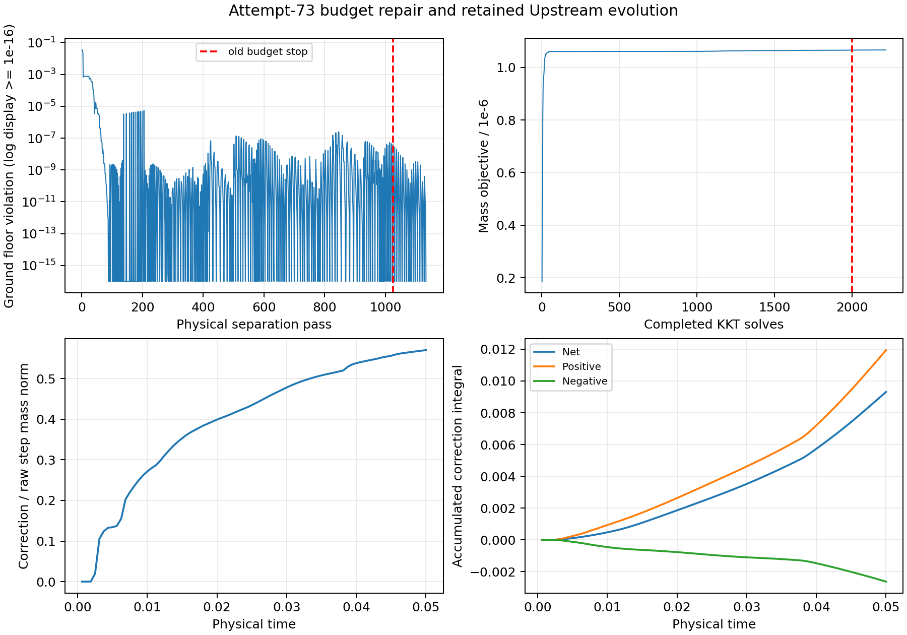
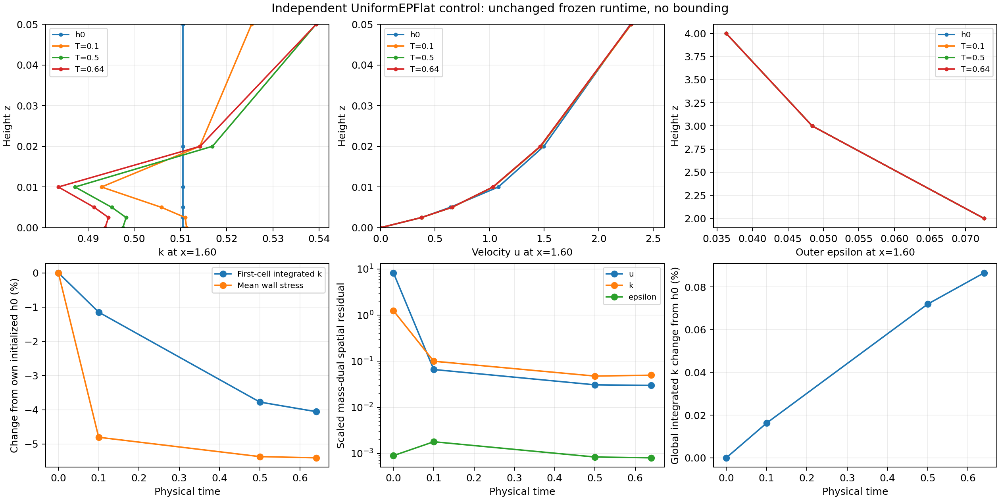

# ConstitutiveV2 projection-budget repair

The exact original attempt-73 candidate is repaired by increasing the **total**
active-set allowance, with unchanged projection mathematics. Native restart
has passed the former failure and **completed T=.05**, continuing to
**85 accepted global steps at T=.053125** in the latest verified status packet.
UniformEPFlat remains running at **1100 steps, T=.6875**. The original terminal
experiment remains unchanged; its continuation uses a separately frozen runtime
and a new run directory. The independent UniformEPFlat campaign continues with
its original executable and complete wall policy.

The dated campaign status and later milestone evidence are recorded below and
in [native.json](cls-epawf-pimple-projection-budget-repair-evidence/native.json).
This is a numerical projection repair, not a repair of the inherited Upstream
source imbalance, constitutive qualification, or proof of steady convergence.

## Source, environments and immutable evidence

All commits remain on `codex/cls-epawf-pimple-one-sweep`, starting from the
actual local and fetched remote HEAD
`c4e67d2fccc89be97fe6a78d4e7801119db529e2`. The existing PIMPLE Mac worktree,
other Mac worktrees, dirty shared Linux checkout and concurrent experiments
were preserved. `linux-usb` timed out; validation used `jay@100.105.247.110`.

The isolated Linux experiment root is:

```
/media/jay/新加卷/nektar-v2026-runs/cls-epawf-projection-repair-20261107
```

Below, `R` denotes this root, `O` the original
`cls-epawf-pimple-constitutive-v2-20261106` root, and `U` the independent
`cls-epawf-uniform-ep-flat-20261106` root, all under the same run volume.
The numerical C++ executable/probe were built at `d30be6b`; their numerical
sources remain unchanged in the subsequent driver/analysis commits. Work
controls/replay are introduced in `91409e0`, `ef555d2`, `d30be6b`; durable
restart/prefix accounting in `54b7dd8`, `aa49ed5`; joined monitoring and
independent verification in `ff5123b`, `31cb8cc`, `1a538ee`.
The final tested analysis/archival source is
`8e17fcbab49708189e6fb9c6b98b88cd6a5be9d4`, including `72b40e4`, `21831ad`
and `9182b0e`. Its tracked and final working-tree source status is clean.
Early manifests list only generated Python bytecode as untracked; this was
retained in `R/generated-python-cache-from-launch`, without changing source.

| Immutable item | SHA256 |
|---|---|
| Original terminal packet | `17180bc0162008914722ee85c6b529c69baed2c6708d2ca0c12733c8586bf78d` |
| Original raw coupled vector | `ec7eb83a29bcfd691eaa0e207eb084cfc5fdd65c824b56adaf5b3e9f3339f367` |
| Accepted step-72 State.bin | `0ebcf803b486d63c42d6ed93db08efd4208d87b98e90dd918e139a77f8c26510` |
| Frozen transport A_k | `d39d06316698f0e11d91612c29db4612ca514db5a15e4f26f11b3e83984f3dbd` |
| Reconstructed consistent M_ff | `5251decc28e900e053e98d98d1f0aeae92a73aed8463d397c39aa806748c9471` |
| Repaired coupled vector | `4f7275a301a4cb41bac01766d5affa56b1123bf4cd45b47463b61d6bfc0848d9` |
| Native accepted step-73 State.bin | `e57e8b09b0dc3d05d828c217bb587f7f4d72de5c87eb96e7f3e96fe315bd2659` |
| Native accepted step-80 State.bin | `1e09cd26337236b0eefb086b67d3954c63f6d48c74c269b61c98348d010f8be5` |
| Archived step-82 State.bin | `346cc8f2c9ec7d6bec75205b27fa83e55b0d2aa5ec4ad511a8ec1cf532d11e64` |
| Archived uniform step-1088 State.bin | `7f342e922f0d3e1fc88dbf446302fb23c14ca81bd655eb6ff82abfbfec0424bc` |
| Latest archived step-85 State.bin | `664d316b0be13ed16c5be1a5769c974ea07412cfcb03b44f02677d45c31d2a46` |
| Latest archived uniform step-1100 State.bin | `34a29f1837dfa6bbd987259c1f6862fe6786b0b1411c1487e5dfbd5c01491308` |
| Repaired production executable | `2308b43bb0cd4f6e2e832357209fcbfc0da7abedac25099696dea349eff34379` |
| Unchanged uniform production executable | `98ff51e3a2aa0debf58d25f5a0e6f9b0d816a97e41834d6fd171863bc576d042` |

`replay-{old-controls,total20000}/manifest.json` bind packet/checkpoint,
boundary-source, actual callback history, XML, executable, linked libraries,
commands and timing. The replay loads the real native checkpoint with its
strict full physical signature, fixed reference and frozen defect. Archived
external coefficients are checked against native boundary rows and checkpoint
essential data. Dependent epsilon matching coefficients are distinguished from
external data. Pre-k is checked without an entry waiver. Replay constructs no
new h0, performs no Lift, and performs **zero governing solves**.

The native restart legitimately performs its existing reference initialization
work separately from physical steps. Its startup bound is inactive and its
accepted initial state and all native histories are exactly the checkpoint's.
The independent verifier checks pre-k, raw candidate, callback history, free
rows and transport-matrix identity against the original packet.

## Demonstrated mechanism and focused repair

The old helper's counter accumulated across `Add` calls. Its failed
`++iterations <= 2000` guard reported 2001 after 2000 completed loop bodies.
The separate outer separation limit was not the stopping condition.

The new controls separate per-Add work, total work, physical separation and
wall time. Counts retain cumulative work and record rejected guards separately.
The legacy default allowances remain reproducible. The repaired campaign uses:

```
RANSWallPimpleKBoundMaxAdd = 2000
RANSWallPimpleKBoundMaxTotal = 20000
RANSWallPimpleKBoundMaxSeparations = 2000
RANSWallPimpleKBoundMaxSeconds = 900
```

These are resource controls, narrowly excluded from the native physical
signature and explicitly recorded in reports/progress. Timestep, physical
parameters, wall policy, metric, ConstitutiveV2 inventory, effective floor and
arithmetic reserve retain strict compatibility checks. No checkpoint bytes or
signatures were edited. `Off` retains its empty bound signature and path.

The objective remains `(1/2) delta_f^T M_ff delta_f`, centered on the original
raw candidate throughout. `PicardKMass` reconstructs the actual consistent
physical mass with the actual essential elimination; A_k is never used as the
projection metric. Whitening, row normalization, twice-applied MGS, numerical
tolerances, physical cut ordering, inactive-cut retention and continuous-ground
checks are unchanged. There is no deduplication, anti-cycling change, rank
threshold adjustment, finite-QP fallback, larger floor or altered source.

| Exact attempt-73 replay | Old allowance | Larger total allowance |
|---|---:|---:|
| Completed KKT solves / active-set cycles | 2000 | 2220 |
| Rejected total-limit checks | 1 | 0 |
| Legacy guard counter | 2001 | 2220 |
| Physical separation passes | 1025 | 1135 |
| Inventory rebuilds | 167 | 184 |
| Mass-factor applications | 2049 | 2268 |
| Last completed primal mass objective | 1.06528368e-6 | 1.06590846e-6 |
| Stationarity of coherent completed working set | 5.41e-19 | 5.97e-19 |
| Normalized accumulated-pool violation | 7.16e-10 | 2.39e-18 |
| Final ground minimum | -3.41259e-8 | 5.10545e-9 |
| Physical floor violation | 3.92310e-8 | 0 |
| Diagnostic projection time, s | 185.26 | 207.47 |
| Complete constitutive/hard audit | rejected | passed |

The old replay returns exactly the archived latest-repair vector
`a4fb19e31671d890fbd45cf6acfd3f9ac339fde521597f93c37cb53358bd6323`.
The higher-budget result completes in 207.47 s diagnostic time (204.41 s for
native projection), consuming only 220 further KKT solves. Its 1134 added cuts
include 945 unique evaluation rows, 125 identical inactive-cut rediscoveries
and at most 50 active rows. No working-set fingerprint repeated. At most three
work cycles were needed by any Add. The smallest encountered normalized QR
residual is 5.08e-8, above the unchanged 2e-11 rank threshold; no rank-loss or
dependent-exchange event occurred. This is evidence of productive cut exchange
and an insufficient cumulative allowance for this candidate, not evidence of
infeasibility or a demonstrated cycling defect.

Full deterministic trace and finite-pool dumps are retained for this frozen
case. Production retains bounded traces plus per-step totals/timings. The
replay spent 140.11 s in inventory work, 48.39 s in physical separation and
10.77 s in optimizer algebra; remaining time includes setup/report work.
Per-step inventory cost remains a practical limitation.

Failure reporting now pairs the last completed primal with its completed dual
snapshot. An unfinished active set is explicitly labelled separately. Active-row
feasibility, accumulated-pool feasibility, full current inventory and continuous
ground feasibility are distinct. A small stationarity or working-set gap cannot
waive a remaining physical undershoot.

## Feasibility, optimality and residual accounting

The successful 504-variable finite QP has 1134 retained inequalities and 48
final active constraints. An independent NumPy readback reconstructs the
whitened physical rows to 2.3e-15 using the exported M_ff. It obtains objective
1.0659084586212862e-6, primal-dual gap -1.06e-21 (roundoff), scaled gap
4.06e-21, stationarity 5.03e-19, complementarity 1.58e-22, zero dual defect,
and normalized finite-pool primal defect 2.3e-18. The complete moving inventory
and continuous-ground floor defects are zero. These finite-QP checks accompany
the native hard audit; they do not replace it or prove volume-wide positivity.
Relative to its own correction norm/objective, stationarity is 3.45e-16,
complementarity 1.49e-16 and the objective gap 9.93e-16.

Non-k and prescribed k coefficients are exactly unchanged. The global shared
CG representation is retained, with physical trace disagreement at roundoff
(1.1e-16). Physical quadrature independently reproduces the correction mass
norm and integral.

| Attempt 73 quantity | Value |
|---|---:|
| Raw frozen residual, max norm | 1.11e-16 |
| Corrected frozen residual = raw residual + A_k delta_k | .15098619 |
| Added A_k delta_k, max norm | .15098619 |
| Storage alpha M_ff delta_k, max norm | .05437136 |
| max abs((A_k-alpha M_ff) delta_k) | .10675516 |
| Correction physical mass norm | .0014600743 |
| Raw increment physical mass norm | .0026098160 |
| Correction / raw increment | .55945487 |
| Correction / current k field mass norm | .00059056 |
| Signed correction integral / current integrated k | 1.91083e-5 |
| Signed integral supplied | .00023077442 |
| Positive / negative integral contributions | .00030228963 / -.00007151521 |
| First-cell correction integral | .00016442388 |

The 55.95% ratio concerns a time-step increment, not total turbulent energy.
The correction is locally consequential: its first-cell integral is about 9.5%
of the remaining first-cell k at this step. The raw linear solver's roundoff
residual is not the residual of the corrected field.
Residual-accounting max norms in this table are native free-row weak loads;
the alpha-zero block norms below are dimensionless, scaled mass-dual norms.
In this two-dimensional case, integrals are per unit span: k times area, or
k times area per time for rates. Mass norms have k times square-root-area units.

## Focused Linux verification

The isolated Release solver and resolution probe build passed with
`-fno-fast-math -ffp-contract=off -D_GLIBCXX_ASSERTIONS` and four compiler workers.
QP checks used two workers for their later rebuild. All runtimes use one MPI
rank and one computational thread; all six BLAS/OpenMP thread variables are
explicitly one. The continuation recorded 36 existing native/diagnostic OS
threads before its next child, leaving room under the 72-worker cap. The shared
checkout and installation were not rebuilt.

Passed checks include:

- Consistent-mass minimizer; stronger dependent constraint; incompatible and
  zero-row constraints; inactive-cut exit and full-separation rediscovery.
- Total, per-Add and wall-time exhaustion with coherent last completed results.
  A native one-pass separation-budget test stops as `k_bound_separation_limit`,
  independently of the inner budget and without claiming infeasibility.
- Native constant, smooth, reference and actual h0 no-ops; between-node ground
  negativity repair; incompatible prescribed floor; non-k/essential invariance.
  The fixture helper now selects `accepted_states[0]` from an evolved startup
  report, rather than mislabelling its final state as h0. The repeated actual-h0
  checks use hash `b8ba7917424057a9f6f16a026d82d53ede43985871537facea170ef6e1841b71`.
- Six native steps from actual h0, including active correction: every repaired
  state hash and final state/time/all histories equal the earlier frozen-runtime
  baseline bit for bit under the larger resource controls.
- Native attempt 73 from the unmodified step-72 checkpoint: raw/pre-k/history/
  free rows/A_k match the archive; repaired state matches the diagnostic replay.
- Deliberate hard rejection after the active attempt-73 correction: accepted
  coupled state, time and every native history restore to step 72; the rejection
  packet retains the actual repaired candidate and full callback history.
- Campaign ownership/orphan-child exclusion, idempotent ledger recovery and
  prefix-budget validation. The copied full 72-step ledger supplies the complete
  prior correction budget, avoiding a last-segment-only prefix sum.

Each accepted physical step still has one vector U predictor, one pressure/gauge
solve, one outer-epsilon solve, one k solve, one logical bound call and one
implicit callback. There are zero additional governing solves. The 2220
attempt-73 QR/KKT solves and 2268 bound mass-factor applications are separately
reported algebraic work. Initialization and diagnostic replay work are separate.

## Actual continuation and physical interpretation

The new durable campaign is `R/repaired-campaign`, from verified step 72 at
dt=.000625. It requests global targets 73, 80, 160, 800, 1600, 3200 and 8000,
with eight-step blocks and explicit 7200 s block timeout. The supervisor never
retries an unchanged numerical rejection. The old terminal campaign is preserved.
`R/repaired-monitor` evaluates completed immutable checkpoints only.

The **2026-11-07 04:30:03 UTC** reviewed archive records:

| Experiment | Accepted global step / physical time | Status | Next automatic target |
|---|---|---|---|
| Preserved original O | 72 / .045 | terminal numerical rejection at attempt 73 | none; no retry |
| Repaired restart R | 82 / .05125 | running | 160 / .1 |
| Unchanged UniformEPFlat U | 1088 / .68 | running, zero bound activation | 1600 / 1 |

New targets 73/.045625 and 80/.05 are complete. Targets 160/.1, 800/.5,
1600/1, 3200/2 and 8000/5 remain pending for R. U has completed .005, .01,
.02, .1 and .5; its 1, 2 and 5 targets remain pending. Neither campaign is
complete. Driver/native/supervisor identities all match their live processes
in this snapshot: R 132645/135337/132640; U 102540/135777/102537. PID start tokens,
paths and checkpoint hashes are included in the compact evidence. The initial
milestone archive had a numeric-JSON PID formatting comparison defect; `8e17fcb`
fixes it with focused checks. It was not a process failure or numerical change.

`R/evidence-reviewed/{repaired,uniform}-checkpoint/` are the immutable copies
listed above. The latest rotating pointers are respectively
`R/repaired-campaign/trajectory/progress.json` and
`U/uniform-campaign/trajectory/progress.json`; later healthy evolution may advance
them beyond this dated archive. `R/evidence-reviewed/artifacts.json` indexes
recoverable states, frozen matrices, finite pools, logs and identities. Its
SHA256 is `dc32bd028b85be80810e9e5357e64c6e171be1f4c0fffa3c2c395863c7f69533`.

All ten newly accepted steps 73--82 have the unchanged governing schedule.
They consumed 17510 separately counted KKT solves and 1814.45 s of projection
time in total. The maximum observed correction time is 354.91 s at step 74;
step 80 uses 1116 KKT solves/583 separation passes and 86.13 s. Cost did not
grow monotonically. The existing 900 s bound and 7200 s block guards were not
reached. The uniform executable and all recorded frozen library hashes remain
unchanged. No new production numerical rejection occurred through the archive.

A subsequent **04:37:54 UTC** [live check](cls-epawf-pimple-projection-budget-repair-evidence/latest-status.json)
verifies R at **85/.053125**, still running toward 160/.1, and U at
**1100/.6875**, still running toward 1600/1. Their newest verified checkpoints
are copied into `R/last-live-check/{repaired,uniform}-checkpoint/`, with the hashes
above. All driver/native/supervisor checks match; both read-only monitors are
alive (R PID 133452, U PID 102539), waiting for their next fixed checkpoint.
R native PID is 135337, U native PID 136089. Neither has a failure. This later
packet also hashes `driver-tests3.log`, including the numeric-JSON PID checks.
Detailed original-equation and profile analysis still covers through .05 for R;
later live acceptance is not substituted for those expensive readbacks.

At the first repaired checkpoint, T=.045625, the original alpha=0 scaled
mass-dual residual blocks are Ux=4.86367, Uz=.54036, k=22.0412,
epsilon=.271390; regional continuity/gauge are at roundoff and refreshed
epsilon matching defect is 2.05822e-5. No nonlinear Lift is applied to the retained
state or its solved epsilon trace for this evaluation. Global integrated k is
12.07720 and first-cell integrated k .00172293, versus h0 values 12.25219 and
.03063048. Mean wall stress is .0174507 versus .161726 at h0. This remains
strongly depleted, bounded, unresolved evolution, outside R2LocalV1 qualification.

The completed **T=.05** readback gives scaled spatial blocks
`[4.52191, .54047, 22.00151, .28700]` for Ux/Uz/k/epsilon. Regional continuity
and common gauge remain at roundoff, and refreshed matching defect is 2.08173e-5.
Global/first-cell integrated k are 12.05856/.00171878, mean wall stress .0174818,
and the continuous-ground minimum is 5.10539e-9 at x=1.54319. The full declared
inventory minimum is 5.10554e-9 on an interior normalization ray; full floor
violation remains zero. Step-80 correction/raw-increment ratio is .57027.

Over .045625--.05, physical L2 changes are velocity .0080831, k .0149557,
epsilon 7.50e-5 and common-gauge pressure .0027952. Correction net supply is
.00166239, with positive .00220066 and negative -.00053827 redistribution;
first-cell supply is .00115817. Endpoint-trapezoid production/destruction
integrals are .0199299/.0428394 globally and .000408918/.00393572 in the first
cell. Total correction through .05 is net .00931181, positive .01194242,
negative -.00263061, absolute .01457303 and first-cell .00828812. These do not
indicate an original-equation steady state or negligible bound influence.

From T=.04 to .045625, physical L2 changes are velocity .0112637, k .0197448,
epsilon 9.17e-5 and common-gauge pressure .0039382. Correction net supply is
.00191786, comprising positive .00253384 and negative -.00061598 redistribution;
first-cell supply is .00143280. Endpoint-trapezoid estimates of integrated
production/destruction are .0260388/.0551756 globally and
.000522586/.00511840 in the first cell. These are consistently window-integrated
quantities. The estimated continuum/flux balance is distinct from the exact
frozen discrete identities retained in the readback.

At T=.64, the independent UniformEPFlat control has zero correction and scaled
residuals Ux=.02997, Uz=.01704, k=.04984, epsilon=.0008083. First-cell integrated
k is .0293886, global k 12.26280, mean wall stress .152989 and refreshed matching
defect 2.32e-7. Its .62-to-.64 L2 changes are velocity .0002695, k .0004925,
epsilon 8.91e-7 and common-gauge pressure .0007026. This later snapshot is not a
matched-time error comparison with R; the preceding report supplies common-time
source/control comparisons. These results do not establish exact reference
preservation or a steady root. Near-wall k and wall stress have drifted by about -4.1% and -5.4% from its
own initialized h0. Qualification remains separate from numerical admissibility.

Completed immutable uniform-control readbacks, all with zero correction:

| Time | Global / first-cell integrated k | Mean wall stress | Scaled k / epsilon spatial residual | Matching defect |
|---:|---|---:|---|---:|
| .1 | 12.25418 / .03027884 | .153960 | .100066 / .00180162 | 2.75e-7 |
| .5 | 12.26101 / .02947446 | .153046 | .047732 / .00084193 | 2.94e-7 |
| .66 | 12.26303 / .02937600 | .152982 | .049916 / .00078917 | 1.87e-7 |

The strict reference qualification first exits at T=.00125 in this control,
separately from its continued hard-admissible diagnostic evolution. The archived
supervisor continues toward 1, 2 and 5 without changing its wall policy/runtime.

H/u_star=5 and the actual initial flow-through time is 1.09578217. Thus the first
repaired checkpoint spans only .009125 wall times/.04164 flow-through times;
the uniform T=.64 checkpoint spans .128/.584. Neither is a completed long-time
assessment. Continue the two distinct experiments toward their automatic targets;
inventory-reconstruction cost and persistent physical correction remain issues
to monitor. No optimizer replacement, source change or mesh study is justified
by this successfully repaired frozen failure alone.





## Reproduction and artifact locations

On Linux, with the dependency environment activated:

```bash
source /home/jay/.local/opt/nektar-v2026-mpi/env.sh
export OMP_NUM_THREADS=1 OPENBLAS_NUM_THREADS=1 MKL_NUM_THREADS=1
export BLIS_NUM_THREADS=1 VECLIB_MAXIMUM_THREADS=1 NUMEXPR_NUM_THREADS=1
R='/media/jay/新加卷/nektar-v2026-runs/cls-epawf-projection-repair-20261107'
O='/media/jay/新加卷/nektar-v2026-runs/cls-epawf-pimple-constitutive-v2-20261106'
U='/media/jay/新加卷/nektar-v2026-runs/cls-epawf-uniform-ep-flat-20261106'
S="$R/source/solvers/IncNavierStokesSolver/Tests/RANS"
cmake -S "$S" -B "$R/build" -DRANS_BUILD_SOLVER=ON \
  -DNektar++_DIR=/home/jay/.local/opt/nektar-v2026-mpi/lib64/nektar++/cmake \
  -DCMAKE_BUILD_TYPE=Release \
  -DCMAKE_CXX_FLAGS='-fno-fast-math -ffp-contract=off -D_GLIBCXX_ASSERTIONS'
cmake --build "$R/build" --parallel 4 --target RANSKBoundQPChecks RANSWallResolutionProbe IncNavierStokesSolver
"$R/build/RANSKBoundQPChecks"
python3 -B "$S/test_cls_epawf_continuation_durability.py"

# Use new output directories; never rebuild a running frozen runtime.
export LD_LIBRARY_PATH="$R/probe-budget-runtime/lib"
python3 -B "$S/replay_cls_epawf_projection_limit.py" \
  --probe "$R/probe-budget-runtime/RANSWallResolutionProbe" --original "$O" \
  --uniform "$U" --output "$R/reproduce-old" --total 2000
python3 -B "$S/replay_cls_epawf_projection_limit.py" \
  --probe "$R/probe-budget-runtime/RANSWallResolutionProbe" --original "$O" \
  --uniform "$U" --output "$R/reproduce-larger-total" --total 20000
python3 -B "$S/analyse_cls_epawf_projection_repair.py" \
  --root "$R" --uniform "$U" --output "$R/reproduce-verification.json"

# A separate new campaign, never the terminal original or an already live root.
export LD_LIBRARY_PATH="$R/solver-runtime/lib"
nohup python3 -B "$S/supervise_cls_epawf_pimple.py" \
  --solver "$R/solver-runtime/IncNavierStokesSolver" \
  --output "$R/reproduce-campaign" \
  --checkpoint "$R/native-inputs/checkpoint72" \
  --prefix-report "$R/native-inputs/prefix-report.json" \
  --prefix-campaign "$R/native-inputs/prefix-campaign" \
  --targets 73 80 160 800 1600 3200 8000 --block-steps 8 --timeout 7200 \
  --bound-max-total 20000 --bound-max-add 2000 \
  --bound-max-separations 2000 --bound-max-seconds 900 \
  >"$R/reproduce-supervisor.log" 2>&1 </dev/null &
```

`launched-jobs.json` contains the exact native regression, rollback and durable
supervisor commands. The new campaign uses copied `native-inputs/checkpoint72`,
`prefix-report.json` and the complete immutable `prefix-campaign` ledger.
`solver-runtime/identity.json`, the campaign's `trajectory/runtime/identity.json`
and `probe-budget-runtime/identity.json` bind the executable/library closures.
`repair-verification.json` indexes the exact replay, mass, finite pool, raw/
corrected/history packets and native checks. `readback73/` retains alpha-zero
residuals, profiles, physical quadrature and budgets; `repaired-monitor/` retains
later fixed milestones. Large coefficients, matrices, checkpoints, logs and
traces remain on Linux.
`readback80/` contains the completed .05 analysis; `evidence-reviewed/` binds
the later .05125/.68 live checkpoint copies. `milestone80.status.json` records
successful milestone acceptance and analysis independently of continued solver
execution. The independent monitors retain future immutable milestones.
