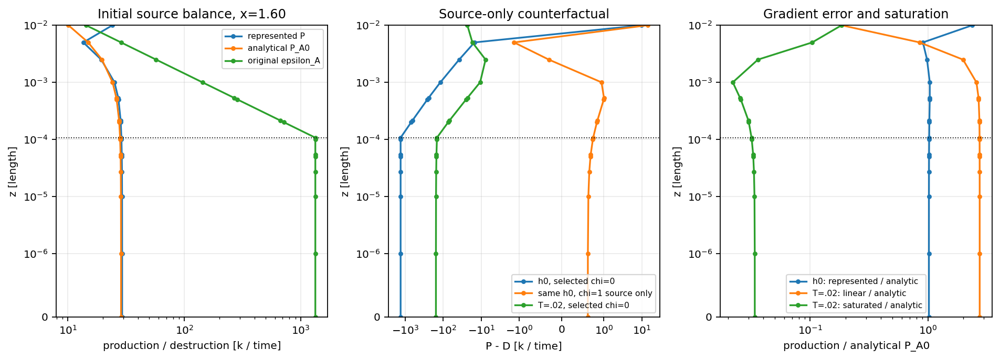
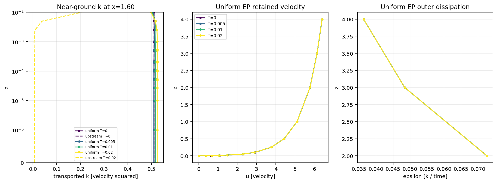
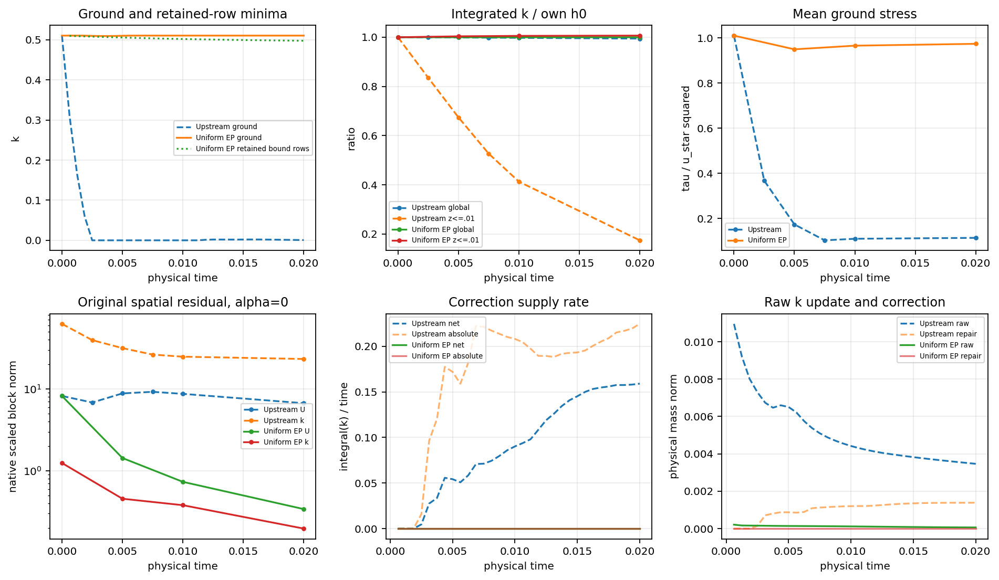

# Uniform EP flat control and the inherited AWF depletion

The uniform-EP control has completed **32 physical steps to T=.02**, with
**no positivity-correction activation or supplied k**. The inherited Upstream
case loses 82.5% of its first-cell integrated k by that time; the control gains
0.67%. This is a substantial improvement in short-time reference preservation.
It does not establish a steady solution or time-integration accuracy. The
control remains under durable continuation toward T=.1 and the longer targets;
see the dated live snapshot below and [compact evidence](cls-epawf-pimple-uniform-ep-flat-evidence/native.json).

The archived 2026-11-07 snapshot verifies **87 accepted steps at
T=0.054375**, status **running**, including passage beyond the
inherited T=.045625 terminal attempt. Its 87 callbacks each have one
U/p/epsilon/k solve and one logical bound call; all bound activations and KKT
work remain zero. Completed targets are steps 8/.005, 16/.01 and 32/.02.
The next automatic target is step 160/T=.1, followed by 800/.5, 1600/1,
3200/2 and 8000/5 while admissible and informative. T=.1 is not yet completed.

The immutable archived restart is `evidence-final/uniform-checkpoint/State.bin`
under the root below, SHA256
`89911165268a813265cfe97acea8fcf1fe35b70e6a0333b595d7138017d1c0a4`.
At that snapshot supervisor PID 102537, driver PID 102540, native PID
105589 and monitor PID 102539 were alive. Native PID identity includes
start token `11069749`, executable and cwd; later blocks legitimately
change the native PID. For live status use `uniform-campaign/status.json`
and `uniform-campaign/trajectory/progress.json`, not an old rotating path.
The archive fixes its actual coupled state/time/all native histories; it is
not a claim that the whole long-time campaign has finished.

All work stays on `codex/cls-epawf-pimple-one-sweep`, starting from actual local
and fetched remote HEAD `56657a7069af7c9600277611833bd37745d604fa`. The existing
Mac worktree, other Mac changes, shared Linux checkout/installation and
concurrent experiments were preserved. The original campaign was not converted
into this control.

## Original campaign: terminal projection failure

The reviewed “68 steps, running” status was historical. The actual Upstream
ConstitutiveV2 campaign accepted **72 steps to T=.045000000000000026**. Attempt
73 at T=.04562500000000003 completed its four governing solves, then failed
with `k_bound_active_set_iteration_limit`. Its supervisor terminated without
retrying the rejected step. The monitor completed immutable analyses at steps
32, 64 and 72.

The failed projection exhausted 2001 active-set iterations / 2000 KKT solves.
Its raw ground minimum was -0.0338020. Its latest repair still had ground
k=-3.41259e-8 at x=1.54408444, z=0, geometry 4, and a floor-feasibility defect
3.92310e-8. Stationarity was small (5.41e-19); feasibility had not converged.
This is an algorithmic projection limit, **not a proof of infeasibility** and
not a governing linear-solve failure.

The last accepted native checkpoint, actual raw/latest-repair packet, full
incoming history and frozen k matrix are preserved in `upstream-terminal/`
under the Linux root below. The accepted State.bin SHA256 is
`0ebcf803b486d63c42d6ed93db08efd4208d87b98e90dd918e139a77f8c26510`.
The original experiment and its failed segment remain unchanged.

## What source the inherited case actually uses

The archived and runtime XML select `RANSWallTransition=Upstream`, with
`RANSWallChi=1`. StateProfile nevertheless selects the baseline at x>=-2.25.
Ground velocity is prescribed zero; ground k has the existing natural scalar
boundary treatment and is **not prescribed zero**. At h0, transported k is
constant K0=0.5105080130598861, including the ground. The sampled wall-law K
is taken at z=1, independently of local k. H=2, the domain is x in [-4,2],
z in [0,4], and the first inner cell is [0,.01].

The native read-only source probe uses retained coefficients, actual gradients,
source quadrature, matching data and consistent free mass. It never lifts the
selected state, changes epsilon, repairs a query or advances history. It checks
additional query/ray k before evaluating dependent expressions. Full outputs
retain invalid-query witnesses separately; these selected readbacks had no
invalid source queries. Source-only chi counterfactuals do not claim to be
coupled states with newly consistent boundary/matching data.

With c_l^w=2.55 and nu=1.5e-5, the actual selected inputs give

```
z_epsilon = 2 c_l^w nu / sqrt(K0) = approximately 1.07068e-4
 epsilon_A(0) = K0^(3/2)/(c_l^w z_epsilon)
              = K0^2/(2 (c_l^w)^2 nu) = 1335.990933735
D_pre = (1-chi) epsilon_A + chi P_A0
```

At constant k, the limiter, B, m and lambda are all one. Ground values at
interior stations therefore give the following clean comparison. Rates have k
per time units; the last column is the complete selected native spatial rate,
not the pointwise source.

| h0 station x | Actual chi | P_h | P_A0 | D_pre = D | P_h-D | -M_ff^-1 R_k,spatial |
|---:|---:|---:|---:|---:|---:|---:|
| -3.5, upstream plateau | 1 | 29.23137 | 28.61069 | 28.61069 | +0.620686 | +3.09137 |
| -2.625, transition | .5 | 29.23137 | 28.61069 | 682.30081 | -653.06944 | -269.30174 |
| -1, baseline | 0 | 29.23137 | 28.61069 | 1335.99093 | -1306.75956 | -548.67198 |
| 1.6, baseline | 0 | 29.23137 | 28.61069 | 1335.99093 | -1306.75956 | -645.12677 |

Spatial/state/admissibility factors are respectively (1,1,1), (.5,1,1),
(0,1,1), (0,1,1). Downstream StateProfile bypasses the state sensor; its returned
unit state factor must not be read as an independent downstream sensor test.
By T=.02 and .045, the upstream x=-3.5 state factor is zero too, although its
spatial factor remains one. Thus the existing transition also quenches its
upstream EP branch after the coupled state departs from its reference.

At x=1.6,z=0, the same h0 coefficients give:

| Frozen source policy | Point P_h-D | Source-only native mass-inverted rate |
|---|---:|---:|
| Actual Upstream | -1306.75956 | -645.12677 |
| chi=0 throughout the source-only comparison | -1306.75956 | -645.11458 |
| chi=1 throughout the source-only comparison | +0.620686 | +6.19827 |

The small difference between the first two weak rates reflects the nonlocal
continuous mass projection and their different upstream sources. These
counterfactuals use the **same selected native volume quadrature**. Each
profile uses its own appropriate normalization quadrature. They are not full
residuals after changing the wall policy or epsilon boundary data.

The inherited depletion therefore begins in the selected physical source,
before bounding: its first three steps have no repair, while the ground minimum
falls to .0598998. Neither V2 nor a ground k=0 condition initiated it. Even
analytical reference production would leave P_A0-epsilon_A approximately
-1307.38025 in this baseline source at the wall.

## Representation, saturation and normalization

The represented ground shear gradient is 183.8821211 versus analytical
181.9194116. Production is 2.17% above P_A0 there, with SaturatedR2 inactive.
Auxiliary viscosity is .000864510321 and k diffusivity .000879510321. The
initial deficit of about 1307 is much larger than the +.62069 production error.
Within the rest of the first cell the production-representation error is much
larger than its ground value, as the resolved profile figure shows.

The later depleted state behaves differently. The table uses the same actual
retained x=1.6,z=0 coefficients for each source-only counterfactual.

| State / source | Local k / sampled K | P_h / linear P at same gradient | D_pre | Limiter | B=m | lambda | D | P_h-D |
|---|---|---|---:|---:|---:|---:|---:|---:|
| T=.02, actual chi=0 | .00681037 / .50996968 | .966857 / 78.80182 | 1333.17483 | .0667723 | .573003 | 1 | 155.35538 | -154.38853 |
| Same state, chi=1 source | same | same | 28.56622 | .0667723 | .889488 | 1 | 2.14442 | -1.17756 |
| T=.045, actual chi=0 | .00468592 / .50828379 | .661929 / 76.84332 | 1324.37479 | .0460955 | .493205 | 1 | 123.77758 | -123.11565 |
| Same state, chi=1 source | same | same | 28.42709 | .0460955 | .806601 | 1 | 1.62455 | -.96262 |

Saturation strongly reduces production once local k is depleted. The linear
values are algebraic comparators, not proposed physically admissible low-k
closures. The limiter reduces destruction locally, while division by the ray
normalization m redistributes its budget. Switching the source on an already
depleted state does not automatically restore equilibrium or positivity of its
future trajectory.

The actual quadrature verifies `sum(w D)=lambda sum(w D_pre)`. Native weak
component sums differ from the full load by at most 4.81e-15, mass-inverted
component sums by 1.24e-10, and consistent-mass solve defects by 2.50e-16 in
these initial/retained-state readbacks. Net destruction is counted once.
Full source tables include heights around z_epsilon, through the first cell
and up to H, actual tensors, all gates, viscosities, limiter, B/m/lambda,
weak loads and component rates.



## Complete UniformEPFlat-v1 policy

Select `RANSWallTransition=UniformEPFlat`. This explicit control is restricted
to the existing serial flat 2D PimpleSingleSweep pilot and chi=1. It uses a
fully active StateProfile at all wall anchors, inner source/normalization,
dependent epsilon and current matching projections. It removes the designated
downstream baseline-only restriction **only for this control**. Baseline plus
current-correction matching columns produce the full EP target on every face.
The existing Upstream support checks and downstream suppression remain intact.

Spatial/state factors are defined as one for this control; this is not a claim
that the Upstream sensors remain zero. Every profile must still be intrinsically
admissible with reason Active and actual weight one. An inadmissible EP profile
throws; it cannot fall back to chi=0. Scalar, covariance, normalization,
boundary, continuity, gauge and linear-solve hard checks are retained. V2's
shared actual-consumer coverage and continuous-ground treatment remain active;
this is not a theorem of positivity throughout every volume polynomial.

The native signature explicitly includes `UniformEPFlat-v1`, chi=1, the full
EP trace and required intrinsic admissibility. Upstream's signature remains
unchanged. Uniform and Upstream checkpoints are not interchangeable; the
focused test verifies refusal rather than editing a fingerprint.

All other physical/numerical settings remain the inherited ones: outer6 mesh
and spaces, regularized CLS, SaturatedR2, capped destruction and its selected
smoothing/normalization, molecular viscosity, roughness, H, samplers, constants,
zero prescribed forcing and eta, unit relaxation, and B_pressure=(alpha M_u)^-1.
Native IMEX1 still performs one vector momentum predictor, one pressure/gauge
solve and algebraic velocity correction, one outer-epsilon solve, one k solve,
one logical ConstitutiveV2 bound, hard checks and one physical/history commit.
No inner-epsilon transport, extra governing solve, outer sweep, trace
restoration, under-relaxation or residual cancellation was added. This remains
a candidate first-order sequential method, not an exact fully implicit stage.

### Actual initialization and focused Linux checks

The control is freshly initialized natively from the intended neutral family,
including the archived zero perturbation and its native initialization path.
Its actual h0 SHA256 is
`8457a658e9e126bfdf31a8c409a5c513f8615ab445db65ed81cd2259cd870bd4`,
versus inherited h0 `b8ba7917424057a9f6f16a026d82d53ede43985871537facea170ef6e1841b71`.
It preserves exact initial velocity, constant k, both pressure fields, gauge
and fixed external data. Six epsilon coefficients change, all on the matching
trace: global rows 1780,1782,1784,1786,1826,1827. Maximum coefficient change is
.00111481832322; physical epsilon L2 difference is .000793434038468.
Every coefficient outside that trace is exactly unchanged. The initialized
matching defect is zero. All native histories are saved, not fabricated from
the coefficient vector. Initialization uses two Lift calls / two total trace
iterations, separately from physical steps, and an inactive bound check.

Passed authoritative focused checks:

- Six-step Upstream replay, including active bounding: coupled state, time and
  all native histories are bit-for-bit identical to the retained baseline.
- Uniform profiles report actual chi=1 at all queried source/trace anchors;
  matching data and both profile quadratures pass. The V2 coverage tripwire
  rejects an undeclared consumer.
- Uniform two-step uninterrupted versus checkpoint/restart: bitwise state,
  time and all history equality; incompatible Upstream restart is refused.
- Existing mass-QP checks, including inactive-constraint rediscovery, and
  campaign-lock/orphan/idempotent-recovery tests pass.
- A separate strict R2LocalV1 run accepts step 1, rejects attempt 2 at T=.00125
  for `outer_gradient_box_exit`, saves the actual second candidate, and rolls
  back accepted state/time/all native histories exactly. Diagnostic continuation
  is therefore not being mistaken for qualification.
- The full solver and probe build pass. The final full cold build is separate
  from the active files and reproduces the native h0 and all initial histories
  bit-for-bit (executable SHA256
  `27c765b68bd48a5ac370cde0cf488a62a802f859f4ac446b07f24beb55b2bf8e`).

One early **test** failure assumed the probe's separately rebuilt reference was
bitwise identical to actual native h0, which includes the zero-perturbation
projection and second Lift. The corrected test uses actual native state/history
and checks its consistency. Evidence collection also corrected an ASLR-sensitive
comparison of ldd addresses and recognizes native reference boundaries rather
than requiring an XML BOUNDARYCONDITIONS section. These were diagnostic/test
issues, not production numerical rejections; their logs remain in Linux.

## Actual common-time evolution

Physical L2 norms use native physical quadrature. Pressure differences use one
common volume-weighted gauge across both regions. Each drift is measured from
its **own actual h0**. The first-cell control region is the entire x domain,
0<=z<=.01, per unit span; initial integrated k is .0306304807836 there and
12.2521923134 globally.

| T | k L2 drift, Upstream | k L2 drift, uniform | First-cell integral / own h0, Upstream / uniform | Mean stress, Upstream / uniform |
|---:|---:|---:|---:|---:|
| .005 | .0546937 | .00113310 | .67451 / 1.00387 | .0278196 / .152004 |
| .01 | .0838954 | .00199876 | .41305 / 1.00563 | .0176468 / .154594 |
| .02 | .123272 | .00320023 | .17451 / 1.00672 | .0183007 / .155901 |

At T=.02 the control reduces k L2 drift by a factor 38.5. Its global k integral
is 12.2526130, versus 12.1849304 upstream. The control k L2 drift is 0.128%
of its initial field L2 norm, not a correction/raw-step percentage. The intended
kinematic stress scale is u_star^2=.16; the represented initial mean is .161726.

| Common T | Between-case U L2 | k L2 | epsilon L2 | Common-gauge pressure L2 |
|---:|---:|---:|---:|---:|
| .005 | .00756122 | .0550601 | .000815747 | .244244 |
| .01 | .0225152 | .0846833 | .000834994 | .369956 |
| .02 | .0482611 | .123645 | .000901059 | .393595 |

The epsilon comparison includes the legitimate initial .000793434 difference.
Uniform epsilon drift from its own h0 at T=.02 is only 2.04873e-6. Its velocity
and pressure drifts are .00841251 and .01093096. Full window changes, sampled K,
B/lambda, residual blocks, qualification events and budgets are in the evidence.

Uniform retained bound-row minima (including pre-k ray rows) at T=.005/.01/.02 are
.505673/.502086/.497688. The T=.02 limiting location is near
(x,z)=(1.625,.00999743), geometry 4. The ground minimum at .01 and .02 is K0 at
the prescribed side corner x=-4; **that minimum is not evidence of an interior
equilibrium**. At the free wall witness x=1.6,z=0, k=.524122 at T=.02, about
2.67% above K0. There P_h=26.7591, P_A0=D=28.6078 and point source=-1.84874,
with no saturation and B=m=lambda=1. Thus local profiles still evolve.

At T=.02 the uniform original alpha=0 scaled residuals are
(U,V,k,epsilon)=(.340393,.017111,.196629,.00183531), versus
(6.70654,.541388,23.2981,.186016) upstream. These residuals use the retained
solved epsilon coefficients under **each case's selected wall policy**;
no Lift or trace replacement is used. The uniform refreshed matching defect
is 7.35714e-7, versus 1.48542e-5 upstream. Its imposed frozen target is solved
to algebraic tolerance. Pressure constraints/gauge remain at roundoff.

A later immutable readback at step 64, T=.04, has global/near k integrals
12.2530077/.03073758, mean stress .155287, and zero cumulative correction.
Its alpha=0 (U,V,k,epsilon) norms are
(.179695,.0145766,.136999,.00235672). The outer-epsilon residual is growing
while the U/k residuals decrease; this is not uniform residual convergence.
The matching discrepancy is 5.57554e-7. These later observations support
continued monitoring, not a steady-state classification.

The control exits the inherited qualification box at T=.00125, as the strict
check confirms. It remains numerically admissible under R2DiagnosticV1; it is
not reported as qualified original M8 evolution.



### Correction and k balance

Through T=.02: 32 implicit callbacks, 32 vector momentum, 32 pressure/gauge,
32 epsilon and 32 k solves; **zero additional governing solves**. There are 32
logical bound calls but zero activations, active-set iterations, mass-factor
applications or KKT solves. Inventory/separation checking still occurs. Raw
and retained k candidates are identical. Added frozen residual A_k delta_k,
storage reaction M delta_k/dt, signed/positive/negative/absolute correction and
correction/raw-step and correction/field ratios are all zero. The raw and
retained k frozen linear residual at step 32 is 3.04e-18.

The exact discrete frozen balance over [0,.02], in integrated-k units per
unit span, is:

| Region | Input-load increment | Implicit increment | Bound increment | Actual increment |
|---|---:|---:|---:|---:|
| Global | .000426157657 | -.000005428151 | 0 | .000420729505 |
| z<=.01 | .000234134839 | -.000028218021 | 0 | .000205916818 |

Window closure errors are <=3.7e-16 globally and <=1.7e-18 near the wall.
Separately, endpoint-trapezoid physical production/destruction integrated over
the same time window are approximately .1231950/.1227410 globally and
.02085545/.01950654 near the wall. These have the same integrated-k units,
but their difference alone is not an exactly closed local CG balance: boundary
fluxes, physical-time quadrature and the frozen implicit update also matter.
The retained diagnostics keep flux estimates separate from the exact discrete
identity. No correction energy explains the control's preservation.

By T=.02 the inherited repair has net integral .00185507, positive .00262991,
negative -.000774837, absolute .00340474, and near-wall .00194433. These
redistributions do not prevent its large depletion. The inherited accepted
campaign has 69 active bounds in its 72 steps; its terminal attempt's
correction/raw-step norm ratio is .5593. This
ratio concerns a step increment, not total turbulent energy. Positive and
negative redistribution remain separately recorded.



## Interpretation and next numerical step

The source-only experiment explains the initial depletion without invoking
bounding or a discretization-only explanation: the intentional chi=0 branch
has a large analytical near-ground deficit for constant k. A complete,
freshly initialized uniform EP control materially improves k and stress
preservation, without requiring any positivity repair over the compared
horizon. This is improved short-time behavior of a different, explicitly named
wall policy, not evidence that the original Upstream equations were solved by
that control.

It is still an evolving, unqualified diagnostic trajectory. Small corrected
increments cannot establish a steady solution; original spatial residuals and
profile/stress drift remain. At T=.02 only .004 H/u_star and .01825 flow-through
times have elapsed: H/u_star=5 and the actual initial bulk velocity 5.4755408
gives L/U_bulk=1.09578217. No long-time or temporal-order conclusion follows.

A separate fresh native zero-time first-cell split at .0025 keeps the physical
policy, polynomial order and constants, but does **not** improve this source
benchmark:

| Initial representation | Ground P_h-P_A0 | Native ground spatial k rate |
|---|---:|---:|
| Original first cell [0,.01] | +.620686 | +6.19839 |
| Split into [0,.0025], [.0025,.01] | -2.47428 | -7.36195 |

Both have the same intended analytical neutral family and constant K0, with
fresh native epsilon data and histories. No physical step, repair or state
transfer is performed. Component/mass checks pass. This is a representation
probe, not a refined trajectory or a spatial convergence result. Point
production at an internal interface uses NativePoint's selected side, whereas
weak loads use both adjoining volumes. RadialProject is a global constrained
L2 projection; it prescribes no ground shear gradient. A chosen derivative or
source rate need not improve monotonically under one split. The next targeted
check should examine that neutral velocity reconstruction and weak production
at the existing inner interfaces before selecting another spatial trajectory.
The primary coarse control continues meanwhile. Increasing floors, adding outer iterations or adding cancellation
sources would not resolve the demonstrated source/reference issue.

## Runtime, continuation and reproduction

Linux experiment root (all heavy fields, matrices, reports and checkpoints):

`/media/jay/新加卷/nektar-v2026-runs/cls-epawf-uniform-ep-flat-20261106`

Original experiment root remains
`/media/jay/新加卷/nektar-v2026-runs/cls-epawf-pimple-constitutive-v2-20261106`.
The artifact index `evidence-final/artifact-index.json`, SHA256
`6efcd35b10acf141b9693c0ac6c83dc5353d1f0eb82ebb2a02dc412a94191697`, indexes 393 files.
It and native.json locate immutable readbacks,
full histories, raw matrices, failure packets and frozen runtimes. PNGs are
kept here; exportable PDFs are in `figures-final/` on Linux.

The campaign solver SHA256 is
`98ff51e3a2aa0debf58d25f5a0e6f9b0d816a97e41834d6fd171863bc576d042`.
It was built from implementation `ee4820d1eacfa56aaf8d98d75f228e34120b449b`;
its launching harness revision is `0bbb77e7956b46fc605bb923b82f55eca04aedc6`.
Subsequent source changes are read-only diagnostics/analysis. The final trace
probe SHA256 is
`1eb10dcf4bdaf47016f1d6741705794a0248399d490fd94b16d10dbc14e54581`,
with diagnostic source through `3af84f9`. All linked-library identities are
frozen and verified. Later cold builds use separate files.

Connect with `ssh linux-usb`; this task used the documented Tailscale fallback
`ssh jay@100.105.247.110`. Activate the installed dependency environment and
set all six numerical thread variables to one. Initial compilation used four
workers, follow-up builds two, and each native solver/probe uses one rank and
one computational thread, within the shared 72-worker limit.

```bash
source /home/jay/.local/opt/nektar-v2026-mpi/env.sh
export OMP_NUM_THREADS=1 OPENBLAS_NUM_THREADS=1 MKL_NUM_THREADS=1
export BLIS_NUM_THREADS=1 VECLIB_MAXIMUM_THREADS=1 NUMEXPR_NUM_THREADS=1
# r is a NEW isolated experiment root; s is the synchronized source checkout.
cmake -S "$s/solvers/IncNavierStokesSolver/Tests/RANS" -B "$r/build" \
  -DRANS_BUILD_SOLVER=ON -DCMAKE_BUILD_TYPE=Release \
  -DNektar++_DIR=/home/jay/.local/opt/nektar-v2026-mpi/lib64/nektar++/cmake \
  -DCMAKE_CXX_FLAGS='-fno-fast-math -ffp-contract=off -D_GLIBCXX_ASSERTIONS'
cmake --build "$r/build" --parallel 4 \
  --target IncNavierStokesSolver RANSWallResolutionProbe RANSKBoundQPChecks
```

The committed `test_cls_epawf_uniform_ep.py`, `diagnose_cls_epawf_sources.py`,
`check_cls_epawf_uniform_representation.py`, `analyse_cls_epawf_constitutive_v2.py`,
`collect_cls_epawf_uniform_ep.py` and `plot_cls_epawf_uniform_ep.py` expose the
reproduction options. Exact executed command arrays, configuration hashes,
source status and runtime identities are retained in native.json and Linux
receipts. The launched production command is:

```bash
python3 -B "$s/solvers/IncNavierStokesSolver/Tests/RANS/supervise_cls_epawf_pimple.py" \
  --solver "$r/validation-runtime/IncNavierStokesSolver" \
  --output "$r/uniform-campaign" --wall-policy UniformEPFlat \
  --block-steps 8 --timeout 7200 \
  --targets 8 16 32 160 800 1600 3200 8000
```

The supervisor/driver lock prevents simultaneous resumes and surviving-child
replacement; step-ledger recovery is idempotent and numerical rejection is
terminal. Blocks publish real native checkpoints and keep absolute global
step/time and correction budgets. They never reset history or count restarted
initial states as physical steps. The immutable comparison covers T<=.02;
continuation status and the latest archived checkpoint are a separate snapshot
in the evidence. **The long-time campaign is running, not completed.**
