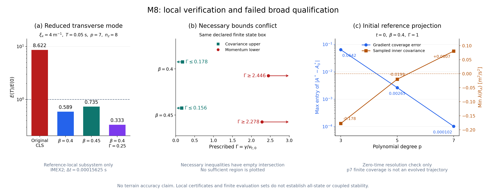

# M8 — Robust variant qualification and conditional terrain validation

## Material Passport

- Mode: experiment-agent implementation, run and reproducibility validation.
- Authority: user approved the three-variant proposal and requested M8 execution.
- Start: 2026-11-03, baseline `22d5c930380a202e29bb2c58613e3763bc2aa372`.
- Branch: `codex/cls-epawf-revised`.
- Status: **Approved candidate study implemented and tested. Broad robust
  qualification FAILED. M8 remains OPEN at the model
  qualification gate; conditional physical terrain validation has not begun.**
- Numerical environment: isolated Linux run root through Tailscale
  `jay@100.105.247.110`; compiler workers 16, numerical library threads one.
  All concurrent compiler, MPI and test workers must stay below 72.

## Approved scope and model decision

The approval selects a research sequence: common cubic scaling plus bounded
inner destruction first, then a reference-preserving positive-increment
regularization. A changed invariant response remains an alternative if the
second candidate requires excessive diffusion. Original CLS and standard
k-epsilon remain controls. The frozen revised note, M0 contract and original
kernel formulas are retained; M8 has its own explicit model selection.

`RANSWallVariant=Original` retains the old outer kernel. `CubicScaled` applies
one prescribed beta to all active cubic terms; beta=0.4 is the primary
reference-local candidate, 0.45 its sensitivity case. `Regularized` adds
`-gamma(x)*(S-Sref)` to the Reynolds stress of that same scaled law. One stress
must supply momentum, production in both turbulence equations, and interface
traction. There is no extra addition of gamma to scalar diffusivities.

The prescribed viscosity is
`gamma(x)=GammaUniform+GammaScale*kappa*u_star*r`. Its coefficients do not
depend on the evolving state. `Sref` is the symmetric incoming flat shear,
`Gref=flow_incoming tensor normal_incoming*u_star/(kappa*r)`. The incoming
frame, physical normal distance convention and extension over terrain are
recorded. This is an explicit reference-dependent constitutive model, not
physical molecular viscosity or a changed nonlinear iteration.

The selected inner source uses the capped-normalized destruction construction
from the earlier note's remedies supplement. Initial declared parameters are
theta=0.2, delta=0.1, piecewise-linear limiter; a C2 quintic is an explicit
separate option. For pre-repair E,D with equal metric ray budgets B,
`w=min(1,k/(theta*K))`, `b=integral(J*D*w)/B`, `m=max(b,delta)`, and
`lambda=b/m`. Replace destruction by `Dpos=D*w/m`, dependent dissipation by
`Epos=lambda*E`, and total redistribution by `Cpos=Epos-Dpos`. The net source
is actual production minus Dpos, assembled once. This same repair applies
to the selected chi=0 baseline. In severe depletion it deliberately reduces
the integrated loss and changes the dissipation trace. Negative represented
k remains invalid; no field floor or post-step clipping is introduced.

## Gates fixed before the campaign

1. Independent compiled-kernel identities, full indexed stress and branch
   derivatives; exact original identity; common-beta reference equality;
   production/energy consistency. Reproduce the note's reference interval
   certificate and the off-reference adverse shear witness independently.
2. Independent ray source quadrature and full directional dependence,
   plateau identity, zero-k reaction, rate bounds, capped/depleted regimes,
   actual trace and conserved redistribution. A continuum source identity
   does not imply a positive high-order CG/IMEX discretization.
3. A rigorous finite state-envelope tangent bound for the regularization,
   covering both limiting invariant branches. A sampled scan cannot stand
   in for this certificate. Record its required gamma and diffusion cost.
4. Native flat reference/stationary stages, full energy and coupled residuals,
   curved manufactured fields, interfaces, independent dt/p/mesh refinements,
   several perturbation amplitudes/wavelengths, MPI and complete restart.
   Match the existing scaled gates (residual 1e-9, isolated identities 1e-10,
   full-field MPI/restart 1e-8); use tighter internal nonlinear tolerances.
5. Separate covariance, outer k/epsilon and bounded source checks. Inner
   depletion controls test the source mechanism; they are not evidence of
   full coupled realizability. Long unforced trajectories must actually
   complete, with durations in advection and turnover units. Stopped prefixes
   cannot qualify transition passage or supply developed-flow averages.
6. Only after the preceding qualification: paired physical empty-floor/hill
   cases with the same repaired patch, reference inputs and baseline, with
   eta=0. Version the Cao-Tamura selector/freezer, freeze uncertainty,
   observations and calibration/validation split before fitting, and retain
   independent flat/hill scores. No historical strip result is substituted
   for the new full coupled patch. Quantify numerical error separately from
   physical model error and matching-height/switch-width sensitivity.

All attempts, including failed qualifications, are retained with source,
commands, runtime/dependency fingerprints, allocation and exit status. M8
does not inherit a successful physical gate merely from M7 verification.

## Implemented equations and model boundaries

The original `RANSModels.cpp`, analytical AWF, revised note and M0 contract
remain unchanged. The new `RANSRobustVariant` wrapper retains the original
invariant law and applies

\[
 R_{\beta,\gamma}=R_{\rm CLS}+(\beta-1)R_{\rm cubic}
                    -\gamma(x)(S-S_{\rm ref}).
\]

The same selected stress supplies outer momentum, production in k and
epsilon, interface traction and energy diagnostics. The original outer
scalar diffusivities are retained. `Original` with beta=1 and gamma=0
returns the original kernel result without additional arithmetic. The
original inner AWF momentum law is retained. Common scaling changes every
active cubic coefficient together; it is not a selective suppression of
one adverse component.

The native implementation computes each capped normalization over its
complete physical metric ray before applying MPI load ownership. It
recomputes the local-k dependence even when the sampled-K/chi profile is
cached. Dependent inner epsilon and its actual constrained outer trace use
the same lambda. This applies to the repaired chi=0 baseline and to the
EP/transition blend. No step clips a represented field or adds a field floor.
The kernel includes full directional actions in local k, sampled K,
pre-profiles and metric weights, including one-sided limiter/cap knots.

Initialization must impose that dependent trace before freezing the
function-defined reference, storing history or recording the initial audit.
The new flat Functions+Capped branch now performs the same lift used by the
mapped/transition branches. Its physics signature includes
`capped_initial_trace=1`. An older affected checkpoint may contain an
unlifted fixed reference and is rejected, even if a later state happened to
have the correct trace. Neutral, default Original/Original-source and already
lifted mapped/transition signature behavior is retained. This is a necessary implementation correction,
separate from the constitutive counterexamples below.

The [wall-stage guide](../../solvers/IncNavierStokesSolver/Examples/RevisedEquilibriumWall/README.md#explicit-research-variants-m8)
documents the selectors, units, fixed reference extension and diagnostics.
The optional invariant-response laws were screened mathematically and were
not adopted as production stress selections.

## Numerical evidence and qualification results

The first implementation is `3941b83`; the original source-bound native campaign uses
`aa854f4c5b05451a81a4e1dd60eaaca98eb547e4` in a separate `m8/source` and
`m8/build`. M7's source/build/runtime evidence and the unrelated Linux main
checkout are preserved. No revised-note or original CLS/AWF source is changed.

- The compiled kernel probe passes 27,907 checks. Independent kernel/source
  qualification passes 37,310 checks at `07363199`; its later stored-report
  replay passes 37,309 (the skipped check is the fresh process exit check).
- The reduced transverse experiment passes 305,254 independent checks. At
  xi=4, p=7/eight radial cells and T=.05 s, the energy ratios are
  .589289214077 for beta=.4, .734610537997 for beta=.45, and
  .333442685761 for beta=.4/GammaScale=.25. This is reference-local reduced
  dynamics; it does not qualify a nonlinear terrain trajectory.
- A fresh directed-interval proof at `11aa94c0` certifies both covariance
  positivity and an incompressible momentum principal lower bound for the
  entire local box with gradient-entry radius .001 and both k/K0 and
  epsilon/epsilon0 ratios
  [.99,1.01], using GammaScale=1 for both beta choices. GammaScale=3
  jointly certifies radius .01 with those same turbulence bounds. These
  finite boxes are not invariant regions of the coupled PDE.
- The coarse p=3 native projection is outside that box before any step,
  with max normalized gradient error .0642009881 and negative inner
  sampled covariance. The zero-step p=5 error is .00264835 and still has
  negative inner covariance. At p=7 the error is .00010243325, every
  declared finite outer evaluation set fits the GammaScale=1 local box,
  and inner/outer sampled covariance minima are +.08069398/+.17775442.
  These are reference-projection observations, not a positive time map.
- On the broader preregistered box (gradient-entry radius .25, both k/K0
  and epsilon/epsilon0 in [.5,1.5]), exact rational states/directions with outward interval
  stress/tangent evaluation give contradictory *necessary* fixed-GammaScale
  bounds. For beta=.4 they are GammaScale >=2.44640920758 and
  GammaScale <=.177525831862; for beta=.45, >=2.27794509320 and
  <=.156117116287. Thus neither fixed-scalar regularized variant can
  provide both nonnegative principal diffusion and covariance positivity
  at every state of this box. This is stronger than the earlier failure
  of very conservative sufficient-gamma choices, and applies only to the
  declared box/model family. Smaller regimes and changed invariant laws
  remain separate questions.

The broad conflict concerns the declared fixed scalar stress increment and
the stated box. It does not prove that every possible constitutive remedy
is impossible. Conversely, the much larger sufficient GammaScale bounds
4836/5360 from the conservative broad estimate are not necessary bounds;
their failure alone would not establish the conflict. The exact-state
necessary bounds above do establish it for this family.

### Modified-invariant alternatives

The approved optional screen retains C(q) below qc=3.3 and uses the earlier
note's C1 power tail with alpha=-qc*C'(qc)/C(qc). Candidate A retains
constant common beta. Candidate B uses
`beta(q)=beta0*[qc*C(qc)/(q*Ctail(q))]^2` above the join. Both C-prime and
beta-prime enter the full tensor tangent. Both beta0=.4 and .45 are tested.

Candidate A retains an adverse simple-shear transverse principal coefficient
at q=8: approximately -.007948 and -.186213 for the two beta choices.
Candidate B repairs that direction. The independent full tensor screen,
however, finds strict strain-active negative incompressible principal forms
for both candidates and beta choices, with directed upper endpoints between
-2.21 and -2.65 in the declared normalization. A common exact rational
within-box covariance witness, A02=5/4 with other entries zero, k=19/4,
epsilon=1/2, q=95/8 and direction (1,0,5)/sqrt(26), gives variance
-.28324679611225. Thus neither screened alternative qualifies. These are
constitutive counterexamples, not newly proved nonlinear PDE trajectories.

### Native reference, perturbations and time integration

The corrected source-bound native completion passes 1,219 independent
checks for CubicScaled and 1,214 for Regularized GammaScale=1, at beta=.4.
It verifies 18 and 17 cases respectively: neutral reference and short joint
velocity/k/epsilon perturbations, independent dt/p/mesh studies,
depletion controls, two-rank ownership and complete-history restart. The
three-level IMEX2 mass-norm difference ratios are 4.00066029 and 4.00826716.
The largest MPI/restart field difference is below 4.1e-14, and the native
histories agree. These are implementation and short-trajectory results.
Negative finite covariance in coarse/depleted cases remains explicitly
recorded; both receipts set `candidate_qualified=false`.

The initial campaign's native/MMS drivers stopped when a checkpoint Path
was serialized into JSON. The original failed attempts are retained.
Corrected driver source `6284787b` replays only successful exit-zero cases
with exact regenerated XML/report hashes, producing solver/loader hashes,
rank counts and prior runtime pins; it repeats every independent audit.
It does not reuse failed cases or checkpoints. Missing checkpoints,
restarts and additional cases are run afresh. The primary AA solver and
runtime images remain unchanged throughout that completion. This is a
driver receipt correction, not a hidden solver retry or constitutive failure.

### Genuine manufactured fields and mapped operators

The original flat Regularized MMS completion passes 309 checks over seven
cases, including separate p/h/dt changes, MPI2 and a fresh checkpoint/restart.
Its maximum scaled stage residual is 6.70e-13, field error 4.62e-16 and
traction/k-flux error 1.16e-15; all six MPI/restart field differences are zero.
The polynomial exact solution is represented exactly on these meshes, so
these results establish consistency, not an empirical spatial or temporal
convergence rate. The corrected startup solver separately passes all seven
fresh cases with 270 driver checks and maximum analytic field error 3.71e-16.
MPI/restart field differences are zero; complete-history maxima are 1.57e-15
and zero. Its first MPI launch stopped before solver initialization because
the orchestration CPU-list environment conflicted with the driver's mapping
flag. That attempt is preserved; the final matrix reruns all seven cases
afresh with unchanged physical inputs and acceptance tolerances.

Nine separate native mapped probe/oracle cases verify the selected weak
operator on variable-H 2D Gaussian patches, cosine feet with transition,
a 3D surface and a rotated Plane incoming frame. Original/CubicScaled/
Regularized case counts are 3/1/5. All 212 selected-operator assertions pass:
weak-component errors are below 6.67e-15, energy discrepancies below 2.42e-14,
and exported 2D coupled directional discrepancies below 6.0e-11. Independent
Original M5 and active-sensor M6 controls pass 502 and 370 additional checks.
The independent ray audit establishes the open inactive-repair plateau
before applying the original source oracle at those generic states.

These mapped fields are bounded unsolved states. They verify all weak rows
and the exported matching actions; they do not establish an exact curved
Regularized MMS, an evolved state envelope or a terrain trajectory. A genuine
curved-gamma MMS gate remains unestablished. The first broad 100/200 sensor
fixture did not activate the legacy omitted-chi-derivative sensitivity
control. Its failure is preserved; fresh 1/30 operator fixtures pass that
control without changing production coefficients or acceptance tolerances.

### Severe capped-source native coupling and restart initialization

The final six-case fixture uses a positive exactly represented tensor-cubic
inner k field, zero velocity/pressure, a narrow undepleted physical sampler
at rK=1 and .99 depletion elsewhere. It uses theta=.2, delta=.1, chi=1,
eta=0 and beta=.4. It has no body/scalar source, anchor, dummy initial
perturbation, clipping or field floor. The fixed exterior k and sampled K
make the actual free-local-k dependence of lambda independently observable.

The preregistered cases are one zero-step base, four +/- free-k directions
at h=2e-4 and 1e-4, and one native step at dt=1e-4. The oracle reconstructs
the whole metric normalization, projected GLL matching-trace coefficients,
free-k trace response and physical source/energy budgets. Source-mechanism
checks and the fully discrete time-map result are reported separately.
All six cases pass on clean `ed34052`, with no retry or changed parameter.
The base minimum lambda is .5786931166002925 and the normalization-capped
physical volume is 1.05061426814518. The initial positive k projection error
is 2.02e-16, the constrained dependent-trace coefficient error 3.68e-16,
and the independent full physical energy/source errors are below 2.11e-15.
Free-k to trace directional errors are 3.87e-13 and 1.98e-12 at the two h
values, while sampled K/exterior k remain fixed. The actual one-step native
startup stage converges to scaled coupled residual 2.44909e-11. Source,
trace, energy and complete-history audits pass in the evolved state too.

The dependent trace is a constrained polynomial projection. On the coarse
ramp faces its pointwise difference from analytic lambda*Epre(H) reaches
.0184441, despite the exact coefficient constraint. The middle capped
plateau is represented. This fixture verifies the implemented projection
and its coupling, not pointwise analytic trace accuracy over every face,
polynomial-everywhere positivity or general discrete admissibility. All 100
runtime images, 3,920 numerical inputs, bindings, packages and tools remain
unchanged before/after; the complete six-case job takes 383.22 seconds.

The new initialization campaign also explicitly tests rejection of an old
flat Functions+Capped checkpoint and successful use of an old Neutral
CubicScaled checkpoint against its original four-step solution and full
histories. Both checks pass. Exact old/new Functions checkpoint signatures
differ only by the scoped marker; the stale checkpoint is rejected before any
accepted restart. The Neutral signature is exactly preserved and its continued
fields/history differ by at most 1.01e-14/3.08e-17 from the old uninterrupted
solution. The receipt retains complete signatures, checkpoint bytes/hashes,
independent checksums and all-field/all-history norms. Actual loader bindings
and transitive library hashes agree from all nine case directories.

### Unforced flow and physical data

The preregistered unforced Regularized transition diagnostic planned T=.3.
It accepted states only through t=.055, then rejected every admissible Newton
trial for the next stage at t=.06. Twelve accepted records and the exact
failure report are retained. The accepted prefix has positive finite k and
outer epsilon samples, but its minimum sampled inner covariance is
-.09983101642016068; covariance qualification already fails. No explicit
negative k/epsilon sample or rejected coefficient vector was exported.
Newton nonconvergence alone establishes neither a turbulence-positivity
failure nor continuum instability. The prefix establishes neither pulse
passage nor a completed long-time qualification and supplies no developed
flow average.

The versioned `cls-epawf-m8-robust-v1` protocol checks the frozen Cao–Tamura
snapshot, separates flat calibration from reserved flat/hill observations,
identifies the selected repaired model and predeclares paired routes and
development/score rules. The old original-first selector/freezer is not used
for a new model. No experimental fit or score has been computed. The physical
floor/hill campaign remains conditional on qualification and was not launched.

### Earlier regressions and attempt preservation

All 33 earlier registered tests pass in one CTest run against the unchanged
AA solver, with 12 processor slots and 3,689.71 seconds total wall time.
The corrected startup binary also passes a focused default Original
flat-Functions MMS and a fresh default Original Neutral evolution smoke.
The former has maximum analytic field error 4.62e-16. These refreshed controls
exercise both original startup paths on the newly built binary.

The five new registered M8 test families have corresponding kernel,
transverse, native, genuine flat MMS and capped-native direct/replay receipts
at the explicitly named producing epochs. This is combined source-bound
coverage, not a claimed single passing 38-test CTest invocation. Passing
these implementation checks does not close the physical model gate.

All unsuccessful attempts are retained. Initial pilots rejected an invalid
selector or stopped on missing diagnostic quadrature metadata; the AA campaign
had the Path receipt failure; the first corrected build lacked a fingerprinted
auxiliary probe; the first fresh MMS attempt had the launcher conflict.
Read-only compatibility audits additionally caught a mistaken LD-path
normalization assertion and an oracle-import VECLIB environment change.
The final audit records actual child paths/bindings and initializes its own
environment before its pin instead of claiming identical environments.

The supplementary Original runner first used an incorrect import name and
stopped before any solver launch. Its next attempt completed the MMS solver
but requested a full manufactured-forcing energy reconstruction that the
existing oracle explicitly does not implement. The final completion reuses
only that successful, XML/report/runtime-bound solve, reruns independent exact
field/traction and supported accounting checks, and runs the Neutral smoke
afresh. It does not claim a full independent forcing/volume-energy audit for
this supplementary MMS. The source and binary are unchanged; the successful
capped fixture supplies its separately stated full physical energy audit.

## Reproducibility and tested source epochs

All mathematical evaluation, compilation, solver execution and figure
generation use Linux through Tailscale. Source edits use the Mac checkout.
The unrelated Linux main checkout remains clean at
`f4b70baec10016dd098005bc5a5507b87e4a57bf`; historical M0–M7 source/build
and runtime pins are retained.

| Producing source | Linux location under the M8 run root | Role |
|---|---|---|
| `07363199` | early kernel/transverse receipts | Initial independent kernel and reduced evolution |
| `aa854f4c5b05451a81a4e1dd60eaaca98eb547e4` | `source`, `build` | Frozen primary solver; original native/MMS campaign, reference projection, flow diagnostic and 33 earlier regressions |
| `11aa94c0e3d54f6b460db4b4cb17fac473b06149` | `certificate-source` | Tightened independent local/wide interval certificates |
| `2a93b04b3c35fc0f184c02e72f42fa1ea1066c22` | `feasibility-source` | Necessary fixed-GammaScale feasibility witnesses |
| `6284787bf4c436203f4404498ba3dfb68aa144ef` | `verification/source`, `verification/build` | Corrected replay/audits, invariant screen and separate mapped probe |
| `ed34052fe4dd967e963c22272a0ec0888cf35b70` | `initialization/source`, `initialization/build` | Corrected startup/signature solver, fresh MMS/cap/restart verification |

The CurvedWallProbe update between AA and 628 changes only the separate
probe/selected diagnostic metadata; the original solver's compiled C++ inputs
are unchanged. The corrected startup epoch is built afresh and is not
silently substituted into earlier records. Its first build compiled the
solver but fingerprinting rejected a missing auxiliary transition probe.
The preserved second build compiles the complete auxiliary target set and
passes the strict 100-runtime-image/3,920-input fingerprint.

Builds use Release MPI libraries from
`/home/jay/.local/opt/nektar-v2026-mpi`, with their own geometry overlay and
16 explicitly allocated compiler workers. Every numerical rank uses
`OMP_NUM_THREADS=OPENBLAS_NUM_THREADS=MKL_NUM_THREADS=BLIS_NUM_THREADS=1`.
CTest concurrency is 12 processor slots; each MPI test declares its ranks.
Conservative overlap accounting is at most 38 workers, including a 16-worker
build and allocated numerical slots, below the hard limit 72. Actual commands,
affinity, durations, solver/loader/tool hashes and before/after runtime pins
are retained in runner receipts. Shared locks protect each producing build
while its tests run.

Representative commands (use fresh output directories for reproduction):

```bash
source /home/jay/.local/opt/nektar-v2026-mpi/env.sh
export OMP_NUM_THREADS=1 OPENBLAS_NUM_THREADS=1 MKL_NUM_THREADS=1 BLIS_NUM_THREADS=1
M8=/media/jay/新加卷/nektar-v2026-runs/cls-epawf-revised/m8
export TMPDIR="$M8/tmp"
export LD_LIBRARY_PATH="$M8/initialization/build/geometry-lib:$LD_LIBRARY_PATH"
RANS_TESTS="$M8/initialization/source/solvers/IncNavierStokesSolver/Tests/RANS"
python3 -B "$RANS_TESTS/validate_cls_epawf_m8.py" \
  --build "$M8/initialization/build" --output FRESH_MMS --mode mms \
  --variant Regularized --beta .4 --gamma-scale 1
python3 -B "$RANS_TESTS/cls_epawf_m8_capped_native.py" \
  --build "$M8/initialization/build" --output FRESH_CAP
# Historical regression command used the unchanged AA build and its overlay:
export LD_LIBRARY_PATH="$M8/build/geometry-lib:$LD_LIBRARY_PATH"
ctest --test-dir "$M8/build" --parallel 12 -E '^RANSCLSEPAWFM8' \
  --output-on-failure --output-junit FRESH_CTEST.xml
```

The [compact evidence archive](cls-epawf-revised-evidence/m8/README.md)
contains exact bounds, counterexamples, native validation receipts, figures
and declared curation indices. Complete fields, checkpoints, logs, histories
and interval tangent arrays remain outside the source tree under
`/media/jay/新加卷/nektar-v2026-runs/cls-epawf-revised/m8`.



## Milestone disposition

The selected models are explicit, reproducible research implementations.
Kernel/source identities, reduced-mode decay, finite local constitutive
certificates, short native evolution and mapped operator checks do not
override the broad counterexamples or qualify a coupled high-order positive
time map. The approved fixed scalar family and the two specified invariant
alternatives fail the declared broad gate. No unrestricted robust model or
physical accuracy claim follows.

M8 therefore remains open. Its remaining gates are a resolved constitutive
model/state-range decision, outer and fully discrete admissibility, a genuine
curved Regularized MMS for any adopted replacement, complete unforced
perturbation/refinement qualification, then the conditional paired developed
floor/hill validation and reserved scores. Those require a new model decision;
altering the model or narrowing its claimed envelope is not inferred from a
failed test. M9 remains open and can separately deliver the faithful research
implementation with its documented failed physical gates.
