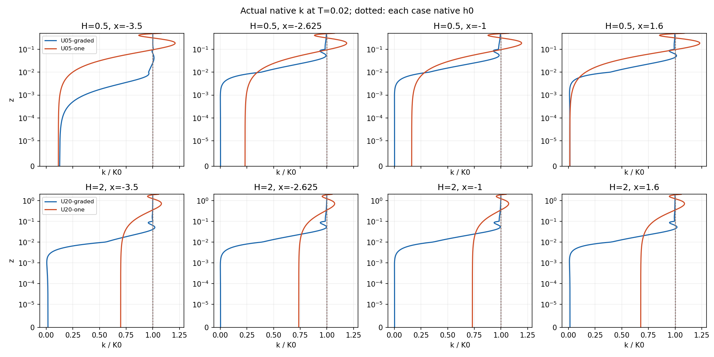
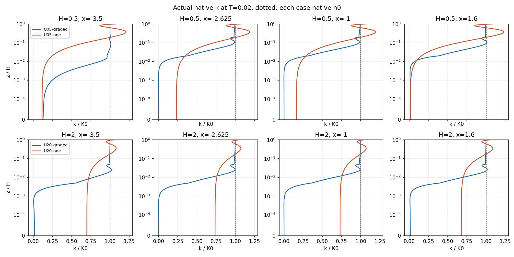
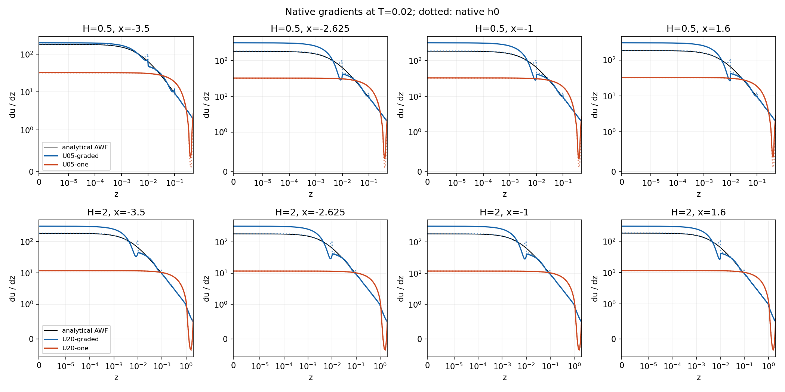
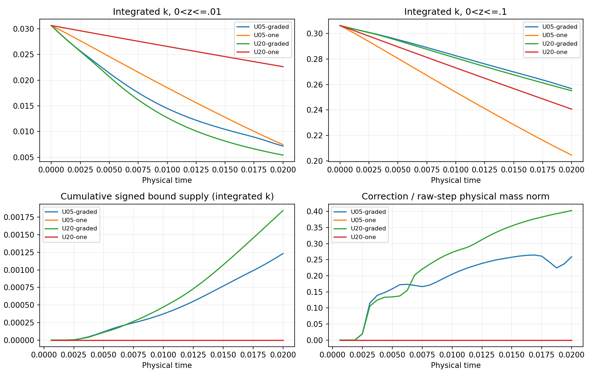

# Upstream branch coverage and fresh wall-layer partition comparisons

2026-11-08, branch `codex/cls-epawf-pimple-one-sweep`. Starting local and fetched
remote HEAD: `de3e0a1d6d9e24860a1957a1baa9505a97f47ec7`.

**ConstitutiveV3 closes the demonstrated inactive-to-active quadrature gap.**
The exact accepted-103 polynomial is rejected by the strengthened, read-only
inventory at the original failure coordinate, before changing velocity or k.
The historical campaigns remain terminal and unchanged. Four freshly
initialized Upstream cases completed 32 accepted steps to **T=.02**, each with
one U/p/epsilon/k solve and one logical final bound call per step.

The smaller-height continuation produced a further, different limitation:
**U05-graded accepted 64 steps to T=.04, then attempt 65 exhausted the 900-second
projection wall-time allowance.** It is terminal, archived, and has not been
retried. U05-one completed T=.05 and .1 and continues as the surviving member,
under its durable supervisor. This is an observed transient comparison, not
evidence of steady convergence or everywhere-positive volume polynomials.

[Compact evidence](cls-epawf-upstream-branch-evidence/native.json),
[dated live status](cls-epawf-upstream-branch-evidence/latest-status.json), and
[artifact index](cls-epawf-upstream-branch-evidence/artifact-index.json) bind the
results to native states, histories, sessions, executables and linked libraries.
All numerical results below are Linux results. This comparison does not establish
a temporal convergence order.

## Accepted 103 versus attempted 104

The strict replay reads the real accepted checkpoint, archived rejected state,
external boundary coefficients and fixed reference. Its SHA256 is
`11d1c23373ed98a3f79c7ce6f242c23883398a3e369e1210e34a81a1c42445e9`.
The saved native GLM slots reproduce the failed implicit-callback history hash
`e58fd3cce0c052eda3588e8cf34493cea15f52ac14020fa17fb347f9c406f3d6`.
The callback is intercepted before any governing solve and the local history
transaction rolls back. The report's rolled-back `last_stage_history` is not
substituted for that failed callback. No Lift, rebuilt h0, checkpoint migration,
old-tail physical advance or intermediate repair occurs.

At x=-3.5 the two states have **bitwise identical k coefficients** and identical
point-sampled K=.5073105694761875 at z=1:

| Quantity | accepted 103 | after U/p in attempt 104 |
|---|---:|---:|
| spatial gate | 1 | 1 |
| state sensor d² | .01008407423494 | .00968792517907 |
| actual chi | 0 | .000326995073 |
| margin gate / Reynolds gate | 1 / 1 | 1 / 1 |
| intrinsic margin / Reynolds number | 2.74933647 / 94967.65 | same |
| selected profile | inactive Q0 | positive-weight Q+ |

The off threshold is d²=.01. U/p changes the state sensor, exposing a different
normalization quadrature; it does not create the negative k polynomial.
The accepted Q0 ray minimum was 5.10554446e-9, whereas its already reachable
Q+ ray contains **k=-4.47954576e-8 at z=.00951619319536**, the first subsequently
rejected coordinate. The old inventory did not visit this row before the
switch. The Q+ cutoff is .00951361558535 and its sampled minimum is
-1.42452947e-7. An independent endpoint/derivative-root calculation gives
-1.42483122e-7 at z=.00960817081640 in the native [0,.01] cubic panel; direct
native evaluation agrees within 1.8e-18. The reported arithmetic error estimate
is 1.14e-13, far below either negative value.

The replay separately constructs a V3 **constraint-enumeration-only** view of
the same immutable coefficients and data. V3 returns `negative_inner_k` at
`constitutive_prospective_active_normalization_ray`, x=-3.5,
z=.00951619319536. This is rejection by a stronger inventory, not a compatible
restart or an accepted repair of the historical state.

The original step-72 and repaired step-103 experiments used different historical
tail/inventory identities. They cannot become the new comparison by changing
XML or signatures. Both remain archived terminal evidence.

## ConstitutiveV3 and its guarantee

For fixed K and geometry, `StateProfile` builds one intrinsically active
weight-one profile and reweights it for every strictly positive chi. Native
checks at chi=1e-12, .125, .5, .9 and 1 confirm identical quadrature locations,
weights and Jacobians. Thus Q0(K) union Q+(K) covers the reachable quadrature
branches at that anchor; intermediate positive weights do not create another
location family.

The shared inventory now adds prospective Q+ rows at the same production,
matching, reconstruction, contact and declared reporting anchors used by
consumers. Sampler and sensor scalar inputs are checked first. Prospective
construction respects disabled correction, Upstream spatial support,
K-dependent margin/Reynolds gates and intrinsic fallback. It does not override
an intrinsically invalid profile. A currently zero **state gate** does not
remove an otherwise reachable Q+ branch.

Prospective rows carry zero source weight and do not enter normalization or
epsilon matching. Actual chi, selected source quadrature, source signs and
physical loads are unchanged. Both current branches, static local points,
exact mean-functional rows, retained inactive cuts and continuous cubic ground
checks remain. Every separation rebuilds K-dependent rows and extrema. Every
QP remains centered on the original raw transport candidate with the physical
consistent M_ff metric, shared free coefficients and fixed essential data.

The selectable policy is `RANSWallPimpleKInventory=ConstitutiveV3`, with strict
`MassQR-ConstitutiveV3` identity. V2 remains selectable for reproduction; Off
remains unchanged. V2 checkpoints are not relabelled V3. Registered-consumer
coverage assertions remain active, including an intentional unregistered-ray
tripwire. Reporting anchors are shared with the comparison/profile consumers,
rather than maintained as a second independent list.

**Scope:** protection of the declared constitutive evaluation inventory and
continuous ground, not positivity throughout every two-dimensional polynomial.
The independent vertical diagnostics make that limitation concrete: at T=.02,
U05-graded has k=-1.44699886e-7 at x=-1,z=.00066870660 and U20-graded has
k=-2.49242867e-7 at x=-1,z=.00059307708. These are between protected rows;
the declared inventories and ground pass. Their arithmetic estimates are about
1.3e-13. They are read-only diagnostic findings, not production rejections or
clipped constitutive inputs. No global volume-positivity claim is made.

## Cases and native initialization

Every new physical fixture and continuation in this experiment uses **z_m=H**.
All four primary cases use the physical column functional
K(x)=integral_0^H k_h(x,z) dz/H, with exact global CG rows from fixed native-panel
GL8 quadrature. There is no tangential or global-domain averaging. z_K is
unused; H/2 is only a geometry placeholder. Positive mean K does not waive local
k checks.

| Case | H=z_m | inner knots | outer vertical elements | total quads | coupled coefficients | Uniform control |
|---|---:|---|---:|---:|---:|---|
| U05-graded | .5 | 0,.01,.1,.25,.5 | 8 | 60 | 2261 | G |
| U05-one | .5 | 0,.5 | 8 | 45 | 1811 | H |
| U20-graded | 2 | 0,.01,.1,.25,.5,1,2 | 6 | 60 | 2165 | C |
| U20-one | 2 | 0,2 | 6 | 35 | 1415 | D |

The common tangential knots are -4,-3,-2,-1,1,2. Z=4 is the computational top,
not an independently established atmospheric boundary-layer thickness. The mesh above z=2
retains knots 2,7/3,8/3,3,10/3,11/3,4. Each pair has identical outer and
tangential meshes. Velocity, k and transported outer epsilon are cubic;
the two regional pressures are linear with one common gauge. Native field
quadrature uses eight points per direction; source integration is GL16 in the
normal direction, GL8 tangentially, retaining roughness/cutoff panels even in
the one-element layer.

All cases retain h=.1, u_star=.4, nu=1.5e-5, SaturatedR2, capped destruction,
unit relaxation, zero eta/forcing/perturbation, native IMEX1 dt=.000625 and the
mass-inverse pressure approximation. Upstream start/end/baseline are
-3/-2.25/-2, sensors are at 2.5 and 3.5, and chi-enable=1. The physical floor
is 5.1050801306e-9 (relative 1e-8); the arithmetic reserve is unchanged. Explicit
projection controls are 2000 per Add, 20000 total, 2000 separations, 900 seconds.

h=.1 is the AWF roughness parameter, not aerodynamic z0. Compatible references
are regenerated without tuning constants or forcing:

| H | ell | U_H | aerodynamic z0,c | corrected z_c | H sqrt(K0)/nu |
|---:|---:|---:|---:|---:|---:|
| .5 | .00536360724 | 4.43538361 | .00377932029 | .0104612514 | 23816.61 |
| 2 | .00536360724 | 5.78025437 | .00343706659 | .00951526914 | 95266.46 |

Reference kinematic traction is .16 and K0=.5105080130598861; H/h is 5 or 20. The compatible inner
reference at a common z<=.5 is unchanged at these fixed AWF inputs; the
compatible external log profile and aerodynamic reference offset change with H.
No fixed-z0 momentum calibration is implied.

Each case has its own fresh native h0, epsilon trace, history and checkpoint.
The established constrained reference projection and zero-perturbation path
are preserved. Initialization takes two Lift calls/three total iterations,
separate from physical-step counts; startup bounding is inactive. Initialization
costs are 28.4,23.8,36.6,23.3 seconds in table order. Actual h0/history hashes
and all initial weak source-mode loads are indexed in the evidence.

| Case | h0 velocity L2 error | h0 du/dz L2 error | h0 production L2 error | h0 mean wall stress |
|---|---:|---:|---:|---:|
| U05-graded | .00993347 | 3.85697 | 1.26981 | .161730 |
| U05-one | .681627 | 21.1623 | 4.69963 | .0283614 |
| U20-graded | .00989479 | 3.85576 | 1.26948 | .161726 |
| U20-one | 2.47630 | 27.2088 | 5.18598 | .0102634 |

Reference production L2 is 5.14911 at H=.5 and 5.17008 at H=2. The one-element
production errors are about 91% and 100%. Lower H improves the ordinary cubic,
but does not adequately resolve this near-wall velocity/production profile.

## Focused verification

| Check | Linux result |
|---|---|
| Consistent-mass QP, dependent constraints, no-op, inactive-cut rediscovery, between-node ground minimum | existing focused RANSKBoundQPChecks passed |
| Positive-chi branch identity and state-only switch | RANSProfileBranchChecks passed |
| Native history rejection transaction | RANSHistoryRejectionChecks passed; CTest 3/3 |
| Exact accepted-103 / attempted-104 replay | bitwise unchanged k; native history/boundary/reference validated; V3 finds original missing row |
| Matched Uniform G, z_m=H, four-step V2/V3 prefix | state, all native histories and time exactly equal; bound inactive |
| Nonuniform Upstream mean consumption | transition-input error <=2.3e-15; dependent epsilon error <=2.3e-16 |
| Point, disabled, spatial exclusion, intrinsic Reynolds exclusion | focused native/read-only fixtures passed |
| Mean-row preservation and local-negative/positive-mean distinction | native sampling checks passed for all four cases |
| Same evolved fields, V2 versus V3 inventory | every native weak component load and dependent matching result exactly unchanged |
| Compatible restart | four steps versus 2+2 exactly equal in state/history/time |
| Active post-bound forced rejection at step 9 | accepted step-8 state/time/history restored exactly; non-k/essential k bitwise unchanged |
| Incompatible inventory/wall policy/mesh/sampler | strict reader rejected, original checkpoint unchanged |
| Tail identity | signature-only reader test rejected; no altered-tail case evolved |
| Final reporting changes | two active steps exactly equal to frozen production state/history/time |

The four primary trajectories contain **128 accepted physical steps**:
128 vector momentum predictors, 128 pressure/gauge solves, 128 epsilon solves,
128 k solves, 128 logical bound calls, and **zero additional governing solves**.
The native harness checks one implicit callback per attempt, essential lifting,
two continuity blocks/common gauge, retained epsilon trace columns and raw
scalar linear residuals. Maximum corrected flow constraint defect is 3.8e-16;
maximum raw k linear residual is 3.3e-15. Internal mass/KKT/separation work is
separately retained and is not described as zero correction work.

The requested frozen U05-one h0 source-order comparison uses identical
coefficients and K functional. GL16 versus GL32 changes the full free-mode
spatial mass-dual load by 2.32827e-5 against norm 9.85506, about 2.36e-6.
Destruction differs by 1.3e-13. The near-wall source/gradient discrepancy is
therefore not explained by this source-quadrature error. No further quadrature,
dt or outer-refinement sweep was launched.

## Transition-resolved source and evolution

At native h0, chi at x=-3.5,-2.625,-1,1.6 is **1,.5,0,0** in all four cases.
The first two stations are free interior plateau/transition points; downstream
spatial support is zero. The source comparisons use the same fields and data;
chi=0/1 counterfactuals are not separately evolved solutions.

At the ground, PA0=28.61068577 and epsilon_A=1335.99093373 for all four h0
states. With normalization/cap unity,
D_pre=(1-chi) epsilon_A+chi PA0. The represented production and selected
source/rate differ strongly with the polynomial representation:

| Case | P_h at ground | source at chi=1 | source at chi=.5 | source at chi=0 | native rate at x=1.6,z=0 |
|---|---:|---:|---:|---:|---:|
| U05-graded | 29.23289 | .622207 | -653.06792 | -1306.75804 | -645.12270 |
| U05-one | .898967 | -27.71172 | -681.40184 | -1335.09197 | -29.29734 |
| U20-graded | 29.23137 | .620686 | -653.06944 | -1306.75956 | -645.12677 |
| U20-one | .117726 | -28.49296 | -682.18308 | -1335.87321 | -8.54170 |

Production saturation is inactive at these initial ground evaluations: linear
and SaturatedR2 production at the same represented gradient agree. At H=.5,
the one-element ground gradient is 32.24681 versus analytical 181.91941. The
small coarse-space mass-inverted depletion rate does not mean a balanced
pointwise source: weak projection changes how that narrow source enters all
free modes. Complete native mode loads, component-sum/mass-solve checks and
selected-state counterfactuals are retained, not just column-integral balances.

| Case | chi at plateau x=-3.5, T=.005/.01/.02 | chi at transition x=-2.625, T=.005/.01/.02 |
|---|---|---|
| U05-graded | .99981 / 1 / 0 | 0 / 0 / 0 |
| U05-one | 0 / 0 / 0 | .19414 / .02931 / 0 |
| U20-graded | .17913 / 0 / 0 | 0 / 0 / 0 |
| U20-one | 0 / 0 / 0 | 0 / 0 / 0 |

At T=.02 the spatial gates remain 1 and .5 at those first two stations, but
the state gate is zero. Downstream actual chi remains zero because spatial
support is zero, with its state gate reported separately. For U05-graded,
plateau/transition d² are .0155156/.0865863; U05-one gives .145707/.0123548.
On adjacent native anchors the pressure sensor dominates these departures
(for example .015369 of d²=.015464 near x=-3.592). This does not justify an
outer-epsilon refinement as the immediate remedy.

The later normalization is consequential. At T=.02 U05-graded ground values
at x=-3.5 have k=.0644311, mean K=.508125, P=6.0530, D_pre=1323.55,
B=.954211, lambda=1, D=879.408 and source=-873.355. At x=-2.625,
k=.00089509, B=.490827 and source=-22.6553. The cap is not a replacement for
the physical destruction rate. The actual quadrature identity
sum(w D)=lambda sum(w D_pre) holds within 1.8e-15 in the retained readbacks.
All requested extra source-query locations at these short-run states were
valid; independent vertical minima are reported separately as above.

## Common-time comparisons and physical budgets

All four runs completed .005, .01 and .02. Norms below use the same physical
evaluation rule; pressure uses one weighted common gauge and transported
epsilon is compared only on the common outer region z>=2. Errors to each own
analytical reference, drift from actual h0, paired differences and between-H
reference offsets are separate entries in the evidence.

| Case, T=.02 | drift u L2 | drift k L2 | drift epsilon(z>=2) L2 | mean stress | refreshed matching defect | bound activations / 32 | native wall seconds |
|---|---:|---:|---:|---:|---:|---:|---:|
| U05-graded | .0472293 | .120710 | 6.3899e-5 | .0210950 | .00111931 | 29 | 1163 |
| U05-one | .0257314 | .189426 | 6.5833e-5 | .0266008 | .00101331 | 0 | 751 |
| U20-graded | .0502316 | .122711 | .000634669 | .0183511 | 6.2818e-5 | 29 | 1539 |
| U20-one | .0221685 | .124986 | .000529848 | .0102413 | 7.9812e-5 | 0 | 881 |

These concurrent-run wall times include audits and initialization of the native
restart process. They are not isolated scaling benchmarks. Separate scheduled
solver times are 454,264,538,295 seconds. Epsilon coefficients remain those
actually solved; no refreshed target replaces their trace to reduce a diagnostic.
The matching diagnostic is the native trace-coefficient maximum defect from
the refreshed projected target; the once-imposed frozen target separately
satisfies its algebraic solve tolerance.

| Case, T=.02 | dimensional original spatial residual mass-dual norms: u / v / k / epsilon |
|---|---|
| U05-graded | 2.58959 / .192858 / 12.6032 / .103017 |
| U05-one | 1.09723 / .0612813 / 9.07425 / .0888182 |
| U20-graded | 2.62341 / .211475 / 11.5683 / .0268531 |
| U20-one | .970558 / .111965 / 6.19418 / .0191084 |

These are refreshed alpha=0 residuals of the retained state. Native scaled
norms and common-normalized norms are also saved, using common
(U,K,E,H,V)=(.4,.5105080131,.0726358333,2,24). The whole outer residual space
changes with H; a smaller coarse-space residual is not evidence of greater
accuracy. Transported-epsilon field comparisons use the common region instead.

| Case | change integral k, z<=.01 | change integral k, z<=.1 | global change integral k | cumulative signed correction | positive / negative correction integrals |
|---|---:|---:|---:|---:|---:|
| U05-graded | -.0234733 | -.0495950 | -.0588193 | .00123245 | .00182670 / -.000594248 |
| U05-one | -.0231920 | -.101837 | -.0481731 | 0 | 0 / 0 |
| U20-graded | -.0252223 | -.0512610 | -.0663024 | .00184577 | .00265069 / -.000804926 |
| U20-one | -.00800598 | -.0657079 | -.0370029 | 0 | 0 / 0 |

All these entries are **integrated k**, per unit span, over the same physical
time [0,.02]. They are not mixed with instantaneous source rates. Initial
integrals are .03063048 and .30630481 in the two fixed bands. In U05-graded,
the z<=.01 correction supplies .00129162 (4.22% of that band's initial k),
despite its much smaller fraction of whole-domain k. The maximum
correction/raw-step mass-norm ratios are .26457 and .40303 for the graded cases;
these are fractions of raw step increments, not fractions of total energy.

The bands are integrated with cuts at z=.01/.1 and x=-3/-2.25/-2 inside partial
elements. Whole layer and first element are separate: the latter is [0,.01]
for graded cases and [0,H] for one-element cases. At T=.02 the U05-graded
z<=.01 signed correction splits .00004417 plateau, .00007709 transition,
.00002451 buffer and .00114585 downstream. Both signs are retained because
the mass projection redistributes k.

Exact frozen-step accounting uses the native PicardKMass M_ff on the identical
free rows, not the archived transport matrix A_k. With the physical integral
row ell, it verifies

    actual increment = -h ell^T M_ff^-1 r_k
                       -h ell^T M_ff^-1 L_k Delta_raw
                       +ell^T delta_bound.

For U05-graded in z<=.01 the three accumulated terms are
-.03666373 + .01189882 + .00129162 = -.02347329. Maximum telescoping/step
closure defect over all 25 bands/regions and four runs is 4.2e-16.
Corrected residual checks explicitly use A_k delta_bound; the distinct storage
reaction is M_ff delta_bound/dt. Their retained identities agree within 8.4e-15.
The raw solver's roundoff residual is not attributed to the corrected field.
Continuum production/destruction and flux estimates remain separate from this
exact projected CG balance.

At the same H, the .02 one-minus-graded k differences are .137687 (H=.5) and
.130718 (H=2). Evolution-only velocity differences are .0531746 and .0548498;
initial representation differences are subtracted before this comparison.
Against Uniform G/H/C/D, the corresponding evolution-only k differences are
.121075,.145454,.123085,.0847841. The matched G four-step prefix established
that V3 itself is an exact no-op on the inactive-bound Uniform trajectory;
the longer archived Uniform controls retain their V2 runtime identities.
No equality after an additional active constraint is assumed.

Reducing H improves the one-element initial velocity/traction fit, but its
z<=.1 depletion is worse at H=.5 than H=2. Conversely, the graded smaller-H
case has somewhat less fixed-band depletion and smaller common-outer epsilon
drift. These are paired sensitivities, not a ranking based on whole-layer
integrals whose physical heights differ.









The plots evaluate the retained native Q3 coefficient polynomials directly;
there is no clipping or sparse-point linear reconstruction. Native-point
agreement is <=2.7e-15 and physical band-integral agreement <=5.9e-14.

## Continuation, terminal evidence and classification

The graded member completed the common prefix to **T=.04**, then rejected
attempt 65 at **T=.040625**. All four governing solves and one bound call ran;
no physical-time/history commit followed. The accepted step-64 checkpoint hash
is `4a953092ce4e85c6a6fec9c172ce5eee83bf820c8b0600762637afd106a9abe0`.
The terminal report hash is
`73180b6f36c9b2f903d1d426bbc3ca5bf87bf97852ad8c870c604651e806868a`.
`terminal-U05-graded` contains verified copies of the checkpoint, report, XML,
raw/pre-k/history/latest-repair packet and transport A_k, plus an unexecuted
zero-PDE replay request. The original attempted/committed vectors are preserved.

The failure is `k_bound_algebra_wall_time_limit`. Despite that label, the clock
is the elapsed time of the logical correction, including inventory/separation:

| Work / feasibility quantity | terminal attempt 65 |
|---|---:|
| elapsed / algebra / inventory reconstruction seconds | 902.32 / 13.19 / 797.90 |
| separation passes / inventory rebuilds | 1365 / 613 |
| completed active-set/KKT iterations | 2686 |
| maximum work in one Add / maximum active size | 8 / 45 |
| unique / repeated physical rows | 1206 / 159 |
| identical-cut rediscoveries | 155 |
| raw minimum k | -.0318784828 |
| latest repair minimum k | 5.104590931e-9 |
| required physical floor / unchanged reserve | 5.105080131e-9 / 4.643043331e-13 |
| remaining physical-floor defect | 4.891996e-13 |
| last coherent working-set stationarity / complementarity | 4.95e-19 / 3.86e-22 |
| correction mass norm / correction-to-raw-step ratio | .00138321 / .507059 |

The last limiting row is a moving baseline ray at
x=-1.5082849012,z=2.62157508e-5. Continuous ground remains positive. The
finite working-set diagnostics are coherent, but the unfinished projection
has not met the full retained/moving reserved-floor requirement. Tiny working-set
stationarity cannot waive that failure. The trace shows near-parallel entering
rows (QR residual about 3.1e-9), inactive-cut rediscovery and small multiplier
steps. The cost is dominated by repeated inventory reconstruction, not by
exhausting 2000 per Add or 20000 total KKT work. This is not a certificate of
infeasibility and does not justify a larger floor or relaxed acceptance.

At the last common T=.04, the one/graded k field difference is .135265
(and common-outer epsilon difference 4.08904e-5). The common .02→.04 window
still changes k by .0861019 in the graded case,
with original k spatial residual 10.7168 at .04. U05-one at .1 has drift from
its actual h0 (u,k)=(.0774414,.226323), stress .00591561 and original spatial
residual blocks (.522483,.0800541,5.83695,.0889822). Its .08→.1 changes
(u,k)=(.0110019,.00987181); bounding is persistent after step 32. These
observations support **unresolved transient bounded evolution**, not an
original-equation steady solution, established bounded fixed point or
statistical stationarity.

The survivor is increasingly projection dominated. At step 160 (T=.1), the
consistent-mass norms of raw increment, correction and accepted increment are
.002880096, .002864865 and .000295803. Their raw/correction mass-metric cosine
is -.99471177: the correction substantially opposes the raw update. This is
measured from the actual saved vectors and native M_ff, not inferred from
similar norm magnitudes. Cumulative signed correction is .1452876 at .1;
the .05→.1 mean correction rate is 1.921205 in integrated-k units per time.
The correction/raw-step ratio reaches .994712, while the correction of that
one step is only about .115% of the **initial whole-domain k L2 norm**. These
different normalizations must not be confused. Small accepted increments in
this regime do not establish convergence of the original equations.

At the later completed T=.15 observation, k spatial residual is still 5.80759
and stress .00598321. The .1→.15 window changes (u,k) by
(.0228864,.0218994), with pressure change .0302887. This longer window confirms
continued drift despite the persistent reaction.

Exploratory settling criteria are common-normalized field/stress changes
below 1e-3 over at least three persistent .02 and .05 windows, with compatible
small original residuals and negligible correction at that accuracy for an
original-equation steady candidate. They are assessment criteria, not altered
step-acceptance tolerances. The current results do not meet them.

H/u_star is 1.25 for the new H=.5 pair and 5 for H=2. Initial actual bulk
velocities give flow-through times 6/U_bulk=1.10845 (graded) and 1.10912 (one).
Thus T=.1 is only .08 wall times and .0902 flow-through times for H=.5.
Successful passage through .1 is not a long-time assessment.

The dated status packet, including actual driver/native/supervisor identities,
inherited locks, checkpoint copies and commands, is authoritative for the
running frontier. The survivor retains integer targets 800/1600/3200/8000
(T=.5/1/2/5), eight-step blocks and explicit 7200-second native block timeouts.
Observed one-element blocks cost about 220 seconds per eight steps under the
current concurrent load, about 27.5 seconds/step: roughly 4–5 further wall hours
from T≈.17 to .5 and about 60 hours to 5, conditional on remaining admissible.
The graded .05/.1 targets were not completed; the survivor is labelled as such.

Verified snapshot: **2026-11-07 16:51:38 UTC / 2026-11-08 00:51:38 China time**:

| Campaign | status | accepted steps | accepted T | completed observations/targets | next automatic target |
|---|---|---:|---:|---|---|
| New U05-graded | numerically rejected | 64 | .04 | .005,.01,.02,.04 | none; failed attempt 65 preserved |
| New U05-one | running survivor | 272 | .17 | .005,.01,.02,.05,.1 | .5, then 1/2/5 |
| New U20-graded and U20-one | short comparison completed | 32 each | .02 | .005,.01,.02 | none launched |
| Existing Uniform G | running unchanged | 1124 | .7025 | .02,.05,.1,.5 | 1 |
| Existing Uniform H | running unchanged | 1435 | .896875 | .02,.05,.1,.5 | 1 |
| Historical Uniform, H=2,z_m=1 | existing run, historical context | 2187 | 1.366875 | .1,.5,1 | 2 |
| Historical repaired original | immutable terminal | 103 | .064375 | terminal 104 at .065 | none |
| Historical original | immutable terminal | 72 | .045 | terminal 73 at .045625 | none |

The survivor's accepted frontier has checkpoint SHA256
`8a9be234624bc61456ab6872eca1804c8c2019d9d2d619623b1b724a106b06b1`,
copied under `status-delivery/Upstream05one/checkpoint`. Its driver, native
child and supervisor identities all matched, and both driver and child held
the inherited campaign lock. The active Uniform campaigns likewise passed
identity/lock checks. Their checkpoint hashes and immutable copies are indexed.
Accepted cumulative correction is .00502487 for the terminal graded case and
.27911787 for the survivor at this snapshot; failed attempt 65 is excluded.
The step-32 screening prefix is counted once, even though the continuation's
completed-target ledger lists only targets crossed after restart.

The independent Uniform G/H campaigns retain their original frozen physical
policies and V2 runtime. Around their retained T=.65/.85 observations,
G has stress .15319, k drift .01401 and original residual blocks
(.00760,.00346,.01460,.000891), with no bound activation. H has stress .00603,
k drift .44295 and residual blocks (.12470,.07711,1.19870,.04179), with
persistent late correction. These different horizons are context, not a
matched-time accuracy comparison or proof that Uniform H is a steady solution.
Their exact latest frontiers and checkpoint hashes are in the dated status.
The older Uniform H=2, z_m=1 campaign remains historical context and unchanged;
no new continuation from its checkpoint was created.

All four new cases are outside the old narrow qualification box by .02.
H=.5 exits at initialization (`outer_gradient_box_exit`); H=2 graded first
exits at .00125 and H=2 one at .000625. R2DiagnosticV1 permits this labelled
numerical experiment while retaining scalar, covariance, normalization,
boundary, continuity and gauge checks. No M8-qualified evolution or fully
converged nonlinear stage root is claimed.

## Next justified work and representation assessment

The concrete graded continuation blocker is now the captured finite-QP/moving
separation behaviour near its small reserved floor. A targeted replay should
separate robust solution of the accumulated physical constraint pool from
moving inventory generation, measure near-dependent inactive-cut re-entry and
retain the original raw-centered objective. This follows the saved trace;
another broad optimizer, floor, time-step or mesh sweep is not justified first.
No unchanged automatic numerical retry has been scheduled.

For reference fidelity, a fixed analytical/enriched inner velocity basis is a
better next representation experiment than another ordinary one-element
cubic. At reference K0, psi(z)=log(1+z/ell) spans the analytical inner profile;
it can be combined with homogeneous polynomial/bubble modes while enforcing
no-slip and the existing matching value/derivative constraints. Exact basis
derivatives would supply wall stress and strain, and production must be
integrated against **every k test-function mode**, not replaced by a column
average. Compatibility of the analytical inner derivative with every imposed
matching derivative must be checked separately: adding the logarithmic shape
to the trial space does not remove a discrepancy in the constrained analytical
family. Matching liftings must retain the existing conditions; no new ground
shear condition is proposed. The enriched consistent momentum mass/operator, full pressure G and
its declared mass-based inverse must be assembled consistently; this still
permits one vector momentum solve per step. ColumnAverage K and scalar spaces
need not change. A basis fixed at reference K0 avoids an unaccounted moving-basis
history or mass-derivative term; a later state-dependent basis would require
explicit transfer/history mathematics and a new identity. This is a design
assessment only; none of the four primary representations was changed.

Even an exact analytical velocity representation gives PA0, not epsilon_A,
near the ground. It would remove the reference production representation error
under chi=1, but the selected chi=0 source remains strongly negative. The
physical choice to revert to original AWF therefore remains a separate model
question. Enrichment alone cannot make that downstream source preserve the
neutral family. Fixed-aerodynamic-z0 calibration is also a separate momentum
model task; h, constants and forcing were not retuned in these comparisons.

## Reproduction and provenance

Production implementation: `5e524ca2a3fc548a120e7bbe5c2142e5432524ad`.
Final numerical diagnostic/reporting C++ and focused tests:
`ff326735226a134623c8e99f3afc3d37209c14c0`.
Read-only fixed-window/ownership evidence is in
`f8ba27880649194436d5ce302827f741a15793dc`; the subsequent cancellation-analysis
commit `ef78147ca5f5c5d8b79f41feb074ae4fa74b7925` and this report do not change
the numerical C++ method.
The isolated Linux source-content verification is indexed with the build logs.
It verifies all 5838 tracked blobs against `ef78147`, with a clean isolated
source working tree after synchronization.
No shared checkout, active executable or linked-library file was rebuilt in place.

The heavy root is:

```
/media/jay/新加卷/nektar-v2026-runs/cls-epawf-upstream-branches-20261107
```

Below, R is that path, S=$R/source/solvers/IncNavierStokesSolver/Tests/RANS,
and P is the common `/media/jay/新加卷/nektar-v2026-runs` parent. `linux-usb`
timed out; execution used `ssh jay@100.105.247.110`. All runtimes are serial,
one rank and one computational thread. Build parallelism was four, then two
for probe-only updates. Existing campaigns and the unrelated Picard jobs were
observed and preserved; worker checks remained below 72. Linked dependency
closure hashes are in each frozen `identity.json` and the compact evidence.

| Frozen executable | SHA256 |
|---|---|
| primary production solver | `255190519d8dc7e9fa66e6fdf91acdc802d9562541a9b1d245f7c6d83fb7afbd` |
| final read-only branch-entry probe | `a598b8b18733d8a48f994201f567efc4a2c675237d4b8793c87b07853bab73b4` |
| unchanged Uniform G/H solver | `aa1071c74de72601f47c97ed413995434e1496dba07095ee970ac361825cb98d` |

```bash
source /home/jay/.local/opt/nektar-v2026-mpi/env.sh
export OMP_NUM_THREADS=1 OPENBLAS_NUM_THREADS=1 MKL_NUM_THREADS=1
export BLIS_NUM_THREADS=1 VECLIB_MAXIMUM_THREADS=1 NUMEXPR_NUM_THREADS=1
export PYTHONDONTWRITEBYTECODE=1 TMPDIR="$R/tmp"
cmake -S "$S" -B "$R/build" -DRANS_BUILD_SOLVER=ON \
  -DNektar++_DIR=/home/jay/.local/opt/nektar-v2026-mpi/lib64/nektar++/cmake \
  -DCMAKE_BUILD_TYPE=Release \
  -DCMAKE_CXX_FLAGS='-fno-fast-math -ffp-contract=off -D_GLIBCXX_ASSERTIONS'
cmake --build "$R/build" --parallel 4 --target IncNavierStokesSolver \
  RANSWallResolutionProbe RANSKBoundQPChecks RANSProfileBranchChecks RANSHistoryRejectionChecks
ctest --test-dir "$R/build" -j1 --output-on-failure \
  -R 'RANS(KBoundQP|ProfileBranch|HistoryRejection)Checks'

# Fresh run: choose a NEW output directory; never overwrite the retained suite.
python3 -B "$S/run_cls_epawf_height_comparison.py" \
  --solver "$R/screening/runtime/IncNavierStokesSolver" \
  --probe "$R/screening/probe-runtime/RANSWallResolutionProbe" \
  --output "$R/reproduce-screening" --inventory ConstitutiveV3 --workers 2 \
  --cases U05-graded U05-one U20-graded U20-one --steps 32 --dt .000625

python3 -B "$S/test_cls_epawf_constitutive_v3.py" \
  --solver "$R/reviewed-validation-runtime/IncNavierStokesSolver" \
  --probe "$R/branch-entry-probe-runtime/RANSWallResolutionProbe" \
  --output "$R/reproduce-focused"
python3 -B "$S/test_cls_epawf_v3_followup.py" --root "$R" \
  --solver "$R/reviewed-validation-runtime/IncNavierStokesSolver" \
  --probe "$R/branch-entry-probe-runtime/RANSWallResolutionProbe" \
  --baseline-solver "$R/screening/runtime/IncNavierStokesSolver" \
  --output "$R/reproduce-active-followup"

python3 -B "$S/replay_cls_epawf_branch_gap.py" \
  --probe "$R/branch-entry-probe-runtime/RANSWallResolutionProbe" \
  --archive "$P/cls-epawf-height-sampler-20261107/status-final" \
  --segment "$P/cls-epawf-projection-repair-20261107/repaired-campaign/trajectory/steps-000097-000104" \
  --boundary-report "$P/cls-epawf-uniform-ep-flat-20261106/sources-common32/upstream-h0/result.json" \
  --output "$R/reproduce-read-only-103"

python3 -B "$S/check_cls_epawf_height_quadrature.py" --root "$R" \
  --probe "$R/detailed-probe-runtime/RANSWallResolutionProbe" --case U05-one \
  --initial-report "$R/screening/U05-one/initial/case.evolution.json" \
  --output "$R/reproduce-quadrature"
python3 -B "$S/analyse_cls_epawf_height_discrete_budget.py" --root "$R" \
  --probe "$R/detailed-probe-runtime/RANSWallResolutionProbe" \
  --cases U05-graded U05-one U20-graded U20-one --output "$R/reproduce-budgets"
python3 -B "$S/analyse_cls_epawf_upstream_windows.py" --root "$R" \
  --output "$R/reproduce-continuation-budgets.json"
```

The running survivor was launched with `supervise_cls_epawf_pimple.py`, the
step-32 native checkpoint and its real prefix report; it freezes its own runtime
closure. Its exact recorded launch arguments are in `latest-status.json`.
It uses `--upstream-case U05-one --wall-policy Upstream --inventory ConstitutiveV3
--targets 32 80 160 800 1600 3200 8000 --block-steps 8 --timeout 7200` and all four
explicit bound-work controls. A second driver must not be launched against that
directory. Resume checks ownership, surviving native child, checkpoint hashes,
case identity and the idempotent step ledger; numerical rejection is terminal.

`screening/<case>/{initial,trajectory}` retains native initialization and all
short-run packets. `forensic-v3-entry` retains the zero-PDE old-state test.
`discrete-budget` retains consistent mass/band rows and per-step A/M identities.
`observations` retains source, branch and alpha=0 readbacks.
`evidence-inputs` holds content-addressed immutable copies of live monitor and
window-budget inputs, so future monitor updates cannot invalidate their hashes.
`selected-U05-*/trajectory` retains native continuation blocks, progress,
ledger, runtime identities and checkpoints; `terminal-U05-graded` is the
separate immutable failure copy. `status-*` holds dated checkpoint/process
snapshots. `artifact-index.json` records exact heavy paths and hashes.
