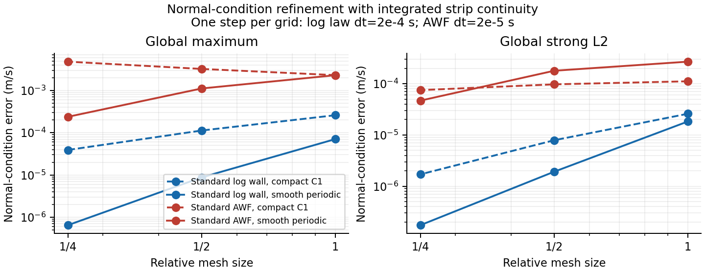
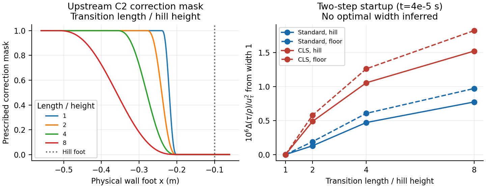

# Terrain wall geometry and upstream AWF transition

## Material Passport

- Origin Skill: academic-research-suite / experiment-agent
- Origin Mode: implementation plan and deterministic validation
- Origin Date: 2026-10-31
- Verification Status: WG1--WG4 VERIFIED within the stated numerical scope and limits
- Version Label: hill_wall_geometry_v1

## Objective and scope

Extend the delivered standard k-epsilon / high-Re CLS URANS implementation
from a flat wall to a two-dimensional terrain graph and its spanwise extrusion.
Provide a prescribed upstream transition from equilibrium-preserving AWF to
original AWF, independently of the existing departure sensors. This is enabling
work for the Cao--Tamura (2006), doi:10.1016/j.jweia.2005.10.001, hill experiment;
it is not yet an experiment-calibrated hill reproduction or a claim that URANS
resolves measured broadband spectra/intermittency.

Baseline: `cba0df5d985ad863d438c48dd2e094769874e1b6`.
Implementation branch: `codex/hill-wall-geometry-transition`.
Keep the existing flat adapter as the default and retain its regression cases.
The compatible log wall remains a standard-k-epsilon policy; both AWF policies
support both closures. General non-extruded three-dimensional terrain, low-Re
CLS and a resolved cube array are outside this extension.

## Execution environment

Source changes and Git work use the Mac checkout. Builds and solver/numerical
validation use an isolated checkout/build under
`/media/jay/新加卷/nektar-v2026-runs/hill-wall-geometry-transition` on Linux.
The primary Linux checkout is on `codex/hit-inflow-generator` at
`6307bcec190adf0af0416096ca2b261f34fd90d3`; preserve it and the shared install.
Connect with `ssh jay@100.105.247.110` while `linux-usb` is unavailable.
Never exceed this project's **16 total workers**. Set OMP/BLAS threads to one,
bound compiler/test/MPI concurrency explicitly, and record commands, source
hashes, binary hashes, timeouts, exit status and failed development attempts.

## Geometric and numerical contract

Use the physical terrain curve r(s), unit tangent t and inward unit normal n.
With signed curvature c defined by dt/ds=c n, normal coordinates have metric
J(eta)=1-c eta. The wall strip has physical normal heights 0<P<H<N,
volume per unit physical-wall area V=H-c H^2/2 and interface area J(H).
Sample N along the physical normal, not the global vertical. Compute geometric
closest-wall distance for CLS separately from aerodynamic roughness/displacement.
Reject folded/ambiguous offset geometry and strips outside a stated thin-layer
curvature range. Support a plane and the paper's compact cosine-squared hill.

The original AWF remains a locally parallel auxiliary model. Extend its strip
inventory, source integration and interface exchange with the actual metric;
keep the curvature contribution of the auxiliary normal shear. Tangential
diffusion/normal-stress gradients inside the unresolved layer remain modelling
approximations and must be documented, not described as an exact integration of
the full curved RANS equations. The equilibrium correction is intended for the
flat approach region; the spatial gate must be zero over the hill and wake.

Terrain velocity boundaries require a vector tangential condition and a normal
constraint. Use an augmented boundary multiplier with the assembled continuous
free velocity trace space for the normal constraint, converged with the coupled implicit stage; the
augmentation is a preconditioning parameter, not a permitted finite-penetration
wall law. Retain Cartesian velocity unknowns and verify normal constraint,
boundary traction and refinement independently. The terrain path initially
requires the current-coefficient matrix-free linear backend.

For a spatial ramp with endpoints xa<xb, define r=clip((x-xa)/(xb-xa),0,1)
and w=1-10r^3+15r^4-6r^5. Fixed mode uses chi=w*chi_fixed; switched mode uses
chi=w*chi_flow. The same effective chi selects mean dissipation and both P/H
epsilon values. Traction and production retain their original-AWF definitions.
Zero w must bypass corrected-reference admissibility checks and exactly select
original AWF. Ramp coordinates refer to the physical wall foot. Optional
stationary wall-property expressions provide spatial roughness and log-wall z0.
All new physics/configuration must enter restart compatibility checks.
Use the terrain adapter (`Plane`, including horizontal ground, or `CosineHill`)
for spatial ramps/properties. The legacy `Flat` adapter retains constant-wall
regression cases and rejects the new spatial configuration.

## Milestones and acceptance gates

| Milestone | Deliverable | Required evidence | Status |
|---|---|---|---|
| WG1 | Geometry, metric/source integration and spatial-ramp primitives | Linux kernel tests: closest points/normals, rotations, curvature/Jacobian, invalid geometry, endpoint/derivative limits and independent quadrature; existing kernel tests pass | CLOSED |
| WG2 | Terrain solver adapter, CLS distance and compatible standard log wall | Actual Linux solves: flat reduction, inclined-plane covariance, curved-wall refinement/normal constraint, source/interface budgets and both closure/wall families; positivity and coupled residual checks | CLOSED |
| WG3 | Spatial transition/property integration and reproducible workflows | Prescribed-mask receipts; inactive-correction/original recovery; spatially varying properties; 1/2/4-rank agreement including remote samples; history restart and mismatch rejection; empty-floor transition controls | CLOSED |
| WG4 | Hill-enabling pilot, regression and delivery | Paper-shaped terrain pilot for standard log wall and original/corrected AWF with both closures; four upstream ramp lengths with paired flat controls; relevant legacy regression; documented errors, limits and reproducible commands | CLOSED |

Commit and push after each completed milestone. A gate is closed only when its
evidence exists; failed attempts and any scientific limitations stay visible.
Initial tolerances: kernel relative errors <=5e-10; converged stage and projected
normal constraint <=1e-7 in the verification cases; serial/MPI/restart field
differences <=1e-6 relative to max(1, field magnitude). Smooth curved-wall
pointwise normal error must decrease under refinement; weak enforcement alone
is not evidence of pointwise satisfaction. For the compact C1 hill, require
decreasing global strong L2 normal error and record its global maximum and both
one-sided foot targets, as justified below. Record measured orders rather than
assume them. Pilot runs are numerical functionality checks, not accuracy acceptance
against experimental data. Threshold changes require an evidence-based reason
in this record.

## Transition-size study design

Use x=0 at the hill crest, H_h=0.04 m and upstream foot x=-0.10 m. Keep the
downstream ramp endpoint xb fixed strictly upstream of that foot; vary width
Delta/H_h in {1,2,4,8} without moving xb. Use a C2 ramp and sample it densely
enough to distinguish a physical-width change from mesh resolution. For every
width run a corresponding empty-floor control. Record incident U/k/epsilon,
skin friction, effective chi and fallback reasons at the hill foot, in addition
to hill/wake profiles and separation indicators. A separate placement test and
wall-strip-height / mesh / timestep studies are required for a later calibrated
experiment campaign.

## Monitoring and outputs

Each command has a hard timeout and retained stdout/stderr/exit receipt. Inspect
progress while processes are alive; retain a failed attempt before fixing its
cause and rerunning a distinct case. Store all generated fields, meshes, history
and detailed logs on the Linux large volume. Keep only small reproducible case
generators, regression fixtures and compact evidence in Git. Final delivery
includes public preparation commands, configuration/restart documentation and a
report separating numerical verification from experimental validation.

## WG1 closure (2026-10-31)

Implemented physical plane/compact-hill geometry, whole-hill closest-point
search, signed wall distance, orthonormal frames, normal-ray/curvature guards,
exact metric volume/interface measures, metric-weighted AWF source integration
and a bounded C2 spatial mask. Zero mask recovers all original wall outputs,
including when corrected-reference high-Re checks would otherwise reject.

Linux: three CTests pass, including the two existing kernel/strip tests.
The geometry probe performs 3,759 checks and five invalid-input rejections.
Independent SciPy quadrature checks 54 smooth/rough, standard/CLS,
negative/zero/positive-curvature and partially/fully corrected combinations;
maximum relative source/shear integration error is 5.76e-16.
Compact receipt: `hill-wall-geometry-evidence/wg1.json`.

Tested source is plan commit `0fb850f` plus the WG1 changes. Geometry .cpp SHA256:
`c081dd17008e475394ab9bd010f6b94b26c513b523e211f739861706095de67c`;
probe .cpp SHA256:
`9576db509a3f16e264cf89309d7f1f11fa5e3c7fa0bc8bc4529f0bf756414dbd`.
Full evidence is in the Linux run root's `wg1` directory. Configure/build/test:

```bash
source /home/jay/.local/opt/nektar-v2026-mpi/env.sh
export OMP_NUM_THREADS=1 OPENBLAS_NUM_THREADS=1 MKL_NUM_THREADS=1 BLIS_NUM_THREADS=1
RANS_RUN=/media/jay/新加卷/nektar-v2026-runs/hill-wall-geometry-transition
export TMPDIR="$RANS_RUN/tmp"
cmake -S "$RANS_RUN/source/solvers/IncNavierStokesSolver/Tests/RANS" \
  -B "$RANS_RUN/build" -DCMAKE_BUILD_TYPE=Release -DRANS_BUILD_SOLVER=OFF \
  -DNektar++_DIR=/home/jay/.local/opt/nektar-v2026-mpi/lib64/nektar++/cmake
cmake --build "$RANS_RUN/build" --parallel 8
ctest --test-dir "$RANS_RUN/build" --output-on-failure -j 1
python3 "$RANS_RUN/source/solvers/IncNavierStokesSolver/Tests/RANS/validate_wall_geometry.py" \
  --probe "$RANS_RUN/build/RANSWallGeometryProbe" --output "$RANS_RUN/wg1/quadrature"
```

Retained development attempts: two CMake discovery failures before using the
documented package directory, and one C++ mixed-auto-declaration compile error,
corrected before the successful run. These supplied no numerical results.

## WG2 development and verification decisions

The terrain adapter now uses physical normal rays, metric strip measures and
weighted sources, a Cartesian vector Robin operator, and an assembled continuous
velocity-trace multiplier. Its conservative constraint and adjoint use the
orthogonal trace projection as defined below, including constant-test
conservation at prescribed-velocity corners. Measure the unprojected normal
error and the actual integrated normal/mass defect independently. The original
auxiliary AWF remains locally parallel, as specified above.

Several failed development attempts are retained under the Linux run root's
`wg2` directory:

- Separately lagging Cartesian Robin cross terms failed rotated AWF cases.
  A simultaneous SPD velocity-block solve fixes this coordinate dependence.
- A pressure-order normal trace left high velocity-normal modes uncontrolled.
  Two-mesh normal errors did not decrease, and a 3D inclined case lost positivity.
  A facewise full-order trace instead imposed conflicting endpoint constraints.
  The assembled continuous free velocity trace removes both problems.
- Native curved-element inverse coordinates needed Newton polishing for exact
  physical N samples. XML partitioning also rounded curved edges/faces to eight
  decimal digits, changing MPI normals by up to 3.5e-6. Curved geometry now uses
  the same full-precision serialization as vertices. An isolated source
  SpatialDomains library verifies the fix without changing the shared install.
- The new surface-integral diagnostic initially reduced an already collective
  ExpList integral again. Local element integration followed by one collective
  fixes the MPI volume accounting, including ranks without a wall.
- A zero initial normal reaction perturbed the CLS normal stress and could send
  the nonlinear iteration to a different branch. Initialize the reaction with
  minus the current resolved normal stress. This is an iteration warm start,
  not a reset to an analytical profile.
- Derivative-based transpiration made the coupled iteration difficult.
  Multisecant acceleration and a surface filter did not resolve its refinement
  failure. Neither experimental iteration option is delivered. The retained
  terrain stage uses a positivity-constrained Newton--Krylov iteration with
  native GMRES. A fixed active CLS invariant branch defines each generalized
  Jacobian; physical residuals retain max(strain,rotation). Kernel checks verify
  active-branch agreement and directional-derivative additivity. Redundant
  pressure/reaction values are projected to their native CG spaces to avoid
  spurious off-space null modes.
- Cache a Cholesky factor of the exact trace mass for up to 1,024 trace modes;
  retain the iterative projection for larger systems or `RANSNormalDirectLimit=0`.
  Runtime idempotence/self-adjoint projection audits verify the same operator.

Three refinement levels are required. Earlier development fixtures refined
the streamwise mesh and H--N layers but kept the outer pressure mesh fixed;
these are not a whole-domain h-convergence test. They exhibited nonmonotonic
strong flux/normal errors and are retained as failed development evidence.
The accepted study must refine every resolved normal layer as well as every
streamwise column. Keep the C1 hill-foot curvature jumps and global maxima
visible, together with global L2/regular-region errors; do not replace a failed
maximum by a weak norm.

The original-CLS plane test at dt=0.002 s met the 1e-6 primary-field comparison
but its derivative-sensitive outputs differed by up to 1.39e-5. Tightening the
nonlinear target to 1e-10, with linear targets 1e-14 and 1e-15, did not converge
in 4,000 iterations (last weak divergence about 7.8e-9). Resolve its rapid
unbalanced original-AWF dissipation transient using the hill pilot timestep
dt=0.0002 s: the observed complete-field rotation difference is then at most
2.34e-9. **The 1e-6 complete-field gate is retained.** Other plane tests retain
dt=0.002 s. The two-step tests exercise IMEX2 startup and continuation.

Curved verification targets nonlinear/pressure iteration at 1e-8 and independently
requires assembled free-row residuals, weak divergence, projected normal error
and physical mass defects below 1e-7. This uses the originally declared gates;
the earlier 1e-9 iteration target was unnecessarily tighter and caused prolonged
stagnation. All failed/overly tight attempts remain available. The final accepted
case receipts and measured refinement orders will be recorded at WG2 closure.

The volume-gradient reconstruction of curved strip continuity failed an early
maximum-normal refinement gate (finest error 0.0320 m/s). An impermeable variant
was investigated but is **not the requested model and is not delivered**.
Integrated strip continuity remains required. Differentiate the pulled-back
scalar strip flux in the native surface space, rather than applying a continuous
chain rule to separately interpolated volume gradients and rotating frames.
For streamwise/normal/span coordinates, retain
J(H) W_H + H d_s(U_P) + V(H) d_span(U_span,P) = 0,
and the corresponding expression at P. Constant scalar flux has exactly zero
surface derivative even on a curved mesh; face contributions telescope under
integration. The physical/weak normal errors and strip side/interface flux
budget remain independent acceptance gates.

A compatible synthetic initial streamfunction is G(normal distance) through N,
blended to the roof-compatible G(e) by 2N. Thus its H/N tangential log traces
are initially independent of wall foot; zero initial transpiration follows
from continuity, without constraining subsequent normal velocity. Numerical
verification is rerun with this initial condition and conservative reconstruction.

Prescribed inlet/wall corners require a conservative dual trace. Let P denote
the orthogonal L2 projector onto the native free scalar velocity trace V_f,
u=P1, a=1-u and c=(1,u)=(u,u)>0. Define

```
C f = P f + u (a,f)/c,          C* v = v + a (u,v)/c, v in V_f.
```

C is an idempotent map into V_f and preserves the integral of every f; its
adjoint lifts the test space to include the constant. Enforce
C(U_normal-W_H)=0. Use C*lambda for the normal reaction and beta C*C for
augmentation, with the same beta C*C W_H on the right-hand side. This retains
an SPD velocity block and makes augmentation vanish at the converged constraint.
In particular, integrated interface normal flux balances the strip side flux
also at prescribed-velocity corners. Runtime audits check P's orthogonality,
C's idempotence/integral preservation, the adjoint identity and symmetry of
C*C. Independent GLL/endpoint quadrature checks the H/P reconstruction and
actual interface-plus-side-flux defect from saved accepted wall data.

The periodic Newton state also needs an explicit zero-mean pressure gauge;
projection into P-2 alone leaves its constant null mode. Outflow cases retain
the pressure level determined by total traction. Difference probes are bounded
in physical field scales, not solely by a volume L2 norm that can hide a large
fine-grid vertex perturbation. Full native GMRES storage is bounded by
RANSNewtonKrylovDimension (default 240, allowed 20--512); difference-step and
Krylov-dimension controls enter restart compatibility. Failed pre-gauge and
pre-conservative-corner solves, including 3D CLS line-search failures, are
retained in the Linux development directories. They are not accepted results.

The original unconditional maximum-normal refinement gate needs a regularity
qualification. At a compact C1 hill foot, the two one-sided differentiated strip
fluxes give different targets, while the resolved CG velocity has one continuous
trace. If the target jump is delta, every continuous trace has maximum error at
least |delta|/2 there. The saved corner audit reports both targets, this lower
bound, the actual trace jump and the measured maximum at every refinement;
the failed global maximum is retained, not called a convergence pass. Add a
smooth periodic cosine hill, with matching one-sided curvature across the
periodic seam, to require decreasing global maximum **and** strong L2 normal
errors. Preliminary AWF maximum errors on this smooth problem decrease
2.29e-3, 1.11e-3, 2.38e-4 m/s, whereas the compact-foot maximum grows. The C1
case must still pass decreasing global strong L2 normal and interface-flux
errors, coupled/free-row tolerances and independent physical flux budgets.
This is an explicit geometry-regularity qualification, not a relaxed nonlinear
or conservation tolerance. Maximum-norm convergence at the compact feet is a
recorded limitation of this continuous-trace discretization.

The AWF startup verification uses dt=2e-5 s after the dt=2e-4 CLS case failed
to converge; all three AWF meshes use the same timestep. The compatible log
wall retains dt=2e-4 s, resolving its rapid wall-flux transient more effectively.
Different wall policies are not compared as an equal-time convergence pair.
The source guard for terrain-wall presence is global: partitions with no wall
faces are valid participants in pressure, trace projection and N sampling.

## WG2 closure (2026-10-31)

Closed with integrated AWF strip continuity retained. All 47 Linux cases pass:
21 flat/rotated/legacy/full-3D cases, 13 compact C1-hill cases and 13 smooth
periodic curved-wall cases. All ten CTests pass. The 32-file tested source
manifest matches the Mac checkout; source baseline is `cfb870a` plus those
manifest changes. Compact evidence: `hill-wall-geometry-evidence/wg2.json`.

Maximum weak divergence is 6.53e-9, conservative normal constraint 7.46e-9,
assembled free-row residual 2.68e-9, interface normal-integral defect 1.02e-11
and resolved mass defect 2.19e-10. Complete-field rotation/flat-reduction
agreement is at most 2.71e-7; augmentation, trace-backend and CLS difference-step
comparisons are below 7.0e-9. Independent GLL/strip-side quadrature verifies
nonzero AWF transpiration and actual interface-plus-side-flux conservation.

| Normal-condition error (m/s) | h | h/2 | h/4 | Last measured order |
|---|---:|---:|---:|---:|
| Smooth periodic standard AWF, global maximum | 2.295e-3 | 1.114e-3 | 2.375e-4 | 2.23 |
| Compact standard log wall, global maximum | 2.594e-4 | 1.126e-4 | 3.903e-5 | 1.53 |
| Compact standard AWF, global strong L2 | 1.116e-4 | 9.739e-5 | 7.503e-5 | 0.38 |
| Compact standard AWF, global maximum (limitation) | 2.303e-3 | 3.232e-3 | 4.804e-3 | -0.57 |

The C1 AWF maximum is **not converged**. Corner receipts show the one-sided
target jump and its half-jump lower bound for every continuous velocity trace.
The regularity-qualified gates and their rationale above are part of this
closure. Both tangential and k strong flux errors decrease on both geometries.
This establishes the stated numerical adapter contracts, not a mesh/time-
converged prediction of the experiment.

The final commands use `validate_terrain.py --build BUILD --suite SUITE
--output RUN --jobs JOBS`: `planes` at `wg2/wallless-planes` (one case at a
time), `curved` at `wg2/final-c1` (two), and `periodic-curved` at
`wg2/final-smooth` (one). The evidence records every exact command, CPU lease,
MPI rank/thread setting and binary/fixture hash. Four compiler workers and at
most sixteen total project workers were used; all OMP/BLAS threads were one.
The isolated geometry library was selected through `LD_LIBRARY_PATH`.
The last smooth cases were moved off CPU64, an SMT sibling used by the separate
HIT study; unfinished logs are retained in `wg2/final-smooth-reallocated` and
accepted earlier cases retain their actual allocations. The primary Linux
checkout and shared installation were left untouched.

## WG3 verification decisions

Spatial features use the conservative terrain adapter, including `Plane` for
horizontal ground. An attempted roughness step on the legacy `Flat` adapter
stagnated after 4,000 iterations at weak divergence 7.72e-5 (standard) and
7.49e-5 (CLS), despite vanishing pressure correction. Its reconstructed normal
Dirichlet data lack the conservative dual-trace coupling needed for this case.
Do not accept this result or relax the divergence gate. Such new spatial
configurations now fail early with an explicit instruction to select `Plane`
or `CosineHill`; existing constant-wall legacy cases retain their original path.
The supported terrain roughness-step cases pass. Failed logs/source are kept
under `wg3/final` and `wg3/pre-scope-guard-source.zip`.

The full-3D initial writer exposed an undefined native HexExp
`FwdTransBndConstrained` method. Its replacement uses local reference-quad
face traces and the reference tensor interior mass block, with consistent increasing tensor-edge ordering and a check that span-independent
input stays span independent. Initialization remains a synthetic
streamfunction, with no reset during physical time advancement. The first
failed 3D preparation is retained under `wg4/pilot`; final receipts also record
preparation failures explicitly. New verification runs use fresh directories.

The 3D preparation diagnostic also caught reversed upper/left-edge ordering in
the native reference-quad constrained transform: an H vertex of 3.0055 m/s was
overwritten by its N value of 3.4861 m/s. The preparation utility uses explicit
increasing tensor-edge order, checks shared face/edge coefficients and retains
the 2D native path. It checks raw and projected span invariance at the existing
5e-10 relative numerical tolerance, reporting both. Curved-coordinate roundoff
of 3.52e-13 m gives absolute epsilon differences around 3e-10; an initially
chosen dimensionful 1e-10 span threshold was inappropriate across quantities
with different units. No physical solve or conservation gate was relaxed.

A supplementary 1e-12 complete-field zero-mask check was stricter than the
preregistered 1e-6 field gate and the 1e-8 nonlinear solve target. Standard-model
pressure differed by 1.75e-9 normalized (all other fields <=1.20e-10); CLS was
bitwise equal. The accepted comparison uses the declared 1e-6 field gate, with
separate 5e-10 algebraic mask/dissipation oracles at the actual accepted state.
The legacy regression retains its stricter 1e-7 absolute field gate: a pressure
only 1.187e-7 difference prompted tightening both recovery solves to 1e-9
pressure tolerance, with the failed fields/logs retained for review.

## WG3 closure (2026-11-01)

All 46 cases and 52 comparisons pass: 29 positive cases and 17 deliberate
configuration/history rejections. The source manifest in
`hill-wall-geometry-evidence/wg3.json` matches the Mac checkout. Linux source
baseline is `c4e6785` plus the recorded WG3 changes. The final run is
`wg3/final-v2`, with all OMP/BLAS threads one and four-rank cases on CPUs 5--8;
combined project validation stayed below sixteen workers.

Independent mask, requested/effective blend and metric dissipation/P/H oracles
meet 5e-10. Zero spatial mask bypasses a deliberately invalid high-Re threshold
and recovers original AWF: the standard complete-field difference is 1.75e-9
normalized and CLS is bitwise equal. Smooth properties and both one-sided
roughness values at the C1 foot are verified. New spatial configurations on
the legacy flat adapter are explicitly rejected as described above.

Both models agree across 1/2/4 ranks to at most 9.12e-11 normalized. Each
four-rank column has one wall-owning rank and eight N queries owned by a rank
with no wall faces; independent saved-field interpolation differs by at most
8.0e-16. Full-3D nonzero spanwise strip-flux divergence is independently
verified (maxima 0.02020 and 0.02083 1/s). Integrated strip continuity, including
its span contribution and actual side/interface flux budget, remains enforced.

Serial-prefix/four-rank full-history continuations agree with uninterrupted
runs to 1.18e-10 (standard) and 5.87e-11 (CLS). Changed mask, referenced roughness
parameter, normal augmentation and element coordinates are rejected for both.
The early metadata guard says `model/configuration mismatch`, while the payload
guard additionally names order; the checker accepts the common configuration
phrase and still requires a nonzero exit. The earlier diagnostic-text-only
failure is retained under `wg3/rejection-message-attempt`.

The full-3D initial utility now produces conforming polynomial traces without
the undefined HexExp method or reversed reference-quad edge values. Independent
initial-field formula errors are below 2.4e-15, geometric reconstruction error
below 3.52e-13 m, and scaled projected span variation below 6.46e-11. The 2D
projection is unchanged. All ten final-solver smoke/kernel CTests pass; WG4
retains the broader legacy recovery/precision regression as a separate gate.

## WG4 verification decisions

Keep the legacy original/zero-weight comparison at its existing 1e-7 absolute
complete-field gate. The initial pair differed only in pressure (1.187e-7);
velocity/turbulence differences were below 2.3e-12. Tightening pressure to
1e-9 hit the old 4,000-iteration limit. A retained debug diagnostic converged
at iteration 4,166, with weak divergence 3.75e-13 and pressure increment
5.92e-10. Both comparison cases therefore use a bounded 6,000-iteration
allowance and the tighter pressure target. No production equation, pressure
comparison gate or physical residual tolerance is weakened. Earlier results
remain in `wg4/legacy-pressure-attempt`, `wg4/legacy-pressure-4000-limit`
and `wg4/legacy-pressure-diagnostic`.

Five additional periodic 2D Plane controls advance five flow-through clocks
with the new terrain adapter, rather than relying only on legacy flat-wall
preservation. Standard/log and fixed/switched corrected AWF with both closures
all pass the declared 0.1% target. At degree 4, twelve normal layers, forty steps
and four single-threaded MPI ranks, the largest final pointwise relative
errors across these controls are U=4.53e-8, k=3.16e-8 and epsilon=6.74e-7;
maximum normal velocity/u_tau is 5.12e-8. All four AWF cases retain chi=1 at
every accepted step. Fixed/switched complete-field differences are at most
2.67e-7 scaled, below the 1e-6 gate. These are periodic stationarity
checks. Earlier inlet/outlet and refinement results remain separate; no claim
of an exact finite-polynomial logarithm or reciprocal-height profile is made.

The public TerrainHill driver and independent initial-field preparation pass
for the paired width-2 CLS hill/empty-floor example. Their receipts are in
`wg4/public-workflow/evidence.json`. Final collection additionally checks the
number of completed physical steps and saved-field times and binds the broader
legacy checks to the same executable hashes. The private Linux checkout is
advanced to the pushed WG3 revision with a mixed reset, preserving its working
files and a pre-update patch. The primary HIT checkout and shared install
remain untouched.

The broader legacy gate passes all twenty cases and six complete-field
comparisons. Fixed/switched, original/zero-weight, switch-off/original and
fallback/original controls are bitwise equal. The largest 2D/3D restart
difference is 1.70e-11 absolute; maximum weak divergence is 7.06e-9. All ten
CTests, independent kernel/quadrature checks and three CLS p-refinement
regressions pass. The latter are explicitly the short M5 regression subset,
not a repeat of its full acceptance campaign.

The four-rank full-hex CLS hill attempt reaches its 1,800-second runtime guard
during the second timestep. Its first step converged in 1,370.93 s, seven
nonlinear iterations and 179 centered-Jacobian GMRES iterations; minimum k and
epsilon remain positive, weak divergence is 2.97e-11 and pressure correction
7.44e-9. Retain this attempt in `wg4/cls-3d-four-rank-timeout`. The final CLS
pilot uses eight single-threaded ranks on CPUs 1--8 and a 7,200-second guard.
The numerical problem, physical convergence criteria and field gates remain
the same. A saved first-step four/eight-rank comparison supplements the earlier
1/2/4-rank tests: all eighteen primary/derived fields at 86,016 physical points
agree to 1.41e-9 scaled, with identical coordinates. Receipt:
`hill-wall-geometry-evidence/wg4-rank-check.json`. This accepts the converged
first step of the retained four-rank attempt, not its incomplete second step.
Other pilot cases use at most four ranks, and the combined
project allocation remains below sixteen workers.

The 2D pilots run concurrently on CPUs 9--12, with the eight-rank CLS case on
1--8 (twelve project MPI workers total). `--suite pilot-2d --publish-to` publishes
only completed per-case data as atomic symlinks into the full campaign. It never
replaces an existing destination, so another runner's active case stays intact.
The original paths stay valid and the full campaign checks fixture/binary hashes
and reapplies independent oracles when consuming these caches. The shard's
outputs remain in `wg4/pilot-2d-shard`, alongside its command/log receipts.

The added switched-weight preservation harness initially selected the wrong
case list and attempted a comparison before generating those cases. This was
a harness failure, with no accepted additional result. Its source and traceback
are retained as `wg4/preservation-missing-case-attempt.py` and
`wg4/preservation-all-weights.log`. The corrected suite passes five cases and
twelve comparisons in `wg4/preservation-all-weights-v2.log`.



The interface-area-normalized strong L2 error decreases for both wall policies.
The smooth-periodic maximum also decreases. The compact C1 AWF maximum grows
under refinement; its one-sided corner-target incompatibility remains an
explicit limitation. Compare refinement within each policy: the log-wall and
AWF data use different timesteps, as labelled, and do not form a cross-policy
accuracy comparison.

All twenty-one 2D hill/empty-floor pilots and thirty-nine independent comparisons
pass. Their maximum weak divergence is 4.32e-9, projected-normal error 4.28e-10
and integrated normal defect 3.51e-13. The independent continuity oracle sees
nonzero transpiration up to 0.006285 m/s. Original/corrected AWF with both
closures, compatible standard log wall and both resolved-molecular variants
remain positive and converge over two physical steps.

The startup width response at t=4e-5 s is measured below (width 8 minus width 1).
All cases keep the same mesh, u_tau=0.3 m/s and downstream ramp endpoint -0.20 m.
The epsilon column is the complete-domain relative maximum difference, with
the width-1 maximum as denominator; the transported CLS variable is eps_tilde.

| Closure | Terrain | Delta(traction/density)/u_tau^2 | Relative maximum epsilon difference |
|---|---|---:|---:|
| Standard | Hill | 7.73e-7 | 0.02421 |
| Standard | Empty floor | 9.72e-7 | 0.02886 |
| CLS | Hill | 1.52e-6 | 0.01492 |
| CLS | Empty floor | 1.82e-6 | 0.01762 |

At width 1 the incident auxiliary traction/density is -0.001815 (standard)
and -0.003042 (CLS) m^2/s^2 on the hill, versus about 0.0899 on the paired
floors. No sampled flat-wake point has negative traction at this early time.
These signed startup auxiliary outputs do not establish stationary separation.
The floor controls show comparable transition-induced changes; these data
cannot select an optimal width or replace developed-flow, mesh/timestep/H and
placement studies. Finite resolved viscosity is exercised as a functionality
option, not as exact preservation of the inviscid analytical reference.



## WG4 closure (2026-11-01)

All remaining wall-geometry/transition milestones are closed. Curved-wall AWF
retains integrated strip continuity, including its spanwise flux contribution.
Only the compatible log-wall policy uses zero interface-normal velocity.

The final Linux acceptance comprises 23 hill/width pilots and 41 independent
comparisons, five five-clock neutral controls and 12 comparisons, 20 legacy
cases and six complete-field comparisons, three short CLS p-refinement
regressions, independent kernel/quadrature checks and all ten CTests. The full
pilot reuses all 21 completed 2D shard cases after checking their fixture and
binary fingerprints, then reapplies every independent oracle. The 3D CLS case
completes both timesteps on eight ranks; the standard 3D case uses four.

Compact receipt: `hill-wall-geometry-evidence/wg4.json`. Its 49 source hashes
match the Mac checkout. All 401,664 saved physical points across the 28 new
pilot/reference cases have finite primary/derived fields and the expected
physical time; minimum saved k is 0.28421869 and epsilon is 0.20428828.
The tested production source is `0e16b8b6a6ccc9c48b2eb224ab97f74fba7c9131`;
WG4 changes its validation/delivery files, with no further production C++ edit.

Across all hill pilots, maximum weak divergence is 4.32e-9, projected-normal
error 4.28e-10, integrated normal defect 3.51e-13, resolved mass defect 1.27e-10
and geometric volume relative error 2.89e-12. Projection audits are below
3.07e-15. These are discrete conservation/convergence checks; the C1-foot
pointwise maximum limitation described above remains explicit.

The eight-rank CLS solve took 3,296.49 seconds. Its seven-iteration stages end
at weak divergence 3.69e-11 and 1.20e-11, with positive turbulence fields and
no positivity guard activation or Newton backtracking. At the requested 1e-14
native inverse tolerance, 452 internal CG applications reached their 5,001
iteration cap; their largest reported relative residual is 3.12e-11. Thus not
every internal native inverse attains 1e-14. The physical convergence gates,
matrix-free true-residual checks and complete-field MPI comparison still pass.
These tight native inverse applications remain a performance limitation;
the elapsed time is not an isolated throughput benchmark while the separate
48-rank HIT study runs on the same server. No physical acceptance gate was
relaxed to accept this case.

Linux used the isolated Release build and full-precision source geometry
library described above, OMP/BLAS threads one, and at most 16 project workers
(the concurrent pilot allocation is eight plus four ranks). The primary Linux
checkout is clean at `f4b70ba` at final inspection and was left to the separate
HIT project; its source and shared installation were not changed by this work.
All heavy fields, histories, meshes and failed attempts remain under the Linux
run root. The compact figures were generated there with Matplotlib and visually
checked on the Mac.

Reproduce the final pilot/reference/regression collection with available CPU
allocations (run the two pilot commands in separate shells for concurrent use):

Complete both pilot runners before starting the preservation/legacy commands
on CPUs 9--12. The public example describes fresh-output generation.

```bash
source /home/jay/.local/opt/nektar-v2026-mpi/env.sh
RANS_RUN=/media/jay/新加卷/nektar-v2026-runs/hill-wall-geometry-transition
RANS_TEST="$RANS_RUN/source/solvers/IncNavierStokesSolver/Tests/RANS"
export OMP_NUM_THREADS=1 OPENBLAS_NUM_THREADS=1 MKL_NUM_THREADS=1 BLIS_NUM_THREADS=1
export TMPDIR="$RANS_RUN/tmp"
export LD_LIBRARY_PATH="$RANS_RUN/build/geometry-lib:${LD_LIBRARY_PATH:-}"
taskset -c 1-8 python3 "$RANS_TEST/validate_terrain.py" --build "$RANS_RUN/build" \
  --output "$RANS_RUN/wg4/pilot-v2" --suite pilot --jobs 1
taskset -c 9-12 python3 "$RANS_TEST/validate_terrain.py" --build "$RANS_RUN/build" \
  --output "$RANS_RUN/wg4/pilot-2d-shard" --suite pilot-2d --jobs 1 \
  --publish-to "$RANS_RUN/wg4/pilot-v2"
taskset -c 9-12 python3 "$RANS_TEST/validate_terrain.py" --build "$RANS_RUN/build" \
  --output "$RANS_RUN/wg4/preservation" --suite preservation --jobs 1
taskset -c 9-12 python3 "$RANS_TEST/validate_standard_awf.py" --build "$RANS_RUN/build" \
  --output "$RANS_RUN/wg4/legacy-v2" --suite checks --jobs 1
taskset -c 13 python3 "$RANS_TEST/record_terrain.py" --build "$RANS_RUN/build" \
  --suite "$RANS_RUN/wg4/pilot-v2/evidence.json" \
  --suite "$RANS_RUN/wg4/preservation/evidence.json" \
  --legacy "$RANS_RUN/wg4/legacy-v2/validation-checks.json" \
  --workflow "$RANS_RUN/wg4/public-workflow/evidence.json" \
  --ctest "$RANS_RUN/wg4/legacy-v2/ctest.log" --output "$RANS_RUN/wg4/final-evidence.json"
taskset -c 13 python3 "$RANS_TEST/plot_terrain.py" \
  --wg2 "$RANS_RUN/source/docs/plans/hill-wall-geometry-evidence/wg2.json" \
  --wg4 "$RANS_RUN/wg4/final-evidence.json" --output "$RANS_RUN/wg4/figures"
```

Existing accepted directories are cached and rechecked. Use fresh output paths
for an independent rerun and retain failed/stale directories. The public
TerrainHill example gives fresh generation/preparation commands. This closes
the enabling implementation and numerical-verification scope, not the calibrated
Cao--Tamura reproduction. Measured inlet/roughness/displacement fitting,
facility boundaries, developed-flow width/placement and mesh/timestep/H studies,
long-time stability and statistical averaging remain experiment work.
