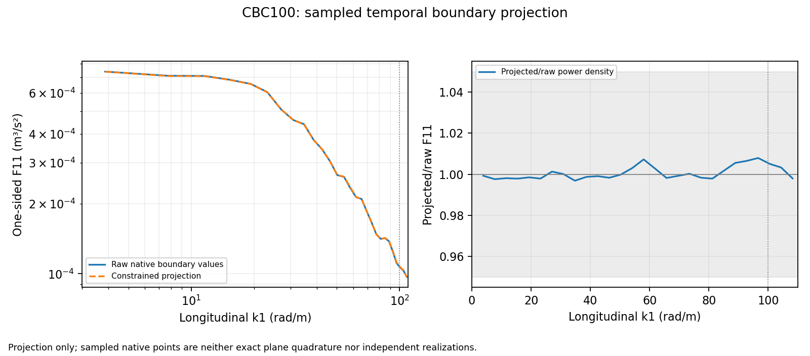

# CBC100 follow-up: implementation and running pilot

Status: **ECONOMICAL STUDY RUNNING**, 2026-10-31. Numerical and experimental
qualification remain open. Work stays on `codex/hit-inflow-generator`.

## Material Passport

| Field | Value |
| --- | --- |
| Workflow | academic-research-suite / experiment-agent, execution and validation |
| Authorized work | Economical CBC inflow pilot targeting longitudinal spectra through100rad/m |
| Helper/source revision | `f4b70baec10016dd098005bc5a5507b87e4a57bf` |
| Native build revision | `1946f8ea1d6e5a8844ce308def5004994a40557b` |
| Linux source | `/media/jay/新加卷/nektar-v2026` |
| New run root | `/media/jay/新加卷/nektar-v2026-runs/hit-inflow/band100/f4b70ba` |
| Allocation | 48MPI ranks, npz16, numerical CPUs16--63, OMP/BLAS/MKL1 |
| Shared server ceiling | 64workers;4 other numerical workers observed at new queue launch |

The native binaries/libraries are reused because the economical iteration
changes only Python helpers, tests and documentation. Linux verified that the
compiled sources and all bound executable/library hashes match the validated
native build. The main Documents checkout belongs to another task and was left
untouched.

## Implemented and verified

The wide-band evaluator now bounds its auxiliary cache and has a separable y/z
path for planes whose dense point-by-bin phase tables would exceed64MiB.
It retains the deterministic mode realization and direct-reference checks.
The native pilot reports the accelerated method and fails on direct fallback.
All-rank readiness is reported separately from the subset of inlet-owning
ranks, with sampled startup/steady CPU-affinity checks and owned-process cleanup.

The controller saves input, executable/library and log hashes, explicit CPU and
thread allocations, atomic progress/receipts, hard timeouts and budget gates.
New temporal analyzers compare the raw/projected boundary signals and matched
downstream records in fixed10--20,20--40,40--70,70--100rad/m bands, with endpoint100
reported separately. Axis-specific mesh spacing and an explicit recipe identity
keep the new cost experiment separate from the original rejected recipe.

Linux validation passed45 Python checks at the helper revision above. The native
boundary/restart/SVV unit groups and the serial, FFTW and eight-rank projection/
flow regressions passed at the native build revision. The earlier native core
checks passed at `109d030`; their evaluator source/test files are unchanged.
Both fresh wide-band preflights passed direct/native evaluation, repeatability,
finite smoke histories and48-rank readiness/affinity checks.

## Measured feasibility

| Quantity | Original recipe | Economical recipe |
| --- | ---: | ---: |
| hx, hy (m) | 0.05,0.05 | 0.1,0.05 |
| Quadrilaterals | 240 | 120 |
| Polynomial degree / Fourier slots | 10 /128 | 10 /128 |
| Timestep (us) | 12.5 | 25 |
| Steps for0.6s | 48000 | 24000 |
| Conservative steady seconds/step | 1.16810 | 0.809616 |
| Forecast wall time per baseline record | 15.604h | 5.425h |
| Sampled peak process-tree RSS | 140.656GiB | 136.347GiB |
| Predeclared12h/180GiB gate | Rejected | Passed |

Each forecast uses the maximum per-step time of the second half of a160-step
mean-initial smoke, plus measured one-off overhead. This does not guarantee
developed-flow cost, peak memory or long-time stability. RSS includes startup;
it does not isolate mesh storage. The original recording was held after its
budget rejection.

A separate boundary-only test used1601 times over0.2--0.6s at256 dispersed native
points. The largest absolute band-power change due to constrained projection
was **0.218922%**, across all three components and four target bands. Longitudinal
F11(100) changed by **+0.548458%**. The much larger full600-band pointwise error
therefore does not indicate a large10--100rad/m temporal spectral error at these
probes. This supports retaining the inlet-plane resolution for the new cost
experiment. It does not establish streamwise CFD convergence.



The native points have arithmetic sample weights; this is neither exact plane
quadrature nor an independent-probe uncertainty estimate. The600/480 input
retains89.8308% of the uncut model F11(100); that input-bandwidth limitation is
separate from the small boundary-projection change.

## Running work and progress

The completed economical preflight is `preflight-01`. The detached queue
(`queue.py`, launch PID304969) has entered `study-01`, selecting `base,dt,x`
sequentially. At the saved handover snapshot, no0.6s recording had completed.
Each case receives a fresh160-step timing smoke before its recording:

- `base`: hx0.1, hy0.05,25us,128slots;
- `dt`: the same mesh with12.5us;
- `x`: hx0.05, hy0.05 with25us.

All use the same1m domain, inlet realization,600/480 radial input, seed,
10m synthetic period, fixed(2548,154,154) counts, prescribed SVV settings and
0.2--0.6s sampling window. Native h/p scaling changes with spatial refinement.
A failed timing/solver gate retains its evidence and stops the remaining study;
failed commands are not retried unchanged.

From the Mac, this read-only command follows the study's current case and native
step progress:

```bash
bash /Users/jay/.codex/worktrees/hit-m6-validation/nektar-v2026/solvers/IncNavierStokesSolver/Tests/HITInflow/check_band100_status.sh \
  /media/jay/新加卷/nektar-v2026-runs/hit-inflow/band100/f4b70ba/study-01
```

The command also works on Linux with the Linux source-script path. During
initialization, progress has no solver step yet. A fresh smoke has160steps;
full baseline/x records have24000steps and the half-dt record48000steps.
Completed cases are analyzed automatically before the next case starts.
The root `queue.json`, `queue.log`, stage `progress.json` and `receipt.json`
remain the live authority. Bound helpers, prepared inputs and native binaries
must remain unchanged during execution.

## Evidence and remaining decision

- [Protocol and gates](hit-inflow-band100-protocol.md)
- [Original feasibility/projection evidence](hit-inflow-band100-original-evidence.json)
- [Passed economical preflight and running-study snapshot](hit-inflow-band100-economical-evidence.json)

The compact files retain Linux paths, checksums, exact commands, allocations,
native diagnostics and receipt identities. Large CSVs, histories and fields
remain outside the source checkout on the Linux disk. The two initial resource-
audit failures and the operator-interrupted contended allocation are preserved
and excluded from numerical conclusions.

After the records finish, review their paired timestep/streamwise sensitivity
and sampling screens before selecting Fourier/bandwidth/SVV controls. No new
full-distance run has been launched. Upstream input-bandwidth accuracy,
downstream numerical/stabilization error, statistical precision, spatial
development and the experimental comparison remain separate open gates. The
earlier M7/M8 conclusions have not been replaced by a physical-validation pass.
