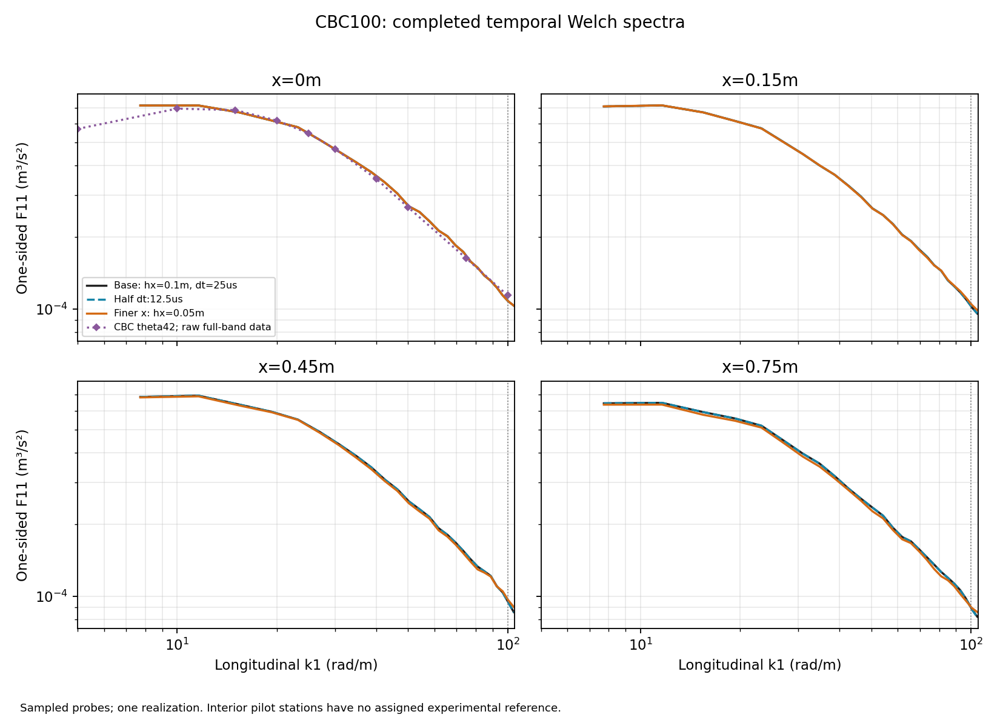
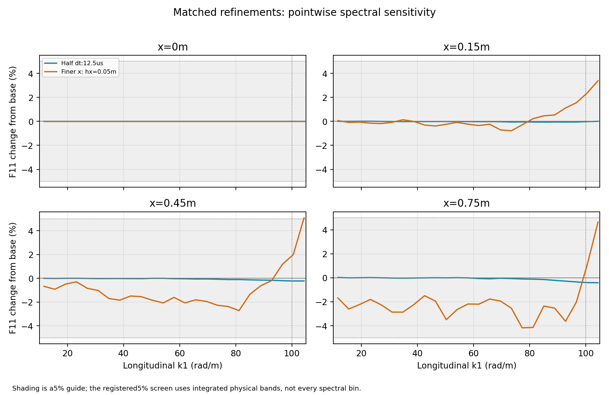
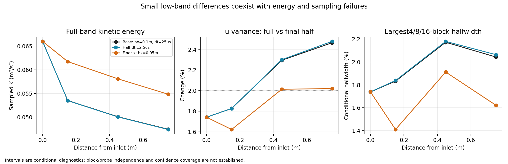

# CBC100 completed-study review and full-distance decision

**Decision: HOLD the full-distance production simulation.** The short pilot
passes its 5% temporal-spectrum sensitivity screens over **10--100 rad/m** for
the two completed refinements. Its full velocity variances/kinetic energy fail
the registered 2% spatial-refinement screen, and downstream sampling precision
is not qualified. Fourier, bandwidth and SVV controls remain open.

## Material Passport

- Origin skill/mode: academic-research-suite / experiment-agent / validate.
- Review date: **2026-11-02, Asia/Shanghai**.
- Verification status: **ANALYZED**; numerical postprocessing reproduced exactly.
  The approximately 25-hour CFD study was not repeated.
- Study source: `f4b70baec10016dd098005bc5a5507b87e4a57bf`.
- Native build: `1946f8ea1d6e5a8844ce308def5004994a40557b`.
- Branch: `codex/hit-inflow-generator`.
- Study: `/media/jay/新加卷/nektar-v2026-runs/hit-inflow/band100/f4b70ba/study-01`.
- Completed review: sibling directory `review-20261102-02`.
- CFD allocation: 48 MPI ranks, npz16, OMP/OpenBLAS/MKL=1; numerical ranks on
  CPUs16--63. Startup/controller CPU0 was included in the audited CPU pool.
- Review allocation: **one CPU,63**, OMP/OpenBLAS/MKL=1. Eleven other numerical
  processes were observed when the review started, below the64-worker ceiling.
- Overall confidence: **CAUTION** for physical/statistical qualification;
  numerical comparisons reproduced exactly.

## Completion, provenance and actual cost

All three cases reached0.6s and completed their analyses. The queue finished on
2026-11-01 at22:15:50 China Standard Time. There were no omitted or failed CFD
cases in this three-case study.

| Case | hx,hy (m) | dt (us) | Final step | Solver wall time | Sampled peak tree RSS |
| --- | --- | ---: | ---: | ---: | ---: |
| base | 0.1,0.05 | 25 | 24000 | 5.504h | 139.08GiB |
| dt | 0.1,0.05 | 12.5 | 48000 | 10.900h | 137.80GiB |
| x | 0.05,0.05 | 25 | 24000 | 8.218h | 132.27GiB |

Degree10,128 Fourier slots,1x0.6x0.6m domain, mean12.7m/s and the CBC600/480rad/m
input are common. The seed, fixed synthesis counts `(2548,154,154)`, periods,
physical probe locations and recording clock match across controls. Inlet
statistics agree to roundoff, so the downstream differences do not arise from
changing the realization.

The review verified the15 command receipts, logs, prepared inputs, manifests,
analysis receipts and native-history/cache hashes. It recomputed each case's
moments and spectra from the immutable cache: **53044 numerical values per case,
159132 total, matched exactly**. Boxcar PSD/variance checks passed. The original
outputs were preserved. Review attempt01 reproduced all values but failed on
NumPy-integer JSON serialization; the corrected export completed in fresh
attempt02. No CFD was rerun for that correction.

## Convergence through100rad/m

The registered comparison uses
`100*abs(refined/base-1)` at every station, with2% screens for full component
variances/K and5% screens for integrated physical spectral bands10--20,20--40,
40--70 and70--100rad/m. Endpoint100 is reported separately. These are numerical
engineering screens, not experimental uncertainty bounds.

| Refinement | Largest variance/K change | Largest F11 band-power change | Largest band-power change, all3components | Largest F11(100) change |
| --- | ---: | ---: | ---: | ---: |
| Halve dt | 0.119% | 0.169% | 0.201% | 0.395% |
| Halve hx | **19.109%** | 2.867% | 4.041% | 2.255% |

The25us timestep is adequate **relative to12.5us on the tested coarse mesh**
for these observables. Streamwise spectral sensitivity also passes the5%
band-power screen. The largest F11 difference at recorded bins in10--100rad/m
is4.171%, near77.3rad/m atx=0.75m. Two spatial levels do not establish an
asymptotic convergence order, and the timestep check was not repeated on the
finer mesh.

At the last station, finer-x F11 band changes are respectively
`-2.149,-2.351,-2.230,-2.867%`; F11(100) changes by`+0.654%`. This establishes
short-domain sensitivity to two numerical controls. Resolving M7's downstream
experimental discrepancy remains an open test, as does qualification below
10rad/m.

## Why the energy-decay gate fails

| x (m) | Base K (m2/s2) | Finer-x K (m2/s2) | Finer-x change |
| --- | ---: | ---: | ---: |
| 0 | 0.066024 | 0.066024 | 0% |
| 0.15 | 0.053531 | 0.061761 | +15.37% |
| 0.45 | 0.050106 | 0.058120 | +15.99% |
| 0.75 | 0.047465 | 0.054867 | +15.60% |

The maximum component-variance difference,19.109%, occurs forw atx=0.45m.
The spectral partition locates essentially all additional finer-mesh variance
above100rad/m. For example, atx=0.75m theu variance increases by0.003717m2/s2,
while its represented boxcar PSD above100 increases by0.004359m2/s2 and the
part below100 decreases by0.000642m2/s2. The piecewise-linear partition's
closure difference from the DFT variance is below0.000024%, negligible here.

Frequencies above the target band contribute to turbulent energy, nonlinear
transfer and decay. Low-band agreement cannot establish the original
full-variance decay objective while these quantities remain sensitive to the
discretization/stabilization choice. The energy gap stays near19% when the
comparison uses the final half or last75% of the record.

The coarser result is also less isotropic: atx=0.75m itsv/u andw/u variance
ratios are0.9306 and0.9199; finer-x gives0.9836 and0.9806. This is a further
resolved-field sensitivity, not a separate experimental-fidelity pass.

### The x control also changes the native SVV operator

The source computes the element's SVV scale using the **maximum edge length**
and maximum polynomial degree. With the prescribed constant speed12.7m/s,
the DG prefactor before the modal filter is

`C_SVV * U * max(hx,hy) / p`.

It is therefore0.127m2/s for base and0.0635m2/s for finer-x. These are filtered
prefactors, **not uniform added viscosities**. Refiningx halves this scale in
both spectral/hp directions, even thoughhy stays0.05m. The physical modal
representation changes as well. The large variance difference is consequently
a combined mesh/SVV sensitivity; it cannot uniquely be assigned to spatial
approximation or to SVV strength from these two cases alone.

The implementation is in
[SVVVarDiffCoeff](../../solvers/IncNavierStokesSolver/EquationSystems/VelocityCorrectionScheme.cpp)
and the
[quadrilateral modal kernel](../../library/StdRegions/StdQuadExp.cpp).
A coarse-mesh half-strength DG-SVV control would match the finer mesh's scalar
prefactor and help distinguish these effects without fitting experimental data.
It would not make the physical modal filters identical.

## Sampling and remaining numerical checks

The primary record has1601 samples over0.2--0.6s at32x32 probes per station.
Welch uses512-sample periodic-Hann windows with256 overlap: five overlapping
segments, with65 tail samples omitted by that estimator. The full-record
moments use all1601 samples. Probe/segment counts are not independent sample
counts.

- The full-to-final-halfu-variance changes atx=0.45/0.75m are2.296/2.467% for
  base,2.302/2.480% for half-dt, and2.014/2.021% for finer-x. Thus all cases fail
  the registered2% sampling screen at those stations. The finer case is close
  to this threshold; the much larger energy-refinement failure is the stronger
  reason to hold production.
- Conditional4/8/16-block interval halfwidths reach2.18% for base/half-dt.
  Nonoverlap does not establish block independence or95% confidence coverage.
- Individual-case Welch band powers change by up to3.79% with window trimming.
  The paired refinements remain within5%: half-dt at most0.207%, finer-x at
  most4.462%. The limited-band agreement is robust to these window choices.
- Nested16x16 versus32x32 probe comparisons change band powers by up to3.34%;
  8x8 versus32x32 changes them by up to10.07%. These are exploratory sampling
  diagnostics from the existing record. A denser64/128-grid record was not run,
  so32x32 cannot be claimed to give exact plane statistics.
- Transverse mesh,128-to192 Fourier resolution, SVV strength, and600-to800
  radial-bandwidth controls remain untested in the completed study.

## Input bandwidth and experimental scope

The already-validated continuum input budget remains a separate model result:

| Cutoff/taper (rad/m) | F11(100) retained versus uncut model | K retained | Molecular dissipation retained |
| --- | ---: | ---: | ---: |
| 600/480 | 89.83% | 86.64% | 21.18% |
| 800/640 | 95.05% | 91.86% | 32.65% |

The missing10.17% at100 for the600 input is relative to its **uncut spectrum
model**, not a measured experimental error. The finite CFD inlet F11(100) is
about4.89% below raw Table2a, while the continuum600 input is4.17% below it.
This isolated upstream agreement does not validate downstream decay. Even800
omits substantial molecular dissipation, so SVV/model qualification remains
necessary; this is not a full-band DNS recipe.

The pilot's furthest station is0.75m. The actual downstream targets after a
theta42 inlet are3.612896m and8.322564m. No experimental reference is assigned
to the pilot's interior stations. Upstream development, span/outlet effects and
the longer decay distance are not established by this study.

## Next bounded work before production

1. Run the coarse-x **half-strength DG-SVV sensitivity control**, using the
   same realization, probes and window, with a fresh timing/stability preflight.
   Use it to assess the change in dissipation, not as an experimentally tuned
   production coefficient. Continue spatial refinement only as needed to
   separate remaining mesh and SVV effects and assess full energy/decay.
2. Complete the192-slot Fourier control, then compare600/480 and800/640 **at
   common192 slots and fixed synthesis counts**. The128-slot solver grid does
   not meet strict Nyquist for800rad/m. Check memory/cost before broadening input.
3. Qualify recording duration, startup and denser plane sampling. Preserve
   paired comparisons and assess independent seeds/blocks before assigning
   precision; do not treat the1024 correlated probes as1024 independent runs.
4. After these gates pass, define and preflight the full-distance recipe. The
   current mean-initial0.6s schedule and10m synthesis box cannot simply be reused
   for9m. For example, the existing nonrepeat-footprint rule for a9m/1.6s run
   requires a synthesis length greater than29.32m, with corresponding updated
   counts. A32m choice would need a new mode/memory/timing assessment within64
   workers, plus adequate initialization/flushing and outlet/span checks.

These are recommendations from the review; no additional CFD or full-distance
simulation was launched. The completed short pilot is closed as a useful
feasibility/refinement study, with physical qualification held.

## Reproduction and evidence

- [Numerical review and bound input hashes](hit-inflow-band100-review.json).
- [Successful review receipt](hit-inflow-band100-review-receipt.json).
- [Continuum input context and source hashes](hit-inflow-band100-input-summary.json).
- [Frozen protocol](hit-inflow-band100-protocol.md).
- [Original feasibility and boundary-projection evidence](hit-inflow-band100-original-evidence.json).
- [Review driver](../../solvers/IncNavierStokesSolver/Tests/HITInflow/pilots/review_band100.py).

The driver, JSON and all six PNG/SVG exports match the archived Linux hashes.
It verifies the complete histories and cache identities, reproduces the original
moments/spectra, and computes window/probe diagnostics without launching a
solver. Re-run it into a fresh external directory with one CPU and explicit
single-thread numerical-library settings. The original Linux checkout remains
at the execution revision to preserve its existing preflight/reference bindings;
the reviewed driver is archived separately in run storage.

## Statistical interpretation audit

Coverage: **11/11** experiment-agent fallacy categories checked. No hypothesis
tests or formal significance claims are made; the numerical thresholds are
engineering screens.

| Category | Review finding |
| --- | --- |
| Simpson's paradox | Stations/components are assessed separately; maxima and signs are retained. |
| Ecological fallacy | Probe averages are not used as independent point/realization evidence. |
| Berkson/selection bias | All predetermined cases and primary windows are included. |
| Collider bias | No observational adjustment model; not applicable. |
| Base-rate neglect | No diagnostic classifier or prevalence inference; not applicable. |
| Regression to the mean | No selection of extreme realizations or pre/post intervention claim. |
| Survivorship bias | All three CFD cases completed; failed review export is disclosed. |
| Look-elsewhere effect | All four bands, all components/stations and endpoint100 are retained. |
| Forking paths | Frozen primary screens are distinguished from exploratory probe diagnostics and the disclosed economical design iteration. |
| Correlation/causation | The x/SVV confounding is explicit; a unique causal attribution is withheld. |
| Reverse causality | Prescribed numerical controls precede the records; no observational directional inference. |
