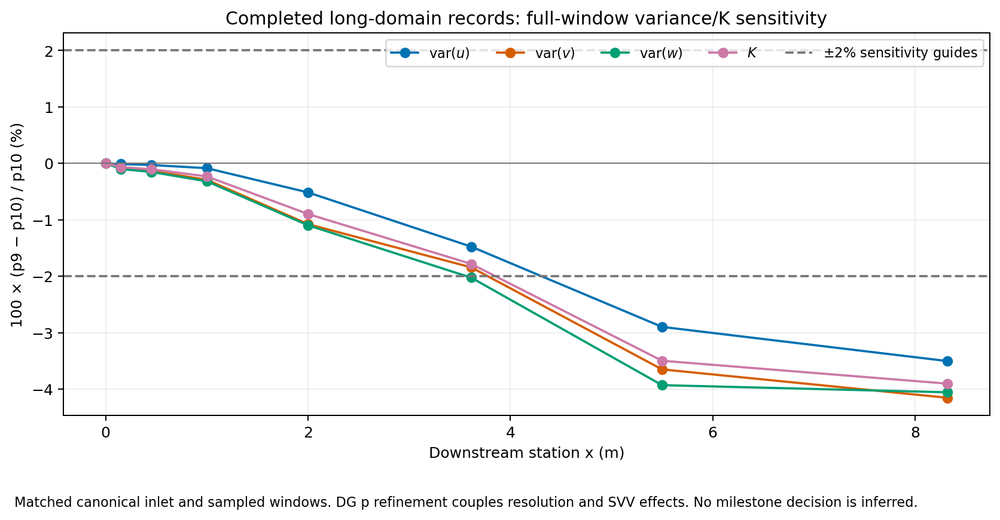
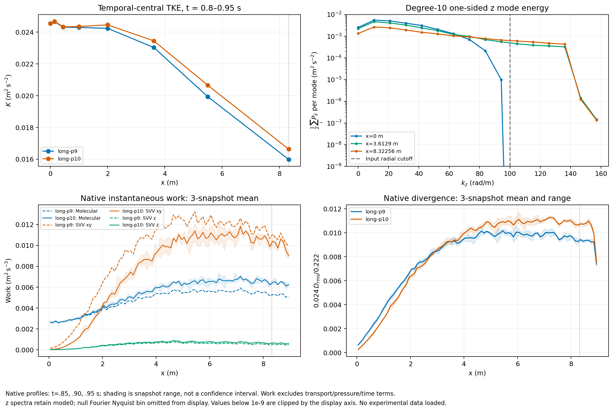

# HIT inflow Milestone 6: resolution, domain and resource study

**Status: CLOSED on 2026-10-29 as a limited-band SVV feasibility study.** Both
full-distance pilots, all 25 short controls, final native diagnostics and the
guarded-source validation are complete. The [production recipe](hit-inflow-milestone-6-production-study.json)
and [machine-readable receipt](hit-inflow-milestone-6-validation.json) are saved.

**The 2% full-distance refinement target was not met:** the largest component
variance change is 4.154%. Spatial adjustment and sampling limitations remain.
The frozen recipe supports a qualified engineering follow-up; it establishes
neither full-DNS accuracy nor full-spectrum CBC fidelity.

This implements Milestone 6 of the [implementation plan](hit-inflow-implementation-plan.md)
under the [predeclared protocol](hit-inflow-milestone-6-protocol.md). No downstream
experimental values have been fitted or scored. Milestone 7 remains separate.
The [follow-up qualification rules](hit-inflow-milestone-6-qualification.md)
predeclare sampling screens and claim limits before Milestone 7 scoring.

## Scope and provenance

| Field | Value |
| --- | --- |
| Origin skill | academic-research-suite, experiment-agent |
| Mode | implementation and numerical verification |
| Branch | `codex/hit-inflow-generator` |
| Physical pilot C++ build | `d74cae8` |
| Final guarded build, 48 unit cases and 22 registered regressions | `29f467b6428ce5efc58d97d4cb481fbda0e432b1` |
| Long and follow-up solver inputs/runners | `812a2c8` |
| Optional spectral analysis | `a3caa84` |
| Authoritative host | `jay-Super-Server`; initial `ssh linux-usb`, resumed through `ssh jay@100.105.247.110` |
| Main run storage | `/media/jay/新加卷/nektar-v2026-runs/hit-inflow/milestone-6` |

The C++ sources are unchanged between `d74cae8` and `812a2c8`. Optional Python
postprocessing was copied into external run storage with its source hash.
After all native jobs finished, Linux was synchronized, configured, rebuilt and
installed at `29f467b`. Its additional C++ change is the sampler range guard;
the normal CBC evaluation arithmetic is unchanged. A native metadata fixture
confirms the exact pilot coefficient digest remains
`10cf3c068556656932363e3c2a892c497a4930a1bd5b24cefb8d03fee9ff9963`.

All M6 work uses at most **64 CPUs**, following the user's stricter limit.
Earlier rebuilds used 32 jobs; the final rebuild used 16 after native jobs
finished, leaving shared-server headroom. OpenMP and OpenBLAS use one thread
per MPI rank. The initial allocation was two long cases of 28 ranks each
(`npz=2`) plus one short case of four ranks (`npz=4`): 60 MPI ranks. After a
matched decomposition timing/field check, the long pair was restarted from
time zero in fresh storage with 24 ranks each and `npz=8`. Together with the
four-rank short queue this uses 52 MPI ranks; the other allowed CPUs remain
available for bounded analysis and controllers. A saved
`live-affinity-change.json` records placement across both sockets after the
initial common CPU set was found to occupy one socket. Each long rank is pinned
to one physical core; the combined allowed set still contains exactly 64 CPUs.
No session, field or solver binary was changed by that placement adjustment.
After both short queues completed, the remaining long pair uses 48 MPI ranks.
The separate fine-recording control used eight ranks, bringing the maximum
simultaneous solver allocation to 60 ranks. A saved process/thread affinity
audit verifies the 64-CPU union, with one OpenMP/OpenBLAS thread per rank.
At 11:28 UTC a separate short build was observed with two compiler processes
while the 24-rank degree-10 case ran. It ended before the follow-up inspection.
The source stayed clean at `812a2c8`; a read-only audit of all 12 mapped Nektar/
bundled-dependency libraries confirmed matching inodes and pre-launch mtimes.
The solver installation was not replaced. Its receipt is
`812a2c8/concurrent-build-library-audit.json`.

## Feasible physical scope

The upstream-only specification uses mean speed 12.7 m/s, molecular viscosity
`1.5e-5 m2/s`, the committed CBC1971 station-42 shell spectrum, log-log
interpolation (`LogLinear`), `K4`/Gaussian extensions, and `Preserve`
normalization. The synthesis periods are `(32,0.6,0.6) m`; the cutoff/taper
pair is `(100,80) rad/m` in the current long pilots.
The experiment's clock uses approach speed `U0=10 m/s`; its downstream
contraction gives measurement speed 12.7 m/s. The theta-42 to theta-98/171 ages
are 0.28448/0.65532 s, giving the selected offsets 3.612896/8.322564 m.

| Quantity | Cutoff 100, taper 80 | Cutoff 200, taper 160 |
| --- | ---: | ---: |
| Retained independent modes | 97,807 | 777,106 |
| Native mode payload per generator | 8,607,016 bytes | 68,385,328 bytes |
| Expected periodic K, m2/s2 | 0.02599846997 | 0.04393868581 |
| Realized periodic K, m2/s2 | 0.02608822850 | 0.04394070614 |
| Expected molecular dissipation, m2/s3 | 0.00265132404 | 0.01198565572 |

These are native finite-lattice generator measurements. With the upstream
reference `K=0.073926 m2/s2` and `epsilon=0.474 m2/s3`, the 100-rad/m choice
retains only about **35.2% of energy and 0.56% of dissipation**; the 200-rad/m
choice retains about 59.4% and 2.53%. The reference totals and finite-lattice
integrals are different quantities; these percentages describe the severe
represented-band limitation, not a measured downstream error bar. No retained
band is silently rescaled to restore the missing energy.

The upstream Kolmogorov length is approximately 0.2905 mm. Even the planning
threshold `k*eta=1` would require roughly 3.97 billion retained modes in this
synthesis box, or about 349 GB of mode payload **per rank**, exceeding the
server's approximately 251 GiB RAM before fields and matrices. Uniform Nyquist
spacing over the 9 by 0.6 by 0.6 m domain gives approximately 4.27 billion points
(`9863*658*658`); the arithmetic is saved in `dns-planning-arithmetic.json`.
These are arithmetic planning estimates, not allocations or measured DNS runs.
They motivate a limited-band study with explicit SVV, rather than a full DNS
claim. SVV stabilizes represented modes; it does not supply the omitted inlet
energy or guarantee the experimental cascade.

Continuum quadrature separates the prescribed input model from the finite
lattice. With the selected policies, the uncut model gives `K=0.0767724` and
`epsilon=0.406073`, respectively 3.85% above and 14.33% below the upstream
reference totals. These were not renormalized. The 100/80-rad/m continuum model
gives `K=0.0260131`, `epsilon=0.00265244`, component rms 0.131689 m/s, Taylor
scale 0.038355 m and longitudinal integral scale 0.050112 m. The uncut model's
integral scale is 0.024248 m. Filtering therefore changes the inlet scales as
well as its energy; full-band experimental totals cannot be used as direct
acceptance targets for this limited configuration.

At the selected 100/80 cutoff, replacing log-log interpolation by linear
interpolation changes continuum K/epsilon by +0.874%/+1.360%; replacing the
low-k K4 extension by zero changes them by -1.984%/-0.167%, and changes the
integral scale by -3.923%. The high extension has no effect below the final
table row at 2000 rad/m. In the uncut model, removing that Gaussian extension
changes epsilon by -12.823% but K by only -0.404%. These are input-policy
sensitivities, not experimental uncertainty estimates. Segmented quadrature
errors and cutoff/taper loss closure are retained in `spectrum-budget.json`.
The quoted length scales describe the continuum input, not a periodic seeded
correlation integral with a nonzero kx=0 asymptote.

## Implementation and verification

The inlet evaluator now groups modes by transverse wavenumber, retains distinct
streamwise temporal phases, and caches spatial phases within a 64 MiB payload
limit. Evaluation uses absolute time and preserves coefficients, random-number
identity, conjugate pairing and restart metadata. Unsupported/cache-limited
cases retain the direct-sum fallback. The native constrained boundary projection
is unchanged.

On Linux, a 512-point timing check measured 1.143 ms for the grouped plane and
6.425 ms per point for the original full reference evaluation. Extrapolating the
sparse direct check to 512 points gives approximately 2,880 times the grouped
cost. This is a plane-sampling comparison, not a solver speedup. Maximum velocity
differences were below `5.1e-13 m/s` and variance differences below `1.7e-15 m2/s2`.

The full-Fourier SVV kernel now assigns the same damping to each cosine/sine
pair, using its physical wavenumber rather than its packed slot ID. An analytical
phase-pair diffusion regression checks this behavior. Reduced Fourier bases keep
their existing convention. The native DG kernel and Fourier work diagnostics
are checked against the assembled stiffness quadratic form and Parseval's
relation. Native initialization also now correctly unpacks assembled global
coefficients before imposing local Dirichlet values.

All **48 unit cases** pass in four suites (30 core, 7 boundary, 9 restart and
2 SVV-work cases), and all **22 selected solver
regressions** pass, including eight legacy controls. The regression batch uses
CTest with eight worker slots and exact registered Tester commands in external
working directories. Two initial failures exposed checking issues: the first
absolute-norm fixture used a parameter override that left the parsed mean
expression unchanged; the constant-mean MPI pressure error was `8.34e-12`, above
the old signed-maximum bound. An explicit second-mean XML fixture fixes the
former; the latter now has a `2e-11` pressure bound, while velocity bounds remain
`5e-12`. Helpers now compute maximum absolute errors over the full communicator.
Earlier signed-maximum initialization diagnostics are excluded from Linf claims.

Final source review added a conservative cached-sampler range guard at
`6522fc9`, preserving the reference evaluator's exception behavior when unused
derivative products overflow. The CBC grouped evaluation arithmetic is
unchanged. Its additional unit case passes in the final Linux build. A repeat
512-point benchmark measures 1.147 ms per grouped plane and 6.616 ms per direct
reference point, with maximum velocity/variance errors of `5.17e-13 m/s` and
`4.48e-15 m2/s2`. The disjoint second stream also passes direct/grouped checks.
These timings remain sampler measurements, rather than solver speedups.

The explicit NumPy spectral backend agrees with the standard-library reference
on a native history and independent even/odd transform fixtures. Scalar means,
variances, blocks and windows are identical. Transform/correlation differences
are below `1.1e-15` in absolute value; maximum native Parseval residual is
`4.5e-16`. Both paths retain each probe's own temporal mean and preserve the
zero-transverse-wavenumber contribution.

## Completed short-domain sensitivities

The baseline has length/span 0.6 m, maximum element side 0.1 m, polynomial
degree 7, 32 full Fourier slots, `dt=1e-4 s`, and a 0.1--0.2 s record. It uses
the same 100-rad/m synthesis and seed for discretization controls. The following
are maximum changes in any component variance or K over x=0, 0.15 and 0.45 m.
Each isolated control is compared with its own baseline; comparing every row
with the finest mesh would confound the changed parameter with spatial error.

| Isolated change | Maximum relative change |
| --- | ---: |
| Degree 7 to degree 9 | 2.0267% |
| Degree-9 result versus h=0.05 m, degree-7 result | 0.1695% |
| Baseline timestep halved | 0.5269% |
| Fourier slots doubled | 0.00170% |
| Domain length increased to 0.9 / 1.2 m | 0.00296% / 0.00313% |
| Mean-only instead of Gaussian-consistent initialization | 0.0000177% |
| SVV coefficients halved / doubled | 0.2515% / 0.2537% |

The fine short chain is also complete. At degree 9, `dt=1e-4` versus
`2.5e-5 s` changes a component variance/K by at most 0.5993%; `5e-5` versus
`2.5e-5 s` changes it by at most 0.06830%. At the common `2.5e-5 s`, degrees
9 and 10 agree within 0.1499%. Increasing the degree-9 probe grid from
32 by 32 to 64 by 64 changes results by at most 0.01483%. These controls cover
x through 0.45 m, not the final comparison stations. All 21 completed short
cases have verified manifest/prepared-XML and receipt/executed-XML hash chains.

Four additional matched controls at degree 10 are complete, with identical
0.1--0.2 s windows and 0.5 ms sampling:

| Candidate control versus degree 10, dt=25 microseconds | Maximum variance/K change | z-spectrum L1 | z-derivative moment |
| --- | ---: | ---: | ---: |
| dt=12.5 microseconds | 0.009041% | 0.009094% | 0.005954% |
| 64 Fourier slots | 0.001868% | 0.019351% | 0.116981% |
| Half SVV strength | 0.022341% | 0.023112% | 0.030306% |
| Double SVV strength | 0.025371% | 0.025800% | 0.033323% |

The complete comparison now contains 25 short controls, each with its prepared
and executed input hash chains verified. These additional tests use two
concurrent four-rank jobs on eight spare CPUs, bringing the simultaneous solver
allocation to 56 ranks while the long pair runs. No native iteration-limit
warnings occurred. Their bounds remain near-field results through x=0.45 m;
they do not quantify far-field timestep, Fourier or SVV-strength sensitivity.
The spectral comparisons use the same completed histories and record window;
the largest Parseval residual is `8.7e-16`. The z-derivative moment remains a
directional measure, not total molecular dissipation.


The degree-7 baseline fails the provisional 2% spatial target: its w variance
at x=0.45 m is 2.1245% below the h-refined reference. Degree 9 is a better
candidate. Refining h/p or Fourier resolution also changes the SVV operator;
these are coupled numerical/model sensitivities.

Inlet projection was measured separately with native quadrature points at five
absolute-time calls, including repeated/reversed calls. The raw direct/grouped
agreement is below `6.7e-13 m/s`, with identical repeated coefficients and
nonzero Fourier content in all velocities. Maximum projected errors are:

| Representation | Maximum over velocity components, m/s |
| --- | ---: |
| Baseline degree 7 | 0.0010390 |
| Degree 9 | 0.00005707 |
| Degree 10, long-case inlet | 0.00001105 |
| h=0.05 m, degree 7 | 0.000006562 |

The degree-10 check uses 11,520 quadrature samples over five absolute-time calls
in the long-case declared interval, two MPI ranks with `npz=2`, and CPUs 6--7.
Its maximum raw error is `5.76e-13 m/s`; repeated coefficients are identical.
These are errors at the sampled native points/times, not global supremum bounds.

Integrated-energy agreement does not establish dissipation agreement. At the
final short snapshot, total instantaneous SVV work divided by molecular strain
dissipation is approximately 4.679, 0.1601 and 0.03766 for the baseline,
degree-9 and h-refined cases. The corresponding fixed-reference divergence norms
are approximately 0.009395, 0.001868 and 0.001233. These distinguish converging
spatial representation from exact pointwise discrete solenoidality. Small net
flux/Gauss residuals alone do not establish the latter.

The matched 0.1--0.2 s z-spectrum checks give maximum normalized L1 differences
of 2.1245% for degree 7 versus h-refinement, 0.1695% for degree 9 versus
h-refinement, and 0.01793% for doubled Fourier slots versus the baseline.
For the separate z-derivative moment `sum(kz^2 * variance_per_mode)`, the
corresponding maximum changes are 2.5024%, 0.2220% and 0.1078%. This derivative
moment is neither total molecular dissipation nor SVV work. In the fine 0.7 s
record at x=0.45 m, modes with `kz>100 rad/m` contain about
0.206%/0.213%/0.0463% of u/v/w variance but 1.90%/1.97%/0.823% of their
z-derivative moments. Nonlinear generation of a tail is therefore visible even
when its contribution to K is small. The direction-labelled spectra and source
hashes are retained in `812a2c8/z-spectral-sensitivity.json`.

The no-SVV control failed with NaNs and repeated native iteration-limit warnings.
It is retained as a rejected stability control; it establishes no universal
claim that every unstabilized configuration is unstable. Span changes alter the
mode lattice and realization, even at the same seed. The first 0.9/1.2 m span
results differ from the fine reference by up to 8.25%/6.93%; they are unpaired
box-plus-realization sensitivities. With both seeds, the short-record deviations
from the original baseline reach 11.19%; no 2% span-convergence claim follows.
These adjacent seeds share random-counter inputs in the frozen version-1
mapping and are distinct-realization controls, not established independent
ensemble replicates. The follow-up qualification rules select disjoint
input-counter streams for production while preserving the version-1 algorithm.
By contrast, native expected inlet covariance changes by less than 0.080% when
the span increases from 0.6 to 0.9/1.2 m. This isolates a small finite-lattice
input effect without establishing independence of the evolving solver from its
periodic box or removing finite-record realization scatter.

## Recording length and uncertainty

Statistics use each fixed probe's temporal-central variance, then a transverse
average. Instantaneous plane means are never removed. The extended short case
reproduces its initial 0.1--0.2 s statistics across the changed MPI layout and
allows longer windows without changing the inlet realization.

| Record at x=0.45 m | K, m2/s2 | Samples |
| --- | ---: | ---: |
| 0.1--0.2 s | 0.02409977658 | 201 |
| 0.1--0.4 s | 0.02502467584 | 601 |
| 0.1--0.8 s | 0.02545261927 | 1,401 |

The 0.1 s record is too short to represent the seeded ensemble. For the 0.7 s
record, eight-block conditional component interval half-widths at x=0.45 m are
2.24%, 2.08% and 2.77%. Four blocks give 2.54%, 2.35% and 4.53%; sixteen blocks
give 2.01%, 2.27% and 2.09%. Some block correlations remain substantial. These
intervals are conditional diagnostics, not established independent-sample
confidence bounds or 2% equivalence tests.

The fine degree-10, `dt=2.5e-5 s` recording control is complete. At x=0.45 m,
its 0.1/0.3/0.7 s records give K=0.02436192721/0.02529112500/0.02572218246.
The initial 0.1--0.2 s prefix agrees with the separate short fine solve to
`7.7e-13 m2/s2` in component variance. At 0.7 s, its eight-block interval
half-widths are 2.23%, 2.03% and 2.78%; four/sixteen-block w half-widths are
4.48%/2.11%. The recording-length conclusion survives spatial/time refinement.
The largest fine-record z-spectrum Parseval residual is `1.5e-15`.


The figure titles identify the polynomial degree, timestep and Fourier slots.
Filled circles show full-window variances/K; the separate open diamonds and
intervals describe mean block energy. These estimators are not interchangeable.
The figures and their input hashes were generated on Linux; the fine recording
figure has its own `provenance-fine.json` receipt.

The exact finite-lattice tensor also predicts continuous-time centering bias:
for a 0.1 s inlet window the expected component biases are -7.68%, -3.94%,
-3.94%; for 0.8 s they are -0.983%, -0.493%, -0.493%. Frozen kx=0 modes alone
contribute approximately 0.313%/0.156%/0.156% of ensemble covariance. This
analytical expectation differs from both the actual seeded record and sampling
intervals. Avoiding recurrence does not by itself establish low-frequency
convergence.

## Completed full-distance pilots

The completed 9 m pilots use degrees 9 and 10, h=0.1 m, 32 Fourier slots,
`dt=2.5e-5 s`, both dealiasing switches, and an absolute 0.8--0.95 s record.
They reach x=3.612896 and 8.322564 m with a 0.677436 m outlet buffer and retain
step checkpoints every 0.05 s. The 0.8 s start exceeds the 0.70866 s nominal
domain transit. The late-profile and window checks below retain the limits of
that startup choice rather than equating nominal transit with equilibration.

The smaller timestep follows a scalar IMEX2 calibration using the native
lattice/spectrum, not a replacement for Navier--Stokes validation. At the final
convection age, `dt=5e-5` gives modeled transverse variance error about 1.40%
but correlation about 0.9595; `dt=2.5e-5` reduces these to 0.179% and 0.9974.
Space, nonlinear evolution, pressure, SVV and boundary effects are excluded
from that analytical model. Actual short timestep and long-degree controls
provide separate solver evidence; a full-distance timestep bound is not measured.

Native checkpoint postprocessing provides complete x-column slabs of
molecular strain dissipation, separate x-y/z SVV work, divergence and
instantaneous energy about prescribed Ubar. That energy is explicitly labelled
and cannot be substituted for temporal-central TKE. Direction-labelled z
spectra and correlations are computed separately from immutable histories.

Both runs completed all 38,000 steps and all 301 declared recording samples.
The matched degree-9 versus degree-10 comparison gives:

| x, m | Degree-9 K, m2/s2 | Degree-10 K, m2/s2 | K change relative to degree 10 |
| --- | ---: | ---: | ---: |
| 0 | 0.02454259 | 0.02454258 | 0.000034% |
| 3.612896 | 0.02303583 | 0.02345397 | -1.783% |
| 5.5 | 0.01993290 | 0.02065546 | -3.498% |
| 8.322564 | 0.01598203 | 0.01663125 | -3.904% |

At the final station, u/v/w variances change by -3.504%/-4.154%/-4.057%.
The conditional eight-block w and K intervals there do not overlap. The
provisional 2% target therefore fails; broad intervals elsewhere do not reverse
that decision. Refining DG degree changes both resolution and the SVV operator.
The maximum z-spectrum L1 and z-derivative-moment changes are 4.599% and 12.861%.
Neither integral energy nor dissipation is labelled converged at 2%.



The degree-9 pilot is complete with 301 samples over the entire declared
0.8--0.95 s window. Its temporal-central K is 0.02454259 m2/s2 at the inlet,
0.02303583 at x=3.612896 m and 0.01598203 at x=8.322564 m. On 24 ranks with
`npz=8`, measured solver wall time is 16,369.50 s and the sampled process-tree
RSS peak is 10,853,880 KiB. RSS is sampled every two seconds and sums process
resident sets, including shared pages; it is not a unique-memory or exact-peak
measurement. Recorded OS thread counts include MPI helper threads; all threads
of each long rank are pinned to one physical core, with OMP/OpenBLAS set to one.

The degree-9 long record is not qualified at 2% sampling precision. Across
stations, eight-block component interval half-widths reach 6.56%, 7.20% and
4.84%, with K reaching 3.36%; four/sixteen-block maximum K half-widths are
5.71%/3.06%. The final-half versus full-window K estimates differ by up to
5.43%. These variations include finite-window centering effects and do not
isolate a startup transient. Few correlated blocks cannot establish confidence
coverage or stationary far-field statistics.

The degree-10 record gives similar conditional limits: maximum eight-block
u/v/w/K half-widths are 6.56%/7.15%/4.77%/3.35%; maximum four/sixteen-block K
half-widths are 5.70%/3.07%. The 0.15 s pilot records do not establish the
adequacy of the proposed 0.8 s production record at the far stations. The
predeclared follow-up rules require that qualification before precision claims.

All three late degree-9 native profiles are complete at 0.85, 0.90 and 0.95 s.
Volume-mean molecular work is approximately 0.004756--0.004762 m2/s3, x-y SVV
work 0.009171--0.009237, and z SVV work 0.0004760--0.0004810. Molecular slab peaks
occur at x=6.35--6.95 m; x-y/z SVV peaks occur at 5.45--6.35/4.65--5.25 m.
Spatial development therefore remains evident beyond the first comparison
station. A statistically qualified equilibrium/adjustment length is not
established. Stable volume-mean work over these three snapshots does not
establish an equilibrated inlet reference plane.

At the final degree-9 station, modes with kz>100 rad/m contain about
14.92%/13.94%/5.94% of u/v/w variance and 52.22%/50.57%/38.15% of their
z-derivative moments. The last active mode m=15 contains less than `1e-5` of
each component variance, with strong SVV rolloff at m=14--15. That rolloff
does not bound the model effect of moving the Fourier/SVV cutoff. The small
near-field Fourier sensitivity cannot be transferred to this far-field tail.

The same three late profiles are complete at degree 10. Their molecular peaks
also lie at x=6.35--6.95 m; x-y SVV peaks reach x=7.15 m in one snapshot. The
three-snapshot volume means are:

| Degree | Molecular work | SVV x-y work | SVV z work | Total SVV / molecular | Fixed-reference divergence |
| --- | ---: | ---: | ---: | ---: | ---: |
| 9 | 0.00475969 | 0.00920976 | 0.00047838 | 2.0355 | 0.0084786 |
| 10 | 0.00538499 | 0.00773896 | 0.00056030 | 1.5412 | 0.0090741 |

Work has units m2/s3. Raw mean slab-integrated divergence RMS values are
0.07843/0.08394 s-1. These are finite discretization diagnostics; analytical
generator solenoidality does not imply exact pointwise discrete solenoidality.
Mean molecular work is about 13% higher at degree 10 relative to degree 9.
Model and resolution sensitivity in gradient quantities is larger than the K sensitivity.

At the final degree-10 station, kz>100 rad/m contributes
15.31%/14.53%/7.01% of component variance and 52.43%/51.29%/41.11% of its
z-derivative moment. The inlet cutoff is not a cutoff imposed on the evolving
solution: nonlinear interactions generate this tail. The full Fourier solver
has active modes through m=15 (`kz=157.08 rad/m`), with a null Nyquist slot.
The spectral rolloff is controlled by the recorded SVV model; far-field Fourier
and SVV-strength convergence remain unquantified.



The shaded native ranges describe three snapshots, not confidence intervals.
K is temporal-central, whereas the native work uses instantaneous total fields.
The first degree-9 profile launch stopped before processing because the new SSH
shell lacked `env.sh`; it was rerun successfully after activation. Its failed
orchestration receipt is superseded by the completed native profile receipt;
the CFD run was not repeated.

The first six native long-domain profiles are complete at t=0.1, 0.2 and 0.3 s
for both degrees, each with all 90 x columns and checkpoint-partition hashes
verified before and after reading. At 0.3 s the volume-mean molecular strain
dissipation is 0.004556/0.004941 m2/s3 at degrees 9/10; total SVV work is
0.009293/0.007369 m2/s3. The fixed-reference divergence norms are
0.008223/0.008351. These warmup fields show substantial modeled work and ongoing
cascade development. They precede the domain flush and cannot establish a
post-start adjustment length or converged downstream statistics. The serial
diagnostic commands, native build metadata, JSON/CSV hashes and timings are in
`812a2c8/early-long-profiles/{long-p9,long-p10}/receipt.json`.

The replacement runs are under `812a2c8/long-npz8-study`. The original
`long-study` warmups are explicitly marked as performance interruptions and
retain their checkpoints; they are not post-flush validation results. In the
matched dense-probe timing trials, steady integration costs with `npz=8` were
approximately 0.351 s/step at degree 9 and 0.486 s/step at degree 10, compared
with approximately 0.489/0.711 s/step in the original allocation. These timings
exclude sampled-step filter work. The tested split gives maximum velocity
differences below `3.7e-11 m/s` against the reference layout after 40 steps.

A separate four-rank control using direct multilevel velocity solves as well
as pressure gave an approximately 20% steady integration improvement but
larger setup time and sampled memory (24.4 versus 8.77 GiB). Its maximum
velocity difference was `3.1e-7 m/s`. The current long pair retains iterative
velocity solves and direct multilevel pressure solves. IMEX2 remains the
binding HIT time-integration contract.

The separate eight-rank degree-10 recording control completed the 0.8 s short
run with the fine timestep. Together with the long pair and residual four-rank
queue, its maximum simultaneous solver allocation was 60 ranks.

## Frozen feasible configuration and error budget

The saved production recipe selects degree 10, h=0.1 m, 32 Fourier slots,
IMEX2 with dt=25 microseconds, a 9 by 0.6 by 0.6 m domain, the 100/80-rad/m
inlet band, both dealiasing switches, DG coefficient 1, and separate z exponential
viscosity 0.0238125 with cutoff ratio 0.75. Velocity solves remain iterative;
pressure uses `XxtMultiLevelStaticCond` with native Scotch reordering. This is
the highest tested optimized DG degree, selected for a limited follow-up rather
than because the full-distance 2% target passed.

Use the disjoint input-counter streams 20261028 and 4315228324. The selected
job ends at 1.6 s after a 0.8 s startup, leaving a 0.8 s recording window. Its
declared synthetic duration is 1.60005 s, strictly below the 2.519685 s repeat
period. The complete initial-domain/time footprint is 29.320635 m within the
32 m synthesis period. This prevents reuse over the declared footprint without
establishing low-frequency or far-field statistical convergence.

| Full 0.95 s pilot, 24 ranks / npz=8 | Degree 9 | Degree 10 |
| --- | ---: | ---: |
| Measured solver wall time, s | 16,369.50 | 20,053.89 |
| Sampled sum of process-tree RSS, GiB | 10.35 | 13.09 |
| Stored case data, GiB | 5.31 | 5.64 |
| Linear runtime estimate for a 1.6 s job, h | 7.66 | 9.38 |

The last row is a planning extrapolation, not a production measurement. For the
selected degree-10 recipe, reserve 12 hours, 32 GiB memory and 20 GiB storage per
case as planning headroom. Two concurrent 24-rank cases use 48 computational
workers with OMP/OpenBLAS one, leaving room within the hard 64-worker limit.
The two-stream production jobs themselves remain Milestone 7 work.

| Error-budget entry | Measured evidence | Qualification limit |
| --- | --- | --- |
| Generator / inlet projection | Cached/direct error below 6.7e-13 m/s; sampled degree-10 projection max 1.105e-5 m/s | Sampled points/times, not a global supremum bound |
| Spatial resolution and DG model | Near-field degree 9/10 change 0.150%; full-distance max 4.154%; z-gradient change 12.861% | Full-distance 2% target failed; coupled model/resolution |
| Timestep | Degree-10 25/12.5-microsecond near-field change 0.009041% | Far-field bound not quantified; scalar IMEX result is a model only |
| Fourier representation | Degree-10 near-field variance change 0.001868%, z-gradient change 0.116981% | Large downstream nonlinear tail; far-field/model-cutoff bound not quantified |
| Transverse period | Input covariance change below 0.080%; short box/realization differences up to 11.19% | Adjacent-seed controls are not independent replicas; no CFD box-convergence bound |
| Outlet buffer | Short-domain changes below 0.0032%; long buffer 0.677436 m | No isolated far-field buffer bound |
| Startup / adjustment | Nominal flush exceeded; three late native profiles; short mean/Gaussian control agrees | Development persists beyond first station; equilibrium length indeterminate |
| Sampling / centering | 4/8/16-block and half-window checks; fine 0.7 s short record; exact inlet centering bias | Conditional intervals, not proven independence/coverage; production duration must qualify at every station |
| Spectrum policy / omitted scales | Selected-band interpolation K/epsilon shifts 0.874%/1.360%; only 35.2%/0.56% of upstream reference K/epsilon injected | Input-model sensitivity and missing scales, not numerical or sampling error bars |
| SVV strength / dissipation | Near-field strength changes below 0.026%; native molecular and x-y/z work measured separately | Long strength sensitivity not quantified; SVV/molecular work ratio 1.54 at degree 10 |

These entries are not independent and are not added in quadrature. No total 2%
accuracy bound is asserted. The feasible input, measured limitations and fixed
qualification rules close the M6 configuration/feasibility objective under its
predeclared limited-validation option. Full-band experimental scoring remains
pending. A development section calibrated using upstream data only, longer
records/disjoint streams, and long-domain refinements remain qualification
options before a stronger physical claim.

## Reproduction and final validation

The final Linux build used Release, C++17, MPI/FFTW enabled and HDF5 disabled,
with `-O3 -DNDEBUG`. Configure/build/install used the existing build and prefix
from AGENTS.md, with `cmake --build ... --parallel 16`. The four exact registered
unit entries were run with:

```bash
ctest --test-dir /home/jay/build/nektar-v2026-mpi --verbose --parallel 1 \
  --output-on-failure -R '^HIT(Core|Boundary|Restart|SVVWork)UnitTests$'
```

The 22 exact registered Tester commands were exported to external per-test
working directories and run with CTest `--parallel 8`, using each test's native
MPI rank count as its PROCESSORS allocation. Source revision, commands, logs,
JUnit, benchmark results and coefficient identity are retained under
`29f467b-final-validation` below the main run root. All 48 unit cases and all
22 regressions pass. Final figures were generated on Linux and visually reviewed
on the Mac, with source/input hashes retained beside PNG/SVG assets.

To run the frozen recipe later, activate the installation environment, keep
OMP/OpenBLAS one, and pass `--jobs 2 --ranks 24 --npz 8` explicitly to
`Tests/HITInflow/run_m6_study.py` under the incompressible solver's directory,
with the saved production-study JSON and a fresh output directory below the
Linux heavy-run root. The extra recipe metadata documents qualification and
planning reserves; the CLI allocation remains explicit.

## SVV interpretation

The candidate follows the local incompressible-solver guide's recommended
spectral/hp DG kernel, with prescribed speed `(12.7,0,0)` and coefficient 1.
The native base viscosity is `12.7*h/p` times the optimized modal filter. The
quadrilateral table, rather than the numerical cutoff-ratio setting, defines
that filter. The homogeneous exponential coefficient is independently
`0.0238125 m2/s` with ratio 0.75; it is not multiplied by the DG h/p scaling.

The constant-Peclet/optimized-kernel rationale is supported by
[Moura, Sherwin and Peiro (2016)](https://doi.org/10.1016/j.jcp.2015.12.009)
and [Moura et al. (2020)](https://doi.org/10.1016/j.jcp.2019.109112).
The latter's spatially developing model grid flow does not establish fidelity
for this three-dimensional CBC case. The broader SVV LES framework is described
by [Karamanos and Karniadakis (2000)](https://doi.org/10.1006/jcph.2000.6552).
Measured instantaneous SVV work is a model diagnostic; open-boundary transport,
pressure, time integration and molecular dissipation remain distinct terms in
the energy budget.
