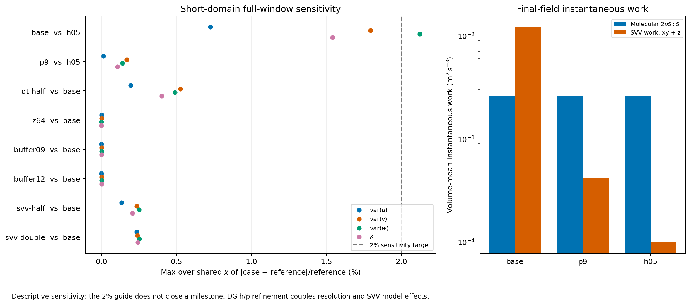
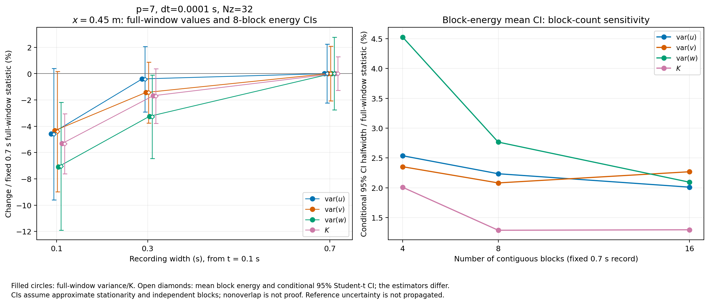
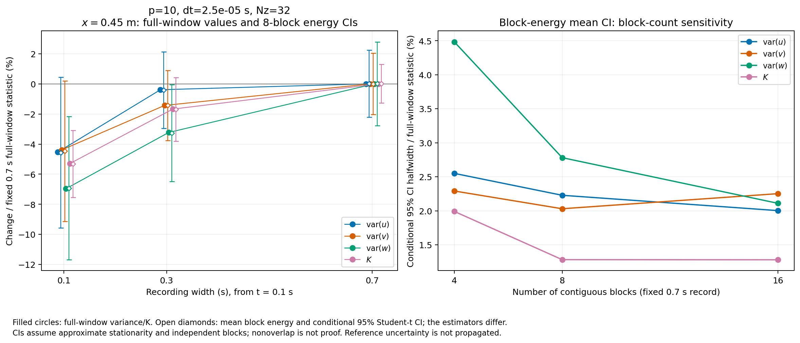

# HIT inflow Milestone 6: resolution, domain and resource study

**Status: IN PROGRESS.** The full-distance pilots must finish before the
production configuration and Milestone 6 closure can be signed off. This report
records completed evidence without treating timing trials or analytical models
as downstream solver validation.

This implements Milestone 6 of the [implementation plan](hit-inflow-implementation-plan.md)
under the [predeclared protocol](hit-inflow-milestone-6-protocol.md). No downstream
experimental values have been fitted or scored. Milestone 7 remains separate.
The [follow-up qualification rules](hit-inflow-milestone-6-qualification.md)
predeclare sampling screens and claim limits before Milestone 7 scoring.

## Scope and provenance

| Field | Value |
| --- | --- |
| Origin skill | academic-research-suite, experiment-agent |
| Mode | implementation and numerical verification |
| Branch | `codex/hit-inflow-generator` |
| C++ build and 47 unit cases | `d74cae8` |
| Corrected 22 registered solver regressions | `812a2c8` |
| Long and follow-up solver inputs/runners | `812a2c8` |
| Optional spectral analysis | `a3caa84` |
| Authoritative host | `jay-Super-Server`, accessed through `ssh linux-usb` |
| Main run storage | `/media/jay/新加卷/nektar-v2026-runs/hit-inflow/milestone-6` |

The C++ sources are unchanged between `d74cae8` and `812a2c8`. Later changes in
`a3caa84` concern optional Python postprocessing. The active solver checkout
remains clean at `812a2c8`; the optional analyzer was copied into external run
storage with its source hash, without replacing running solver libraries.

All M6 work uses at most **64 CPUs**, following the user's stricter limit.
Builds use 32 jobs and never overlap solvers. OpenMP and OpenBLAS use one thread
per MPI rank. The initial allocation was two long cases of 28 ranks each
(`npz=2`) plus one short case of four ranks (`npz=4`): 60 MPI ranks. After a
matched decomposition timing/field check, the long pair was restarted from
time zero in fresh storage with 24 ranks each and `npz=8`. Together with the
four-rank short queue this uses 52 MPI ranks; the other allowed CPUs remain
available for bounded analysis and controllers. A saved
`live-affinity-change.json` records placement across both sockets after the
initial common CPU set was found to occupy one socket. Each long rank is pinned
to one physical core; the combined allowed set still contains exactly 64 CPUs.
No session, field or solver binary was changed by that placement adjustment.
After both short queues completed, the remaining long pair uses 48 MPI ranks.
The separate fine-recording control used eight ranks, bringing the maximum
simultaneous solver allocation to 60 ranks. A saved process/thread affinity
audit verifies the 64-CPU union, with one OpenMP/OpenBLAS thread per rank.

## Feasible physical scope

The upstream-only specification uses mean speed 12.7 m/s, molecular viscosity
`1.5e-5 m2/s`, the committed CBC1971 station-42 shell spectrum, log-log
interpolation (`LogLinear`), `K4`/Gaussian extensions, and `Preserve`
normalization. The synthesis periods are `(32,0.6,0.6) m`; the cutoff/taper
pair is `(100,80) rad/m` in the current long pilots.

| Quantity | Cutoff 100, taper 80 | Cutoff 200, taper 160 |
| --- | ---: | ---: |
| Retained independent modes | 97,807 | 777,106 |
| Native mode payload per generator | 8,607,016 bytes | 68,385,328 bytes |
| Expected periodic K, m2/s2 | 0.02599846997 | 0.04393868581 |
| Realized periodic K, m2/s2 | 0.02608822850 | 0.04394070614 |
| Expected molecular dissipation, m2/s3 | 0.00265132404 | 0.01198565572 |

These are native finite-lattice generator measurements. With the upstream
reference `K=0.073926 m2/s2` and `epsilon=0.474 m2/s3`, the 100-rad/m choice
retains only about **35.2% of energy and 0.56% of dissipation**; the 200-rad/m
choice retains about 59.4% and 2.53%. The reference totals and finite-lattice
integrals are different quantities; these percentages describe the severe
represented-band limitation, not a measured downstream error bar. No retained
band is silently rescaled to restore the missing energy.

The upstream Kolmogorov length is approximately 0.2905 mm. Even the planning
threshold `k*eta=1` would require roughly 3.97 billion retained modes in this
synthesis box, or about 349 GB of mode payload **per rank**, exceeding the
server's approximately 251 GiB RAM before fields and matrices. Uniform Nyquist
spacing over the 9 by 0.6 by 0.6 m domain gives approximately 4.27 billion points
(`9863*658*658`); the arithmetic is saved in `dns-planning-arithmetic.json`.
These are arithmetic planning estimates, not allocations or measured DNS runs.
They motivate a limited-band study with explicit SVV, rather than a full DNS
claim. SVV stabilizes represented modes; it does not supply the omitted inlet
energy or guarantee the experimental cascade.

Continuum quadrature separates the prescribed input model from the finite
lattice. With the selected policies, the uncut model gives `K=0.0767724` and
`epsilon=0.406073`, respectively 3.85% above and 14.33% below the upstream
reference totals. These were not renormalized. The 100/80-rad/m continuum model
gives `K=0.0260131`, `epsilon=0.00265244`, component rms 0.131689 m/s, Taylor
scale 0.038355 m and longitudinal integral scale 0.050112 m. The uncut model's
integral scale is 0.024248 m. Filtering therefore changes the inlet scales as
well as its energy; full-band experimental totals cannot be used as direct
acceptance targets for this limited configuration.

At the selected 100/80 cutoff, replacing log-log interpolation by linear
interpolation changes continuum K/epsilon by +0.874%/+1.360%; replacing the
low-k K4 extension by zero changes them by -1.984%/-0.167%, and changes the
integral scale by -3.923%. The high extension has no effect below the final
table row at 2000 rad/m. In the uncut model, removing that Gaussian extension
changes epsilon by -12.823% but K by only -0.404%. These are input-policy
sensitivities, not experimental uncertainty estimates. Segmented quadrature
errors and cutoff/taper loss closure are retained in `spectrum-budget.json`.
The quoted length scales describe the continuum input, not a periodic seeded
correlation integral with a nonzero kx=0 asymptote.

## Implementation and verification

The inlet evaluator now groups modes by transverse wavenumber, retains distinct
streamwise temporal phases, and caches spatial phases within a 64 MiB payload
limit. Evaluation uses absolute time and preserves coefficients, random-number
identity, conjugate pairing and restart metadata. Unsupported/cache-limited
cases retain the direct-sum fallback. The native constrained boundary projection
is unchanged.

On Linux, a 512-point timing check measured 1.143 ms for the grouped plane and
6.425 ms per point for the original full reference evaluation. Extrapolating the
sparse direct check to 512 points gives approximately 2,880 times the grouped
cost. This is a plane-sampling comparison, not a solver speedup. Maximum velocity
differences were below `5.1e-13 m/s` and variance differences below `1.7e-15 m2/s2`.

The full-Fourier SVV kernel now assigns the same damping to each cosine/sine
pair, using its physical wavenumber rather than its packed slot ID. An analytical
phase-pair diffusion regression checks this behavior. Reduced Fourier bases keep
their existing convention. The native DG kernel and Fourier work diagnostics
are checked against the assembled stiffness quadratic form and Parseval's
relation. Native initialization also now correctly unpacks assembled global
coefficients before imposing local Dirichlet values.

All **47 unit cases** pass in four suites, and all **22 selected solver
regressions** pass, including eight legacy controls. The regression batch uses
CTest with eight worker slots and exact registered Tester commands in external
working directories. Two initial failures exposed checking issues: the first
absolute-norm fixture used a parameter override that left the parsed mean
expression unchanged; the constant-mean MPI pressure error was `8.34e-12`, above
the old signed-maximum bound. An explicit second-mean XML fixture fixes the
former; the latter now has a `2e-11` pressure bound, while velocity bounds remain
`5e-12`. Helpers now compute maximum absolute errors over the full communicator.
Earlier signed-maximum initialization diagnostics are excluded from Linf claims.

Final source review added a conservative cached-sampler range guard at
`6522fc9`, preserving the reference evaluator's exception behavior when unused
derivative products overflow. The CBC grouped evaluation arithmetic is
unchanged. Its additional unit case and final Linux rebuild remain pending
until the active solver jobs finish; the 47-case result above refers to the
actual pilot build.

The explicit NumPy spectral backend agrees with the standard-library reference
on a native history and independent even/odd transform fixtures. Scalar means,
variances, blocks and windows are identical. Transform/correlation differences
are below `1.1e-15` in absolute value; maximum native Parseval residual is
`4.5e-16`. Both paths retain each probe's own temporal mean and preserve the
zero-transverse-wavenumber contribution.

## Completed short-domain sensitivities

The baseline has length/span 0.6 m, maximum element side 0.1 m, polynomial
degree 7, 32 full Fourier slots, `dt=1e-4 s`, and a 0.1--0.2 s record. It uses
the same 100-rad/m synthesis and seed for discretization controls. The following
are maximum changes in any component variance or K over x=0, 0.15 and 0.45 m.
Each isolated control is compared with its own baseline; comparing every row
with the finest mesh would confound the changed parameter with spatial error.

| Isolated change | Maximum relative change |
| --- | ---: |
| Degree 7 to degree 9 | 2.0267% |
| Degree-9 result versus h=0.05 m, degree-7 result | 0.1695% |
| Baseline timestep halved | 0.5269% |
| Fourier slots doubled | 0.00170% |
| Domain length increased to 0.9 / 1.2 m | 0.00296% / 0.00313% |
| Mean-only instead of Gaussian-consistent initialization | 0.0000177% |
| SVV coefficients halved / doubled | 0.2515% / 0.2537% |

The fine short chain is also complete. At degree 9, `dt=1e-4` versus
`2.5e-5 s` changes a component variance/K by at most 0.5993%; `5e-5` versus
`2.5e-5 s` changes it by at most 0.06830%. At the common `2.5e-5 s`, degrees
9 and 10 agree within 0.1499%. Increasing the degree-9 probe grid from
32 by 32 to 64 by 64 changes results by at most 0.01483%. These controls cover
x through 0.45 m, not the final comparison stations. All 21 completed short
cases have verified manifest/prepared-XML and receipt/executed-XML hash chains.

The degree-7 baseline fails the provisional 2% spatial target: its w variance
at x=0.45 m is 2.1245% below the h-refined reference. Degree 9 is a better
candidate. Refining h/p or Fourier resolution also changes the SVV operator;
these are coupled numerical/model sensitivities.

Inlet projection was measured separately with native quadrature points at five
absolute-time calls, including repeated/reversed calls. The raw direct/grouped
agreement is below `6.7e-13 m/s`, with identical repeated coefficients and
nonzero Fourier content in all velocities. Maximum projected errors are:

| Representation | Maximum over velocity components, m/s |
| --- | ---: |
| Baseline degree 7 | 0.0010390 |
| Degree 9 | 0.00005707 |
| Degree 10, long-case inlet | 0.00001105 |
| h=0.05 m, degree 7 | 0.000006562 |

The degree-10 check uses 11,520 quadrature samples over five absolute-time calls
in the long-case declared interval, two MPI ranks with `npz=2`, and CPUs 6--7.
Its maximum raw error is `5.76e-13 m/s`; repeated coefficients are identical.
These are errors at the sampled native points/times, not global supremum bounds.

Integrated-energy agreement does not establish dissipation agreement. At the
final short snapshot, total instantaneous SVV work divided by molecular strain
dissipation is approximately 4.679, 0.1601 and 0.03766 for the baseline,
degree-9 and h-refined cases. The corresponding fixed-reference divergence norms
are approximately 0.009395, 0.001868 and 0.001233. These distinguish converging
spatial representation from exact pointwise discrete solenoidality. Small net
flux/Gauss residuals alone do not establish the latter.

The matched 0.1--0.2 s z-spectrum checks give maximum normalized L1 differences
of 2.1245% for degree 7 versus h-refinement, 0.1695% for degree 9 versus
h-refinement, and 0.01793% for doubled Fourier slots versus the baseline.
For the separate z-derivative moment `sum(kz^2 * variance_per_mode)`, the
corresponding maximum changes are 2.5024%, 0.2220% and 0.1078%. This derivative
moment is neither total molecular dissipation nor SVV work. In the fine 0.7 s
record at x=0.45 m, modes with `kz>100 rad/m` contain about
0.206%/0.213%/0.0463% of u/v/w variance but 1.90%/1.97%/0.823% of their
z-derivative moments. Nonlinear generation of a tail is therefore visible even
when its contribution to K is small. The direction-labelled spectra and source
hashes are retained in `812a2c8/z-spectral-sensitivity.json`.

The no-SVV control failed with NaNs and repeated native iteration-limit warnings.
It is retained as a rejected stability control; it establishes no universal
claim that every unstabilized configuration is unstable. Span changes alter the
mode lattice and realization, even at the same seed. The first 0.9/1.2 m span
results differ from the fine reference by up to 8.25%/6.93%; they are unpaired
box-plus-realization sensitivities. With both seeds, the short-record deviations
from the original baseline reach 11.19%; no 2% span-convergence claim follows.
These adjacent seeds share random-counter inputs in the frozen version-1
mapping and are distinct-realization controls, not established independent
ensemble replicates. The follow-up qualification rules select disjoint
input-counter streams for production while preserving the version-1 algorithm.
By contrast, native expected inlet covariance changes by less than 0.080% when
the span increases from 0.6 to 0.9/1.2 m. This isolates a small finite-lattice
input effect without establishing independence of the evolving solver from its
periodic box or removing finite-record realization scatter.

## Recording length and uncertainty

Statistics use each fixed probe's temporal-central variance, then a transverse
average. Instantaneous plane means are never removed. The extended short case
reproduces its initial 0.1--0.2 s statistics across the changed MPI layout and
allows longer windows without changing the inlet realization.

| Record at x=0.45 m | K, m2/s2 | Samples |
| --- | ---: | ---: |
| 0.1--0.2 s | 0.02409977658 | 201 |
| 0.1--0.4 s | 0.02502467584 | 601 |
| 0.1--0.8 s | 0.02545261927 | 1,401 |

The 0.1 s record is too short to represent the seeded ensemble. For the 0.7 s
record, eight-block conditional component interval half-widths at x=0.45 m are
2.24%, 2.08% and 2.77%. Four blocks give 2.54%, 2.35% and 4.53%; sixteen blocks
give 2.01%, 2.27% and 2.09%. Some block correlations remain substantial. These
intervals are conditional diagnostics, not established independent-sample
confidence bounds or 2% equivalence tests.

The fine degree-10, `dt=2.5e-5 s` recording control is complete. At x=0.45 m,
its 0.1/0.3/0.7 s records give K=0.02436192721/0.02529112500/0.02572218246.
The initial 0.1--0.2 s prefix agrees with the separate short fine solve to
`7.7e-13 m2/s2` in component variance. At 0.7 s, its eight-block interval
half-widths are 2.23%, 2.03% and 2.78%; four/sixteen-block w half-widths are
4.48%/2.11%. The recording-length conclusion survives spatial/time refinement.
The largest fine-record z-spectrum Parseval residual is `1.5e-15`.

The figure titles identify the polynomial degree, timestep and Fourier slots.
Filled circles show full-window variances/K; the separate open diamonds and
intervals describe mean block energy. These estimators are not interchangeable.
The figures and their input hashes were generated on Linux; the fine recording
figure has its own `provenance-fine.json` receipt.

The exact finite-lattice tensor also predicts continuous-time centering bias:
for a 0.1 s inlet window the expected component biases are -7.68%, -3.94%,
-3.94%; for 0.8 s they are -0.983%, -0.493%, -0.493%. Frozen kx=0 modes alone
contribute approximately 0.313%/0.156%/0.156% of ensemble covariance. This
analytical expectation differs from both the actual seeded record and sampling
intervals. Avoiding recurrence does not by itself establish low-frequency
convergence.

## Full-distance work still required

The current 9 m pilots use degrees 9 and 10, h=0.1 m, 32 Fourier slots,
`dt=2.5e-5 s`, both dealiasing switches, and an absolute 0.8--0.95 s record.
They reach x=3.612896 and 8.322564 m with a 0.677436 m outlet buffer and retain
step checkpoints every 0.05 s. The 0.8 s start exceeds the 0.70866 s nominal
domain transit; actual startup and spatial adjustment still require inspection.

The smaller timestep follows a scalar IMEX2 calibration using the native
lattice/spectrum, not a replacement for Navier--Stokes validation. At the final
convection age, `dt=5e-5` gives modeled transverse variance error about 1.40%
but correlation about 0.9595; `dt=2.5e-5` reduces these to 0.179% and 0.9974.
Space, nonlinear evolution, pressure, SVV and boundary effects are excluded
from that analytical model. The fine short-case timestep chain and matched
long-degree comparison must provide the corresponding solver evidence.

Native checkpoint postprocessing will provide complete x-column slabs of
molecular strain dissipation, separate x-y/z SVV work, divergence and
instantaneous energy about prescribed Ubar. That energy is explicitly labelled
and cannot be substituted for temporal-central TKE. Direction-labelled z
spectra and correlations are computed separately from immutable histories.

The first six native long-domain profiles are complete at t=0.1, 0.2 and 0.3 s
for both degrees, each with all 90 x columns and checkpoint-partition hashes
verified before and after reading. At 0.3 s the volume-mean molecular strain
dissipation is 0.004556/0.004941 m2/s3 at degrees 9/10; total SVV work is
0.009293/0.007369 m2/s3. The fixed-reference divergence norms are
0.008223/0.008351. These warmup fields show substantial modeled work and ongoing
cascade development. They precede the domain flush and cannot establish a
post-start adjustment length or converged downstream statistics. The serial
diagnostic commands, native build metadata, JSON/CSV hashes and timings are in
`812a2c8/early-long-profiles/{long-p9,long-p10}/receipt.json`.

The replacement runs are under `812a2c8/long-npz8-study`. The original
`long-study` warmups are explicitly marked as performance interruptions and
retain their checkpoints; they are not post-flush validation results. In the
matched dense-probe timing trials, steady integration costs with `npz=8` were
approximately 0.351 s/step at degree 9 and 0.486 s/step at degree 10, compared
with approximately 0.489/0.711 s/step in the original allocation. These timings
exclude sampled-step filter work. The tested split gives maximum velocity
differences below `3.7e-11 m/s` against the reference layout after 40 steps.

A separate four-rank control using direct multilevel velocity solves as well
as pressure gave an approximately 20% steady integration improvement but
larger setup time and sampled memory (24.4 versus 8.77 GiB). Its maximum
velocity difference was `3.1e-7 m/s`. The current long pair retains iterative
velocity solves and direct multilevel pressure solves. IMEX2 remains the
binding HIT time-integration contract.

The matched linear-solver resource trials are complete; the long pilots are
still running. A separate eight-rank degree-10 recording control repeats the
0.8 s short-domain run with the fine timestep, bringing the concurrent MPI
allocation to 60 ranks while it runs.
The final production choice, measured runtime/RAM/storage budget, adjustment
assessment, uncertainty criteria and machine-readable closure receipt remain
outstanding. A proposed longer production record must stay inside the
`32/12.7 = 2.519685 s` synthesis period, including startup and clock margin.

## SVV interpretation

The candidate follows the local incompressible-solver guide's recommended
spectral/hp DG kernel, with prescribed speed `(12.7,0,0)` and coefficient 1.
The native base viscosity is `12.7*h/p` times the optimized modal filter. The
quadrilateral table, rather than the numerical cutoff-ratio setting, defines
that filter. The homogeneous exponential coefficient is independently
`0.0238125 m2/s` with ratio 0.75; it is not multiplied by the DG h/p scaling.

The constant-Peclet/optimized-kernel rationale is supported by
[Moura, Sherwin and Peiro (2016)](https://doi.org/10.1016/j.jcp.2015.12.009)
and [Moura et al. (2020)](https://doi.org/10.1016/j.jcp.2019.109112).
The latter's spatially developing model grid flow does not establish fidelity
for this three-dimensional CBC case. The broader SVV LES framework is described
by [Karamanos and Karniadakis (2000)](https://doi.org/10.1006/jcph.2000.6552).
Measured instantaneous SVV work is a model diagnostic; open-boundary transport,
pressure, time integration and molecular dissipation remain distinct terms in
the energy budget.
