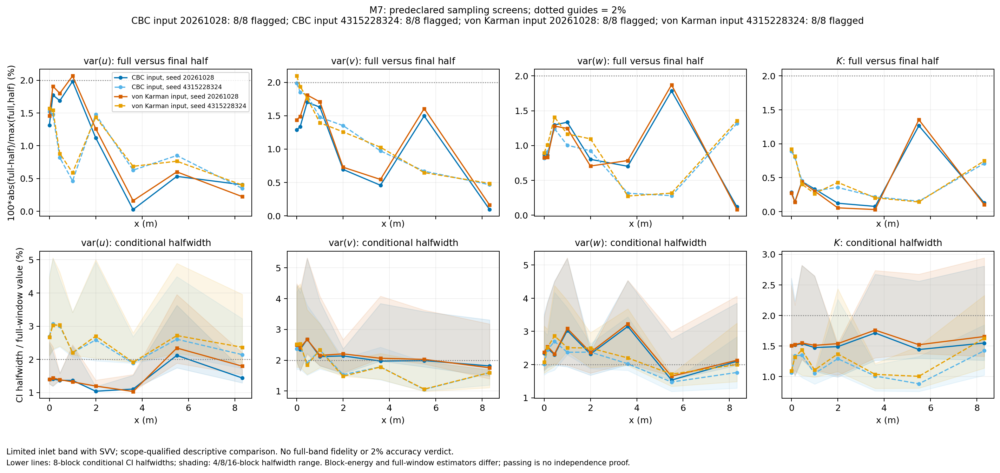
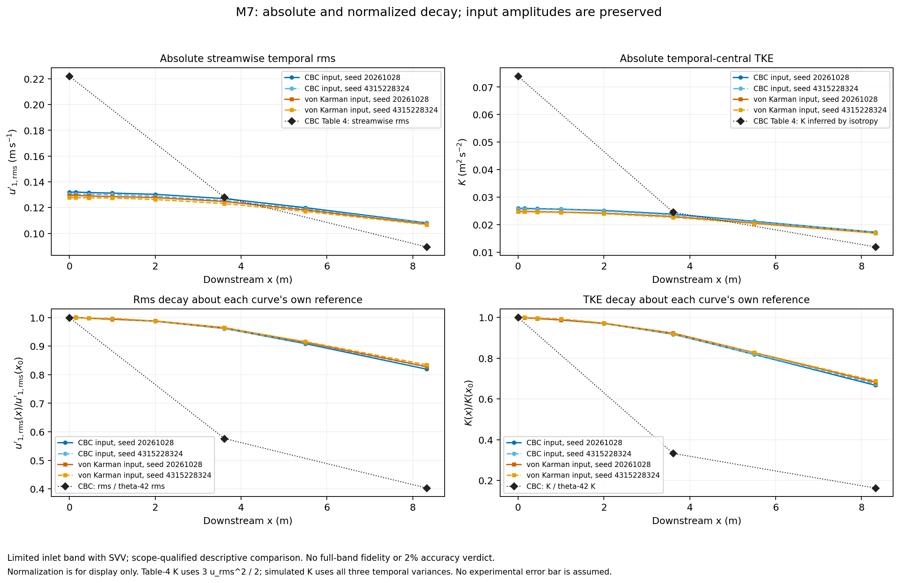
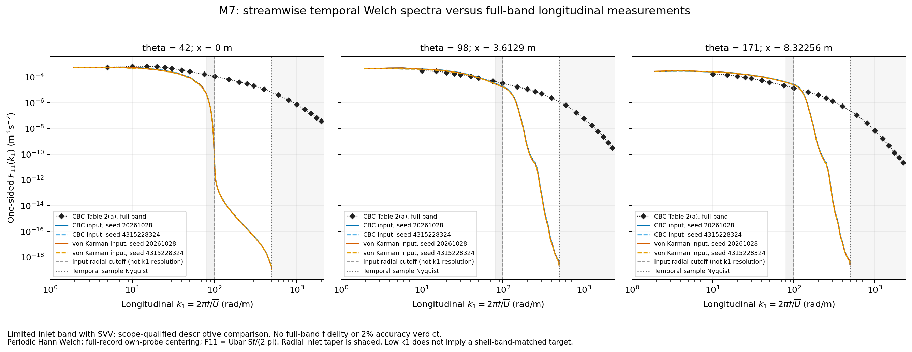
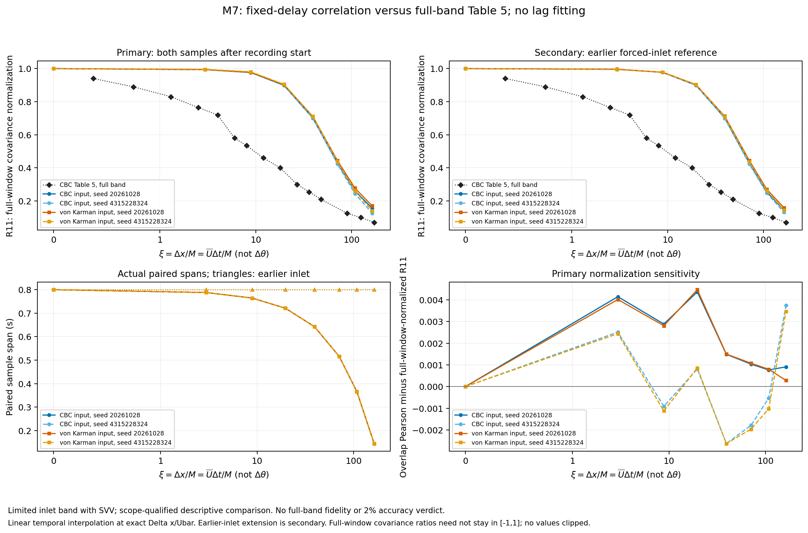
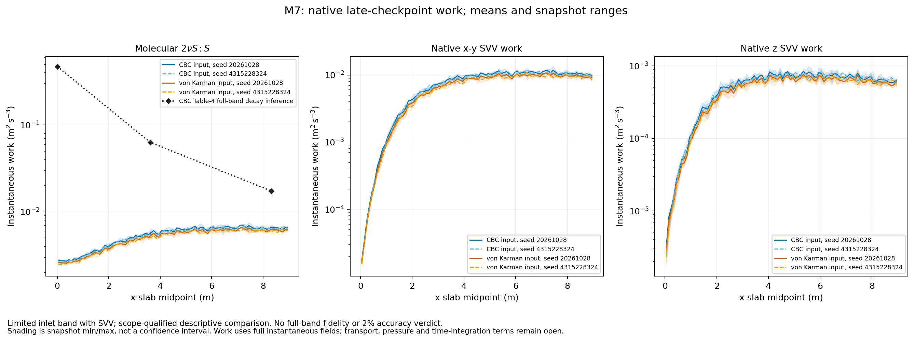

# HIT inflow Milestone 7: downstream experimental comparison

Status: **CLOSED — DESCRIPTIVE LIMITED-BAND COMPARISON**, 2026-10-31.
All four prescribed calculations, their sampling diagnostics, experimental
comparisons and native-work profiles are complete. The frozen calculation
decays too slowly and preserves too much convection-delayed correlation.
All 32 case/station combinations fail the predeclared 2% sampling screen.
Full-band physical validation and 2% numerical accuracy are **not established**.

This closure follows the [predeclared M7 protocol](hit-inflow-milestone-7-protocol.md)
and [M6 qualification rules](hit-inflow-milestone-6-qualification.md). It records
an unfavorable comparison without fitting to downstream measurements. The
[validation receipt](hit-inflow-milestone-7-validation.json) contains the
machine-readable station statistics, conditional intervals, scales, work,
commands and hash bindings. Milestone 8 remains pending.

## Material Passport

| Field | Value |
| --- | --- |
| Origin skill / mode | academic-research-suite, experiment-agent / validate |
| Origin date / version | 2026-10-31 / hit_inflow_m7_v1 |
| Verification status | ANALYZED: completed production evidence reviewed; no full-CFD rerun at final review |
| Interpretation status | CAUTION: descriptive comparison; precision, development and full-band fidelity remain unqualified |
| Project branch | `codex/hit-inflow-generator` |
| Native CFD build | `29f467b6428ce5efc58d97d4cb481fbda0e432b1` |
| CBC runner / VK runner and analysis source | `97014abbab6eb52ace58860368357c24d98b37d7` / `da607a9a46d6b11d7b30e67441c878139e11adf2` |

## Frozen inputs and experiment

The experiment is Comte-Bellot and Corrsin (1971), *Simple Eulerian time
correlation of full- and narrow-band velocity signals in grid-generated,
'isotropic' turbulence*, principal 5.08 cm grid. Table 2(a) supplies the
one-sided longitudinal spectrum, Table 3 the reconstructed isotropic shell
spectrum, Table 4 the RMS and inferred dissipation/scales, and Table 5 the
full-band convection-delayed correlation. The
[Table-2/3/4 source](../../solvers/IncNavierStokesSolver/Tests/HITInflow/cbc1971-source.json)
and [Table-5 transcription](../../solvers/IncNavierStokesSolver/Tests/HITInflow/cbc1971_full_band_correlation.json)
were checked against the complete PDF pages before production scoring. Printed
pages 296, 298, 299 and 302 correspond to PDF pages 24, 26, 27 and 30. The PDF
SHA-256 is `e8067700a0ed678c33fa92e5e3f3d737df98d976e5f3b1478612f071536962d3`.
No figure digitization or universal experimental error bar is introduced.

Mean measurement-region speed is Ubar=12.7 m/s; approach speed U0=10 m/s
sets experimental age. Thus theta=42+U0*x/(M*Ubar), M=0.0508 m. The two downstream
planes x=3.612896 and 8.322564 m correspond to theta=98 and 171. Table 5 uses
xi=x/M, giving 71.12 and 163.83 at those planes. The experimental references are:

| Age theta | x (m) | u_rms (m/s) | Inferred K (m2/s2) | epsilon (m2/s3) | lambda / eta (m) | Lf / Lg (m) | Re_lambda |
| --- | --- | --- | --- | --- | --- | --- | --- |
| 42 | 0 | 0.222 | 0.073926 | 0.474 | 0.00484 / 0.00029 | 0.024 / 0.0127 | 71.6 |
| 98 | 3.6129 | 0.128 | 0.024576 | 0.0633 | 0.00764 / 0.00048 | 0.0345 / 0.0188 | 65.3 |
| 171 | 8.32256 | 0.0895 | 0.0120154 | 0.0174 | 0.0102 / 0.00066 | 0.049 / 0.0228 | 60.7 |

Experimental K is inferred as 3*u_rms^2/2; simulated K uses all three measured
temporal variances. The Table-4 dissipation/scales are full-band quantities.
The published viscosity-caption discrepancy retained from M6 is not refitted:
the calculation uses nu=1.5e-5 m2/s throughout.

| Setting | Both spectrum families |
| --- | --- |
| Domain / expansion | 9 by 0.6 by 0.6 m; 90 by 6 quadrilaterals in x-y, Fourier in z |
| Resolution | h=0.1 m; degree 10 (`NUMMODES=11`); 32 homogeneous Fourier slots |
| Solver / integration | Nonlinear velocity correction; IMEX2; dt=25 microseconds; both dealiasing switches |
| Solves | Iterative velocity; pressure Xxt/MultiLevelStaticCond with Scotch |
| Boundary conditions | HIT velocity Dirichlet inlet and pressure H condition; periodic y and z; HOutflow velocity Neumann / zero pressure Dirichlet outlet |
| Stabilization | Native x-y DG SVV coefficient 1; separate z exponential viscosity 0.0238125 m2/s, cutoff ratio 0.75 |
| Spectrum treatment | Preserve amplitudes; radial cutoff/taper 100/80 rad/m; no omitted-energy restoration |
| Synthetic volume | 32 by 0.6 by 0.6 m, counts (1020,20,20), 97,807 retained modes |
| Duration / statistics | Run 0--1.6 s; primary window 0.8--1.6 s |
| Histories | Eight x stations; 64 by 32 half-open y-z probes; every 20 steps, dt_sample=0.0005 s |
| Streams | A=20261028; B=4315228324, in each family |

The CBC inlet uses only station-42 Table-3 shell data, log-log interpolation,
K4/Gaussian extensions and Preserve normalization. The
[upstream-only von Karman fit](hit-inflow-milestone-7-upstream-fit.json) uses
u_rms=0.222 m/s and Lf=0.024 m at theta=42. For
E(k)=A*L^(5/3)*(L*k)^4/[1+(L*k)^2]^(17/6), its length is
0.032135646697566765 m and amplitude 0.708341072215995 m^(4/3)/s2.
The uncut K is 0.073926 m2/s2 and Lf=0.024 m; its molecular dissipation
diverges in the inertial tail. Apply the common energy taper after that fit.
No downstream data enter either input model.

| Prescribed input quantity | CBC | von Karman |
| --- | ---: | ---: |
| Native expected periodic K (m2/s2) | 0.02599846997 | 0.02494910477 |
| Native expected molecular dissipation (m2/s3) | 0.00265132404 | 0.00251070503 |
| Continuum filtered longitudinal integral scale (m) | 0.050112 | 0.051813 |

Only about 35.2% of the upstream experimental K and 0.56% of its dissipation
enter the CBC calculation; VK retains about 33.7% of K. These omissions are
input-model limitations. They cannot be represented by a statistical error bar.
The exact synthetic repeat period is 2.519685 s, exceeding the declared 1.60005 s
interval including padding; the full space-time footprint is 29.320635 m,
less than the 32 m streamwise period.

The two seeds have disjoint enclosing input-counter ranges, separated by 2^32.
This avoids counter reuse without proving independent pseudorandom streams.
Matching streams across CBC/VK provide common random mode inputs. Four cases
therefore do not constitute four independent ensemble realizations.

## Execution and integrity

All native builds, solver runs and numerical postprocessing used the Linux
server `jay-Super-Server`, reached by `ssh jay@100.105.247.110`. The authoritative
run root is:

```text
/media/jay/新加卷/nektar-v2026-runs/hit-inflow/milestone-7/97014ab
```

Each pair ran two 24-rank MPI cases with `npz=8`, `OMP_NUM_THREADS=1` and
`OPENBLAS_NUM_THREADS=1`. Rank helper threads inherited the rank's single-core
affinity. The 64-worker server limit covered all concurrent work. The saved
3,557 monitor samples show at most 48 HIT MPI processes and 60 native/compiler
workers across the server, with zero worker-warning or affinity-violation rows.
Bounded controllers and at most two analysis workers shared the remaining
headroom. These are sampled observations, not a continuous scheduler audit.
The final evidence summarizer used one CPU (50), after the CFD jobs ended.

| Case | Stream seed | Start (China time) | Solver receipt finished | Solver wall (h) | Peak sampled tree RSS (GiB) |
| --- | --- | --- | --- | --- | --- |
| CBC A | 20261028 | 10-29 20:58 | 10-30 13:44 | 16.759 | 13.085 |
| CBC B | 4315228324 | 10-29 20:58 | 10-30 13:36 | 16.629 | 13.082 |
| VK A | 20261028 | 10-30 14:25 | 10-31 02:53 | 12.45 | 13.059 |
| VK B | 4315228324 | 10-30 14:25 | 10-31 02:51 | 12.432 | 13.079 |

All cases completed 64,000 steps to t=1.6 s with initialization and solver exit
code zero and no native iteration-limit warning. Postprocessing finished at
2026-10-31 02:58:01 China time; the five production figure pairs finished at
02:58:37. Each case has 3,201 cached full-history samples and 1,601 primary
samples. The production reader checked all native history frames, including
pressure, for finite values and complete uniform probe/time records. Three late
checkpoints per case, at 1.30/1.45/1.60 s, supply 90 complete x slabs each.

Final review verified 117 small-file bindings, including executed inputs,
solver logs, analysis/work outputs, experimental data, native profile outputs,
frozen helper copies and all ten figure files. The four large NPZ caches and
27.6 GB of ASCII histories were not read again: their creation-time hashes,
before/after identity checks and finite-data checks are retained in the bound
receipts. Native fields were checked when the late profiles were collected.
The validation JSON states this hash scope explicitly.

C++ remains unchanged from the native build. Prior Linux checks are retained:
four spectrum-preparation tests and 15 analyzer/native-work tests passed; the
completed M6 history reprocessed through the new pipeline reproduces variance/K
to 6.94e-18 m2/s2. An old/new full-field control at t=0.1 s has exactly zero
L2 and maximum differences in u/v/w/p. Its differing duration metadata does
not establish restart-identity interchangeability. The synthetic plotting
fixture is excluded from every production value and figure below.

## Sampling qualification

Every probe uses its own temporal mean before plane averaging. Instantaneous
plane means are never removed. The validation JSON retains all component
variances, RMS, K, mean velocities, Reynolds covariances, anisotropy tensors,
full/final-half/last-75-percent windows, and 4/8/16-block conditional intervals.
Raw block values and own-block-centered alternatives remain in each original
`analysis.json` in run storage.

| Case | Max full/final-half change (%) | Max conditional half-width, 4 blocks (%) | 8 blocks (%) | 16 blocks (%) | Flagged stations |
| --- | --- | --- | --- | --- | --- |
| CBC A | 1.9822 | 5.3065 | 3.1488 | 2.2262 | 8/8 |
| CBC B | 1.9855 | 5.0445 | 3.067 | 2.3775 | 8/8 |
| VK A | 2.0645 | 5.3204 | 3.2246 | 2.1886 | 8/8 |
| VK B | 2.0948 | 5.0578 | 3.0359 | 2.4015 | 8/8 |

The screen flags a station if any component variance/K has a full-versus-final-half
change above 2%, or if any 4/8/16-block conditional interval half-width exceeds
2% of its full-window value. All eight stations fail in every case. CBC window
changes alone stay below 2%; that does not undo their interval failures. The
largest CBC-A four-block half-width is 5.3065% for v variance at x=0.45 m.

Blocks contain 400/200/100 samples, span 0.1995/0.0995/0.0495 s, and each choice
excludes one tail sample. Block energies use the full-window probe mean;
own-block-centered alternatives answer a different question. The conditional
Student-t intervals concern mean block energy, which differs slightly from the
full-window variance. Recorded lag-one block correlations and temporal
correlations do not establish independence. Neither 2,048 spatial probes nor
five overlapping Welch segments supply an independent sample count. There is
no qualified ensemble confidence interval from two streams.



## Absolute and normalized decay

RMS values below are in m/s and K in m2/s2. A/B retain the two streams separately.

| Case | u_rms, theta42 | theta98 | theta171 | K, theta42 | theta98 | theta171 |
| --- | --- | --- | --- | --- | --- | --- |
| CBC A | 0.1319694 | 0.1269653 | 0.1081394 | 0.0260059 | 0.02387596 | 0.01734791 |
| CBC B | 0.130438 | 0.1254 | 0.1079194 | 0.02575264 | 0.02360513 | 0.01736921 |
| VK A | 0.1292645 | 0.1247079 | 0.1071068 | 0.02493912 | 0.02301189 | 0.01700518 |
| VK B | 0.1277891 | 0.1231035 | 0.1067079 | 0.02471761 | 0.0227441 | 0.01700273 |

The CBC RMS at theta=98 is close to the experimental 0.128 m/s, although its
inlet RMS is only about 0.131 m/s versus 0.222 m/s experimentally. The own-inlet
normalized decay exposes that mismatch:

| Case | K98 / K42 | K171 / K42 |
| --- | --- | --- |
| CBC A | 0.9180978 | 0.6670759 |
| CBC B | 0.91661 | 0.674463 |
| VK A | 0.9227228 | 0.6818678 |
| VK B | 0.9201578 | 0.6878792 |
| Experiment (isotropic K inference) | 0.3324405 | 0.1625325 |

By theta=98, the simulated K has declined only about 8%, whereas the inferred
experimental K has declined about 67%. By theta=171 the simulated decline is
about 31--33%, versus about 84% experimentally. Final simulated RMS remains
about 0.107--0.108 m/s versus 0.0895 m/s. Near agreement of one absolute RMS
value is insufficient evidence of the experimental decay trajectory. Both
families retain the discrepancy; no downstream fitting or amplitude adjustment
was performed.



## Longitudinal spectra

The primary PSD is a one-sided periodic-Hann Welch estimate with 512 samples,
256-sample overlap, five segments, 65 unused tail samples, delta_f=3.90625 Hz,
window-energy sum 192 and equivalent noise bandwidth 5.859375 Hz. Every segment
uses fluctuations centered by the full-record mean of its own probe; there is
no extra segment detrending. The full 1,601-sample boxcar periodogram supplies
exact discrete Parseval closure. Across all cases/stations its largest relative
residual is 2.98e-16. Welch closes against its own weighted segment variance;
that target need not equal full-window variance.

Convert using k1=2*pi*f/Ubar and F11=Ubar*Sf/(2*pi). The sample Nyquist is
1,000 Hz, approximately 495 rad/m. Histories have no explicit antialias filter
before every-20-step sampling. The following theta=171 densities are in m3/s2;
values are linearly interpolated within the estimated PSD, without extrapolation.

| Case, theta171 | F11 at k1=10 | 50 | 100 | 200 rad/m |
| --- | --- | --- | --- | --- |
| CBC A | 0.000253387 | 8.2486e-05 | 2.65674e-05 | 4.51809e-10 |
| CBC B | 0.000247776 | 8.35458e-05 | 2.67093e-05 | 4.47369e-10 |
| VK A | 0.000254846 | 7.97074e-05 | 2.46688e-05 | 4.02195e-10 |
| VK B | 0.000251366 | 7.95712e-05 | 2.49441e-05 | 3.89365e-10 |
| Experiment (Table 2a) | 0.000181 | 3.94e-05 | 1.39e-05 | 4.02e-06 |

At k1=50 rad/m, the CBC density is over twice the full-band experimental value;
at 200 rad/m it is orders of magnitude smaller. The radial inlet cutoff is not
a longitudinal spectral resolution bound: high radial wavenumbers contribute
to F11 even at small k1, through the isotropic projection
F11(q)=integral_q^infinity E(k)*(1-q^2/k^2)/k dk. Thus selecting published points
below 100 rad/m does not create a shell-filtered experimental target. Nonlinear
evolution can also populate wavenumbers absent at the inlet. The homogeneous-z
correlation/spectrum is a separate directional observable. No full-band or
band-matched accuracy score is inferred from these overlays.



## Convection-delayed correlation

Pair the inlet at t with the same transverse coordinate downstream at
t+x/Ubar. Delays use the prescribed mean velocity, with linear fractional-sample
interpolation and no lag fitting. The primary estimate requires both observations
inside 0.8--1.6 s. The secondary extension pairs post-start downstream samples
with earlier forced-inlet samples; inlet stationarity by construction does not
qualify downstream startup or stationarity.

| Downstream x (m) | xi=x/M | Delay (s) | Primary pairs / probe | Actual primary span (s) | Earlier-inlet pairs / span |
| --- | --- | --- | --- | --- | --- |
| 3.6129 | 71.12 | 0.28448 | 1032 | 0.5155 | 1601 / 0.8 |
| 8.32256 | 163.83 | 0.65532 | 290 | 0.1445 | 1601 / 0.8 |

The ideal primary overlap at the far station is 0.14468 s; its actual sampled
span is 0.1445 s, containing 290 pairs per probe. It is not an 0.8 s primary
estimate. The extended inlet record supplies 1,601 pairs spanning 0.8 s.

The values below use covariance centered and normalized by each signal's full
primary-window mean/variance. The separate paired-overlap Pearson estimates,
paired variances, floor/ceiling delay sensitivity and sample times remain in
the validation JSON. These normalizations are distinct; the full-window
covariance ratio is not clipped to [-1,1].

| Case | Primary R11, theta98 | theta171 | Earlier-inlet R11, theta98 | theta171 |
| --- | --- | --- | --- | --- |
| CBC A | 0.4295849 | 0.15594 | 0.4298602 | 0.1444875 |
| CBC B | 0.4230984 | 0.1266949 | 0.4230387 | 0.1317268 |
| VK A | 0.4442547 | 0.1706102 | 0.4448062 | 0.1592946 |
| VK B | 0.4375945 | 0.1403637 | 0.4366145 | 0.1451031 |
| Table 5 (linear interpolation) | 0.1632095 | 0.07521489 | same reference | same reference |

Table-5 values at xi=71.12 and 163.83 are explicit linear interpolations between
published rows [48,90] and [125,172], respectively. Neither is an exact published
measurement. Both model families retain more correlation than this reference.
The change between the primary and earlier-inlet estimates and between streams
remains visible; it is not converted into a precision-qualified error bar.



## Molecular work, SVV and spatial adjustment

The native observable is instantaneous total-field molecular strain work
2*nu*S:S, with x-y and z SVV work reported separately. The table gives the
arithmetic mean and range over three late snapshots; these ranges are not
confidence intervals. Work units are m2/s3. At x=0, values come from the first
full slab centered at x=0.05 m, rather than the exact inlet plane. Interior
station values interpolate neighboring slab averages.

| Case | x (m) | Mean molecular | Snapshot min--max | Mean SVV x-y | Mean SVV z | Mean SVV/molecular ratio |
| --- | --- | --- | --- | --- | --- | --- |
| CBC A | 0 | 0.00277466 | 0.00264978--0.00286894 | 1.7304e-05 | 3.13728e-06 | 0.0073747 |
| CBC A | 3.6129 | 0.00565713 | 0.0053413--0.006232 | 0.00886647 | 0.000696901 | 1.6904 |
| CBC A | 8.32256 | 0.00659436 | 0.00629835--0.00698405 | 0.0106743 | 0.000656877 | 1.717 |
| CBC B | 0 | 0.00260592 | 0.00251449--0.00274385 | 1.64705e-05 | 2.53777e-06 | 0.0072817 |
| CBC B | 3.6129 | 0.00546047 | 0.00521655--0.0056402 | 0.0085605 | 0.000679943 | 1.6909 |
| CBC B | 8.32256 | 0.00637358 | 0.00606193--0.00675776 | 0.0102063 | 0.000589994 | 1.6935 |
| VK A | 0 | 0.00262613 | 0.00250977--0.00271622 | 1.61088e-05 | 2.84136e-06 | 0.0072232 |
| VK A | 3.6129 | 0.0052599 | 0.00497303--0.00578392 | 0.00794294 | 0.000623979 | 1.6287 |
| VK A | 8.32256 | 0.00624761 | 0.00596587--0.00655592 | 0.00995086 | 0.000608586 | 1.6884 |
| VK B | 0 | 0.00246691 | 0.00238174--0.00259653 | 1.53482e-05 | 2.30036e-06 | 0.0071421 |
| VK B | 3.6129 | 0.0050776 | 0.00485207--0.00525245 | 0.00767282 | 0.000604921 | 1.6293 |
| VK B | 8.32256 | 0.00597929 | 0.00563832--0.00633146 | 0.00943981 | 0.000546829 | 1.6691 |

For CBC A, molecular work grows from about 0.002775 near the inlet to 0.005657
at the first experimental comparison plane and 0.006594 at the far plane.
SVV work grows from near zero to exceed molecular work. The late profiles
therefore show continuing spatial development through theta=98; a bounded,
qualified upstream adjustment region is not demonstrated. Nominal domain flush
and late snapshots do not prove equilibrium with the experimental reference.

At the final plane CBC-A molecular work plus SVV happens to approach the
experimental 0.0174 m2/s3. This does not establish molecular-dissipation agreement:
SVV/molecular is approximately 1.717 and the experimental estimate is a full-band
decay inference. The following interval-average temporal-central K slopes are
another distinct observable, in m2/s3:

| Case | -U delta K/delta x, 0--3.612896 m | 3.612896--8.322564 m |
| --- | --- | --- |
| CBC A | 0.00748714 | 0.0176034 |
| CBC B | 0.00754891 | 0.0168157 |
| VK A | 0.00677456 | 0.0161976 |
| VK B | 0.00693725 | 0.0154821 |

The native slab/global checks close volume, molecular/SVV work, divergence RMS
and velocity norm within the saved tolerances. They verify diagnostic
consistency. Open-boundary transport, pressure work, storage and time-integration
contributions have not been assembled into a closed turbulent energy budget.
Do not identify -U*delta K/delta x with local molecular work, or interpret an
unclosed residual as a measurement of SVV error.



## Represented scales and incompressibility diagnostics

Native-gradient surrogates use the temporal var(u) with each instantaneous total-field
molecular work: lambda=sqrt(15*nu*var(u)/epsilon_m),
eta=(nu^3/epsilon_m)^(1/4), Re_lambda=u_rms*lambda/nu. Their three-snapshot means
at theta=171 are shown alongside periodic-z integrals. These mixed estimators
are not qualified experimental microscales.

| Case, theta171 | lambda surrogate (m) | eta surrogate (m) | Re_lambda surrogate | Finite z integral, u (m) | Finite z integral, w (m) |
| --- | --- | --- | --- | --- | --- |
| CBC A | 0.0199891 | 0.000846063 | 144.108 | 0.0179951 | 0.0391207 |
| CBC B | 0.0202922 | 0.000853317 | 145.995 | 0.0166248 | 0.0364691 |
| VK A | 0.0203373 | 0.000857514 | 145.218 | 0.0190816 | 0.0412757 |
| VK B | 0.020717 | 0.000867078 | 147.378 | 0.0175275 | 0.0383228 |

The experimental theta=171 values are lambda=0.0102 m, eta=0.00066 m and
Re_lambda=60.7. Periodic-z u is transverse to the separation; w is longitudinal.
Their tabled integrals retain the zero mode and stop at half the 0.6 m period.
Removing that mode makes the complete half-period integral mathematically zero
(up to numerical roundoff). The separately saved positive-lobe integrals and
first-zero positions depend on that convention; some longitudinal lobes remain
positive at the 0.3 m boundary and are explicitly censored. These are finite
periodic diagnostics, not the experiment's inferred unbounded Lg/Lf. Temporal
Taylor/isotropy surrogates are also saved in the original analysis, with finite
band and boxcar endpoint cautions; they do not replace native full gradients.

The analytical input tensor remains solenoidal by construction, as verified in
earlier milestones. The evolved weakly incompressible numerical solution has
finite pointwise divergence. At t=1.6 s:

| Case, t=1.6 s | Divergence RMS (1/s) | Fixed-CBC dimensionless divergence | Relative flux imbalance | Gauss relative residual |
| --- | --- | --- | --- | --- |
| CBC A | 0.0847096 | 0.0091578 | 4.27922e-06 | 2.88956e-16 |
| CBC B | 0.0838994 | 0.00907021 | 3.82238e-06 | 2.27866e-16 |
| VK A | 0.0805622 | 0.00870942 | 3.54946e-06 | 1.95549e-16 |
| VK B | 0.0799712 | 0.00864554 | 3.55417e-06 | 1.25017e-16 |

The fixed-CBC normalization is the M6 convention Lf_CBC*div_rms/u_rms_CBC, with
Lf_CBC=0.024 m and u_rms_CBC=0.222 m/s. Small net-flux and Gauss residuals verify the
integrated diagnostics; they do not bound local divergence. The finite
approximately 0.009 dimensionless residual remains a numerical limitation.
No machine-precision pointwise incompressibility claim is made for the evolved
fields.

## Remaining uncertainty and scope

The M6 full-distance degree refinement changed a component variance/K by
4.1539844424%, exceeding the frozen 2% target. DG h/p changes also change the
SVV operator. Far-field timestep, Fourier/SVV-cutoff, periodic-span, outlet-buffer
and SVV-strength effects remain **not quantified**. Near-field controls cannot
supply far-field error bounds, and these coupled effects cannot be added to a
total uncertainty bar. Experimental residual anisotropy, response/tail limits
and inferred scales remain separate from numerical and sampling limitations.

An upstream-only calibrated development/reference-plane calculation is required
before a quantitative physical-validation claim if development persists. This
M7 evidence does not satisfy that prerequisite. A longer recurrence-safe record
or enlarged disjoint-stream ensemble would also be needed to support a tighter
sampling claim. No follow-up physical run or downstream tuning is introduced
as part of this closure.

The interpretation scan covered all 11 experiment-validation fallacy types:

| Check | Disposition |
| --- | --- |
| Simpson's paradox | Streams and families remain separate; no pooled reversal used |
| Ecological fallacy | Plane averages are not treated as independent probes or individual-field guarantees |
| Berkson's paradox | No case selection by downstream agreement; filtered-band scope remains explicit |
| Collider bias | No outcome-conditioned regression/control selection |
| Base-rate neglect | No diagnostic-classification probabilities or prevalence claim |
| Regression to the mean | No selection of extreme streams or pre/post treatment-effect inference |
| Survivorship bias | All four prescribed cases retained; startup interruption preserved |
| Look-elsewhere effect | All stations and 4/8/16-block screens retained; no selected passing result or p-value claim |
| Garden of forking paths | Frozen recipes/protocol; no lag/window/downstream refit |
| Correlation versus causation | R11 is a flow observable; no isolated attribution of discrepancies to one coupled error source |
| Reverse causality | Downstream observations do not calibrate the imposed upstream model |

The internal read-only review used the same model family and shared project
context. It is not cross-model verification or an independent CFD reproduction.
The final-review status is ANALYZED; the earlier deterministic pipeline and
exact field-control checks retain their narrower verified scope.

## Reproduction and artifacts

Raw histories, fields, checkpoints and NPZ caches stay under the Linux run root.
Per-case `manifest.json`, `run.receipt.json`, the two `study.receipt.json` files,
`postprocessing-da607a9/<case>/{analysis.json,work.json,native-profiles/receipt.json}`
and `production-figures-da607a9/provenance.json` retain complete commands and
input/output hashes. The committed figure directory contains the five original
PNG/SVG pairs and unchanged plotting provenance.

The source helpers are
`solvers/IncNavierStokesSolver/Tests/HITInflow/pilots/{analyze_m7.py,checkpoint_profiles.py,collect_m7_work.py,plot_m7.py}`.
Use the saved frozen copies under `postprocessing-da607a9/scripts/` to reproduce
these exact outputs, and fresh output directories to preserve prior evidence.
The completed pair commands were:

```bash
source /home/jay/.local/opt/nektar-v2026-mpi/env.sh
hit_src=/media/jay/新加卷/nektar-v2026
hit_base=/media/jay/新加卷/nektar-v2026-runs/hit-inflow/milestone-7/97014ab
# Original commands, retained as provenance; existing output paths are immutable.
python3 "$hit_src/solvers/IncNavierStokesSolver/Tests/HITInflow/run_m6_study.py" \
  "$hit_base/cbc-frozen-study.json" --output "$hit_base/cbc-production" \
  --jobs 2 --ranks 24 --npz 8
python3 "$hit_src/solvers/IncNavierStokesSolver/Tests/HITInflow/run_m6_study.py" \
  "$hit_base/vk-frozen-study.json" --output "$hit_base/vk-production" \
  --jobs 2 --ranks 24 --npz 8
```

Each original launcher additionally supplied its archived MPI wrapper, rank
pinning and OMP/OpenBLAS-one environment. These commands should not be rerun
against existing output paths. To repeat only the small-file evidence summary,
with no new CFD or large-cache read, run the saved review script on one CPU:

```bash
hit_base=/media/jay/新加卷/nektar-v2026-runs/hit-inflow/milestone-7/97014ab
hit_review="$hit_base/review-reproduction-$(date -u +%Y%m%dT%H%M%SZ)"
taskset -c 50 env OMP_NUM_THREADS=1 OPENBLAS_NUM_THREADS=1 PYTHONDONTWRITEBYTECODE=1 \
  python3 "$hit_base/final_review_20261031_v2.py" \
  --run-root "$hit_base" --source-root /media/jay/新加卷/nektar-v2026 \
  --output "$hit_review"
```

That script binds the clean source revision, confirms C++ unchanged from the
native build, checks existing receipts/hashes, and summarizes existing statistics.
It does not rerun the stochastic CFD or newly qualify precision. Its exact hash
and the full Linux-generated review artifact are recorded in the validation
JSON. The initial review-parser `Step`/native `Steps` format mismatch was fixed
before a review output was produced; both script versions remain in run storage.

Operational corrections were retained with provenance: CBC rank placement was
changed at t approximately 0.033 s without changing numerical inputs; an untracked
Python bytecode cache caused the first VK launcher to stop at its clean-source
guard. The cache and original launcher evidence were archived before the frozen
VK pair started at 2026-10-30 14:25 China time. CBC was not repeated. The progress
reader's earlier partial-tail bug did not affect full-file scientific analysis.
Its later `inf` heuristic matched the finite `L inf error` norm labels printed
by Nektar; final review checked their numeric values and found no nonfinite
numeric token. These norm labels compare against the default exact field and
are not an experimental-accuracy measure.

## Closure disposition

| Requirement | Result |
| --- | --- |
| Frozen CBC and upstream-only VK pairs, two streams each | Complete, four successful 1.6 s runs |
| Table 2(a), Table 4 and full-band Table 5 comparisons | Saved per stream, with conventions/interpolation and discrepancies |
| Sampling windows, 4/8/16 blocks, conditional intervals | Saved; 32/32 station screens fail |
| Represented scales, molecular/SVV work, adjustment and conservation | Saved and explicitly qualified |
| Figures and reproducible provenance | Five PNG/SVG pairs inspected; Linux evidence and compact receipt saved |
| Full-spectrum physical validation / 2% precision | Not established |
| Development/reference-plane alternative | Required before quantitative validation; not executed in M7 |
| Milestone 8 | Pending |
