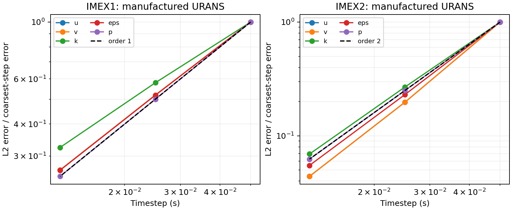
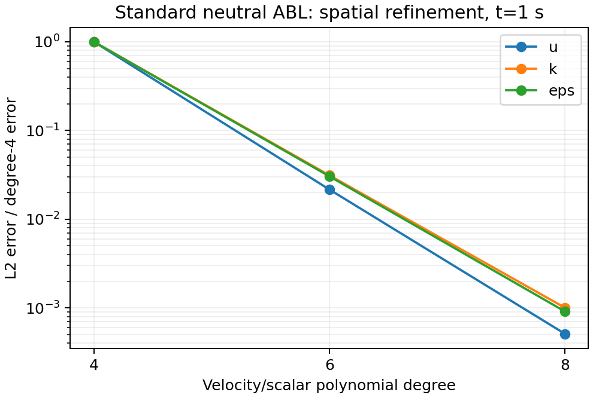

# Standard k–epsilon URANS transport

Milestone 3 adds an opt-in `RANSVelocityCorrectionScheme` to
`IncNavierStokesSolver`. It advances standard k–epsilon with changing turbulent
diffusion, the full symmetric momentum stress, implicit turbulence losses, and
a pressure iteration enforcing the discrete continuity equation. It includes a
compatible standard log-law control on a flat standoff boundary. The Linux
acceptance suite, native smoke tests, independent kernel/column regressions,
and source-hash audit passed. Milestone 3 is closed on 29 October 2026.

## Material Passport

| Field | Value |
| --- | --- |
| Origin skill | academic-research-suite, experiment-agent |
| Origin mode | implementation and numerical verification |
| Origin date | 2026-10-29 |
| Version label | neutral_abl_rans_m3_v1 |
| Milestone status | CLOSED |
| Source parent | `1e60b6d31cb3bc90f9ad43a24e62ec60936bdd49` |
| Project branch | `codex/neutral-abl-rans-awf` |
| Linux connection | `ssh jay@100.105.247.110` over Tailscale |
| CPU budget | At most 16 concurrent project workers |

## Solver contract

The implementation is in
[`RANSVelocityCorrectionScheme.h`](../../solvers/IncNavierStokesSolver/EquationSystems/RANSVelocityCorrectionScheme.h)
and [its implementation](../../solvers/IncNavierStokesSolver/EquationSystems/RANSVelocityCorrectionScheme.cpp).
It reuses the native field, advection, time-integration, Helmholtz, output, and
boundary infrastructure. The existing solver classes keep their original
behavior. Milestone 2's general standard-model point evaluator supplies the
viscosity and turbulence source components.

Use the following session choices:

| Setting | Value or interpretation |
| --- | --- |
| `SolverType` | `RANSVelocityCorrectionScheme` |
| `TurbulenceModel` | `StandardKEpsilon` |
| `EQTYPE` | `UnsteadyNavierStokes` |
| `Projection` | `Galerkin` |
| Fields in full 2D | `u,v,k,eps,p`, with mesh y representing height |
| Fields in full 3D | `u,v,w,k,eps,p`, with mesh z representing height |
| Time integration | Native `IMEX`, order 1 or 2, blank variant, constant step |
| `RANSResolvedDiffusion` | `HighRe` excludes resolved molecular diffusion; `Molecular` retains it |
| `Kinvis` | Positive physical molecular viscosity in both modes |
| `p` field | Reduced pressure `pi = p_mechanical/rho + 2k/3`, with zero volume mean |

The scalar fields have the same continuous expansion and ordered physical
quadrature grid as velocity. Pressure can use a lower-order continuous space
on that **same quadrature grid**. The fixtures use degree p velocity/scalars
and degree p−2 pressure. The implementation checks physical point coordinates,
not just array lengths. The tested elements are quadrilaterals and hexahedra.
Homogeneous Fourier expansions, substepping, adaptive timesteps, SVV, GJP,
advection smoothing, flow-rate control, and moving reference frames are outside
this initial path and are rejected where configured. Use RANS transport
constants in place of the legacy `DiffusionCoefficient` function.

The mechanical pressure per unit density exposed through the fluid interface
subtracts 2k/3;
saved fields and history points retain reduced pressure. The field metadata
declares the model and pressure convention. Native field output embeds the
lower-order pressure in the velocity expansion, following the existing
`EquationSystem::WriteFld` convention. The field audit checks that complete
saved representation. Provenance emitted by the installed core library can
identify that library's older build; the run manifest identifies the tested
RANS source parent, exact source hashes, and executable hash.

### Implicit stage and symmetric stress

Let `alpha = 1/lambda`, where lambda is the native IMEX stage timestep and b is
the stage's incoming predictor. Advection and external forcing form the
explicit part. The implicit part contains

\[
\partial_t U=-\nabla\pi+\nabla\cdot[\mu(\nabla U+\nabla U^T)],\quad
\mu=\nu_b+\nu_t,
\]
\[
\partial_t k=\nabla\cdot(D_k\nabla k)+P-\epsilon,\qquad
\partial_t\epsilon=\nabla\cdot(D_\epsilon\nabla\epsilon)
+C_{\epsilon1}\frac{\epsilon}{k}P-C_{\epsilon2}\frac{\epsilon^2}{k}.
\]

Here `Dk = nu_b + nut/sigmaK`, `Depsilon = nu_b + nut/sigmaEpsilon`, and
production contracts the same complete covariance with the native velocity
gradient. The isotropic 2k/3 term is absorbed in reduced pressure in momentum.
No production clipping or k/epsilon floor is introduced.

Each nonlinear iteration evaluates the closure at the current iterate. Scalar
component diffusion is implicit in momentum. The transpose-gradient stress is
assembled through `IProductWRTDerivBase`; it contributes the weak divergence
with its interface/boundary interpretation intact. This term is retained even
when the velocity is nearly divergence-free: variable viscosity prevents
replacing the full stress by a scalar effective Laplacian.

The turbulence Helmholtz problems use the positive loss coefficients
`epsilon_iterate/k_iterate` and `Cepsilon2*epsilon_iterate/k_iterate` as variable
mass coefficients. Their gains are P and
`Cepsilon1*epsilon_iterate*P/k_iterate`. At a converged fixed point these are
the original model sources. Viscosity, production, losses, and wall data are
updated within the stage; no frozen-viscosity approximation is used in the
accepted nonlinear result. The assembly avoids the legacy division by Kinvis,
so `HighRe` sets resolved nu to zero while retaining positive physical Kinvis.

The default nonlinear relaxation is 0.5 and pressure relaxation is 0.8. These
change the iteration, not its converged equations. Iteration failure or a
nonpositive/nonfinite candidate fails the stage. Backward Euler is used for
the strong-loss positivity control. BDF2 is not unconditionally positive;
an intentionally excessive BDF2 step is required to trigger the guard.

### Coupled pressure and normal velocity

Pressure is a Lagrange multiplier for the native weak continuity equation.
For a pressure test q, assemble

\[
D_h(U)[q]=-(U,\nabla q)+\langle U\cdot n,q\rangle.
\]

The normal component of velocity is prescribed at nonperiodic boundaries.
Each such pressure boundary must use a Neumann entry tagged
`USERDEFINEDTYPE="RANSPressure"`. Its `VALUE="0"` is a marker for the coupled
treatment; it does not assert zero physical normal pressure gradient.
Fully prescribed inlet/outlet velocities and periodic faces are supported.
Pressure-Dirichlet/open-outflow formulations remain later work.

After the component velocity solves, the pressure defect iteration applies
an inertia/viscous preconditioner to this **assembled weak residual**. A
Poisson solve supplies `-alpha Kp^{-1} Dh(U)`, and pressure mass solves supply
the viscosity-weighted mass contribution. The preconditioner is approximate;
the stage must converge with the actual symmetric stress and weak continuity.
The old constant-viscosity curl–curl pressure extrapolation is bypassed.

The Poisson map pins a vertex to fix its gauge. Pressure mass inverses instead
use a separate unpinned map, since a mass matrix is already nonsingular. The
Poisson increment has a homogeneous pin, and every pressure update has its
volume mean removed. Final continuous pressure coefficients are stored through
local transforms and C0 assembly, avoiding an artificial mass-projection
constraint at the pinned vertex. A gauge-offset control tests invariance to a
constant added to initial pressure.

Stage diagnostics report both strong divergence and the L2 norm of the
mass-represented weak continuity residual. The latter is the enforced discrete
constraint; the former also contains spatial approximation error. They are
not interchangeable measures.

### Standard log-law control

`RANSLogLaw` denotes a flat lower **standoff boundary**, above the omitted
inner wall region. Use tangential Neumann entries with that tag, zero normal
Dirichlet velocity, zero k Neumann flux, epsilon Dirichlet, and the coupled
pressure marker. The wall law evaluates current boundary k and velocity:

\[
u_k=C_\mu^{1/4}\sqrt{k_H},\qquad
t_w=u_k\kappa\,U_H/\log((H+s)/z_0),\qquad
\epsilon_H=u_k^3/[\kappa(H+s)].
\]

The tangential momentum Neumann contribution is `-tw`, in the outward-gradient
flux convention at the lower boundary. Epsilon boundary coefficients are
replaced by the formula above at each iteration. `RANSZ0` is aerodynamic
roughness; `RANSHeightShift` s is the explicit standard-model shifted-origin
option. Neither is the physical roughness height used by the original AWF.
In 3D the first two components are tangential and the last is vertical.

For this new variable-diffusion path, scalar Neumann values are **diffusion
gradient fluxes** `D grad(phi) dot n`. Momentum Neumann values are components
of the full symmetric-stress traction. The standard top control supplies
`tw_top=u*^2`, zero k flux, and
`(nut/sigmaEpsilon) epsilon'=-u*^4/(sigmaEpsilon Z)`.

This standard-model control does not introduce the CLS/AWF strip's additional
P state or its integrated production/dissipation replacement. The conservative
AWF strip selected in Milestone 1 remains part of Milestones 4–5. The standoff
interpretation makes the standard boundary policy concrete without importing
the AWF correction into the standard-model baseline.

## Configuration and diagnostics

| Parameter | Default |
| --- | --- |
| `RANSCmu`, `RANSCepsilon1`, `RANSCepsilon2` | 0.09, 1.44, 1.92 |
| `RANSSigmaK`, `RANSSigmaEpsilon` | 1, 1.3 |
| `RANSNonlinearTolerance` | 1e−9 |
| `RANSMaxIterations` | 200 |
| `RANSPicardRelaxation`, `RANSPressureRelaxation` | 0.5, 0.8 |
| `RANSMinimumK`, `RANSMinimumEpsilon` | 0, with strict positivity required |
| `RANSZ0`, `RANSHeightShift` | 0.02, 0 |

The stopping test uses the maximum iterate change for each field divided by
`max(1, field maximum magnitude)`, a similarly scaled pressure correction,
and the absolute weak-divergence L2 norm. All must be below the configured
tolerance. Working units and field scales therefore matter when selecting a
tolerance. Positive minimum-state guards are optional rejection thresholds;
they never replace a value with a floor.

`<session>.rans.csv` records stage time, iterations, state change, pressure
correction, strong/weak divergence, minimum k/epsilon, viscosity range, live
global-system counts, and guard activations. Every changing-coefficient
Helmholtz solve releases its global, static-condensation and local blocks.
The fixed pressure Poisson/mass operators have bounded lifetimes. Optional
`RANSDebug` supplies detailed iteration output for diagnosing a failed stage.
MPI state and closure guards fail collectively, including ranks without wall
faces. Successful stages have no guard activation.

## Acceptance study

The independent fixture generator
[`generate_m3.py`](../../solvers/IncNavierStokesSolver/Tests/RANS/generate_m3.py)
uses SymPy to differentiate a prescribed unsteady divergence-free polynomial
velocity, spatially/time-varying k and epsilon, and nonconstant reduced
pressure. Its forcing includes the full variable symmetric stress and both
transport equations. The solver does not evaluate this reference internally
or subtract an equilibrium residual.

[`validate_m3.py`](../../solvers/IncNavierStokesSolver/Tests/RANS/validate_m3.py)
checks first/second temporal order, quadrature sensitivity, the gauge offset,
both diffusion modes, a deliberately missing transpose term in manufactured
forcing, homogeneous decay, an independent backward-Euler algebraic root,
the excessive-step BDF2 rejection, a three-component 3D manufactured case,
full 3D homogeneous transport, complete saved-field
serial/MPI agreement, a collective invalid-state rejection, standard ABL
spatial refinement, shifted heights, a wrong top flux, finite-viscosity
departure, and the legacy Kovasznay regression.

The standard ABL domain is 300 m long with a 30 m top and a 2 m lower standoff
plane. It uses z0=0.02 m and U(10 m)=10 m/s with the **computed model kappa**
0.43266615305567874. Streamwise periodicity first isolates the vertical
balance. A longer run lasts one nominal flow-through time, 30 s. This is a
standard-model transport/control check; the inlet/outlet, five-flow-through,
perturbation and full preservation study remains Milestone 6.

The [native field audit](../../library/UnitTests/SolverUtils/RANSFieldAudit.cpp)
imports every saved element and variable, verifies coverage and representation,
then compares complete physical fields and reference errors in full precision.
Fixtures, logs, field files and long-run diagnostics stay in the Linux run
directory. Exact-fixture/binary fingerprints allow a resumed validator to reuse
completed cases, without silently reusing results after source/binary changes.

## Completion results

The [transport manifest](neutral-abl-rans-awf-milestone-3/validation.json)
records 27 cases, including two required rejection cases, plus complete-field
comparisons and the legacy solver regression. The
[environment record](neutral-abl-rans-awf-milestone-3/environment.json)
identifies the executables, installed dependencies, compiler, allocation and
raw-log hashes. All 12 source hashes in the transport manifest match the Mac
files delivered in the closure commit. The plotting script has its own hash
in the environment record.

### Unsteady transport and pressure

The manufactured solution uses degree 6 velocity/scalars, degree 4 pressure,
10 GLL points per direction, timesteps 0.05, 0.025 and 0.0125 s, and final time
0.2 s. Observed orders from successive step halvings are:

| Field | IMEX1 | IMEX2 |
| --- | --- | --- |
| u | 0.947, 0.972 | 2.343, 2.162 |
| v | 0.947, 0.972 | 2.343, 2.162 |
| k | 0.787, 0.839 | 1.899, 1.953 |
| epsilon | 0.948, 0.973 | 2.120, 2.065 |
| reduced pressure | 1.000, 1.000 | 2.001, 2.000 |

IMEX2 demonstrates second-order convergence. The IMEX1 k sequence approaches
first order more slowly than the other fields over this tested range; it is
reported explicitly rather than assigned an exact measured order of one.
Homogeneous decay independently gives k orders 2.167 and 2.058, and epsilon
orders 2.179 and 2.047. The strong-loss backward-Euler run matches an independent
algebraic root while remaining positive. The excessive BDF2 step and a
four-rank case with an invalid state initially confined to one partition both
fail through the required positivity guard.

At the middle timestep, increasing quadrature from 10 to 14 points changes
complete saved fields by at most 9.46e−14. Adding 1000 to the initial pressure
does not change the final reference errors within the 1e−8 acceptance bound.
Both `Molecular` and `HighRe` manufactured cases pass. Omitting the transpose
stress from the **independent manufactured forcing**, while keeping the solver
unchanged, increases pressure L2 error from 4.52e−6 to 1.92e−4, a factor of
42.6. Pressure is the decisive observable because part of that omitted force
can be absorbed into a pressure gradient.

The three-component 3D manufactured case uses eight hexahedra, degree 4
velocity/scalars, degree 2 pressure, 11 quadrature points per direction,
four ranks, and two 0.01 s steps. L2 errors are 6.26e−7, 6.27e−7 and 4.54e−8
for u/v/w; 1.08e−8 for k; 2.41e−6 for epsilon; and 3.69e−6 for reduced pressure.
All three velocities and all three derivative directions are active.
The largest complete-field serial/four-rank differences are 1.08e−10 for the
2D manufactured case and 4.25e−10 for full-3D periodic decay. These comparisons
import every saved field and element, including the embedded pressure modes.

The legacy `KovaFlow_m8_short_HOBC.xml` case retains its L2 errors
2.30665e−8, 5.67848e−9 and 1.07686e−8 for u/v/p within 1e−11. The new path
does not change the existing velocity-correction algorithm.



### Standard neutral ABL

With the compatible top traction and epsilon flux, the unforced analytical
standard profile converges under polynomial refinement. At time 1 s,
using 20 steps of 0.05 s, the unnormalized domain L2 errors are:

| Velocity/scalar degree | u | k | epsilon |
| --- | --- | --- | --- |
| 4 | 8.156e−3 | 3.514e−3 | 2.780e−3 |
| 6 | 1.761e−4 | 1.097e−4 | 8.458e−5 |
| 8 | 4.162e−6 | 3.528e−6 | 2.535e−6 |

At degree 8, replacing the top epsilon flux by zero raises its L2 error to
5.051e−2. The shifted-origin case has u/k/epsilon errors 4.072e−6, 3.348e−6
and 2.409e−6. Adding resolved molecular viscosity 0.01 m²/s while retaining
the high-Re analytical reference produces measurable departure: u/k/epsilon
errors become 6.992e−2, 7.357e−2 and 1.726e−2. The solver does not reset fields
to an analytical profile or cancel the equilibrium residual.

The four-rank degree-8 run advances **600 steps to 30 s**, one nominal
300 m / 10 m/s flow-through time. The reference has u*=0.6962082664 m/s,
k=1.6156865007 m²/s² and epsilon(30 m)=0.02599820415 m²/s³. Final errors are:

| Field | L2 error | Maximum absolute error | Normalized maximum error |
| --- | --- | --- | --- |
| u | 7.883e−6 | 1.841e−7 m/s | 1.841e−8 using U(10)=10 |
| k | 4.424e−6 | 6.039e−8 m²/s² | 3.738e−8 using final maximum k |
| epsilon | 2.175e−6 | 1.183e−7 m²/s³ | 4.549e−6 using reference epsilon at the top |
| vertical velocity | 1.848e−8 | 7.521e−10 m/s | 1.080e−9 using u* |

The epsilon normalization uses the smallest reference epsilon in the domain;
it therefore bounds the pointwise relative error at all sampled heights.
All three primary fields meet the 0.1% milestone control threshold, with the
largest normalized error equal to 0.000455%. This is a converged spatial
approximation to the analytical equilibrium, not an exact-discrete proof.

The 600-stage run needs at most 18 nonlinear iterations per stage. Its largest
weak-divergence L2 norm is 7.92e−11; strong divergence reaches 2.31e−8. The live
global-system diagnostic remains 8 throughout. The 3D manufactured case
similarly retains a count of 10. These are manager counts, not a measurement
of total resident memory. All accepted stages have positive k and epsilon
and zero guard activations.



### Regression and reproduction

The [kernel regression manifest](neutral-abl-rans-awf-milestone-3/kernel-regression-validation.json)
records 11,250 native checks, 78 bulk cases, 60 wall cases, 24 rejected inputs,
the independent Python oracle, and native serial/four-rank column checks.
The maximum serial/MPI column difference is 2.84e−17. Historical Milestone 1
and Milestone 2 evidence remains unchanged. CTest passes all three registered
tests: `RANSStandardTransportSmoke`, `RANSWallLayerPrototype`, and
`RANSKernelUnitTests`.

The Linux run directory is
`/media/jay/新加卷/nektar-v2026-runs/neutral-abl-rans-awf/m3-transport`.
It contains the detached source parent plus the validated source files, the
isolated build, every generated fixture, full field outputs, histories, stage
diagnostics and raw logs. The full incompressible solver was rebuilt against
the installed native libraries; the shared build and installation were not
overwritten. The primary Linux checkout was initially `812a2c8` and was clean
at `29f467b` when evidence was collected, after independent HIT documentation
work advanced that branch. This milestone used its separate source worktree.

The tested toolchain is GCC 11.4.0, CMake 3.22.1, Open MPI 4.1.2 and Python
3.10.12 with SymPy 1.9. Initial compilation used eight jobs; final incremental
compilation used four. Numerical libraries use one thread. Temporal tests
use at most three concurrent serial solver jobs; that pool closes before
four-rank MPI tests begin. All work runs within CPU affinity 112–127 and the
**16-worker project limit**. CTest runs one test at a time.

From a synchronized Linux source checkout, reproduce in a fresh run directory:

```bash
source /home/jay/.local/opt/nektar-v2026-mpi/env.sh
export OMP_NUM_THREADS=1 OPENBLAS_NUM_THREADS=1 MKL_NUM_THREADS=1 BLIS_NUM_THREADS=1
export PYTHONDONTWRITEBYTECODE=1
export RANS_RUN=/media/jay/新加卷/nektar-v2026-runs/neutral-abl-rans-awf/m3-reproduction
mkdir -p "$RANS_RUN/tmp"
export TMPDIR="$RANS_RUN/tmp"
taskset -c 112-127 cmake -S solvers/IncNavierStokesSolver/Tests/RANS \
  -B "$RANS_RUN/build" -DCMAKE_BUILD_TYPE=Release -DRANS_BUILD_SOLVER=ON \
  -DNektar++_DIR=/home/jay/.local/opt/nektar-v2026-mpi/lib64/nektar++/cmake
taskset -c 112-127 cmake --build "$RANS_RUN/build" --parallel 4
taskset -c 112-127 ctest --test-dir "$RANS_RUN/build" --output-on-failure --parallel 1
taskset -c 112-127 python3 solvers/IncNavierStokesSolver/Tests/RANS/validate_m3.py \
  --build "$RANS_RUN/build" --output "$RANS_RUN/validation"
taskset -c 112-127 python3 solvers/IncNavierStokesSolver/Tests/RANS/validate_m2.py \
  --build "$RANS_RUN/build" --output "$RANS_RUN/kernel-regression" --mpi-ranks 4
taskset -c 112-127 python3 solvers/IncNavierStokesSolver/Tests/RANS/plot_m3.py \
  "$RANS_RUN/validation/validation.json" "$RANS_RUN/figures"
```

Full CLS and original AWF integration remain Milestone 4; the equilibrium AWF
coupling remains Milestone 5. The present standard-model periodic control does
not close Milestone 6's inlet/outlet, five-flow-through, perturbation, restart,
and broader h/p/dt preservation study. No thermal, terrain, low-Re, or rotating
model capability is claimed here.
