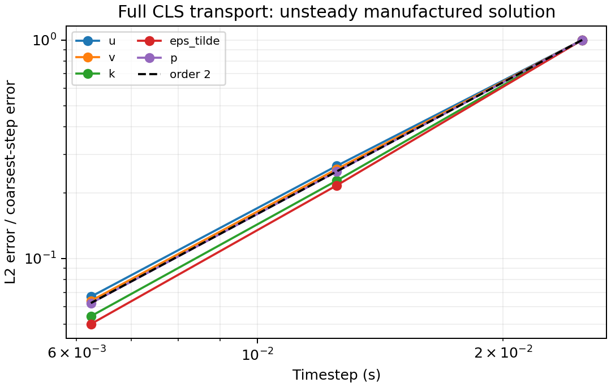
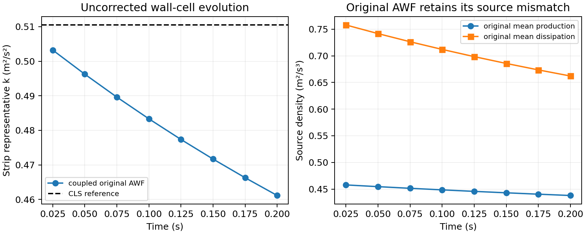

# CLS URANS and the original analytical wall function

Milestone 4 extends `RANSVelocityCorrectionScheme` with the high Reynolds
number Craft–Launder–Suga cubic closure, its algebraic Yap term, and the
original rough-wall analytical wall function coupled through Milestone 1's
conservative wall strip. The original AWF is an intentionally uncorrected
baseline; its dissipation mismatch must remain measurable.

The implementation is in the
[RANS solver](../../solvers/IncNavierStokesSolver/EquationSystems/RANSVelocityCorrectionScheme.cpp)
and [wall adapter](../../solvers/IncNavierStokesSolver/EquationSystems/RANSAnalyticalWallStrip.cpp).
They call the unchanged, independently verified Milestone 2 model kernels.

## Material Passport

| Field | Value |
| --- | --- |
| Origin skill | academic-research-suite, experiment-agent |
| Origin mode | implementation and numerical verification |
| Origin date | 2026-10-29 |
| Version label | neutral_abl_rans_m4_v1 |
| Milestone status | CLOSED on 2026-10-29 |
| Source parent | `7f3ce79ad2fa404c95f0aa89c6137c97d8e624b8` |
| Project branch | `codex/neutral-abl-rans-awf` |
| Authoritative environment | Linux, connected with `ssh jay@100.105.247.110` |
| Project worker limit | 16, including compilation, MPI and numerical threads |

## CLS transport contract

Select `TurbulenceModel=CLSHighRe`. The primary variables are
`u,v,k,eps_tilde,p` in full 2D, or `u,v,w,k,eps_tilde,p` in full 3D. The native
CG/IMEX configuration and coupled weak pressure treatment from
[Milestone 3](neutral-abl-rans-awf-milestone-3.md) remain in use.

In 2D, mesh x/y represent physical x/z; solver v is physical W. The gradient
is embedded in physical x/y/z before evaluating the full 3-by-3 covariance.
In 3D, the solver and physical axes coincide. The momentum flux uses

\[
T=(\nu_b+\nu_t)(\nabla U+\nabla U^T)-R^{NL}.
\]

Every nonlinear iteration updates the variable C(q), all quadratic and cubic
terms, production from the complete covariance, and the algebraic Yap term.
The component Laplacian is implicit. The transpose-gradient and nonlinear
fluxes enter the same native weak derivative assembly and converge within
the coupled stage. No simple-shear substitution, fixed equilibrium Cmu,
production clipping, stress limiter, or reference cancellation is used.

CLS defaults to state relaxation 0.1, pressure relaxation 0.25 and at most
800 iterations per implicit stage. The standard model retains its Milestone 3
defaults. A high-order CLS column exposed an oscillatory coupled iteration
with the more aggressive standard-model settings; pressure damping alone did
not resolve it, whereas damping the stress/state iteration did. These settings
change convergence of the iteration, not the equations at its fixed point.

`RANSPressureTolerance` defaults to `RANSNonlinearTolerance` and separately
controls the scaled pressure increment. The state-change and absolute weak
continuity tests retain `RANSNonlinearTolerance`. This permits a pressure
criterion appropriate to an elongated domain and small timestep, where the
inertia-weighted Poisson correction amplifies linear-solve roundoff. The 3D
AWF study uses 1e−7 for the pressure increment and 1e−10 for state/continuity;
the other acceptance cases use 1e−10 for all three. Tight study runs allow
2000 iterations, without changing the configured 800-iteration CLS default.

`RANSYapCoefficient` and `RANSYapLength` default to 0.83 and 2.5. The flat
physical wall is at `RANSWallOrigin`, default zero; Yap uses the positive
geometric height above that wall. CLS rejects the standard log-law height
shift. `RANSResolvedDiffusion=HighRe` omits resolved molecular diffusion;
`Molecular` adds it while retaining the **same high-Re dissipation convention**:
transported modified epsilon equals modeled total epsilon. The molecular
gradient-k split, damping and low-Re additional E term are not enabled.
Physical `Kinvis` remains positive in both modes and always enters the AWF.

The saved p field remains reduced pressure, pi=p_mechanical/rho+2k/3.
The fluid pressure interface subtracts 2k/3. Additional field output names
`rans_nut`, `rans_P`, `rans_Yap`, `rans_eps_total`, six `rans_R_ij` components,
`rans_quadratic_norm` and `rans_cubic_norm` identify modeled quantities,
separate from covariance of resolved unsteady fluctuations. They are local
polynomial projections of current model evaluations. Projection error in
these derived fields is distinct from transport error.

## Original AWF strip

Select `RANSWallModel=AWFOriginal` with CLS. At the flat lower interface H,
use Robin entries tagged `AWFOriginal` for tangential velocity and k,
Dirichlet entries for normal velocity and modified epsilon, and the
`RANSPressure` Neumann marker for pressure. The supplied Robin primitive
coefficient is a placeholder replaced by the stage's strip inertia.
The normal and epsilon traces are algebraic data updated within the coupled
solve. Tangential no slip is enforced by the finite auxiliary wall solution
at the physical wall, below the CG domain.

The geometry parameters are `RANSStripHeight=2`, `RANSStripPointP=1` and
`RANSStripPointN=4`, measured above `RANSWallOrigin`, with 0<P<H<N.
`RANSRoughnessHeight=0.1` is the original AWF equivalent sand-grain height;
it is distinct from aerodynamic z0. The AWF coefficients
`RANSAWFCmu`, `RANSAWFCLength` and `RANSAWFSmoothIntercept` default to
0.09, 2.55 and 10.7. N must lie below the CG top at each wall sampling column.
Initial geometry support is flat quadrilateral layers and extruded hexahedra.

Let wU and wk be the fixed logarithmic and physical-height matching weights
from [Milestone 1](neutral-abl-rans-awf-milestone-1.md). Eliminate

\[
U_P=(U_H-w_U U_N)/(1-w_U),\qquad
K_P=(k_H-w_k k_N)/(1-w_k).
\]

The same operators apply to the **complete native IMEX predictor b**. Thus
the strip inventories H UP and H KP retain their time histories without
additional independent restart variables. Explicit resolved convection and
body-force history is transferred by these linear operators. The strip's
selected mean convection approximation is this interpolation of the native
resolved convection; it is not a separately derived inner polynomial PDE.

For multidimensional assembly, UP and KP are tangential functions in the
continuous surface trace space, evaluated in each wall quadrature column.
The normal direction still has a single representative CV state and no
additional inner polynomial moments. This is the explicit extension of
Milestone 1's scalar column to a varying wall surface; it reduces to that
column for tangentially homogeneous data. Interface rows integrate these
functions against the native surface test functions.

For alpha=1/lambda, the implicit tangential interface gradient flux is

\[
t_H=H\alpha(U_P-b_P)+H F_p+t_A,
\]

where Fp is the same matching operator applied to the current mechanical
pressure gradient. The outer bottom outward flux is −tH. Its local
UH-dependent term becomes a Robin mass coefficient H alpha/(1−wU); the
nonlocal UN contribution is updated in the nonlinear iteration. The k flux
similarly follows

\[
q_H=H\alpha(K_P-b_{k,P})-H(\overline P_A-\overline\epsilon_A),
\]

with zero modeled physical-wall k flux. The opposite interface terms cancel
between outer and strip constant-test rows. No CG source is integrated over
the omitted inner volume. The original mean production and mean dissipation
are each supplied once.

The quasi-steady AWF receives the current tangential UH and
F=Fp+Fa−f_body, with Fa interpolated from resolved convective acceleration.
Pressure is converted from reduced to mechanical form before differentiation.
External body force has the opposite sign in this auxiliary F; its time
history is already present in b for the strip's transport row. The published
roughness cutoff below h remains inside the pure AWF kernel. Signed reversed
traction is preserved. The auxiliary upper derivative is not imposed as a
second independent resolved flux.

The initial adapter accepts deterministic `Body`/`Field` forcing. It rejects
other forcing classes because reevaluating a force with its own evolving state
inside each nonlinear iteration would change that force's time history.

EP, EH and the strip mean dissipation come from one original auxiliary
distribution. EP has no independent transport equation; EH replaces the
outer dissipation boundary row. There is no extra prescribed epsilon flux.
The corrected distribution and equilibrium switch remain Milestone 5.

EH and WH use the native boundary-constrained forward transform, preserving
shared vertices/edges of the continuous trace. A nonconstant auxiliary EH is
not generally a polynomial. Diagnostics separate the actual trace constraint
error from `epsilonH_projection_error`, the difference between that projected
trace and the raw auxiliary distribution. Constant-K reference data have no
such tangential representation error.

Integrated strip continuity sets

\[
W_H=-H\nabla_t\cdot U_P.
\]

Native tangential derivatives at H and physical N samples provide this trace
within each nonlinear iteration. It need not be zero in a nonuniform flow.
The weak pressure iteration uses that actual normal velocity and the full
RANS momentum equation. It does not add an independent pressure value.

All ranks participate in physical N sampling. Wall quadrature coordinates
are gathered once; ownership is selected by the containing element above N
from the interior side of each tangential wall patch, with deterministic
global geometry ID resolving remaining ties. This retains each patch's
one-sided derivative at shared tangential vertices. Values and derivatives are evaluated
at the exact N height with native elemental interpolation and communicated
collectively. Ranks without wall faces can own N samples. The initial adapter
uses replicated sampling metadata and collective values; large-domain
communication optimization is outside this milestone.

## Diagnostics and acceptance

`<session>.rans.csv` retains stage convergence, strong/weak divergence,
positivity and matrix-manager diagnostics. `<session>.awf.csv` records patch
area, both integrated tangential tractions, production/dissipation means,
positive eliminated KP and EP, the EH constraint, integrated strip continuity,
normal interface velocity, constant-test momentum/k budgets, physical N
ownership and original-policy chi=0. A budget is marked available only when
the other boundaries for that variable are Neumann or periodic; reactions
of prescribed tangential traces are not inferred.
The boundary measure is per unit span in 2D and physical patch area in 3D;
traction and budgets are per unit density. Legacy aerodynamic-force filters
retain their existing molecular-viscosity convention; the modeled covariance
and AWF traction outputs provide the RANS quantities for this milestone.

The independent generator uses dimensional tensor formulas and symbolic
differentiation. Its affine divergence-free velocity activates quadratic,
cubic and Yap terms while spatially varying k/epsilon makes C(q) and
viscosity nonconstant. A full 3D case activates all three velocities and
derivative directions. Complete field audits include the modeled outputs
whenever independent exact expressions are supplied.

Acceptance checks cover second-order unsteady convergence, both resolved
diffusion modes, quadrature, serial/four-rank fields, omitted cubic forcing,
omitted Yap, geometric-distance sensitivity, CLS column p refinement,
original-AWF mean/point/traction recovery against independent quadrature,
the note's uncorrected wall-source mismatch, evolving strip inventory,
both tangential directions in 3D, nonzero WH in a nonuniform wall flow,
smooth/transitional/molecular AWF branches, reversed traction, and collective
rejection of invalid eliminated KP, N geometry, and wall distance.

## Completion evidence

All 27 Milestone 4 acceptance cases passed on Linux, including three expected
collective rejections. All accepted stages retained positive outer and
eliminated turbulence states, with zero guard activations and bounded live
matrix counts. The same executable also passed the complete 27-case standard
regression, the legacy Kovasznay check, five CTests, and the 11,250-check native
kernel suite with its independent oracle and serial/four-rank column audit.

The committed records are:

- [CLS/AWF acceptance manifest](neutral-abl-rans-awf-milestone-4/validation.json),
  containing exact session/binary hashes, commands, stage diagnostics,
  independent reference values and full-field comparisons.
- [Standard transport regression](neutral-abl-rans-awf-milestone-4/standard-regression-validation.json)
  and [kernel regression](neutral-abl-rans-awf-milestone-4/kernel-regression-validation.json).
- [Environment and artifact fingerprints](neutral-abl-rans-awf-milestone-4/environment.json),
  including compiler/MPI versions, linked native libraries, build flags,
  primary-checkout observations and raw-log hashes.

### CLS transport

The independent manufactured solution was advanced to 0.1 s with
dt=0.025, 0.0125 and 0.00625 s. Velocity/scalar degree is four and pressure
degree two, with 12 quadrature points per direction. Observed L2 orders are:

| Field | First halving | Second halving | Finest-step L2 error |
| --- | ---: | ---: | ---: |
| u | 1.916 | 1.987 | 3.916e−9 |
| v | 1.965 | 2.001 | 3.951e−9 |
| k | 2.140 | 2.060 | 4.079e−8 |
| modified epsilon | 2.213 | 2.106 | 1.381e−7 |
| reduced pressure | 2.002 | 2.001 | 1.120e−6 |



The [PDF figure](neutral-abl-rans-awf-milestone-4/figures/cls-temporal.pdf)
is also supplied. The four-rank full-3D manufactured case has primary-field
L2 errors below 3e−6. Increasing the 2D quadrature from 12 to 16 changes no
saved field by more than 2.604e−13; the serial/four-rank maximum difference,
including the modeled outputs, is 2.019e−10.

Removing the cubic term from the manufactured momentum forcing increases
pressure error from 1.120e−6 to 3.300e−4. Suppressing Yap increases modified
epsilon error from 5.944e−7 to 3.065e−3; changing the wall-distance origin
increases it to 1.429e−2. These controls exercise the actual assembled terms.
The nonpolynomial Yap output has projection-dominated L2 error 3.292e−5 at
degree four, reducing to 1.069e−7 at degree eight at the same timestep.

The CLS bulk ABL column, with prescribed compatible boundary data and no
AWF, refines as follows at 0.1 s:

| Velocity/scalar degree | u L2 error | k L2 error | modified epsilon L2 error | reduced pressure L2 error |
| --- | ---: | ---: | ---: | ---: |
| 4 | 5.604e−3 | 1.392e−4 | 6.593e−4 | 4.475e−3 |
| 6 | 1.267e−4 | 3.041e−6 | 2.082e−5 | 1.690e−4 |
| 8 | 3.083e−6 | 8.118e−8 | 6.807e−7 | 4.682e−6 |

### Original AWF baseline and conservation

Independent quadrature at the note's zero-forcing reference reproduces
mean production 0.461092609 and mean dissipation 0.774943967 m²/s³.
This reference is an oracle evaluation, not a zero-time transport result.
At the first finite backward-Euler step, dt=0.025 s, the coupled values are
0.457751824 and 0.757956121. At 0.2 s they are 0.437903869 and 0.662149827.
The eliminated strip k falls from its initial reference 0.510508013 to
0.461128789 m²/s². No profile reset or source cancellation maintains the
original incompatible state.



The [PDF figure](neutral-abl-rans-awf-milestone-4/figures/original-awf-baseline.pdf)
is also supplied. Traction, mean production, mean dissipation, EP/EH and the
matching elimination in the homogeneous evolving cases agree with independent
quadrature within 2e−8. The serial/four-rank full-field difference is at most
6.728e−9. In both the N=4 and N=8 MPI studies, all 24 wall-point N samples
are owned by ranks without wall faces; only one of the four ranks owns walls.

Across all accepted wall cases, maximum normalized constant-test momentum
and k budget defects are 1.062e−7 and 7.370e−8, below the 2e−7 acceptance
limit. Momentum is scaled by max(1, integrated traction magnitude per
component); k is scaled by max(1, H times patch area times the sum of mean
production and mean dissipation). Actual algebraic EH trace error is below
4.2e−17 and the raw integrated strip continuity defect below 1.55e−12.
The nonuniform case develops nonzero WH, reaching 2.682e−5 m/s, with EH
projection error 8.905e−9 distinguished from its imposed-trace error.

The full-3D wall case exercises both horizontal tractions and their prescribed
direction, as well as the volume/strip budgets. Its two stages have weak
continuity residuals below 4.11e−11, state changes below 9.80e−11, and
unscaled pressure increments below 9.82e−9 with pressure tolerance 1e−7.
Its strong divergence reaches 5.27e−3: the mixed weak pressure method does
not make pointwise divergence zero. This coarse, short wall case is a
coupling/conservation check; its difference from the initial analytical field
is not an accuracy or preservation result.

Smooth and transitional roughness cases pass. The deliberately large
physical-viscosity auxiliary control has zero turbulent production and equal
EP, EH and mean dissipation; it verifies the entirely molecular AWF branch,
without claiming physical validity of high-Re outer CLS at low Reynolds
number. A forced case retains reversed signed wall traction. Invalid
eliminated KP, out-of-domain N and nonpositive CLS wall distance are rejected
collectively. The standard 30-second/600-step ABL regression retains maximum
absolute u and k errors of 1.839e−7 and 6.033e−8, respectively. The native
kernel serial/MPI column difference remains 2.835e−17.

### Tested source and scope

The tested source parent is `7f3ce79ad2fa404c95f0aa89c6137c97d8e624b8`, with
all 19 model, adapter, build, fixture and study-file SHA256s recorded in the
acceptance manifest and verified against the Mac checkout before commit.
The Release solver SHA256 is
`b978de9e9210b603c05d7996026ec57276101d211e3c3abda4d702b7a9b14f8d`;
the audit executable SHA256 is
`07f353b7534c6c3b5887ace15d16e7d8a181175cb06f569f734f46ef47f070cb`.
The standard regression uses those same binaries.

Validation used GCC 11.4.0, CMake 3.22.1, Open MPI 4.1.2 and Python 3.10.12
on Linux, with NumPy 1.21.5, SciPy 1.8.0, SymPy 1.9 and Matplotlib 3.5.1.
The isolated source/build and all raw data remain under
`/media/jay/新加卷/nektar-v2026-runs/neutral-abl-rans-awf/m4-cls-original-awf`.
The shared MPI core libraries were reused without rebuilding or reinstalling
them. Native field core provenance can therefore name an older installed-core
revision; the recorded source hashes and executable hashes identify the RANS
implementation tested here. The primary Linux checkout and other HIT jobs
were left to their existing work; its independently advancing revision and
untracked Python cache are recorded without altering them.

Milestone 4 closes full CLS transport and the conservative original-AWF
baseline. The corrected AWF and equilibrium switch remain Milestone 5.
The full inlet/outlet, restart and multi-flow-through preservation study
remains Milestone 6. Thermal AWF, terrain, curved/nonmatching wall layers,
low-Re CLS and broad nonlinear robustness are not established by these tests.

## Reproduction

Run from a synchronized Linux source checkout. Keep compilation and data in
a separate run directory; the shared MPI installation supplies the native
libraries and is not overwritten. The external build compiles the complete
production incompressible-solver source list, including the new classes.

```bash
source /home/jay/.local/opt/nektar-v2026-mpi/env.sh
export OMP_NUM_THREADS=1 OPENBLAS_NUM_THREADS=1 MKL_NUM_THREADS=1 BLIS_NUM_THREADS=1
export PYTHONDONTWRITEBYTECODE=1
export RANS_RUN=/media/jay/新加卷/nektar-v2026-runs/neutral-abl-rans-awf/m4-reproduction
mkdir -p "$RANS_RUN/tmp"
export TMPDIR="$RANS_RUN/tmp"
taskset -c 112-127 cmake -S solvers/IncNavierStokesSolver/Tests/RANS \
  -B "$RANS_RUN/build" -DCMAKE_BUILD_TYPE=Release -DRANS_BUILD_SOLVER=ON \
  -DNektar++_DIR=/home/jay/.local/opt/nektar-v2026-mpi/lib64/nektar++/cmake
taskset -c 112-127 cmake --build "$RANS_RUN/build" --parallel 4
taskset -c 112-127 ctest --test-dir "$RANS_RUN/build" --parallel 1 --output-on-failure
taskset -c 112-127 python3 solvers/IncNavierStokesSolver/Tests/RANS/validate_m4.py \
  --build "$RANS_RUN/build" --output "$RANS_RUN/validation"
taskset -c 112-127 python3 solvers/IncNavierStokesSolver/Tests/RANS/validate_m3.py \
  --build "$RANS_RUN/build" --output "$RANS_RUN/standard-regression"
taskset -c 112-127 python3 solvers/IncNavierStokesSolver/Tests/RANS/validate_m2.py \
  --build "$RANS_RUN/build" --output "$RANS_RUN/kernel-regression" --mpi-ranks 4
taskset -c 112-127 python3 solvers/IncNavierStokesSolver/Tests/RANS/plot_m4.py \
  "$RANS_RUN/validation/validation.json" "$RANS_RUN/figures"
```

The commands above run studies sequentially. The recorded final validation
overlaps the CLS/AWF study on CPUs 112–119 with the standard/kernel regression
stream on CPUs 120–127. Each stream uses at most four MPI ranks, with the
standard validator's three serial temporal cases completed before its MPI
cases. The combined allocation remains within the 16-CPU project limit.
Initial compilation used eight jobs and incremental builds four.
Symbolic generation needs SymPy; the independent wall oracle uses SciPy;
plotting uses Matplotlib. Native solver and audit binaries perform the field
comparisons. Exact fixture/binary fingerprints govern resumed case reuse.
