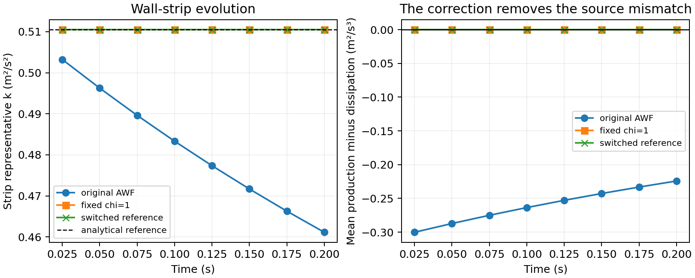
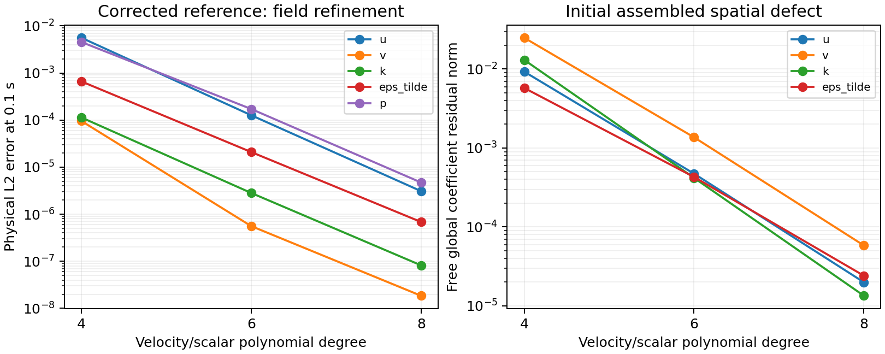
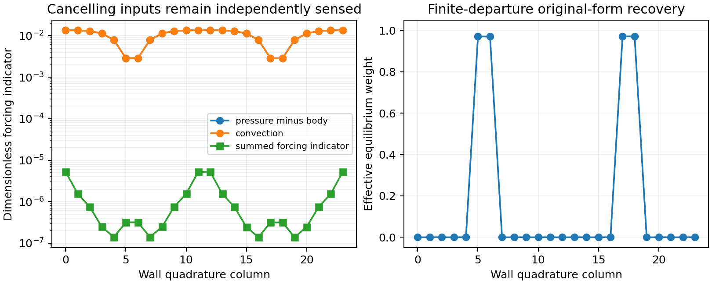

# Equilibrium-preserving CLS analytical wall function

Milestone 5 couples the note's dissipation correction and compact equilibrium
switch to the production `RANSVelocityCorrectionScheme` wall strip. It reuses
the verified Milestone 2 kernels and the conservative original-AWF adapter
closed in [Milestone 4](neutral-abl-rans-awf-milestone-4.md).

## Material Passport

| Field | Value |
| --- | --- |
| Origin skill | academic-research-suite, experiment-agent |
| Origin mode | implementation and numerical verification |
| Origin date | 2026-10-29 |
| Version label | neutral_abl_rans_m5_v1 |
| Milestone status | CLOSED on 2026-10-30 (Asia/Shanghai) |
| Source parent | `c91536ae3888db879ca1e0e6c51434d928fbce75` |
| Project branch | `codex/neutral-abl-rans-awf` |
| Authoritative environment | Linux over Tailscale `jay@100.105.247.110` |
| Project allocation | At most 16 workers; numerical library threads set to one |

## Native policy and configuration

Select `TurbulenceModel=CLSHighRe` and `RANSWallModel=AWFEquilibrium`.
Use the same flat physical frame, primary variables, geometric wall distance,
CV inventory, nonlocal N sampling, coupled weak pressure and IMEX transport
as Milestone 4. The tangential velocity/k Robin entries at H must carry the
matching `AWFEquilibrium` tag. Normal velocity and modified dissipation are
Dirichlet traces determined in the nonlinear stage, with pressure tagged
`RANSPressure`. See the complete XML fixture in the RANS test directory.

The corrected policy receives the **configured CLS neutral reference** from
the solver, rather than using a second hard-coded q or kappa. It reconstructs
its counterfactual reference from each current eliminated positive KP and the
current physical viscosity, sand-grain roughness and H/P geometry. At each
wall quadrature column,

\[
u_* = \sqrt{K_P/q_*},\quad t_0=K_P/q_*,\quad U_{H,0}=t_0J_0,
\quad A=u_*^3/\kappa_c,
\]
\[
P_0=\frac{t_0^2}{H}\int_0^H\frac{\nu_{t,A}}{D_A^2}\,dz,
\quad\Lambda=HP_0/A,\quad z_c=H\exp(1-\Lambda).
\]

P0 always uses zero forcing even when the current resolved state is forced.
The original auxiliary momentum law supplies traction and mean production
at the actual current velocity and forcing for every weight. The correction
changes only the dissipation mean and point values:

\[
\bar\epsilon=(1-\chi)\bar\epsilon_A+\chi P_0,\quad
E_P=(1-\chi)E_A(P)+\chi A/P,\quad
E_H=(1-\chi)E_A(H)+\chi A/H.
\]

All three are evaluations of one blended positive auxiliary distribution,
with corrected component A/max(z,zc). Its weight is constant through the
omitted normal column. As in Milestone 4, the multidimensional extension
allows the representative states and weight to vary tangentially in surface
quadrature columns; it introduces no extra inner polynomial moments.

The matching input is the actual CG trace at H. The M1 logarithmic P/N
operator exactly preserves an outer logarithm in the continuum, so the
compatible reference is UH=t0 J0 and
U(z)=UH+(u*/kappa) log(z/H). The local diagnostic `log_z0` is
log(H)−kappa UH/u*. Prescribing an additional `RANSZ0` is rejected for this
policy. H/P/N remain physical geometry, independent of quadrature nodes.

## Switch and forcing

`RANSAWFWeight=Fixed` uses `RANSAWFFixedWeight` in [0,1], default one.
This verification mode isolates the correction. Weight zero returns the
complete original AWF exactly, including its boundary constraints and strip
source. `RANSAWFWeight=Switched`, the corrected policy's default, requires
explicit positive parameters `RANSAWFOn < RANSAWFOff`. No calibrated terrain
thresholds are supplied.

The seven independent indicators and parameter suffixes are:

| Indicator | Weight parameter suffix |
| --- | --- |
| Matching tangential velocity relative to local UH,0 | U |
| Logarithmic UP/UN velocity increment | DeltaU |
| Independent outer kN relative to KP | K |
| Independent outer epsilonN relative to A/N | Epsilon |
| Mechanical pressure gradient minus body acceleration | Pressure |
| Resolved convective acceleration | Convection |
| Representative normal velocity WP | Normal |

Each weight is `RANSAWFWeight<suffix>`, default one, nonnegative, with at
least one positive weight. Directions `RANSAWFDirectionX/Y`, default (1,0),
specify a fixed nonzero incoming horizontal direction. The 2D x-z case
requires direction Y=0; a 3D direction can be rotated. It is normalized
without dividing by local velocity. Vector velocity/forcing indicators use
norms in that physical tangent frame.

The scale is us=sqrt(KP/q*+(nu/H)^2). The departure d is the weighted
Euclidean norm of the note's seven indicators. For on<d<off, set
s=(d²−on²)/(off²−on²) and chi=(1−s)^3(1+3s+6s²); chi is exactly one
below on and exactly zero above off. The independent epsilon sample is at
physical N, never the EP constrained by this same wall update.

The auxiliary forcing is F=(grad p_mechanical−body)+convection. Its pressure
and convection pieces enter separate sensors even if their sum cancels.
The strip transport row retains only grad p_mechanical explicitly because
body force and resolved convection already occur in the complete native
IMEX predictor and its P/N interpolation. This preserves Milestone 4's force
and history accounting. Deterministic `Body`/`Field` forcing is supported.

There is no resolved CG point at P. The representative normal sensor uses
WP=(P/H)WH, corresponding to the strip's constant tangential-divergence
approximation W(z)=−z div_t UP with physical-wall impermeability. WH still
comes from integrated strip continuity inside the coupled pressure iteration.
This is an explicit CV extension of the note's normal-velocity sample.

## Admissibility and failure policy

The correction requires finite positive zc<=P, equivalently
Lambda>=1+log(H/P), and the intended high-Re wall regime. This initial
adapter uses sqrt(KP) H/nu >= `RANSAWFMinimumRe`, default 100, as an
explicit configurable regime gate. This threshold is an experimental
operating restriction, not a universal wall-function calibration.

`RANSAWFFailurePolicy=UseOriginal`, default, records the reason and uses
weight zero outside the gate. It never clips the cutoff. With
`RequirePreservation`, a requested reference is checked collectively against
the initial field before timestepping. Subsequent requested nonzero
corrections also fail if their current reference is inadmissible. Fixed
weight zero remains a baseline mode. A fallback or inactive correction
carries no analytical preservation claim.

Both `HighRe` and `Molecular` resolved diffusion modes remain available.
The wall regime gate concerns physical wall viscosity; enabling molecular
diffusion in the outer CLS equations is a separate choice and changes the
strict high-Re analytical balance.

## Assembly and diagnostics

Only the existing strip mean dissipation source and algebraic EP/EH values
are replaced. The source is integrated once over the omitted strip. The
same H times UP/KP inventories and native predictors generate the Robin
inertia, and the interface fluxes cancel between strip and outer rows.
EP has no independent PDE/time history; EH replaces its outer boundary row.
Neither an additional epsilon flux nor a reference residual subtraction is
introduced. CLS stress, production, Yap and pressure treatment remain active.

The wall CSV retains the original schema and adds weight ranges, requested
weight, maximum departure, minimum Lambda/wall Reynolds number, maximum
cutoff, reference P0, original mean dissipation and counts of active,
inactive, cutoff, regime and arithmetic-range fallback points. `chi` is the
surface-weighted effective mean. Counts refer to wall quadrature columns,
including each surface patch's own shared endpoints.

`RANSAWFPointDiagnostics=1` writes per-rank point CSVs with independent
resolved inputs, separate forcing pieces, all seven sensors, the current
reference and original/selected dissipation. Reason values are 0 active,
1 inactive, 2 inadmissible cutoff, 3 outside wall regime and 4 unrepresentable
cutoff. Phase one records completed stages. When the residual audit is on,
phase zero also records the first nonlinear iterate of each stage.
Fixed corrected weighting leaves sensor/departure columns zero while still
recording its reference and independent inputs. The original policy leaves
all correction-reference columns zero; they are not regime measurements for
that policy.

`RANSStageAudit=1` assembles the full nonlinear implicit-stage residual at
the initial iterate and at the returned converged state, using native weak
derivatives, all bulk sources and symmetric/nonlinear stress, current
pressure, Neumann loads, the actual Robin load and inertia, and the incoming
IMEX predictor. It also assembles continuity with the actual boundary-normal
trace. Native assembly merges shared coefficients and MPI copies; norms
exclude Dirichlet equations and count each universal free coefficient once.
The reported L2/Linf norms are **global coefficient residual norms**, not
physical L2 or mass-dual norms. Comparisons must retain this basis/geometry
context. The audit accepts the analytical strip's Robin conditions; other
Robin operators are rejected rather than silently omitted.

For a first backward-Euler column step with vanishing explicit transport,
the phase-zero residual is the stationary spatial defect of the represented
analytical state, including the actual wall adapter. Later initial iterates
need not be stationary. The converged residual checks the coupled stage;
it does not prove that analytical logarithms and reciprocal heights are
exactly representable at finite polynomial degree. EH trace/projection
errors, normal continuity, positivity and constant-test budgets remain
separate diagnostics.

## Acceptance and reproduction

The Linux study covers fixed and switched references, polynomial and
quadrature refinement, short timestep controls, original and zero-weight
recovery, partial blending, independent epsilon sensing, separate/cancelling
forcing, nonuniform normal transport, MPI and nonvertex N ownership, rotated
3D coupling, molecular outer diffusion, configured CLS constants,
admissibility fallback and collective preflight/configuration rejection.
All pointwise wall outputs are checked against independent quadrature and
the documented switch. Complete saved fields are compared for recovery,
plateaus and MPI. Original CLS/AWF and standard URANS regressions run with
the same final executable.

## Completion evidence

All **34 acceptance cases passed** on Linux: 28 completed native simulations
and six expected collective rejections. Every accepted stage retained
positive outer and eliminated turbulence states, zero guard activations and
bounded matrix counts. The same final executable also passed the complete
27-case original CLS/AWF regression, complete 27-case standard URANS
regression including the 30-second/600-step ABL case and legacy Kovasznay,
six CTests, and the 11,250-check kernel suite with independent oracle and
native serial/four-rank column comparison.

The committed evidence comprises the
[corrected-policy acceptance manifest](neutral-abl-rans-awf-milestone-5/validation.json),
[original-policy regression](neutral-abl-rans-awf-milestone-5/original-regression-validation.json),
[standard-model regression](neutral-abl-rans-awf-milestone-5/standard-regression-validation.json),
[kernel regression](neutral-abl-rans-awf-milestone-5/kernel-regression-validation.json)
and [environment/artifact fingerprints](neutral-abl-rans-awf-milestone-5/environment.json).
Raw native fields, stage/point CSVs, exact sessions and case receipts remain
under the recorded Linux run directory. The compact manifest retains their
hashes, per-point ranges and representative receipts.

### Reference retention and assembled residuals

The fixed-weight corrected 2D column uses H=2, P=1, N=4, h=0.1 m,
physical nu=1.5e−5 m²/s and u*=0.4 m/s. At 0.2 s its strip representative
k is 0.510508052913 m²/s², compared with the initial reference
0.510508013060. The original AWF gives 0.461128789404 at the same time.
The corrected mean source P−E is 4.2865e−7 m²/s³, while the original
source is −0.224245958. The small remaining corrected defect is measured;
no exact discrete cancellation is asserted.

At degree six, the full-domain k and epsilon L2 departures at 0.2 s are
4.6862e−6 and 1.9566e−5, respectively. Original-AWF departures are about
39,989 and 3,176 times larger. The switched reference stays exactly at chi=1
and produces identical saved primary fields to the fixed-weight case.



The [PDF figure](neutral-abl-rans-awf-milestone-5/figures/corrected-source-balance.pdf)
is also supplied. With dt=0.025 s, the fixed-weight reference at 0.1 s refines
as follows, with scalar/velocity degree p and pressure degree p−2:

| p | u L2 error | k L2 error | modified epsilon L2 error | reduced pressure L2 error |
| --- | ---: | ---: | ---: | ---: |
| 4 | 5.5942e−3 | 1.1345e−4 | 6.6083e−4 | 4.5457e−3 |
| 6 | 1.2641e−4 | 2.8246e−6 | 2.0893e−5 | 1.7150e−4 |
| 8 | 3.0872e−6 | 8.2000e−8 | 6.8333e−7 | 4.7123e−6 |

The actual phase-zero assembled spatial defects decrease under the same
refinement. These are native free global coefficient norms, including the
actual wall Robin operator and independent outer constitutive evaluation:

| p | streamwise momentum | normal momentum | k equation | epsilon equation |
| --- | ---: | ---: | ---: | ---: |
| 4 | 9.2829e−3 | 2.4937e−2 | 1.3082e−2 | 5.7711e−3 |
| 6 | 4.7320e−4 | 1.3669e−3 | 4.1830e−4 | 4.2949e−4 |
| 8 | 1.9911e−5 | 5.8277e−5 | 1.3443e−5 | 2.4117e−5 |



The [PDF figure](neutral-abl-rans-awf-milestone-5/figures/corrected-refinement.pdf)
is also supplied. Continuity in the initial homogeneous columns is at
coefficient roundoff, from 2.4e−13 to 7.1e−11 as degree increases; it is
not interpreted as a convergent nonzero physical defect. The completed
degree-six reference stages have maximum assembled coefficient residual
1.578e−7. Each accepted case separately checks residual reduction from its
first iterate, with an absolute coefficient-norm allowance of 1e−6 for
already small initial defects. These dimensional, basis-dependent norms
are distinct from the nonlinear state/weak-continuity stopping criteria.

Backward-Euler first steps at dt=0.01 and 0.005 s pass the same wall/volume
audits. These short stationary-reference checks do not measure an independent
unsteady wall-model temporal order. The bulk manufactured temporal-order
regression remains second order, as recorded in the original-policy manifest.

### Switch, recovery and three dimensions

All traction, mean-production, reference, blend and seven-sensor receipts
agree with independent quadrature/formulas. Maximum scaled discrepancy is
7.25e−14 for requested/effective weight and 2.27e−14 for the mean blend;
admissibility, regime and fallback reason agree exactly. A configured
zero-Yap CLS case verifies that the wall reference uses the solver's
configured kappa. P0 remains the zero-forcing counterfactual for the current
KP even in forced cases.

The maximum complete-primary-field difference is 4.021e−9 between serial
and four-rank corrected cases, and 1.363e−11 between 12- and 16-point
quadrature cases. Initial assembled serial/MPI norms agree within 1.49e−14.
Physical N=5.5 lies inside an outer element; its four-rank case exercises
sampling owned by ranks without wall faces. No matching location is selected
from a quadrature node.

Saved primary fields agree exactly for original versus fixed chi=0, switched
inactive versus the matching original departure case, inadmissible-cutoff
fallback versus original, and wall-regime fallback versus original. The
independent-epsilon transition case has effective mean chi=0.796756 at
0.002 s. It verifies the compact transition using epsilonN while EP/EH
remain outputs of the selected auxiliary distribution.

The separate pressure-minus-body and convection sensors recover the original
form where their sum nearly cancels but each departure exceeds its threshold.
The figure uses the first-iterate receipts of this diagnostic control:



The [PDF figure](neutral-abl-rans-awf-milestone-5/figures/independent-forcing-switch.pdf)
is also supplied. This control starts with a velocity perturbation that is
not discretely divergence-free and develops a projection transient. Its
later departure from the initial analytical fields is not an accuracy or
stability benchmark. The nonuniform switched case separately develops
WH=2.682e−5 m/s and recovers its inactive branch.

The four-rank 3D cases use both horizontal velocity/traction components at
a fixed angle of 0.4 radians. At degree four, the represented reference has
initial departure 0.0686868, mainly from the P/N velocity increment and
independent epsilonN. Its switched weight is therefore about 0.58 after
the first step, rather than one. A separate fixed-weight case verifies the
fully corrected 3D coupling. Increasing degree to six with the same
on=0.02/off=0.1 thresholds reduces initial departure to 0.0136519; both
completed stages then have chi=1. No threshold was changed to obtain that
plateau. These short 3D cases establish coupling and sensor refinement,
not long-duration 3D profile accuracy.

The 3D studies use pressure-increment tolerance 1e−7 while retaining state
and weak-continuity tolerances 1e−10, as motivated in Milestone 4 for the
elongated domain and small timestep. The refined case's weak continuity
residual is below 7.51e−11, and its largest unscaled pressure increment is
6.48e−8. The strong divergence is nonzero, as expected for this mixed weak
pressure space; at 0.002 s its L2 norm is 4.599e−3.

### Conservation, admissibility and provenance

Across all accepted wall cases, maximum normalized constant-test momentum
and k budget defects are 1.046e−7 and 7.287e−8, below the 2e−7 acceptance
limit. The momentum scale is max(1, integrated traction magnitude per
component); the k scale is max(1, H times wall area times (Pbar+Ebar)).
Actual EH trace error is below 3.43e−11 and the raw strip continuity defect
below 3.88e−12. The largest EH projection error, 3.801e−5 in the forced
diagnostic control, is reported separately. The homogeneous corrected
reference has EH projection error below 1.2e−16.

Cutoff failure with P=0.001 m and the entirely molecular auxiliary wall
control both recover the original operator under `UseOriginal`. They fail
collectively at preflight under `RequirePreservation`. Invalid thresholds,
all-zero weights, an independent RANSZ0, and fixed weight outside [0,1] are
also rejected. The high-viscosity control verifies a numerical fallback;
it is not validation of low-Re outer CLS physics.

The final solver SHA256 is
`58378d599177a925610a618c5de9516c9586ff92750b349ffe9398b74fd1cc9a`,
and the field-audit SHA256 is
`07f353b7534c6c3b5887ace15d16e7d8a181175cb06f569f734f46ef47f070cb`.
All three transport studies use those same binaries. The source parent is
`c91536ae3888db879ca1e0e6c51434d928fbce75`; the acceptance manifest records
all 19 relevant source/build/fixture/study hashes, verified against the Mac
checkout before committing.

Validation used GCC 11.4.0, CMake 3.22.1, Open MPI 4.1.2 and Python 3.10.12,
with NumPy 1.21.5, SciPy 1.8.0, SymPy 1.9 and Matplotlib 3.5.1.
The isolated source, executable and raw data remain under
`/media/jay/新加卷/nektar-v2026-runs/neutral-abl-rans-awf/m5-equilibrium-awf`.
The shared MPI installation was not rebuilt or overwritten; its linked
library hashes still match Milestone 4. Native field core provenance can
therefore name the older installed-core revision; executable/source hashes
identify the implementation tested here. The primary Linux checkout remains
at `da607a9a46d6b11d7b30e67441c878139e11adf2` with its preexisting Python
cache, and the unrelated HIT run was left untouched.

Milestone 5 closes corrected-AWF coupling, admissibility, switch response,
baseline recovery and the assembled native audit. Full inlet/outlet,
restart and multi-flow-through preservation studies remain Milestone 6.
Terrain calibration, broad nonlinear stability, thermal AWF and exact
analytical retention on a finite polynomial mesh are not established here.

## Reproduction commands

Run from the synchronized source root on Linux with an isolated build and
data directory. The shared installation supplies native core libraries;
the external build compiles the complete production solver source list.

```bash
source /home/jay/.local/opt/nektar-v2026-mpi/env.sh
export OMP_NUM_THREADS=1 OPENBLAS_NUM_THREADS=1 MKL_NUM_THREADS=1 BLIS_NUM_THREADS=1
export PYTHONDONTWRITEBYTECODE=1
export RANS_RUN=/media/jay/新加卷/nektar-v2026-runs/neutral-abl-rans-awf/m5-reproduction
mkdir -p "$RANS_RUN/tmp"
export TMPDIR="$RANS_RUN/tmp"
taskset -c 112-127 cmake -S solvers/IncNavierStokesSolver/Tests/RANS \
  -B "$RANS_RUN/build" -DCMAKE_BUILD_TYPE=Release -DRANS_BUILD_SOLVER=ON \
  -DNektar++_DIR=/home/jay/.local/opt/nektar-v2026-mpi/lib64/nektar++/cmake
taskset -c 112-127 cmake --build "$RANS_RUN/build" --parallel 4
taskset -c 112-127 ctest --test-dir "$RANS_RUN/build" --parallel 1 --output-on-failure
taskset -c 112-127 python3 solvers/IncNavierStokesSolver/Tests/RANS/validate_m5.py \
  --build "$RANS_RUN/build" --output "$RANS_RUN/validation"
taskset -c 112-127 python3 solvers/IncNavierStokesSolver/Tests/RANS/validate_m4.py \
  --build "$RANS_RUN/build" --output "$RANS_RUN/original-regression"
taskset -c 112-127 python3 solvers/IncNavierStokesSolver/Tests/RANS/validate_m3.py \
  --build "$RANS_RUN/build" --output "$RANS_RUN/standard-regression"
taskset -c 112-127 python3 solvers/IncNavierStokesSolver/Tests/RANS/validate_m2.py \
  --build "$RANS_RUN/build" --output "$RANS_RUN/kernel-regression" --mpi-ranks 4
taskset -c 112-127 python3 solvers/IncNavierStokesSolver/Tests/RANS/plot_m5.py \
  "$RANS_RUN/validation/validation.json" "$RANS_RUN/figures"
```

These commands serialize the studies. The recorded allocation instead uses
CPUs 112–119 for the corrected study and 120–127 for CTest followed by the
original, standard and kernel regression stream. Each native case uses at
most four MPI ranks. The standard study's three serial temporal workers
finish before its MPI runs. Initial compilation uses eight jobs and subsequent
compilation four, before starting the two numerical streams. This project
never uses more than 16 CPU workers; shared HIT jobs and the primary checkout
are preserved. SymPy, NumPy/SciPy and Matplotlib are needed by the independent
generators, quadrature checks and plots.
