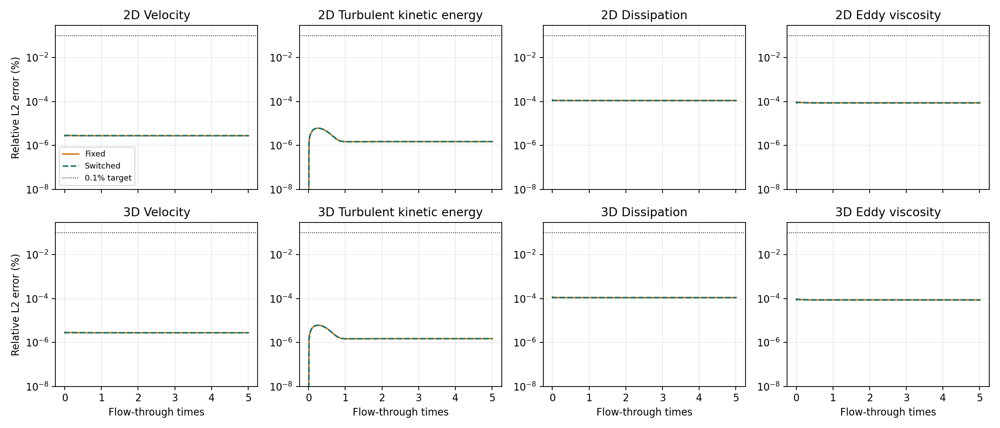
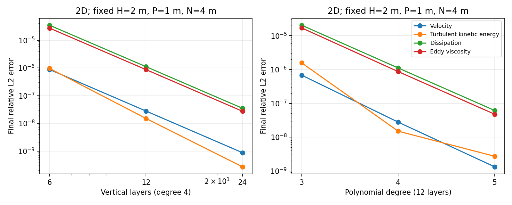
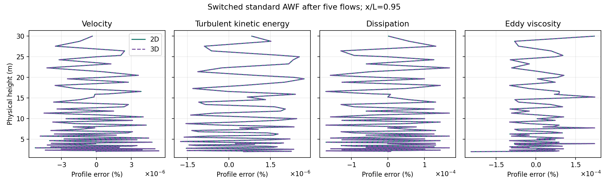

# Equilibrium-preserving analytical wall function for standard k–epsilon

| Material passport | Value |
| --- | --- |
| Origin | academic-research-suite / experiment workflow; derivation and implementation |
| Version | standard_kepsilon_awf_v1 |
| Status | COMPLETE on 2026-10-31; derivation, implementation and Linux acceptance completed within the stated scope |
| Source parent | `03381bfa44bf5a76b16840ed91c1d33f3a3d5f4d` |
| Branch | `codex/neutral-abl-rans-awf` |
| Allocation | At most 16 project CPU workers; numerical-library threads one |

## Scope and attribution

This extension applies the capped-distribution construction of the supplied
CLS equilibrium-AWF note to the **standard** high-Reynolds-number k–epsilon
closure. The outer reference is derived below from that closure, without Yap
or cubic stresses. The original auxiliary momentum, production and roughness
relations are those of [Suga, Craft and Iacovides (2006)](https://doi.org/10.1016/j.ijheatfluidflow.2006.03.011).
The compatible standard-model outer profiles and top flux follow
[Richards and Norris (2011), equations 14, 21–23](https://doi.org/10.1016/j.jweia.2010.12.008).
The capped dissipation correction is an extension derived here, and is not
attributed to either published paper. The supplied note is local background;
this document contains the equations needed to reproduce the extension.

Use a fixed Cartesian frame, flat physical wall at z=0, and an outer CG domain
starting at H>0. P lies inside the omitted strip, 0<P<H, and N>H is an
independent physical sample in the outer domain. All fluxes are per unit
density. Molecular viscosity is retained in the auxiliary AWF but omitted
from the resolved equations for the exact analytical compatibility statement.
No shifted wall-distance convention is used in this AWF extension. The
existing `standard` log-law example remains a separate boundary policy.

## Standard-model surface-layer reference

Write nu_t=C_mu k²/epsilon, P_k=nu_t(U')² and consider a horizontally
homogeneous, steady parallel flow U(z), constant k=K>0 and constant shear
nu_t U'=u_*². The k equation gives P_k=epsilon=u_*² U'. Substituting the
eddy-viscosity relation yields

\[
 q_s=\frac{K}{u_*^2}=C_\mu^{-1/2},\qquad
 u_* = \sqrt{K/q_s},\qquad t_0=u_*^2.
\]

Select the self-similar branch epsilon=A/z. Then

\[
 A=\frac{u_*^3}{\kappa_s},\quad
 U'=\frac{u_*}{\kappa_s z},\quad
 \nu_t=\kappa_su_*z.
\]

The epsilon equation, divided by epsilon²/K, becomes

\[
 0=C_{\epsilon1}-C_{\epsilon2}
       +\frac{q_s\kappa_s^2}{\sigma_\epsilon},\qquad
 \boxed{\kappa_s=
 \sqrt{(C_{\epsilon2}-C_{\epsilon1})\sigma_\epsilon/q_s}}.
\]

Require C_mu>0, sigma_epsilon>0 and C_epsilon2>C_epsilon1. Default constants
give q_s=10/3 and kappa_s=sqrt(0.1872), approximately 0.432666. These are
recomputed from the configured **bulk** model constants. The separate
auxiliary wall constants C_mu,A=0.09, C_l,A=2.55 and intercept 10.7 retain
their original meaning; C_mu,A is not silently replaced by bulk C_mu.

At the reference the modeled covariance is
R=2K I/3-nu_t(grad U+grad U^T). Thus R_xz=-u_*², the three diagonal
components equal 2K/3, and reduced pressure pi=p/rho+2K/3 is constant.
There is no CLS normal-stress outlet correction. At the top Z prescribe
shear u_*², zero k flux, and the epsilon gradient flux

\[
 (\nu_t/\sigma_\epsilon)\epsilon'(Z)
       =-u_*^4/(\sigma_\epsilon Z).
\]

## Original momentum anchor and mean production

For current eliminated strip K, construct the original AWF auxiliary
nu_t,A(z;K,h,nu) and D_A=nu+nu_t,A>0. Its integrals are

\[
 J_0=\int_0^H D_A^{-1}\,dz,\qquad
 J_1=\int_0^H (z-h)_+D_A^{-1}\,dz.
\]

In a fixed tangential frame, the original relations are
t_w=U_H/J_0-(J_1/J_0)F and
U_A(z)=t_w J_0(z)+F J_1(z), with no slip at z=0. Keep both unchanged.
Choose the reference's free velocity offset from the zero-forcing anchor:

\[
 U_{H,0}=t_0J_0,\qquad
 U_0(z)=U_{H,0}+\frac{u_*}{\kappa_s}\log(z/H),\quad z\ge H.
\]

The corresponding aerodynamic roughness is derived, not prescribed again:
log z_0=log H-kappa_s U_H,0/u_*. Arbitrary independent choices of h, H,
u_*, z_0 and U(10) generally overdetermine this anchor. To target a specified
z_0 one must solve the matching relation for an available wall parameter.

The original AWF's zero-forcing mean turbulent production is

\[
 P_0=\frac{t_0^2}{H}\int_0^H
        \frac{\nu_{t,A}}{D_A^2}\,dz\ge0.
\]

Use this nonnegative integral, independently of current forcing F. It is
neither the current off-equilibrium production nor the singular outer
epsilon integrated down to the physical wall. Original mean dissipation
generally differs from P_0, even though the outer solution has P_k=epsilon.

## One positive distribution for the sink and interface epsilon

Define a corrected auxiliary distribution by

\[
 \epsilon_C(z)=\frac{A}{\max(z,z_c)},\qquad
 \Lambda=\frac{HP_0}{A},\qquad
 \boxed{z_c=H\exp(1-\Lambda)}.
\]

For 0<z_c<=P<H its mean is
A[1+log(H/z_c)]/H=P_0, while epsilon_C(P)=A/P and
epsilon_C(H)=A/H. Consequently the necessary and sufficient cutoff condition
within this capped family is

\[
 \boxed{\Lambda\ge1+\log(H/P)}.
\]

If the condition fails, or the cutoff/numerator cannot be represented, use
the explicit original-form fallback or reject a request for preservation.
Never clip z_c to P: clipping would change the mean sink. A separate
sqrt(K)H/nu high-Re gate also applies.

With 0<=chi<=1 blend **distributions**:

\[
 \epsilon_{EP}(z)=(1-\chi)\epsilon_A(z)+\chi\epsilon_C(z),\qquad
 \overline\epsilon_{EP}=(1-\chi)\overline\epsilon_A+\chi P_0.
\]

Obtain epsilon_P and epsilon_H by evaluating that same distribution. Keep
the original traction, auxiliary velocity and current mean production for
every forcing input. Chi=0 recovers every original wall output exactly;
chi=1 at the admissible reference gives mean P=mean epsilon=P_0 and the
correct outer epsilon boundary value. Positivity and the explicit pressure
response of the original momentum kernel are retained.

## Conservative coupling and equilibrium proof

Reuse the existing CV-to-CG strip coupling. Eliminate K_P from the linear-z
matching of K_P,K_N to K_H, and U_P from the log-z matching of U_P,U_N to
U_H. Apply those same linear operators to the complete IMEX predictor.
The representative P velocity is defined by this matching operator; it is
not identified with the auxiliary no-slip reconstruction U_A(P), which can
differ. The outer analytical log profile supplies the reference P velocity.
The strip momentum balance uses its inventory, current pressure forcing,
original wall traction and the opposing CG interface flux. The strip k
balance uses its inventory, interface flux and **one** integrated source
H(mean P_A-mean epsilon_EP). Epsilon_P is algebraic; prescribe epsilon_H
at the outer interface. No additional duplicate volumetric wall source,
profile reset or reference-residual subtraction is added.

At the analytical state K_P=K_H=K_N=K and the log matching reproduces U_P
exactly. Constant shear makes the interface and wall momentum fluxes equal;
zero k gradient gives zero interface k flux. At chi=1 the single integrated
k source vanishes. Epsilon_H=A/H matches the outer solution, whose
momentum, k and epsilon residuals vanish by the preceding derivation.
The strip normal-velocity reconstruction gives zero normal velocity.
Thus the **continuous coupled model** admits the analytical neutral ABL.
Finite polynomial projection, quadrature and iterative tolerances still
produce numerical errors, which must converge and be measured.

The seven existing independent departure sensors use this standard q_s and
kappa_s: matching speed; U_N-U_P; K_N-K_P; epsilon_N-A/N; tangential
pressure/body forcing; tangential convection; and normal velocity at P.
The same compact C2 switch is one on its declared equilibrium plateau and
zero outside its off threshold. Thresholds remain experimental inputs,
without a universal calibration or nonlinear-stability claim.

## Implementation and validation contract

Expose `StandardKEpsilon` with `AWFOriginal` and `AWFEquilibrium`, retain
the original `standard`/`RANSLogLaw` control, and provide public choices
`standard_original`, `standard_fixed` and `standard_switched`. The common
kernel takes the actual configured neutral reference; CLS behavior remains
covered by its existing regressions. Reject shifted-height AWF geometry and
an independently prescribed z_0 for the corrected wall.

Validation will include independent numerical quadrature of momentum,
production and the capped mean; default and changed model constants;
admissibility/strict rejection, chi=0 recovery and all seven sensors;
2D/3D coupling, MPI continuation and off-equilibrium response; five-flow
profile preservation, fixed-H mesh/polynomial refinement and time-step
sensitivity. Store solver data outside the source checkout. Record failures
as failures; an accepted finite-resolution case is not a general stability
or exact-discrete-preservation proof. Results and exact reproduction commands
will be appended after Linux execution.

## Linux preservation and convergence results

The isolated Release executable was built from the source parent and changed
source hashes recorded with the evidence. The primary Linux checkout, shared
build and installation were preserved. Data live under
`/media/jay/新加卷/nektar-v2026-runs/neutral-abl-rans-awf/standard-awf-20261031`.
All new standard-AWF solver acceptance cases use `RANSLinearSolver=MatrixFree`.
Native-backend validation of this new closure/wall combination is not claimed.
The build used eight compiler workers. Study cases used one rank in 2D and
four ranks in full 3D, two concurrent jobs at most, and one
OMP/OpenBLAS/MKL/BLIS thread per rank. Separate short checks use at most four
ranks; the combined allocation stays below the 16-CPU project limit.

The default standard-AWF reference has u*=0.4 m/s, H=2 m, P=1 m, N=4 m,
h=0.1 m and nu=1.5e-5 m²/s. Independent native/SciPy checks give:

| Reference quantity | Value |
| --- | ---: |
| q_s | 3.3333333333333335 |
| kappa_s | 0.43266615305567874 |
| U(H) | 5.653748715319112 m/s |
| U(10) | 7.141674591718309 m/s |
| A | 0.14792005232672778 m³/s³ |
| P_0 | 0.45103093737423633 m²/s³ |
| Original mean epsilon | 0.8291636610370601 m²/s³ |
| Lambda / minimum Lambda | 6.098306893212736 / 1.6931471805599454 |
| Corrected cutoff z_c | 0.01221415550387782 m |

Both fixed chi=1 and switched correction complete five flows in 2D and full
3D at degree 4, 12 vertical geometric layers, degree 2 pressure, eight GLL
points per direction and dt=0.5 s. They take 421 steps to 210.5 s. Every
monitored velocity/k/epsilon/viscosity/stress reference gate is below 0.1%
in both volume-normalized L2 and quadrature-point relative maximum norms,
including the initial projection and all accepted timesteps. The largest
errors across those four cases are:

| Field | Peak relative L2, percent | Peak pointwise relative maximum, percent |
| --- | ---: | ---: |
| U | 0.000002960 | 0.00001032 |
| k | 0.000006116 | 0.00002390 |
| epsilon | 0.000120835 | 0.000266368 |
| nu_t | 0.000095493 | 0.000304241 |
| R_xz | 0.00138433 | 0.00617655 |



The four baselines keep chi=1 without positivity guards or admissibility/
regime/range fallbacks. Full-3D reference data are span independent; the
operator and mesh are fully 3D. These cases do not prove stability for general
3D disturbances or terrain.

At fixed physical H/P/N, 6/12/24-layer refinement gives final relative L2
orders 4.986/4.996 for U, 4.971/4.993 for epsilon and 4.980/4.994 for nu_t.
The observed k orders are 6.001/5.803 for this constant-k reference. R_xz,
which includes a velocity derivative, gives 3.992/3.998. The 2D degree 3/4/5
sequence also decreases the U, k, epsilon and viscosity errors.

The six-layer case completes all five flows but has a peak pointwise R_xz
error of **0.101313%**, slightly above the 0.1% engineering target. It is
retained as a coarse-resolution target failure, rather than counted as an
accepted preservation case. The initial study driver applied the baseline
engineering gate to refinement cases too; the final reduction reports each
case's target outcome and separately checks convergence. Its original log
and failure receipt remain on Linux. No solver rerun or equation change was
needed to re-reduce those existing fields.



Halving dt from 0.5 to 0.25 s in both dimensions preserves the reference.
In 2D the changes in final relative L2 errors for U/k/epsilon/nu_t are all
below 3.2e-13. Duration is rounded up to complete steps: the endpoints are
210.5 and 210.25 s. This is a stationary-profile timestep-sensitivity test,
not a measurement of temporal order. The inherited manufactured tests supply
the separate bulk-transport IMEX2 order evidence; no new wall-coupled
unsteady temporal-order measurement is claimed here.

A 1% smooth streamfunction/k perturbation in 2D decays over five flows. Its
initial k L2 departure is 0.00355021 and its final departure is 1.99190e-6;
final U/epsilon/nu_t departures are 1.30607e-6, 5.10344e-6 and 1.24194e-6.
The perturbation's initial state intentionally fails the reference-error gate;
its acceptance criterion is recovery, not a small maximum-over-time error.



### Reproduce the original standard-model analytical benchmark

An additional switched-AWF 2D case preserves the **same** U(10)=10 m/s and
z0=0.02 m reference used by the original standard-log-wall control. Solving
the original AWF matching relation gives physical sand-grain
h=0.36784081548215075 m, u*=0.6962082663998187 m/s and
U(H)=7.410234262651711 m/s. The wall operator still derives z0 from its
anchor; no independent `RANSZ0` is passed to `AWFEquilibrium`. The 300-step
case reaches exactly 150 s/five flows and passes the same 0.1% gate. Thus the
extension is not limited to the default u*=0.4 reference selected by the new
helper choices.

### Numerical limits and interpretation

At dt=0.001 s, the original standard-AWF control reaches the coupled-stage
iteration limit with linear tolerance 1e-13, and completes with 1e-15 or
1e-16 at the default pressure/state relaxation. Lowering pressure relaxation
to 0.25 did not resolve that small-step case in the tested iteration budget.
A 50% initial epsilon departure with an equilibrium inlet also fails at
0.001 s with 1e-15, while it completes at 0.025 s. These are retained
numerical convergence failures, not claims of physical blow-up. Small dt
and tighter linear precision are not universal convergence remedies.

An initial-only departure with a reference inlet leaves the switch active
at some inlet wall points. Such a locally mixed state should not equal the
original AWF globally. The uniform switch-off/original-recovery comparison
therefore uses a periodic column; fixed chi=0 recovery separately exercises
the inlet/outlet geometry. Native output and exact fixture/binary hashes of
the unsuccessful attempts and the inlet comparison remain with the evidence.
The existing CLS degree 5 full-3D growing-mode limitation remains unresolved.
Long-time 3D polynomial convergence for the new standard AWF has not been
established by this 2D refinement study.

The explicit original-form fallback with the very small P=0.001 m geometry
also reaches the iteration limit at dt=0.001 s and linear tolerance 1e-15.
The strict inadmissibility preflight rejects that reference before stepping.
The completed fallback comparison instead makes the reference inadmissible
through C_epsilon2=1.46 while retaining H/P/N=2/1/4 m and the original
initial/boundary fields; both runs use those same bulk constants. This is a
nonequilibrium fallback control, not an analytical-preservation case.
`UseOriginal` guarantees the original wall outputs; it does not guarantee
convergence of the global coupled iteration.

## Acceptance, delivery and reproduction

All nine CTests pass. The detailed suite passes 20 cases: 17 completed solver
workflows and three expected configuration/admissibility rejections. Its 48
standard-wall cases use independent SciPy quadrature and default/changed bulk
constants across the original smooth, rough and molecular auxiliary branches.
The native probe performs 19,108 checks, including point/mean consistency,
positivity, admissibility, frame rotation and all seven independent switch
sensors. The original kernel/column regression and the three-degree CLS/AWF
refinement pilot also pass; this does not constitute a new full CLS long-run
stability study.

Fixed/switched reference fields agree exactly in the comparison. Fixed
chi=0, the uniformly inactive periodic switch, and inadmissible-reference
fallback each recover the corresponding original wall run with zero measured
complete-field difference. These comparisons keep the same bulk constants,
initial/boundary data, geometry and timestep on each side. The complete
native-history continuation differences, including pressure and derived
outputs, are 7.98e-12 absolute for serial-to-four-rank 2D and 1.94e-11 for
four-to-two-rank 3D.

The periodic-column conservation audit retains the original absolute
acceptance limits, 1e-5 for momentum and 1e-6 for k, with
`budget_available=1`. At the profile experiment's nonlinear tolerance 1e-8,
its peak momentum/k budget defects are 1.672e-4 and 1.188e-5: the near-stationary
iteration stops before meeting the stricter budget test. Tightening the state
and weak-continuity tolerance to 1e-12, while keeping the pressure-increment
tolerance at 1e-8 and linear tolerance at 1e-15, passes both unchanged budget
limits: peak defects fall to 9.77e-9 for momentum and 7.46e-10 for k.
The initial/default-tolerance data are retained; no wall/source
formula was altered for this check.

All seven public choices prepare successfully in 2D and 3D with `python3 -S`
(site packages disabled). These fourteen preparations run no solvers. Both
full manuals compile (339 user-guide and 206 developer-guide pages), and the
changed RANS pages and all three scientific figures were visually reviewed.
The full manuals retain pre-existing unresolved/duplicate references outside
the changed material; successful compilation is not a claim that those old
cross-reference warnings were repaired.

Compact reports, source/executable fingerprints, figures, retained-attempt
receipts and exact commands are in the [evidence directory](standard-kepsilon-awf-evidence/).
No field/checkpoint/history payload or large log is committed. All source
changes are on the existing project branch; the shared installation is not
replaced by this isolated test build.

From a Linux checkout of the delivered branch, reproduce in a **fresh** run
directory (adapt the CPU IDs to the host's allowed affinity):

```bash
source /home/jay/.local/opt/nektar-v2026-mpi/env.sh
export OMP_NUM_THREADS=1 OPENBLAS_NUM_THREADS=1 MKL_NUM_THREADS=1 BLIS_NUM_THREADS=1
RANS_RUN=/media/jay/新加卷/nektar-v2026-runs/neutral-abl-rans-awf/standard-awf-reproduction
RANS_TESTS=solvers/IncNavierStokesSolver/Tests/RANS
mkdir -p "$RANS_RUN/tmp"
export TMPDIR="$RANS_RUN/tmp"
cmake -S "$RANS_TESTS" -B "$RANS_RUN/build" \
  -DRANS_BUILD_SOLVER=ON -DCMAKE_BUILD_TYPE=Release \
  -DNektar++_DIR=/home/jay/.local/opt/nektar-v2026-mpi/lib64/nektar++/cmake
cmake --build "$RANS_RUN/build" --parallel 8
taskset -c 112-127 python3 "$RANS_TESTS/validate_standard_awf.py" \
  --build "$RANS_RUN/build" --output "$RANS_RUN/checks-final" --suite checks --jobs 1
taskset -c 112-127 python3 "$RANS_TESTS/validate_standard_awf.py" \
  --build "$RANS_RUN/build" --output "$RANS_RUN/study" --suite study --jobs 2
python3 "$RANS_TESTS/plot_standard_awf.py" \
  --study "$RANS_RUN/study" --output "$RANS_RUN/figures"
```

The checks and study may be run concurrently only while their **combined**
allocation remains within 16 workers. Successful solver data can be reused
only when fixture and binary fingerprints match and all stored artifact
hashes still agree; each invocation reapplies the acceptance checks. Changes
to validation logic therefore recheck existing numerical data rather than
silently accepting a previous verdict. Current source fingerprints are
recorded in the final reduction. Build/manual/public-preparation collection
and optional retained development attempts are separate from solver execution.
Use the [public guide](../../solvers/IncNavierStokesSolver/Examples/NeutralABL/README.md)
for generating and continuing individual cases with
`--model standard_fixed` or `--model standard_switched`.
