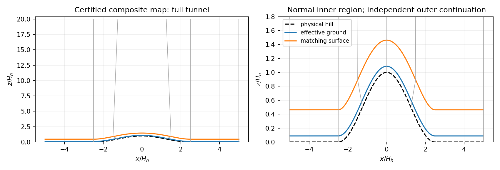
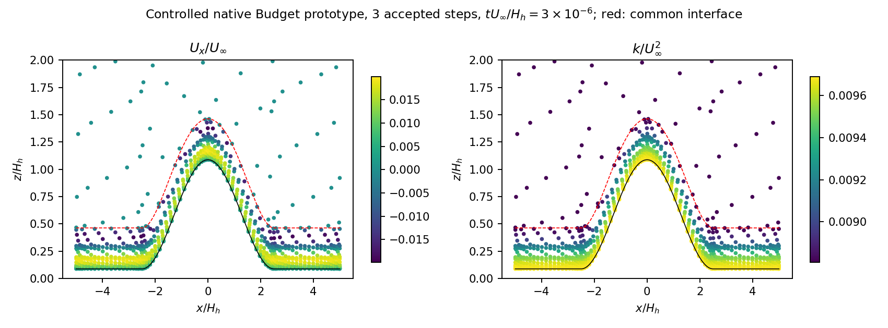
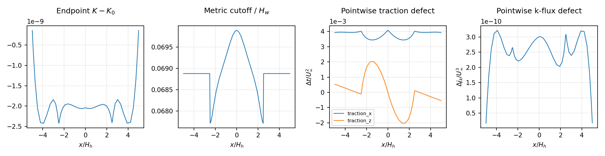

# WJ-H1: composite rough-hill Budget foundation

The full-height composite geometry and the small native coupled Budget prototype
pass their implementation checks. The final source-built runtime accepts three
hill steps, three zero-hill steps and one reversed inclined-plane step. Each
attempt performs one U predictor, one pressure/gauge solve, one k solve, one
outer-epsilon solve and one logical bound operation. Correction is inactive;
raw/corrected k bytes agree. This is a controlled implementation experiment,
not a calibrated experimental inlet/outlet hill prediction.

WJ-7 stays closed: Budget admission10866.759210 >10800s, joint RESOURCE_LIMIT,
zero new governing steps and T3 NOT_RUN. H1 uses fresh states, signatures,
histories and a separate root. No EP terrain route is enabled.

## Source and runtime

Fetched reviewed baseline `b47fd90ce5a67b5afd9af8378ad1f139976b98b3` was selected.
All native C++ and headers were compiled at
`b50aaa8b0c5aaa8022ba5ded5e16dd6eb8c69dab`, tree
`81c5e6aa53e2c400294af3a7d2c29b874f5d9bc7`. Later commits change Python,
documentation, or CTest runtime selection. CMake/runtime metadata at
`2826b8e5daaebb4bd1024bfa225c4b4b8065ad58` has identical native C++/header
inputs and reuses the verified ELFs. The final read-only observer is
`f9f3ef0dbbf31c7d6997269ebe5c1aac5ab8fa27`. Publication commits are not
substituted for producing native source.

Mac source/Git work remained in `.worktrees/wj-earsm-awf`; every commit was
pushed normally. The documented Tailscale fallback was used after the USB alias
timed out. Other worktrees, the dirty Linux main checkout, installed libraries
and active CLS/A93 work were preserved. No shared installation was changed.

Heavy root: `/media/jay/新加卷/nektar-v2026-runs/wj-h1-20261111`.
GNU11.4, C++17 Release, `-ffp-contract=off -fno-fast-math`,
`RANS_BUILD_SOLVER=ON`; one compile worker, serial rank and all six numerical
thread controls1. Process monitoring includes MPI helpers and other jobs under
the72-worker cap. The initial observed allocation was23–26 scientific workers;
no capacity-limit termination occurred.

Both original Mac and worktree specification bytes agree:

```
main     1959e96ea0b61f9deb9ff9ad1f5b26488a932a8451c2de6d3b6f7b7c9dbd9124
appendix 0ab52e0d813b8fb344973f75ca6d8da97ff389ef9f93476500ca9d1df1fbc47c
```

The literal `quad`/`\quad` erratum remains documented; the intended logarithmic
coefficient in eq:integrals-linear is `(d+a*h)/a^2`. No specification algebra
or constitutive constant was changed.

The terrain probe executable SHA-256 is
`1a190333603bf9fec7c16a997143e1f3e296f70d3e90c4ad7bc48753e25c3ebc`;
the complete solver is
`846c1b0b31e747153d3dfc545bbf0ece51905d0c92c78ed12f672ade64585434`.
The actual final SpatialDomains library is the isolated source-built
`build-v1/geometry-lib/libSpatialDomains.so.5.9.0`, SHA-256
`0c23e0de180a233bd88f70b265ae9865aeac456e6482f8ff0fa1b4be84d69dab`.
It was compiled in source-v1 at c6163a7 and reused after verifying that its
SpatialDomains inputs are unchanged at b50aaa8. All changed RANS kernels and
native consumers were rebuilt at b50aaa8.
[The effective closure](wj-h1-linux/runtime-v5-effective.json) records all
resolved libraries, executable identities and the exact LD_LIBRARY_PATH.
The compile-command/cache/source-input receipts also remain in the compact data.

Sealing caught an inherited prebuilt-library selection bug: the original CTest
environment named a nonexistent new-build geometry-lib directory. Its runs used
the installed SpatialDomains library, hash
`40fb9c1d658b54511f604e8eb982cbbc8d487c190745cbd045fac392a15e6eda`.
Those results and default-shell ldd views are retained. CMake now selects the
actual prebuilt directory; a new zero-solve loader test verifies its resolution.
The repeated mapped cases have identical callback state/history hashes, audits
and physical samples across both runtimes. A flat accepted-checkpoint readback
also preserves State.bin, histories/time/gauge and physical samples exactly,
with zero Lift calls/iterations and zero governing solves. Its genuine split1
producer is retained separately from that zero-step report.

## Experimental specification and provisional wall choice

[The machine-readable case](../../solvers/IncNavierStokesSolver/Tests/RANS/wj_h1_experiment.json)
records Cao–Tamura2006 page/figure provenance, reported rounded anchors,
conversions and assumptions. The local original PDF was read and Fig.3/Table1
visually inspected; its SHA-256 is
`adffb5c1d740be791211d82ce35778a37a3315a6dc72c56c80b70cc6642a43df`.
There are no vetted digitized profile arrays yet. Spanwise variance and epsilon
remain unmeasured completions, with explicit uncertainty. No isotropic
`k=1.5*sigma_u^2` initialization or simultaneous experimental/exact-WJ stress
fit is asserted. WJ's reference rms ratios~1.759/1.192 retain their bias against
the paper's2.15/1.13. The provisional analytic finite-depth inlet is not used
in this native prototype.

Lengths use H_h=.040m; velocities use U_infinity. Hill height1, half-width2.5,
cube height.125, spacing.875, frontal density.041, fitted z0=.005, assumed
d0=.0875, delta~6.25, original physical ceiling20, u_tau=.051, and
nu_hat=.051*.005/3.97=6.423173803526447e-5. Physical cubes, aerodynamic z0,
displacement and AWF sand grain are distinct.

The effective wall is `X_phys+d0*n_phys`, an explicit normal homogenization
assumption. H_w=.375 (15mm) is constant normal distance above it. The selected
conditional flat inversion gives h_s=.09067919520940076 (3.627167808mm),
z_v=-.001769879860235167 and flat r_c=.02582918456335882 (1.033167383mm).
K0=qe*.051^2=.008809015145515194. These are verification choices, not measured
parameters or a physical precursor calibration.

| H_w/H_h | separately inverted h_s/H_h | r_c/H_h | cutoff gate | nu/nu_t at H |
|---:|---:|---:|---:|---:|
| .25 | .0914303797782 | .0256067955456 | 3.27860315060 | .01309623 |
| .375 | .0906791952094 | .0258291845634 | 3.67542098872 | .008752525 |
| .5 | .0903069516352 | .0259416726116 | 3.95875744160 | .006572335 |

All have negative z_v, h_s<H_w and positive reference columns. These are
independent conditional inversions at three heights, not one multiheight
experimental fit. The simple appendix sufficient condition d>=2nu is not met
by the selected case. An alternative fixed-K certificate is checked: p_ref is
unimodal, p_ref(0)>A/r_c throughout the certified curvature interval, and
E_c>p_ref after the cutoff. With the metric budget this gives Q_J<=0 and hence
k_column>=K. Endpoint curvature budgets bound every intermediate root; the
smallest checked initial sign margin is .010258719614. Sampled/reference
profile checks accompany that argument. It is not an evolving-k positivity
theorem. The retained molecular contribution at the interface is~.875% of the
turbulent one; the high-Re outer approximation remains conditional.

## Composite map and native coupling

The inner tube stops at d0+H_w=.4625 (18.5mm). The outer region continues
independently to Z=20 using the ruled map in the contract. It is not a
full-height normal chart. Effective curvature is
`kappa_phys/(1+d0*kappa_phys)`. Whole-domain analytic lower bounds are
normal stretch .634824637160, relative inner J .681937833671 and outer full
determinant .596938398626. The ceiling bracket is18.4537829619. These, the
simple boundary, monotone horizontal map and disjoint inner/outer interiors
certify injectivity through the full tunnel height. The original .1 reach
certificate is retained. Both cosine feet are fitted faces; geometry and
physical gradient/cofactor evaluations retain their one-sided owners.

Independent checks cover flat, plane(.2 slope), varying-curvature hill, both
feet, both H derivatives, inverse maps, physical-gradient finite differences,
volume/surface/cofactor divergence identities and five invalid geometries.
Hill volume per unit span is196.584582198043; independent maximum gradient FD
error9.78e-10 and inverse error1.56e-15. Full-height integration orders16/32
pass the fixed geometry tolerances. Ray weights are effective-wall base area
times J, once; outer weights use the full Jacobian, once.

The named `BudgetTerrainV1` route preserves full3D WJ/DevStrainRawWorkV1,
physical epsilon, raw stress work and independent Cd diffusion. Constants
remain c1=1.8,c2=5/9,Ce1=1.44,Ce2=1.82,sigma_k=1,sigma_epsilon=1.3,
Cd=572/6561,qe=81/(2sqrt143),kappa=.381917863546733. Positive wall nu,
Linear full-strain stress with local transported k and source P_A-E_c remain.
The current endpoint K sets the metric counterfactual cutoff and A(K)/H_w
epsilon trace; actual hill forcing does not set that cutoff. There is no chi,
cap, inner epsilon equation/extra flux, clipping, reset or eta forcing.

The production Picard pressure columns now use the physical tangent projector,
including the sampled outer pressure contribution to roughness forcing.
Consistent-mass PIMPLE `D*(alpha*M)^-1*G-C` is preserved. Separate pressures,
one gauge, shared U/k and distinct one-sided gradients remain. Mechanical
pressure is pi-2k/3. Full traction and the tensor-derived normal jump identity
are checked without adding a strong jump condition. Frozen same-state block
and five pressure-only action checks are distinct from a nonlinear Jacobian.

## Actual native steps and independent loads

The controlled verification domain is chart s=[-5,-2.5,0,2.5,5],
rho=[0,.1875,.375,2,6.25,20]. It uses Q3 velocity/scalars and regional
continuous Q1 pressures: state790, free U308, pressure/gauge36, flow344,
k165 and epsilon101. The legacy dense-state guard3000 is unchanged.

The positive initial k/epsilon and inner streamfunction vortex, reversed on
the plane, are declared in the contract. Exterior differential values are
held at their projected initial traces; there is one global gauge. These
closed verification boundaries are not an experimental finite-depth inlet,
traction outlet or slip ceiling. No flat checkpoint seeds the hill.

| final source-built case | accepted steps | dt | final t U_inf/H_h | native seconds | complete check seconds |
|---|---:|---:|---:|---:|---:|
| rough hill | 3 | 1e-6 | 3e-6 | 68.107674 | 100.777341 |
| zero hill | 3 | 1e-6 | 3e-6 | 67.881905 | 101.165906 |
| reversed plane | 1 | 1e-6 | 1e-6 | 38.023742 | 70.598599 |

All seven completed attempts have1/1/1/1/1 solve/bound counts, no extra
governing solve and no correction activation or location. Every raw/corrected
snapshot is byte-equal. Final hill changes are max|delta K|=2.42354274323e-9,
max|delta r_c|=2.49438732169e-9 and max|delta epsilon_H|=3.82229185260e-10.
Both regions and the dependent consumers are actually evolved.

Independent split quadrature on the represented fields uses x24/r32 versus
native x16/r24; it splits physical/source/element breakpoints. Full physical
G, molecular terms, separate Cd diffusion, raw work, roughness forcing and
current metric cutoff are independently evaluated. Three declared weak modes
(1,s/5,H hat) retain inner/outer loads and exterior reactions. Largest final
component/regional errors are1.37e-12/1.34e-12 for the hill and below2.36e-12
over all cases, against declared2e-9/4e-9 absolute load floors and2e-8 relative
tolerances. Scalar, momentum, continuity/gauge and full outer-epsilon terms
remain separate; separately normed pieces are not added as norms.

For the final hill, integrated raw actual inner production is.000823103056651,
counterfactual production .0133554581371251 and cutoff destruction
.0133554581371251. Their reference-budget defect is1.22e-17; actual production
is deliberately different. Roughness power is-1.58448370190e-6, with force
normal contamination below5.1e-21. The energy weak-work bookkeeping identity
defect is5.47e-16; the raw unsteady/exterior-reaction work is not zero.

Final same-state frozen block defects are below7e-18. Pressure frozen-column
and centered-residual defects are below5.7e-14 across the final cases. The
normal full-traction/jump algebraic identity is checked natively. Opposing
interface mass defect is below1.8e-21; epsilon value-trace defect below5.8e-18.
Hill pointwise full traction and k-flux defects remain .00406875435440 and
3.21133574162e-10. They are reported separately from conservative shared-test
assembly and are not erased with another boundary condition.

The final hill sampled covariance minima are~.00181413(inner)/.00587255(outer),
and sampled planar/transverse principal margins over nu_eff are
.999977456/.999985437. Positive roots, scalar domain, metric/cutoff gates and
raw work pass their individual hard predicates. The largest hill raw-work
defect is4.97e-24. These are finite spatial/angular audits. Both WJ adverse
witnesses and the smooth-budget reference_nonpositive witness are preserved
by the fresh existing oracles/flat transaction; no clipping changes them.

Strong divergence is not hidden: the deliberately coarse hill has inner
sampled maximum .00656644738 at startup and .00656617235 at step3, with
inner L2 .00202326587. The final outer maximum is2.60193220e-6. Spatial
accuracy is UNRESOLVED; the small prototype is not an accuracy-qualified hill
solution. A positive principal margin or a completed step is no stationarity
or global stability/realizability proof.

Region-aware observations invert original physical x,z. Crest y'=10mm maps
inside the AWF; local inner U/k/R is used there. The wake7mm observations also
use their actual region. Outer epsilon statistics include the entire outer
domain. Reattachment x/H_h=6.5 is outside this short prototype and NOT_RUN.
No speed-up, reattachment, spectrum or intermittency fit is performed.





## Commands, regressions and bounded cost

Exact argv, exits/times and log hashes are in the command receipts and
[test results](wj-h1-linux/test-results.json). Representative reproduction:

```bash
source /home/jay/.local/opt/nektar-v2026-mpi/env.sh
export OMP_NUM_THREADS=1 OPENBLAS_NUM_THREADS=1 MKL_NUM_THREADS=1
export BLIS_NUM_THREADS=1 NUMEXPR_NUM_THREADS=1 VECLIB_MAXIMUM_THREADS=1
h1root=/media/jay/新加卷/nektar-v2026-runs/wj-h1-20261111
cmake -S "$h1root/source-v3/solvers/IncNavierStokesSolver/Tests/RANS" \
  -B "$h1root/build-v3" -DRANS_BUILD_SOLVER=ON -DCMAKE_BUILD_TYPE=Release \
  -DNektar++_DIR=/home/jay/.local/opt/nektar-v2026-mpi/lib64/nektar++/cmake \
  '-DCMAKE_CXX_FLAGS=-ffp-contract=off -fno-fast-math' \
  -DCMAKE_EXPORT_COMPILE_COMMANDS=ON \
  -DRANS_PREBUILT_SPATIAL_LIBRARY="$h1root/build-v1/geometry-lib/libSpatialDomains.so.5.9.0"
cmake --build "$h1root/build-v3" --parallel 1 --target \
  WJTerrainGeometryProbe WJTerrainCoupledProbe IncNavierStokesSolver RANSWallResolutionProbe
# Exact final metadata configuration and verified ELF aliases: runtime-v5-design.json.
ctest --test-dir "$h1root/metadata-v5" --show-only=json-v1
ctest --test-dir "$h1root/metadata-v5" -j 1 --output-on-failure \
  -R '^WJH1(RuntimeClosure|CompositeGeometry|RouteGuards|Native_(hill|zero|plane))$'
```

Existing immutable directories must not be overwritten to reproduce a run;
use a fresh root and the committed generators/observer. Exact original runs
used the bounded H1 runner and its per-selection reservations.

There are69 final registrations and29 relevant unique passing checks:
22 fresh source-built-runtime geometry/route/loader/native/oracle checks,
plus five small standard/CLS/AWF transport/equilibrium smokes and the flat WJ
Budget/legacy Regularized Budget transactions under the installed-runtime
lineage. Native C++ and ELFs are identical across those lineages. Both flat
transactions pass exact restart, rollback and immutable checkpoint checks;
they were not repeated merely for a library-path-only metadata correction.
No full historical campaign was launched.

Retained failures: missing initial CMake package path; first compile's missing
headers; second compile's SessionReader rvalue; invalid legacy reporting P=H;
wrapper environment duplication before launch; and the obsolete cylinder
rejection message assertion. Their fixes do not alter model equations. The
wrapper's uncompleted1200s reservation remains charged. The installed-loader
selection defect is separately corrected and both numerical lineages retained.

[The closed resource receipt](wj-h1-linux/resource-closure.json) records39/40
units:14 mapped attempts including the superseded seven,15 transaction
attempts including the failed fixture's five, and10 ordinary smoke timesteps.
There are29 one-sweep attempts, each with one solve of every block and one
bound call, including three deliberate post-solve rejections. Ordinary solver
controls are distinct. Measured check wall time1070.243196s; conservative
charged numerical cost3591.060259/10800s includes the unknown reservation,
setup/transfer/wait and closure reserves. Compile time including failed builds
is1721.079481/7200s, separate from numerical cost. Peak measured test-tree RSS
is1,207,472,128bytes (<8GiB); the root was2,610,401,635bytes (<16GiB).

The hill's three actual sweeps cost31.099602s; flow/k/epsilon assembly cost
.801527/.194066/.616729s and dense factorization .006239s in total. Inclusive
timing rows overlap. Domain/audit work dominates this small case. Native
startup/audits/observations/I/O explain the difference from68.107674s native
and100.777341s complete verification. The read-only compact observer costs
17.105328s; plotting1.771238s. No large SVD campaign was introduced.

## Capacity and next item

[The capacity table](wj-h1-linux/capacity-estimate.csv) is an integer/storage
estimate, not another executed mesh. One uniform bisection would have2909
states and flow1443, close to the retained3000 guard. Another would have11155
states and is rejected by that guard. An illustrative future160x80 hill/wake
grid has465343 states and a242165 flow block: one dense flow matrix alone
requires436.93GiB, before factors, consistent masses, scalars and copies.
This exceeds the observed~251GiB host memory and is not a production option.
At the verification dt, even one H_h/U_infinity clock takes10^6 steps; the
measured audit/sweep cost would imply~120 serial days. That arithmetic is not
a qualified production timestep or physical development/averaging estimate.

The next physical item is a separate rough-flat precursor: digitize/qualify
Fig.3, complete spanwise variance/epsilon with sensitivity, and fit h_s using
multiple measured heights before any hill comparison. The next boundary
implementation must couple that finite-depth inlet to a physical pressure/
traction outlet with scalar outflow/backflow and a justified ceiling; an
absolute pressure outlet replaces the closed-prototype gauge. A developed
resolved hill/wake run needs a sparse/operator conversion preserving
`D*(alpha*M)^-1*G-C`, full roughness G and consistent M, together with cheaper
unchanged-predicate audits. No lumped mass, full momentum inverse or SPD
assumption is authorized by this prototype.

Experimental calibration/open boundaries, spatial/temporal convergence,
developed hill/wake statistics, long-time preservation, EP terrain, variable H,
general3D/MPI and LES/spectral validation remain NOT_RUN. Known WJ adverse
principal/covariance states and uncapped-sink positivity limits remain model
risks for subsequent cases; no such hard-domain violation occurred here.

## Immutable compact/heavy bridge

[Receipt](wj-h1-linux/receipt.json), [transport](wj-h1-linux/transport.json),
[Mac verification](wj-h1-linux/mac-verification.json) and compressed heavy index
bind source/runtime, XML, native checkpoint/report/callback roles, test logs,
tables and figures. The859719-byte archive SHA-256 is
`98e9867124aa54bcc5cb2386d9bbec57e59c4ccedf00785f853ce022bc505873`.
Mac independently verifies58 stored files and25 decoded encodings plus the
receipt/archive. Heavy fields/checkpoints and dependency rehashes are recorded
Linux verification, not claimed as Mac reads. Summary-v1/v2 and installed
runtime receipts remain immutable; summary-v3 is the final current-K observer.
The compact evidence is~1.56MB; heavy native fields/checkpoints stay in the H1
Linux root. No previous WJ result or ledger is overwritten.
