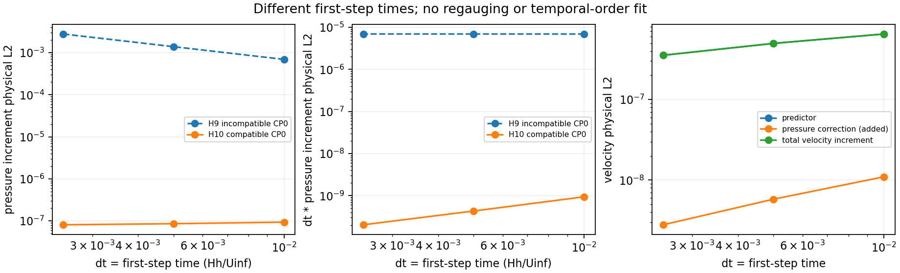
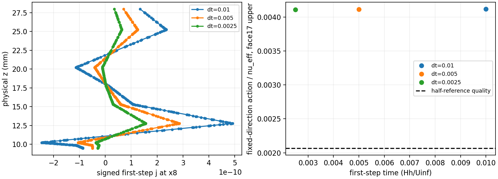

# WJ-H10: compatible flat-neutral initialization and three first steps

**PASS within the frozen first-step scope.** `FlatInletTraceV1` removes the
represented CP0 continuity defect without changing physical data, scalars,
regional pressures, the fixed reference or its defect. All three fresh CP0s,
three restarted first steps and six strict views passed. The three accepted
attempts each report one momentum/pressure/k/epsilon solve and one bound call,
with zero bound activations or material corrections. Initial admission checks
are separate from those per-attempt counters.
[Final component gates](wj-h10-linux/compact-supplement-v1/component-gates-final.json)
include completed resource/transport verification while preserving the original
pre-closure publication.

The old nonzero first-step pressure-impulse plateau is absent. This supports
H9's initialization-compatibility mechanism. It does not close H8's UNRESOLVED
early common-time contraction, establish an asymptotic order, or qualify a
developed physical inlet. No trajectory was continued beyond its first step.

## Implementation and tested identities

Fetched starting Mac/origin HEAD was exactly reviewed
`d5c708457c5248b2bb5e719aebd72628e007a8b7`. The WJ worktree was clean; unrelated
main-checkout files and the Linux shared checkout's dirty docs were preserved.
The contract was committed before the native matrix in `94a6564`.
The governing compiled source is `ca82fdb`; the strict reader additionally uses
the synthetic-test header at `9447f29`. The latter repairs the SessionReader
mutable-reference API and adds independent native BwdTrans/PhysDeriv checks;
governing source inputs are unchanged. Python observers are separately versioned
through `581cc86`, verifier `3db37e1`, finalizer `3b8ee02`.
[Source identities](wj-h10-linux/compact-supplement-v1/source-identities.json)
independently match 343 compiled project source/header inputs and 26 observer
versions to Git blobs. Installed dependency headers retain Linux verification.

The new ELF SHA-256 identities are:

| Consumer | SHA-256 |
|---|---|
| Governor | `7541174482b121855f1e4d5072aee53fe3f7fb5faa8ea051645df0b42a8bcc9e` |
| Strict reader | `ddc3499f13c28f9452ad96f68d9edad2773a8ff2841e7b03c872eb37d4403467` |
| Reused unchanged WJKernelProbe | `3d4edf79a2718a281175be1a575776a33dd5f988c48d5a1b594a9b5f2dd7844c` |

The isolated Release build used GNU11.4.0, `RANS_BUILD_SOLVER=ON`,
`-ffp-contract=off -fno-fast-math`, `--parallel1`, and the qualified prebuilt
SpatialDomains SHA `0c23e0de180a233bd88f70b265ae9865aeac456e6482f8ff0fa1b4be84d69dab`.
The new executables use a complete copied original H8 private glibc closure,
including its original loader. Actual per-exec mappings and library hashes are
in [runtime-observed](wj-h10-linux/closure/runtime-observed.json); pre-exec host
libc appearances in PID-union maps are explicitly distinguished. New binaries
do not inherit the old governing/observer ELF identities.
[Compiler commands/dependencies](wj-h10-linux/closure/compiled-inputs.json)
and all [actual operation commands/logs](wj-h10-linux/operations/) are retained.

The original/worktree specifications retain main SHA
`1959e96ea0b61f9deb9ff9ad1f5b26488a932a8451c2de6d3b6f7b7c9dbd9124`
and appendix SHA
`0ab52e0d813b8fb344973f75ca6d8da97ff389ef9f93476500ca9d1df1fbc47c`.
The documented quad/\quad typography erratum and `(d+a*h)/a^2` coefficient remain.

The opt-in helper reads already lifted native inlet modal coefficients through
local/global IDs and orientation signs. Modified_A endpoint modes satisfy
`phi0+phi1=1`: copying each radial coefficient to both horizontal endpoint modes,
zeroing higher horizontal modes and free normal velocity produces U_h(rho),W_h=0.
For the frozen horizontal composite map x is unchanged and z depends only on
rho, so physical divergence and every regional Q1 continuity moment vanish in
exact arithmetic. No analytic reevaluation, RadialProject, mass/KKT/pressure
solve or new flow assembly belongs to the transform.

It runs once after Project/Lift/SetReference and m_initial freeze, before native
history initialization. Essential coefficients retain their exact bits, including
signed zero; scalar/pressure/reference/defect arrays are untouched. Old reference
residual meanings remain intact; actual pre/post startup diagnostics are distinct.
Active mode/version enters checkpoint physics identity. Off/absent uses the
legacy signature path. Tilted/curved/nonconstant-H maps, incompatible native
partitions/IDs/degrees, nonzero prescribed normal velocity and perturbations reject.

## Startup and accepted-state qualification

All cases use only H6-refined6mm: H=.15, hs=4.341801417014184mm, d0=.0875,
16inner+34outer normal cells, Nx1[0,8], Q3/Q1, 2328 states, q12/normal16 and the
3000-state guard. Physical Functions/geometry/reference data are unchanged.
Original WJ full3D stress, DevStrainRawWorkV1, raw work, Cd diffusion, wall nu,
current-K uncapped Budget/cutoff/dependent epsilon and complete outlet/top data
remain. The outlet fixes pressure level; there is no additional gauge or imposed
evolving pressure jump.

All three CP0 coupled/reference/defect arrays and physical history slots are
bitwise identical; each has its own valid dt signature and native time labels.
The pre-transform state also matches the historical H9 CP0 bitwise. Restart and
all strict views report zero Project/Lift and zero initializer applications;
strict views perform zero governing solves. Genuine completed callbacks have
alpha=100,200,400. [Bindings](wj-h10-linux/closure/verification.json) retain the
producer, state, history, checkpoint, alpha and time identities.

The common final inventory has **7173 owned physical observations**, including
all H8 locations, actual H10 witnesses/neighborhoods, both normal-face owners,
H roles and exterior/inward points. Physical volume quadrature nodes were also
checked separately and give the same minima. This is finite coverage.

| State | Recorded time | Minimum m/nu_eff | Maximum sampled strong divergence |
|---|---:|---:|---:|
| Common CP0 | 0 | .003514506137272 | 0 |
| dt=.01 CP1 | .01 | .003527666261547 | 4.27617e-5 |
| dt=.005 CP1 | .005 | .003522023975160 | 2.87175e-5 |
| dt=.0025 CP1 | .0025 | .003518176871483 | 2.04324e-5 |

All pass the unchanged native hard guards and separate quality threshold
.002068763923454. The limiting owner is geometry18 upper normal face at
x=8,z=.31946961248954786 (physical12.7787845mm), distinct from H and the retained
geometry17 face at10.2430072mm. Minimum transverse action remains above .94347;
minimum full covariance eigenvalue is at least .00248051. Independent angular
and shared compiled-action replays meet the2e-11 allowance.

All34 inner and70 outer signed CP0 pressure moments are zero in the independent
integration, and every native moment meets2e-15. Pointwise CP0 scaled divergence
is zero. Endpoint weak continuity remains near roundoff despite nonzero strong
divergence: these are different quantities.
[Complete signed vectors](wj-h10-linux/publication-v1/all-Q1-moments.json) are kept.

Initializer velocity change has full physical L2 norm5.15536130e-6 and sampled
maximum3.36050956e-5. New CP0 velocity reference error is1.24159649e-5 in full L2,
sampled maximum3.09089994e-5. Its outer E_G=.00183753825,
E_epsilon=.000128349891, E_U=4.17073425e-6 and E_k=3.36930739e-7.
No continuum equality or improvement over the old minimum was required.

## Actual first-step mechanism and pressure behavior

Saved P=C bitwise: static ExternalLift changes nothing. F=pre_k and raw=corrected
are bitwise; C->F changes only velocity/regional reduced pressure, F->K only k,
K->A only epsilon, with F/A velocity and pressure identical. Intermediate K is
diagnostic, not an accepted state; its temporary epsilon trace is not repaired.

Native saved matrices/vectors and passive matvecs verify
`du=predictor-BGp*dpi`, `pressure_rhs=D*predictor+rp(C)`,
`rp(F)-rp(C)=D*du`, and `S*dpi=D*BGp*dpi`.
The complete native Gp includes roughness-pressure and non-outlet reactions.
OpenTunnel has no gauge and continuity has no pressure block, so Cpp=0 and
`S=dt*D*Mfree^-1*Gp`. Thus `S0*j=D*predictor+rp(C)`; the new initial rp(C) term
is zero. No saved flow system was factored or solved by the passive analysis.
The largest saved-vector identity discrepancy is8.9301e-17; the frozen system
residual matvec discrepancies are below6e-21.

| dt = first-step time | Old pressure L2 | New pressure L2 | Old j L2 | New j L2 |
|---:|---:|---:|---:|---:|
| .01 | 6.92707604e-4 | 9.37216708e-8 | 6.92707604e-6 | 9.37216708e-10 |
| .005 | 1.38879638e-3 | 8.61627593e-8 | 6.94398192e-6 | 4.30813796e-10 |
| .0025 | 2.78095342e-3 | 8.10817635e-8 | 6.95238354e-6 | 2.02704409e-10 |

These are signed fields with the same outlet-fixed pressure convention, no
regauging. Full/regional means, coefficient vectors, profiles and actual actions
are in [compact arithmetic](wj-h10-linux/compact-supplement-v1/) and the remote
full payloads. The old impulse plateau is reduced by roughly7400–34300 times.
New pressure stays bounded over these three different first-step times; j falls
with dt. Predictor L2/dt is6.49792e-5,9.93633e-5,1.41549e-4, so its asymptotic
constant has **not** been resolved. Do not infer a temporal order. The historical
unsaved predictor/correction split remains unavailable.





The action panel uses a fixed direction at face17 upper; the quality line is
context only. Admission uses each state's independently minimized action over
the complete declared inventory, as tabulated above.

## Remaining interface, weak and spatial defects

Current sampled K and cutoff move: CP0 K ranges .0088090121775–.0088090151455
and rc=.02641989831–.02641990094; endpoint ranges are separately retained.
Shared U/k remain continuous, actual-K dependent epsilon defects stay below
2.2e-18, total traction jump maxima are about4.18e-7 and k-flux jumps at most
1.83e-8. Wall shear is about.0026009. These represented pointwise defects are
not extra strong coupling equations. Actual inner production differs from the
current-K counterfactual budget: at CP0 the integrated values are.007603818795
versus.007603765413; counterfactual production and destruction agree to roundoff.
No actual-production equilibrium is imposed.

All four unique state/history weak evaluations (common CP0 plus three endpoints)
pass native q12/independent q32 anchors and q24/q32 comparisons using the actual
projected1,x/5,interface_hat traces and refreshed reactions/current-K data.
Maximum component/regional anchor discrepancies are5.74e-13;
maximum q24/q32 discrepancies are1.44e-12, below the unchanged mixed2e-9/4e-9
plus2e-8 relative tolerances. Complete signed physical, split and exterior-role
tables remain separate from derived/diagnostic totals.

Fixed-scale physical consistent-mass-dual CP0 spatial norms for u,v,k,outer
epsilon are2.42102e-5,6.10866e-7,.001298716,.000711574. At dt=.01 the actual
completed-stage norms are6.00313e-7,7.60514e-7,2.24520e-7,2.83855e-6, while the
uncancelled spatial values are5.17710e-6,7.67649e-7,9.62952e-5,7.95970e-5.
[Norm packets](wj-h10-linux/publication-v1/norms-errors.json) retain all branches,
fixed amplitudes/volume conventions, reference error and initial drift separately.
Small frozen linear residuals do not eliminate these nonlinear/stage/spatial defects.

## Executed commands, failures, resources and transport

Healthy ext4 root: `/home/jay/build/wj-h10-flat-inlet-20261113`, UUID
`4c5b928b-0ef9-464e-91cb-3b0b2202e3b0`. Bounded write/fsync/readback passed.
Only selected healthy H9 ext4 inputs were imported; no damaged/obsolete root was
traversed or modified. All six numerical thread controls were1, one serial rank,
compile --parallel1. Maximum prelaunch scientific allocation was24 workers;
the launcher reserved6, below72.

The exact commands/PYTHONPATH versions are in operation receipts. Main forms:

```sh
cmake -S "$R/source/solvers/IncNavierStokesSolver/Tests/RANS" -B "$R/build" \
  -DRANS_BUILD_SOLVER=ON -DCMAKE_BUILD_TYPE=Release \
  '-DCMAKE_CXX_FLAGS=-ffp-contract=off -fno-fast-math' \
  -DCMAKE_EXPORT_COMPILE_COMMANDS=ON \
  -DNektar++_DIR=/home/jay/.local/opt/nektar-v2026-mpi/lib64/nektar++/cmake \
  -DRANS_PREBUILT_SPATIAL_LIBRARY="$R/runtime/geometry/libSpatialDomains.so.5.9.0"
cmake --build "$R/build" --parallel1 --target IncNavierStokesSolver RANSWallResolutionProbe
python3 -B -m unittest -v test_wj_h5_neutral test_wj_h6_projection \
  test_wj_h7_transport test_wj_h8_local_timestep test_wj_h9_startup_audit \
  test_wj_h10_initialization
python3 -B "$R/observer-v5/control_wj_h10.py" --root "$R"
python3 -B "$R/observer-v6/control_wj_h10.py" --root "$R" --resume-after-coarse-step-audit
```

There are **63 unique executed passing methods**:51 H5–H9 and12 H10. The full
passed invocation ran60, then the final H10 invocation ran12, including three
additional methods; totals are not added as unique tests. CTest registration
exists; no H10 CTest execution is claimed. The small340-state native fixture
checks18 negative native signs, exact preservation/idempotence, independent
transforms, Q1 moments, invalid maps/partition/perturbations and signature rejection.
It has zero governing steps. Its max independent physical divergence is1.34e-15.

Retained failures are implementation/test setup, not native physical exits:
the first reader build used the wrong SessionReader setter API; the initial test
cwd selected the old module; the synthetic fixture variable name was wrong; the
first coarse passive arithmetic audit applied abs to a decoded Python list; the
final passive publisher initially lacked PYTHONPATH. Each was corrected, versioned
and charged. The accepted coarse step was never repeated: a guarded resume verified
its report/checkpoint/runtime, completed its outstanding CP1 view and launched
only the two remaining branches. No failed full-size native reservation was retried.

Final charge **1455.232635/3600s**: build/setup809.608885s (including full60s),
science345.623750s, full300s closure. The two build attempts took498.326596s
(failed reader, governor built) and218.329781s (repaired reader). Peak tree RSS
1,329,344,512bytes; build/source/runtime434,211,484bytes; science883,417,701bytes.
All limits and25% admission headroom fit. Failures/parent work remain charged;
there are no unknown reservations. [Final ledger](wj-h10-linux/closure/accounting-final.json)
is closed. Passive Rows pressure-mass algebra totals416 factorizations/34 solves,
including the failed scan;14 kernel queries. These are not governing solves.

The1,688,744-byte compact transport SHA is
`a7a2ebe2b520426df65340ca614017fcdbd0255cebe91fecfc92686bc4cb6df3`.
All188 decoded file identities were independently verified on Mac. Three full
arithmetic row payloads remain remote; their explicitly derived compact views
preserve vectors/checks and selected owner profiles. The original publication's
mutable-ledger prefix hash is resolved by an exact byte/hash-matching reconstructed
snapshot, explicitly labelled in [ledger-prefix recovery](wj-h10-linux/compact-supplement-v1/ledger-prefix-recovery.json).
The original publication/seals are unchanged; future publisher code now saves
its prefix snapshot directly. Remote heavy hashes are Linux-verified; they are
not represented as independently read heavy files on Mac.

## Next decision

Recommend a separately bounded continuation of these three compatible6mm branches
to commonT=.04, with the existing local-owner, hard/quality, arithmetic and weak
gates. **None is executed or authorized by this result.** The finite-depth inlet,
physical H selection/roughness-sublayer validity,7mm observation inside these AWFs
and empty all-stresses-outside interval remain open. Hill production, EP, old
measured-rms/Blackadar20mm validation, capacity/backend and longer work stay pending.
