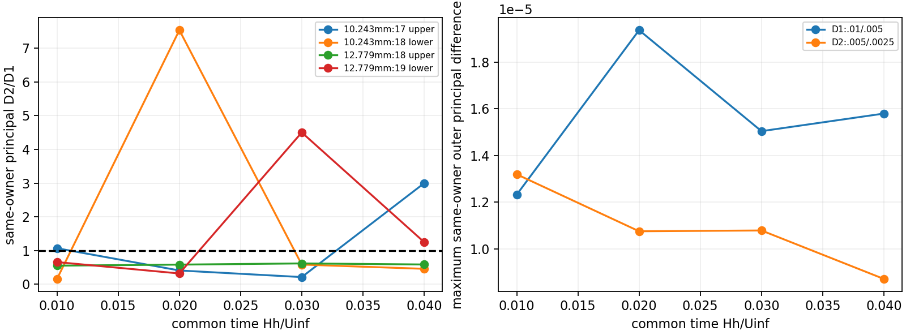
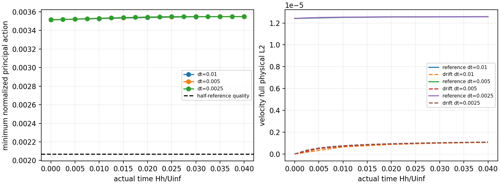

# WJ-H11: compatible neutral control at common T=.04

**Native/finite-inventory verification PASS; temporal qualification UNRESOLVED.**
All three branches reached their fixed common target. There were exactly25 new
governing attempts,25 accepted/qualified new states,three restart blocks and11
new strict views, with zero fresh CP0s, builds, bound activations or material
corrections. No native or expanded physical exit occurred. Nevertheless several
resolved same-owner principal differences do not contract. The first limiting
comparison is geometry17 upper at t=.01: rho=1.07044458. A small terminal bulk
difference does not close that result.
[Final component gates](wj-h11-linux/compact-verification-v1/component-gates-final.json)
retain that scientific outcome after source, resource and transport verification.

## Frozen implementation and actual work

SSH fetch confirmed reviewed020f18298897e1bf526834a1e5175ed71ba59e31, no newer
commits, dirty WJ work or existing H11 jobs/roots. An initial HTTPS fetch stalled
and failed; the explicit GitHub SSH fetch succeeded. Unrelated worktrees and main
checkout files were preserved. Contract `fb6291a` preceded native execution.
Python implementation/observers are versioned from `de649e4` through `909fd72`;
the source capsule and overrides are independently bound in the compact evidence.

No C++/header changes or native build occurred. Governor/reader compiled inputs
remain H10's `ca82fdb` and its reader-only fixture-header repair `9447f29`.
H11 revalidated those dependency bytes, wrappers, private loader/libraries and
actual instantaneous native-exec maps, reusing the closure **in place**:

| Consumer | ELF SHA-256 |
|---|---|
| Governor | `7541174482b121855f1e4d5072aee53fe3f7fb5faa8ea051645df0b42a8bcc9e` |
| Strict reader | `ddc3499f13c28f9452ad96f68d9edad2773a8ff2841e7b03c872eb37d4403467` |
| Kernel probe | `3d4edf79a2718a281175be1a575776a33dd5f988c48d5a1b594a9b5f2dd7844c` |

The inherited GNU11.4 Release build used RANS_BUILD_SOLVER=ON,
`-ffp-contract=off -fno-fast-math`. This is verified runtime reuse, not a new build
at H11 Git HEAD. [Actual native maps](wj-h11-linux/closure-v2/runtime-observed.json)
separate private original glibc from pre-exec PID-union host mappings.

Original/worktree literature hashes remain
`1959e96ea0b61f9deb9ff9ad1f5b26488a932a8451c2de6d3b6f7b7c9dbd9124` and
`0ab52e0d813b8fb344973f75ca6d8da97ff389ef9f93476500ca9d1df1fbc47c`.
The quad/\quad erratum and correct `(d+a*h)/a^2` coefficient remain unchanged.

Only the H6-refined6mm flat control was used:16inner+34outer cells,Nx1[0,8],
Q3/Q1,2328 states,q12/normal16,3000 cap,H=.15,hs4.341801417014184mm,d0=.0875,
physical matching plane9.5mm. All physical Functions/parameters, reference/defect,
original WJ/Budget/DevStrainRawWorkV1/Cd diffusion, wall nu, current-K cutoff and
dependent epsilon, complete reference outlet/top data and pressure convention
are unchanged. FlatInletTraceV1 identity remains active, with zero applications
on restart. IMEX1/single-sweep,k_then_epsilon,eta0,ExactStepV1,VerifyOff and all
native predicates remain. No forcing, profile/scalar restoration or extra gauge.

| Branch | dt | Imported absolute step | Additional reserved/attempted/accepted/qualified | Terminal |
|---|---:|---:|---:|---|
| coarse | .01 | 1 | 3/3/3/3 | step4,t=.04 |
| fine | .005 | 1 | 7/7/7/7 | step8,t=.04 |
| quarter | .0025 | 1 | 15/15/15/15 | step16,t=.04 |

The three imported State.bin hashes match the user-specified H10 hashes, with
full signature/native-slot/time/reference/defect bindings verified. XML Time=0
and each original dt were retained; NumSteps is additional3/7/15. Geometry,
expansions and Functions match the sealed H10 inputs. All3 restarts and11 strict
views report zero Project/Lift/initializer work. Each accepted new attempt has
one U/pressure/k/epsilon solve and bound call:25 each, zero extra governing or
correction/restoration solves. Raw/corrected k are bitwise equal in all25 packets.
Initial admission bound checks are separate from those per-attempt counters.

## Producer roles and startup compatibility

All original checkpoints/reports/history/signatures remain unmodified. Output
checkpoints are indexed by serialized absolute step/time/state; CP suffixes are
generation indices. The restored step1 audit in H11 has alpha0 and never replaces
H10's completed callback. Common coarse t=.01 uses H10's original producer and
strict anchor. All newly completed contexts use H11 producers and alpha100/200/400.
[Semantic verification](wj-h11-linux/closure-v2/verification.json) independently
matches the native reader's report/checkpoint/state/history header roles.

The first closure verifier incorrectly required the newly derived GLM callback
input to equal the stored predecessor bitwise. Actual saved histories differ
only in85 signed zeros, with **all numerical coefficients exactly equal** in
every branch. Restored coupled states, serialized native slots and time labels
remain strictly bitwise equal to H10. Native GLM arithmetic forms a new input
(`TimeIntegrationAlgorithmGLM.cpp`, Zero/Svtvp assembly), and
`RANSEquilibriumWallEvolution::Implicit` copies that input into fullHistory.
The corrected verifier retains both exact hashes and the zero-sign indices;
it never edits histories or relaxes checkpoint/slot equality. A new fixture
rejects any nonzero mismatch and distinguishes these roles. The original failed
receipt remains charged. C=P,post_flow=pre_k,raw=corrected and F/A velocity/pi
equalities hold in all25 actual phase packets.

## Every-step admission and common support

The final union contains7185 owned observations (7173 H10 owners plus new native
witnesses/neighborhoods) and3200 physical Gauss8 volume rows. All31 state roles,
29 unique physical states, were replayed, including fine/quarter off-common
times and the original compatible CP0/H10 first steps. Both owners at each
retained normal face, matching roles, exterior/inward points and fixed physical
offsets remain. No expanded negative, unresolved sign or half-reference quality
loss occurred; no accepted prefix was disqualified. This is finite coverage.

Across the complete assessment the smallest normalized principal margin is the
compatible CP0 value .003514506137272, above .002068763923454. The minimum among
NEW accepted states is .00353905252/coarse,.00352979780/fine,.00352259717/quarter.
Transverse action, full covariance, root/denominator, scalars, viscosities,
ground/outlet and raw-work checks pass separately. Independent angular and
shared compiled replays meet2e-11; that allowance was not added to a native guard.

Every complete34inner+70outer signed pressure moment vector meets2e-15.
Regional continuous/broken-Q1 projections and complements are retained in
[Q1-continuity](wj-h11-linux/publication-v1/Q1-continuity.json), with full element
details remote. Strong-divergence peaks over NEW states are5.23537e-5,3.67592e-5,
3.57918e-5 for coarse/fine/quarter; pointwise divergence is not required to remain
zero after CP0. Small weak continuity is distinct from these strong values.

## Temporal result at the same physical owners

D1=norm(.01-.005),D2=norm(.005-.0025), using identical physical support, recorded
times within128eps*max(1,|t|), and no pressure regauging/interpolation. Field scales
are1 for U/G,K for k/R,A/H for epsilon,u_tau² for pressure and1 for normalized
actions. Floors are4e-11*scale, times sqrt(measure) for physical L2. Zero/below-floor
denominators remain UNRESOLVED; below-floor D2 has an upper bound, not a precise
zero or rate. Identical CP0 and constant zero components therefore provide no rate.

| t | face17 upper,10.243mm | face18 lower,10.243mm | face18 upper,12.779mm | face19 lower,12.779mm | Outer same-owner maximum |
|---:|---:|---:|---:|---:|---:|
| .01 | **1.070445** | .160407 | .554325 | .659713 | **1.070445** |
| .02 | .410638 | **7.534473** | .584606 | .322377 | .555764 |
| .03 | .215130 | .585821 | .619924 | **4.502463** | .717605 |
| .04 | **2.997197** | .460155 | .588306 | **1.252234** | .552204 |

These are resolved principal D2/D1 values, not differences of moving minima.
At face17 upper,x8,z=.25607517888672315 (10.2430071555mm),D1/D2 are
1.23273138e-5/1.31957062e-5 at.01 and2.83541738e-6/8.49830525e-6 at.04, well above
the4e-11 floor. At the second face,z=.31946961248954786 (12.7787845mm),upper/lower
owners are kept separately. Signed values, all G/R components, k/epsilon,pi,
production and minimizing directions are in the fixed-owner/component tables.
The maximum-support norm keeps its own two maximizing locations; neither is
substituted for a different-position minimum.

Compared with H8's OLD initialization, face17's t=.01 absolute D2 is about37times
smaller, but rho still exceeds1. At.04 its new local rho is about3 even though
the full outer difference envelope contracts. This configuration contrast does
not change H8's historical result or prove a particular update caused the response.

At T=.04 all resolved full physical L2 field ratios contract:
U .558940,G .498724,k .498704,epsilon .509665,R .440505,pi .527206.
The terminal U D1/D2 values are3.68109e-8/2.05751e-8, much smaller than continuum
error: terminal full U reference L2 errors are1.25704e-5,1.25757e-5,1.25785e-5,
while compatible-CP0 drifts are1.06519e-6,1.08609e-6,1.09644e-6. These are three
different questions. Full/inner/outer physical and amplitude-normalized errors,
all common-time ratios/floors and signed local components are published.
No temporal order or nonlinear propagation bound is inferred.





## Actual arithmetic, weak/interface loads and residuals

Exactly TWO new attempt-level arithmetic sets were exported: fine absolute2 and
quarter absolute4, both ending at.01; coarse H10 absolute1 is reused. Saved-system
matvecs pass predictor−BGp*dpi,pressure_rhs=D*predictor+rp(C),full Q1 linearity
and S*dpi=D*BGp*dpi with complete native Gp. No passive governing system was
factored or solved. The consistent-mass pressure operator and Cpp=0/no-gauge
problem are unchanged; no −Dᵀ replacement, full momentum inverse or lumping.

| Branch attempt ending.01 | Pressure increment L2 | dt*increment L2 | Predictor U L2 | Pressure-correction U L2 |
|---|---:|---:|---:|---:|
| coarse1, reused | 9.37217e-8 | 9.37217e-10 | 6.49792e-7 | 1.09943e-8 |
| fine2, new | 2.22157e-8 | 1.11078e-10 | 2.34495e-7 | 4.52625e-9 |
| quarter4, new | 8.63551e-9 | 2.15888e-11 | 9.74235e-8 | 1.77484e-9 |

Their incoming times/durations differ; these increments are not equal-duration
causal experiments or a common-pressure order measurement. Signed full/regional
means/profiles and actual vectors are retained. Historical H9 unsaved predictor
vectors remain unavailable.

All11 new strict views and the reused H10 coarse1 anchor pass native q12 versus
independent32 and24/32 checks with actual projected1,x/5,interface_hat traces and
refreshed reactions/current-K data. Maximum component/regional anchor errors
are2.01e-13; maximum24/32 differences4.44e-13, below unchanged mixed2e-9/4e-9
plus2e-8 relative tolerances. Signed physical components, splits, exterior roles
and derived/constraint diagnostics remain distinct. These three weak modes do
not certify all spatial modes.

K,cutoff,dependent epsilon,wall shear,traction/k-flux,pressure offset and actual
versus counterfactual source histories evolve in the retained
[interface history](wj-h11-linux/publication-v1/interface-history.json); none is
reset to reference. Strict stage/spatial mass-dual norms remain separate. At
quarter T=.04,uncancelled u,v,k,epsilon spatial norms are
6.82581e-7,1.28462e-7,6.96476e-6,1.15470e-5; actual completed-stage norms are
4.19075e-8,6.11828e-8,8.96677e-9,4.06927e-8. Fixed amplitudes/physical volumes are
retained in the packets. Frozen linear residuals are separate again. Nonzero
spatial residuals prevent an exact discrete-equilibrium or stationarity claim.

## Commands, accounting and evidence roles

Healthy ext4 root `/home/jay/build/wj-h11-compatible-common-time-20261113`,UUID
4c5b928b-0ef9-464e-91cb-3b0b2202e3b0, passed bounded write/fsync/readback with
about85GiB initially free. Runtime/import/checkpoint aliases and exact argv/logs
are in [controls](wj-h11-linux/controls/) and [operations](wj-h11-linux/operations/).
All six numerical-library thread controls were1, one serial rank/scientific
worker. Largest recorded prelaunch allocation was17 workers, with6 reserved,
below72. No shared installation/mount or other campaign changed.

Main command forms, with the versioned PYTHONPATH from receipts:

```sh
python3 -B -m unittest -v test_wj_h5_neutral test_wj_h6_projection \
  test_wj_h7_transport test_wj_h8_local_timestep test_wj_h9_startup_audit \
  test_wj_h10_initialization test_wj_h11_continuation
python3 -B "$R/observer-v3/control_wj_h11.py" --root "$R"
python3 -B "$R/observer-v4/assess_wj_h11.py" --root "$R" --mode arithmetic
python3 -B "$R/observer-v4/assess_wj_h11.py" --root "$R" --mode common
python3 -B "$R/observer-v5/publish_wj_h11.py" --root "$R"
python3 -B "$R/observer-v8/close_wj_h11.py" --root "$R"
```

There are75 distinct passing methods:63 existing and12 H11. The full invocation
ran73; later11- and12-method H11 invocations add two unique fixtures, not23.
CTest registration exists; no configure/build/CTest execution is claimed.
Native blocks took22.149133,39.312366,72.673417s; final union36.499726s and selected
arithmetic23.615849s. Coarse results admitted subsequent work under updated25%
headroom projections with the full closure reserve intact.

Closed charge **787.149824/1500s** =487.149824s measured operations +60setup +240
closure, including the2.268256s failed passive verifier and its corrected receipt.
Peak process-tree RSS1,505,861,632bytes (about1.40GiB),science1,511,203,722bytes,
copied source/runtime9,750,961bytes; all caps pass. There are312 diagnostic
pressure-mass factorizations,2816 solves and108 kernel queries, separate from
governing work. [Final accounting](wj-h11-linux/closure-v2/accounting-final.json)
is closed; H10's1455.232635s charge and all older ledgers remain unchanged.
The [complete consuming-root receipt](wj-h11-linux/transport-supplement-v1.json)
also includes archives/versioned code and all compact exports:12,068,464bytes
of copied code/archive data and1,524,826,907bytes of other output, below1/3GiB.

Publication-time accounting was saved BEFORE hashing and remains an immutable
prefix; final accounting/closure are separate. All204 compact transport members
and decoded identities were independently verified on Mac. Archive951154bytes,
SHA `bc65bc0af48e3e7fd2cec64f54d413af26264fcc7ab5b87af81274ed0f699a36`.
Native fields/checkpoints/matrices/strict scalar rows remain on Linux. Their
hashes were verified there; Mac verification covers transported compact bytes
and Git observer/source identities, not independently downloaded heavy arrays.
Original publication/seals and failed verifier lineage remain immutable. The
final closure records75 methods; the earlier pre-closure publication correctly
records the74 then executed.

## Next bounded decision

Initial discrete continuity incompatibility is removed, but it was not the sole
source of local timestep sensitivity. No governing sign/source/boundary defect or
constitutive-domain exit is demonstrated here. Recommend ONE separately bounded
saved-phase audit at face17 and adjacent owners at t=.01/.04: use existing C/F/K/A
packets to separate actual flow,k,epsilon changes and the exact gradient/timescale
delta-B decomposition. Use genuine predictor/correction vectors only at.01;
none were saved at.04. No new timestep, mesh, initialization or trajectory is
implied, and this follow-up was not executed in H11.

The full-height neutral control remains idealized. Finite-depth completion,
physical H/roughness-sublayer validity,7mm stress observations inside these AWFs
and the empty all-measurements-outside interval remain open. Hill production,
anisotropic inner stress,EP,old measured-rms/Blackadar20mm,capacity/backend and
evolution beyond.04 stay pending. This is not developed-flow or experimental validation.
