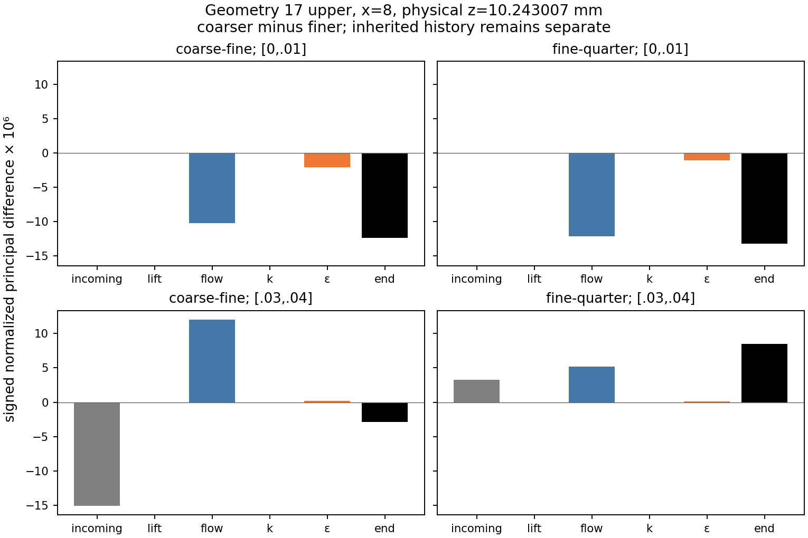
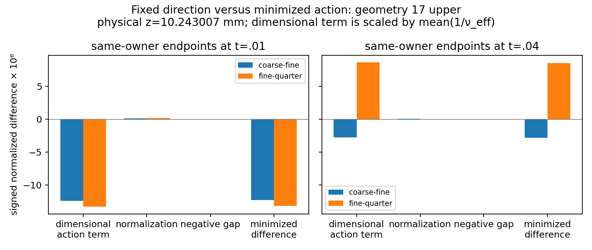

# WJ-H12 saved-phase diagnosis

**The bounded audit is PASS. H11's temporal qualification remains UNRESOLVED.**
The early flow contribution already fails monotonic local contraction. In the
late window, inherited differences and signed cancellation strongly affect the
endpoint ratio. Fixed-direction actions reproduce noncontraction, so optimizer
movement is not its sole explanation. The audit does not identify a unique
underlying discretization cause or a governing constitutive defect.

New work: **zero governing attempts, CP0s, initializer applications, strict
readbacks or native builds**. Fourteen saved attempts, 224 C/F/K/A owner roles
and 56 predecessor roles were retained. There were 46 unique coefficient-state
evaluations at four owners, one persistent kernel process and **48 requests**
(24 distinct actual inputs, one value and one fixed derivative each).

## Frozen inputs and implementation

Starting/fetched HEAD was `b20ae1f1eed3f68bc94b80456329b02190a4c4d0`, matching
review. The WJ worktree was clean; the unrelated main checkout/branch and
untracked literature were preserved. The pre-science contract is
[`35e1324`](wj-h12-saved-phase-diagnosis-contract.md). Source versions are bound
in [source identities](wj-h12-linux/closure-v1/source-identities.json), with
[independent Git-blob verification](wj-h12-linux/mac-source-verification.json).
Principal implementation commits are `032a1d890a34fc38b9912a06843e350fe7514528`
and `498a4e0c2991c2d468d3d413961a2bb269343eae`; the completed passive observer
is `d4daac5a93f40c3f96d184da4d7ca53818198d73`. Publication, closure and layout
sources are `4a5e10a`, `2833a45` and `1b2c0dc`, respectively.

The exact inventory is unchanged:

| Window | coarse .01 | fine .005 | quarter .0025 |
|---|---|---|---|
| [0,.01] | 1 | 1,2 | 1,2,3,4 |
| [.03,.04] | 4 | 7,8 | 13,14,15,16 |

Every absolute step 1 uses its H10 producer; subsequent steps use H11.
[Source/input bindings](wj-h12-linux/publication-v1/source-input-bindings.json)
contain the six original report identities, fourteen manifest-selected snapshot
identities, fixed reference/defect hashes and the exact four physical/chart owner
records. Inputs were read in place from the two healthy ext4 roots:

```text
/home/jay/build/wj-h10-flat-inlet-20261113
/home/jay/build/wj-h11-compatible-common-time-20261113
```

At x=8, the retained owners are geometry17 upper/18 lower at
z=.25607517888672315 code (10.243007155468927 mm), and geometry18 upper/19 lower
at z=.31946961248954786 (12.778784499581914 mm), all x-side upper. Original snap
metadata and both traces remain distinct. The first face is .743007 mm above
the 9.5 mm matching plane; it is not H. No new points or extrema were added.

The 2328-state, H6-refined, compatible 6 mm neutral control, physical Functions,
reference/defect, complete boundary data, high-Re outer WJ and molecular-viscous
Budget AWF remain unchanged. Both original Mac literature hashes match the
contract; the quad/\\quad typography erratum and correct `(d+a*h)/a^2` coefficient
are preserved. No C++ source changed. H11's old outcomes and every earlier ledger
remain immutable.

The sparse observer caches only four native Modified-Jacobi element rows/signs
and physical Jacobians. It maps the second velocity block to Cartesian U_z.
It never constructs H7 Rows, volume inventories, Q1 projections, weak budgets
or diagnostic mass systems. The pilot's independent existing `field()` comparison
differs by at most **1.1102230246251565e-16**.

## Roles, identities and actual updates

[Fourteen phase bindings](wj-h12-linux/publication-v1/phase-bindings.json) verify
P=C, post_flow=pre_k and raw=corrected bitwise; zero bound activation/correction;
C->F changes only velocity/regional pressure, F->K only k, K->A only epsilon;
F/A velocity and pressure agree bitwise. P retains its own preceding absolute
step/time, separately from the attempt time/alpha/history. Both requested and
predecessor context steps are checked explicitly. The H11 alpha=0 restored audit
never substitutes for the completed H10 step-1 callback.

Derived callback differences are confined to signs of exact zeros, with original
hashes/indices preserved. There is no allowance for a nonzero coefficient
difference. K's temporary epsilon trace is not lifted, refreshed or declared
accepted. All four-owner intermediate and accepted closure evaluations are
defined and sampled-positive; this is not a global admissibility proof.

The complete [signed phase CSV](wj-h12-linux/publication-v1/signed-local-phases.csv)
and [compressed full roles](wj-h12-linux/publication-v1/local-phase-roles.json.gz)
retain U, full G, trace, k/epsilon, B, full3D R/covariance, pressure, raw full-stress
work, root/denominator, viscosities, actions and direction projectors. The local
in-plane margins over these roles range from .003514506137272083 to
.004652500905351478. Historical native decisions are unchanged.

The implemented outer formulas give R=k*r(B),
nu_eff=(k^2/epsilon)*3N/[5(N^2-2tr(O^2))], O=skew(B), and
D_G R[H]=(k^2/epsilon)D_B r(B)[dev(H)]. Thus normalized outer actions depend
only on B. The checked variable change is mathematical homogeneity, not a
manufactured initialized scalar/gradient state. Wall viscosity is unaffected.
Raw work remains -R:G, including isotropic work when trace(G) is nonzero.

All stored transitions and endpoint pairs verify the exact Delta-B split,
Delta mhat=Delta a-Delta g, and the dimensional/normalization identity using
componentwise 128-eps bounds. Explicit signed residuals/bounds are retained in
[phase decompositions](wj-h12-linux/publication-v1/phase-decompositions.json.gz).
The independent implicit-root derivative error is at most 3.9968028886505635e-15;
the cubic root is differentiated. No simple-shear threshold or gradient
replacement is used.

## Endpoint reproduction and equal-window findings

All **24** published accepted endpoint/owner records are reproduced, against
both H11's hash-bound JSON and its published CSV. Maximum retained replay error
is **6.5503158452884236e-15**. [Replay](wj-h12-linux/publication-v1/endpoint-replay.json)
and [CSV check](wj-h12-linux/publication-v1/published-csv-replay.json) bind the
comparison. At geometry17 upper:

| Time | fixed action rho | minimized action rho | fixed coarse-minus-fine | fixed fine-minus-quarter |
|---|---:|---:|---:|---:|
| .01 | 1.06934001424 | 1.07044457666 | -1.23281457445e-5 | -1.31829795460e-5 |
| .04 | 3.08522424791 | 2.99719727148 | -2.75845085804e-6 | +8.51043947389e-6 |

These are resolved above the 4e-11 comparison floor. The fixed-action sign
reversal at .04 survives removal of optimizer movement. Ratios above one fail
monotonic contraction; they do not establish instability or a temporal order.

The full fourteen-attempt accounting, rather than only six final attempts, gives
the following **signed normalized minimized-action terms, multiplied by 1e6**.
All lift terms are exactly zero.

| Window/pair | inherited | flow | k | epsilon | endpoint |
|---|---:|---:|---:|---:|---:|
| [0,.01], coarse-fine | 0 | -10.21561949 | -.04513543 | -2.06655888 | -12.32731379 |
| [0,.01], fine-quarter | 0 | -12.09436591 | -.02819595 | -1.07314434 | -13.19570619 |
| [.03,.04], coarse-fine | -15.04232260 | +11.99808091 | -.00140137 | +.21022567 | -2.83541739 |
| [.03,.04], fine-quarter | +3.23606146 | +5.16304517 | +.00240335 | +.09679527 | +8.49830525 |

The early flow difference already grows between the two comparisons. Epsilon
updates are material and their cross-level differences decrease; k contributions
are smaller. These are sequential nonlinear functional increments, not unique
percentages of an underlying PDE error.

At .03 the two pairs have opposite inherited signs. The late coarse-fine incoming
term is largely cancelled by its new flow term; the declared scalar cancellation
measure is **.895955738766**. Fine-quarter terms reinforce, giving zero cancellation
under that definition. Earlier history is not attributed to [.03,.04]. Signed G/B
components and zero-safe unresolved cases are in
[window contributions](wj-h12-linux/publication-v1/signed-window-contributions.csv)
and [full cumulative identities](wj-h12-linux/publication-v1/cross-window-accounting.json.gz).



For the late window, the additional minimized-action differences decompose as
follows, also multiplied by 1e6:

| Pair | scaled dimensional-action change | normalization | negative optimizer-gap change |
|---|---:|---:|---:|
| coarse-fine | +12.36135067 | -.14453614 | -.00990932 |
| fine-quarter | +5.30836092 | -.06232892 | +.01621179 |

Adding the inherited term recovers each endpoint. These exact scalar telescopes
have residuals around 1e-18 (up to 1.2103e-18 in these four primary window checks),
separate from the physical comparison floor. Normalization and gap changes affect
values but do not remove the fixed-direction noncontraction.
[All owners](wj-h12-linux/publication-v1/window-normalization-gap.json) retain
their own signed contributions and bounds. Raw g=a-mhat and its gap status are
retained per role; the declared normalized replay uncertainty is2e-11, and
near-floor gaps remain unresolved rather than being replaced by zero.



## Genuine predictor coverage and compiled checks

Only coarse1(H10), fine2(H11), quarter4(H11), ending .01, have sealed arithmetic.
The predictor is already an increment and pressure_correction_velocity includes
its minus sign. Native velocity_rows/signs reproduce U_F-U_C and G_F-G_C from
their sum; the qualified -BGp*delta_pi relation is reused, without loading or
solving a governing matrix. At geometry17 upper, actual Gxz increments are:

| Attempt | predictor | signed pressure correction | total |
|---|---:|---:|---:|
| coarse1 | -6.65923424835e-6 | -3.12102399214e-8 | -6.69044448804e-6 |
| fine2 | -2.56579255431e-5 | -3.05085376620e-8 | -2.56884340805e-5 |
| quarter4 | -1.91967319605e-5 | -1.46023376990e-8 | -1.92113343005e-5 |

The local Gxz increment is predominantly predictor in these three records.
Their incoming times/durations differ; coverage is **3/7 early and 0/7 late**.
No full-window predictor/correction causal split is available. Full G/U and
fixed-tau B increments at all four owners are in
[bounded coverage](wj-h12-linux/publication-v1/predictor-coverage.json). Pressure
is not an independent input to the WJ action, and no missing vectors or hybrid
constitutive states were invented.

The only native program was the existing persistent WJKernelProbe, ELF
`3d4edf79a2718a281175be1a575776a33dd5f988c48d5a1b594a9b5f2dd7844c`.
H10 compiled-input/source hashes, `-ffp-contract=off -fno-fast-math`, wrapper,
private loader/libraries and actual native-exec maps pass verification.
Current Git HEAD is not its producing C++ identity. See
[native maps](wj-h12-linux/publication-v1/kernel-native-exec.json) and
[48 requests/aliases](wj-h12-linux/publication-v1/compiled-checks.json).
Maximum errors: dimensional action 5.14996e-18, implicit dN 1.77636e-15,
normalized fixed action 1.56732e-15. No governor/resolution probe was invoked.

## Executed commands, resource closure and preserved failures

The new root is `/home/jay/build/wj-h12-saved-phase-diagnosis-20261113`, ext4
UUID `4c5b928b-0ef9-464e-91cb-3b0b2202e3b0`. The primary SSH route timed out;
the documented `jay@100.105.247.110` fallback passed bounded write/fsync/readback
with 89,412,116,480 bytes available. No old-root traversal, mount/package change,
heavy-input copy or unrelated-campaign modification occurred.

One serial worker, all six OMP/OpenBLAS/MKL/BLIS/NumExpr/VECLIB controls=1 before
imports. Largest operation admission snapshot was25 workers; the conservative
additional6 allowance remained below72. [Requests/logs/receipts](wj-h12-linux/operations/)
contain actual argv, source hashes, allocations and timing. With R denoting the
new root and P the synchronized RANS Python directory, the main invocations were:

```sh
python3 -B "$P/run_wj_h12.py" --root "$R" --label focused-tests-v1 --seconds 60 -- \
  python3 -B -m unittest -v test_wj_h12_saved_phase <14 selected H9-H11 methods>
python3 -B "$P/run_wj_h12.py" --root "$R" --label role-context-test-v2 --seconds 15 -- \
  python3 -B -m unittest -v test_wj_h12_saved_phase.SavedPhaseDiagnosis.test_predecessor_role_keeps_its_own_time_and_step
python3 -B "$R/observer-v2/study_wj_h12.py" --root "$R" --mode stage
python3 -B "$R/observer-v2/study_wj_h12.py" --root "$R" --mode science
python3 -B "$R/observer-v3/study_wj_h12.py" --root "$R" --mode repair
python3 -B "$R/observer-v3/study_wj_h12.py" --root "$R" --mode science \
  --resume-from "$R/science/results-v1"
python3 -B "$R/observer-v4/publish_wj_h12.py" --root "$R" --mode publish
python3 -B "$R/observer-v4/publish_wj_h12.py" --root "$R" --mode verify
python3 -B "$R/observer-v5/close_wj_h12.py" --root "$R"
```

The science/publication commands were launched through the scoped resource
adapter; exact complete commands replace the abbreviated test list in receipts.
**24 distinct passing methods** were executed: H12=10, H9=6, H10=2, H11=6.
No full H9 module/Q1 mass fixture, historical suite, CMake configure, build or
CTest run occurred. CTest registration is not reported as execution.

The first science receipt failed after retaining every phase due to a reader
schema error (`principal.in_plane` versus H11's `margin` key). It consumed
3.144930330 s and no kernel request. The failure/halt/output remain sealed.
The targeted regression and repair admission verified no native/physical halt;
aggregation resumed once from the unchanged retained phase evaluations under
a new charged receipt. The pilot was not repeated. Its 25%-headroom projection
was156.863949 s including the untouched90 s closure reserve.

Final charge is **129.168471056/600 s**: fully charged30 setup +9.168471056
operation seconds (including5.500949411 science/failure seconds) +fully charged90
closure/publication/transport. Peak measured process-tree RSS is243,200,000 bytes;
new output before compact transport is13,850,084 bytes and copied source5,838,491
bytes, far below the fixed caps. There were zero diagnostic mass/governing
factorizations/solves or saved governing-matrix matvecs; sparse basis products
and nine saved-vector scatters are separately counted in
[scientific summary](wj-h12-linux/closure-v1/scientific-summary.json).

The original contribution PNG had overlapping repeated y labels. A presentation-
only layout view was regenerated from the sealed CSV under a15 s bound, taking
3.224924 s within the already fully charged90 s closure. The closed ledger and
all original seals/figures remain unchanged. This is not a second scientific
batch or a new allocation; its separate
[receipt/seal](wj-h12-linux/closure-layout-supplement-v1/seal.json) binds the
replacement figure above. Publication-time accounting (including its then-active
reservation) and final closure accounting are distinct immutable snapshots.

[Linux verification](wj-h12-linux/closure-v1/verification.json) rehashes selected
heavy inputs. [Local transport verification](wj-h12-linux/mac-transport-verification.json)
independently reads compact bytes and all five decoded compressed identities;
it does not claim local reads of the original heavy reports, snapshots or ELF.
The compact archive is898,117 bytes. Source blobs and figure/owner/height/sign
labels were independently checked. See [final accounting](wj-h12-linux/closure-v1/accounting-final.json)
and [component gates](wj-h12-linux/publication-v1/component-gates.json).

## Decision

The saved sequence, numerical identities and compiled action are consistent.
No governing sign/source/trace defect is demonstrated by this sparse audit.
Early flow-gradient differences and late inherited cancellation explain where
the observed ratios enter; they do not uniquely explain the underlying
discretization response. Missing late predictor vectors remain unavailable.
H11 remains **UNRESOLVED** for temporal qualification, with its native/finite-
inventory results unchanged. No order, instability, global ellipticity,
realizability or exact-equilibrium conclusion follows from these ratios.

Recommend one separately bounded **finite-depth-inlet and measurement-scope
design package**, carrying the unresolved local temporal qualification explicitly
into any later validation plan. No fourth timestep or repeated ratio audit is
justified automatically here. The full-height log/constant-k control is idealized;
no physical H_w is selected. The 7 mm stress target remains inside these AWFs:
the primary inverse needs H_w>4.413515542 mm, whereas placing every target outside
needs H_w<3.5 mm. The interval is empty without a separately declared modeling
decision. Finite-depth completion, roughness-sublayer validity and treatment of
inner stress observations remain open. Hill production, anisotropic inner stress,
EP, old measured-rms/Blackadar/H_w20mm work, capacity/backend work, further timestep
levels and evolution beyond .04 remain outside this package.
