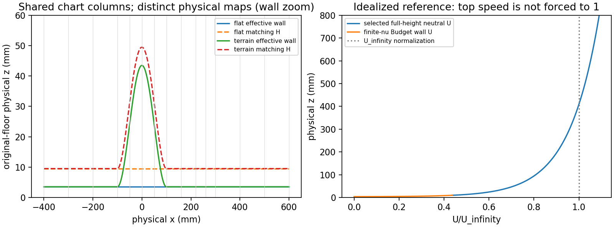

# WJ-H13: paired-domain and full-height neutral preparation

The requested paired target and guarded flat session are implemented. Offline
construction, geometry and continuum boundary checks **PASS**. The actual
24,688-state mapped target is **OBSTRUCTED** by the current dense route. No
native preservation result is claimed.

| Claim | Status | Evidence |
|---|---|---|
| Shared terrain/flat domain construction | PASS | `publication-v1/paired-case/paired-domain.json` |
| Full-height composite-map certificate/checks | PASS | `publication-v1/paired-geometry-checks.json` |
| Continuum reference/boundary compatibility | PASS | `publication-v1/reference-boundary-checks.json` |
| Target native capacity | OBSTRUCTED | `publication-v1/paired-case/native-preflight.json` |
| Fresh target native initialization | NOT_RUN | No compatible target checkpoint exists |
| Target-domain evolution | NOT_RUN | No native invocation authorized/performed |
| Preservation over declared duration | NOT_RUN | Protocol prepared, not admitted |
| Experimental comparison | NOT_RUN | No calibrated/developed hill prediction |

All paths in this report refer to [wj-h13-linux](wj-h13-linux/) unless stated
otherwise. Heavy source capsules and original generated/failing artifacts remain
at `/home/jay/build/wj-h13-fullheight-paired-domain-20261113` on Linux ext4.

## Selected input, source and scope

Fetched starting HEAD was `36115115e7d4e0ce2e98d9ed83c4c28bc2e9ec89`, equal
to the reviewed remote. No newer selected terrain manifest, prior H13 work/job
or intervening commit was found. Source work used the existing clean WJ worktree
`/Users/jay/Documents/nektar-v2026/.worktrees/wj-earsm-awf` on the requested
branch. The unrelated main checkout/branch and its untracked literature were
preserved. H12 audit PASS and closed 129.168471056/600 s ledger, and H11 temporal
UNRESOLVED, are unchanged. No old-domain replay was performed.

The user's full-height neutral objective supersedes finite-depth/ambient H13
designs. H5's primary **mean-only** fit, exact stored intercept and wall parameters
are reused; no new fit, rms-derived K, taper, Blackadar tail, matching-height
selection or hill-result calibration enters H13. Primary numeric lineage is
6 mm, with 5/5.5 mm retained as historical metadata, not additional cases.

Specification hashes match the original Mac files:

- Main: `1959e96ea0b61f9deb9ff9ad1f5b26488a932a8451c2de6d3b6f7b7c9dbd9124`.
- Appendix: `0ab52e0d813b8fb344973f75ca6d8da97ff389ef9f93476500ca9d1df1fbc47c`.

The documented literal `quad` versus `\quad` typography erratum and the correct
`(d+a*h)/a^2` coefficient remain untouched. Both primary PDFs were available in
the original Mac `docs/literature` and hash verified: Cao–Tamura
`adffb5c1d740be791211d82ce35778a37a3315a6dc72c56c80b70cc6642a43df`;
Richards–Norris `2a8d769dde2d85a6034f2cc64a5da70da31feb9dfdf2c236484cf38520541780`.
The latter's printed 259/261 (PDF 3/5), Eqs.23/48 and empty-domain discussion were
read from rendered original pages. Its different model constants and optional
buffer sources were not imported. No whole-paper redigitization was performed.
See `publication-v1/literature-identities.json` for exact local filenames/roles.

The isolated Linux capsule contains 586 tracked files at
`e60e8b32f46b9a0d7fd4993006e9068be99b4ae0`. The successful scientific observer
overlay is `65136787e7b31b3c3649acc358bc32ee9ef9b634`; publication and descriptive
metadata use `57e63eb1cb1e4e97641f24c2f568a2c9c50572a8`. Source/capsule/member hashes
are in `publication-v1/source-identities.json`. Mac independently checked 596
Git blobs across the selected capsule descriptors. There is no native producer,
ELF, compiler or loaded-library qualification in H13: none was invoked or built,
and no C++ source was changed. Historical native evidence is reuse only.

## Concrete paired artifacts

The fixed horizontal vector is
`[-10,-7.5,-5,-2.5,-1.25,0,1.25,2.5,4,5.5,6.5,7.5,10,12.5,15]`.
There are 700 Q3 chart elements: 14 columns × (16 inner + 34 outer cells).
Inlet/outlet/top are physical −400/600/800 mm. The normal arrays are recorded
in full in `paired-domain.json`, with the unique H=.15 interface and all original
cutoff/roughness/observation breakpoints. Binary64 chart knots match the selected
H10 6 mm XML exactly (normal-vector SHA
`03d6d61a90b5316faf2d150d7fc34fbf41645076fcbe801822bb9af8b0c272a2`).
Every physical Function VALUE is byte-identical to that manifest-bound XML,
verified against its actual Linux bytes; state/checkpoint conversion was not used.

Shared topology SHA is
`7bbb644e4e11309bfd5bc65d445c0da5e09db598e6affbe614f100c3063ac97c`.
IDs, connectivity, chart coordinates, composites, regional/interface ownership,
Q3/Q1 spaces and quadrature settings are common. Representation/lifting uses
8 GLL points; canonical mass/projection uses Gauss8, physical mass/projection
Gauss16, and governing tangential12/normal16 remain distinct. Physical vertices
and Jacobians differ intentionally between partners.

The flat partner is horizontal Plane/CompositeTunnelV1 with FlatInletTraceV1.
The hill partner uses the prescribed cosine-squared amplitude1, half-width2.5,
normal displacement d0, inner normal rays only through d0+H=.2375 (9.5 mm), and
independent outer eta continuation to physical top20. It is a **geometry artifact**:
`terrain-chart-topology.xml` has no Conditions/solver; curved physical OpenTunnel
and initialization remain unqualified. No flat cutoff/state is imported into it.

| Geometry check | Flat | Hill |
|---|---:|---:|
| Owned 5×5 GLL element-map samples | 17,500 | 17,500 |
| Minimum sampled det(dX/d(s,rho)) | .9955919395465994 | .8088960663700735 |
| Certified full-height determinant lower bound | .9955919395465994 | .7662055985125468 |
| Certified minimum inner normal stretch | 1 | .8124775163793022 |
| Shared-face coordinate defect | 0 | 0 |
| Opposite cofactor defect | 0 | 0 |
| Maximum top/lateral coordinate roundoff | 1.77636e−15 | 1.77636e−15 |

Additional shared-face checks and both one-sided foot curvatures are retained.
The certificate uses positive x_s and determinant, simple flat laterals and a
positive interface-to-ceiling bracket; inner and outer interiors do not overlap.
It does not extend normal rays to 800 mm. The inner full Jacobian is
`g*(1+d0*kappa_phys)*(1+r*kappa_eff)`; the ray factor is relative to effective-wall
area. The outer full Jacobian is independent. Future integration must use its
physical Jacobian once, rather than multiplying an already mapped weight again.



The left panel is a wall zoom, not the whole tunnel height. Both panels use
original-floor physical millimetres. The right panel covers the full 800 mm.

## Reference, complete boundary data and observations

The stored reference retains `u_tau=.051`, positive wall
`nu=6.423173803526447e−5`, `d0=.0875`, `H=.15`, `h_s=.10854503542535461`,
`K=.008809015145515192`, `A=.0003473286082198882`, and stored
`z0_e=.005676270321216798`. The intercept is about .227050812848672 mm;
viscosity still uses the separately reported .2 mm anchor, not this fitted value.
Full3D Original WJ, DevStrainRawWorkV1, raw `-R:G`, independent Cd, original
constants, nonconstant inner k, current-K counterfactual cutoff and dependent
outer epsilon are unchanged. Molecular viscosity is omitted only in the outer
high-Re operator. The added model-view bridge is descriptive only: every inherited
field of the original scientific manifest compares equal and no input was regenerated.

For physical r=z−d0, the outer reference is log U, constant K, epsilon=A/r over
the **entire** inlet height. U at 250/800 mm is .9334130429735712/1.0900334256227213
in U_infinity units. No clipping/rescaling enforces a free-stream plateau. Inner
U and k use the finite-nu stationary Budget reference. Its cutoff is
1.0567959323907734 mm, Lambda=2.7365178439962614 and k_wall/K=1.956862237925166.
These are continuum reference properties, not target represented-state results.

At the top: W=0, tangential traction +.002601, zero k diffusive flux and **fixed
physical outward** epsilon flux +2.6134341590612756e−7. With
`B=Cd*K²/sigma_epsilon`, the general coefficient is
`(Cd/Cstar)*u_tau^4/sigma_epsilon` before setting Cd=Cstar. The paper's gradient
flux has the opposite sign. This is neither fixed gradient, Robin nor epsilon
Dirichlet data. Normal traction is the impermeability reaction.

Complete outlet (x,z) tractions are inner `(+.0021750654680284427,+.002601)`
and outer `(−.0021750654680284427,+.002601)`, independently checked from the full
regional physical stresses. Scalar diffusive outflow is zero with native backflow
stop. The initial/reference reduced pressure is pi_o=0, pi_w=−K/Ne; the outlet
fixes the pressure level, with no gauge, pressure Dirichlet or extra H jump equation.

| Continuum/expression check | Measured offline result |
|---|---:|
| Degree16 wall U expression max error | 7.16233e−14 |
| Degree16 wall k expression max error | 6.76889e−15 |
| Integrated reference production / destruction | .0009504709341241106 / .0009504709341241107 |
| Integrated wall budget defect | 1.08420e−19 |
| Q(0), Q(H) | 0, 0 |
| Epsilon diffusion coefficient defect | −2.54110e−21 |
| Integrated epsilon gradient-flux identity defect | 0 |
| Common U / k defect at H | 1.11022e−16 / 0 |
| Inner total traction / outer shear | .002601 / .002601 |
| Inner/outer H gradient ratio | .9621581978585547 |
| Dependent epsilon and E_c(H) | both .0023155240547992548 |

The wall's molecular part is retained in total traction. Individual Reynolds
normal stresses need not be continuous. Independent Python full3D WJ evaluations
at five outer heights reproduce N=4.05, the constant covariance and the distinct
constitutive/transport diffusion reference. No new kernel/probe was used.

`reference-profiles.csv` and `observations.json` keep physical height, effective
r, model region, local inner k/R, outer-only epsilon, production and shear distinct.
Fig.3 stays at its actual hill-absent virtual crest x=0, not moved to inlet−10.
Stations include both feet, crest, mesh faces, inlet/outlet and wake/profile points
through7.5; the paper's actual 7 mm velocity traverse through x/H=8 is also retained.
The crest speed-up anchor, reattachment and Fig.12 rms target remain observations,
not fitted data. No digitized Fig.12 values are invented.

The physical7 mm targets have flat effective r=3.5 mm and remain **inside AWF**.
Inner epsilon is not invented. The primary inverse requires H>4.413515542 mm,
whereas all such targets outside would require H<3.5 mm: the interval remains
empty. Flat parallel AWF normal stresses are isotropic; developing normal strain
need not preserve that equality. No anisotropic extension or physical H optimum
is selected.

## Capacity and the concrete next implementation

Counts are source-aware entity counts, not claimed native row-number exports.
They reproduce the known single-column 2328 and two-column 4048 layouts before
giving the target 24,688. `N=1720*Nx+608` agrees with the generated topology.

| Field/block | State DOFs | Independent DOFs |
|---|---:|---:|
| U | 6493 | 6300 |
| W | 6493 | 6258 |
| k | 6493 | 6342 |
| outer epsilon | 4429 | 4284 |
| inner pressure | 255 | 255 |
| outer pressure | 525 | 525 |
| gauge | 0 | 0 |

There are 43 shared U/k interface DOFs and 43 dependent epsilon DOFs. The velocity
predictor has 12,558 unknowns; pressure780; assembled flow13,338; k6342. The
**actual epsilon linear block is4327**, retaining 43 identity trace rows and their
transport/mass columns, rather than only4284 independent transport unknowns.

`RANSWallEvolutionPatch.cpp:296–319` limits the default dense route to3000 and
the opt-in4331 route to `!Mapped()`. `RANSWallEvolutionPatch.h:94` returns
`!m_mapping.Identity()`, and `RANSWallNormalMap.cpp:365–368` excludes
`compositeTunnel` from Identity even at zero hill. None of these predicates was
changed. The external generator/preflight checks exact XML/topology/capacity-source
hashes, refuses before Popen and notes that NumSteps0 does not avoid constructor
allocations. The target session remains NOT_RUN, not a startup rejection.

Integer-only double-payload sizing gives:

| Current dense storage item | Bytes |
|---|---:|
| Stored field mass matrices | 1,171,470,704 |
| Selected simultaneous flow/PIMPLE arrays and factors | 6,709,678,560 |
| One 6493² long-double accumulation temporary | 674,544,784 |
| k / epsilon scalar matrices, before factors/workspaces | 321,767,712 / 149,783,432 |

These are source-path lower bounds, not measured target RSS/performance. The
legacy full-state-square estimate is separately labelled as hypothetical and is
not presented as the selected PIMPLE allocation. No such matrices were allocated
in H13. Existing small H2 timings show row/domain evaluation matters and do not
predict this target's runtime.

The implementation-ready prerequisite is in
`paired-case/mapped-backend-prerequisite.json`. Its source call graph locates
GlobalField Mass/Project310/320, Patch PhysicalMass/PhysicalProject164/180 and
Norms1020, Picard assembly141, PIMPLE arrays/factors118/133/144 and scalar solve250,
KBound68, and diagnostic pressure_mass919. This spans constructor/reference
projection, governing solves, bounds, mass-dual diagnostics and strict output.

The smallest complete next route is an opt-in mapped element/face/ray block
adapter with consistent-mass applications/solves and frozen Picard/scalar actions;
reuse NekSysOperators/NekLinSysIterGMRES through a custom mapped-row adapter.
Preserve the full nonsymmetric `D*(alpha*M_free)^−1*G−C`, complete roughness and
exterior pressure action, actual free-row restrictions, k-then-epsilon, dependent
epsilon identity rows/columns, current-K profile, all bounds/adverse witnesses,
cache generations, rollback/history and initializer semantics. Do not lump mass,
replace mass inverse by full momentum inverse, assume SPD Schur, omit terms or
increase the guard as a substitute. A governing-only conversion would leave dense
startup/observations and is insufficient.

First qualify actions/solves/residuals and signed boundaries against existing
small dense-qualified mapped controls, including H10's two-column fixture and
concrete failure witnesses; freeze comparison tolerances before those tests.
Qualify restart/rollback and observation equivalence. Only then admit a **fresh
target** CP0 and retained short pilot with native row-map/count verification,
finite measured memory/time and fresh signature/history. H13 implements none of
that backend and borrows no old ledger allowance.

## Prepared preservation protocol

`preservation-protocol.json` distinguishes analytic q0, actual fully initialized
qh0, and the frozen internal reference/defect; it does not assume they are equal.
It separately defines representation, CP0 drift, analytical-reference and fetch
errors, station-to-reference comparisons and temporal sensitivity. It freezes
norm scopes/scales, physical Gauss8 measures and owner rules, with additional
outer epsilon height-relative errors so an A/H normalization cannot hide top errors.
Pressure retains the actual traction-fixed level. Physical Jacobians appear once.

Future CP0 checks retain multi-column native ID/sign injection, essential values,
all regional Q1 moments, strong divergence, root/scalar/covariance/in-plane and
transverse predicates, current K/cutoff/epsilon and the separate half-reference
quality threshold .002068763923454. FlatInletTraceV1 already supports this tensor
partition; no initializer rewrite is proposed. No H11 checkpoint is converted.

| Physical clock, code time H_h/U_infinity | Value |
|---|---:|
| Complete coupled cross-section bulk velocity | .9566264028836502 |
| Bulk transit Lx/U_b, Lx=25 | 26.13350407707765 |
| Slowest outer transit Lx/U(H) | 57.17628191545675 |
| Top transit | 22.935076496133906 |
| Conservative inner diffusion clock | 195.80590488759879 |
| Interface / top K/epsilon clock | 3.8043289281565653 / 505.02466521278404 |

The predeclared proposed StageB horizon is the maximum of 3 bulk transits,
2 slowest outer transits, inner diffusion and top K/epsilon:505.02466521278404.
The complete terminal monitoring window is [447.8483832973273,505.02466521278404].
At the illustrative metadata dt=.01 this would require50,503 steps; no runtime
or temporal adequacy is inferred. Future native admission must freeze application
budgets, comparison floors, timestep/cadence and measured resources before launch;
these are explicitly null/not admitted here. Insufficient funding/horizon remains
PARTIAL_DURATION/UNRESOLVED. Neither one transit nor this finite protocol proves
stationarity. T=.04 on the old strip is not this preservation experiment.

## Executed focused work, failures and closure

Linux Python3.10.12, NumPy1.21.5, SciPy1.8.0 on x86_64/ext4 were used with all
six OMP/OpenBLAS/MKL/BLIS/NumExpr/VECLIB controls1 and one serial scientific worker.
Request receipts record concurrent allocations below72. Ext4 UUID is
4c5b928b-0ef9-464e-91cb-3b0b2202e3b0; bounded 1 MiB write/fsync/readback passed,
initial free space was89,396,412,416 bytes. The USB SSH alias timed out; the
documented Tailscale fallback was used. No mounts/packages/shared installations
or damaged/obsolete roots were modified/traversed.

Nine distinct H13 unittest methods passed: frozen reference/units; full traction
and unspecialized epsilon signs; paired map/feet/interface; entity/free-block
counts; multi-column coefficient/sign identity; unchanged generator defaults and
physical Functions; observation/duration roles; preflight refusal/tamper; and
offline native/build refusal. There were15 method executions across versioned
logs (11 passing executions and4 original errors). CTest is registered as
`WJH13PairedDomainPreparation`, but was neither configured nor executed; no
unrelated historical suite was rerun.

Actual bounded commands are retained in `closure-v1/operation-receipts/*/request.json`
and `command.log`, including exact Python method selections and source paths.
Representative science/publication commands were:

```bash
python3 -B observer-v4/study_wj_h13.py --root /home/jay/build/wj-h13-fullheight-paired-domain-20261113 --version v2
python3 -B observer-v5/publish_wj_h13.py --root /home/jay/build/wj-h13-fullheight-paired-domain-20261113 --mode publish
python3 -B observer-v5/publish_wj_h13.py --root /home/jay/build/wj-h13-fullheight-paired-domain-20261113 --mode verify
```

Each ran through `run_wj_h13.execute` with prior finite reservation, explicit
thread controls, process-group time/RSS/output limits and monotone journal helper.
The successful scientific operation cost3.837840963 s including its figure;
its internal pre-plot timer is separately labelled and is not total operation cost.
After that measurement the remaining offline-publication forecast, with25%
headroom and untouched90 s closure, was166.218876775/600 s. No native admission
was attempted.

Three failed operations are preserved: the first suite found missing Conditions
in three synthetic fixtures plus an invalid double-hyphen XML comment; the first
scientific preparation stopped on that comment before producing numeric checks;
and the first compact archive command had a nested-string SyntaxError. Fixtures,
comment and archive quoting were repaired under new receipts/versions. Original
logs and malformed science-v1 XML remain; science-v2 and transport-v2 are separate
outputs. The unused v3 overlay is labelled transported/unexecuted. The failed
archive created no file; a subsequent missing-file download changed no scientific
bytes. Its wait/failure is covered by the fully charged closure allowance.

Closed accounting is `closure-v1/accounting-final.json`:

| Resource/count | Final value |
|---|---:|
| Total charge / ceiling | 129.7482806199987 /600 s |
| Fully charged setup / closure | 30 /90 s |
| Non-closure launched operations, including failures | 9.748280619998695 s |
| Scientific operations within that charge | 4.606959366996307 s |
| Recorded closure child operations, included in fixed90 s | .5178626100023394 s |
| Recorded peak process-tree RSS / cap | 117,813,248 /2,147,483,648 bytes |
| New output at finalization, before final closure packaging / cap | 16,311,006 /268,435,456 bytes |
| Native governing / CP0 / solver / probe / strict / build / restart conversion | all0 |
| Global dense matrix allocations | 0 |

No unresolved reservation was reclaimed. Publication-time accounting was saved
before hashing and remains an explicitly earlier snapshot; it is not relabelled
final accounting. The final ledger is closed and separately sealed.

Linux verified generated artifacts, selected H10 original XML, source capsule
members, topology/role bindings and manifest/seal hashes. Mac independently
verified the 374,417-byte publication archive (SHA
`97ca850b4da7332a9b09a1f71dda94b5eddd178f569ed34e3582e63c3509e93f`),
all60 decoded members and51 compact manifest artifacts, the descriptive bridge,
Git source blobs and the figure's exact bytes/layout. It also verified the
19,388-byte closure archive (SHA
`80a729752a9705ac1a7e40f58a8aa27091c2d63699c44870f792704797cc0a6f`),
all44 decoded closure members and final manifest/seal/accounting. Original Linux
paths remain explicit aliases; no report/signature was rewritten. Historical
heavy/native verification is recorded Linux evidence, not a new Mac checkpoint
read. See `transport-verification-v1` for both distinctions and decoded hashes.

The next package is **mapped-route capacity/backend qualification and fresh target
admission**, using the concrete operator/call-graph plan above. Domain-duration
flat preservation follows, then curved physical boundaries/initialization and
hill flow. This preparation does not select a physical H, establish roughness-
sublayer validity, resolve the7 mm scope conflict or validate the idealized inlet
against the finite-depth tunnel. EP, finite-depth/ambient designs, old measured-
rms/Blackadar/20 mm work, model/anisotropic-stress changes, matching-height searches,
old temporal audits and hill governing production remain outside H13.
