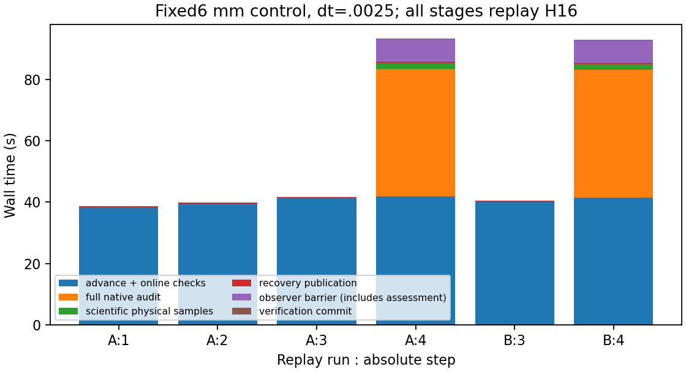
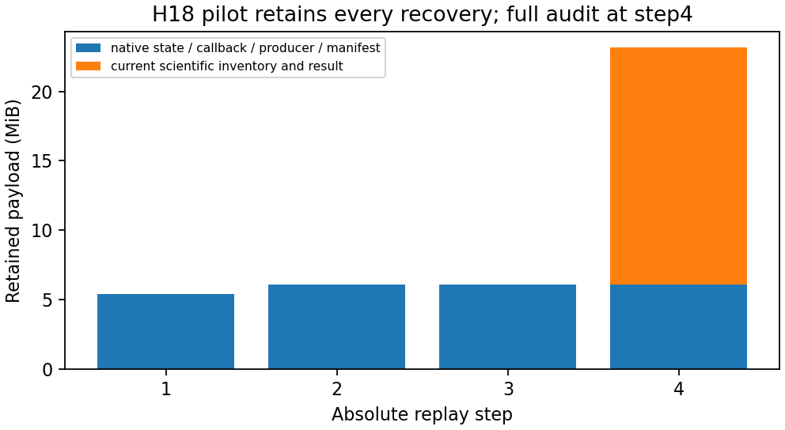

# H18 checkpoint audits with continuous solver guards

H18 qualified the checkpoint-audit mechanism at its declared short schedule.
Target A completed four replayed attempts; Target B strictly imported A's previously
unaudited step2, verified that input, and reproduced steps3–4. All six target states,
native histories, genuine callback histories, original qh0, reference/defect and
physical signatures match H16 bitwise. No new scientific time, CP0, initialization,
projection, height, mesh or timestep was introduced. The final strict read passed.

The fetched starting head was the reviewed a5badd612c3e74c646a4ed525cfed29cb4acad7e.
The branch-owning WJ worktree was clean; other worktrees and main-checkout files were
preserved. Linux used healthy ext4 `/home/jay/build/wj-h18-checkpoint-audits-20261114`.
H15–H17 ledgers stayed closed. The selected H16 closed-accounting bytes still match
SHA256 62a9bd910c1c9675f4bf8f030fd177471aa87b1ed980eb3d562d522137e464f9.
The original Mac literature hashes match 1959e96e…dbd9124 and 0ab52e0d…fbc47c;
the accepted quad/\quad typography and `(d+a*h)/a^2` errata are unchanged.

## Implementation and executed identity

`RANSWallMonitoringPolicy=CheckpointAuditV1` is opt-in with `BoundedV1` retention.
Absent/Off preserves every-step auditing. Recovery/scientific strides live in the
immutable execution intent, use absolute steps and pin timestep bits. Initial/restored
and final states are always audited. The target used recovery 1/scientific 4; restart
at absolute 2 did not reset the schedule. `ImmutableRowReuse=Off` and `ExactStepV1`
remain. No equation, root, coefficient, boundary or physical-signature exclusion changed.

StopOnBound now runs outside optional RecordAudit. PIMPLE's scalar/continuous-ground,
current moving/nonlocal-ray coverage, constitutive evaluation, outlet/constraint and
true frozen-system checks remain on every solve, with final Refresh and completed-stage
residual/norm evaluation. The bound is computed every attempt. Full physical sampling,
covariance/principal search and independent scientific assessment run only when due.
Nondue records contain an empty full-audit map and explicit NOT_SCHEDULED status.
They do not inherit a previous PASS. Full covariance/principal verification covers
inspected states; H16's original intermediate qualifications remain historical evidence.

Recovery output binds State.bin to genuine WJCompletedCallbackV1 history/time/alpha,
producer, immutable configuration, original qh0/reference/defect and source identities.
Native-completed, durable and fully verified cursors are distinct. PendingNativeV1
shares strict validation with the qualified importer but does not require a future PASS.
A pending restart is audited before advancing and receives a separate native startup
verification commit. Its original producer continues to say that the earlier audit was
not scheduled. Prepared PASS/ACK alone cannot promote a cursor. Directory and parent
fsync, rollback and bounded exceptional reporting remain active.

State/WJ/stage/step/explicit records are trimmed after every completed step. PIMPLE
retention no longer depends on factor logging. Bound computation no longer forces rich
k matrices/substep snapshots; selected steps and available bound events retain them.
Late discarded operators are unavailable rather than reconstructed. Factor metadata is
recorded at selected/scientific steps under the new policy. The observer retains fixed
sealed support plus current witnesses, uses a monotone schedule and archives inventories.
No ever-growing historical witness/ready seen set is retained.

The owned-recovery deletion API protects pending/scientific/verified/first-failure
anchors and keeps newest 3 eligible recoveries; synthetic files exercise deletion and
durability. This short qualification deliberately retains every recovery. Long-duration
archive/namespace growth and scientifically acceptable sampling intervals remain open;
this is not an unrestricted duration-bounded monitoring claim.

Executed native source: `0209525df2785d4f1ad2344176f78e6d36822784`. Three focused build versions were
retained; final governor/reader qualification used the last version. GNU 11.4 Release,
RANS_BUILD_SOLVER=ON, -ffp-contract=off/-fno-fast-math and the private original runtime
were verified. Actual native-exec maps and library hashes are sealed in closure.

| Binary | SHA256 |
|---|---|
| Governor | bfb52a1eda03330bafec1a2134cb82e1e33efe9907e6487fb6e30b7cfb22c5bf |
| Strict reader | 5d18a1fe3d454dcdbc1fd7aa3b108481269ea92a552ba98842ab2a82d107211c |

Frozen Python is identified per file in execution-config, independently of documentation
HEAD. The numerical observer/cache modules are unchanged; actual H18 observer bytes are
also bound in the intent/ready packets. The reused 211582940-byte cache keeps SHA256
800ac28c73ecb6498e6504b4e14e774db2cff893f2c0aaf418cb7036d50d00b0.
The reused H17 compatibility helper retains its historical schema/prose; H18's native
change is cadence/retention/pending import, with row policy Off. No historical cache pin
was edited. All 349 transported compiled source/header dependencies match Mac source.

A later passive-only readback selector refinement handles a verified pending-restart
input when no subsequent scientific step qualifies. Its three synthetic tests and dry
comparison with the actual final request passed; AST comparison confirms only `strict`
changed. The executed governor/observer capsule was preserved, with no extra native call.

## Focused controls and exact attempt counts

Fourteen focused Python methods ran directly on Linux, followed by three isolated
post-science selector methods: 17 distinct executed methods. CTest registration is not
reported as execution. The native protocol executable exercised final/temporary ACKs,
stale/malformed/failed/duplicate/timeout cases, interrupted publication, directory-sync
ordering and bounded factor records. A read-only native component invocation exercised
the actual shared bound/domain guards with zero full audits, eleven pending-integrity
refusals and both old qualified/new startup-qualified import paths.

| Category | Actual attempts / reads | Result |
|---|---:|---|
| Small legacy two-step |2| Exact sealed-H16 state/history parity |
| Small checkpoint policy two-step |2| Step1 recovery unaudited; step2 scientific verification |
| Small pending step1 restart |1| Genuine callback import/startup verification; exact step2 parity |
| Small deliberate post-implicit failure |1| Native/coupled rollback; provisional evidence, no completion publication |
| Target A from original H14 CP0 |4| Four online-completed recoveries; startup/final verification |
| Target B from A step2 |2| Strict pending import; restored-input/final verification; exact steps3–4 |
| Final target strict read |1| Zero Project/Lift/initializer/governing work |
| Fresh CP0 / new scientific steps |0 /0| Unchanged scope |

The sealed small fixture retains its own compatible dt=.01; it is a regression control,
not another target timestep. Every target attempt uses dt=.0025 and ends no later than
T=.01. Each successful sweep has one U, pressure, k and epsilon solve and one bound call,
zero bound activation/material correction and identical raw/corrected k hashes.

Target full native audits, PhysicalSamples calls and independent assessments each total 4:
A input 0/final 4 and B restored input 2/final 4. Only two completed scientific checkpoints
receive new step qualification commits; the two input verification commits are separate.
A1–3/B3 have online checks and no newly scheduled covariance/principal assessment.
The retained native maps match H16 at all inspected states, including completed step2
at alpha 400. The protected final strict reader uses B's genuine producing callback.
Complete 255+525 signed moment vectors, current-K/cutoff/epsilon/interface diagnostics,
transverse/covariance/positivity and principal extrema are retained in the evidence.

The fixed common support uses H16's sealed final union: 11456 points/17521 owners plus
44800 physical Gauss8 rows. Current witnesses are added without truncating coverage.
This comparison does not pretend to reproduce H16's earlier live discovery order.
The quality gate is unchanged at .002068763923454 and all signed Q1 moments pass 2e-15.

| Newly audited physical state | Min in-plane/nu_eff | Min transverse/nu_eff | Min covariance | Scaled strong-divergence max |
|---|---:|---:|---:|---:|
| A restored CP0 |.003514506137272|.943482176052|.002480518251|0|
| B restored completed step2 |.003520644291722|.943479549202|.002480552826|2.42908e-5|
| A/B completed step4 |.003527178521718|.943478472686|.002480577924|2.36428e-5|

The smallest sampled scalar is about 1.74424e-5. Covariance values are dimensional
code values; they are not principal-action normalizations. Complete signed Q1 vectors
are in the CSV; neither their maximum nor the strong-divergence maximum is substituted
for the other.
Evolved strong divergence is reported separately; its CP0 zero condition is not imposed.
Analytical error, actual-qh0 drift and internal-reference residuals remain distinct.
H16 profile/fetch context is explicitly reused through exact state/math bindings.

The strict packet retains projected 1, x/5,interface_hat signed components/regional sums,
current reactions and physical consistent-mass dual norms. Frozen linear residual,
genuine completed-stage defect and alpha0 spatial residual are separate. No new
quadrature campaign, full-target passive audit batch, kernel query, correction sweep
or exact-discrete-equilibrium claim was made. Terminal spatial mass-dual norms for
(Ux,Uz,k,epsilon) are [3.19009e-6,3.26423e-7,6.09081e-5,8.29355e-5]; genuine
completed-stage norms are [1.98970e-7,2.75026e-7,5.83135e-8,4.76666e-7]. Net mass
flux is 7.23727e-15. These nonzero defects are not frozen linear residuals or an
extra nonlinear convergence requirement. The compact strict view keeps all signed
projected weak components and 112 interface traces; larger exterior/station/load arrays
remain in their original Linux payload and verified transport archive.

## Measured cost, storage and limits

Target A cost 310.234 s; pending restart B 248.737 s; final strict 37.816 s. Warm nondue A2–3
native compute averaged 40.429995 s, and recovery publication/fsync averaged .310187 s.
The measured full native audit/physical sampling plus inclusive observer wait/commit
increment is 50.979164 s. Independent assessment is already inside wait and is not added
again; nested principal/row timers are not added to their audit parent. Audit CPU 0 means
unmeasured CPU. Startup, restart and final work remain separate from per-step estimates.

The storage figure shows selected checkpoint and independent payloads. The full forecast
also includes streamed factor metadata, telemetry, timing and console files.

A native recovery averages6.211 MB; a scientific package averages36.789 MB including
its inventory/result and conservatively the run's factor archive. Current telemetry
is about266 kB/step and timing/console output about530 kB/step: recurring diagnostic
storage remains material. No broader residual/solver diagnostic pruning was attempted.
Representative lossless compression is measured separately; it is not assumed universal.

The proposed recovery 10/scientific 100/terminal 50 schedules correspond to delta-T
.025/.25/.125. They are supported schedule examples, not accepted scientific intervals.
At unchanged horizon 505.02466521278404/window [447.8483832973273,505.02466521278404],
202010 ceiling steps give about 95.9286 conditional days and 243.7 GB uncompressed.
The ceiling step time is 505.025, explicitly distinct from the unchanged declared clock.
Startup/terminal work, future witness/namespace growth and flow-dependent cost/storage
remain qualifications. The prior H16 inclusive forecast was 211.896 days. This short
cross-run replay does not establish a statistically reliable speedup or affordability.

The new ledger is CLOSED at 2305.358323669/7200 s, including fully charged setup 60,
closure 300 and 900 conservative unknown transport/coordination seconds. Build 245.441 s;
combined qualification/target/readback 722.327 s, below its 3000 s ceiling. Sampled aggregate
RSS peaks:8,002,641,920 bytes build;6,722,887,680 bytes science. Source/build/runtime
190,043,741 bytes; new output256,910,166 bytes before the final small archives. Limits
passed. The first pre-transfer coordinator could not open its script; a later passive
publication wrapper had a quoting error before child work. Both failures, versions and
charges are retained. No failed/unknown governing reservation was repeated.

Small essentials transport passed: 164478 bytes, SHA256
200f2af4ac160d52d238662a01f24d9dead719a17fdaca0f0bc08ce2763d2b11 in 8.135 s.
The selected 1685888-byte archive also passed exact verification in 50.893 s, SHA256
832736b5a089219756a712df9af00bfd95e82fc6971d5578458c7457711fcd30.
Seventy-nine original manifest members were verified locally; optional remaining
members are explicitly remote-only. Two bulky original records have labelled compact
storage views; original hashes and verified archive locations are retained.
The original publication, separate closure and authoritative index retain their original
identities; local verification lists optional remote-only members. Heavy coefficients,
matrices, histories and complete row/load payloads remain at their sealed Linux paths.

## Next decision

Recommend a separately bounded target-domain dt=.005 versus retained dt=.0025 comparison
to common T=.01, with application/local-gradient/principal error budgets frozen before
launch. It would require one freshly compatible coarse CP0 and at most two new coarse
attempts; reuse the existing fine baseline and compare common support/times. Audit each
common time with this monitoring mode and retain recovery each step. Measure and reserve
its complete cost before authorizing it. Two levels establish sensitivity, not temporal
order or an error bound; H11 temporal adequacy remains UNRESOLVED. Execute none here.

A separately frozen affordable duration/archive plan and unchanged full-domain flat
preservation follow that decision, then curved-terrain qualification and the hill
experiment. The full-height log/constant-outer-k inlet is idealized. No physical H_w is
selected; roughness-sublayer validity and application/experimental uncertainty remain
open. Physical 7 mm observations stay inside AWF, and H_w>4.413515542 mm versus
H_w<3.5 mm leaves the all-measurements-outside interval empty. EP, altered inner stresses,
old measured-rms/20 mm work and longer evolution remain deferred. H18 proves no
stationarity, exact discrete equilibrium, all-time covariance/principal positivity,
global realizability/ellipticity, hill suitability or experimental agreement.
