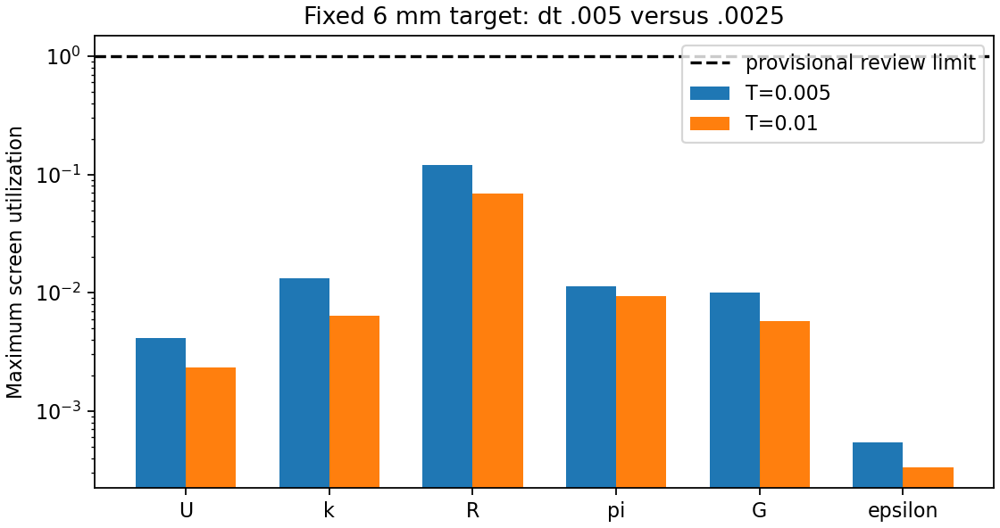
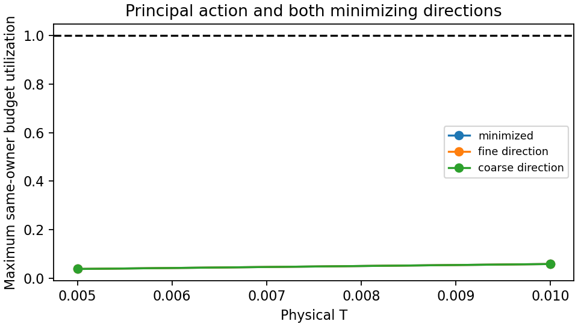

# H19 bounded target-domain timestep sensitivity

H19 passed its **provisional two-level sensitivity screen** at T=.005 and .01.
One new dt=.005 native CP0 preserved the original fine CP0's spatial state
bitwise. One coarse process completed and independently qualified both authorized
steps. The protected final strict read passed. There were **two new coarse
scientific attempts**, no fine evolution and no increase beyond T=.01.
This does not select a production timestep or resolve H11 temporal adequacy.

The fetched starting revision was the reviewed
`a8fc3f50eab7b50fcdec235a22f82a140ea7ee06`; there were no intervening commits or
WJ edits. Other worktrees and an unrelated Linux capacity campaign were preserved.
The new healthy-ext4 root is
`/home/jay/build/wj-h19-target-timestep-20261115`. H18's closed ledger was rehashed
unchanged. Both original Mac literature identities match the established
1959e96e…dbd9124 and 0ab52e0d…fbc47c hashes; the quad/\quad typography erratum
and correct `(d+a*h)/a^2` coefficient are unchanged.

## Initial-state equivalence and implementation

The new `step_zero_bootstrap` is a separate native producer in the strict
resolution helper. It imports the immutable fine CP0 under its original
signature/dt, requires IMEX1 and absolute step/time zero, and restores its physical
arrays/reference/defect. It calls native IMEX1 `Initialise`/`BuildScheme` at .005;
the implicit callback refuses any governing solve. No fine GLM history is copied
or rescaled. Ordinary wrong-dt restart still fails. No physics-signature exclusion
changed, and TimeStep remains part of the signature.

The native helper explicitly performs the complete WJ audit, scalar/outlet and
feasible-bound checks. Its XML uses the non-loop helper's Off retention/monitoring
settings; it does not execute a governor loop or omit its explicit CP0 audit.
The restarted coarse governor uses the required CheckpointAuditV1/BoundedV1,
ExactStepV1, ImmutableRowReuse Off, recovery 1/scientific 1 and StopOnBound On.
This execution-only role distinction is recorded rather than relabelled.

| CP0 property | Fine original | New coarse |
|---|---|---|
| dt |.0025|.005|
| step/time |0 /0|0 /0|
| native history times |[0,.0025]|[0,.005]|
| contained coupled-state SHA256 |631caa32a59ff43253f1fcac4effd955eb68b8529d9c28f29e615cf14ca0f077|same|
| State.bin SHA256 |d27ee0e2f9b9bf8639d47449c5e8e338212363417faca7bf014d1008f44f69a3|9d51909af6a22d28a5b1ade258b982f19e491cbc8057fd93304c11e681934889|

Regional pressures, fixed reference, fixed defect and eta also match bitwise,
including signed binary64 zeros. Different checkpoint/signature/history-label
identities are legitimate. The new CP0 is the run-local native qh0 anchor; the
fine CP0 is separately pinned as `spatial_lineage_anchor`. Spatial Project/Lift/
initial-velocity applications and governing solves during bootstrap are zero.
There is one target native-history initialization, plus one small component
history-construction exercise without a new fixture CP0 or governing trajectory.

The original 700-element/24688-state physical problem, H_w=6 mm, full-height
Functions, maps/signs, q12/normal16, model, boundary data and pressure convention
are unchanged. The exact XML allowlist removes only TimeStep and declared execution
controls for comparison; XML Time remains zero. The physical difference is the
authorized timestep, not a changed initial spatial representation.

H18's replay comparator remains intact. H19 adds a distinct physical-time role:

| Coarse completed step | Fine completed step | T | Coarse/fine alpha |
|---:|---:|---:|---:|
|1|2|.005|200 /400|
|2|4|.01|200 /400|

Fine step 2 keeps its genuine H18 A-step2 producer/callback; H18 B's restored-input
verification supplies its additional full audit. Fine step 4 uses H18 B-step4.
Each serialized state/history/callback is checked against its own producer. No
cross-dt equality is imposed on evolved states or histories. CP suffixes are
generation indices, not physical-time or absolute-step selectors.

## Native and independent qualification

Both completed steps have one U, pressure, k and epsilon solve and one bound call,
zero bound activations, zero material/additional corrections and equal raw/corrected
k hashes. Restart performs zero spatial initialization. Both final ACKs, native
qualification commits and the qualified cursor are durable. The final reader ran
after governor exit and used the genuine alpha200 completed callback.

The fixed H16/H18 support starts at 11456 physical points/17521 owners, with 44800
physical Gauss8 rows. The frozen extension rule adds both current native witnesses
and their +/-1e-6 neighborhoods and both states' cutoffs at every fixed matching-
outer x. Both fields are evaluated on the resulting union. CP0 realizes 11629
points/17733 owners; each common-time comparison realizes 11800/17943 plus the same
Gauss8 support. Coordinate bits, face owners, chart/physical maps and snap metadata
are preserved; there is no lowest-ID selection or averaging of traces.

The cache compatibility record keeps historical pins unchanged and explicitly
separates dt-bearing signature metadata from dt-independent geometry/basis/tests/
quadrature/analytical reference and original-qh0 objects. All current fields,
closure, profiles/cutoff and decisions are recomputed. Existing fine summaries
do not retain all raw values on this extended support, so those fine values were
passively reconstructed; no fine governing or strict native run was repeated.

| Accepted state | Coarse minimum m/nu_eff | Fine minimum m/nu_eff |
|---|---:|---:|
|CP0|.003514506137272|.003514506137272|
|T=.005|.003520378848743|.003520644291722|
|T=.01|.003526555321964|.003527178521718|

All exceed the unchanged separate quality gate .002068763923454. Full covariance,
transverse action, root/scalar/viscosity/cutoff and native hard checks pass. At .01
the coarse minimum covariance is .002480575608 in code units. All 255+525 signed Q1
moments pass 2e-15; the largest absolute value among the 4680 published coarse/fine
moment entries is 3.896342854e-16. Coarse scaled strong-divergence maxima are
2.71729e-5 and3.34724e-5; they are not weak-continuity failures or subjected to the
CP0 zero-divergence gate.

Six decisive native-witness value/direction replays use the actual stored owners
and implicit-root tangent. Maximum normalized-action disagreement is 5.23e-15,
below the unchanged 2e-11 replay accuracy; dimensional and scaled field/covariance
comparisons also pass. No compiled kernel request or new quadrature campaign ran.
These are finite-inventory results, not global ellipticity/realizability proofs.

## Provisional sensitivity, reference error and drift

The following are the largest scaled differences across regional RMS and finite
maxima. Complete per-region, per-metric signed data and scales/floors are retained.

| Field | T=.005 maximum | T=.01 maximum | Provisional limit |
|---|---:|---:|---:|
|U|4.10368e-7|2.33734e-7|1e-4|
|k|1.33166e-5|6.33834e-6|1e-3|
|R|1.20610e-4|6.93584e-5|1e-3|
|pi|1.13695e-5|9.32767e-6|1e-3|
|G|9.99853e-5|5.73803e-5|1e-2|
|outer epsilon|5.39809e-6|3.34845e-6|1e-2|

Vector/tensor norms are Euclidean/Frobenius. Scales are1 for U, K for k,
u_tau^2 for R/pi, max(||G_eq||_F,.051/19.9125) for G and the positive exact
height-dependent outer epsilon. Physical region measures are 497.8125/3.75/494.0625.
The 4e-11 scaled floor classifies reconstruction resolution, not a propagation bound
or altered physical guard. These review limits are not experimental uncertainties.

The most adverse principal comparison is at x=15, physical z=.25607517888672315
code =10.2430071555 mm, geometry251 upper/x-upper, with the adjacent owner retained.
It is .743007 mm above the physical9.5 mm interface, not the matching interface.
At this SAME owner the minimized coarse-minus-fine differences are -7.77517e-6
at .005 and -1.20966e-5 at .01. The local difference grows even though several
bulk differences shrink. At .01 its coarse/fine margins are .004130038788938 and
.004142135341646; these are distinct from the separately reported moving minima.

The corresponding local budgets B_i=.1*(a_fine,i-a_gate) are 2.05326e-4 and
2.07337e-4. Maximum utilization, including both states evaluated at each other's
minimizing directions, is .0378674 and.0583425. All comparisons pass; the three
direction/minimized curves nearly coincide. They do not establish contraction
with timestep or a temporal order. Plot segments connect measured endpoints only.

Initial representation error remains larger than the temporal difference in some
quantities. Full-domain initial U RMS/max are 9.83722e-7/3.06327e-5; scaled G
RMS/max are 2.62071e-4/.00832473. At .01 coarse U drift RMS/max are 5.86552e-8/
4.55310e-6 and coarse reference error9.92680e-7/3.30919e-5. Scaled G drift
RMS/max are 7.77032e-6/.00120016. Small coarse–fine differences therefore do not
bound continuum/reference error or prove a discrete equilibrium.

Current K, cutoff, epsilon trace and interfaces evolve rather than reset. At .01
sampled coarse matching K spans .0088090149530–.0088090154374 and cutoff r spans
.0264198980509–.0264198984805 code. Shared U/k defects are zero and the dependent
epsilon defect is at most 2.17e-18. Total traction and represented k-flux traces
have nonzero finite-space defects; no extra pointwise constraint was imposed.
Actual inner turbulent-production integral .0237619348427 differs from current-K
counterfactual production .0237617726791, which balances cutoff destruction in its
reference budget. Actual P_A-E_c remains the transported source. Complete signed
interface/exterior trace differences and station profiles remain in the records.

## Residuals and source/runtime

Final physical consistent-mass dual spatial norms (Ux,Uz,k,outer epsilon) are
[3.84667e-6,5.59313e-7,8.40502e-5,9.32723e-5] coarse and
[3.19009e-6,3.26423e-7,6.09081e-5,8.29355e-5] fine. Genuine completed-stage norms
are [3.83979e-7,5.29890e-7,1.31219e-7,1.26515e-6] and
[1.98970e-7,2.75026e-7,5.83135e-8,4.76666e-7], using each actual callback/alpha.
Coarse/fine net mass fluxes are 6.80012e-15/7.23727e-15. These are not the frozen
linear residuals. Signed projected weak terms and 112 interface traces are retained;
larger exterior/station/load arrays remain in the original native packets.

Ordinary per-step packets retain completed-stage norms, but not separately
mass-normalized alpha0 spatial norms at T=.005. Those intermediate spatial norms
are unavailable here; no extra strict read was substituted. Final coarse/fine
strict packets permit the like-normalized terminal comparison above. No new
independent24/32 weak-load study or universal quadrature guarantee is claimed.

Executed native capsule: `b2365e52b0d334d7b61c6be3a4a3bb9029491084`.
Frozen scientific Python is 4108e3da with per-file pins. Later publication tools
are separately pinned. All 350 compiled source/header dependencies match Mac source.
GNU 11.4 Release, RANS_BUILD_SOLVER=ON, -ffp-contract=off/-fno-fast-math and the
private original loader/library closure were verified against actual native-exec
maps. H18 ELF identities were not inherited by the new executables.

| H19 ELF | SHA256 |
|---|---|
|Governor|067ccdf0954efb6ea9921887edd911c57da910be1c82ffddaadba4f7f544d3e8|
|Reader/helper|637656771bdeb4b94d1487748489357ab58e0030a80cd52d5f55289018ed375c|

Eighteen distinct focused Python methods passed; the first invocation also retains
a nonexistent-class selector error, with its 17 executed methods passing. Native
protocol/guard/cadence/durability fixtures and the genuine small history/refusal
component passed. Registration is not execution. Two build failures were retained:
a pre-compiler directory-monitor race and const/unused-argument compiler diagnostics.
The final build passed. A passive publication import failed because H18's late
publication helper was absent from its frozen source capsule; its explicit source
binding and corrected passive receipt are preserved. No native case was retried.

## Cost, storage, closure and next decision

CP0 production plus independent qualification cost 125.922 s; native WJ audit inside
it cost 54.968 s. Native-history initialization has an invocation count, not a separate
micro-timing. The coarse block cost 314.766 s; final strict 38.183 s. Restored governor
startup.object/startup.initialize scopes are 9.329/77.969 s, with initialization
inclusive of its full audit and observer barrier. Do not add nested scopes.

| Step | Native compute | Full audit+PhysicalSamples | Recovery/fsync | Observer wait | Commit | Inclusive step |
|---|---:|---:|---:|---:|---:|---:|
|1|81.401s|43.261s|.325s|20.271s|.062s|102.089s|
|2|84.140s|43.833s|.362s|20.416s|.066s|105.016s|

The ordinary-compute subscope after subtracting audit/PhysicalSamples averages
39.224s; there was no ordinary unaudited warm coarse step. Observer wait includes
fine reconstruction and sensitivity work; it is not added again as hidden CPU.
Audit CPU zeros mean unmeasured CPU.

For proposed physical recovery/science/terminal intervals .025/.25/.125, coarse
strides 5/50/25 give 101005 steps, 20201 recoveries and 2250 scientific checkpoints.
The declared horizon/window remain 505.02466521278404 and
[447.8483832973273,505.02466521278404]; ceiling-step time is505.025. A conditional
native-only estimate is 46.99 days; including the observed H19 comparison wait is
47.60 days, excluding startup/terminal extras and future growth. This extrapolates
two audited steps and assumes an observer role that has no future fine oracle;
it is not a statistically representative production mean or duration admission.

Measured telemetry/timing/console is 818502 bytes/step. Keeping H18's scientific
package estimate with these logs gives 165.5 GB uncompressed conditionally. H18's
243.7 GB estimate, including 160.9 GB recurring logs, remains an unresolved production-
output issue. H19 comparison NPZ payloads are additional study data, not assumed
routine duration archives. Cadence/namespace/log optimization remains deferred.

The ledger is CLOSED at 1259.907967403/5400 s, including setup 60, closure 300 and 180
conservatively charged unmetered network/coordination seconds. Build 182.854 s and
combined qualification/target/readback 522.013 s pass their 1200/1800 ceilings.
Sampled aggregate peaks are7,892,180,992 bytes build and6,874,308,608 bytes science.
Source/build/runtime 160,755,689 bytes and new output 243,163,440 bytes before final
small archives pass the 8/2 GiB caps. The verified essential archive is 1057297 bytes,
SHA256 2e025c910d632292e99897538cfcfc98497f3620ad312a47ec148a75dfd2d2d8;
transfer took 19.880 s. Publication accounting remains its original OPEN snapshot;
closed accounting and the post-science source supplement are separately sealed.

Recommend designing ONE separately bounded three-level target study to common
T=.02, with explicit application/numerical budgets reviewed before admission:
continue .005 by 2 steps and .0025 by 4, and create one compatible .00125 branch
for 16 steps (22 new attempts total). Audit declared common times on identical
support and qualify all new lineage. This is a proposal only: no third-level case,
CP0, attempt or longer evolution was prepared/executed in H19. H11's historical
same-owner noncontraction remains UNRESOLVED; two levels cannot establish order.

Then freeze an affordable duration/archive plan, unchanged full-domain flat
preservation, curved-terrain qualification and the hill/experiment comparison.
The full-height log/constant-outer-k inlet is still idealized. Physical H_w and
roughness-sublayer validity are not selected/validated. Physical 7 mm observations
remain inside these AWFs; H_w>4.413515542 mm and H_w<3.5 mm still leave the all-
measurements-outside interval empty. Height/model changes, EP, old measured-rms/
20 mm work and experimental validation remain outside this package.
