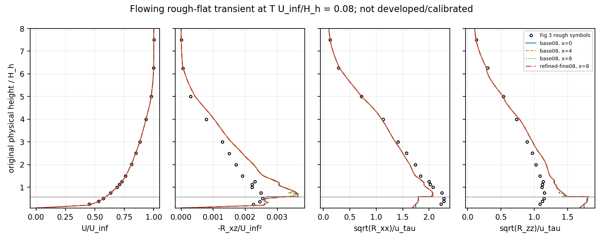
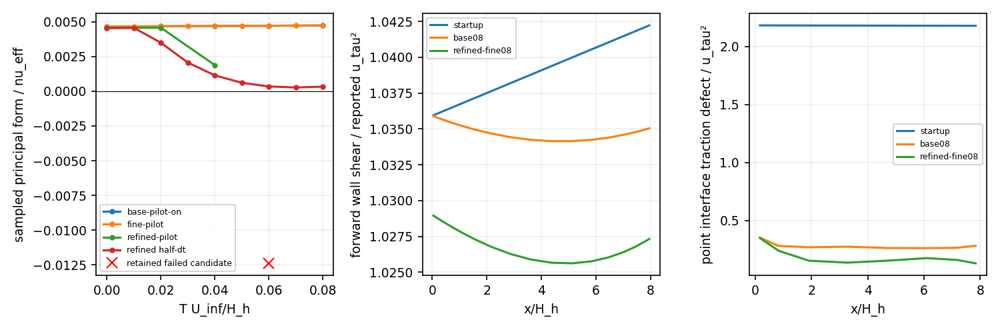

# WJ-H2: physical rough-flat boundaries and an obstructed precursor

Physical inlet, full-traction outlet, scalar outflow and ceiling operators are
implemented in the production `RANSEquilibriumWallEvolution` session path.
The qualified scope is **serial flat composite-tunnel WJ Budget**, with the
existing prescribed-boundary mode retained. The complete solver executes a
flowing finite-depth rough-flat transient with nonzero outer shear. The planned
developed/one-flow-through precursor is **not qualified**: the prescribed normal
refinement at dt=.02 loses the sampled in-plane principal predicate at T=.06.
The bounded half-dt diagnosis accepts eight steps to T=.08 but does not establish
the frozen T=8 target. A proposed longer continuation was rejected before launch
by automatic approval review; it remains NOT_RUN.

H1 remains the small mapped-terrain implementation foundation. WJ-7 remains
RESOURCE_LIMIT, with no new governing steps and T3 NOT_RUN. Neither ledger nor
its immutable evidence was reopened. No EP, hill prediction, 3D/MPI, clipping,
physical cap, equilibrium forcing or backend-capacity extension is included.

## Source and runtime

The fetched, clean reviewed baseline was
`117e2e6b6dce6f9887b59a17b68c13d081c5ae30`. Work continued in the existing Mac
WJ worktree on `codex/wj-earsm-awf`; every commit was pushed normally. Other
worktrees, the dirty Linux main checkout and live CLS/A93 work were preserved.
The documented Tailscale fallback was used after the USB alias timed out.

Authoritative heavy root:
`/media/jay/新加卷/nektar-v2026-runs/wj-h2-20261111`.
An isolated detached development source/build was used; no shared installation
was replaced. The producing identities are distinct from publication HEAD:

| Role | Identity |
|---|---|
| Scientific native C++ producer | `c344dc2209f030e426e2ee5501d5e5b72a6d2c46` |
| Native producing tree | `5320aa4243b73c77fd8454fcc3cfcdc28506fb19` |
| Frozen first study driver | `c2189f8b98954271c321d9bd971a45a6fa24a353` |
| Bounded half-dt driver | `016c25da112c70ea39035d7012ebe734b4969fac` |
| Versioned passive native observer | `e62b5f4d265f068dd5af3f090bfb0e385c3ae53e` |
| Final read-only scientific/publication source | `0d6a74a1` (full identity in manifest) |

The governing ELF SHA-256 is
`9ae37a1aba62755b10ad99c9484c498cef9d927a75fb950f00344f4ffc5d06fe`;
the versioned observer is
`6f35b837f0dd13eb155e0fe34f0dc670c609ee6cbe739609a5de288dd49ed06d`.
All 340 source dependencies from the governing and RANS-kernel compilation
dependency files match the producing commit and the delivered Mac source.
Later C++ changes affect only the passive observer. The mutable development
checkout's HEAD is never substituted for a producing revision.

GNU11.4, C++17 Release, `-O3 -DNDEBUG -ffp-contract=off -fno-fast-math`,
`RANS_BUILD_SOLVER=ON`; one compiler worker, one serial rank and six numerical
thread controls set to1. Actual main-process memory mappings were captured
during a zero-step immutable physical restart. The selected source-built
SpatialDomains is the H1 isolated library, SHA-256
`0c23e0de180a233bd88f70b265ae9865aeac456e6482f8ff0fa1b4be84d69dab`.
The installed SpatialDomains has a different identity and was not used.
[Loaded files](wj-h2-linux/loaded-runtime.json), [native inputs](wj-h2-linux/native-source-inputs.json)
and [manifest](wj-h2-linux/manifest.json) retain resolved paths/hashes, effective
compile/link receipts, source objects, commands, XML and checkpoint identities.

Original Mac and worktree specifications agree byte for byte:

```
main     1959e96ea0b61f9deb9ff9ad1f5b26488a932a8451c2de6d3b6f7b7c9dbd9124
appendix 0ab52e0d813b8fb344973f75ca6d8da97ff389ef9f93476500ca9d1df1fbc47c
paper    adffb5c1d740be791211d82ce35778a37a3315a6dc72c56c80b70cc6642a43df
```

The literal `quad`/`\quad` typography erratum and correct `(d+a*h)/a^2`
coefficient are retained without changing the specifications.

## Experimental input and conditional roughness fit

[The case specification](../../solvers/IncNavierStokesSolver/Tests/RANS/wj_h2_experiment.json)
distinguishes reported anchors, digitized symbols and missing-input assumptions.
Sixty hollow rough-case symbols were extracted from the original Fig.3(a–d),
p.7, using PDF marker coordinates. The
[data/provenance](../../solvers/IncNavierStokesSolver/Tests/RANS/cao-tamura-fig3/README.md)
retain panel-specific height origins, axis calibrations, selected symbols and
approximately .15 PDF-point reading resolution. The overlay was visually checked.
Reading resolution is not an experimental uncertainty bar; probe-voltage
calibration was not used as a universal velocity uncertainty.

The hill-absent virtual crest x=0 is approximately identified with the inlet.
This removes upstream fetch from this pilot; imposed mean data there are not an
independent validation. Domain[0,8]x[d0,20], stations0,2,4,6,8 use original physical
heights. The effective wall is d0=.0875; r=z-d0, not outer chart rho.
H_h=1, L_h=2.5, z0=.005, delta~6.25, u_tau=.051 and
nu=.051*.005/3.97=6.423173803526447e-5. Cubes, z0, d0 and h_s remain distinct.

Measured mean/rms knots use a C1 finite-depth continuation to U=1 and assumed
.003 rms per component at z=12.5. Spanwise variance is bracketed between the
measured vertical and longitudinal variances; the base weight is .5. No
`k=1.5*sigma_u^2` assumption is made. Unmeasured epsilon uses the declared
finite-depth mixing-length family, normalized at H to A(K)/H. The base
asymptotic length is .09 delta; .05/.15 and span weights0/1 are independent
missing-input controls. This is a provisional completion, not measured epsilon.

| Conditional flat fit / trace | Value |
|---|---:|
| H_w, smallest candidate containing3 overlap mean points | .5 =20mm |
| h_s, fixed by those points and reported wall stress | .03721697831176141 =1.48868mm |
| K(H), from completed digitized rms | .012618181994557477 |
| K/u_tau² | 4.85128104366 |
| epsilon_H / neutral tail at reported u_tau | 1.71436837052 |
| Three mean-fit residuals, U_inf units | +.01070279, -.00458587, -.00602654 |
| Mean-fit RMS | .00756965 |
| Implied initial traction / reported traction | .002638956 / .002601 |
| Lambda, r_c, z_v | 4.21187469, .020140514, +.000085665 |
| Budget-reference k at ground / minimum | .02490224 / .01261818 |
| Molecular fraction at H | .00548141 |

h_s<H, the finite-nu cutoff and positive reference column pass. The positive
z_v produces a real molecular-only sliver. It is retained. These are conditional
flat-fit parameters, not a calibrated hill result. The inlet epsilon trace is
dependent; incompatible independently prescribed corner epsilon is rejected.

The independently differentiated full WJ inlet and compiled kernel replay agree.
The base completion passes finite inlet covariance/principal sampling; its
in-plane minimum is .00498786. Span0 at the base length and midpoint span at
length .15 delta have **negative principal witnesses with positive covariance**.
Span1 and length .05 delta pass this preflight. All five results and witnesses
are retained in [the completion table](wj-h2-linux/inlet-completion-family.json).
They are not global admissibility proofs. The original constants are unchanged;
neutral WJ rms1.759/1.192 versus reported2.15/1.13 remain a visible model bias.
No evolving missing-input companion was admitted after the failed base study.

## Conservative boundaries and focused verification

`OpenTunnelV1` uses normal session/Functions inputs in the full solver:

- Inlet U/k/outer epsilon in physical coordinates; no-slip wins at the ground
  corner. H shares U/k and owns the dependent epsilon trace.
- Outlet prescribed **complete physical mean traction**, zero for the physical
  pilot, with scalar zero diffusive flux. This fixes the pressure level through
  the natural condition; it does not prescribe pi=0 there. The redundant gauge
  unknown and row are removed consistently. Initial pressure is not regauged.
- Physical top z=20 is impermeable slip with zero scalar diffusive flux. Its
  normal traction is a reaction. The former top-Dirichlet mass-flux repair is
  absent. Ceiling sensitivity remains open.
- Ground no-slip and modeled zero k flux. Material sampled outlet backflow
  stops before commit, with a point/phase witness; no velocity clamp or invalid
  scalar extrapolation is used.

For volume advection already integrated by parts, exterior residuals are
U(U.n)-Tn, k(U.n)-Dk grad(k).n and epsilon(U.n)-De grad(epsilon).n.
T uses full regional stress and pi=p/rho+2k/3. The same terms enter frozen
blocks and affine pressure actions. Prescribed outlet traction has no pressure
column. A common pressure constant has a nonzero free-flow action, so no second
mean-pressure constraint is added. PIMPLE retains
S=D(alpha M)^(-1)G-C with consistent M and roughness pressure columns.
It is not a full nonlinear Jacobian or a full-momentum-inverse pressure operator.

The separate analytic control uses K=qe*u_ref², its integrated nonconstant
Budget k, physical r in the outer logarithm/epsilon, and pi_o=0,
pi_w=-K/Ne. Its outlet includes the required transverse+u_ref² traction;
top tangential shear and epsilon diffusive flux are nonzero. Thus it is not
the physical stress-free ceiling case. The incompatible H1 vortex was not
used as a clean traction-convergence control.

Native startup/final assembly checks give maximum same-state flow/k/epsilon
load defects1.78e-15/6.94e-18/2.71e-20. Five pressure modes, including common
constant and nonconstant roughness columns, agree with frozen columns within
2.85e-14 and centered differences within1.43e-13. Independent boundary load
scatter error is2.12e-22; both H-sided outlet measures are .5 and19.4125.
Three independent polynomial weak modes include storage, convection, sources,
diffusion, roughness and exterior reactions; raw regional loads are retained
without claiming separately normed pieces add linearly or all raw tests vanish.

ExactStepV1 was qualified only for this flat open route. Full state, current K,
epsilon, time/data generation and boundary changes invalidate relevant entries;
concrete cutoff/principal failures retain identical decisions. Physical Off/On
trajectories and analytic restart trajectories agree exactly. The source-built
analytic transaction has6 accepted steps and1 deliberate post-solve rejection,
with exactly one U/pressure/k/epsilon solve and logical bound per attempt.
Rollback preserves state, gauge, histories, times, audits and samples; original
producer bytes are unchanged. A separate signed-zero-preserving replay verifies
these equalities. Supported changed traction data fail at signature validation;
epsilon-corner and reversed-reference backflow tests fail for their intended
reasons.

## Actual flowing runs and the first obstruction

Q3 velocity/scalars, regional continuous Q1 pressure, one horizontal element,
eta=0, no condensation, force/gravity0, PimpleVerify Off, and StopOnBound On.
The 3000-state guard is unchanged. Actual chart/physical knots are retained in
each case-design.json. Normal refinement changes no inlet completion, H or h_s.

| Run | State | Free U | Pressure | Flow | k solve | Epsilon solve* | Accepted / attempted | T |
|---|---:|---:|---:|---:|---:|---:|---:|---:|
| Base dt=.02 |1062|411|50|461|210|130|4/4|.08|
| Base dt=.01 |1062|411|50|461|210|130|8/8|.08|
| Refined dt=.02 |1966|771|90|861|390|238|2/3|.04 accepted; .06 rejected|
| Refined diagnostic dt=.01 |1966|771|90|861|390|238|8/8|.08|

*Epsilon solve includes the retained dependent trace rows. Base/refined normal
cell counts are23/43 (9+14 /17+26). A separate four-step Off run is an exact
duplicate control, not extra physical development. Including it, physical work
is26 accepted+1 rejected complete attempts. Every attempt has one solve of each
governing block and one logical bound; correction is inactive and raw/corrected
k bytes agree, including the rejected candidate.

Outer flow is already O(U_inf), with U(H)=.5928979 and nonzero outer shear.
This is not a nearly resting outer-flow probe. Nevertheless the attained
duration is only T U_inf/H_h=.08, or .01 nominal flow-throughs. The frozen T=8
target and developed/stationary criteria are unmet.

The first failed principal witness is at the outlet x=8, on the upper normal
face of outer geometry17, rho=.5848921240416898, T=.06:

```
k=.012486200396086231; epsilon=.0010462489706672422
Gxx=.00035397141002544; Gxz=.3042558380861338
Gzx=-.00040757082497914; Gzz=.06510828529912971
N=4.348817178179926; nu_eff=.012100616392337287
nu_d=.012991268206866542
eig(R)=[.00297537980,.00922136687,.01277565412]
principal/nu_eff=-.012390236673493472
```

[The complete incident](wj-h2-linux/principal-incident.json) includes xi,
polarization, action, state/callback hashes, element ownership and independent
coefficient reconstruction. Independent differentiation and compiled shared
action reproduce the negative value. Covariance is positive; root, scalar and
cutoff guards pass. Praw=.000652365 differs from Pdev=.001197281 because raw
divergence is .06546226. No root change, clipping or restoration was used.
The accepted predecessor and failed candidate/history are retained separately.

Halving dt on the same refined mesh accepts eight steps, but its final
principal minimum is only .000327418. This demonstrates timestep sensitivity
of the observed exit. It does not prove impossibility at all smaller dt, a
pressure-space defect, instability of the pressure pair or a global WJ failure.
The prepared longer proposal was denied before SSH execution; no study-v2 root
or governing attempt exists. See [the exact denial](wj-h2-linux/continuation-denial.json).

## Numerical sensitivity, physical discrepancy and budgets

Common physical quadrature is split at both meshes and physical breakpoints;
orders8/10 normal and4/6 horizontal use identical points/weights within each
comparison. L2 differences are normalized by U_inf, K(H) and epsilon_H, with
each physical field domain's own measure. Pressure has a fixed traction level,
so it is never independently regauged. Its finite differences are reported
without a numerical PASS budget. Two levels do not establish an asymptotic order.

| At T=.08 | U L2 | k L2 | Entire outer epsilon L2 | Wall shear max /u_tau² |
|---|---:|---:|---:|---:|
| Base .02 versus .01 |2.582e-5|3.612e-5|2.433e-5|9.978e-4|
| Base versus refined, both .01 |2.036e-5|1.142e-4|5.568e-5|8.720e-3|

These accepted-prefix field comparisons pass the frozen2% L2/5% sampled limits;
K/cutoff differences pass2%. Quadrature changes in these norms are below3.2e-17
against the fixed1e-10 floor. None erases the earlier failed observation.
Same-node independent weak-load errors are below8.93e-14. Increasing outer load
quadrature8->24 changes the two evolved outer-stress moments by3.81e-9 and
4.35e-9, slightly beyond the original2e-9 absolute floor. This separate load-
quadrature gate remains **UNRESOLVED**, without a tolerance relaxation.

At base T=.08, inlet/outlet mass fluxes are -18.96114060066/+18.96114060066;
net flux is -1.49e-14, with zero ground/top flow and no repair. Maximum frozen
linear residuals are O(1e-16) or smaller. The source-built pressure-test weak
continuity residuals are near roundoff, while strong divergence is not. Complete
admissibility inventories and strong-divergence extrema remain in the reports.

Current sampled K ranges .01256844–.01261212, with cutoff .02014531–.02017998.
Dependent epsilon trace DOFs have zero refreshed defect; pointwise trace
interpolation differs by up to1.58e-9. Point traction defect is .00091739 and
opposing k-flux defect4.60e-6. Shared U/k/mass traces agree. These represented
point defects are not hidden by an added strong interface condition. The physical
startup completion is not a traction-equilibrium reference; its initial traction
defect is also retained. The analytic control provides the compatible check.

Actual integrated inner production is .01011086780, whereas current-K reference
production and destruction are .01996150034. Their difference is the intended
uncapped source, not a missing sink or an enforced production budget. The average
forward wall shear is .002691036, 3.46% above the reported .002601. Reduced and
mechanical pressures are separate; general interface normal balance uses actual
full stress, not a constant neutral -K/Ne substitution.

At the prescribed data plane, mean-profile RMS discrepancy is .00465 U_inf, but
modeled shear RMS discrepancy is .000555 U_inf² and longitudinal/vertical rms
discrepancies are .228/.326 u_tau. At x=8 they are .00460, .000528 and .231/.319,
respectively. These differences mix a short transient with the stated model and
missing-input assumptions; they are not experimental uncertainty or independent
inlet calibration. Inner stresses/velocity use evolved AWF fields and local k;
outer points use WJ in physical Cartesian axes. The spanwise R_yy is retained.
Inner `epsilon` profile columns denote Ec diagnostics, not an inner epsilon PDE.





Uncancelled spatial mass-dual norms at base T=.08 are
u=.00086377, v=.00112703, k=.04726683 and full outer epsilon=.00572422.
Actual saved-callback stage defects are separately .00018958, .00082380,
.00011696 and .00002605. Startup has no completed-stage packet. These are
consistent-mass, physical-scale norms, not arithmetic noise estimates or proof
of stationarity. The1e-5 development criterion is not reached.

## Linux tests, commands and cost

The inventory has73 registrations. The20 named selections in the manifest all
pass (339.878s), including kernels/oracle, returned fields, Budget, shared legacy
transaction, standard/CLS/AWF transport/equilibrium, timing and history controls.
`WJH2OpenBoundaries` separately passes (197.374s), giving21 unique selected CTests.
Passive lineage fixtures pass (14.611s): earlier checkpoints, wrong report,
producer, callback and native history, failed-producer role, and rejection of
a restart-start alpha=0 audit as a preceding completed callback. Final focused
measurement fixtures also pass after the pressure-label/componentwise-max fix.
Zero selected tests was never counted as validation.

Executed command forms (exact argv, cwd, exit, elapsed and log hashes are in the
manifest; immutable labels must not be reused):

```bash
source /home/jay/.local/opt/nektar-v2026-mpi/env.sh
export OMP_NUM_THREADS=1 OPENBLAS_NUM_THREADS=1 MKL_NUM_THREADS=1
export BLIS_NUM_THREADS=1 NUMEXPR_NUM_THREADS=1 VECLIB_MAXIMUM_THREADS=1
R=/media/jay/新加卷/nektar-v2026-runs/wj-h2-20261111
S=$R/source-v1
export LD_LIBRARY_PATH=/media/jay/新加卷/nektar-v2026-runs/wj-h1-20261111/build-v1/geometry-lib:${LD_LIBRARY_PATH:-}
cmake -S "$S/solvers/IncNavierStokesSolver/Tests/RANS" -B "$R/build-v1" \
  -DNektar++_DIR=/home/jay/.local/opt/nektar-v2026-mpi/lib64/nektar++/cmake \
  -DRANS_BUILD_SOLVER=ON -DCMAKE_BUILD_TYPE=Release \
  '-DCMAKE_CXX_FLAGS=-ffp-contract=off -fno-fast-math' \
  -DCMAKE_EXPORT_COMPILE_COMMANDS=ON \
  -DRANS_PREBUILT_SPATIAL_LIBRARY=/media/jay/新加卷/nektar-v2026-runs/wj-h1-20261111/build-v1/geometry-lib/libSpatialDomains.so.5.9.0
cmake --build "$R/build-v1" --parallel 1 --target IncNavierStokesSolver RANSWallResolutionProbe
ctest --test-dir "$R/build-v1" --show-only=json-v1
ctest --test-dir "$R/build-v1" -j 1 --output-on-failure -R '^WJH2OpenBoundaries$'
```

The native scientific commands were `study_wj_h2.py --phase pilot` with the
frozen runtime-v4 pair, then the single `diagnose_wj_h2.py` invocation. Versioned
`measure_wj_h2.py`, `report_wj_h2.py` and `publish_wj_h2.py` consume those retained
bytes. They do not rerun trajectories or fabricate callback histories.
The denied `continue_wj_h2.py` proposal was not executed.

Four sweeps cost10.2503s with reuse Off and3.55065s with qualified ExactStepV1;
the half-dt refined eight sweeps cost11.7030s. Including startup/output, that
refined invocation cost36.1608s. For the base Off/On commands, domain.compute
falls from46 calls/11.1269s to18/2.14574s; dense factorization is only .01698/.01680s.
Inclusive timers overlap. Dense LU is not the measured small-case bottleneck.
The observed peak command tree RSS is2.0594GB, with maximum recorded global
worker count33<72. Numerical thread count is1; no resource ceiling killed a run.
Recorded build wall time, including repaired strict-warning failures, totals
2163.76s separately from numerical work.

The new H2 ledger closes at132 charged control/native units and1795.608s,
including a conservative600s unmetered setup/parent/publication charge and30s
initial setup charge; a further600s closure reserve remains below the21600s
ceiling. Direct late read-only fixture/summary receipts consume that charged
bound. It is not presented as all measured native solve time. Original limits
2200 units,8GiB RSS,8GiB invocation output and32GiB root are unchanged. No old
allocation was reset. Unlaunched T=8 work is not counted as executed work.

## Evidence and next boundary problem

[Component outcomes](wj-h2-linux/component-gates.json),
[receipt](wj-h2-linux/receipt.json), [verification](wj-h2-linux/verification.json)
and [transport](wj-h2-linux/transport.json) bind the compact payloads to immutable
Linux paths. Linux independently reread the indexed heavy reports/checkpoints,
ELFs and logs; Mac independently verified the archive, decoded compact files,
340 current native source files and original specifications. Recorded remote
heavy verification is distinguished from locally read bytes. Superseded observer
and publication outputs remain in the Linux root; pressure-status and vector-
maximum corrections change only the versioned scientific view. The original
development parser/map/endpoint-output failures and their source fixes remain
visible. No failed candidate or receipt was overwritten.

The next physical hill design should include an upstream flat fetch and x=0
data station, cosine feet at±2.5, observations through x=7.5, and an outlet near
x=15 (7.5H_h downstream buffer), subject to backflow/buffer sensitivity. An
illustrative x vector[-10,-7.5,-5,-2.5,-1.25,0,1.25,2.5,4,5.5,6.5,7.5,10,12.5,15]
with the base normal vector has11254 states, about5754 free velocity rows and
375 regional pressure rows. It exceeds the retained3000 guard; it is a planning
grid, not an established minimum resolved mesh. A6129-square dense flow array
alone is about300.5MB before workspaces/copies. Dense factorization growth and
repeated row/geometry/domain work both need measured scaling; the small-case
reuse gain is not production-capacity proof.

First resolve the observed outlet/principal sensitivity and the outstanding
load quadrature, with an explicitly approved bounded design. Upstream fetch,
spanwise/epsilon completion and flat stress/intercept calibration then need
development at the virtual crest. Curved **physical** open-boundary operation
remains unqualified; H1's curved prescribed mode is retained. Extend and verify
that route before a developed hill run. Any later operator conversion must keep
the consistent-mass, nonsymmetric PIMPLE Schur operator. A bounded-destruction
amendment, if justified, is a separately named model change with its dependent
trace, not a hidden remedy here.

This package demonstrates compiled physical-boundary implementation progress
and a flowing transient. It does not establish a developed precursor,
experimental inlet calibration, hill speed-up/reattachment, stationarity,
exact finite-space equilibrium, general stability/realizability or scalable
production capability.
