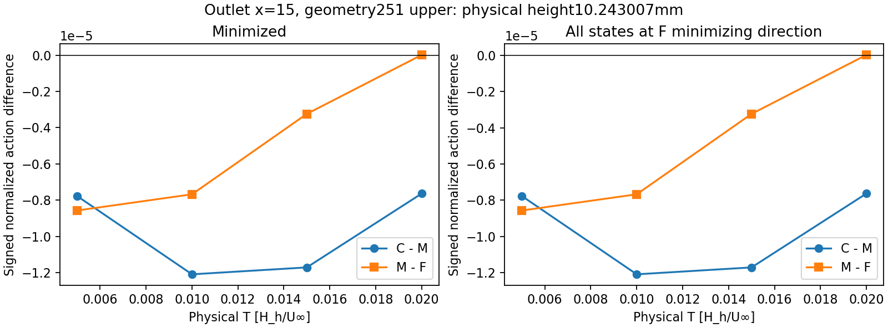

# H20 completed three-level target-domain study

H20 is complete through T=.02: **22/22 new governing attempts completed**, one
new native-history CP0 and three terminal strict reads passed. Initial/restart
integrity, the scheduled physical/quality checks and all three provisional
absolute pair screens pass. **Uniform temporal contraction is not demonstrated.**
The early fixed-owner response is resolved and noncontracting; later reduction
does not erase it or establish a temporal order.

This is the completion of the explicitly authorized resumption from
e9fc43a5cb35debc0d512138d5230ee5c368b140. Fetch found no intervening changes.
The [original configuration-stop evidence](wj-h20-three-level-evidence.md), closed
ledger and failed publications are unchanged. The
[resumption contract](wj-h20-resumption-contract.md) carries every prior charge
into the same7200-second aggregate ceiling rather than resetting the allowance.

## Executed matrix and initial-state integrity

| Level | dt | Reused start | New attempts/completed | Final step/time | New final strict |
|---|---:|---|---:|---|---|
|M|.0025|H18 step4/.01|4/4|8/.02|PASS|
|C|.005|H19 step2/.01|2/2|4/.02|PASS|
|F|.00125|one compatible native CP0|16/16|16/.02|PASS|

Execution was serial M→C→F. M's planned comparison absence was labelled
NOT_YET_AVAILABLE; C screened against completed M anchors; F assessed complete
triplets at.005/.01/.015/.02. Recovery stride1 and scientific strides2/1/4 used
absolute steps. XML Time stayed0 and NumSteps was additional4/2/16. AtT=.015 the
serialized times differ by one ULP on each side of the canonical time; the
[time table](wj-h20-linux/resumption-v1/publication-v2/time-pairs.csv) retains the
actual bits and own callback alphas200/400/800. No interpolation or suffix-based
selection was used.

F's bootstrap strictly imported the original dt=.0025 CP0, then used native
IMEX1 Initialise/BuildScheme at.00125. Coupled state, regional pressures,
reference/defect and eta are bitwise unchanged, including signed zeros.
Coupled qh0 SHA256 remains
`631caa32a59ff43253f1fcac4effd955eb68b8529d9c28f29e615cf14ca0f077`.
F's own State.bin SHA256 is
`958fee74c4df323dfe3ab31ae7ba8d061b0eac62055b91a033916eb8fa98af48`,
with native history times[0,.00125] and its own dt-bearing signature. There was
one native-history initialization, zero spatial Project/Lift/initial-velocity
applications and zero builds. Ordinary wrong-dt restart rules were not weakened.

The700 Q3/Q1 elements,24688 coefficients, maps/signs/owners, quadratures,
full-height Functions, original WJ/full-stress/raw-work/Cd model and finite-nu
Budget AWF are unchanged. Current represented matching K, cutoff and dependent
epsilon evolved normally. Original qh0, analytical q_eq and frozen internal
reference/defect remain distinct.

## Physical checks, coverage and absolute sensitivity

All scheduled native/independent physical checks pass. Every completed sweep had
one momentum, pressure, k and epsilon solve and one bound call, with zero bound
activations, material corrections, extra restoration solves or raw/corrected-k
differences. There were11 governor full audits/PhysicalSamples calls, plus the
separate bootstrap/readback work. Nonscheduled steps retain online checks and
explicit NOT_SCHEDULED full-audit status; covariance/principal positivity is not
claimed at uninspected times.

The fixed H16/H18 support, both interface/face owners, physical Gauss8 support,
current witnesses/neighborhoods and every participating state's moving cutoff
neighborhoods formed each realized common inventory. All three fields were
reevaluated on the triplet support; old native decisions were not rewritten.
The stored inventories preserve coordinate/owner bits and one-sided traces.

Across common-time audited states, the independent minimum in-plane margin was
0.003520378848743, above the0.002068763923454 quality threshold. Minimum covariance
eigenvalue was0.002480551679586 and transverse margin0.943476667795425. The largest
absolute signed Q1 moment in the published vectors was3.896342854018e-16,
below2e-15. Strong divergence reached1.148762342505e-4 and is reported separately;
evolved Q3/Q1 states were not subjected to the CP0 pointwise-zero condition.

Unchanged H19 field limits/scales and same-owner/finer-margin principal budgets
were applied to C-M, M-F **and direct C-F**, separately by region and RMS/maximum.
All pass. Worst field utilization was0.19209948 of its limit; worst principal
utilization was0.09502006 of its allowance. These are provisional numerical-review
budgets, not experimental uncertainties or production acceptance criteria.

Twenty-four independent implicit-root directional replays against saved compiled
native actions agreed to at most4.97e-15 normalized and2.27e-17 dimensional error,
within the existing tolerances. No new kernel-probe process was launched.

## Contraction is local and time-dependent

The following are resolved D2/D1 ratios on identical support and scales:

| T | Full RMS U | Full RMS G | Full RMS R | Full RMS pi | Principal251 upper | Adjacent265 lower |
|---:|---:|---:|---:|---:|---:|---:|
|.005|.6112|.6364|.6115|.9305|**1.10249**|.29785|
|.010|.5540|.6501|.5728|.7719|.63468|**4.21619**|
|.015|.5468|.6581|.5470|.6648|.27633|.86929|
|.020|.5368|.5981|.4910|.5877|.00260|.50897|

The two principal columns are separate owners atx=15,
z=.25607517888672315 code=10.2430071555mm above the original floor. They are not
averaged, and this face is.743007mm above the matching plane, not the interface.
All three states were also evaluated at each of theta_C/theta_M/theta_F.
AtT=.005, shared-direction ratios at251 upper are1.102486–1.102490, so optimizer
movement alone does not explain the noncontraction.

At251 upper, signed C-M and M-F differences are respectively
-7.7751683e-6/-8.5720292e-6 at.005 and -7.6381039e-6/+1.9839196e-8 at.02.
The terminal tiny ratio includes a sign reversal/cancellation; its large observed
log2 ratio is not a high-order convergence claim. At265 lower/T=.01 the signed
differences are -1.0030110e-7 and+4.2288894e-7, well above the4e-11 floor.

Other noncontracting entries include outer velocity maximum and outer gradient
RMS/maximum at.005. Inner-pressure RMS ratios are1.00141 at.005 and1.18087 at.01;
its maximum ratio is1.02262 at.02. The
[complete contraction table](wj-h20-linux/resumption-v1/publication-v2/contraction.csv)
retains every status/value, including all regions and shared directions. No
noncontraction result was converted to a physical failure or hidden behind the
small terminal difference. No Richardson estimate or production timestep follows.

## Reference error, drift and residuals remain separate

AtT=.02, full physical velocity RMS error against q_eq is approximately
9.95e-7 for all levels; drift from qh0 is7.53e-8(C),7.71e-8(M),7.79e-8(F).
Initial representation RMS error is9.84e-7. Small temporal differences therefore
do not establish small representation error or exact discrete equilibrium.
The full regional field/gradient/reference/drift tables use the declared fixed
scales, positive height-resolved outer epsilon scale and comparison floors.
Generic console errors against default zero ExactSolution were not used.

All three strict views used actual terminal checkpoints, genuine producing
callbacks and native histories, with zero governing/Project/Lift/initializer work.
Like-normalized consistent-mass dual norms remain nonzero. For example, outer
epsilon spatial norms are4.713e-5(C),4.317e-5(M),4.120e-5(F), while genuine
completed-stage norms are4.386e-7,1.886e-7,8.744e-8. Frozen linear checks,
completed-stage defects and alpha-zero spatial residuals are separate facts.

Signed weak/stage packets, interface K/cutoff/epsilon/traction/k-flux data and
exterior traces are retained. Scalar normal diffusion derivatives are labelled
n·D grad(f); outward Fick flux has opposite sign. Inner auxiliary cutoff
destruction is distinguished from transported outer epsilon and actual raw
production. Finite representation flux defects were not made new hard constraints.

## Executed source, tests and retained passive failures

The native capsule is b2365e52b0d334d7b61c6be3a4a3bb9029491084; governor ELF
`067ccdf0954efb6ea9921887edd911c57da910be1c82ffddaadba4f7f544d3e8`
and reader/helper ELF
`637656771bdeb4b94d1487748489357ab58e0030a80cd52d5f55289018ed375c`
reuse the verified private loader/library closure. All350 compiled dependencies
and actual native-exec maps passed. No documentation HEAD substitutes for these
compiled inputs. M Python was726c9de9; C/F used16cd2b6d with exact per-file pins.
The numerical observer/evaluator bytes are unchanged between them.

M's native process exited successfully with both commits and its step8 strict
read passed. A subsequent Python assertion compared serialized"8" to integer8.
Saved-state/commit/callback/Q1 validation resolved only that passive exception;
M was never rerun. Its failed receipt/halt remains, with an explicit hash-bound
resolution and a separate monotone slot for any later failure. Old source/config
files remain immutable; C/F use versioned source/config/cache compatibility.

Thirty distinct focused methods passed:27 before M,29 after the passive fix and
one publication-I/O test,57 executions in this resumption. The original50
executions remain separately recorded. No extra small governing trajectory ran.
The passive publisher's first export hit180s through repeated lazy NPZ reads.
That prefix/charge remains. Exact-byte-tested once-per-array loading completed
the corrected export in16.949s; no scientific data or solver work was repeated.

## Closed resources, cost and transport

The linked ledger is CLOSED at **3547.862081274/7200s**, including the original
714.056254596s and both historical failures. Aggregate native-category work was
2149.155559665/3600s. New setup60/closure300s were fully charged without reclaiming
old reserves. Historical four unknown-capacity slots and one old-anchor strict
read remain separate from22 actual new attempts and three new terminal reads.
Aggregate reserved capacity is26; actual new governing work is22.

Peak aggregate science RSS was7,190,593,536bytes, below8GiB. New output at the
closure snapshot was1,104,648,456bytes, plus25,259,673 historical bytes, below2GiB.
New source/runtime footprint was91,029,013bytes plus45,576,689 historical bytes.
One serial native worker and bounded observer used six numerical thread controls1;
unrelated server jobs were preserved and total workers stayed below72.

M/C/F blocks took396.140/342.852/1100.310s; final reads37.653/38.183/37.906s.
The F bootstrap took120.573s. Ordinary compute was about41.35s(M, two samples)
and41.86s(F, twelve); C's41.36s is an audited-subscope subtraction, not an ordinary
warm sample. Full native audits cost44–45s; M physical-only independent assessment
averaged10.42s. Observer wait contains assessment and is not added to it again.
CPU zeros mean unmeasured. Inclusive/disjoint timing tables preserve all scopes.

At unchanged proposed physical recovery/science/terminal intervals.025/.25/.125,
conditional loop forecasts are49.9/98.2/197.3days(C/M/F). Measured-encoding archive
illustrations are194/274/429GB, with unpruned logs and conservative checkpoint
packages. These are short-sample conditional estimates, not admitted schedules,
storage plans, statistically established costs or accepted application budgets.
The separately measured setup/bootstrap/startup/terminal/closure extras are not
included in those extrapolated loop values and remain necessary duration-plan
items, along with future witness growth and namespace/log-retention qualification.
The horizon505.02466521278404 and window[447.8483832973273,505.02466521278404]
remain unexecuted; ceiling-step time505.025 is labelled separately.

The authoritative root is
`/home/jay/build/wj-h20-three-level-resume-20261115`.
The separately sealed index binds publication-v2 and closed linked accounting;
its publication accounting is an earlier OPEN snapshot. The3,196,305-byte
essential archive SHA256 is
`1e37c7caa30ee959cfe6b1f1acfb8371e34e1998a2946b1a03efae4dbccfc101`.
All205 transported members and both figures were hash-verified; figures were
visually inspected. Heavy arrays/checkpoints remain at their manifest-bound Linux
paths. Finalized test/failure/source logs have a separate transport supplement.

## One next bounded package

Recommend a **saved-state diagnosis of the two outlet face owners** at.005/.01
and the terminal cancellation at.02: decompose actual B=(k/epsilon)dev(G), fixed
action/normalization and optimizer-gap differences using the existing triplets,
without hybrids, new governing solves, timesteps or adaptive point searches.
This targets the demonstrated local noncontraction before a longer temporal or
application-budget decision. No follow-up was executed here.

H11 remains historically UNRESOLVED. Production timestep/error budgets, affordable
duration/archive admission, long flat preservation, curved terrain and hill/
experiment comparison remain later gates. The full-height log control is
idealized. No physical H_w is selected; physical7mm observations remain inside
the9.5mm matching interface, and the all-observations-outside interval stays empty.
