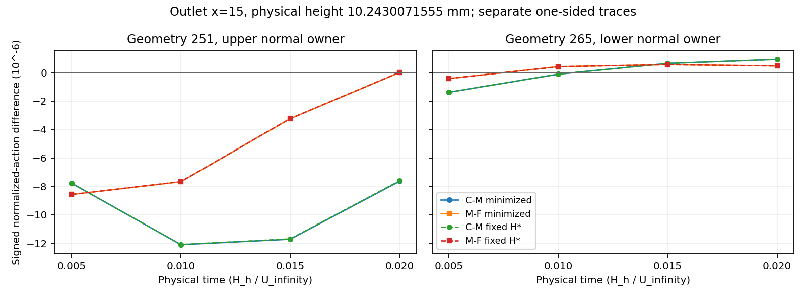
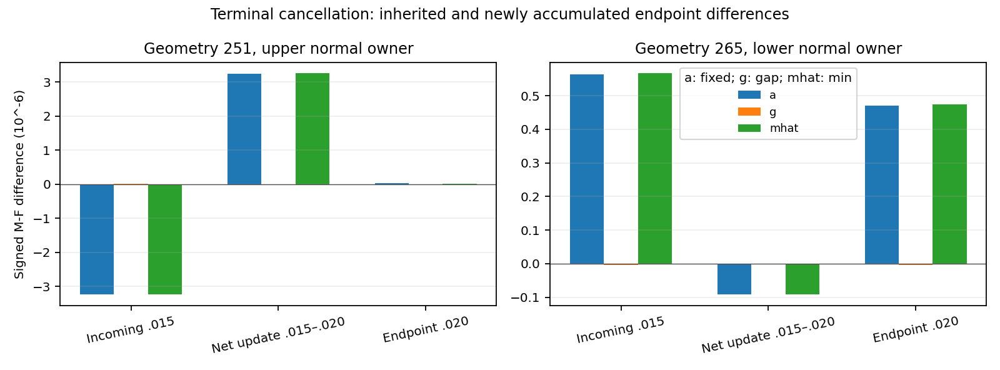

# H21 saved-state outlet diagnosis: complete

**The saved-state audit passes; uniform temporal contraction remains unproven.**
The two traces have identical U, k, epsilon, pi and tau at every selected state,
but different normal gradients. Their signed gradient/timescale cancellations
explain the contrasting local differences at the level of endpoint algebra.
Neither optimizer movement nor normalization alone explains the noncontraction.
The small terminal difference includes a substantial inherited/update
cancellation; it is not evidence of high temporal order.

No governing attempt, CP0, restart, initialization, native reader, build, kernel
process, saved governing matrix operation or mass-system solve ran. H20 and all
earlier evidence/ledgers are unchanged. The
[contract](wj-h21-outlet-diagnosis-contract.md) was committed at31d7bec2 before
science; fetch matched starting revision441052ff6d932ac78bcb64aac36f737844081aba.
The tested implementation is1ba04449. Numerical work was authoritative on Linux.

## Selection, provenance and numerical agreement

Twelve accepted C/M/F states atT=.005/.01/.015/.02 give24 exact owner roles.
The two records are geometry251 upper-normal and265 lower-normal atx=15,
physical z=.25607517888672315 code=10.243007155468927mm. Both are upper-x;
their face is.7430071555mm above the physical9.5mm matching plane. No owner
averaging, new points/neighborhoods, extrema search or volume scan was used.

Every checkpoint was read in Python under its own dt/signature/serialized
history and genuine producing callback, with alpha200/400/800. State-file and
coupled-array hashes remain distinct. M2 retains its original H18 A producer
and callback; H18 B's restored-input verification remains a separate audit role.
All original qh0, fixed-reference and fixed-defect hashes were preserved.
The exact [selection/structure compatibility](wj-h21-linux/publication-v1/control--selected.json)
and [state bindings](wj-h21-linux/publication-v1/lineage.json) retain those roles.

H21 independently reconstructs the sparse physical fields through existing
Modified_A maps/signs and the composite-map Jacobian, then recomputes full3D WJ
stress, physical root, implicit tangent and angular minimum. It does not use the
global `Rows` inventory. Against H20's separately exported anchors:

| Check | Largest observed error | Declared tolerance |
|---|---:|---:|
|Scaled field/closure replay|2.0383e-14|2e-11|
|Normalized action at theta_C/M/F|3.1442e-15|2e-11|
|Implicit dN replay|1.7764e-15|2e-11|
|Delta-B tensor identity|2.8671e-16|componentwise128 eps bound|
|Action normalization identity|9.8567e-19|componentwise128 eps bound|
|Optimizer-gap identity|0|componentwise128 eps bound|
|Endpoint-window telescope|3.3881e-21|componentwise128 eps bound|

The field scales and algebra bounds were frozen before evaluation. No comparison
floor replaced a signed value by zero. The smallest local sampled principal
margin is.004114251877784; local covariance eigenvalues remain positive
(minimum.002482066049209). These checks concern only24 endpoint/owner records,
not a new complete-inventory/native qualification or global certificate.

## Noncontraction survives a fixed direction

Here E1=C-M and E2=M-F, always at the same physical owner. Hstar uses the frozen
H9 rational orthogonal direction; it is independent of each state's optimizer.

| T | 251 minimum rho | 251 fixed-Hstar rho | 265 minimum rho | 265 fixed-Hstar rho |
|---:|---:|---:|---:|---:|
|.005|**1.102488**|**1.101578**|.297847|.297516|
|.010|.634683|.634041|**4.216194**|**4.219996**|
|.015|.276331|.275814|.869285|.867528|
|.020|.002597|.003614|.508967|.508332|

The [signed values](wj-h21-linux/publication-v1/principal-differences.csv) and
[72 shared-direction actions](wj-h21-linux/publication-v1/shared-directions.json)
also reproduce H20. Thus optimizer motion is not the sole source of either
early noncontraction. No temporal-order fit or error bound is inferred.

## Gradient, timescale and normalization

The exact identity is Delta B=mean(tau)Delta dev(G)+Delta(tau)mean(dev(G)).
The outer closure's R=k r(B) and nu_eff=(k^2/epsilon)c(B) identities, including
the implicit-root tangent, also pass. Its normalized tangent therefore depends
on B; the dimensional action still carries k^2/epsilon. This statement concerns
the outer high-Re closure and does not remove molecular viscosity from the AWF.
All12 opposite-owner comparisons have exactly zero U/k/epsilon/pi/tau trace
differences under the unchanged reconstruction. Their Gxz and Gzz traces differ;
this is compatible with a continuous FE velocity having discontinuous normal
derivatives. No trace was substituted for another.

Representative **signed Bxz contributions** are:

| Owner/time | Pair | Gradient term | Timescale term | Total Delta Bxz |
|---|---|---:|---:|---:|
|251/.005|C-M|+6.354298e-5|+1.851758e-5|+8.206056e-5|
|251/.005|M-F|+8.010509e-5|+1.036216e-5|+9.046725e-5|
|265/.010|C-M|-1.049669e-5|+1.156404e-5|+1.067350e-6|
|265/.010|M-F|-1.009439e-5|+5.649046e-6|-4.445341e-6|
|251/.020|M-F|-3.113971e-6|+2.912780e-6|-2.011915e-7|

At251/.005 the gradient contribution is larger for M-F while the timescale
contribution is smaller; their sum does not contract. At265/.010 the C-M
gradient and timescale terms nearly cancel, whereas M-F reverses sign. Its
large ratio therefore has a small, resolved C-M denominator. These are actual
full-tensor splits; a tensor-norm ratio is not a percentage attribution of the
nonlinear margin. Complete tensors and components are retained in
[pair decompositions](wj-h21-linux/publication-v1/pair-decompositions.json).

For fixed action a=d/nu_eff and optimizer gap g=a-mhat, both exact identities
Delta a=mean(1/nu_eff)Delta d+mean(d)Delta(1/nu_eff) and
Delta mhat=Delta a-Delta g pass. At251/.005:

| Pair | Dimensional-action term | Normalization term | Delta a | Delta g | Delta mhat |
|---|---:|---:|---:|---:|---:|
|C-M|-7.851558e-6|+6.985982e-8|-7.781698e-6|-6.529510e-9|-7.775168e-6|
|M-F|-8.661710e-6|+8.955920e-8|-8.572151e-6|-1.216220e-10|-8.572029e-6|

Normalization and the optimizer gap modify these differences but do not create
their early noncontraction. This does not uniquely identify a PDE/splitting or
boundary cause. Pi is retained as context and is not an explicit WJ-action input.
There is no demonstrated constitutive/sign/owner contradiction in this audit.

## Terminal cancellation retains the incoming difference

For251, M-F, over[.015,.02], the minimized-action identity is:

    -3.2375045733e-6 + 3.2573437695e-6 = +1.9839196161e-8.
       incoming       differential        endpoint
                      endpoint update

The predeclared net cancellation statistic is.9969453950, or99.69454%.
The fixed action has the same behavior:
-3.2251175177e-6+3.2526083702e-6=+2.7490852495e-8.
Subtracting the terminal optimizer-gap difference+7.6516563337e-9 gives the
reported minimum difference. Its dimensional/normalization split is
+3.1426243075e-8-3.9353905818e-9. The terminal result is resolved above4e-11,
but is a small residual of larger signed contributions, not a near-exact field.

On265 the corresponding minimized incoming/update/endpoint values are
+5.6653183099e-7, -9.2067235391e-8 and+4.7446459560e-7; net cancellation is only
27.95851%. The same physical point therefore cannot be represented by one trace.

All18 pair/window telescopes preserve signed incoming terms and both branches'
endpoint increments on[.005,.01],[.01,.015],[.015,.02]. Supporting G/B/d/nu_eff/
scalar/stress quantities are in the
[componentwise table](wj-h21-linux/publication-v1/signed-endpoint-windows.csv).
H20 saved no corresponding flow/k/epsilon or predictor/correction vectors.
These increments are **endpoints**, not reconstructed native substeps. Their
underlying stage-level causal split remains UNRESOLVED; no hybrid state was used.

## Executed checks, resources and transport

The final Linux unittest invocation passed15 distinct methods:10 H21 methods
and five individually selected H12/H20 methods. It covers exact inventory,
wrong owner/snap/ULP/signed-zero, signs/Jacobian, metadata compatibility, tensor/
normalization/gap/cancellation identities, floors, hash corruption, wrong integer
time/producer/alpha and zero-native admission. No broad H9 volume/mass suite ran.
The earlier15-method execution had one test-fixture NameError; its corrected
test-only version leaves analysis bytes unchanged. These are executed unittests,
not CTest registrations. Exact argv/logs are in
[operations](wj-h21-linux/operations) and the [reproduction record](wj-h21-outlet-reproduction.md).

Two initial passive imports failed on metadata assumptions: bounded structure
omits model parameters, and cross-dt structure hashes include signature/intent.
Corrections verify the pinned original parameters and exact shared spatial
payload while retaining each own-dt identity. No numerical guard/signature was
weakened. Failed sources/receipts remain; one interrupted metadata inspection
retains its full30-second unknown charge. The first failure is never erased.

Active Linux analysis is`source-v3/wj_h21_outlet.py` SHA256
`0d2140767d22e3528e59b63f9e617c488c9cc5781dc2ca66d8aae550a41f9087`;
tests are the separate`source-tests-v4` fixture correction. Imported numerical
helpers are byte-matched to H20 source-v2; exact pins are in the compact controls.
Python3.10.12/GCC11.4 and NumPy1.21.5 used six numerical thread controls1.
Actual Python/library maps are retained. No native ELF/private loader was
executed; historical H20 native provenance is reused only as saved evidence.

The new ledger is **CLOSED at190.454657256/600s**, including setup30, closure90,
all passive failures/transfers and the30-second unknown reservation. Science
worker internal time was2.989s; its enclosing metered operation was3.668s
(not additive). Peak monitored process-tree RSS was259,031,040bytes, below2GiB.
Source/output before final archive was7,814,876bytes; the essential archive adds
480,764bytes, far below the256MiB output allowance. No old ledger was reopened.

Authoritative Linux root:
`/home/jay/build/wj-h21-outlet-saved-state-20261115`.
The [index](wj-h21-linux/authoritative-index-v1.json) binds publication,
supplement and CLOSED accounting separately; publication accounting is an
earlier OPEN snapshot. Archive SHA256 is
`a828ba02a6446fd1917bfb65ba34f53d232a7f60b5a036758d0005a09f94c76c`.
All58 archive files and34 individual manifest entries were verified on the Mac;
both figures were visually checked. Large coupled arrays remain in their
original Linux files. The full700-element static field-map copy is omitted from
Git with its exact original pin retained in the
[storage aliases](wj-h21-linux/local-storage-aliases.json); it remains on Linux
and in the verified archive. The [transport receipt](wj-h21-linux/transport-verification.json)
does not rewrite the remote PREPARED transport label or historical evidence.

## One next bounded decision

If stage attribution is required before further temporal admission, recommend
one separately budgeted **seven-attempt replay toT=.005** at the existing three
timesteps (1C+2M+4F), retaining actual C/F/K/A packets for all seven attempts and
the existing arithmetic packets at the three common endpoints. Require exact
H20 state/history replay parity before interpreting them. This would test where
the demonstrated early gradient/timescale response enters the actual sequence;
it is not another timestep level or a longer horizon. It was **not executed**.

H20's mixed contraction and H11's historical UNRESOLVED qualification remain.
No production timestep, long preservation, global realizability, temporal order
or experimental validation is admitted. The full-height inlet is still an
idealized control; finite-depth completion and roughness-sublayer validity stay
open. No physical H_w is selected. Physical7mm observations remain inside the
9.5mm matching plane, and H_w>4.413515542mm versus H_w<3.5mm leaves the
all-observations-outside interval empty. Hill/terrain, EP, anisotropic inner-law
changes, old measured-rms/20mm work and longer evolution remain deferred.
