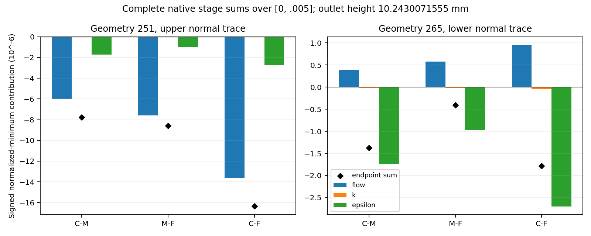
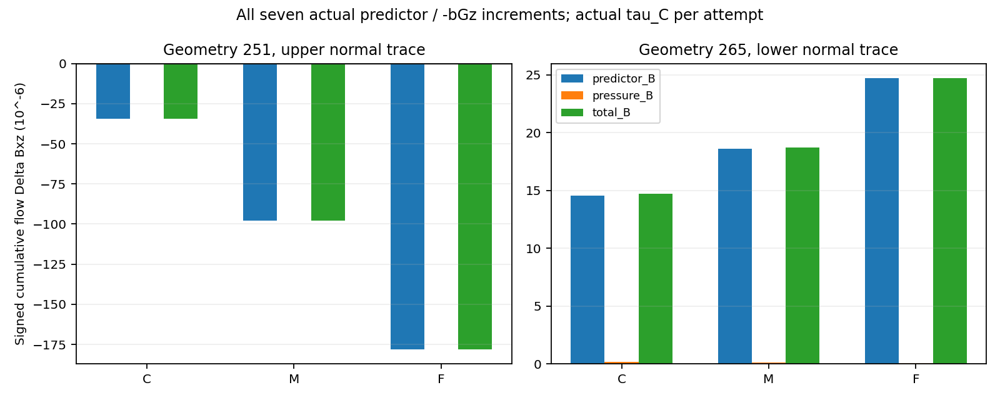

# H22 completed: exact early-window replay and actual phase attribution

**The finite H22 diagnostic is complete.** Retained M2 received a fresh
zero-advance startup verification and a qualified strict read. The four missing
F advances replayed their historical trajectory exactly, F4 passed independent
qualification and strict readback, and the combined seven-attempt captures
support complete signed phase/predictor accounting at both fixed owners.
Local temporal contraction remains mixed; that is not a physical failure or a
reason to repeat this diagnostic.

The original [obstructed campaign](wj-h22-native-phase-attribution-evidence.md)
remains unchanged. Its failed ACK, halt, old M0 cursor, missing historical M2
step qualification, source variants and CLOSED ledger were hash-verified before
and after completion. A new verification does not rewrite that history.

Starting/fetched HEAD wasbd8c5619efc66343492ec33b8df86c55a0637462, matching review.
The [completion contract](wj-h22-completion-contract.md) was committed atd9b5e58d
before native work. Source/Git used the branch-owning Mac worktree; authoritative
execution used healthy ext4 at:

`/home/jay/build/wj-h22-completion-20261115`

## Implementation and exact new work

The reused native capsule is057e6b7465660cac5ec8617abf5c876fa8bff71f. There was
no C++ change or build. Compiled sources/headers/objects, compile commands,
wrappers, ELFs, private loader/libraries and actual new native-exec maps passed
qualification. GNU11.4 Release, -ffp-contract=off/-fno-fast-math and six numerical
thread controls1 were retained. Governor/reader ELF SHA-256 values remain:

- `1c1df27b32ca5b6925ee467431f5291e25996e010c6c0026bebd12130e4d2e1d`
- `8ca139e140637bfe14ae875b1b5815b50fbb131229ac7020b3d9168791daa739`

The frozen Python execution capsule is4c3b48c19e4fe5472ec6d662113379321679f3be,
with per-file pins. Later passive analysis/publication source is separately
identified at7bd31fc3. It did not alter the native/observer execution capsule.
Compatible independent immutable rows were reused through verified active
module/profile/geometry/reference/runtime bindings; no cache rebuild occurred.

| New operation | Advances | Restored/final absolute step | Actual time/alpha | Result |
|---|---:|---|---|---|
|M2 startup verifier|0|2 / 2|.005 / 400|new startup-verification commit PASS|
|Qualified M2 strict read|0|2|.005 / 400|PASS; original completed producer/callback|
|F native replay|4|0 / 4|.00125,.0025,.00375,.005; completed alpha800|all four exact; F4 committed-qualified|
|Qualified F4 strict read|0|4|.005 / 800|PASS|

No C/M governing work was repeated. There was no new CP0, bootstrap, Project,
Lift, initializer application, spatial/history production, reference reset or
new scientific time. Ordinary F integrator advances/history updates and durable
recoveries were retained. All four sweeps had exactly one momentum, pressure,
k and epsilon solve and one bound call, zero activations/material correction/
additional restoration, and identical raw/corrected-k hashes.

Aggregate H22 counts are **seven advances/completions and vector packets**, three
governing blocks plus one separate zero-advance verifier, and **four strict
reads**: historical C1/M0, then new M2/F4. The old M0 read supplies no M2 evidence.
The completion contract explicitly supersedes the original three-read limit.
No new kernel request, saved-matrix operation or Python mass solve ran.

## Retained M2: producer, audit and verification stay distinct

M2's original H22 completion84bc540a…3b9eb19 authenticates its original completed
report/checkpoint and callback6fd23abd…c908. State.bin remains
4d0a8697…6b564; contained coupled state remains6e0daed7…24885. H18 A2 is the
historical genuine producer/history, alpha400. H18 B startup remains a separate
full physical audit of the identical state.

The new startup process used dt=.0025, XML Time0, NumSteps0 and absolute ceiling2.
PendingCompletion/Restore supplied the authenticated callback; no alternate
callback replaced it. Current state/history/time/reference/defect/eta/signature
parity was established before full-map comparison through the separate audit.
The observer assessed actual restored step2, issued the new startup verification,
and stayed alive while the native process evaluated final budgets/residuals.
There was no invented terminal completion or zero-step alpha0 substitution.

The resulting WJStartupVerificationCommitV1 and new cursor point to the original
retained M2 completion. The old execution remains NOT_COMMITTED. The new strict
request explicitly uses QualifiedV1, the original completed report/callback and
the NEW startup commit. Typed selection refuses unavailable/wrong-step/prepared
or pending data and cannot fall back to M0. F admission required this actual
verification, strict M2 PASS, retained capture parity and prospective headroom.

## Replay, physical qualification and coverage

The composite immutable index binds original C1/M1/M2 to their original capture
execution sidecar and new F1–4 to the new sidecar. It keeps producer, physical
audit, historical qualification and subsequent M2 verification separate. The
startup verifier is not an eighth stage. Every old/new completion retains its
own dt/signature/native histories/time bits and genuine callback200/400/800;
coupled coefficients, history slots/times, callback, reference/defect and eta
replay bitwise. F4's contained state hash is
`f2abb139ec06a7e277f3cd9532fd77f16dd9ff32a72da9dd1261772744b18d2d`;
its distinct State.bin hash is
`14716047469856b22a84cfc7991db3a9b6d86726880ff43e861df4384b08cc07`.

Full native/independent audits ran at the authorized startup/terminal states.
M1 and F1–3 retain NOT_SCHEDULED full-audit roles; online guards remained active.
At T=.005 on complete checkpoint support:

| Level/audit role | Minimum in-plane / nu_eff | Minimum transverse | Minimum covariance | Inner/outer Q1 max abs |
|---|---:|---:|---:|---|
|C1, historical H22|.003520378849|.943479700946|.002480551680|5.5738e−19 / 3.6329e−16|
|M2, fresh startup|.003520644292|.943479549202|.002480552826|6.3192e−19 / 2.8013e−16|
|F4, new completed|.003520611010|.943479706794|.002480553120|5.7428e−19 / 2.5991e−16|

All inspected quality minima exceed.002068763923454, and every255+525 signed
Q1 moment satisfies2e−15. Scalar/root/viscosity/cutoff/outlet/covariance and other
native predicates pass. Each independent checkpoint uses17737 explicit owned
observations plus44800 physical Gauss8 rows. Current witnesses/cutoff support,
all legitimate owners and current-K profiles are recomputed. This is finite
checkpoint coverage, not global or all-intermediate-state realizability.

Strong-divergence maxima at C1/M2/F4 are8.2729e−5/9.0499e−5/9.4326e−5,
separate from weak continuity. F0's compatible initialization has zero physical
divergence/moments. The CP0 zero-divergence property is not imposed on evolved
Q3/Q1 states. Reference error, drift from original qh0 and analytical equilibrium
remain separate in the full physical results. Strict packets retain uncancelled
spatial, genuine completed-stage and signed weak/interface diagnostics; compact
native projected weak terms are not a new quadrature-convergence claim.

For example, consistent-mass dual epsilon norms at the common endpoint remain
nonzero and have different meanings:

| State | Uncancelled alpha0 spatial norm | Genuine completed-stage norm |
|---|---:|---:|
|C1|1.9890291e−4|4.1291032e−6|
|M2|1.4730134e−4|1.2994464e−6|
|F4|1.2947689e−4|5.0269727e−7|

These are not frozen linear-solve residuals, exact equilibrium or a temporal-order
estimate. The old M0 strict packet has no completed-stage norm.

## Complete actual-phase attribution

The analysis retains **56 C/F/K/A owner roles plus14 predecessors**. Exactly the
two H21 traces are used: geometry251 upper-normal and265 lower-normal, both
upper-x at[15,0,.25607517888672315] code=10.243007155468927mm, .7430071555mm
above the physical matching plane. No averaging, coordinate resnap, new point
or volume-stage scan occurred. The fixed rational Hstar and full3D WJ
implicit-root tangent are unchanged.

Stationary P=C, post_flow=pre_k, raw=corrected K, all field masks and F/A
velocity/pressure equality pass. Whole-field scatter checks include non-free
rows: maximum velocity/pressure coefficient errors are1.105e−16/2.163e−19,
within their unchanged128-eps certificates. Saved bGz is used with its actual
minus sign. No pressure correction was inferred from subtraction; no saved
matrix was multiplied or solved. Provisional K epsilon remains its actual stale
split value; no phase was repaired or promoted to an accepted state.

Complete equal-window minimized-action contributions at T=.005 are:

| Owner | Pair | Flow | k | epsilon | Endpoint |
|---|---|---:|---:|---:|---:|
|251 upper|C−M|−6.0204984e−6|−2.2264245e−8|−1.7324056e−6|−7.7751683e−6|
|251 upper|M−F|−7.5900955e−6|−1.3670216e−8|−9.6826349e−7|−8.5720292e−6|
|251 upper|C−F|−1.3610594e−5|−3.5934461e−8|−2.7006691e−6|−1.6347198e−5|
|265 lower|C−M|+3.8235024e−7|−2.2274161e−8|−1.7331802e−6|−1.3731041e−6|
|265 lower|M−F|+5.7337608e−7|−1.3676007e−8|−9.6867530e−7|−4.0897523e−7|
|265 lower|C−F|+9.5572632e−7|−3.5950168e−8|−2.7018555e−6|−1.7820793e−6|

Initial incoming and lift differences are zero. Owner251's adjacent difference
grows by−7.9686092e−7: its flow contribution changes−1.5695971e−6 while epsilon
offsets+7.6414216e−7 and k+8.5940286e−9. Thus the early noncontraction enters
the complete saved sequence principally through the signed flow difference,
partly opposed by scalar updates. This is sequential bookkeeping, not a unique
counterfactual cause or a percentage attribution of nonlinear principal action.
Later flow increments already use each branch's previously transported scalars
and current-K profiles; the flow label does not isolate earlier scalar feedback.

The same-owner minimized rho values reproduce H21:1.102487932 at251 and
.297847215 at265. At265, positive flow and negative epsilon contributions oppose;
the declared cancellation is.357704 for C−M and.737116 for M−F. Fixed-direction,
dimensional/normalization/gap and full tensor data remain in the signed tables.
Optimizer motion alone does not explain the result.

All seven actual predictor/-bGz vectors cover the entire early window. Full U/G
and tau_C-weighted B increments are retained per attempt and cumulatively, without
evaluating predictor-only constitutive states. Pressure is context, not an
explicit WJ-action input. The later265/.01 response and.02 cancellation retain
H21 endpoint evidence only; this replay supplies none of their missing stages.
H20 absolute screens are reused only after exact endpoint parity and are not
new comparisons. No temporal order or error bound is inferred.

## Passive roundoff-accounting correction, with the failure retained

The first combined analysis stopped at F1/owner251: its composed B residual
4.0740e−14 exceeded an unpropagated direct bound near2.842e−14. Native replay,
coefficient scatter and the primitive physical-gradient identity already passed.
The analysis had incorrectly discarded that gradient reconstruction's certified
roundoff when applying tau_C dev(...). This was a passive accounting defect,
not a native/vector/physics discrepancy.

Version2 preserves the direct bound/exceedance and carries the primitive bound
analytically. If r_G=Delta G−G_predictor−G_pressure and |r_G|<=E_G, then

`|tau_C dev(r_G)| <= |tau_C| (E_G + trace(E_G) I/3)`.

The remaining B linearity error is checked separately with the same primitive
128 eps*(fixed nonzero scale+sum absolute terms). Cumulative certificates sum
the per-attempt certified errors before checking accumulator roundoff. The128
factor, scales,2e−11 replay accuracy and4e−11 comparison floors were not changed;
no physical floor hid a failed telescope. The original failed operation/source
and raw exceedance remain archived. Two independent synthetic controls verify
the deviatoric bound at all diagonal sign corners and reject a discrepancy
beyond the propagated certificate.

There is one direct-bound exceedance among the14 attempt-owner B checks; its
propagated bound is3.4250e−13. The signed B residual equals tau_C dev(r_G) within
the unchanged primitive certificate. Complete branch/cross-level telescopes have
maximum residuals1.0588e−22/4.2352e−22; transition identities3.7953e−16. All
quantities at the actual phases were defined. This correction requires no native
rerun and does not alter endpoint comparisons or the mixed contraction finding.

## Resources, delivery and next finite decision

The parent stays CLOSED at1169.9461947359669s. The child adds
1004.6800919250527s, including new setup60 and closure300, preserving old charges.
Aggregate CLOSED usage is **2174.626286661 /4500s**; native972.642432892/1800,
build135.610163536/900 (all historical), analysis35.374959313/600. Failed passive
analysis, a local pre-transfer syntax refusal, unknown/coordination allowances
and transport are retained. Publication OPEN and final CLOSED snapshots are
separately sealed.

Inclusive new operation costs are115.684s M2 verification,38.813s M2 strict,
313.590s F block and38.885s F4 strict. Zero-step startup/final budgets/residuals
are charged native work. Independent evaluation is contained in observer wait;
neither is added again to the enclosing native operation. Raw nested/disjoint
timings, output/capture bytes, per-step records and peak RSS accompany closure.
No production-duration forecast is derived from diagnostic capture mode.

New aggregate scientific peak is6673739776 bytes, below8GiB. Retained plus new
science/publication bytes are455217185, and source/runtime162533560, below2/8GiB.
Every vector binary is307632 bytes; the four new manifests are71559/71586/71587/
71587 bytes. This is1516847 new vector/pin bytes; all seven total2654550 bytes.
Rich selected k snapshots/COOs remain separate, unchanged capture evidence.

F's recorded native-only compute times are38.348/39.105/40.259/83.909s; inclusive
`native.step` times are38.667/39.443/40.613/96.734s. Step4 includes its41.274s
native full audit inside native compute. Its12.339s observer wait includes the
9.462s independent assessment and prefix/protocol work; these scopes are not
added together. Startup.initialize is88.618s for restored M2 and69.878s for F0,
inside the corresponding complete operation costs, which also include final
budgets/residuals and process coordination. One short diagnostic replay is not a
statistically established production mean or a speedup benchmark.
Selected k/vector diagnostic writing lies inside PIMPLE/native compute; its
elapsed overhead was not separately isolated.

The completion executed21 distinct Python methods (11 new,10 relevant reused)
and one whole-scatter positive/adverse synthetic fixture. The original native
serializer qualification was reused; no new native test trajectory/component
or build ran. Across parent and child there are45 Python method executions,
35 distinct methods. All original evidence hashes and absent old M2 step-commit
were verified unchanged. Heavy scientific arrays remain on Linux with exact
identities; compact essential/optional transport is separately verified.

Recommend one separately frozen unchanged common-time continuation from H20's
sealed T=.02 anchors to.04: **4C+8M+16F=28 advances**, comparing .025/.03/.035/.04.
Use ordinary checkpoint monitoring with rich phase/vector capture Off. Retain
all short-study recoveries, callbacks, qualified anchors and comparison supports;
freeze output bytes and every scheduled audit/read before admission. H18's
ordinary-compute prior40.43s/step gives about1132s for the28 advances alone,
before restores, audits, triplet analysis, strict reads, I/O and25% headroom.
It is a planning prior, not an H22 production estimate or a duration admission.
No further timestep/refinement/replay should be added merely to force every
local ratio below one. This follow-up was not executed.

H20's49.9/98.2/197.3-day and194/274/429-GB illustrations remain conditional prior
evidence. Production timestep/application budgets, affordable archive/duration,
full-duration flat preservation, curved-terrain qualification and hill/experiment
comparison remain later. The505.02466521278404 horizon and declared terminal
window remain unexecuted; physical7mm observations remain inside the9.5mm
matching plane. Numerical replay does not validate that modelling choice.
