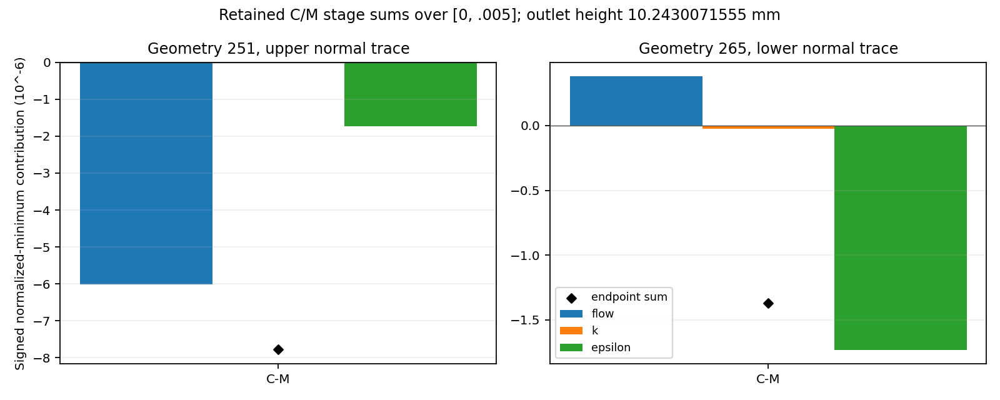
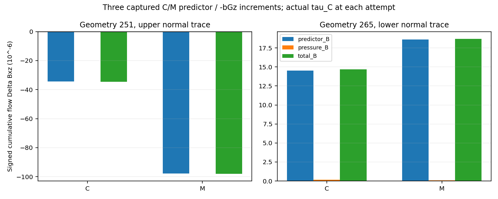

# H22 early-window replay: closed with an observer-role obstruction

H22 stopped after three of its seven authorized replay attempts. C1 completed,
passed independent assessment and received a native qualification commit. M1 and
M2 completed natively with exact historical numerical payloads, but the terminal
observer compared M2's full native audit against its producer's **unscheduled,
empty audit map**. The observer issued FAIL before independent terminal assessment
and native qualification. F was not launched. This is an H22 orchestration defect;
it is not a constitutive failure or a new temporal-sensitivity result.

The role-aware correction passes focused tests and passive evaluation of the
retained bytes. It does not retroactively qualify M2, remove the original failure,
or authorize a governing retry. The seven-attempt diagnostic remains incomplete.
H20/H21 results and all earlier closed ledgers are unchanged.

The starting/fetched revision was
`63622edffa70b98d0636f8d3da472a4afbbfc233`, matching the reviewed head. The
[contract](wj-h22-native-phase-attribution-contract.md) was committed at
`406a2617` before native execution. Mac source/Git work used the branch-owning
worktree; authoritative build, tests and numerical work used healthy Linux ext4:

`/home/jay/build/wj-h22-early-phase-replay-20261115`

## Implementation and executed configuration

Native capsule `057e6b7465660cac5ec8617abf5c876fa8bff71f` adds only selected
passive mapped increment serialization. `RANSWallPimpleFlowVectors=MappedIncrementV1`
copies the actual predictor, bGz, du and dz plus native row indices after flow and
before scalar updates. It does not infer bGz, apply an operator, assemble, factor
or solve an additional system. The signed pressure velocity is **-bGz**.
`WJMappedFlowVectorsV1` binds exact array/payload hashes, C/F/history, time/alpha,
step and execution identity; it remains explicitly provisional until completion.
Dense PIMPLE arithmetic and verification remain Off and mapped dense-mode
rejection is unchanged. Selected sparse k snapshots retain their original files;
no saved k-matrix operation was performed.

The affected governor, strict reader and synthetic writer fixture were built with
GNU11.4 Release, `RANS_BUILD_SOLVER=ON`, `-ffp-contract=off -fno-fast-math`, at most
eight compiler workers. Dependencies and reused objects were checked against
actual sources/headers/flags; new ELFs have their own recorded identities. Actual
native-exec maps passed the private-loader/library check. Historical executables
and source identities remain distinct. The executed Python configuration is the
sealed `execution-config-v2.json`, including `3d391620` orchestration and the
prelaunch `b362e428` prepared-cursor inventory fix. The later correction at
`8ed40f30` was **not used for governing execution**.

The fixed H13/H14 scientific configuration, each level's own dt-bearing CP0,
original qh0, reference/defect and all physical Functions were retained. There
was no CP0 production, bootstrap, spatial/history initialization, Project, Lift,
initializer application, reference recomputation or new scientific advance.
The two literature SHA-256 identities match their established values; the
quad/\\quad typography and `(d+a*h)/a^2` coefficient errata are unchanged.

## Execution, provenance and the first failure

| Level | Authorized/actual attempts | Native completions | Independent terminal / native commit | Final strict selection |
|---|---:|---:|---|---|
|C, dt=.005|1 / 1|1|PASS / committed C1|C1, genuine alpha=200 callback|
|M, dt=.0025|2 / 2|2|NOT_RUN / M2 unqualified|original M0, genuine alpha=0 initial role|
|F, dt=.00125|4 / 0|0|NOT_RUN|NOT_RUN|

There were two governing process blocks, three vector packets, two protected
strict reads, one affected-target build and one synthetic native writer fixture.
All three completed sweeps had one momentum, pressure, k and epsilon solve and
one bound call, with zero bound activation, material correction or additional
restoration. M1's full scientific audit was NOT_SCHEDULED. C startup/C1 and M
startup independent assessments passed. M2's native full audit passed; its new
independent terminal assessment did not run. A skipped or blocked audit is not
reported as PASS.

The historical M2 producer is H18 A2. H18 B's startup audit is a separate audit
of the identical physical state, not a replacement producer/callback. The
executed observer incorrectly required equality with A2's empty audit map and
stopped with `bitwise numerical/ordered parity: terminal native full audit`.
The failure ACK, native failure, first halt, M2 completion and last qualified M0
cursor are retained. No M2 qualification commit exists.

Passive correction explicitly pins the separate B startup audit through H20's
sealed input selection, proves exact physical-state/reference/defect/dt/time/
signature identity, then compares its complete numerical audit map. That map
matches the new M2 map **bitwise**. Genuine A2 callback history and alpha=400
remain unchanged. The qualified cursor hash was checked before and after; the
correction wrote no ACK, native commit or cursor. Corrected-observer governing
qualification is NOT_RUN.

M2's `State.bin` file hash is exactly the historical A2 file hash:
`4d0a8697523a2937526df541cd46b07ff956cbf82d6cbd4cc3a4246ac446b564`.
Its contained coupled-state hash is separately
`6e0daed74de86008984548e9946f9d97bc4d707198f9ecab2a8b315f79224885`.
All three captured completions pass exact state/native-history/time/callback/
reference/defect/eta replay checks under their own producers. These passive
checks preserve the original native and qualification statuses.

| Completion | Contained coupled-state SHA-256 | Historical numerical replay |
|---|---|---|
|C1|`dd4210b49fec1e8f3a6b2cbfe2b88564fabe11faea36c279b3c17cbdb1f67b97`|exact H19 C1|
|M1|`b9c1c19b6c44513d1778143b695e9720d0463d0a9786a91ec6ae97cc6c469819`|exact H18 A1|
|M2|`6e0daed74de86008984548e9946f9d97bc4d707198f9ecab2a8b315f79224885`|exact H18 A2; B startup supplies separate full-map audit|

The new independent startup minimum is .003514506137272; C1's is
.003520378848743, both above .002068763923454. C1's transverse/covariance minima
are .943479700946368/.002480551679586. Its 255 inner and 525 outer signed Q1
moments have maxima5.5738e−19/3.6329e−16, below2e−15. Startup moments and physical
divergence are zero; C1's pointwise strong-divergence maximum8.2729e−5 is a
separate evolved-state diagnostic. M2 has no new independent-inventory result.

Two earlier prelaunch corrections are also retained: an argv spelling was
refused before target reservation; a missing inventory hash in the prepared
cursor was found and fixed before any native process. An unused v1 configuration
and a syntax-error receipt remain archived. Neither consumed a governing attempt.

## Available phase attribution

The retained prefix supplies **24 C/F/K/A owner roles plus six predecessor roles**,
covering C1 and M1/M2 at both exact H21 owners. There are ten distinct state
vectors and twenty sparse constitutive owner evaluations after exact alias
deduplication. All quantities were mathematically defined; no intermediate was
repaired or relabelled accepted. P=C, post_flow=pre_k, raw=corrected K, field masks
and F/A flow/pressure equality pass. The three saved vector/scatter identities,
linear U/G/B predictor-pressure identities, Delta-B/normalization/gap identities,
branch telescopes and C-M telescope pass their separate componentwise roundoff
bounds. The four C/M terminal owner records reproduce H21 within the frozen
scaled replay accuracy. No manufactured constitutive state was evaluated.

The signed C-M minimized normalized-action difference at T=.005 decomposes as:

| Exact owner | Incoming/lift | Flow | k | epsilon | Endpoint C-M |
|---|---:|---:|---:|---:|---:|
|251 upper-normal|0|−6.020498405e−6|−2.226424455e−8|−1.732405643e−6|−7.775168292e−6|
|265 lower-normal|0|+3.823502413e−7|−2.227416127e−8|−1.733180168e−6|−1.373104088e−6|

Both owners are upper-x at [15,0,.25607517888672315] code lengths,
10.243007155468927 mm physical height, .7430071555 mm above the matching plane.
The two normal traces were not averaged or resnapped. At 251 the available
flow/scalar contributions reinforce the signed difference. At 265 the flow
contribution opposes epsilon; the declared descriptive cancellation is .357704.
Fixed-Hstar action differences are respectively −7.781697802e−6 and
−1.372494712e−6, so the available difference is not solely optimizer motion.
These signed telescopes locate changes in the saved update sequence, not a
unique counterfactual cause, outlet defect or temporal order.

F's four replay attempts and phases are unavailable. Therefore M-F/C-F phase
telescopes and complete early-window three-level predictor attribution are
NOT_RUN. Old F endpoints cannot substitute for the missing stages. H21's later
owner265/.01 response and .02 cancellation remain endpoint evidence only. H20's
C-M absolute screen is reused after exact endpoint replay, not newly measured;
its mixed contraction and H11's historical UNRESOLVED scope are unchanged.

## Validation, resources and next decision

Linux executed 24 distinct focused Python methods and the synthetic native
writer component. The Python executions were 17 initial H18/H20/H21/H22 methods,
one session-selection fixture, one prepared-cursor fixture, four audit-role
fixtures and one sealed-index/corruption fixture. Commands/logs and source pins
are retained; registrations are not counted as execution. No small governing
trajectory or broad historical campaign ran.

The ledger is CLOSED at **1169.946194736 / 4500 seconds**, including charged
setup60, closure300, failed/unknown work and coordination/transfer allowances.
The build took135.610s; charged C/M blocks187.520/205.839s; final strict reads
38.172/32.853s; retained passive role/phase analysis4.597s; publication5.907s.
These scopes are inclusive operation costs, not a warm production mean. No new
duration extrapolation is made from diagnostic-capture mode. H20's conditional
49.9/98.2/197.3-day and194/274/429-GB illustrations remain prior evidence only.
Full byte/RSS, source/runtime, signed-Q1, capture-overhead, timing and transport
records accompany the publication; heavy checkpoints, snapshots and vectors stay
in the original Linux root. Publication-time OPEN accounting and final CLOSED
accounting are separately sealed.

Each flow-vector binary is307632 bytes; manifests are71602/71602/71603 bytes,
giving1137703 new vector/metadata bytes across the three attempts. Existing
selected phase JSONs are3841921/3842601/4315444 bytes, with2451264-byte sparse k
COO files each. Capture's elapsed cost was not isolated from the PIMPLE scope;
there is no old-mode CFD timing rerun or claimed capture speedup. Inclusive
`native.step` is90.669s for C1 and38.374/82.863s for M1/M2. C1's observer wait is
10.021s (including its9.226s independent evaluation), so those costs must not be
added. M2's1.008s wait contains the adapter failure, not an independent scan.
Checkpoint/publication scopes are .327/.286/.356s; only C1 has the .062s native
qualification-commit scope. Raw disjoint/inclusive timer records are preserved.
Aggregate scientific/build peaks are6643404800/8289333248 bytes, under8/16 GiB;
source/build/runtime footprint is156584056 bytes and science plus publication
202392692 bytes. The verified compact transfer is3858407 bytes, SHA-256
`c036cd1a981d56f0419b3540ce9d064a03ebfc5015255421e32e67091bb22211`.

Recommend one narrowly bounded follow-up: qualify the corrected audit-source
role using M2's retained pending completion under a **new startup verification**,
then explicitly authorize only the missing F four-attempt replay if that gate
passes. Do not rerun the accepted C/M governing work or retroactively commit the
failed M2 monitor cycle. No follow-up was executed in H22. Completion of the
three-level attribution must precede a claim that this diagnostic question is
closed.

The idealized full-height inlet, unvalidated application/production timestep
budgets, long flat-preservation and affordable archive decisions, curved-terrain
qualification and hill/experiment comparison remain pending. The physical7 mm
observations remain inside the9.5 mm matching interface. No height/model/EP
change, longer horizon, global realizability/ellipticity or temporal-order claim
is supported by this partial replay.
