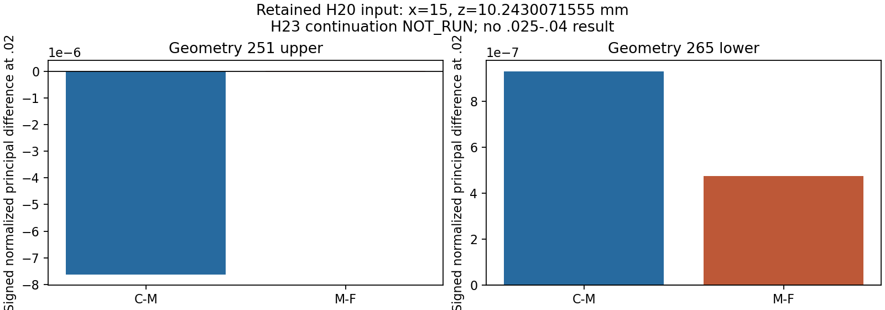

# H23 stopped before governing execution

**H23 is CLOSED_OBSTRUCTED_EXECUTION. The .02→.04 continuation did not run.**
The retained H20 .02 triplet reproduced exactly in passive preflight, but the M
observer rejected an active-import path mismatch before the governor was spawned.
The protected strict read of the original qualified M8/.02 anchor passed with its
genuine alpha400 callback. C and F were not admitted. No scientific time was added.

This was an H23 orchestration defect, not a physical, numerical-domain, storage
capacity or temporal-screen failure. The later passive repair is component-tested;
its governing qualification remains NOT_RUN. The stop was not erased or retried.

Starting/fetched HEAD was `9c480d7333f29ad347738e7e9d5f567053570165`, matching
review. The branch-owning Mac worktree was clean and no existing H23 root/job was
found. The [contract](wj-h23-flat-continuation-contract.md) was committed at
`4ece534c` before numerical work. Authoritative root:

`/home/jay/build/wj-h23-flat-continuation-20261115`

## Frozen scientific inputs and verified starts

The original 700-element Q3/Q1, 24688-coefficient full-height flat 6mm control is
unchanged: d0=3.5mm, interface9.5mm, h_s=4.341801417014184mm,
z0,e=.227050812848672mm, K=.008809015145515192. Full3D Original WJ,
DevStrainRawWorkV1/raw stress work/Cd, high-Re outer convention, finite-nu budget
AWF/current-K cutoff/dependent epsilon, transported inner k, physical Functions,
maps/signs/owners/quadratures and all boundaries/reference data were preserved.
IMEX1, eta0, one flow→k/bound→epsilon sweep, all guards and declared limits remain.

The intended matrix and actual statuses are:

| Level | dt | Genuine H20 start | Additional planned | Final planned | Actual |
|---|---:|---|---:|---|---|
|M|.0025|M8/.02|8|M16/.04|observer admission failed; governor NOT_RUN|
|C|.005|C4/.02|4|C8/.04|NOT_RUN|
|F|.00125|F16/.02|16|F32/.04|NOT_RUN|

Checkpoint file hashes match the authorized C4/M8/F16 identities respectively:

- `647044a05d72b72f98526cecd5a731c6a2455a5debe4c10fb775192af44f7adc`
- `6a1d061c8dee8c396ee588edd3afa86a353ceb58653c8bed2fedfdf291d3188c`
- `bf6f580b5a7f3b6af9c88c64186371dd9d67803f4bc76bcdf3901d69e8a61760`

Each complete producer/completion/checkpoint/callback/qualification chain was
verified through the sealed H20 publication and heavy manifest. Each own-dt CP0
matches the immutable spatial qh0, reference/defect and eta bitwise; qh0 remains
`631caa32a59ff43253f1fcac4effd955eb68b8529d9c28f29e615cf14ca0f077`.
The .02 start states retain distinct hashes and nonzero incoming differences.
XML Time remains0, TimeStep unchanged, NumSteps additional8/4/16, absolute
ceilings16/8/32. Exact protected-XML checks passed. All rich captures are Off,
substep_evidence_steps=[], with CheckpointAuditV1/BoundedV1/ExactStepV1,
ImmutableRowReuse Off and StopOnBound retained.

Both literature identities match the established SHA-256 values
`1959e96ea0b61f9deb9ff9ad1f5b26488a932a8451c2de6d3b6f7b7c9dbd9124` and
`0ab52e0d813b8fb344973f75ca6d8da97ff389ef9f93476500ca9d1df1fbc47c`.
Accepted quad/\\quad typography and `(d+a*h)/a^2` coefficient errata are unchanged.

## Exact obstruction and smallest repair

The final execution Python was frozen at `edb72c9e` with per-file pins in
`source-v3`. Runtime/input/cache compatibility had been created under
`source-v2`. Although the numerical module bytes were identical, the compatibility
record also pins their actual import paths. The unchanged observer correctly
rejected this comparison in `wj_h17_observer.load_compatible()`:

`active_source_bindings(historical_manifest) == compatibility["active_sources"]`

The coordinator observed the observer exit and never reached its native Popen.
Evidence includes native_exit=None, producer=None, absent native-launch.json,
empty native.log, no completion, no ready manifest and no startup-verification
commit. The outer operation consumed1.814762s; its outcome reports the prelaunch
exception. There was one governor coordinator launch and **zero actual governor
processes, attempts or completions**.

The driver conservatively charged eight unknown attempt-capacity slots because
there was no producing report. That original receipt and reserved capacity remain
unchanged. Closure separately establishes actual zero from the coordinator's
ordered launch path and retained outcome/artifacts; this does not reclaim or
repeat the failed reservation.

The repair at `c6aa5908` adds the same active-import validation before source
freeze and immediately before governor reservation. Equal numerical bytes at
different paths require a new compatibility record; no historical pins or generic
checkpoint/signature validation are weakened. An isolated passive check:

1. Reproduces rejection of the actual stale compatibility record.
2. Creates a separately named record for the actual active numerical imports.
3. Verifies the unchanged immutable cache/profile/qh0/reference/runtime bindings
   and loads it successfully without a scientific evaluation or solve.
4. Confirms the retained monotone halt still refuses another governor.

The failed source-v3/configuration/compatibility and earlier versions are immutable.
The new record is not substituted into the failed execution, no startup PASS was
invented, and no governing qualification was run under the repair. Source/Git
changes alone do not qualify a repaired native/observer execution configuration.

## Passive numerical preflight and protected strict evidence

One retained-triplet preflight reconstructed H20 .02 on its exact saved support.
All three physical summaries, complete signed255+525 Q1 vectors, all-pair screens,
fixed-owner signed/directional values, reference/drift metrics and contraction
results match the sealed H20 result exactly. This is **three passive state
assessments**, not H23 startup audits or new completed-state qualifications.
Change since .02 is zero for this input check; original-qh0 drift and incoming
cross-level differences remain nonzero and distinct from representation error.

The fixed H16/H18 support, Gauss8 support, exact two outlet owners251-upper and
265-lower at10.2430071555mm and inner probe/owners are retained. The signed figure
shows only the incoming H20 .02 state, explicitly labelled as such:

The protected read used QualifiedV1, the original H20 M8 producing report,
checkpoint and callback and its actual WJQualificationCommitV1. It selected
absolute8, T=.02, alpha400, with zero Project/Lift/initializer/governing work.
Native open/interface/weak checks and genuine callback binding passed. The raw
strict result and signed weak/interface/mass-dual data remain manifest-bound;
no .04 endpoint or new startup audit report was substituted.

No full scientific audit ran in a governor; no H23 state received online checks
or independent qualification. All15 planned barriers and12 completed endpoints,
the28 advances and four .025/.03/.035/.04 triplet comparisons are explicitly
NOT_RUN. There are no new trajectory, contraction, physical-margin or cost
measurements to report. H20/H22's mixed local contraction is unchanged historical
evidence, not an H23 temporal conclusion.

## Executed implementation, runtime and controls

No C++/header change, build, CP0, bootstrap, spatial/history initialization,
standalone probe, miniature trajectory, normal phase/vector capture, saved-matrix
operation or extra diagnostic mass solve ran. The only actual native process was
the protected strict reader from capsule
`057e6b7465660cac5ec8617abf5c876fa8bff71f`.

Static compiled dependencies/objects/link commands/flags, wrappers and both ELFs
were verified against sealed H22 records. Actual reader native-exec maps and all
loaded private libraries passed. Governor native-exec verification is NOT_RUN.
Governor/reader ELF hashes are respectively:

- `1c1df27b32ca5b6925ee467431f5291e25996e010c6c0026bebd12130e4d2e1d`
- `8ca139e140637bfe14ae875b1b5815b50fbb131229ac7020b3d9168791daa739`

GNU11.4 Release and -ffp-contract=off/-fno-fast-math are retained. One serial
reader or passive worker used all six numerical-library thread controls1;
unrelated Linux jobs were preserved and worker limits passed. Heavy inputs were
read in place on healthy ext4, with bounded write/fsync/readback and capacity checks.

Seventeen distinct focused Python methods passed:11 new H23 and6 affected existing
controls. There were30 successful method executions across the initial and final
commands, plus one failed historical test-selector entry retained separately.
The affected checks cover nonzero F restart, step/time/alpha/producer/history,
capture-Off intent, required-partner availability, typed strict selection,
deadline/campaign accounting, direct C-F screening, shared directions, floors,
pending/qualified distinction, cadence, prepared inventory and active path binding.

Earlier passive failures also remain: the first transfer selected the bootstrap
CLI namespace without creating a root (charged5s), and the first passive setup
monitor treated an absent publication directory as an error before the child ran
(0.013456s). That historical receipt says RESOURCE_LIMIT; no capacity limit was
actually reached. The repaired directory check passed, and these events were not
relabelled as physical failures or discarded.

## Closed accounting, storage and scientific limit

The new H23 ledger is **CLOSED at550.554481253/6000s**, including fully charged
setup60, closure300, transfer/coordination90, all failures and unknown capacity.
Native-category charge is40.640330304/4200s, including the failed coordinator;
passive charge149.914150949/900s. Prior ledgers and unused allowances remain closed.

Measured enclosing operations include retained preflight37.759536s, failed M
coordinator1.814762s, protected strict38.825569s and passive publication6.842905s.
These are separate operations; no nested wait/audit scopes are summed. No ordinary
advance, recovery publication, native full-audit, observer comparison barrier or
warm continuation cost exists for H23. Its forecast is NOT_EVALUABLE.

Peak scientific-tree RSS was3,923,677,184bytes; new output before closure was
127,393,880bytes and copied source16,489,844bytes, all below the declared caps.
There were zero new recovery packages. Historical checkpoint-package sizes are
labelled as historical, while preflight arrays/inventory and strict evidence are
new retained output. Runtime was reused in place, not recopied. Heavy arrays stay
on Linux. The essential1,354,163-byte and complete compact1,405,795-byte archives
were hash-verified after transport; all118 sealed files and81 lossless copy
transformations were verified locally. Transport took91.076s within closure300.
The authoritative index SHA-256 is
`454bb37c7bff4655ef588635df3e048d3941f1f68ef8ff6bcc7d74f85fd01a24`.

H20's49.9/98.2/197.3-day and194/274/429-GB illustrations remain conditional prior
evidence. H23 supplies no production governing/monitoring/retention sample and
cannot decide which future bottleneck dominates. Proposed physical intervals
recovery.025/science.25/terminal.125 remain unqualified scenarios. The report retains
the unchanged505.02466521278404 horizon and terminal window
[447.8483832973273,505.02466521278404], ceiling-step distinctions and hypothetical
remaining counts from.04; **.04 was not reached**.

The precise next requirement is a separately authorized resumption of the same
remaining28-advance matrix after active imports/compatibility/source freeze are
validated together, preserving this failure and all charges. The repaired governing
configuration needs execution qualification; no other replay, timestep or physics
change is justified. No follow-up was executed here.

Production timestep/application budgets, affordable duration/archive planning,
long full-domain flat preservation, curved-terrain and hill/experiment comparisons
remain later gates. Physical7mm observations remain inside the9.5mm matching plane;
neither retained-state checks nor numerical continuation validate that wall-height
choice. No new matching height, EP or unrelated work was introduced.
