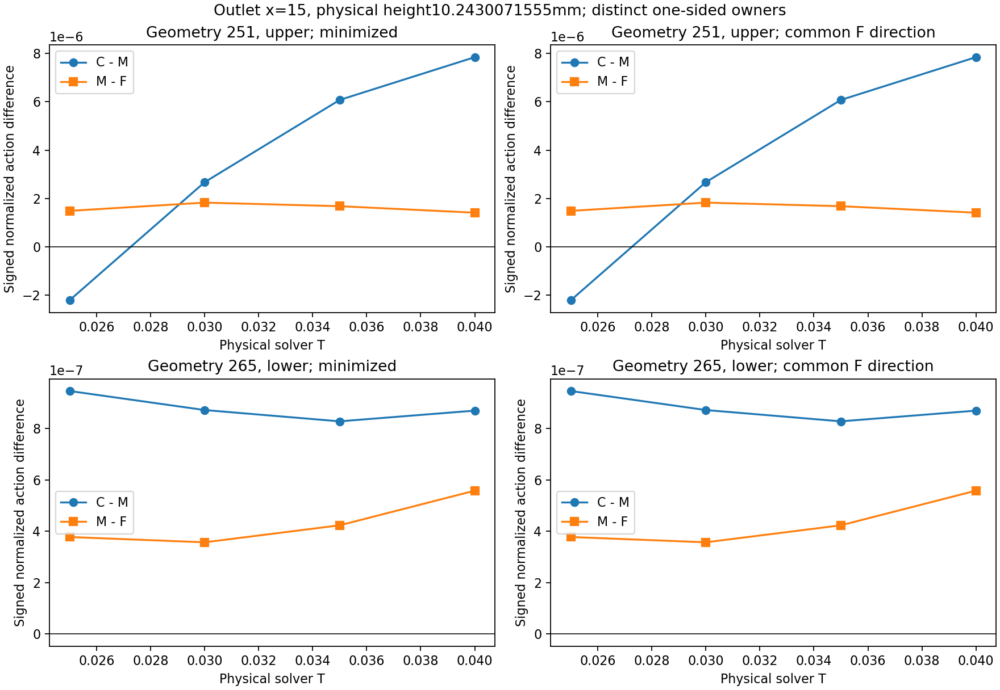
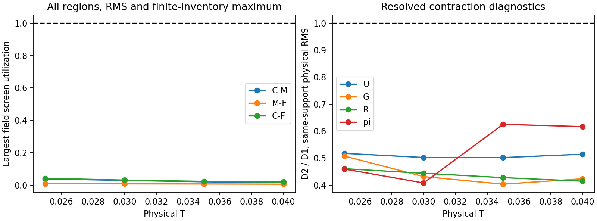

# H24: repaired bindings and completed flat continuation

H24 is **CLOSED PASS**. The unchanged M, C and F trajectories advanced from
their qualified H20 states at .02 to .04: 28/28 attempted, completed and accepted
advances, with three genuine terminal strict reads. All scheduled physical and
provisional absolute screens passed. There is no remaining H24 obstruction.
The scientific ledger is CLOSED; no later duration or optimization is admitted.

The fetched starting revision was
`6a6940df6647f661b164eb10f8b52af73dfee57a`, matching the reviewed baseline.
The branch-owning Mac worktree was clean; existing Linux jobs were inspected and
preserved. H23 remains a separate immutable CLOSED obstruction, with its original
550.5544812529697-second charge and failed execution evidence intact.

## Execution and publication identities

The scientific Python capsule was
`75457717ebb89a42bcc1cb2155c8cd0fff9ec94f`, installed once at the final
`/home/jay/build/wj-h24-flat-continuation-20261115/source` path. Compatibility was
created afterward from the numerical modules actually imported by the observer.
Actual path/byte bindings were checked at freeze, each reservation and immediately
before native launch. The real stale H23 path case was rejected; the coherent
H24 record and immutable cache were accepted under the actual launch namespace.
No path pin, physics signature or numerical tolerance was weakened.

All six native operations reused capsule
`057e6b7465660cac5ec8617abf5c876fa8bff71f`, GNU 11.4 Release,
`-ffp-contract=off -fno-fast-math`, and its qualified private loader/libraries.
The governor ELF SHA256 is
`1c1df27b32ca5b6925ee467431f5291e25996e010c6c0026bebd12130e4d2e1d`;
the reader is
`8ca139e140637bfe14ae875b1b5815b50fbb131229ac7020b3d9168791daa739`.
Compiled dependency/object/link provenance and actual native-exec mappings are
pinned in the publication controls and operation receipts. Runtime was reused in
place; no native build occurred. The final passive publisher/closer executed from
`publication-code-v3`, revision `3133cfd3`, with separate per-file identities.
Earlier unexecuted publisher drafts remain retained. Publication tooling and the
final documentation HEAD are distinct from the scientific execution capsule.

Normal pushes and remote checks occurred at the required publication points:

| Checkpoint | Commit | Executed work at publication |
|---|---|---|
| A | `5bd17db45a30326b8c15589f3c9ce44a4e9460a8` | Contract, coherent bindings, controls, retained-triplet preflight; before M |
| B | `4ad8807db34018213502da957b50131156ba2ee1` | M16 and its terminal strict PASS; C/F still pending |
| C | The commit containing this report and final sealed evidence | M/C/F complete, final transport and CLOSED accounting |

Checkpoint C's exact remote SHA is supplied in the final handoff; a commit cannot
contain its own hash. The authoritative scientific index is
[authoritative-index-v1.json](wj-h24-linux/authoritative-index-v1.json).

## Unchanged science and actual continuation

The original 700-element Q3/Q1, 24688-coefficient full-height neutral flat control
was retained: only the stored 6 mm AWF, d0=3.5 mm, physical matching plane9.5 mm,
full-precision calibration/Functions, native geometry/maps/signs/owners,
q12/normal16 governing quadrature and physical Gauss8 assessment. Original full3D
WJ, raw full-stress production, Cd diffusion, high-Re outer convention, finite
molecular viscosity in the budget-cutoff AWF, transported inner k and current-K
cutoff/dependent epsilon all remain unchanged, as do complete boundary laws,
regional pressure convention, IMEX1/eta0 and one flow→k/bound→epsilon sweep.

CheckpointAuditV1, BoundedV1, ExactStepV1, ImmutableRowReuse Off and StopOnBound
were used. Normal phase snapshots, flow vectors, arithmetic and extra PIMPLE
verification were Off; substep evidence selection was empty. The two literature
SHA256 values matched the frozen main
`1959e96ea0b61f9deb9ff9ad1f5b26488a932a8451c2de6d3b6f7b7c9dbd9124`
and appendix
`0ab52e0d813b8fb344973f75ca6d8da97ff389ef9f93476500ca9d1df1fbc47c`.
The recorded quad/`\quad` typography erratum and correct `(d+a*h)/a^2`
coefficient are preserved.

| Order | Level / dt | Genuine H20 start | New accepted / failed | Terminal | Strict role / result |
|---|---|---|---:|---|---|
| 1 | M / .0025 | M8 / .02 | 8 / 0 | M16 / .04 | completed, alpha400 / PASS |
| 2 | C / .005 | C4 / .02 | 4 / 0 | C8 / .04 | completed, alpha200 / PASS |
| 3 | F / .00125 | F16 / .02 | 16 / 0 | F32 / .04 | completed, alpha800 / PASS |

F's final serialized time is `.040000000000000015`; all exact bits are retained
and satisfy the frozen 128-epsilon time alignment. Checkpoint suffixes are
generation labels. Each start restored exact coupled coefficients, native
history/time slots, genuine completed callback, fixed reference/defect, eta and
own-dt signature. Each own-dt CP0 remained the original-qh0 anchor, separate from
the nonzero .02 restart and analytical reference. New startup-verification
reports did not replace the original H20 completed producers.

There were three governors, three fresh startup commits, twelve newly qualified
scientific endpoints and three strict readers. Fifteen native full-audit barriers
correspond to fifteen observer events containing thirty participating-state
assessments. The separate retained-.02 preflight evaluated three saved states.
All 28 recoveries, callbacks and completion manifests remain on Linux. Off-cadence
recoveries retain online checks and explicit NOT_SCHEDULED full-audit status.
Every sweep used one momentum, pressure, k and epsilon solve and one bound call;
bound activations/material corrections/extra restorations were zero, with equal
raw/corrected-k hashes. There were zero new CP0s, bootstraps, spatial or standalone
history initializations, builds, normal rich captures or standalone probes.

## Qualification and coverage

| Component | Outcome | Evidence |
|---|---|---|
| Active source/path/cache/runtime binding | PASS | Real stale-path refusal and actual launch namespace checks |
| Nonzero startup/history/reference integrity | PASS, all three branches | Exact restored parity plus fresh startup commits |
| Online/native hard acceptance | PASS, 28 advances | Per-step counters, residual/constraint and bound records |
| Scheduled finite-inventory physical/quality checks | PASS, 15 barriers | Native audit plus independent current-state assessment |
| C−M, M−F, direct C−F provisional absolute screens | PASS, all four new times | Regional RMS/MAX and same-owner/direction allowances |
| Terminal strict read/lineage | PASS, three genuine .04 endpoints | QualifiedV1, own producer/callback and alpha |
| Contraction | Descriptive reduction on declared aggregate records | Signed local records retained separately |
| Duration, production dt, application budgets | NOT ADMITTED / UNVALIDATED | Conditional cost scenarios only |

The unchanged support starts with 11456 fixed points /17521 legitimate owners
and 44800 physical Gauss8 rows, adding current participating witnesses, prescribed
neighborhoods and moving cutoff points with all face/interface owners. Each
realized inventory and hash is archived. M's new-time comparisons were explicitly
NOT_YET_AVAILABLE, C used existing M partners, and F reassessed triplets on the
common realized support. No future oracle was assumed and no owner was averaged.
An earlier decision and a later expanded-support assessment remain distinct.

Across all scheduled assessments, including the .02 starts, the lowest normalized
in-plane margin was **.003536166047618944**, above `.002068763923454`;
the lowest transverse value was **.9434763867425122**, covariance eigenvalue
**.0024806050146316573**, and native scalar margin **1.744239312328977e-5**.
Among the four new common times, the in-plane minimum was
`.003539823049497612` (C at .025). All **23,400 signed Q1 entries**
(30×[255+525]) satisfy the gate: maximum absolute value
**3.256349095934444e-16**, below `2e-15`. Complete vectors are in
[all-signed-Q1-moments.csv](wj-h24-linux/publication-v1/all-signed-Q1-moments.csv).
Strong divergence remains a separate diagnostic; for example M/.04 has maximum
`1.1783440237674562e-4`, scaled `1.545433290600075e-5`. Evolved Q3/Q1 states
were not subjected to the CP0 pointwise-zero construction gate.

The worst new field-screen utilization was **.0429626891617541** (4.2963%):
C−F full-region R MAX at .025, normalized difference `4.2962689161754105e-5`
against `.001`. The worst same-owner principal screen used **.07447446428841117**
(7.44745%) of its allowance, C−F at .025 in the finer direction, geometry239 at
`[-7.5,0,.24678758944336157]`: difference `1.5260020834469146e-5`, allowance
`.00020490272713306011`. All pair/region/component records, directions, raw
actions, viscosities and margins are retained. These limits remain provisional
numerical screens, with `4e-11` scaled reconstruction floors and `2e-11`
action-replay accuracy; they are not experimental or production error budgets.

## Four-time signed temporal evidence

Full physical RMS ratios `rho=||M−F||/||C−M||` on identical support/scales:

| T | U | k | R | pi | G | outer epsilon |
|---:|---:|---:|---:|---:|---:|---:|
| .025 | .517171 | .487126 | .460404 | .459173 | .507363 | .524946 |
| .030 | .501875 | .491530 | .443393 | .407519 | .431089 | .518507 |
| .035 | .501664 | .492652 | .427313 | .624578 | .403167 | .513788 |
| .040 | .513987 | .492500 | .414212 | .616328 | .423041 | .510591 |

All 200 declared field/regional/aggregate contraction records were resolved and
below one (range `.1975645827`–`.9729262095`). This describes this finite window
and support, not every point or time. The two fixed outlet traces at
`[15,0,.25607517888672315]` retain separate geometry251 upper-normal and
geometry265 lower-normal owners, both upper-x, at physical height10.2430071555 mm.
Signed minimized normalized-principal differences are:

| T | 251 C−M | 251 M−F | abs ratio | 265 C−M | 265 M−F | abs ratio |
|---:|---:|---:|---:|---:|---:|---:|
| .025 | -2.207761428e-6 | +1.488423465e-6 | .674178 | +9.451766601e-7 | +3.774795307e-7 | .399375 |
| .030 | +2.675028617e-6 | +1.829505658e-6 | .683920 | +8.711889004e-7 | +3.569068528e-7 | .409678 |
| .035 | +6.075535309e-6 | +1.681826639e-6 | .276819 | +8.272918366e-7 | +4.229790220e-7 | .511282 |
| .040 | +7.843826826e-6 | +1.413013532e-6 | .180143 | +8.688903785e-7 | +5.576362843e-7 | .641780 |

At owner251/.025, opposite adjacent signs give cancellation
`1-|E1+E2|/(|E1|+|E2|)=.8053836633`; the C−M sign reverses by .030.
Later adjacent signs at both owners agree. All three actual states were also
evaluated at each shared theta_C/theta_M/theta_F; independent minima remain a
separate diagnostic. Signed pressure, stress, gradient, scalar, production and
interface/exterior traces are retained without regauging. The fixed inner stress
probe and actual adjacent owners are retained too.

No temporal order, Richardson error bound, unique phase cause, global
realizability/ellipticity or production timestep follows. H11's UNRESOLVED
historical qualification and H20/H22's earlier mixed local contraction keep their
original scopes; H24 does not rewrite them.

## Reference, drift and genuine residuals

Analytical q_eq, actual original qh0, fixed internal reference/defect, and .02
restart fields remain separate. Initial full-domain U representation RMS is
`9.837224637085666e-7`. At .04:

| Level | U RMS error from q_eq | U RMS drift from original qh0 | U RMS change since .02 |
|---|---:|---:|---:|
| C | 9.969906833e-7 | 8.861073079e-8 | 1.904697109e-8 |
| M | 9.972182468e-7 | 8.945000751e-8 | 1.869677651e-8 |
| F | 9.973395350e-7 | 8.986619255e-8 | 1.852164931e-8 |

The strict reader retains spatial alpha-zero and genuine completed-stage
consistent-mass dual norms, frozen subsolve residuals, signed weak components,
interface/exterior loads and constraints with their existing meanings. For the
entire transported outer-epsilon block at .04:

| Level | Uncancelled spatial dual norm | Completed-stage dual norm |
|---|---:|---:|
| C | 1.877519103e-5 | 1.384337964e-7 |
| M | 1.729873019e-5 | 6.208776287e-8 |
| F | 1.661256234e-5 | 2.950310037e-8 |

These are not the frozen linear residual and need not vanish for a single sweep.
No extra governing solve, saved-matrix operation or new mass-projection campaign
was launched. Transported outer epsilon and the current-K-dependent inner
auxiliary destruction remain separately labeled.

## Executed controls, measured resources and storage

The Linux focused run executed **22 methods, all PASS**, once: five H24 binding
controls, eleven H23 continuation/import/deadline controls and six selected
H20/H18/H22 direction/floor/cadence/qualified-cursor controls. The exact selectors,
command log and receipt are in checkpoint A. The retained .02 triplet preflight
reproduced physical gates, signed probes, absolute screens, reference/drift and
contraction on its saved support. No miniature native trajectory or broad
historical campaign was added. No H24 native failure or adaptive retry occurred.

| Operation | Governor seconds | Protected strict seconds | New advances |
|---|---:|---:|---:|
| M | 681.362218 | 38.888259 | 8 |
| C | 555.529829 | 38.989228 | 4 |
| F | 1114.773301 | 39.555438 | 16 |

| Closed account / measured capacity | Actual | Ceiling |
|---|---:|---:|
| Total charged Linux operations | 3052.381070 s | 6000 s |
| Native governing plus strict | 2469.098273 s | 4200 s |
| Passive operations, transfers and coordination | 223.282797 s | 900 s |
| Setup plus closure, fully charged within total | 60 + 300 s | Reserved |
| Sampled aggregate science peak RSS | 7,029,719,040 bytes | 8 GiB |
| New output before sealing closure | 1,391,961,400 bytes | 2 GiB |
| Copied source/publication code | 5,646,650 bytes | 8 GiB |
| New copied native runtime | 0 bytes | Reused in place |

The publication-time accounting snapshot conservatively includes the then-active
180-second publication reservation. Its `total_charged_so_far` is not the final
actual charge. The completed publication took24.692938 seconds; the separately
sealed `closure-v1/accounting-final.json` is authoritative and CLOSED. Final
essential/compact transport took11.938808 seconds inside charged closure. All
branch admissions preserved prospective headroom, terminal reads and closure.
One serial governor plus bounded observer and six library thread controls=1 were
used; sampled host allocations remained below72. No heavy reader overlapped a
governor.

The file-only science/operations partition is1,379,000,479 bytes; source,
directory metadata and closure explain the different capacity snapshot above:

| Retained category | Bytes |
|---|---:|
| Lossless independent field NPZs | 707,734,008 |
| Scientific inventories | 289,505,986 |
| Completed/final native reports | 122,580,378 |
| Configuration/cursors/receipts/other | 114,780,261 |
| Native checkpoints, 28 State.bin files | 40,517,596 |
| Factor metadata streams | 39,948,375 |
| Console/telemetry/timing | 22,501,784 |
| Genuine callback sidecars | 15,849,327 |
| Raw terminal strict packets | 13,697,513 |
| Independent results | 11,826,410 |
| Completion manifests | 58,841 |

Direct ordinary non-audit samples average41.638536 seconds for M (n4) and
40.388027 for F (n12). C has no direct ordinary sample; its41.500677-second
audited-scope subtraction is labeled as such. Recovery means are
.347534/.371398/.336506 seconds for M/C/F. Due native audit plus physical-sample
means are44.564488/43.810622/43.380474 seconds. Observer enclosing completed-event
waits are10.968651/20.816641/35.692690 seconds for M-only/C-pair/F-triplet;
assessment is already inside wait. Pair/triplet comparison cost is not a future
single-trajectory production cost. Complete inclusive/exclusive timers are
retained; nested scopes are not added and CPU zeros mean unmeasured.

Across16 direct ordinary M/F steps, exclusive `domain.compute` accounts for
18.745313 seconds per step, `flow.assembly`6.318373, residual work2.275727,
and mapped band solves1.640536. The inclusive k-bound scope9.325640 includes
nested domain work; its exclusive part is1.897261. These are measured
attributions, not permission to remove bound/domain coverage. Necessary native
computation dominates a future sparse-monitoring loop.

## Conditional affordability and stopping decision

The unchanged horizon505.02466521278404 and terminal window
[447.8483832973273,505.02466521278404] remain unexecuted. From .04 the remaining
advance counts are C100997/M201994/F403988; ceiling-step time is505.02500000000003.
At the proposed, unqualified physical cadences recovery.025/science.25/terminal
science.125, each level would have20200 recoveries and2250 science checkpoints.
The model uses physical-only M wait/commit cost11.033379 seconds, not a temporal
oracle, and measured recovery/science/log bytes:

| Level | Conditional native-only days | Conditional observed-loop days | All proposed recoveries archived, GB | Science plus newest3 recovery scenario, GB |
|---|---:|---:|---:|---:|
| C | 49.740 | 50.027 | 279.164 | 164.351 |
| M | 98.588 | 98.876 | 358.625 | 243.885 |
| F | 190.054 | 190.342 | 516.399 | 401.702 |

GB are decimal measured-encoding illustrations, including existing recurring
logs. C uses a subtracted estimate; no short-study mean is a statistically
representative production benchmark. Future restart/startup/strict/transport,
failure, factor and witness growth are not priced by the loop extrapolation.
Newest3 rotation, lossless compression/log pruning and long namespaces remain
unqualified assumptions. The short-study2 GiB cap does not admit such an archive.

Recommend **one bounded production-affordability qualification on saved .04
states**, with an explicit application/error-budget and storage envelope. Target
the demonstrated recurring exact domain-check work and qualify lossless
telemetry/archive retention while preserving every scalar, nonlocal/moving-ray,
ground, root and bound guard. Use saved-state parity and measured disjoint cost to
decide whether a practical duration plan is warranted. No follow-up was executed.

Full-duration flat preservation, production timestep/application budgets,
curved-terrain governing qualification and hill/experimental comparison remain
later gates. This short continuation proves neither stationarity nor exact
equilibrium, all-time positivity, global stability or experimental validity. The
physical7 mm observations remain inside the9.5 mm matching plane; numerical PASS
does not resolve that modeling limitation or authorize a height/model/EP change.

## Reproduction and sealed evidence

Authoritative Linux root:
`/home/jay/build/wj-h24-flat-continuation-20261115`.
The publication, CLOSED closure, all recoveries and heavy field arrays stay there
with exact paths/sizes/SHA256s. The index SHA256 is
`b638402b15e8242bbdf2ab825f3753050fb241a03022a40f7aa25dc30fd356bc`.
Exact executed environment and six admitted command forms are in
[wj-h24-reproduction.md](wj-h24-reproduction.md); per-operation requests/receipts
bind the lower-level commands. They document execution and do not reopen a
CLOSED ledger.

The local [README](wj-h24-linux/README.md), storage aliases, copy transformations,
transport verification and local compact manifest distinguish original bytes
from lossless gzip copies and derived tables. All192 final sealed files and136
copy transformations were verified after transport. Figures were visually
checked for signed quantities, time axes, physical height and owner/side labels.
Publication/accounting snapshots were saved before hashing; final closure is
sealed separately. Active journals were not relabeled immutable publications.
