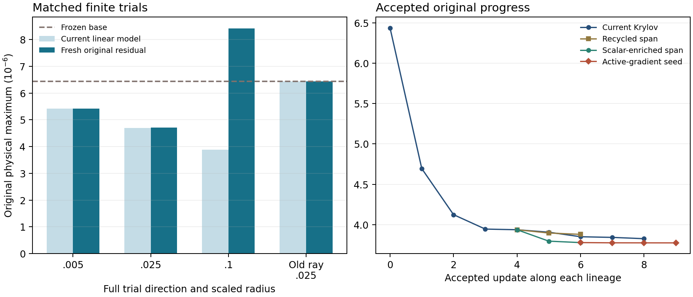

# WJ-C1R10 bounded nonlinear progress on the original B3 equations

## Frozen field and numerical controls

The branch began at the reviewed `441f854236f10d96e514d48118978ddf5a757c33`.
The signed 5,238-cell B3 base has coefficient SHA-256
`ced15ecef5037f0e638664999a6ec82f46e02585a95895f907aa14ed3704c600`.
Its refreshed original momentum, continuity, gauge, $k$, outer epsilon and
trace blocks were $[3.286600153710145\times10^{-7},2.378657765983026\times10^{-12},
0,6.438421472031332\times10^{-6},2.857844404925701\times10^{-6},0]$.
The row-scaled $L_2$ norm was $1.4277267361975784\times10^{-4}$. The archive
seed, session, richer pending packet and previous independent equation receipt
matched the pinned bytes. The original field, signed basis and free order,
boundary and table identities, geometry, and lifted traces agreed on replay.
The native source-bound equation signatures were checked separately.

The run retains $\eta=0$, $g=.0024$, $H=.15$, $d_0=.0875$,
$h=.11541061001735275$, the original finite-viscosity WJ law and three-dimensional
deviatoric convention, AWF, dependent epsilon trace, moving-cutoff integration,
sampled loads, $G_h-C_\Pi$, scalar transport and production, inlet and
`ZeroTransverseV1` outlet. The spaces are Q3/Q2 with the validated 12×12 GLL
expansion and 10×16 split integration during the solve. Correction mass,
correction diffusion and residual regularization are zero. The factor's
inverse-only mass is .009539982703780335 at colored spacing 4e−6.
The current hybrid action uses exact fixed-rule $k$ diffusion on 5,130 cells
and current differences including the moving rule on the remaining 108 cells.
The earlier order-18 construction limitation remains scoped to that expansion
choice. [Paired axial convergence record](wj-h27-c1-paired-axial-convergence.md)

The retained Linux run directory is

```text
/media/jay/cb7dc460-f22f-4533-8329-245d10620f47/nektar-v2026-workspace/runs/wj-c1-b3-bounded.xjpRylk7
```

## Actual no-factor trials

Each canonical input column was checked separately from the published native
direction after its scaling round trip. The comparison used relative tolerance
5e−16 and absolute tolerance zero. The batch rebuilt the finite state through
the ordinary nonlinear validation and $F_0$ path. Each trial has its signed
model, actual residual and remainder when the field evaluated. The packet
contains the native principal, covariance, whole-cell scalar and whole-trace
observations. The principal observations are diagnostic samples. Physical
release requires the separate original admission checks.

| Direction | Fraction | Physical prediction | Physical actual | Actual / predicted decrease | Armijo |
| --- | ---: | ---: | ---: | ---: | --- |
| Bounded .005 | 1 | 5.415225e−6 | 5.415417e−6 | 0.999812 | pass |
| Bounded .025 | 1 | 4.699073e−6 | 4.712745e−6 | 0.992139 | pass |
| Bounded .1 | 1 | 3.888237e−6 | 8.416289e−6 | −0.775578 | fail |
| Bounded .1 | .5 | 4.771614e−6 | 4.839014e−6 | 0.959564 | pass |
| Old ray .025 | 1 | 6.438412e−6 | 6.440883e−6 | −261.605 | fail |
| Old ray .025 | .5 | 6.438417e−6 | 6.438970e−6 | −116.662 | fail |
| Old ray .025 | .25 | 6.438419e−6 | 6.438554e−6 | −56.213 | fail |
| Old ray .025 | .125 | 6.438420e−6 | 6.438454e−6 | −27.426 | fail |

At size .025 the optimized correction reduced the original maximum by 26.8%.
The .1 full trial had outer epsilon remainder norm 7.98789e−6, versus
1.99715e−6 at half fraction. The measured factor of four supports shrinking
the radius when finite-state agreement deteriorates. All eight trial fields
were feasible and their sampled principal margins were positive. The trial
batch left the accepted coefficient digest and controller custody unchanged.
Three native controls rejected stale coefficient, scale and input column
bindings before publication of a trial.

The tested trial source was `fb11c91fba9e6a9109dac9f8a1c201b574e3cac7` and the Linux
solver SHA-256 was
`23ddc0c2d60cd26a4fade9a87a6404193b8f1c172b79d4efdadc66b6ead03fce`.
The no-factor process cost 306.16 wall seconds with peak RSS 2.28 GiB.
The unchanged signed raw bytes remain in `frozen-trials/`.

## Bounded policy and acceptance

`WJH27BoundedDirectionV1` uses a separate opt-in direction path.
The production policy starts from an explicit Reanchor at .025, with
minimum and maximum radii 1e−7 and .1. The default experiment uses
a rank-16 current Krylov construction and at most four proposals per base.
Each reduced subproblem minimizes the maximum of the original physical and
row-scaled model ratios with $\|Qy\|_\infty\le\Delta$. The six physical
blocks share the same base physical denominator. Current actions are rebuilt
after each accepted update. The constrained solver reports its gap or
iteration cap and the native evaluator verifies the proposed action.

The fresh primary, half and wide spacings are 512e−6, 256e−6 and
1024e−6. Twice the primary/half change is an empirical action allowance.
The physical and row-scaled model decreases must each exceed four allowances
plus roundoff. The original spacing sensitivity comparison against half of
each .3 target remains in force. The .3 linear errors are retained as
diagnostics. The 1% usefulness label distinguishes weak and useful descent.
Neither label supplies an acceptance decision.

The finite trial uses the current original norm-Armijo criterion and
physical actual/predicted decrease ratio at least .1, with the original
root tolerance as the terminal exception. Rejection halves the radius
and recomputes the subproblem. Growth is at most two and requires
rho above .75 and displacement of at least .8 of the radius. Accepted
checkpoints bind the actual free displacement and next controller state.
Six accepted updates below 1% cumulative reduction with no improving
reduction per action trigger the declared stagnation stop.

The Linux-tested bounded source is `37fa371ae830fe27b9fac1c5e2fb5bfee05f58df` and its
solver SHA-256 is
`5c221e70183db67a0d3eb0923da2709f1102ef64228981b4adbb75207de7559a`.
The focused controls cover partial descent with failed .3 tolerances,
misleading curvature, inadequate actual ratio despite Armijo, infeasible
finite-state rejection, weak descent and the exact displacement and radius
on cold Resume. The existing Newton controls also pass.

## Repeated nonlinear progress and its limiting mechanism

The first current-subspace run accepted eight corrections, with the largest
drop in the first three. Its first accepted physical and scaled model ratios
were .72727 and .73384, above the old .3 targets. The actual norm fell to
4.694243e−6 at ratio .99331 after 35 current products. At the third base,
the .1-radius proposal had
outer epsilon remainder norm 5.568e−6 and failed Armijo. Reoptimizing at .05
lowered that remainder to 1.280e−6 and the trial passed. The current action
allowances were orders of magnitude smaller than the measured remainders.

At the eighth accepted state, the optimizer returned zero at four radii
from .025 through .003125. Its reported gap was still 0.00119–0.00190.
This motivated two matched continuations from checkpoint 4, each starting
at .05. Both recomputed every action on a retained span without assembling
another right inverse. The second added orthogonalized $k$ and outer-epsilon
components of the previous scaled displacement. The scalar enrichment
improved the first actual reduction at the same radius from 1.03% to 3.59%.

| Arm | Start $N(F_0)$ | Last accepted $N(F_0)$ | Updates | Native wall s | Peak RSS GiB |
| --- | ---: | ---: | ---: | ---: | ---: |
| Current rank-16 model | 6.438421e−6 | 3.825892e−6 | 8 | 3482.23 | 7.89 |
| Recycled comparison, rank 16 | 3.936786e−6 | 3.879426e−6 | 2 | 387.65 | 2.33 |
| Scalar-enriched comparison, rank 18 | 3.936786e−6 | 3.777411e−6 | 2 | 431.88 | 2.34 |
| Unchanged enriched Resume | 3.777411e−6 | 3.777411e−6 | 0 | 194.28 | 2.33 |
| Active-gradient optimizer restart | 3.777411e−6 | 3.773993e−6 | 3 | 799.42 | 2.37 |

The unchanged enriched Resume again produced zero candidates at four
radii. On an earlier common enriched base, 250 cut-plane iterations
and the retained .0125 feasible incumbent yielded a nonzero .025 proposal.
Its fresh actual norm was 3.780170e−6, versus 3.777411e−6 for the .0125
incumbent. That control separated optimizer insufficiency from the value
of simply allowing a larger radius. Neither finite trial advanced custody.
The next controlled change seeded the same optimizer from current
active-block gradients. The frozen model at the exhausted enriched base
then supplied nonzero descent. The native continuation accepted three
further updates for 0.0905% reduction from that base. Cumulative residual
reduction per current product fell from 1.265e−10 at the first update to
4.953e−11 by the third.

At the final accepted field, the last four radii .00625, .003125, .0015625
and .00078125 yielded feasible weak-descent trials with resolved actions.
Every trial failed the unchanged full-fraction Armijo bound
$3.77361569242\times10^{-6}$. At .003125 the fresh norm
$3.77375363616\times10^{-6}$ had ratio .58059 and stayed above the bound.
At the smallest radius, the ratio rose to .90051 as predicted physical
decrease fell to $1.094\times10^{-10}$. The action allowance was
$5.894\times10^{-14}$. This last search was limited by the model
decrease available in the tested span together with finite-state curvature.
The current evidence neither certifies the cut-plane optimum nor identifies
an adverse original-model root.

The best field reduced the maximum by 41.38% after nine accepted updates
along its lineage. The separate runs recorded 15 accepted updates in all,
including the comparison branch. The best coefficient identity is
`bc593d6c54e937bc5ee0986fa9df67d40b39da34cd34c9f1037981406ec4f67b`
in `bounded-active/state.accepted-000003.json`, packet SHA-256
`6dce7818c2a2db127fe7c0bcf145f597d918e9d7c4ea009d3672a387a1ebbd12`.
The smaller but rejected trial has separate `UNCOMMITTED_TRIAL` custody.
The explicit endpoint selector used the former for all independent checks.



The recycled numerical source was `b7aaa46e490d28fa2bd36d36d79f27eb9cda283c`,
solver SHA-256
`14fea37e6baec5df607ca530bb114477b4c58a23e4701941ba65cbcadffabb4b`.
The active-gradient helper is separately pinned at
`e4f02a474ca621dd55aa6a455f2456469af79b4a`. The numerical work used serial
MPI-enabled Linux binaries with numerical-library threads set to one.
The measured native build stages cost 107.47, 92.36 and 95.85 s, with
16 compiler workers. The single cold inverse in the current rank-16 run
used 931.56 s assembly and 75.41 s factorization. The comparison,
extended replay, finite-trial and endpoint audit process sums overlap
other work and are separate from elapsed campaign time.

## Independent endpoint check

The 16×24 native replay retained the accepted coefficient digest exactly
and enabled the existing all-row action cross-checks. The 28×28 independent
equation calculation agreed with that richer native replay to within
$2.2\times10^{-15}$ in all four physical blocks.

| Residual | 16×24 native | 28×28 independent | Independent limit |
| --- | ---: | ---: | ---: |
| Momentum | 2.109320117e−7 | 2.109320116e−7 | 1e−9 |
| Continuity | 5.557865483e−12 | 5.557616230e−12 | 1e−9 |
| \(k\) | 3.773999867e−6 | 3.773999868e−6 | 1e−8 |
| Outer epsilon | 2.165370631e−6 | 2.165370629e−6 | 1e−8 |
| Projected epsilon trace defect | — | 6.825244433e−16 | 1e−10 |

The native maximum remains above 1e−10. The separate pointwise epsilon
trace representation error is 1.123188265e−6. Native whole-cell lower
bounds are .004002662 for \(k\) and 1.744190e−5 for outer epsilon.
The minimum covariance/\(k\) is .2529977. The whole-trace \(K/K_{\rm in}\)
range is [.95506273, 1.03729248] and the minimum integration Jacobian is
.99954995. The minimum native sampled principal/\(\mu\) is .003993775.
Independent mass, power, shared-trace and face-measure identity errors
were each below 1.6e−15. The independent face and volume checks covered
all eight required regions. The lowest sampled face response was .00398074035.
The required 15 fixed-owner and 35 local-minimum samples all passed,
with minimum uncertainty-adjusted response .00398074032.
The original admission checker returned `INDEPENDENT_EQUATION_FAILURE`.
The signed field retains diagnostic custody.

The richer replay cost 106.63 s. The independent equations and principal
scans ran concurrently for 446.98 s and 958.58 s respectively. The local
and fixed-owner audit took 26.82 s. Campaign elapsed time through the
completed audits was 6,092 s out of the 10,800 s allocation.
All receipts and their exact source, session, executable and coefficient
bindings are in the [machine-readable evidence](wj-h27-c1-b3-bounded-nonlinear-progress-evidence.json).

## Decision and gate status

**Outcome D, spatial admissibility unresolved.** A3 remains the admitted
5,238-cell level-three representation at \(g=.0024\), or a 0.096 mm hill.
B3 is an improving then stalled pending solve at the same height.
The third paired comparison requires a qualified B3 endpoint. The retained
A2/A3 gap .02551944209 already exceeds the .000759430545 threshold ceiling
by about 33.6 times. Physical time advanced in this campaign was zero.
The later full-cost production criterion remains
\(1.25 C_{\rm total}\le86400\) seconds per qualified trajectory.

| Gate | Status | Evidence and scope |
| --- | --- | --- |
| `BEST_B3_STATE_REPRODUCED` | PASS | Exact frozen digest, signed free order and six-block replay |
| `FROZEN_BOUNDED_NONLINEAR_TRIALS_ASSESSED` | PASS | The .025 bounded candidate reduced actual \(F_0\) by 26.8%. The matched ray failed Armijo. |
| `BOUNDED_DIRECTION_POLICY_VERIFIED` | PASS | Original trial guards, unchanged legacy controls, exact accepted displacement and validated radius restart |
| `SUSTAINED_ORIGINAL_PROGRESS_ASSESSED` | PASS | 41.38% reduction across the retained accepted lineage, followed by exhausted weak-descent proposals |
| `B3_ORIGINAL_ROOT_QUALIFIED` | OPEN | The pending field fails native and independent equation tolerances |
| `PAIRED_AXIAL_LEVEL_THREE_COMPLETE` | OPEN | Qualified B3 required |
| `NEXT_SPATIAL_DISCRIMINATOR_COMPLETED` | OPEN | Selection requires the qualified pair |
| `POSITIVE_ORIGINAL_ANCHOR_RESOLUTION_SUPPORTED` | OPEN | Parent-child and between-family spatial criteria remain unsatisfied |
| `ADVERSE_ORIGINAL_BRANCH_RESOLUTION_SUPPORTED` | OPEN | A resolved adverse original branch remains unestablished |
| `HEIGHT_CONTINUATION_RELEASED` | OPEN | Spatial admission and requalification at \(g=.003\) and .0032 required |
| `FULL_HEIGHT_ORIGINAL_PHYSICAL_PILOT_PASSED` | OPEN | The 40 mm original physical pilot through \(t\ge1.48\) remains pending |
| `C1_CLOSED` | OPEN | Original admissible full-height pilot and its controls required |
| `C2_READY` | OPEN | Depends on C1 |
| `LONG_FLAT_PRODUCTION_COST_CLOSED` | OPEN | Separate long-flat tests and production cost measurements required |
| `REMOTE_PUSH_VERIFIED` | OPEN | Pending remote ref check |

## Reproduction

The campaign manifest records coefficient, session, policy, source, solver
and action-packet identities. Review the small [campaign scripts](wj-h27-linux/b3-bounded/)
and use a fresh Linux run directory for reproduction. The retained bundles
refer to the exact tested numerical revisions. Separate raw vectors and full
logs remain under the Linux run directory above.

```bash
runs='/media/jay/cb7dc460-f22f-4533-8329-245d10620f47/nektar-v2026-workspace/runs'
record="$runs/wj-c1-b3-bounded.xjpRylk7"
r9="$runs/wj-c1-b3-dir-curvature.SfYckSXM"
gitroot="$(git rev-parse --show-toplevel)"
tools="$gitroot/solvers/IncNavierStokesSolver/Tests/RANS/h27"
scripts="$gitroot/docs/plans/wj-h27-linux/b3-bounded"
fresh="$(mktemp -d "$runs/wj-c1-b3-bounded-replay.XXXXXXXX")"
mkdir "$fresh/tmp"
git clone --shared --no-checkout "$record/source" "$fresh/source"
cp "$scripts"/*.sh "$scripts"/*.py "$scripts"/*.sha256 "$fresh/"
cp "$tools/c1_bounded_trials.py" "$fresh/"
cp "$record"/{finite,bounded,recycled,active-helper}.bundle "$fresh/"
cd "$fresh"
date +%s > start.epoch
date -Is > start.iso
bash build-stage.sh finite
bash run-finite.sh
bash run-finite-controls.sh
bash build-stage.sh bounded
bash run-bounded.sh bounded bounded-main \
  "$r9/hybrid-fine/state.accepted-000001.json" Reanchor 6550 6730 20 .025 16 22 \
  || test -s bounded-main/state.diagnostic-steady.json
bash run-resume-controls.sh
```

The measured span comparison starts at the retained fourth main checkpoint.
Use the signed basis published for the correction that led to that checkpoint.

```bash
bash build-stage.sh recycled
r="$PWD"
source threads.sh
export PYTHONPATH="$r/source/solvers/IncNavierStokesSolver/Tests/RANS/h27"
seed="$record/bounded-main/state.accepted-000004.json"
basis="$(find "$record/bounded-main" -maxdepth 1 \
  -name 'state.action-bounded-current-basis-base-3-proposal--1-sequence-*.json' \
  -print)"
python3 "$PYTHONPATH/c1_recycled_basis.py" "$seed" "$basis" "$r/recycled-frames"
bash run-recycled.sh recycled bounded-recycled "$seed" \
  Reanchor 640 810 2 .05 16 22 "$r/recycled-frames/recycled.json" \
  || test -s bounded-recycled/state.diagnostic-steady.json
bash run-recycled.sh recycled bounded-enriched "$seed" \
  Reanchor 640 810 2 .05 18 22 "$r/recycled-frames/enriched.json" \
  || test -s bounded-enriched/state.diagnostic-steady.json
bash run-recycled.sh recycled enriched-resume \
  "$r/bounded-enriched/state.accepted-000002.json" Resume 3300 3490 15 \
  .05 18 22 "$r/recycled-frames/enriched.json" \
  || test -s enriched-resume/state.diagnostic-steady.json
bash run-model-refinement.sh
bash start-active.sh || test -s bounded-active/state.diagnostic-steady.json
```

The same scripts can replay the archived packets and bases directly by using
their absolute paths. The collector verifies accepted displacements against
the raw finite trial vectors before aggregating the progress and timing records.

```bash
best="$record/bounded-active/state.accepted-000003.json"
printf '%s  %s\n' \
  6dce7818c2a2db127fe7c0bcf145f597d918e9d7c4ea009d3672a387a1ebbd12 "$best" \
  | sha256sum -c -
bash run-endpoint.sh recycled "$best" endpoint-rich pending-all 1370
```

For the next discriminator, use that exact base on the signed B3 mesh and
the matching terminal current frame
`bounded-active/state.action-bounded-current-basis-base-3-proposal--1-sequence-*.json`.
Compare its current span with one augmented by the factor-applied, row-scaled
$k$ and outer-epsilon residual blocks. Orthogonalize the additions and
measure their independent content. At the same .00625 and .025 radii,
rebuild current actions and test the original actual merit against the
baseline span. The previous enrichment recycled components of an old
displacement. This experiment tests whether current residual-block
directions create enough descent to clear the same unchanged Armijo bound.
