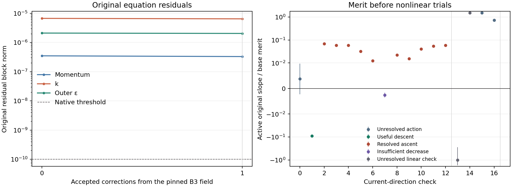

# B3 original-merit direction recovery

**B3 remains unresolved.** One verified original-merit step reduced the reproduced native maximum from 6.6984545885e−6 to 6.4573534137e−6 on the exact 5,238-cell mesh. The native qualification limit is 1e−10. Tightening the linear solve on the same base and factor left the tested positive-mass directions ascending in the original merit. Zero mass exposed a true linear and action-accuracy limitation. The pending field is durably recoverable, with independently reintegrated residuals and a positive sampled native principal margin. The third paired comparison and the spatial admission decision remain open.

The calculation retains the signed 5,238-cell B3 mesh at \(g=.0024\) (0.096 mm), \(H=.15\), \(d_0=.0875\) and the exact reference \(h=.11541061001735275\). The native governing equations use the original WJ law, molecular viscosity, full three-dimensional deviatoric form, dependent \(\epsilon_H(K)\), sampled loads and the mixed \(G_h-C_\Pi\) operator. The reference table, inlet, ZeroTransverseV1 outlet, Q3/Q2 spaces and 12×12 GLL rule are unchanged. Correction diffusion and residual regularization are zero. All iterations advance zero physical time.

## Policy and discriminating controls

`WJH27OriginalMeritV1` uses the existing differential mass, including the trace derivative, in \(J+\sigma M_X\). Pressure and continuity rows remain algebraic. Each proposed direction has a fresh shifted action and a second prospective FD spacing. The ledger records both scaled and physical norms of \(e=R+(J+\sigma M_X)d\), the correction-action blocks, and the blocks of \(e-\sigma M_Xd\). This last vector predicts the full original step. The reported spacing allowance is twice the measured change between spacings. It is a sensitivity check for the declared FD actions.

The original max norm uses the fixed block norms in the order momentum, continuity, gauge, \(k\), outer \(\epsilon\), and trace. The policy polarizes active quadratic block seminorms to estimate their right derivative and takes the largest slope of the active blocks. This handles exact ties. It also searches fractions \(1,1/2,\ldots,1/4096\) for an uncertainty-adjusted decrease of at least \(\gamma\alpha N(R)\), where \(\gamma=\max(.01,2c_{\rm Armijo})\). A certified decrease below 1% of the base merit is weak and can prompt recovery. Resolved ascent, inadequate model decrease, unresolved action, and failure of either true linear check have separate records. The largest certified fraction starts the feasible nonlinear search, with at most eight trials for each selected direction. The original norm-Armijo test governs acceptance.

When necessary the same-base forcing ladder is .1, .03 and .01 within the session's declared limits. The solver skips targets already met and targets below its FD sensitivity allowance. A tighter restart checks the current residual of the retained correction and uses the same inverse. A mass change starts a fresh Krylov solve with the new action. The inverse has a declared age and work cap, with one bounded refresh on a failed initial linear check with a borrowed factor. On the B3 run the initial mass is exactly .03815993081512134 and the explicit stronger same-base candidate is .12600557368361534. Ordinary mass moves are at most a factor of two. Two consecutive steps with fraction at least .75, actual relative reduction at least .2 and ratio \(\rho\in[.7,1.5]\) halve the next mass. A step below .25 and relative actual reduction below .03 can strengthen it. Other acceptances hold mass.

Accepted packets carry the used and next mass, reference, previous and accepted norms, used and next forcing, accepted count, consecutive reliable steps, actual-to-predicted ratio and controller decision. The versioned metadata binds the coefficient digest, source, equation signature and numerical policy before an explicit `Resume`. Deliberate `Reanchor` starts a new controller on the imported field. The durability and physical-release guards retain their earlier behavior.

| Linux control | Measured result |
| --- | --- |
| Exact shifted solve with original ascent | Shifted error \(4.44\times10^{-16}\), active original slope \(+2\), zero actual trials. The initial coefficients remained accepted. |
| Tied active blocks | Both blocks were active and the largest slope was \(+1\). No actual trial ran. |
| Positive \(1/64\) secant | Fraction \(1/256\) verified weak descent and reduced the actual merit to .99609375. |
| Same-base same-inverse tightening | At mass 1, changing .5 to .1 reduced the current error from .390117 to \(4.99\times10^{-12}\). The active slope changed from \(+.812744\) to \(-.0909091\). Only the verified direction reached an actual trial. |
| Changed mass | Changing 3 to 1.5 at the same base changed the slope from \(+2\) to \(-4\). Fraction .25 reduced the original merit to \(7.10\times10^{-12}\). |
| Controller restart | Restoring after one accepted step matched the next used and proposed masses, forcing and final coefficients of the uninterrupted two-step control. |

The native 368-cell original flat control produced identical coefficients and residuals on the archived and current executables with the policy disabled. Its maximum was \(2.260387887174237\times10^{-11}\). A one-step packet saved the mass .08, next forcing .1127395421 and one reliable step. The restored process built a cold inverse, used those saved settings and proposed .04 after its next accepted correction. The final coefficient digest and full controller record matched the uninterrupted two-step control. Silent fallback to the legacy solve and explicit resumption under a changed forcing fingerprint both rejected the checkpoint before correction.

## B3 direction and accepted-state evidence

The primary packet SHA-256 is `28b56a71d809a1b5ca04bfcc5078f87b06a16b97d73bd6783335c2567259264c` and the coefficient digest is `7a0ac1ac6e9712e4636eb500bc725ec48b439a66c0978e78308cf54d8cec1b78`. All pinned archive bytes were verified. Current-source 10×16 replay matched the signed inventory and every original block exactly. The momentum, continuity, \(k\), and outer-\(\epsilon\) norms were \(3.4909887989\times10^{-7}\), \(2.7929554585\times10^{-15}\), \(6.6984545885\times10^{-6}\), and \(2.1017544187\times10^{-6}\). The replay also passed the native direct/assembled action check.

The initial script expected the new equation signature to equal the archive signature. Native signatures include the source fingerprint. The corrected check compares every other state field and verifies each signature's own steady-equation digest. It reused the successful replay receipt. The archived last direction used a borrowed inverse at forcing .5 and terminated after one Krylov product. The matched coefficients and exact effective mass carry into this campaign, whose first direction uses a cold factor.

The first current factor was assembled at the pinned coefficients with mass .03815993081512134. Its weak-mass direction passed both linear checks. The original k slope of +2.505e−8 was inside the spacing allowance of 4.031e−8. The safeguard classified the action as unresolved and skipped nonlinear trials. At the same base the explicitly stronger .12600557368361534 reused the factor. It predicted 6.44214e−6 and accepted the full step at 6.45735e−6, with ρ=.94065. The accepted original blocks were (3.297e−7, 2.368e−12, 6.45735e−6, 2.04150e−6), ordered as momentum, continuity, k, and outer ε. The outer-ε remainder was 5.706e−7, chiefly diffusion at 5.702e−7. The separately computed dependent-lift overlap was 1.357e−6. The active original merit was k.

| Mass at accepted F₀=6.45735e−6 | Forcing | Current true shifted error | Scaled error / RHS | Active original slope | Spacing allowance |
| ---: | ---: | ---: | ---: | ---: | ---: |
| .12600557 | .5 | 1.850e−6 | .2944 | +4.433e−7 | 7.292e−9 |
| .12600557 | .1 | 1.256e−7 | .02367 | +3.838e−7 | 9.090e−9 |
| .12600557 | .01 | 6.274e−8 | .008990 | +3.774e−7 | 9.003e−9 |
| .25201115 | .01 | 2.448e−8 | .006569 | +1.445e−7 | 4.934e−9 |
| .50402229 | .01 | 5.947e−8 | .006881 | +3.831e−7 | 2.198e−9 |

Every direction in the table used the same factor and frozen accepted coefficients. All 13 checked proposals had central stencils. At .25201115 and forcing .03 the slope was weakly negative, with magnitude below the required 1% per unit fraction. The finer linear target changed its sign. At forcing .01 each shifted direction passed both linear tests and gave original ascent above its measured FD change. The full original k model and k mass-action norms at these three tight targets were 6.9425/6.9555, 6.7583/6.7569, and 6.8762/6.8735, in units of 1e−6. The guard issued zero nonlinear trials at this base and stopped with RESOLVED_ASCENT. The accepted packet retained positive whole-cell scalar bounds of .00374041 and 1.74419e−5, covariance/k=.25442744, sampled native principal/μ=+.0040091892 and K/K_in in [.95625332, 1.03889304]. Its coefficient digest is a9aca9ccec004db740505d1a43d5a0baa1f3f9984e673f27910922f6e40d4bb3.

The 16×24 native replay rebuilt the same coefficients, passed the direct/assembled action check and returned 6.45735004324725e−6. Its sampled principal/μ was +.0039938259. The largest residual change was 3.37e−12 in k. Independent order-28 reintegration on the same pending packet returned momentum 3.296894996e−7, continuity 2.368386684e−12, k 6.45735004344703e−6 and outer ε 2.041499266e−6. The native and independent results agree at this pending iterate. The equation gate remains open.

The next arm imported that checkpoint exactly and deliberately re-anchored the controller at mass zero. Its initial forcing was .03. The unshifted direction predicted a full-step decrease, but the current physical linear error was 1.474e−6 against a target of 1.937e−7. The spacing allowance was 4.655e−6. The low positive candidate .009539982703780335, one quarter of the archived effective mass, used the same cold zero-mass factor and returned a physical linear error of 2.855e−6 with spacing allowance 4.760e−7. Neither passed both current checks. The bounded refresh built the inverse at that positive mass on the same accepted coefficients.

The refreshed .009539982703780335 direction passed both linear checks at 1.194e−7, with measured original slope +9.898e−6 and spacing allowance 4.106e−7. Doubling to .01907996540756067 reused the fresh factor. Its current true error was 3.696e−8, measured original slope +4.695e−6 and spacing allowance 1.245e−7. Both allowances exceeded half the .03 forcing target. The strict policy returned ACTION_UNRESOLVED and made zero nonlinear trials. The positive measured slopes were much larger than the spacing allowances in both positive-mass proposals.

The completed zero-mass direction had measured slope −6.45734e−6 and excessive spacing disagreement. The next comparison uses mass zero, forcing .03 and the exact same accepted coefficients again. Its primary normalized displacement is 5e−7 with the same prospective half-spacing witness. This was declared before the run. A smooth second-order centered error would reduce by 64× and bring the prior 4.655e−6 spacing allowance down to 7.27e−8, below half the .03 forcing target. Actual convergence remains an empirical check, and the new cold factor uses the change in spacing as well.

The finer-spacing arm completed one factor. At mass zero and forcing .03, 30 products failed to give a nonzero correction whose current physical error improved on the zero correction's 6.45735e−6. The scaled error/RHS of the retained zero correction was 1. The action fields are unavailable for this direction. The live log's zero spacing placeholder denotes the absence of a second action. The small positive-mass retry was interrupted by the cooperative limit after a further 19 products. Its last completed true linear check gave physical error 1.34103e−5 and scaled error 1.79007e−4, while the recurrence's projected scaled norm was 4.88e−20. The final direction-level metric is null because the attempt ended before that check. Neither retry accepted an original step. They returned the same coefficient digest as the primary checkpoint.

The finer comparison changed the cold colored factor and current directional differencing together. Its result identifies a projected-versus-recomputed action problem for that configuration. A spacing test on an identical nonzero direction remains an open discriminator. The primary accepted full step had good actual model agreement. The follow-up arms stopped at the direction or linear check, before nonlinear feasibility or a finite-step remainder could control acceptance.



The right panel uses the active original slope divided by the base merit. Bars show the measured spacing allowance in the same normalization. The finer arm's zero correction supplied no slope point.

## Qualification and paired spatial decision

The archived A3 root on 5,238 cells retains native maximum 4.9830e−11, independent momentum 6.6682e−13, continuity 9.1905e−15, k 5.0088e−11, outer ε 7.7753e−13 and projected trace defect 5.10e−16. Its independent outer-face response minimum was +.0039796553. The retained matched A2/A3 fixed-core response difference is .02551944209, 33.6 times the .000759430545 ceiling. The full-gradient difference is .15475235629, the strong-divergence difference .15313806541 and the sampled-load difference .07350241085. The frozen 2,175 coordinates and four approached limits keep digest `73c264cf3d237311049fec71f07c32fa44a5b38c2cd2cd308c85103c9f62ab98`. The retained upstream and off-core patches, normalization and owner rules are in the campaign evidence.

The best B3 packet is the typed diagnostic `B3-direction/state.accepted-000001.json`. Its SHA-256 is `14d89730e092fcd1ecaa9672ed9de8cf10c7960ef5526dcad048960ffea1f19d`. The richer replay and independent equation receipt bind the same coefficients. The order-28 trace projection defect is 6.15e−16 and its pointwise approximation error is 1.172e−6. The power, mass and interface identity defects are within 3e−15. The outlet velocity minimum is 1.206e−6 and the sampled integration Jacobian minimum is .99955. The B3 original residual still exceeds its limit, so the full independent margin and point qualifications remain open.

The spatial outcome remains **D, spatial admissibility unresolved**. The B2/B3 and A3/B3 decision comparisons require a qualified B3 root. The A2/A3 baseline alone still exceeds the spatial threshold. Height stays at g=.0024 and the measured physical time is zero.

## Linux identities, costs and reproduction

The tested numerical revision is `d482e4d106e85fce3da0d794c647be09a33f8b92`, source fingerprint `062ceea0c30658cdb7b1af9ab401094c7fcfd5b15cfa8b58bf4a93659eea0249`. The Linux solver SHA-256 is `17278af621fc01a69660f0e285155bc4a9eb42a760e87aaa5c87c6cb2e545082`. The focused probe SHA-256 is `00907c4fc0830f5efd47756480c17151bd0a032ca2df0b010a19e7fceceb1214`. Both were built in the isolated Release directory against the authoritative installed Nektar++. The table SHA-256 is `3eeb32e6c1f53d6045d9d03707344c65f0f1ec3964dc69116a87e04e104325e1`. Session, equation, coefficient and receipt hashes are in the [evidence manifest](wj-h27-c1-b3-direction-recovery-evidence.json). The final evidence commit adds reporting to this numerical revision.

The measured Linux campaign elapsed time at the recorded stop was 8,881 s against the 10,800 s envelope. The 1,919 s balance included the 1,730 s qualification reserve. The remaining 189 s could not cover another measured factor preparation. The additional extension was unused. All numerical library thread counts were one. The isolated build used eight compiler workers. The campaign used one native solver lane and overlapped one serial pending-state equation audit with inverse preparation. At launch the tracked active worker count was at most 52, within the shared 72-worker limit. Linux reported at least 319 GiB available at the recorded memory checks.

| Work | Process wall time (s) | Assembly / factorization (s) | Peak RSS (GiB) | Accepted updates |
| --- | ---: | ---: | ---: | ---: |
| Positive-mass directions | 2,030.55 | 1,114.44 / 92.12 | 7.88 | 1 |
| Zero and small-mass contrast | 3,255.24 | 2,252.18 / 186.13 | 8.02 | 0 |
| Finer action spacing | 1,824.56 | 1,118.73 / 91.83 | 7.64 | 0 |
| Exact pinned native replay | 69.89 | — | 2.40 | 0 |
| Pending 16×24 replay | 119.97 | — | 4.00 | 0 |
| Pending independent order-28 equations | 527.37 | — | .54 | 0 |

The five main native process times sum to 7,300.21 s. The focused native controls total 345.27 s and the two builds total 373.49 s. The first build's synthetic harness rejected an inconsistent forcing range, which was fixed before the reported controls and numerical runs. The elapsed budget and overlapping process times are recorded separately. The later production cost criterion stays at `1.25*C_total <= 86400` seconds per qualified trajectory.

Large fields and trial ledgers remain under the Linux campaign directory. Reproduction uses a new sibling directory. The archived scripts locate the pinned inputs by their durable Linux paths. Their digests and each actual session are in the manifest. The outer process records include `primary.log`, `zero-mass.log` and `finer-action.log`. Expected diagnostic stops write the typed accepted packet and return code 1.

```bash
base=/media/jay/cb7dc460-f22f-4533-8329-245d10620f47/nektar-v2026-workspace
record="$base/runs/wj-c1-b3-direction.uqlaz7Qn"
r=$(mktemp -d "$base/runs/wj-c1-b3-direction-reproduce.XXXXXXXX")
cd "$r"
source "$base/env.sh"
mkdir tmp
date +%s > start-epoch
cp "$record"/{threads.sh,final-build.sh,direction-v2.bundle,campaign.sh,reanchor.sh,native-controls.sh,qualify.sh} .
git clone --no-local --no-checkout "$record/source" source
bash final-build.sh
bash native-controls.sh
bash campaign.sh replay
bash campaign.sh primary || test -s B3-direction/state.diagnostic-steady.json
bash reanchor.sh B3-direction/run.xml B3-direction/state.accepted-000001.json \
  B3-zero-mass 4650 Reanchor || test -s B3-zero-mass/state.diagnostic-steady.json
bash reanchor.sh B3-direction/run.xml B3-direction/state.accepted-000001.json \
  B3-finer-action 1970 Reanchor 5e-7 || test -s B3-finer-action/state.diagnostic-steady.json
```

The qualification entry point is `bash qualify.sh qualify <case> B3-rich 1350`. It checks the exact-coefficient 16×24 native replay, then runs the independent order-28 equations, margins and point-owner audit. After admission, `bash qualify.sh paired B3-rich` evaluates the frozen core, retained patches and wider coverage separately.

## Gates and next action

| Gate | Status | Evidence or remaining work |
| --- | --- | --- |
| `BEST_B3_STATE_REPRODUCED` | PASS | Exact current-source coefficient digest and all original residual blocks agree. |
| `ORIGINAL_MERIT_DIRECTION_CHECK_VERIFIED` | PASS | Ascent, ties and small-fraction controls. B3 proposals used prospective FD spacings and zero nonlinear trials on rejected directions. |
| `SAME_BASE_LINEAR_ACCURACY_CONTROL_COMPLETE` | PASS | Forcing .5 to .01 reduced true error by 29.5× at fixed mass and factor. The B3 active slope remained positive. |
| `CORRECTION_MASS_CONTROLLER_RESTART_VERIFIED` | PASS | Native restored and uninterrupted runs agreed in coefficients and next mass and forcing. Changed policy was rejected. |
| `B3_ORIGINAL_ROOT_QUALIFIED` | OPEN | Best accepted native maximum 6.45735e−6 versus 1e−10. |
| `PAIRED_AXIAL_LEVEL_THREE_COMPLETE` | OPEN | A3 is qualified. B3 remains pending. |
| `NEXT_SPATIAL_DISCRIMINATOR_COMPLETED` | OPEN | Select after a qualified third pair. |
| `POSITIVE_ORIGINAL_ANCHOR_RESOLUTION_SUPPORTED` | OPEN | Paired field stability is unresolved. |
| `ADVERSE_ORIGINAL_BRANCH_RESOLUTION_SUPPORTED` | OPEN | B3 is an unconverged diagnostic field with a positive sampled native response. |
| `HEIGHT_CONTINUATION_RELEASED` | OPEN | Fixed-height spatial criterion remains open. |
| `FULL_HEIGHT_ORIGINAL_PHYSICAL_PILOT_PASSED` | OPEN | Physical time zero. |
| `C1_CLOSED` | OPEN | Full-height qualification and physical pilot pending. |
| `C2_READY` | OPEN | C1 pending. |
| `LONG_FLAT_PRODUCTION_COST_CLOSED` | OPEN | Separate production-cost study pending. |
| `REMOTE_PUSH_VERIFIED` | PASS | Local HEAD and the GitHub ref both returned `f61a2a13ceab3cccd48250dbac68a4965990d5b5` for the source and numerical evidence. |

The next discriminating solve keeps the correction operator \(J_0\) unshifted and uses the measured small positive mass only in the inverse. The .009539982703780335 cold factor met the true shifted target at the same field. Its shifted correction had an ascending original slope. The proposed test separates the effect of this factor on the current unshifted Krylov error from the mass in the correction. Compare recurrence and recomputed residuals at the original 4e−6 spacing and retain the prospective half-spacing check. A passing direction must still reduce actual \(F_0\). Budget approximately 2,100 s for this first native test, plus qualification time if convergence permits. It needs a new allocation with that reserve.

```bash
base=/media/jay/cb7dc460-f22f-4533-8329-245d10620f47/nektar-v2026-workspace
record="$base/runs/wj-c1-b3-direction.uqlaz7Qn"
next=$(mktemp -d "$base/runs/wj-c1-b3-inverse-only.XXXXXXXX")
cd "$record"
source "$base/env.sh"
source threads.sh
export TMPDIR="$next/tmp"
mkdir "$TMPDIR"
suite="$record/source/solvers/IncNavierStokesSolver/Tests/RANS/h27"
python3 "$suite/c1_steady_case.py" "$record/B3-direction/run.xml" "$next/case" \
  --seed "$record/B3-direction/state.accepted-000001.json" --eta 0 --quadrature 10 16 \
  --fd 4e-6 --seconds 1890 --newton 12 --inverse ColoredSparseV1 \
  --inverse-mass .009539982703780335 --maximum-inverse-age 6 --reuse-linear-iterations 30 \
  --direction-model --globalization ModelBacktrackV1 --steady-forcing .03 .001 .3 \
  --merit-mass 0 --merit-entry Reanchor --merit-work 96 --accepted-checkpoint 2100 55 1250
bash "$NEKTAR_RUNS/wj-c1-steady-recovery.LOp8mfob/run-capped.sh" \
  "$next/case" "$record/build/IncNavierStokesSolver" 2100
```

For an improving deadline, use the newest `state.accepted-*.json` as the seed on the same session with `--merit-entry Resume` and the same numerical policy. Preserve the full saved controller. A passed qualification permits the existing paired checks on the frozen core and retained patches.
