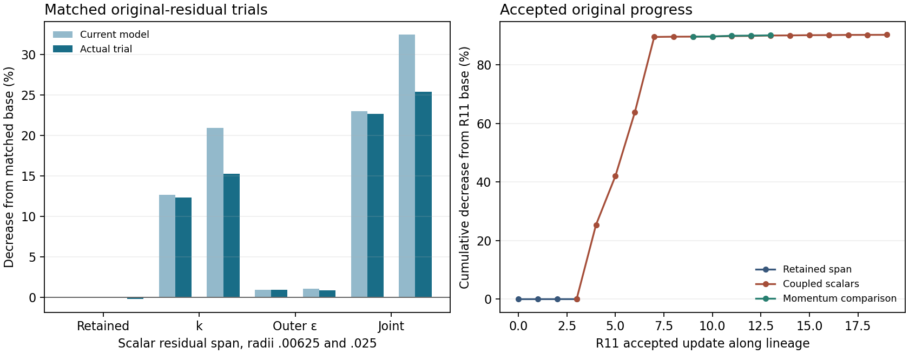

# WJ-C1R11 model-ratio recovery of the original B3 equations

## Frozen terminal base

The reviewed remote tip and the initial fetch agreed at
`a80496e6a9fd57053e825c46d995511ad268b18b`. The signed base is the last
accepted R10 checkpoint with coefficient SHA-256
`bc593d6c54e937bc5ee0986fa9df67d40b39da34cd34c9f1037981406ec4f67b`.
The replay verified the pinned archive packet, session, rank-18 terminal
frame and payload, richer packet, independent equations, and all four
historical trial receipts and payloads. It retained the signed ordering of
175,027 free coefficients on 5,238 cells. The fresh six original residual
blocks were

$$[2.1093202284118935\times10^{-7},\,5.557865482754053\times10^{-12},\,
0,\,3.773993091732891\times10^{-6},\,2.1653706371673917\times10^{-6},\,0].$$

The base row-scaled norm was $9.248292236345496\times10^{-5}$. The four
input directions were checked as exact archived physical columns and
against the native scaling round trip at relative tolerance $5\times10^{-16}$.
The archived smaller trial keeps its `UNCOMMITTED_TRIAL` custody. The
current-source replay is an independent evaluate-only diagnostic, with zero
accepted updates and no controller advancement.

The physical calculation retains the original finite-viscosity WJ stress
and deviatoric convention, AWF, dependent epsilon trace, moving cutoff,
sampled loads, $G_h-C_\Pi$, original transport and production, and
`ZeroTransverseV1` outlet. The reference geometry has $g=.0024$, $H=.15$,
$d_0=.0875$ and $h=.11541061001735275$. It uses Q3/Q2, the validated
12×12 GLL expansion and 10×16 split integration. The earlier order-18
construction limitation remains scoped to the expansion rule. Correction
mass, diffusion and residual regularization are zero. Only the optional
colored inverse carries mass .009539982703780335 at factor FD 4e−6. The
current hybrid $J_0$ keeps its fixed-rule $k$ tangent and spacings
512e−6, 256e−6 and 1024e−6.

## Actual acceptance at four matched displacements

`WJH27BoundedDirectionV2` requires both physical and row-scaled model
decreases to exceed four empirical action allowances plus a 64-epsilon
relative roundoff reserve. The existing two-spacing action-resolution limits
stay at half of the respective .3 model-error targets. The actual physical
decrease must exceed the observed base and trial repeatability plus
roundoff, with actual/predicted physical decrease at least .1. The
root-tolerance exception uses the confirmed original norm. Each actual
evaluation uses the full finite-state path. Eligible actual trials are
repeated, and the larger original norm controls acceptance. The recorded
full-fraction legacy Armijo limit is diagnostic for V2. The legacy policy
and Newton line search remain independently exercised by the native tests.

| Scaled radius | Predicted decrease | Actual decrease | Actual / predicted | Legacy Armijo | V2 eligibility |
| ---: | ---: | ---: | ---: | --- | --- |
| .00625 | 7.581222e−10 | 7.103470e−11 | .0936982 | reject | reject, ratio |
| .003125 | 4.124371e−10 | 2.394556e−10 | .5805869 | reject | pass |
| .0015625 | 2.145612e−10 | 1.711368e−10 | .7976128 | reject | pass |
| .00078125 | 1.093661e−10 | 9.848577e−11 | .9005144 | reject | pass |

All four observations used the original nonlinear residual and finite-state
guards. Repeated eligible evaluations agreed exactly, with physical
decrease floor $5.36317\times10^{-20}$. The .003125 trial increased actual
scaled $L_2$ to $9.248417209267348\times10^{-5}$ while decreasing the original
physical maximum. The policy uses the positive scaled *model* decrease
and the actual physical decrease. These replays do not publish accepted
checkpoints. The separate native control checks equivalent full and
half-fraction parameterizations of one displacement, weak linear descent,
insufficient ratio, infeasible states, unresolved actions and controller
restoration. [R10 evidence and archive context](wj-h27-c1-b3-bounded-nonlinear-progress.md)

## Accuracy of the same reduced model

The original six physical block metrics share the base physical maximum as
their denominator. The row-scaled $L_2$ model uses the separate base scaled
norm. The optimizer reconstructs the factor-free terminal span, checks the
normalized Gram spectra and retains the best feasible incumbent. It takes
the prior direction unchanged when feasible, or scales it into the radius
before comparing it with the current active-gradient seed. Candidates
from another base are projected and scored using that base's current
residual and actions.

The stopping test inside `JointModel.solve` uses the smaller of the
historical normalized gap cap and .1 times the achieved gain, with an
8e−9 floor for the gain used in that calculation. The LP returns its
observed upper/lower values and exit status. The offline comparison used
a 1,000-iteration and 25-second budget. The online policy uses 1,000
iterations and 12 seconds per radius, with an outer child deadline.
The native parser and the pinned helper dependency hashes bind both
versions of the proposal format.

| Fixed radius | Historical or capped reduction | Refined joint reduction | Refined gap | LP iterations |
| ---: | ---: | ---: | ---: | ---: |
| .003125 | 9.997e−5 | 1.866268e−4 | 1.662910e−5 | 210 |
| .00625 | 1.636e−4 | 2.766438e−4 | 2.642508e−5 | 211 |
| .025 | 1.921e−4 | 5.882613e−4 | 4.744421e−5 | 213 |

The gaps are empirical bounds for the declared reduced model and LP
feasibility tolerances. At .025 the achieved model reduction was about
0.059%. Fresh native directions and actual original trials supply the
separate nonlinear evidence.

| Proposal | Radius | Predicted original maximum | Actual original maximum | Ratio | V2 eligibility |
| --- | ---: | ---: | ---: | ---: | --- |
| Capped model | .025 | 3.772896321e−6 | 3.774701210e−6 | −.64564 | reject |
| Refined model | .025 | 3.771654587e−6 | 3.781875045e−6 | −3.37051 | reject |
| Refined model | .00625 | 3.772876739e−6 | 3.773528152e−6 | .41648 | pass |
| Refined model | .003125 | 3.773245517e−6 | 3.773408463e−6 | .78203 | pass |

All four actual states were feasible with positive native sampled
principal response. The refined .025 model produced a larger represented
displacement and a worse original nonlinear residual. At .003125 the
refined correction gained about .0155% of the original residual. Tighter
optimization improved the candidate within this span, and the actual results
showed the need to test smaller radii and current coupled directions.
The refined .025 trial's largest remainder was the outer-epsilon block
at 3.5781e−7. Its physical action allowance was 1.615e−12. At .003125 the
outer-epsilon remainder fell to 5.3142e−9. The original maximum was
controlled by \(k\). The remainder identifies where the local model
lost accuracy within the full residual vector.

## Retained-span continuation and restart

The explicit .00625 Reanchor carried the accepted displacement, original
norm history and three existing updates in the stagnation window. The
retained-span continuation rebuilt the current actions after each accepted
step. Three new updates took the residual to $3.7732666415153475\times10^{-6}$,
a .01925% reduction from the R11 base. The recorded outcomes were

| New update | Original maximum | Actual / predicted | Window update | Cumulative current products |
| ---: | ---: | ---: | ---: | ---: |
| 1 | 3.773539385e−6 | .40855 | 4 | 21 |
| 2 | 3.773411010e−6 | .15969 | 5 | 42 |
| 3 | 3.773266642e−6 | .17941 | 6 | 63 |

Cumulative absolute reduction per product fell from 2.161e−11 to
1.153e−11. The run stopped with `BOUNDED_STAGNATION` at the declared
allocation rule. The accepted state, field and time stayed in original
steady diagnostic custody. The retained process cost 616.80 wall
seconds with 2.42 GiB peak RSS. Each initial finite replay took about
four minutes without a factor.

The tested acceptance and reduced-model executable was built from
`bca7d24517dba65c0e269c1d2d081bd582c838fe`, with solver SHA-256
`9194d11338d6f5498a0254ebb1613f1cf9c226559db8fab8149b6d35d9ac10cf`.
Its native probe recorded 15 solves, seven derivative probes and
12 fatal controls. The staged reproduction and manifest preserve the
legacy active-optimizer identity for the matched capped control.

The cold Resume reproduced the accepted coefficients, residuals, full
displacement, policy digest, and next radius. The changed-radius Resume
was rejected before an accepted state was published. The check compares
the full controller with the explicit entry label checked separately.
The first receipt check treated the expected Reanchor-to-Resume label
change as a controller difference. The corrected check reused both
existing native receipts. A start deferred by the worker cap was retried
before the changed-policy case was created.

## Coupled scalar residual directions

The matched comparison uses the exact third retained V2 checkpoint,
packet SHA-256 `c5f93284357a5c1b45460c3ea81e3a208f849abb3d69d2801cc1174021300346`,
coefficients `5f5c409d70986624dbbe56bfa3cb680441f1d0323d3f9bd99ef966917658b226`.
The six-update allocation window starts anew for the new coupled
directions. The accepted history and reference norm are carried forward.

The colored inverse is prepared once at the selected accepted base,
with its explicit mass and factor FD controls. Each right-hand side
retains the raw negative $k$ or outer-epsilon equation rows and uses
$\operatorname{Precondition}[-D_rF_b]$. The callback receives the
unscaled raw right-hand side, and the full returned correction is
scaled by $D_x^{-1}$ for the subspace. Each retained addition is
orthogonalized twice. All selector trials at the first base are
diagnostic candidates. Only the best eligible actual trial may
publish through the accepted observer. Subsequent accepted bases
rebuild the scalar residuals, coupled directions and current actions
while the same inverse is within its declared age limit.

The Linux coupled probe recorded 16 solves, seven derivative probes
and 12 fatal controls. It verifies the raw scalar RHS sequence, full
coupled output, four span ranks, a single factor and refreshed RHSs
at the next accepted state. The first probe build attempted an
unavailable QR definition. The synthetic control now uses its exact
scaled-coordinate projection and supplies the required explicit
zero-shift callbacks. Both earlier build and probe receipts are
preserved separately. The successful solver was built from
`146383895724c3c75eaf3267364b4cdf6132748e`, SHA-256
`5b4e679e8e99218d8e99bceaa9466dc9a7af0b62bad73a7d3b7393305c65e951`.

The B3 inverse used 221 colors and 17,860,621 matrix entries. Assembly took
1,053.81 s and factorization took 85.18 s. Each archived RHS agrees exactly
with the corresponding masked raw original residual, after applying the
signed row scale once. The resulting independent fractions and scaled
backsolve errors were

| RHS | Full scaled correction norm | Fraction outside retained span | Scaled factor backsolve error |
| --- | ---: | ---: | ---: |
| \(k\) | 2.59364824 | .01083253 | 4.25526e−13 |
| Outer epsilon | .01799634 | .04500554 | 1.43354e−15 |

Each full correction contains velocity, pressure and both scalar
components. For example, the scaled pressure coefficient norms are
2.02981238 and .01732425 for the two RHSs. The direction receipts record
the raw vectors, factor base and scale bindings.

| Span | Radius | Predicted original maximum | Actual original maximum | Ratio | V2 eligibility |
| --- | ---: | ---: | ---: | ---: | --- |
| Retained | .00625 | 3.772447014e−6 | 3.773129498e−6 | .16732 | pass |
| Retained | .025 | 3.770462560e−6 | 3.782381507e−6 | −3.25057 | reject |
| $k$ | .00625 | 3.294340314e−6 | 3.306894237e−6 | .97379 | pass |
| $k$ | .025 | 2.981853503e−6 | 3.196151111e−6 | .72922 | pass |
| Outer epsilon | .00625 | 3.738835088e−6 | 3.738873127e−6 | .99890 | pass |
| Outer epsilon | .025 | 3.734538954e−6 | 3.741873751e−6 | .81061 | pass |
| Joint | .00625 | 2.904181546e−6 | 2.917527386e−6 | .98464 | pass |
| Joint | .025 | 2.548593442e−6 | 2.815076783e−6 | .78240 | pass and publish |

The joint .025 displacement gave the best eligible actual norm, a 25.39%
reduction from the matched base, and was the sole published update in the
panel. The next radius grew to .05. At that accepted field outer epsilon
became the largest physical residual block.

The continuation reached $3.928421948\times10^{-7}$ after its fourth
accepted update. Momentum then became the largest original block.
Over the next two accepted updates its decrease was .97685%, reaching
$3.890047063\times10^{-7}$. The scalar blocks at the sixth checkpoint
were $8.90230\times10^{-8}$ and $6.53613\times10^{-8}$.

The scalar continuation reused that factor through 16 accepted updates
and reached $3.6537571161825857\times10^{-7}$. The cooperative deadline
ended the run with its accepted field intact. The last correction used
.002272 of scaled displacement against a .1 radius, with actual/model
ratio .999448. The optimizer's current subspace produced only a small
momentum reduction at that field even with the larger radius.
The scalar process cost 4,998 s and 7.92 GiB peak RSS. Its solver
ledger recorded 411 current products including the final unfinished
base. The accepted lineage accounts for 391 products.

## Momentum-limited comparison

After one complete six-update scalar window, the momentum block remained
largest for three consecutive accepted states. The measured slowdown
justified a second, separately identified inverse for a matched test.
The comparison forks from `scalars/state.accepted-000006.json`, packet
SHA-256 `4b622ffaf4f04b7cf897ae71ef48fc16b67d4d08f77a7ad0b2f084551ddc5c58`,
coefficients `e6d4a6d9d9c8295df7a0d844f4c92e13817a5c464752e8aef61a1b5be720c46f`.
At selection the campaign had 4,177 s remaining. The original scalar
lineage continued with its first factor.

The new policy compares the current joint scalar span with its
momentum-enriched counterpart at .00625 and .025 on the same accepted
field. The momentum RHS retains the raw velocity equation rows. Its
inverse output remains fully coupled. The original radius cap, norm,
V2 acceptance, optimizer controls and root limits apply to both candidates.
The declared rank limit is 24. The new direction and selector are bound
to a different policy digest and enter through explicit Reanchor.
The momentum executable was built and tested from
`d4c16c17ca2db940dac353d51382975ebeb539f7`, SHA-256
`7ed5962c9603e5fe3b29116f9f3631b0ae806f35ff92229411f9822876ad96d8`.
The native probe again recorded 16 solves, seven derivative probes and
12 fatal controls, including the additional matched momentum RHS check.
The co-operative and process limits were 2,324 and 2,504 s. The inverse
entry estimate was 1,350 s, using the preceding measured same-mesh
preparation cost plus reserve.

The new matrix took 1,113.41 s to assemble and 105.58 s to factor. The
momentum RHS contains precisely the negative committed velocity-equation
rows, with row scaling applied once. Its full scaled correction norm
was 22.87997. The component outside the retained frame had norm .07803
and relative fraction .003411. The scaled shift-consistent backsolve
error was 2.762e−12.

| Matched span | Radius | Predicted original maximum | Actual original maximum | Ratio |
| --- | ---: | ---: | ---: | ---: |
| Joint scalar | .00625 | 3.874314670e−7 | 3.874313700e−7 | 1.000062 |
| Joint scalar | .025 | 3.874314670e−7 | 3.874313700e−7 | 1.000062 |
| Joint plus momentum | .00625 | 3.874077245e−7 | 3.874075527e−7 | 1.000108 |
| Joint plus momentum | .025 | 3.874077245e−7 | 3.874075527e−7 | 1.000108 |

The momentum addition supplied a further $2.38173\times10^{-11}$
decrease on this base. Both spans produced nearly the same model and
actual results at the two radii. The measured direction effect was
small despite the model-ratio agreement.

The momentum continuation published four advances and reached
$3.716952586348365\times10^{-7}$ by its cooperative deadline. The scalar
continuation's terminal checkpoint had the lower original maximum. The
scenario timings are separate because the two trajectories used different
factor bases and overlapped in wall time.

| Continuation | Accepted updates in this run | Initial maximum | Best accepted maximum | Wall s | Peak RSS GiB |
| --- | ---: | ---: | ---: | ---: | ---: |
| Retained | 3 | 3.773993092e−6 | 3.773266642e−6 | 616.80 | 2.42 |
| Coupled scalar | 16 | 3.773266642e−6 | 3.653757116e−7 | 4,998.00 | 7.92 |
| Momentum comparison | 4 | 3.890047063e−7 | 3.716952586e−7 | 2,386.36 | 7.86 |



## Independent endpoint audit

The richer 16×24 native replay used the exact selected accepted
coefficients and enabled current all-row action cross-checks.
Independent order-28 equations agreed with the richer native
evaluation within $8.3\times10^{-16}$ across the four physical blocks.

| Residual | 16×24 native | 28×28 independent | Independent limit |
| --- | ---: | ---: | ---: |
| Momentum | 3.653757121e−7 | 3.653757121e−7 | 1e−9 |
| Continuity | 1.153256912e−11 | 1.153179712e−11 | 1e−9 |
| $k$ | 1.648734210e−8 | 1.648734293e−8 | 1e−8 |
| Outer epsilon | 5.556426717e−8 | 5.556426744e−8 | 1e−8 |
| Projected dependent trace | — | 7.489973025e−16 | 1e−10 |

The pointwise trace approximation was 1.1322534e−6. The independent
minimum integration Jacobian was .99954995. The absolute mass and power
identity errors were 7.9681e−16 and 1.1271e−15. The richer native replay
observed whole-cell scalar lower bounds .003802929 and 1.7441901e−5,
minimum covariance/$k$ .2540929, certified $K/K_{\rm in}$ range
[.95734797, 1.03818977], and sampled principal/$\mu$ .003993914.
These are the original equation audit and native domain observations of
the pending field. Original root qualification also requires the
complete independent admission scans on a converged field.

The richer replay took 117.05 s and the independent equations took
510.97 s. The combined campaign reached the completed equation audit
at 9,667 elapsed seconds and collected the manifest at 9,830 seconds,
within the 10,800-second allocation. The scalar and momentum process
times overlap. The campaign used the original allocation.
The [machine-readable manifest](wj-h27-c1-b3-model-ratio-recovery-evidence.json)
binds the exact equation, session, coefficient, solver and audit receipts,
including both failed pre-run probe attempts.

## Decision and next experiment

The best lineage added the three retained and 16 scalar advances to the
R10 accepted base. Its total R11 reduction was 90.31859%. The selected
field is `scalars/state.accepted-000016.json`, packet SHA-256
`faa18ee48e662384a1f11bd5b3dc48d79a7e3c0c4d7c653b0c976dd5b516fab8`,
coefficients `8fca6a8370060e2873c57a816970c8f35331e6e90196c4dae1b1d4df6bad4f5c`.
At the recovery quadrature its six original blocks, in the declared order,
were

$$[3.6537571162\times10^{-7},\,1.1532569119\times10^{-11},\,0,\,
1.6479735689\times10^{-8},\,5.5564248467\times10^{-8},\,0].$$

The measured original maximum is about 3,654 times the native root limit.
The final scalar advances had close model agreement and used a small
fraction of the available radius. The next discriminating experiment is
to hold the selected field, generate a fresh current mixed-residual
right-preconditioned Krylov frame with at most 24 directions, and compare
with the joint scalar frame at .00625 and .025. Keep the existing inverse
mass, both model norms and V2 acceptance for the first comparison.
Measure independent content, model agreement and actual momentum
reduction per current product. This tests refreshed direction content
at the momentum-limited base under a common factor.

**Outcome D, spatial admissibility unresolved.** The held height is
$g=.0024$, or 0.096 mm. Steady diagnostics advanced zero physical time.
The third paired axial decision needs a qualified B3 endpoint, and the
retained A2/A3 gap .02551944209 exceeds the .000759430545 threshold
ceiling by about 33.6 times. The long-flat production criterion remains
$1.25 C_{\rm total}\le86400$ seconds per qualified trajectory.

| Gate | Status | Evidence and scope |
| --- | --- | --- |
| `BEST_B3_STATE_REPRODUCED` | PASS | Exact R10 accepted coefficients, signed frame, scales and six original blocks |
| `BOUNDED_ACCEPTANCE_SCALE_CONSISTENT` | PASS | Matched nonlinear replay, equivalent displacement controls, cold Resume and changed-policy rejection |
| `REDUCED_MODEL_ACCURACY_ASSESSED` | PASS | Relative gap control inside the optimizer and matched actual trials at .00625 and .025 |
| `CURRENT_RESIDUAL_ENRICHMENT_ASSESSED` | PASS | Eight scalar trials and the later four-trial momentum comparison on their respective fixed bases |
| `SUSTAINED_ORIGINAL_PROGRESS_ASSESSED` | PASS | 16 coupled scalar advances, including sustained reduction and the late momentum-limited rate |
| `B3_ORIGINAL_ROOT_QUALIFIED` | OPEN | Selected field exceeds the original equation tolerances |
| `PAIRED_AXIAL_LEVEL_THREE_COMPLETE` | OPEN | Qualified B3 required |
| `NEXT_SPATIAL_DISCRIMINATOR_COMPLETED` | OPEN | Selection requires the qualified pair |
| `POSITIVE_ORIGINAL_ANCHOR_RESOLUTION_SUPPORTED` | OPEN | Parent-child and paired spatial criteria remain unmet |
| `ADVERSE_ORIGINAL_BRANCH_RESOLUTION_SUPPORTED` | OPEN | Converged independent adverse-branch evidence remains pending |
| `HEIGHT_CONTINUATION_RELEASED` | OPEN | Spatial admission and earlier height requalification required |
| `FULL_HEIGHT_ORIGINAL_PHYSICAL_PILOT_PASSED` | OPEN | The original 40 mm physical pilot through \(t\ge1.48\) remains pending |
| `C1_CLOSED` | OPEN | Qualified signed branches and the original physical pilot required |
| `C2_READY` | OPEN | Depends on C1 |
| `LONG_FLAT_PRODUCTION_COST_CLOSED` | OPEN | Separate qualified trajectory measurements required |
| `REMOTE_PUSH_VERIFIED` | OPEN | Pending remote ref check |

## Reproduction

The isolated Linux campaign directory is

```text
/media/jay/cb7dc460-f22f-4533-8329-245d10620f47/nektar-v2026-workspace/runs/wj-c1-b3-ratio.gIfLSg48
```

Use a fresh directory on the same run volume. The source bundles retain
the exact numerical revisions for the acceptance and coupled runs. All
numerical-library thread settings are explicit in the archived
`threads.sh`. The process snapshots and timing receipts record the
shared allocation. Waiting launcher processes with separately counted
children and observed MPI progress services are listed separately.

```bash
runs='/media/jay/cb7dc460-f22f-4533-8329-245d10620f47/nektar-v2026-workspace/runs'
record="$runs/wj-c1-b3-ratio.gIfLSg48"
gitroot="$(git rev-parse --show-toplevel)"
scripts="$gitroot/docs/plans/wj-h27-linux/b3-ratio"
fresh="$(mktemp -d "$runs/wj-c1-b3-ratio-replay.XXXXXXXX")"
mkdir "$fresh/tmp"
git clone --shared --no-checkout "$record/source" "$fresh/source"
cp "$record"/{threads.sh,ratio.bundle,coupled.bundle,momentum.bundle} "$fresh/"
cp "$scripts"/*.sh "$scripts"/*.py "$fresh/"
cd "$fresh"
date +%s > start.epoch
date -Is > start.iso
bash build.sh ratio 2
bash study-reduced.sh
bash phase-one.sh
bash phase-two.sh
bash audit.sh coupled
r="$PWD"
source threads.sh
export PYTHONPATH="$r/source/solvers/IncNavierStokesSolver/Tests/RANS/h27"
python3 collect.py "$r" "$r/c1-r11-evidence.json"
python3 plot_progress.py "$r/c1-r11-evidence.json" "$r/model-ratio-progress.png"
```

To reproduce the momentum panel from the already signed held base, start
another fresh run directory with the same copy and clock setup above.
The original campaign built this executable and ran the comparison in
overlap with the scalar continuation.

```bash
seed="$record/scalars/state.accepted-000006.json"
printf '%s  %s\n' \
  4b622ffaf4f04b7cf897ae71ef48fc16b67d4d08f77a7ad0b2f084551ddc5c58 "$seed" \
  | sha256sum -c -
bash build.sh momentum 4
bash solve.sh momentum momentum "$seed" momentum \
  Reanchor 2324 12 .00625 "$record/frame/recycled.json" 12
bash audit.sh momentum
```

For an unchanged-policy Resume of the best accepted scalar field, build
the `coupled` bundle in a fresh directory as above and use the exact
checkpoint and frame. Resume restores the saved .1 next radius. The
command's .00625 is the original fingerprinted policy parameter.

```bash
seed="$record/scalars/state.accepted-000016.json"
printf '%s  %s\n' \
  faa18ee48e662384a1f11bd5b3dc48d79a7e3c0c4d7c653b0c976dd5b516fab8 "$seed" \
  | sha256sum -c -
bash build.sh coupled 2
bash solve.sh coupled scalar-resume "$seed" scalar-blocks \
  Resume 2600 12 .00625 "$record/frame/recycled.json" 12
```

The existing frames, solver binaries, sessions, machine receipts and raw
directions may also be inspected in the retained campaign directory.
The [small reproduction helpers](wj-h27-linux/b3-ratio/) pin the exact
archive and required table before running any trial.
