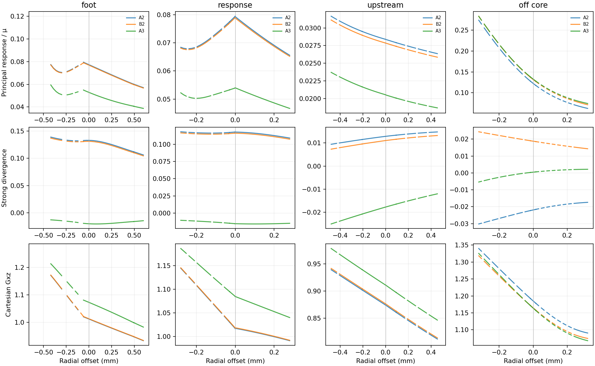

# B3 recovery and spatial decision at \(g=.0024\)

**D. SPATIAL_ADMISSIBILITY_UNRESOLVED.** The best accepted B3 coefficient field on 5,238 cells reduced the original maximum from \(1.75745\times10^{-4}\) to \(6.69845\times10^{-6}\). It remains above \(10^{-10}\). The A3 comparator remains qualified on its own representation. B3, the completed third pair and the next spatial solve remain open. Physical time advanced in this campaign was zero.

The hill height was 0.096 mm. Geometry, \(H=.15\), \(d_0=.0875\), the exact reference \(h=.11541061001735275\), the certified table and the inlet and outlet were held fixed. All solves used the original WJ–AWF equations at \(\eta=0\), with the same Q3/Q2 spaces, molecular viscosity, full three-dimensional deviatoric convention, sampled loads, dependent \(\epsilon_H(K)\) and \(G_h-C_\Pi\) velocity–pressure coupling. Scientific acceptance and the fixed response limit retain their previous values. The native expansion rule was 12×12 GLL. The prior 18-point construction limitation retains its earlier scope.

## Accepted-state durability

The opt-in accepted observer writes a numbered packet after each distinct accepted correction. The native diagnostic writer emits a create-only file, synchronizes the contents, publishes it by atomic link and synchronizes the containing directory. The packet records the source, equation, coefficient, input and session digests. The native and analysis admission paths explicitly reject the accepted-checkpoint role for physical release. Final diagnostic output follows the existing path and can be qualified independently.

The inverse guard compares remaining time against the larger of the declared estimate and the longest observed preparation, plus the output reserve. Remaining time takes the earlier of the cooperative steady deadline and the outer cap supplied to the session, measured from native construction. The outer wrapper provides additional startup and publication time. The durable packet records accepted coefficients even when a blocking factorization outlives a cooperative check.

| Control | Linux result |
| --- | --- |
| Checkpointing disabled or enabled | The 368-cell original flat solve reproduced coefficient digest `ff6b82ce66324ac4e8f4d2e848d1ff17bbf20f6ae6e2aa9aa47d9ba26e7130f9`. Original maxima were exactly \(2.260387887174237\times10^{-11}\). Five accepted packets were published. |
| Guard during the first interruption setup | After one accepted correction, 54.79 s remained against a measured 69.857 s preparation and 8 s reserve. The guard stopped the next preparation and the accepted packet survived. |
| Owned interruption | With 220 cooperative seconds and a 245 s outer allowance, an interruption after 80.997 s reached the second inverse preparation. The final output was absent and sequence 1 survived. Same-mesh evaluate-only replay reproduced coefficient digest `e812aa2618a1015a4e621a9b3755b41a5f1a45ff03e228e8d6dc8e44f006379c`. |
| Uncommitted trial and corrupted binding | The synthetic Armijo trial with a smaller observed norm never reached the accepted observer. The native import rejected a deliberately corrupted packet digest. |
| Physical release | A bound but unconverged accepted checkpoint on a physical hill was rejected before physical advancement. |

The flat checkpoint refresh took .0074–.0115 s per accepted state. Serialization, file sync and publication took .075–.085 s. The native receipt and logs include the interrupted case, exact residuals and packet paths.

## Exact B3 replay and recovery

The pinned `B3-cross` archive packet, its session, the 16×24 pending replay and the A3 packet and session matched their SHA-256 identities. The current build reproduced coefficient digest `38b02cc97168d9e206069f30b1a2c80939260ac31a0c729a7cc646e08bae64a1` and the original momentum, continuity, \(k\) and outer-\(\epsilon\) norms \(2.1826166947096095\times10^{-5}\), \(1.7159719679108807\times10^{-4}\), \(1.0123123792739592\times10^{-4}\) and \(1.757453919198468\times10^{-4}\) exactly.

The primary continuation imported the actual recoverable packet without remapping or uncommitted-candidate permission. It used the existing ModelBacktrackV1 trial selection, original F0/J0 and the unchanged true norm-Armijo condition, with 2,600 native seconds and a 2,900 s outer cap. The output reserve was 35 s and the initial inverse estimate was 1,000 s. This continuation started at the retained R5 endpoint, so its performance is scoped to that start.

| Accepted correction | Fraction | Refreshed original maximum | True linear maximum | Actual / predicted decrease |
| --- | ---: | ---: | ---: | ---: |
| 1 | .00104710 | \(1.7565337083\times10^{-4}\) | \(9.11\times10^{-7}\) | .500058 |
| 2 | .000657887 | \(1.7559554571\times10^{-4}\) | \(1.60\times10^{-6}\) | .500032 |
| 3 | .000412561 | \(1.7555921558\times10^{-4}\) | \(1.62\times10^{-6}\) | .500047 |
| 4 | .000258865 | \(1.7553633996\times10^{-4}\) | \(2.65\times10^{-6}\) | .500024 |
| 5 | .000162397 | \(1.7552191153\times10^{-4}\) | \(3.31\times10^{-6}\) | .500039 |

The five-step reduction was 0.127%. All five current linear checks passed. The recorded rejections comprised 18 table exits, eight scalar polynomial failures and ten feasible trials with insufficient actual decrease. For the first feasible fraction, .0625, the current model predicted \(1.64761\times10^{-4}\) and the original equations returned \(4.93386\times10^{-4}\). Its outer-\(\epsilon\) remainder was \(3.28913\times10^{-4}\), dominated by diffusion at \(3.28641\times10^{-4}\). The separately measured trace-lift overlap was \(7.53660\times10^{-4}\). The half-spacing change in the derivative was \(3.38\times10^{-8}\). The owners of the dominant row meet around \((-6.25,.15232)\). The later steps also had larger outer-\(\epsilon\) than \(k\) remainders. Native physical-term attribution covered the first three directions. An independent order-28 check used the last two accepted packets to reconstruct direction 5 and reintegrate its first accepted trial on the previously identified row 524. The signed diffusion remainder was −8.37e−12 in the raw weak row, compared with −8.43e−12 for the sum of the four terms. The largest contribution from halving the directional spacing was 1.16e−17. The separately reported lift overlap was dominated by −3.33e−11 in diffusion. These signed row values have a different normalization from the native block norms. The guard stopped a second factor build with 1,100 s left against the observed 1,170 s plus 35 s reserved. The record marks the second linear measurement as unavailable.

The same-mesh preparation control started from accepted correction 1. The H1-minimal velocity projection reduced the weak-continuity residual from \(1.71418\times10^{-4}\) to \(4.72439\times10^{-12}\). The stored geometry, all signed inventories, \(k\), pressure and dependent \(\epsilon\) coefficients agreed exactly. Original momentum, \(k\) and \(\epsilon\) increased to \(3.16506\times10^{-5}\), \(3.27067\times10^{-4}\) and \(1.79298\times10^{-4}\). Whole-cell scalars and the table and covariance guards passed. The native principal witness was \(+.00400912544\). The maximum Cartesian gradient change was .000318 on the frozen core, \(5.44\times10^{-6}\) upstream and .02035 on the off-core patch. The constraint reduction and the measured local changes justified one separate solve on the projected seed. Its predictor, residual and run lineage have distinct identities.

The continuity-prepared trajectory accepted nine corrections before its deadline. Original \(F_0\) fell by 11.52% from \(3.2706675681\times10^{-4}\) to \(2.8938297371\times10^{-4}\). The terminal momentum, weak continuity, \(k\) and outer-\(\epsilon\) norms were \(2.77307\times10^{-5}\), \(5.81114\times10^{-11}\), \(2.89383\times10^{-4}\) and \(2.68625\times10^{-4}\). The sampled response was \(+.00400904376\). All nine measured current linear solves passed. Accepted fractions were .003125 to .028013, with 21 table, nine scalar polynomial and nine actual-merit rejections. At the first feasible projected fraction .03125, the model predicted \(3.16846\times10^{-4}\) and the equations returned \(3.37068\times10^{-4}\), including an outer-\(\epsilon\) remainder of \(1.65308\times10^{-4}\). The dominant native row again had the four upstream owners identified on the exact arm. Two factors were completed. The deadline stopped the search after the ninth durable correction, and the original maximum exceeded the exact arm's best value.

The selected raw upstream row on the exact arm had \(J_0d=+1.0163\times10^{-7}\) and a constrained physical mass action \(Md=-4.0510\times10^{-7}\), including the dependent lift. Their magnitudes would match around \(\Delta\tau=3.99\). One additional correction control began from the exact fourth accepted coefficient field and used \(\Delta\tau=1\), on the mass-dominant side of that measured scale. The existing solver uses the differential mass only in \(J_0+M/\Delta\tau\) and its inverse, with pressure and continuity algebraic. It updates the frozen shift as the original merit decreases. The line model subtracts the actual shift action before predicting \(F_0\). Actual acceptance and final evaluation use the original equations at \(\eta=0\). This experiment tests the direction after finding that weak-continuity projection alone left substantial scalar curvature. It changes no coefficients in the input field.

On the common fourth exact base, the available unshifted solve accepted fraction .000162397. Its first feasible trial had maximum \(3.06540\times10^{-4}\) against a prediction of \(1.72760\times10^{-4}\). With the mass correction the first full step passed. The original maximum fell to \(2.21186\times10^{-5}\) against a prediction of \(2.20321\times10^{-5}\), giving actual/predicted decrease .999437. The outer-\(\epsilon\) remainder was \(7.43\times10^{-8}\). Weak continuity fell to \(2.59\times10^{-11}\) and the native response was \(+.0040091450\). The shifted linear solve passed at \(4.33\times10^{-8}\). This is a direction experiment on common coefficients. The earlier factor was reused and the shifted factor was built on this base.

Tapering the correction mass to .1260056 substantially changed the next correction. Reuse reached its 12-iteration cap at true linear maximum \(3.00\times10^{-6}\) and did not pass the current target. The time guard left the accepted update intact before a fresh factor could start. The exact accepted packet was resumed at \(\Delta\tau=7.936156875971839\) to preserve the already indicated mass instead of resetting to 1. The resumed solve rebuilt its inverse at that base.

The restored mass accepted another full step, reducing \(F_0\) to \(6.7398497307\times10^{-6}\) with original block values \([3.54443\times10^{-7},2.84761\times10^{-15},6.73985\times10^{-6},2.11484\times10^{-6}]\) and sampled response \(+.0040091485\). The process exited with code 1 shortly after the numbered checkpoint was published. The final ledger and a native exception message were absent. The 16×24 direct/assembled replay recovered the accepted coefficient digest exactly and returned \(6.7398492702\times10^{-6}\) and sampled principal \(+.0039937850\).

A scoped diagnostic build prints exceptions escaping the steady solve. The original abrupt exit remains unclassified. The immutable-file control deliberately encountered a preexisting checkpoint path and printed the cause while preserving the original contents. The next exact restart used the same governing residual and preserved the taper at \(\Delta\tau=26.044548020511748\). It allowed up to 30 current Krylov iterations per reuse attempt, with the existing age cap of four and the same true linear tolerances. The prior mass-shift reuse had lowered the unpreconditioned residual appreciably by product 12, so additional current products were a bounded alternative to immediate assembly and another factor. The admission rule remains the original residual.

The final retry completed one factor and all three measured current linear solves. Fractions .1 and .0121262 reduced the maximum to \(6.6984545885\times10^{-6}\). On the third direction, all 24 tried fractions were feasible and the actual norm failed sufficient decrease at each. The full-step norm \(1.32484\times10^{-5}\) exceeded the current model prediction \(7.77474\times10^{-6}\), itself above the base norm. Outer-\(\epsilon\) diffusion contributed \(1.06681\times10^{-5}\) of the remainder. At the smallest tested fraction \(1.19\times10^{-7}\), predicted and actual changes were both positive and agreed to about \(7.4\times10^{-18}\) in the maximum norm. The native result was `LINE_SEARCH_NOT_CONVERGED`. The last checked shifted linear residual was \(2.29634\times10^{-6}\) at forcing .5.

The final typed field has original block maxima \([3.49099\times10^{-7},2.79296\times10^{-15},6.69845\times10^{-6},2.10175\times10^{-6}]\), whole-cell scalar lower bounds \([.0038848753,1.74419\times10^{-5}]\), native covariance/k .2543624 and sampled principal/mu \(+.0040091641\). Whole-interface \(K/K_\mathrm{in}\) is \([.95589285,1.03808106]\). Its coefficient digest is `7a0ac1ac6e9712e4636eb500bc725ec48b439a66c0978e78308cf54d8cec1b78`. The final packet and numbered accepted checkpoint carry the same coefficients.

The 16×24 replay of this exact field passed the direct/assembled current-action check and returned \(6.6984535248\times10^{-6}\) with sampled principal \(+.0039938007\). The largest residual-block change was \(1.064\times10^{-12}\) in \(k\). The richer replay and its source binding leave B3 available for diagnosis and further preparation.

The richer-rule replay of the last exact accepted field reproduced its coefficient digest and passed the native assembled/direct action control. The original maximum changed from \(1.755219115279182\times10^{-4}\) at 10×16 to \(1.755219114979786\times10^{-4}\) at 16×24. The largest block change was \(1.03\times10^{-12}\) in \(k\).

## Localization and the next spatial experiment

The 2,175-point frozen core and its four approached limits keep digest `73c264cf3d237311049fec71f07c32fa44a5b38c2cd2cd308c85103c9f62ab98`. Retained off-core comparison receipts preserve their exact coordinates. Each current comparison selects the owners on its own signed mesh and verifies coincident Cartesian positions. Wider sampling remains separate from fixed-core contraction.

A3's independently qualified 5,238-cell packet retains native original maximum \(4.9830\times10^{-11}\), independent momentum and continuity \(6.6682\times10^{-13}\) and \(9.1905\times10^{-15}\), \(k\) and outer-\(\epsilon\) norms \(5.0088\times10^{-11}\) and \(7.7753\times10^{-13}\), and projected matching-trace defect \(5.10\times10^{-16}\). The pointwise trace approximation error is \(6.85\times10^{-7}\). The independent outer-face response minimum is \(+.0039796553\) with derivative-spacing difference \(5.61\times10^{-11}\).

Current-source native A3 replay reproduced the qualified A3 coefficient digest, original residual blocks and principal response exactly at 16×24. The matched A2/A3 replay found a core response difference of .02551944209 at \((2.495,h)\), full-gradient difference .15475235629 and strong-divergence difference .15313806541 at \((2.5,h+.0015)\), and a sampled-load difference .07350241085 at the foot. The coverage response difference was .02907807011. The off-core and upstream patches retain variation of .01175 and .00796 respectively. These are differences on retained converged coefficients, with common locations and mesh-specific signed owners.

The A2/A3 baseline resolves the signed Q3 modal contributions to the physical gradient in each owner. Near \((a,r)=(2.5,.11751)\) in the original above-support interval, the axial derivative contribution to the gradient change is .14186 and the radial contribution is .06214. The two radial bubble-mode contributions to the radial derivative change are about .00380 and .00037. At the wider foot witness below support they are smaller still. The upstream patch near \((-6.25,.15)\) records a response change of .00796, with a larger radial component of gradient variation there. The plot retains the distinct radial owner traces. The coincident upstream region and the earlier Newton-trial remainder are separate observations.



The archived A2/B2 fixed-core gap was .001363583641. A2/A3 still exceeds the ceiling by 33.6×, with controlling gradient and load variation at and around the foot. The new B3 fields are still unconverged, so the B2/B3 and A3/B3 decision comparisons remain pending. The measured upstream and off-core changes remain in the retained comparison sets. The generator regression recovered the above-support interval from stored vertex heights and inserted \(r=.12234156386501502\), preserving every parent token and all axial cuts. The resulting 5,292-cell XML was a mesh-generation control. The scientific spatial experiment requires a qualified third pair and remains pending.

All decisions stayed at \(g=.0024\). The results leave both resolution-supported admission and a resolution-supported adverse branch open.

The positive spatial threshold remains \(T=\min(.0007594305446050912,m_{\min}/4)\). It applies to uncertainty-adjusted parent–child and between-family differences at common coordinates. Full-gradient, total-load and coverage requirements retain their declared scope.

## Reproduction and provenance

The [evidence manifest](wj-h27-c1-b3-recovery-spatial-decision-evidence.json) binds the Linux source, executable, build and run logs, test controls, sessions, packets and comparison receipts. Large fields and ledger files remain under the designated campaign root. Use a fresh run directory for reproduction.

Tested numerical revision was `a10288f486eb568d550d08d34cd0f46ab3631dec`, numerical fingerprint `396dbeea24b3f6f48825c69c209c6314156d2a517c236af670853a77e1c6cde9`, and Linux executable SHA-256 `7dc696d2acba0e1d9bf0d087c0c4890965ed971aff42b7d7dd8dc7dbb1a41d80`. The checkpoint probe used `5fec2393ec6f5e8e33f1726ccf4aa6a1049c666f` and the independent comparison tools used `ae9f7ca0e086fdda551e29bea7b9a6a8eb37dc89`. The archive A3 qualification is bound to its original executable and source `b8f1bba6c50a1e85a89c8c70dfcc29b0e44d4cf6`. The second diagnostic build used revision `7dc25527e334c9f40f860601d5422643f616c154`, fingerprint `fb284836555046d3dd6359133c87ea3d6408a64ef8ac97b6f5272ab04e57715c` and executable SHA-256 `31cf8238ceca8daf958be82f4c3c18183b2bbc5261db13457dc1f0df1d3c54cb`.

The helper scripts record exact commands and use the authoritative Linux installation. Pending native cases return code 1 and write their accepted packets. The evidence identifies the expected outputs and exits for each control. From the campaign root, the run definition is reproduced in an empty sibling directory by copying the listed helpers, their bundles and the Linux lineage. Use a fresh epoch and output paths. All Python and native numerical-library thread counts were set to one, with eight compiler workers for the isolated native build and two for the small probe rebuild.

```bash
base=/media/jay/cb7dc460-f22f-4533-8329-245d10620f47/nektar-v2026-workspace
archive="$base/runs/wj-c1-paired-axial.UXeQ6Noe"
record="$base/runs/wj-c1-b3-recovery.7FoBkbd2"
r=$(mktemp -d "$base/runs/wj-c1-b3-reproduce.XXXXXXXX")
cd "$r"
source "$base/env.sh"
mkdir tmp
date +%s > start-epoch
cp "$record"/{threads.sh,build.sh,durable.bundle,exact.sh,regression.sh,regression.bundle,spatial.bundle,helpers.sh,A3-replay.sh,pending-rich.sh} .
git clone --no-local --no-checkout "$archive/audit-source" source
bash build.sh
bash exact.sh exact || test -s B3-backtrack-exact/state.diagnostic-steady.json
git -C source fetch "$r/regression.bundle" HEAD
git -C source checkout --detach FETCH_HEAD
cmake --build build --parallel 2 --target WJH27SteadyKrylovProbe
build/WJH27SteadyKrylovProbe "$r/accepted-observer.json"
bash helpers.sh sync
bash helpers.sh custody
bash helpers.sh A3-baseline
bash A3-replay.sh
bash pending-rich.sh B3-backtrack-exact B3-exact-terminal-rich-pending
```

The checked-in `c1_checkpoint_verify.py` runs the on/off, interruption, digest and release controls. The two archived small sessions were `control-flat-zero/run.xml` and `anchor-original/run.xml` under `wj-c1-steady-recovery.LOp8mfob`. `regression.sh` records the probe build and exact control command. The matched replay reuses the existing coordinates, eight retained or explicitly added local patches and 31,088 separately reported coverage coordinates. The bound `A2-A3-matched.sh` command uses the campaign paths. Point its campaign root at the fresh reproduction directory before running it.

The projected branch uses the first packet emitted by the reproduction's exact solve. The recorded file digest identifies the original campaign and depends on observed timing metadata. Exact coefficient comparisons use the coefficient digest.

```bash
cp "$record"/{prepare-or-resume.sh,prepare-or-resume-calibrated.sh,targeted-correction.sh,targeted-correction-resume.sh,qualify.sh} .
bash prepare-or-resume.sh project B3-backtrack-exact/run.xml \
  B3-backtrack-exact/state.accepted-000001.json B3-continuity-preflight
bash prepare-or-resume-calibrated.sh retry B3-continuity-preflight/run.xml \
  B3-continuity-preflight/state.diagnostic-steady.json B3-continuity-solve 2950 3200 1200
bash targeted-correction.sh B3-backtrack-exact/run.xml \
  B3-backtrack-exact/state.accepted-000004.json B3-correction-mass-once 2075 2350 1300
bash targeted-correction-resume.sh B3-correction-mass-once/run.xml \
  B3-correction-mass-once/state.accepted-000001.json B3-correction-mass-resume \
  2760 2980 1275 7.936156875971839
```

The logging follow-up imports the preserved early-exit checkpoint. From a directory prepared with the earlier build and synced helpers, reproduce the measured caps with the following commands.

```bash
cp "$record"/{logged.bundle,build-logged.sh,run-logged.sh,best-rich-logged.sh} .
bash build-logged.sh
bash run-logged.sh logging-control
source threads.sh
tools="$r/source/solvers/IncNavierStokesSolver/Tests/RANS/h27"
resume="$record/B3-correction-mass-resume"
python3 "$tools/c1_steady_case.py" "$resume/run.xml" "$r/B3-correction-mass-logged" \
  --seed "$resume/state.accepted-000001.json" --eta 0 --quadrature 10 16 \
  --seconds 2028 --newton 12 --inverse ColoredSparseV1 --maximum-inverse-age 4 \
  --reuse-linear-iterations 30 --direction-model --globalization ModelBacktrackV1 \
  --pseudo-time 26.044548020511748 --accepted-checkpoint 2238 35 1275
bash "$base/runs/wj-c1-steady-recovery.LOp8mfob/run-capped.sh" \
  "$r/B3-correction-mass-logged" "$r/build-logged/IncNavierStokesSolver" 2238 \
  || test -s B3-correction-mass-logged/state.diagnostic-steady.json
bash best-rich-logged.sh
```

The independent accepted-direction probe used source revision `0cf71e1169b3212de95ee8e2d6a8699db31b74c3` and order 28 on the selected row. Run it from the fresh directory.

```bash
tools="$r/source/solvers/IncNavierStokesSolver/Tests/RANS/h27"
table="$base/runs/wj-c1-support-spatial.W5us9Je8/owner-source/docs/plans/wj-h27-linux/task2r-r1/tables-exact-inner-v1.json"
PYTHONPATH="$tools" python3 "$record/tmp/c1_epsilon_step.final.py" \
  --base B3-backtrack-exact/state.accepted-000004.json \
  --accepted B3-backtrack-exact/state.accepted-000005.json \
  --ledger B3-backtrack-exact/state.steady.json \
  --table "$table" --iteration 4 --row 524 --out late-epsilon-row.json
```

## Cost

The authoritative Linux campaign used 10,250 elapsed seconds of the 10,800-second budget and ended at 11:13:09 Asia/Shanghai. The sum of the separately measured top-level native processes was 9,539.91 s. Concurrent process times and nested regression costs appear separately in the manifest. The initial and logging builds took 188.61 s and 192.33 s. The matched A2/A3 replay used 111.77 s. The first guard control and all failed native work are retained.

| Native case | Wall seconds | Peak RSS GiB | Assembly seconds | Factor seconds |
| --- | ---: | ---: | ---: | ---: |
| Exact ModelBacktrackV1 | 1559.72 | 7.64 | 1070.16 | 99.34 |
| Continuity-prepared | 3018.99 | 8.20 | 2241.08 | 211.75 |
| Correction mass at initial setting | 1409.00 | 7.85 | 1096.46 | 90.45 |
| First tapered resume | 1349.29 | 7.89 | 1124.03 | 98.74 |
| Logged taper with bounded reuse | 1521.90 | 7.88 | 1107.90 | 103.39 |
| Final richer replay | 122.85 | 4.00 | — | — |

## Gates and next action

| Gate | Status | Evidence and scope |
| --- | --- | --- |
| `ACCEPTED_STATE_DURABILITY_VERIFIED` | PASS | Linux on/off, owned interruption/replay, immutable atomic failure, uncommitted/corrupt/physical-release controls. |
| `B3_EXACT_PENDING_REPLAY_PASSED` | PASS | Exact archive bytes, canonical coefficient digest and native original blocks on the current build. |
| `B3_ORIGINAL_ROOT_QUALIFIED` | OPEN | Best refreshed 10×16 and 16×24 maxima are 6.69845e-6 with a native limit of 1e-10. |
| `PAIRED_AXIAL_LEVEL_THREE_COMPLETE` | OPEN | A3 is qualified. B2/B3 and A3/B3 require the qualified B3 endpoint. |
| `CONTROLLING_FIELD_VARIATION_LOCALIZED` | OPEN | A2/A3 localization is complete. The B3 contribution remains pending. |
| `NEXT_SPATIAL_DISCRIMINATOR_COMPLETED` | OPEN | Needs a qualified B3 endpoint and paired measurements. The 5,292-cell generator control had no solve. |
| `POSITIVE_ORIGINAL_ANCHOR_RESOLUTION_SUPPORTED` | OPEN | A2/A3 fixed-core principal gap exceeds the retained ceiling and B3 comparison or later spatial closure remains open. |
| `ADVERSE_ORIGINAL_BRANCH_RESOLUTION_SUPPORTED` | OPEN | No common stable adverse interior was established on resolving decision roots. |
| `HEIGHT_CONTINUATION_RELEASED` | OPEN | Height held at .0024 through the spatial decision. |
| `FULL_HEIGHT_ORIGINAL_PHYSICAL_PILOT_PASSED` | OPEN | Actual 40 mm target and t>=1.48 remain pending. |
| `C1_CLOSED` | OPEN | Original spatial and full physical evidence required. |
| `C2_READY` | OPEN | Requires C1 closure. |
| `LONG_FLAT_PRODUCTION_COST_CLOSED` | OPEN | Separate long-flat and 1.25 times total cost <=86400 s per qualified production trajectory. |
| `REMOTE_PUSH_VERIFIED` | OPEN | Commit publication verification pending. |

Resume B3 before selecting another spatial solve. One bounded control is to re-anchor the correction mass at \(\Delta\tau=7.936156875971839\), the setting that accepted the second full step, from the exact final accepted field. Measure current linear error and the unshifted merit slope on that same base. Compare with the observed weak-mass direction before choosing a further taper. One new factor has measured cost of about 1,200 s. Allow roughly 2,080 s for this control and reserve independent qualification separately. This campaign ends with a 6.70e-6 maximum and 24 feasible failed trials at the weaker setting, and the remaining 550 seconds could not cover a fresh factor. The qualification gate stayed too far away to justify the optional extension.

```bash
base=/media/jay/cb7dc460-f22f-4533-8329-245d10620f47/nektar-v2026-workspace
r="$base/runs/wj-c1-b3-recovery.7FoBkbd2"
case_dir="$r/B3-correction-mass-logged"
seed="$case_dir/state.diagnostic-steady.json"
printf '%s  %s\n' 28b56a71d809a1b5ca04bfcc5078f87b06a16b97d73bd6783335c2567259264c "$seed" | sha256sum -c -
next=$(mktemp -d "$base/runs/wj-c1-b3-reanchor.XXXXXXXX")
mkdir "$next/tmp"
source "$base/env.sh"
export TMPDIR="$next/tmp" OMP_NUM_THREADS=1 OPENBLAS_NUM_THREADS=1 MKL_NUM_THREADS=1
export NUMEXPR_NUM_THREADS=1 BLIS_NUM_THREADS=1 VECLIB_MAXIMUM_THREADS=1
tools="$r/source/solvers/IncNavierStokesSolver/Tests/RANS/h27"
python3 "$tools/c1_steady_case.py" "$case_dir/run.xml" "$next/attempt" \
  --seed "$seed" --eta 0 --quadrature 10 16 --seconds 1830 --newton 5 \
  --inverse ColoredSparseV1 --maximum-inverse-age 4 --reuse-linear-iterations 30 \
  --direction-model --globalization ModelBacktrackV1 --pseudo-time 7.936156875971839 \
  --accepted-checkpoint 2080 35 1275
bash "$base/runs/wj-c1-steady-recovery.LOp8mfob/run-capped.sh" \
  "$next/attempt" "$r/build-logged/IncNavierStokesSolver" 2080
```
