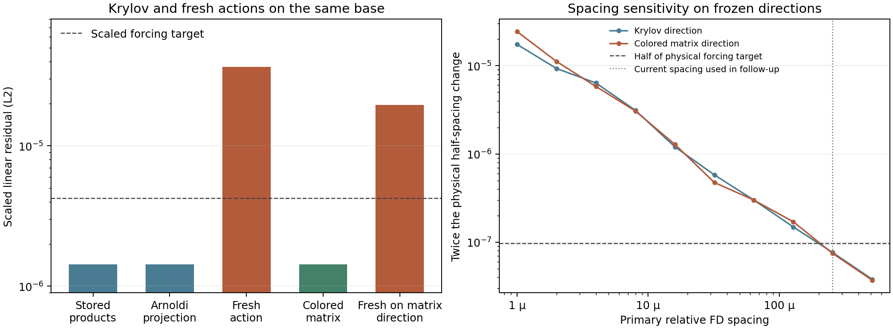

# B3 unshifted action and stabilized inverse

**B3 remains pending.** The wider current actions recovered three accepted updates with zero correction mass and the stabilized right inverse. The original maximum fell from 6.45735341366e−6 to 6.44120254493e−6, a 0.250% decrease. The required native limit is 1e−10. The fixed-vector and recurrence audits explain the measured action gap. A later direction again exceeded the action-sensitivity allowance after passing the true linear checks. The third paired assessment and spatial admission remain open.

The calculation uses the original B3 equations at \(g=.0024\) (0.096 mm), \(H=.15\), \(d_0=.0875\) and \(h=.11541061001735275\) on the signed 5,238-cell mesh. It retains the original WJ law, AWF, molecular viscosity, three-dimensional deviatoric convention, dependent \(\epsilon_H(K)\), sampled loads, the \(G_h-C_\Pi\) pressure operator and ZeroTransverseV1. The Q3/Q2 spaces and 12×12 GLL rule are retained. Residual regularization and correction diffusion are zero. The governing residual is \(F_0\), and the diagnostics advance zero physical time.

## Exact starting field and controls

The pinned field is `B3-direction/state.accepted-000001.json` under `wj-c1-b3-direction.uqlaz7Qn`, with packet SHA-256 `14d89730e092fcd1ecaa9672ed9de8cf10c7960ef5526dcad048960ffea1f19d` and coefficient SHA-256 `a9aca9ccec004db740505d1a43d5a0baa1f3f9984e673f27910922f6e40d4bb3`. The archived native original norms in momentum, continuity, \(k\), and outer \(\epsilon\) were \(3.29689503587\times10^{-7}\), \(2.36798521833\times10^{-12}\), \(6.45735341366\times10^{-6}\), and \(2.04149931397\times10^{-6}\). Each replay signature binds its own numerical source. Pin verification compares complete physical and equation settings and the signed coefficient inventory across the source change.

The focused Linux control constructed a Krylov recurrence with scaled projected norm zero and recomputed scaled norm 2. It preserved the nonzero direction \((1,-1)\) when the solver selected zero. The fixed matrix check gave \(4.71\times10^{-16}\) and no state update was accepted. A separate inverse test added mass .5 and changed the solution by 5.83 while preserving the original colored action exactly. Its shifted backsolve residual was zero in the test arithmetic. Eleven inherited solves, seven derivative probes, 12 fatal controls and six original-merit controls also ran.

## Fixed directions and scaled residual reconstruction

The smoke test subtracts the earlier accepted field from the latest accepted field using only the independent native free coordinates. The native lift reconstructs constrained values, including \(\epsilon_H(K)\), on every trial. The four prescribed relative spacings are \(4\times10^{-6}\), \(2\times10^{-6}\), \(10^{-6}\) and \(5\times10^{-7}\). The second spacing is repeated with an identical base and direction. The receipts retain trial displacements, feasible stencils, six physical block norms, a fixed scaled Euclidean norm and the Taylor remainder against the finest measured action. The matching-\(k\) split measures additivity on two pieces of the same direction.

The primary solve uses \(J_0d=-F_0\). The right inverse uses \(J_{\rm col}+\mu_P M\), with \(\mu_P=.009539982703780335\) and the correction mass held at zero. The actual Armijo norm, current true linear checks and accepted checkpoint rules are carried forward. The factor and current FD spacings are separately logged. The first material failed nonzero check stores the raw base, scales, direction, Arnoldi basis, preconditioned directions, stored actions, Hessenberg matrix and least-squares coefficients. Its typed receipt cannot be imported as a physical or accepted state.

The bound raw arrays permit independent reconstruction of \(r_{\rm store}=r_0-Wy\), \(r_{\rm arnoldi}=r_0-VHy\), and \(r_{\rm fresh}=-D_r[R+J_h(d)]\). The matrix-only control uses the retained unshifted colored approximation with the same shifted factor. Current actions on the control direction use the original residual. The control does not propose or accept a state.

At the first material failed check the target was 4.23832919e−6 scaled and 1.93720602e−7 physical. The stored products and the Arnoldi projection gave 1.43540e−6 scaled and 4.23618e−8 physical. Recomputing the action on the accumulated direction gave 3.64283e−5 scaled and 2.80956e−6 physical, led by k. Independent binary reconstruction gave a stored-versus-Arnoldi difference of 1.69e−18 and a stored-versus-fresh gap of 3.64533e−5. The latter was 8.60 times the scaled target. The Arnoldi relation and basis orthogonality Frobenius defects were 5.28e−16 and 1.82e−15. The reconstructed physical direction differed by 8.97e−16 in Euclidean norm. The small least-squares system had rank four. Summing action column norms weighted by the absolute least-squares coefficients gives 0.023713 versus a summed action norm of 0.000141270. The corresponding scaled correction norm amplification was 3.546.

On this identical failing direction, halving the prescribed spacing gave scaled changes of 4.175e−5, 5.891e−5 and 1.187e−4. The respective physical changes were 3.179e−6, 4.642e−6 and 8.701e−6. Repeating 2e−6 was bitwise reproducible. The matching-k split gave a small gap of 9.914e−8 scaled. This split and the actual Arnoldi combination have different amplification. The measured gap is in the accumulated current action relative to the stored combination. Its source includes direction-dependent FD error amplified by these products. The tested Arnoldi and scaling reconstructions close near roundoff.

The retained colored matrix test used the very same shifted factor. It met both internal targets in four products, at 1.42904e−6 scaled and 4.15438e−8 physical. At 4e−6 the freshly evaluated residual of that matrix direction instead measured 1.96158e−5 scaled and 1.29418e−6 physical. Neither passed. Finer spacings increased the observed sensitivity on the same direction. The momentum disagreement of about 8.2e−7 persisted across those spacings, motivating the targeted singleton comparison.

The primary backsolve diagnostic checked a moved-from callback when recording the factor mass. It omitted the shift in that diagnostic value. Both saved first-backsolve rows in the primary receipt therefore measure the unshifted matrix. The follow-up records the factor state and shift directly. The first solve used the separately logged shifted factor, and the residual and Arnoldi-gap reconstructors were independent of the affected diagnostic row.

The follow-up replayed all five starting actions bitwise on the same captured vector under the later source identity. It tested the largest participating matching-k, outer-ε and velocity directions in the declared foot neighborhood. At the primary factor spacing, all three complete-color actions agreed with the singleton actions on their claimed nonlinear rows. The matching-k and outer-ε outside-support rows were zero after the exact linear action was removed. The foot-velocity outside-support scaled norm was 1.161e−13, or 1.296e−15 weighted by the observed correction coefficient. The synthetic missing-row fixture detected an aliased coupling of .3. The three B3 comparisons constrain the selected supports.

The captured current direction and the retained-matrix direction both showed declining spacing differences as the spacing increased. At 128e−6 compared with 64e−6, the changes were respectively 9.620e−7 and 1.119e−6 scaled and 7.453e−8 and 8.529e−8 physical. The failed current correction still had about 2.80e−6 true physical model error. The matrix direction retained about 8.17e−7 momentum error, while the larger spacing reduced its k error. Neither saved direction met the original .03 forcing targets. The later bracket tested a larger current-action displacement while preserving the two directions and coefficients.

At 256e−6 compared with 128e−6, the doubled changes were 1.051e−6 and 9.442e−7 scaled and 7.643e−8 and 7.462e−8 physical. Both were below half of the .03 target in their respective norms. The 128e−6 primary spacing exceeded the same physical allowance. The larger bracket's Taylor remainders declined by approximately four on halving, and no turnover in the half-spacing action changes appeared up to 512e−6. The follow-up chose 256e−6 as the smallest tested common spacing satisfying both allowances. The preconditioner-only mass, the factor assembly spacing 4e−6, the .03 forcing target and all original checks were retained. Both saved corrections continued to miss the linear targets on the coarser actions.



The final no-factor probe used the signed difference between the last two accepted states and divided the measured action changes by the accepted fraction \(7.25044347422\times10^{-5}\) to express them in full-correction units. At 512e−6 versus 256e−6, the doubled allowance was 4.379e−6 scaled and 3.237e−7 physical. At 256e−6 versus 128e−6 it was 7.233e−6 scaled and 5.680e−7 physical. Both fit the final-base half-target allowances of 2.125e−5 scaled and 9.662e−7 physical. This measures the last accepted direction at the final base. The later action-unresolved direction was not saved by the earlier true-check trigger.

The no-factor probe reproduced the exact coefficient digest, all signed cells and all six archived residual blocks. The current FD action at the repeated 2e−6 spacing and its residual difference matched bitwise. The successive halving differences were 8.429e−8, 1.950e−7 and 3.453e−7 in the fixed scaled Euclidean norm. Their physical maxima were 6.648e−9, 1.407e−8 and 2.599e−8. The prospective .03 targets were 4.238e−6 scaled and 1.937e−7 physical. The matching-k additivity gap was 2.123e−10 scaled and 1.257e−11 physical. Taylor remainders declined from 7.152e−11 to 8.961e−12 in the scaled norm. The growth of the derivative differences on halving did not justify choosing a finer spacing. The archived step supported the planned factor test at 4e−6 within the measured limits for that direction.

The 368-cell native control matched the archived legacy coefficients and residuals with the new diagnostic disabled. The explicit restart and uninterrupted controller paths reached the same coefficient digest and next mass .04. Returning to the legacy path from a controller checkpoint was rejected. This exercises the refactored immutable writer on an accepted trajectory.

## Original solve and spatial decision

With the wider current spacing, the first new correction returned 6.23932e−8 physical and 1.55469e−6 scaled true linear error at forcing .03. Its physical spacing allowance was 7.16955e−8. The original model verified a full fraction as a local descent prediction. Actual feasibility and curvature restricted the accepted fraction to .00125. The first original maximum was 6.44896855772e−6 at actual-to-predicted ratio 1.0383. A second .00125 update gave 6.44158792455e−6 at ratio .9847. Both used correction mass zero and the same inverse. The new accepted packet has coefficient digest 2f4c6cdafbe51ce65222bf7923ba327e000af5a98c6a5d1cff15ea6eeda02b3e and retains a positive sampled native principal margin of +.00400913.

At the next base the unshifted direction passed at 4.64090e−7 physical and 1.51637e−5 scaled. Five of eight trials left the reference table, one failed strict scalar positivity, and the two feasible fractions .015625 and .0015625 failed original Armijo. The smallest trial predicted 6.43167e−6 and returned 2.31705e−5. Its outer-ε remainder was 2.17532e−5. The outer-ε remainder at the larger feasible fraction was .00217165. Their ratio was 99.8 for a tenfold fraction change. The first two solved directions also showed this quadratic pattern, dominated by outer-ε diffusion at the upstream matching owners. The dependent lift is an overlapping diagnostic contribution. The terminal failure occurred after a credible local model and exhausted the actual trial budget.

The safeguard therefore seeds the first original Armijo trial at .00035 on the exact second accepted field. The measured ε curvature coefficient is about 8.91, and the square root of the available ε margin divided by 8.91 is approximately .000680 there. The opt-in change starts below that estimated transition. Later proposals reuse the last accepted fraction, doubling it only when the actual-to-predicted ratio lies in [.5,1.5], still bounded by the largest verified model fraction. Feasibility and actual norm-Armijo still decide acceptance. The new source and trial policy use an explicit re-anchor, with the old next forcing .3 and zero mass carried into the new session. Subsequent exact continuation uses Resume. The synthetic control verified .2 followed by .4 and agreement between uninterrupted and restored paths.

The seeded continuation used one cold factor at the exact second accepted field. The shifted backsolve residual was 1.138e−8 for a unit scaled right-hand side. Applying the unshifted colored matrix to that same response gave residual 3.214. This direct check confirms the reported inverse addition with correction mass zero. The factor preparation used 914.11 s for assembly and 75.00 s for factorization.

The .00035 trial was feasible and returned 6.44476e−6 against a prediction of 6.43935e−6. The original merit at that fraction was still dominated by k. The outer-ε remainder was 1.12658e−6. Actual backtracking selected \(7.25044347422\times10^{-5}\) and accepted at 6.44120254493e−6 with ratio .83019. The previous continuation reused its factor at the late base, while this continuation started cold on the accepted field. The trial comparison supports the smaller tested fraction on the new direction.

The final candidate direction used the same factor at age one. It passed both .3 true linear checks with 8.35433e−7 physical and 2.26905e−5 scaled. Its physical spacing allowance was 1.10184e−6, above the required 9.66180e−7. Its active original slope was negative. The run stopped at ACTION_UNRESOLVED before testing a nonlinear fraction. This is a measured precision limitation at the latest base. The code preserved the accepted state with zero correction mass and next forcing .3.

The retained pending checkpoint is `B3-seeded-trials/state.accepted-000001.json`. Its SHA-256 is `30034e13516180631745c573427108001ad9f7ec8196550cde763fb03238e41e` and its coefficient digest is `710989059963482483be5f097f1c1c73641c0b26e89a6b1423471242c41b337a`. The final native blocks are 3.28903e−7 momentum, 2.37786e−12 continuity, 6.44120e−6 k and 2.35458e−6 outer ε. The sampled principal margin is +.0040091209, covariance/k .25503, and whole-interface K/Kin in [.95682726,1.03727897]. Whole-cell scalar lower bounds are .00403458 and 1.74419e−5.

The 16×24 replays preserved both accepted coefficient digests and passed the native direct/assembled action checks. The final richer native maximum is 6.441199663775513e−6 with sampled principal margin +.0039937573. Independent order-28 integration returned 3.28903e−7 momentum, 2.37826e−12 continuity, 6.441199663915682e−6 k and 2.35458e−6 outer ε. The independent k norm at the prior checkpoint was 6.441584964814391e−6. The final projected trace defect is 6.98e−16, with a pointwise trace approximation error of 1.097e−6. The mass and algebraic power identity defects are within 3.3e−15. These are pending-state equation receipts.

The spatial decision remains **D, spatial admissibility unresolved**. B3 requires original-root convergence and independent admission before joining A3 in the third pair. All iterations advanced zero physical time.

The retained A2/A3 fixed-core response difference is .02551944209, about 33.6 times the .0007594305446050912 ceiling. The frozen 2,175-location core and four approached limits have SHA-256 `73c264cf3d237311049fec71f07c32fa44a5b38c2cd2cd308c85103c9f62ab98`. A qualified B3 would permit the remaining pair checks. Upstream and off-core patches retain their archived coordinates, scales and owner rules. The unsolved 5,292-cell mesh remains a generator control.

## Linux cost and reproduction

| Tested scope | Source revision | Linux solver SHA-256 |
| --- | --- | --- |
| Exact replay and primary gap | `eec67579d3f41bbe7e4b51659337a8f79d259f88` | `21e8171d3911f6d4cead16f7d89087e0afd226c1fa037cb6a31caa03616b7085` |
| Frozen vectors and coarser current solve | `5c1e0f1fbb9e2c72f4a5a1b586df279e2a963677` | `3d8eccf72a247214a5f7f33862488eedbad9e06b6cf8c66f0f059c48fa562156` |
| Seeded trials and final pending checks | `da4faaa6a96e62550861e05a3eec4ae2d4ad4ab9` | `b895975e0d0f713ca154bcbf56072415353b02ec139a99e4d589c1ec6ba1a8d2` |

The [manifest](wj-h27-c1-b3-unshifted-action-recovery-evidence.json) binds the exact sessions, table, source fingerprints, scale and free-order identities, factor settings, packet, diagnostic payload and audit hashes. The certified reference table SHA-256 is `3eeb32e6c1f53d6045d9d03707344c65f0f1ec3964dc69116a87e04e104325e1`. The later commits add the review artifacts and publication receipt to the numerical sources.

| Diagnostic solve | Process wall (s) | Assembly / factorization (s) | Peak RSS (GiB) | Accepted updates |
| --- | ---: | ---: | ---: | ---: |
| Stabilized inverse at original action spacing | 1,549.63 | 1,057.71 / 75.08 | 7.88 | 0 |
| Wider current action spacing | 1,256.96 | 917.99 / 74.01 | 7.89 | 2 |
| Seeded original Armijo fractions | 1,168.52 | 914.11 / 75.00 | 7.89 | 1 |

The recorded Linux elapsed time was 9,037 s of 10,800 s. The 1,763 s balance included a 1,730 s qualification reserve and left 33 s outside it. This was below the measured cost of a fresh factor. The campaign used one serial solve lane, at most three simultaneous no-factor probe lanes, and two equation-audit lanes at the end. Numerical library thread counts were one. The isolated builds used eight workers and were authorized after inspecting active workloads and available memory. The primary solve launched with 331 GiB available and the later solve launches had at least 406 GiB available. The primary solve and small native control overlap was observed with 52 tracked active threads at control launch, within the 72-worker allocation.

The main native process times sum to 5,007.48 s, with 329.85 s for separate native controls. The two independent order-28 processes took 446.40 s and 446.91 s and overlapped. Total measured build process time was 505.92 s. An initial compiler failure exposed a diagnostic type name collision, which was resolved before runtime. Its 68.59 s is included. The elapsed time, sums and per-case measurements have distinct scopes. This diagnostic campaign does not qualify the later `1.25*C_total <= 86400` second production condition.

Run in a fresh sibling directory on the authoritative Linux host. The archived scripts use the pinned simulation and equation-receipt paths. Each native case records its generated session and cap. The exact executable and raw payload identities are in the evidence manifest. An unconverged native solve writes its accepted-state receipt and returns code 1.

```bash
base=/media/jay/cb7dc460-f22f-4533-8329-245d10620f47/nektar-v2026-workspace
record="$base/runs/wj-c1-b3-unshifted.DNPSiHDh"
r=$(mktemp -d "$base/runs/wj-c1-b3-unshifted-reproduce.XXXXXXXX")
cd "$r"
source "$base/env.sh"
mkdir -p tmp v2/tmp v3/tmp
date +%s > start-epoch
cp "$record"/{threads.sh,source.bundle,build.sh,run.sh,pins.py,followup.sh,trial.sh,pending.sh,qualify-v3.sh} .
cp "$record"/v2/{threads.sh,source.bundle,build.sh} v2/
cp "$record"/v3/{threads.sh,source.bundle,build.sh} v3/
git clone --no-local --no-checkout "$record/source" source
git clone --no-local --no-checkout "$record/v2/source" v2/source
git clone --no-local --no-checkout "$record/v3/source" v3/source
bash build.sh
bash run.sh probe
bash run.sh solve B3-inverse-only 2100 4e-6 4e-6 || test -s B3-inverse-only/state.diagnostic-steady.json
bash v2/build.sh
bash followup.sh probe B3-captured-coarse failed-direction 3.2e-5
bash followup.sh probe B3-matrix-coarse fixed-colored-direction 3.2e-5
bash followup.sh probe B3-singleton-check failed-direction 4e-6 columns
bash followup.sh probe B3-captured-wide failed-direction 1.28e-4
bash followup.sh probe B3-matrix-wide fixed-colored-direction 1.28e-4
bash followup.sh probe B3-captured-bracket failed-direction 5.12e-4
bash followup.sh probe B3-matrix-bracket fixed-colored-direction 5.12e-4
bash followup.sh solve B3-coarse-current 2900 2.56e-4 4e-6 .03 30 || test -s B3-coarse-current/state.diagnostic-steady.json
bash v3/build.sh
bash trial.sh seeded B3-seeded-trials 2400 || test -s B3-seeded-trials/state.diagnostic-steady.json
bash pending.sh B3-coarse-current/run.xml B3-coarse-current/state.accepted-000002.json B3-coarse-rich-pending equations
bash pending.sh B3-seeded-trials/run.xml B3-seeded-trials/state.accepted-000001.json B3-final-rich-pending equations
```

Use `c1_action_gap.py` from the tested follow-up source to recheck the SHA-bound binary arrays and reconstruct the scaled recurrence. The approved qualification suite remains `bash qualify-v3.sh qualify <case> B3-rich 1350` followed by `bash qualify-v3.sh paired B3-rich` after `QUALIFIED` admission. The suite tests the exact coefficient digest, native 16×24 equations and actions and the independent order-28 equation, margin and point-owner receipts. The paired workflow keeps the frozen locations separate from broader coverage.


## Gates and continuation

| Gate | Status | Scope |
| --- | --- | --- |
| `BEST_B3_STATE_REPRODUCED` | PASS | Exact signed coefficients and all six original native blocks. |
| `FIXED_DIRECTION_ACTION_AUDIT_COMPLETE` | PASS | Archived step and captured nonzero corrections, repeated actions, four initial stencils, wider brackets, Taylor and selected additivity checks. |
| `KRYLOV_ACTION_GAP_EXPLAINED_OR_CONTROLLED` | PASS | Stored and Arnoldi residuals close near roundoff. Measured fresh-action gap and same-factor matrix control identify the tested discrepancy. Wider current actions enabled accepted steps. |
| `UNSHIFTED_OPERATOR_SHIFTED_INVERSE_VERIFIED` | PASS | Zero correction action, distinct factor settings and the measured shifted versus unshifted backsolve. |
| `ORIGINAL_UNSHIFTED_PROGRESS_DEMONSTRATED` | PASS | Three actual original Armijo updates on accepted-state lineage. |
| `B3_ORIGINAL_ROOT_QUALIFIED` | OPEN | Final native maximum 6.44120e−6 versus 1e−10. |
| `PAIRED_AXIAL_LEVEL_THREE_COMPLETE` | OPEN | Qualified A3 and pending B3. |
| `NEXT_SPATIAL_DISCRIMINATOR_COMPLETED` | OPEN | Requires a qualified third pair. |
| `POSITIVE_ORIGINAL_ANCHOR_RESOLUTION_SUPPORTED` | OPEN | Third-pair stability and refinement unresolved. |
| `ADVERSE_ORIGINAL_BRANCH_RESOLUTION_SUPPORTED` | OPEN | Current accepted field has a positive sampled margin. A converged branch assessment remains open. |
| `HEIGHT_CONTINUATION_RELEASED` | OPEN | Fixed-height spatial criterion pending. |
| `FULL_HEIGHT_ORIGINAL_PHYSICAL_PILOT_PASSED` | OPEN | Physical time zero. |
| `C1_CLOSED` | OPEN | Original full-height qualification and physical pilot pending. |
| `C2_READY` | OPEN | C1 pending. |
| `LONG_FLAT_PRODUCTION_COST_CLOSED` | OPEN | Separate long-flat and production studies pending. |
| `REMOTE_PUSH_VERIFIED` | PASS | `git ls-remote origin refs/heads/codex/wj-earsm-awf` returned the published evidence commit `d295d5a1e08e8acabc73114b698b580775338d1f`, equal to the local HEAD at 2026-11-26T19:01:53+08:00. |

The next bounded solve should test 512e−6 current FD on the newest accepted coefficients while retaining 4e−6 factor assembly and correction mass zero. The final accepted-direction probe and the earlier frozen brackets give a quantified sensitivity trend. The previously unresolved direction still needs the two fresh checks. Preserve the effective next forcing .3 and seed the next trial from twice the last accepted fraction, 1.4500886948443608e−4. The changed FD fingerprint requires an explicit re-anchor. This comparison needs a fresh factor allocation plus the qualification reserve.

```bash
base=/media/jay/cb7dc460-f22f-4533-8329-245d10620f47/nektar-v2026-workspace
r="$base/runs/wj-c1-b3-unshifted.DNPSiHDh"
next=$(mktemp -d "$base/runs/wj-c1-b3-unshifted-continue.XXXXXXXX")
cd "$r"
source "$base/env.sh"
source threads.sh
export TMPDIR="$next/tmp"
mkdir "$TMPDIR"
suite="$r/v3/source/solvers/IncNavierStokesSolver/Tests/RANS/h27"
python3 "$suite/c1_steady_case.py" B3-seeded-trials/run.xml "$next/case" \
  --seed B3-seeded-trials/state.accepted-000001.json --eta 0 --quadrature 10 16 \
  --fd 5.12e-4 --factor-fd 4e-6 --seconds 1890 --newton 50 \
  --inverse ColoredSparseV1 --inverse-mass .009539982703780335 \
  --maximum-inverse-age 6 --reuse-linear-iterations 30 --action-gap-audit \
  --direction-model --globalization ModelBacktrackV1 --steady-forcing .3 .001 .3 \
  --merit-mass 0 --merit-reanchor 0 --merit-entry Reanchor --merit-work 96 \
  --merit-trial-fraction 1.4500886948443608e-4 --accepted-checkpoint 2100 55 1250
bash "$NEKTAR_RUNS/wj-c1-steady-recovery.LOp8mfob/run-capped.sh" \
  "$next/case" "$r/v3/build/IncNavierStokesSolver" 2100
```

For unchanged-policy continuation of the recorded seeded trajectory, supply its session and last numbered checkpoint to `bash trial.sh resume <new-case> <outer-cap> B3-seeded-trials/run.xml B3-seeded-trials/state.accepted-000001.json` under a declared active campaign. That path restores the full controller and builds a cold factor. Freeze and audit any newly unresolved direction before choosing further spacing changes.
