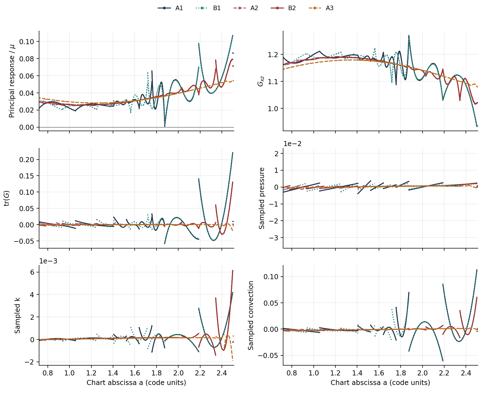

# WJ–EARSM/AWF paired axial convergence at \(g=.0024\)

**D. SPATIAL_ADMISSIBILITY_UNRESOLVED.** Two independently audited axial pairs reach the original fixed-height equations. Family A also reaches an independently admissible 5,238-cell root. The between-family gap contracts sharply at level two on the fixed core. The measured within-family changes still exceed the prescribed limit.

The prescribed chart, \(0.096\) mm hill, \(H=.15\), \(d_0=.0875\), exact reference \(h=.11541061001735275\), molecular viscosity and \(\eta=0\) were held fixed. The model retained the original stress, three-dimensional deviatoric strain, transported scalars, dependent \(\epsilon_H(K)\), finite-viscosity inlet and `ZeroTransverseV1` outlet. The positive 864-cell result at \(g=.0032\), or \(0.128\) mm, retains its representation-specific scope. The inherited disturbed release reached \(t=.06\) at \(g=.003\). This campaign advanced zero physical time. The 40 mm pilot and C2 remain pending.

## Controls and comparison

The archived A0 and B0 sessions correspond to `Mref-rich` and `Mshift-ref-rich` in the R4 campaign. Their bytes and signed coefficient digests matched the pinned identities. Rebuilt essential and dependent lifts reproduced both coefficient hashes exactly. Fresh native 16×24 replays and independent order-28 equation, face and local direction checks reproduced both admissions. B0's limiting response was in the outer region, with inner-support response of about \(+.004929\). The manifest gives the exact limiting owner and coordinates.

The frozen R4 core has 2,175 chart coordinates in \([.875,2.5]\) and \(|r-h|\le .0015\), with four signed approaches per point. Its digest is `73c264cf3d237311049fec71f07c32fa44a5b38c2cd2cd308c85103c9f62ab98`. The evaluator selects each owner on its own mesh and compares Cartesian positions before comparing fields. Coincident limits at numerical roundoff keep separate polynomial gradients. The coverage dataset adds both meshes' faces, the wider downstream strip and cell-relative offsets. Independently detected outer or off-core minima have separate physical patches evaluated on every retained root. Coverage extents are sampled spans.

The R4 replay recovered \(d_{AB,0}=.03868827439139451\), maximum \(G_{xz}\) difference `.13669091414769152` and maximum strong divergence difference `.06626143662171902`. The frozen magnitude scales for \(\|G\|_F\), total load, pressure, \(k\) and convection are respectively `1.2754046893967808`, `.05138392826581355`, `.009427764905870066`, `.002276238708280367` and `.05353939724280634`. Identical-coefficient re-evaluation and archived-profile replay give empirical noise floors. The largest archived-method discrepancy among the tracked quantities is \(5.681\times10^{-12}\). Angular uncertainty is carried separately.

The buffered interval covers the common envelope \([0,15]\). The immediate downstream parent interval extends to the outlet. Each level bisects all axial intervals in that entire envelope through complete radial columns. The two distinct radial token inventories are copied directly from the parent XML. Matching and hill-foot faces and all prior axial cuts are preserved. Exact axes and signed unknown inventories are in the manifest.

| Level | Axial columns | Cells per family | A core widths | B core widths | A free unknowns | B free unknowns |
| --- | --- | --- | --- | --- | --- | --- |
| 0 | 12 | 1164 | 0.234375–0.703125 | 0.3125–0.625 | 38821 | 38821 |
| 1 | 18 | 1746 | 0.1171875–0.3515625 | 0.15625–0.3125 | 58279 | 58279 |
| 2 | 30 | 2910 | 0.05859375–0.1757812 | 0.078125–0.15625 | 97195 | 97195 |

The trial spaces are Q3 for velocity and scalars and Q2 for pressure, with 12×12 GLL expansion quadrature. Steady solves use the original residual and the existing `ColoredSparseV1` inverse reuse (maximum age 4 and at most 12 iterations with a reused inverse). Native split integration starts at 10×16 and decision packets are freshly checked at 16×24. The separate sampled pressure/\(k\) action uses fixed Gauss order 16. The R4 expansion-quadrature order-18 construction assertion remains outside the validated replay scope.

## Original equations and admissibility

| Case | Native max | Independent original blocks | Projected trace defect | Sampled response lower | Whole K/Kin | Admission on this mesh |
| --- | --- | --- | --- | --- | --- | --- |
| A0 | 6.200e-11 | 7.287e-13 / 8.526e-15 / 6.247e-11 / 4.282e-11 | 3.682e-16 | +0.00303772 | [0.970724, 1.028977] | QUALIFIED |
| B0 | 4.136e-11 | 4.110e-13 / 1.157e-15 / 4.168e-11 / 1.338e-12 | 3.747e-16 | +0.00329416 | [0.969633, 1.023512] | QUALIFIED |
| A1 | 6.924e-11 | 1.731e-11 / 5.653e-15 / 6.938e-11 / 4.417e-11 | 3.470e-16 | +0.000801433 | [0.950953, 1.022780] | QUALIFIED |
| B1 | 7.119e-11 | 1.684e-11 / 3.763e-15 / 7.139e-11 / 6.085e-11 | 4.750e-16 | +0.00291264 | [0.949935, 1.023828] | QUALIFIED |
| A2 | 1.047e-11 | 1.305e-12 / 4.823e-15 / 1.166e-11 / 3.928e-12 | 4.070e-16 | +0.0039778 | [0.961189, 1.015316] | QUALIFIED |
| B2 | 1.729e-11 | 1.141e-12 / 4.285e-15 / 1.803e-11 / 1.225e-11 | 4.375e-16 | +0.00397787 | [0.962187, 1.014947] | QUALIFIED |

The independent columns are ordered momentum, continuity, \(k\), outer \(\epsilon\). Their limits are \(10^{-9},10^{-9},10^{-8},10^{-8}\), with native maximum and projected trace limits of \(10^{-10}\). The manifest separates pointwise \(\epsilon_H\) representation from its projected residual. It records whole-cell scalar lower bounds, covariance, whole-face table coverage, chart and outlet checks, matching and inner-layer balances, weak power and raw one-sided flux defects. Integrated wall-force differences remain separate from the support derivative comparison.

## Fixed core and coverage

| Comparison | Response | Response maximizer (a,r) | Full gradient | Gxz | Divergence | Total load | Pressure | Sampled k | Convection |
| --- | --- | --- | --- | --- | --- | --- | --- | --- | --- |
| Aprev/A0 | 0.0444415 | (1.640625, 0.11541061) | 0.163754 | 0.161189 | 0.0518795 | 0.0323913 | 0.00925756 | 0.0014655 | 0.0267027 |
| Bprev/B0 | 0.046882 | (1.5625, 0.11541061) | 0.167238 | 0.165806 | 0.0463976 | 0.0272468 | 0.00629516 | 0.00128678 | 0.0265969 |
| A0/B0 | 0.0386883 | (1.640625, 0.11541061) | 0.143683 | 0.136691 | 0.0662614 | 0.0326011 | 0.010783 | 0.00103073 | 0.0410092 |
| A0/A1 | 0.0598621 | (2.1875, 0.11541061) | 0.210326 | 0.133181 | 0.17147 | 0.123715 | 0.0060458 | 0.00301555 | 0.123197 |
| B0/B1 | 0.0571881 | (2.1875, 0.11541061) | 0.212838 | 0.133281 | 0.17375 | 0.0970203 | 0.00382514 | 0.00297124 | 0.0973948 |
| A1/B1 | 0.0368667 | (1.7598684, 0.11541061) | 0.116537 | 0.101764 | 0.0443448 | 0.0384347 | 0.00318621 | 0.00112608 | 0.0401991 |
| A1/A2 | 0.060422 | (2.1875, 0.11541061) | 0.186664 | 0.116139 | 0.15108 | 0.0990805 | 0.00319164 | 0.00346564 | 0.0955331 |
| B1/B2 | 0.0603594 | (2.1875, 0.11541061) | 0.184412 | 0.116347 | 0.148043 | 0.0978681 | 0.00224854 | 0.00345909 | 0.0940103 |
| A2/B2 | 0.00136358 | (0.9375, 0.11691061) | 0.00776574 | 0.00355613 | 0.0057984 | 0.0011761 | 0.00129925 | 8.39791e-05 | 0.00232494 |

Each maximum uses the same chart point and signed approach for both fields. The gradient column is \(\max\|G_1-G_2\|_F\), using all entries of the planar Cartesian block. The other components of the three-dimensional Cartesian gradient vanish for this two-dimensional field. Numerical locations include the physical coordinates, owner IDs and bounds, both values and differentiation uncertainty. The complete Linux receipts include the sampled quantities, pointwise jumps and supplementary patches.

The scalar tangential sampled load is

\[
\frac{1_{0<r<h}}{\ell(1+(d_0+H)\kappa)}
\left[\partial_a\Pi_H-\tfrac23\partial_a K+2u_{t,H}\partial_a u_{t,H}\right],
\]

where \(\ell\) and \(\kappa\) are the physical graph's stretch and signed curvature. The tangential velocity derivative includes frame rotation. The tables and figure track the matching-derived load amplitudes and their one-sided limits. The applied volume loads include the strict support indicator and switch off at \(h\). The closure response at \(h\) is full WJ with \(\chi=1\).



The latest coverage contains 24,766 common coordinates before cell-relative offsets. A2 has 0 negative upper-response owner samples. B2 has 0 negative upper-response owner samples. The smallest retained adjusted response was 0.0039778, which sets the threshold to 0.000759430545.

At level two the between-family response difference was 0.001363584 on the core and 0.009296148 on the wider set at `[0.17578124999999997, 0.10041061001735276]`. Empirical contraction ratios use only the fixed core.

The A2-to-A3 fixed response change was 0.02551944 at `[2.495, 0.11541061001735275]` with full-gradient change 0.1547524, strong-divergence change 0.1531381 and total load change 0.07350241. The wider response change was 0.02907807 at `[2.34375, 0.11541061001735275]`. Strong divergence remains sensitive despite the reduction in the fixed response difference. A3 has 0 negative upper-response owner samples on the wider set.

## Unchanged fine-grid operator diagnosis

A1 was selected because its independent face response was the smaller of the first two children. On the fixed strip the exact nested polynomial transfer changed the full gradient by about \(4\times10^{-12}\). Rebuilding essential and dependent lifts caused no resolved change there. The constrained continuity projection changed the full gradient by `.03908`, divergence by `.04765` and total sampled load by `.02307`. The completed original correction changed those quantities by `.20692`, `.15914` and `.13014` from the prepared seed. A0's transferred weak continuity residual fell from \(5.4245\times10^{-4}\) to \(6.3233\times10^{-13}\) under fine-grid projection. The final A1 continuity residual was \(5.254\times10^{-15}\). A large strong divergence difference persists after imposing the weak constraint.

The opt-in native probe evaluates \(F_f(PX_c)\) and \(F_f(X_f)\) with the original terms and dependent trace reconstruction. It calls the current unshifted native directional probe on \(\delta X=X_f-PX_c\) at the solved root, using four central spacings. It separates \(G_h\), \(-C_\Pi\), sampled \(k\), sampled convection, local advection, constitutive momentum, continuity and both scalar equations. The termwise sum closes the original prepared momentum residual below \(2\times10^{-18}\) in the native norm.

| Case | Native block norm | Momentum | Continuity | k | Outer epsilon |
| --- | --- | --- | --- | --- | --- |
| A1 | Prepared F0 | 2.015e-04 | 6.323e-13 | 3.446e-03 | 1.175e-03 |
| A1 | Current J0 action | 2.023e-04 | 3.650e-10 | 3.459e-03 | 3.229e-03 |
| A1 | Finite transfer remainder | 1.123e-05 | 3.650e-10 | 6.531e-04 | 3.013e-03 |
| A1 | Finest halving change | 5.241e-09 | 4.415e-10 | 1.019e-06 | 7.317e-09 |
| B1 | Prepared F0 | 1.922e-04 | 8.326e-13 | 3.129e-03 | 1.106e-03 |
| B1 | Current J0 action | 1.925e-04 | 3.028e-10 | 3.153e-03 | 2.748e-03 |
| B1 | Finite transfer remainder | 9.081e-06 | 3.028e-10 | 5.158e-04 | 2.522e-03 |
| B1 | Finest halving change | 4.370e-09 | 3.278e-10 | 5.083e-07 | 5.762e-09 |
| A2 | Prepared F0 | 2.989e-04 | 2.421e-12 | 9.646e-03 | 2.289e-03 |
| A2 | Current J0 action | 2.978e-04 | 5.120e-10 | 9.758e-03 | 2.297e-03 |
| A2 | Finite transfer remainder | 9.408e-06 | 5.120e-10 | 7.052e-04 | 2.788e-04 |
| A2 | Finest halving change | 5.437e-09 | 5.489e-10 | 4.334e-07 | 7.437e-09 |

At A1, the norms of the momentum contributions to \(F_f(PX_c)-F_f(X_f)\) were \(2.6794\times10^{-4}\) for local advection, \(2.3561\times10^{-4}\) for sampled convection, \(1.8617\times10^{-4}\) for constitutive momentum, \(1.6097\times10^{-4}\) for ordinary pressure, \(6.7175\times10^{-5}\) for sampled pressure and \(1.6141\times10^{-5}\) for sampled \(k\). These are norms of signed row vectors, with cancellation in their sum. Exact linear continuity closure was \(7.64\times10^{-16}\), identifying cancellation in the tiny-step finite-difference continuity remainder. Pressure coupling remains in the mixed operator.

The independent signed order-28 rows agreed with native sampled pressure, \(k\), and convection to \(2.28\times10^{-20}\), \(4.55\times10^{-20}\), and \(1.82\times10^{-19}\) in maximum absolute row difference on A1. The direct and assembled current-action checks also completed. The outer \(\epsilon\) Taylor remainder was 2.56 times the prepared residual on A1 and 2.28 times on B1. The empirical linear-attribution criterion is 0.1 of each material block residual. The complete transfer exceeds that criterion, so the two optional linear transfer-correction solves were unnecessary. No sampled-action sign or integration discrepancy of this scale was observed on the checked representation.

On A2 the nested transfer reproduced the parent gradient to \(3.08\times10^{-12}\). The gradient difference was \(.11643\) from continuity projection and \(.18549\) from the prepared state to the solved child. The exact linear continuity closure was \(1.59\times10^{-15}\). The outer \(\epsilon\) remainder fell to 12.2% of that block's prepared residual and still exceeded the attribution criterion. On this child the signed sampled pressure, \(k\) and convection row discrepancies were \(1.42\times10^{-20}\), \(3.49\times10^{-20}\) and \(3.66\times10^{-19}\).

## Attempts and cost

| Case | Base native s | Independent audit sum s | Case process sum s | Base native peak GiB | Newton corrections | Factor builds |
| --- | --- | --- | --- | --- | --- | --- |
| A0 | 28.17 | 327.77 | 355.94 | 0.970 | 0 | 0 |
| B0 | 28.37 | 330.20 | 358.57 | 0.970 | 0 | 0 |
| A1 | 429.20 | 468.45 | 999.64 | 2.135 | 5 | 1 |
| B1 | 426.78 | 466.98 | 957.76 | 2.131 | 5 | 1 |
| A2 | 720.09 | 800.97 | 1623.98 | 3.847 | 4 | 1 |
| B2 | 700.80 | 810.36 | 1613.38 | 3.859 | 4 | 1 |

Linux elapsed time was 7177 s against the 7,200 s allocation. Measured native process wall sum was 8100.94 s and other timed work totalled 5515.52 s.

A3 took 1308.91 s native with peak RSS 7.885 GiB. Its richer native maximum was 4.983e-11, independent maximum 5.009e-11, projected trace defect 5.096e-16 and smallest admitted sampled margin +0.003979655.

The first B3 arm used 2025.68 s, with five accepted corrections to a logged residual of `6.18235734185e-4` and a native principal margin of `+.0040089776`. The outer cap returned 124 during second inverse preparation and expired before final candidate and ledger serialization. The run input, prepared seed, stdout and cost survive. The last logged iterate has no coefficient packet.

The alternate B3 arm imports the A3-rich field with the existing same-chart nonnested projection on the same B3 mesh. The current continuity equation participates in the full solve. This preparation began at `3.78445816819e-4`. The wrapper reserved 175 s for startup, factor exit and serialization. The run used 1317.25 s, reached 0.000175745 and returned `NEWTON_NOT_CONVERGED: declared Newton iteration bound exhausted`. The last accepted coefficients have a separate bound packet.

The matched 16×24 pending replay took 101.26 s and reproduced the coefficient digest. The largest change among original block residual norms was 8.138e-13. The replay maximum remained 0.000175745, so the candidate remains unconverged under the richer rule. The campaign ended within the original allocation.

The process-wall sum includes concurrent work. Native wall cost includes construction, rejected work and output according to the stage ledger. Each solver and audit lane used one numerical-library thread. The isolated builds used eight compiler workers after inspecting the shared host. The original production criterion remains \(1.25 C_{\rm total}\le86400\) wall seconds per qualified trajectory.

## Reproduction and identities

The exact runner scripts, parent XML and packets, table, signed inventories and receipts are listed by absolute Linux path and SHA-256 in the [evidence manifest](wj-h27-c1-paired-axial-convergence-evidence.json). The runner selects a new directory per stage and rejects existing scientific outputs. Reproduce in a fresh run directory with the identified scripts and pinned archive inputs.

```bash
ssh jay@100.88.70.60
WJ_WORK=/media/jay/cb7dc460-f22f-4533-8329-245d10620f47/nektar-v2026-workspace
source "$WJ_WORK/env.sh"
WJ_RUN="$WJ_WORK/runs/wj-c1-paired-axial.UXeQ6Noe"
export OMP_NUM_THREADS=1 OPENBLAS_NUM_THREADS=1 MKL_NUM_THREADS=1
export NUMEXPR_NUM_THREADS=1 BLIS_NUM_THREADS=1 VECLIB_MAXIMUM_THREADS=1
WJ_REPLAY=$(mktemp -d "$WJ_WORK/runs/wj-c1-paired-replay.XXXXXXXX")
cd "$WJ_REPLAY"
mkdir tmp profiles-tree transfer-analysis-tree
date +%s > start-epoch
cp "$WJ_RUN"/{paired-run.sh,profiles.sh,build-audit.sh,transfer-audit-run.sh,build-signed-audit.sh,finish-level-two.sh,next-transfer.sh,paired-later-run.sh,profiles-later.sh,try-B3-cross.sh,complete-A3-profile.sh,check-B3-pending-rule.sh,audit-7f9f3af.bundle,audit-v2.bundle} .
git clone --no-hardlinks "$WJ_RUN/audit-source" grid-source
git -C grid-source checkout --detach f16906d74a5e28706152a94ef432292ed6126ffb
git clone --no-hardlinks "$WJ_RUN/audit-source" audit-source
tar -xf "$WJ_RUN/profile-7e8cd.tar" -C profiles-tree
tar -xf "$WJ_RUN/transfer-analysis-9680e07d.tar" -C transfer-analysis-tree
bash paired-run.sh initialize
bash paired-run.sh A0 &
bash paired-run.sh B0 &
wait
bash paired-run.sh A1 A0 1380 830 550 &
bash paired-run.sh B1 B0 1380 830 550 &
bash profiles.sh baseline
wait
bash profiles.sh 1
bash build-audit.sh
bash transfer-audit-run.sh A1
bash transfer-audit-run.sh B1
bash build-signed-audit.sh
bash finish-level-two.sh signed-guard
bash paired-run.sh A2 A1 1750 900 1000 &
bash paired-run.sh B2 B1 1750 900 1000 &
wait
bash finish-level-two.sh compare-level-two
bash next-transfer.sh
bash paired-later-run.sh A3 A2 1980 650 1450 &
bash paired-later-run.sh B3 B2 1980 650 1450 &
wait
bash try-B3-cross.sh &
bash complete-A3-profile.sh
wait
bash check-B3-pending-rule.sh
```

The decision roots use tested revision `b8f1bba6c50a1e85a89c8c70dfcc29b0e44d4cf6` and executable SHA-256 `60be1637c75f7d2a701f2082dd38b770bec0d37d52cc2296d76b804f14ebc66b`. Its source fingerprint is `104bcf1f3169a590d99e18d477aea4db7f2547d469fcde1340a3764c7e11da01`. The table SHA-256 is `3eeb32e6c1f53d6045d9d03707344c65f0f1ec3964dc69116a87e04e104325e1`. The opt-in diagnostic replays used later clean Release revisions. Native root, current-action and transfer comparisons verified their scope at fixed geometry. The publication commits add compact evidence and a remote verification receipt.

The transfer diagnostic was built in isolated Release trees. The first diagnostic revision was `7f9f3af7f03bff3440292549f61b936d6b7d4be5`, executable SHA-256 `5991b5942e92e7dc44250c8a9a1c0dffa8f365984b52a272a96094dd467d41e7`. The signed-action diagnostic used `758525be643327cf00c9ff88ad3ed140c78b613c`, executable SHA-256 `de73ecacd71b1976c3a42fef7f627bdcfd9fd323ecb40aa2af974b59ff130d24` and kernel fingerprint `fd9b02186e9e5333b3b3258e07557361e9b34d25acb6fae8545b3d7d12b993b6`. The two focused helper regressions passed on this clean Linux checkout. A single-field digest corruption returned an error before transfer evidence was emitted, after reproducing the same original residuals.

## Gate decision

| Gate | Status | Scope |
| --- | --- | --- |
| `PARENT_PAIR_REPRODUCED` | PASS | The two 1,164-cell parents replayed with exact coefficient hashes and fresh receipts. |
| `FIXED_COMPARISON_METRIC_VERIFIED` | PASS | The R4 values were reproduced on 2,175 chart coordinates and four separate approaches. |
| `PAIRED_AXIAL_LEVEL_ONE_CONVERGED` | PASS | Both 1,746-cell original roots passed independent admission. |
| `PAIRED_AXIAL_LEVEL_TWO_CONVERGED` | PASS | Both 2,910-cell original roots passed independent admission. |
| `WITHIN_AND_BETWEEN_FAMILY_STABILITY_MEASURED` | PASS | Fixed-core, coverage and off-core patch metrics for the completed pairs. |
| `POSITIVE_ORIGINAL_ANCHOR_RESOLUTION_SUPPORTED` | OPEN | Within-family response and derivative-field changes exceed the prescribed criterion. |
| `ADVERSE_ORIGINAL_BRANCH_RESOLUTION_SUPPORTED` | OPEN | A shared, resolved negative region has yet to be established. |
| `UNCHANGED_OPERATOR_DIAGNOSIS_COMPLETE` | PASS | Transfer stages, current unshifted J0, exact weak continuity and independently signed sampled terms verified. The finite Taylor remainder precludes a small linear attribution. |
| `HEIGHT_CONTINUATION_RELEASED` | BLOCKED | The fixed-height spatial test still fails. |
| `FULL_HEIGHT_ORIGINAL_PHYSICAL_PILOT_PASSED` | OPEN | Current results are at g=.0024 and physical time zero. |
| `C1_CLOSED` | OPEN | Full-height admissible original pilot remains pending. |
| `C2_READY` | OPEN | C1 physical closure remains pending. |
| `LONG_FLAT_PRODUCTION_COST_CLOSED` | OPEN | These are steady diagnostic preparation costs. |
| `REMOTE_PUSH_VERIFIED` | PASS | Published evidence commit `e6a18145a8cb15807653051e028adaa64cd32b71` matched `git ls-remote origin refs/heads/codex/wj-earsm-awf`. |

The retained B3 packet is `B3-cross/state.diagnostic-steady.json`. Its SHA-256 is `bd5270047edfb1294ada7af01537d0aafd0301c9bbe52cab2f7a41206f4c3b5b` and its coefficient SHA-256 is `38b02cc97168d9e206069f30b1a2c80939260ac31a0c729a7cc646e08bae64a1`. Its original momentum, weak continuity, \(k\) and outer \(\epsilon\) residuals were respectively \(2.183\times10^{-5}\), \(1.716\times10^{-4}\), \(1.012\times10^{-4}\) and \(1.757\times10^{-4}\). The native principal response was \(+.00400910\), with whole-face \(K/K_{\rm in}\) in \([.9553447,1.0362653]\). This remains a diagnostic iterate.

All five current linear solves met their forcing targets. The accepted fractions were \(1/2,1/16,1/128,1/32,1/512\). The ledger records 16 actual-merit rejections, seven table rejections and three scalar-polynomial rejections. For the first feasible full step, the predicted norm was \(8.47\times10^{-8}\) and the actual norm \(6.28\times10^{-4}\). Outer-\(\epsilon\) diffusion dominated that remainder, at \(6.28\times10^{-4}\), with an overlapping dependent-lift contribution. The four owners of its dominant row meet at \(a=-6.25\), \(r\simeq.1523219\), close to the upstream matching region observed in the A3 patches. The finite-difference half-spacing difference in the same outer block was \(4.11\times10^{-9}\). The evidence identifies a nonlinear and feasibility limitation for this preparation. The first factor preparation took about 973 s. A useful second-factor continuation and its independent audits exceed the remaining allocation, and the A3 spatial decision remains open.

The next discriminating test is an exact B3 continuation on this same signed mesh with the existing original-residual model-based backtracking enabled. Compare the resulting feasible fractions and actual nonlinear reduction against the measured halving record at the same absolute residual targets. The reported source and standard solver support the following replay. A 2,600 s native allowance can accommodate two measured factors with time left for directional and globalization work. The outer 2,900 s cap includes construction and serialization. Keep a fresh accepted packet before the cap and qualify it with the original 16×24 and independent order-28 checks before adding it to the paired comparison.

```bash
WJ_RUN="$WJ_WORK/runs/wj-c1-paired-axial.UXeQ6Noe"
WJ_SUITE="$WJ_RUN/grid-source/solvers/IncNavierStokesSolver/Tests/RANS/h27"
WJ_NEXT=$(mktemp -d "$WJ_WORK/runs/wj-c1-b3-next.XXXXXXXX")
export TMPDIR="$WJ_NEXT"
export PYTHONPYCACHEPREFIX="$WJ_NEXT/pycache"
python3 "$WJ_SUITE/c1_steady_case.py" "$WJ_RUN/B3-cross/run.xml" "$WJ_NEXT/solve" \
    --seed "$WJ_RUN/B3-cross/state.diagnostic-steady.json" \
    --eta 0 --quadrature 10 16 --seconds 2600 --newton 12 \
    --inverse ColoredSparseV1 --maximum-inverse-age 4 --reuse-linear-iterations 12 \
    --direction-model --globalization ModelBacktrackV1
bash "$WJ_WORK/runs/wj-c1-steady-recovery.LOp8mfob/run-capped.sh" "$WJ_NEXT/solve" \
    "$WJ_WORK/runs/wj-c1-support-spatial.W5us9Je8/owner-build/IncNavierStokesSolver" 2900
```

Height continuation remains held. The next spatial comparison uses the completed B3 and the existing A3 at \(g=.0024\), through the same fixed core, coverage and supplementary patches.
